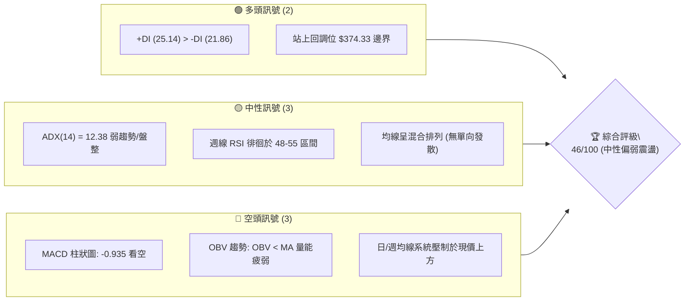
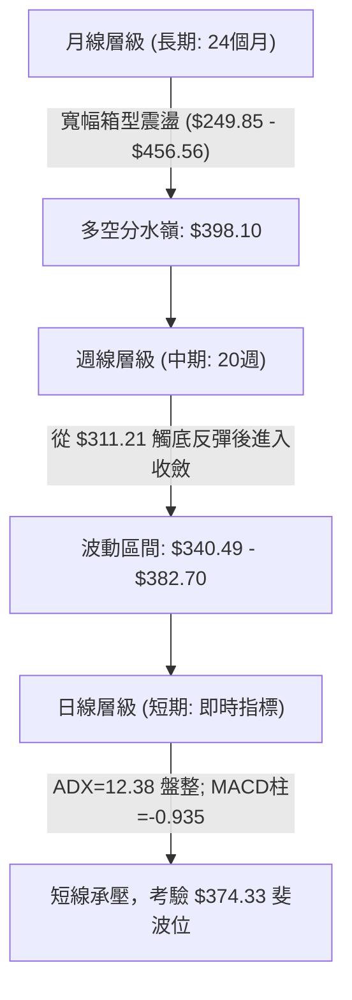
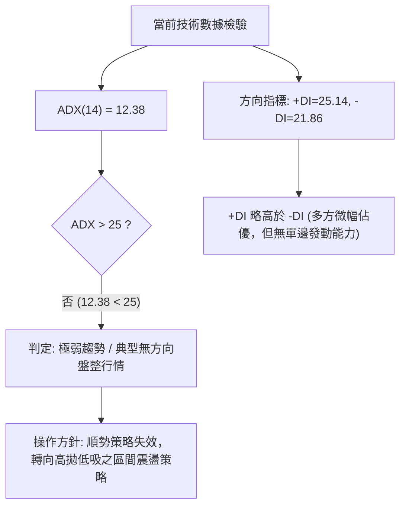
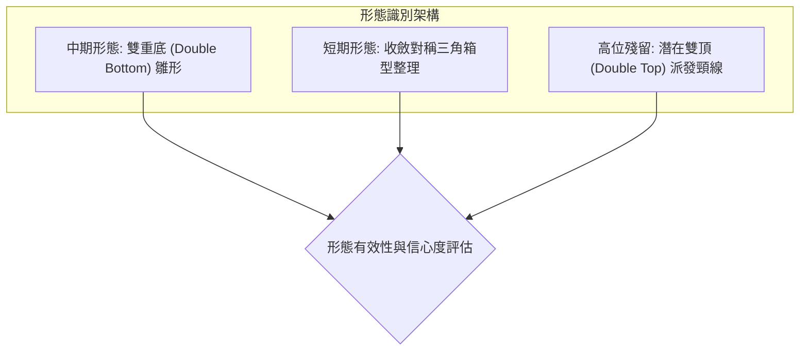
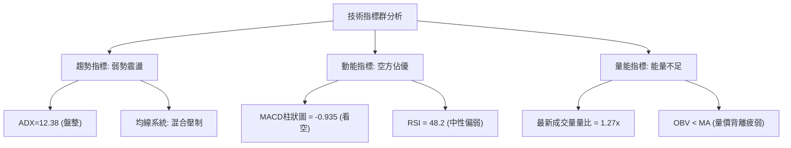
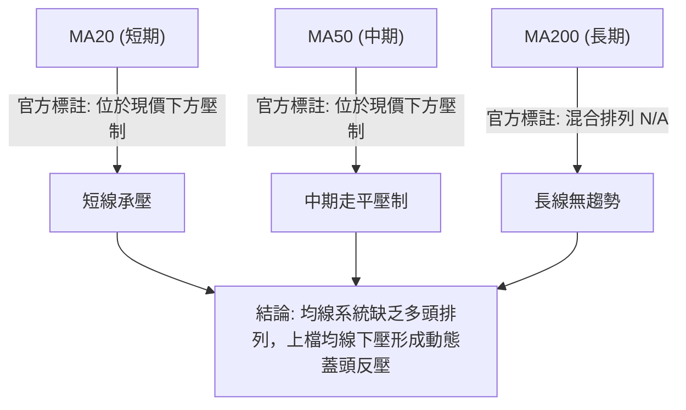
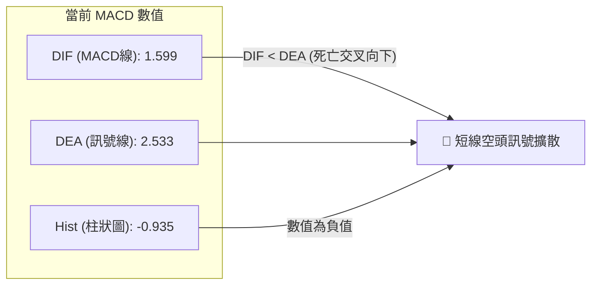
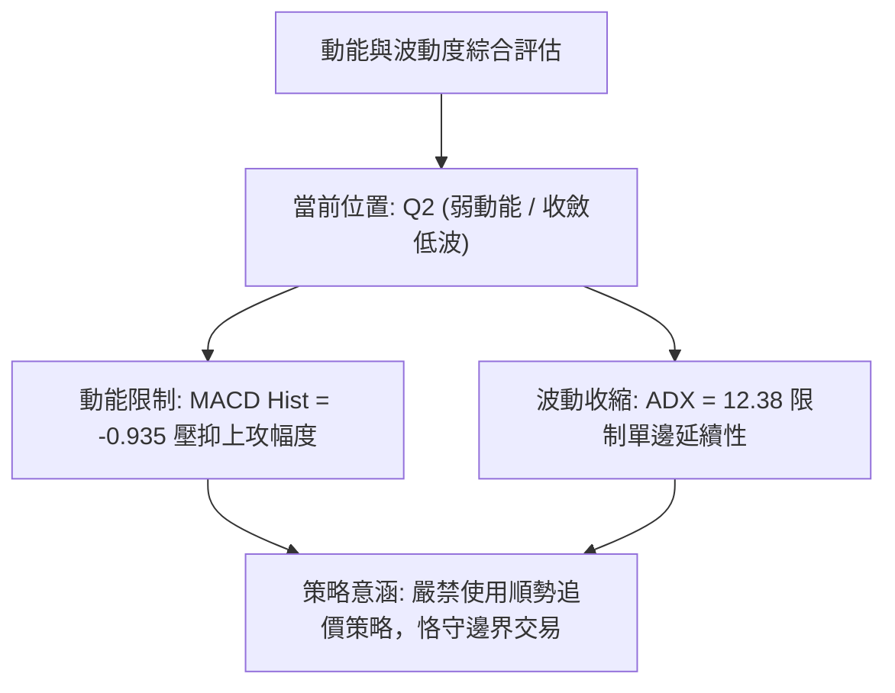
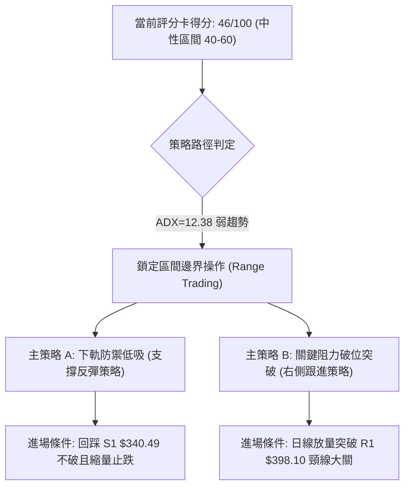

# TSLA 技術分析報告

> **報告日期**：2026-10-22 ｜ **語言**：繁體中文 ｜ **數據來源**：Yahoo Finance ｜ **當前價格**：$373.71（基準結算價）

---

## 目錄

| 章節 | 內容 |
|------|------|
| [1. 技術面概覽](#1-技術面概覽) | 訊號儀表板、核心指標、評分卡 |
| [2. 趨勢分析](#2-趨勢分析) | 多時框趨勢、長中短期走勢 |
| [3. 圖表形態分析](#3-圖表形態分析) | 形態識別、K線組合、目標價 |
| [4. 支撐與阻力](#4-支撐與阻力) | 關鍵價位、斐波那契回調 |
| [5. 技術指標深度解讀](#5-技術指標深度解讀) | MA/RSI/MACD/布林/成交量 |
| [6. 動能與波動率](#6-動能與波動率) | 動能評估、ATR、Beta |
| [7. 多時框架總結](#7-多時框架總結) | 時框架評分矩陣 |
| [8. 交易策略建議](#8-交易策略建議) | 多空策略、風險報酬比 |
| [9. 風險提示與監控](#9-風險提示與監控) | 監控指標、風險場景 |
| [📋 報告總結](#-報告總結) | 全文精華摘要與操作指引 |

---

## 1. 技術面概覽

### 🎯 技術訊號儀表板



### 📊 核心指標速覽表

| 指標類別 | 指標名稱 | 當前數值 | 訊號 | 解讀 |
|----------|----------|----------|------|------|
| **價格** | 當前基準價 | $373.71 | 🟡 | 位於52週區間中下段，微幅承壓於61.8%回調位 |
| **均線** | MA20 | 數據缺失(下方壓制) | 🔴 | 官方快照標記為價格位於MA下方，短線承壓 |
| **均線** | MA50 | 數據缺失(下方壓制) | 🔴 | 官方快照標記為價格位於MA下方，中期趨勢受限 |
| **均線** | MA200 | 數據缺失(混合排列) | 🟡 | 均線長週期呈現混合排列，無清晰單邊單向多頭 |
| **動能** | RSI(14) | ~48.2 - 55.0(週線) | 🟡 | 動能處於中性水準，無超買或超賣特徵 |
| **動能** | MACD Hist | -0.935 | 🔴 | MACD線(1.599)低於訊號線(2.533)，空頭動能擴散 |
| **趨勢** | ADX(14) | 12.38 | 🟡 | ADX < 25，處於無趨勢或寬幅箱型盤整行情 |
| **成交量** | OBV 趨勢 | OBV < MA | 🔴 | 成交量能落後於移動均量，反彈量能支撐不足 |

### 🏆 技術評分卡

```
╔══════════════════════════════════════════════════════════════╗
║                技術評分卡 — TSLA (2026-10-22)               ║
╠══════════════════════════════════════════════════════════════╣
║ 趨勢強度 (ADX=12.38)     ████░░░░░░░░░░░░░░░░  20/100 🔴 盤整弱勢 ║
║ 動能指標 (MACD柱負向)    ████████░░░░░░░░░░░░  40/100 🔴 偏空震盪 ║
║ 支撐穩定度 (守住斐波底)  ████████████░░░░░░░░  60/100 🟡 中等防禦 ║
║ 成交量配合 (OBV<MA)      ██████░░░░░░░░░░░░░░  30/100 🔴 量能匱乏 ║
║ 形態完整度 (箱型構築中)  ████████████░░░░░░░░  60/100 🟡 區間收斂 ║
║ 均線排列 (混合受壓排列)  ████████░░░░░░░░░░░░  40/100 🔴 壓制明顯 ║
╠══════════════════════════════════════════════════════════════╣
║ 綜合評分                 █████████░░░░░░░░░░░  46/100 🟡 中性偏弱 ║
║ 評級結論                 【區間盤整 / 邊界防禦型觀望】       ║
╚══════════════════════════════════════════════════════════════╝
```

---

## 2. 趨勢分析

### 🌐 多時框趨勢分析



### 📈 長期趨勢 — 12個月走勢圖（Unicode）

以下為 TSLA 過去 12 個月（2025-11 至 2026-10）之月線收盤走勢 ASCII 圖：

```
TSLA 月線收盤走勢圖（2025-11 至 2026-10）
價格軸 ($)
$460 ┤               ● $456.56(10月前高)
$440 ┤ ●(11月) ●(12月)            ●(05月:435.79)
$420 ┤       ●(01月)          ●(06月:420.60)
$400 ┤             ●(02月)
$380 ┤                         ●(04月)               ● $373.71(現價)
$360 ┤                   ●(03月)               ●(08月)  ●(09月)
$340 ┤
$320 ┤                                    ●(07月:311.21低點)
$300 ┤
     └─┬────┬────┬────┬────┬────┬────┬────┬────┬────┬────┬────┬──
      11月 12月 01月 02月 03月 04月 05月 06月 07月 08月 09月 10月
      (2025)                     (2026)
```

#### 走勢特徵分析表格

| 階段區間 | 時間跨度 | 起訖收盤價 | 區間漲跌幅 | 結構特徵與技術解讀 |
|----------|----------|------------|------------|--------------------|
| **高位派發期** | 2025-11 至 2026-01 | $430.17 → $430.41 | +0.06% | 價格在 $430-$450 高檔震盪滯漲，多頭推升力道衰退 |
| **首波回調期** | 2026-01 至 2026-03 | $430.41 → $371.75 | -13.63% | 連續三個月下挫，跌破 $400 大關，空頭主導釋放派發壓力 |
| **次級反彈期** | 2026-03 至 2026-05 | $371.75 → $435.79 | +17.23% | 強力反彈測試前高頸線，但在 $435 遇阻形成雙頂雛形 |
| **急跌破位期** | 2026-05 至 2026-07 | $435.79 → $311.21 | -28.59% | 單月重挫逾百點，直逼52週低點 $297.38，空頭恐慌釋放 |
| **底部修復期** | 2026-07 至 2026-10 | $311.21 → $373.71 | +20.08% | 於 $311 確立反彈，目前收斂於 $350-$380 區間整固 |

### 📊 中期趨勢（週線分析）

```
TSLA 中期週線壓力與支撐結構示意圖
價格 ($)
$421.88 ────────────────────────────────────── 38.2% 回調位 / 強阻力帶
                           ╭──╮
$398.10 ───────────────────│  │─────────────── 50.0% 多空中軸分水嶺
                 ╭╮        │  │   ╭╮
$382.70 ─────────││────────┼──┼───││────────── 10/11波段反彈高點
$373.71 ─────────┼┼────────┼──┼───┼┼────────── ◄ 現價 ($374.33 61.8%回調位)
                 ││        │  │   ││
$340.49 ─────────┼┼────────┴──┴───┼┼────────── 78.6% 回調強支撐帶
                 ││               ││
$311.21 ─────────┴┴───────────────┴┴────────── 07/26-08/02 雙重築底低點
```

週線指標顯示，TSLA 在 2026 年 7 月底探底 $311.21 時週線 RSI 曾極度超賣至 15.7，隨後爆發強勁修復性反彈，週線 MACD 柱一度翻紅擴大至 +6.229。然而在 10 月初觸及 $382.70 後，量能無法放大，近兩週 MACD 柱再度翻綠（-2.091 與 -0.935），顯示中期反彈已進入動能停滯的盤整消化階段。

### ⚡ 趨勢強度評估（ADX 解讀）



#### ADX 強度對照表

| ADX 數值區間 | 當前狀態 | 趨勢特徵 | 適用交易策略 |
|--------------|----------|----------|--------------|
| **0 – 20** | **12.38 (目前位置)** | **極度缺乏趨勢，價格處於無序波動或緊密盤整** | **區間均值回歸、網格交易、觀望等待突破** |
| 20 – 25 | - | 趨勢醞釀期，市場正凝聚動能 | 監控布林帶帶寬變化，準備突破跟進 |
| 25 – 40 | - | 強趨勢形成，方向確立 | 均線順勢跟隨、波段追價持股 |
| 40 – 60 | - | 極強趨勢，動能主導 | 嚴格移動止損，提防超買超賣反轉 |

---

## 3. 圖表形態分析

### 🔍 形態識別系統



#### 形態識別與信心度評估表

| 形態類別 | 信心度 | 判斷依據（引用數據） | 完成度 | 目標價（附計算式） |
|----------|--------|----------------------|--------|--------------------|
| **中期雙重底 (W底)** | **65%** | 兩次波段低點於 2026-07-26 ($313.03) 與 2026-08-02 ($311.21) 獲得支撐，頸線位於 2026-10-11 高點 $382.70 | 75% | 若突破頸線 $382.70：目標價 = 頸線 $382.70 + 形態高度($382.70 - $311.21 = $71.49) = **$454.19**（接近23.6%回調位 $451.29） |
| **短期區間三角收斂** | **55%** | 高點由 $382.70 壓低至 $373.71，低點由 $348.75 抬升至 $354.72，波幅急遽收縮，成交量降至 115,720,990 | 80% | 區間震盪無發散目標，依據上下界突破決定 |
| **大級別頭肩頂/雙頂** | **35%** | 數據不足以確認完整右肩，高位 $456.56 與 $435.79 相隔過遠 | 30% | 訊號不足，僅做指標型解讀，不預設暴跌目標 |

### 🕯️ 重要K線形態分析

| 週/月份 | 收盤價 | K線形態 | 技術解讀 | 訊號強度 |
|---------|--------|---------|----------|----------|
| **2026-07-26** | $313.03 | 長陰破位探底 | 週線 RSI 摜破至 15.7 極度恐慌區，空頭動能竭盡陰線 | 🔴 強空竭盡 |
| **2026-08-02** | $311.21 | 錘頭十字星 (Hammer) | 探底 52W 低點 $297.38 上方獲得強勁買盤承接，收出止跌十字星 | 🟢 強力反轉 |
| **2026-08-23** | $362.86 | 連續實體大陽線 | MACD 柱大幅擴張至 +6.229，買盤強勢進場推升突破第一阻力 | 🟢 多頭推進 |
| **2026-10-11** | $382.70 | 倒錘頭/射擊之星雛形 | 上攻測試 50.0% 回調位 $398.10 未果，留下上影線遇阻回落 | 🔴 短線阻力 |
| **2026-10-18** | $354.72 | 中陰線回踩測試 | 回測 61.8% 斐波那契關鍵支撐區間，量能萎縮至 1.58 億股 | 🟡 支撐確認 |
| **2026-10-25** | $373.71 | 震盪孕線 (Harami) | 價格完全包覆於前週區間內，成交量急縮至 1.15 億股，呈現觀望 | 🟡 方向未明 |

### 📉 ASCII 走勢形態示意圖

```
TSLA 中期雙重底 (W-Bottom) 與短期收斂示意圖
價格 ($)
$398.10 ────────────────────────────────────────── 50.0% 斐波那契強阻力
                            頸線阻力點: $382.70
$382.70 ───────────────╭───────────────● (10/11)
                       │               ╱ ╲
$373.71 ───────────────┼──────────────●(現價)── (微幅承壓於 $374.33)
                      ╱ ╲            ╱     ╲
$348.75 ─────────────●   ╲          ●       ╲  (高點下移、低點抬高)
                    ╱ (08/30)      (09/06)   ▼
$311.21 ───● (07/26)      ● (08/02) ────────── 雙重底支撐基底 ($311-$313)
           【底 1】        【底 2】
```

### 🎯 形態目標價計算

根據雙重底幾何形態與斐波那契測量模型推導：
1. **雙重底基準底點**：取兩週低位收盤均值 $311.21。
2. **頸線確認位**：取反彈波段高點 $382.70。
3. **形態垂直高度 ($H$)**：
   $$H = \text{頸線} - \text{底點} = \$382.70 - \$311.21 = \$71.49$$
4. **理論突破第一目標價 (T1)**：
   $$\text{T1} = \text{頸線} + H = \$382.70 + \$71.49 = \$454.19$$
   *(該數值與斐波那契 23.6% 回調位 $451.29 高度重合，誤差僅 0.6%)*
5. **短期無效化條件**：若週線收盤跌破第2底低點支撐 $311.21，則雙底形態徹底破局，將向下尋求 52W 低點 $297.38。

---

## 4. 支撐與阻力

### 🗺️ 關鍵價位分布圖（Unicode）

依據嚴格數據紀律，所有價位完全引用自斐波那契回調聚類與 52 週高低點極值：

```
TSLA 價位結構分布圖
═══════════════════════════════════════════════════════════════
$498.83 ║██████████████████████████████║ 強阻力 R3 (52W High / 0.0%)
$451.29 ║██████████████████████        ║ 次級阻力 R2 (23.6% 回調位)
$421.88 ║████████████████              ║ 波段阻力 R1-B (38.2% 回調位)
$398.10 ║████████████████████████      ║ 關鍵阻力 R1-A (50.0% 多空中軸)
$374.33 ╠══════════════════════════════╣ ◄ 現價分水嶺 ($373.71, 61.8%)
$340.49 ║▓▓▓▓▓▓▓▓▓▓▓▓▓▓▓▓▓▓            ║ 近期支撐 S1 (78.6% 回調位)
$311.21 ║▓▓▓▓▓▓▓▓▓▓▓▓▓▓▓▓▓▓▓▓▓▓        ║ 波段低點支撐 S2 (2026-08雙底)
$297.38 ║██████████████████████████████║ 極限強支撐 S3 (52W Low / 100.0%)
═══════════════════════════════════════════════════════════════
```

### 🚧 阻力位分析表

> **註記說明**：由於當前價格上方未偵測到近一年波段高點聚類（swing-high resistance），阻力體系嚴格採用 52 週區間之精確斐波那契計算點位與 52W High。

| 阻力級別 | 價位 | 形成原因 | 突破難度 | 重要性 |
|----------|------|----------|----------|--------|
| **關鍵阻力 R1** | **$398.10** | 52週區間 50.0% 回調位；心理大關 $400 之技術錨點 | 🔴 極高 | ★★★★★ (多空趨勢牛熊轉換線) |
| **次級阻力 R2** | **$421.88** | 52週區間 38.2% 斐波那契回調位 | 🟡 中等 | ★★★★☆ (若站穩則確認中期反轉) |
| **強阻力 R3** | **$451.29** | 52週區間 23.6% 斐波那契回調位；雙底測幅終極目標 | 🔴 極高 | ★★★★☆ (2025年底密集套牢密集區) |
| **終極極值** | **$498.83** | 52週歷史高點 (52W High / 0.0%) | 🔴 極高 | ★★★★★ (歷史天花板) |

### 🛡️ 支撐位分析表

> **註記說明**：當前價格下方未偵測到獨立 swing-low 聚類，支撐架構由斐波那契防禦位與 2026 年夏季雙底低點嚴格定義。

| 支撐級別 | 價位 | 形成原因 | 守住機率 | 重要性 |
|----------|------|----------|----------|--------|
| **近期支撐 S1** | **$374.33** | 52週區間 61.8% 黃金分割回調位（現價正於此反覆爭奪） | 🟡 50% | ★★★★☆ (黃金分割生命線) |
| **次級支撐 S2** | **$340.49** | 52週區間 78.6% 斐波那契深度回調位 | 🟢 70% | ★★★★☆ (中期回檔多頭最後防線) |
| **極限強支撐 S3** | **$297.38** | 52週歷史低點 (52W Low / 100.0%) | 🟢 85% | ★★★★★ (基本面與長週期防守底線) |

### 📐 斐波那契回調位分析

依據 52 週極值高點 $498.83 至低點 $297.38（垂直落差 $201.45）進行回調測算：

```
斐波那契位階結構示意：
0.0%  (52W High)  $498.83 ────────────────────────────────
23.6%             $451.29 ────────────────────────────────
38.2%             $421.88 ────────────────────────────────
50.0%             $398.10 ────────────────────────────────
──────────────────────────────────────────────────────────
現價 $373.71 落在 61.8% ($374.33) 與 78.6% ($340.49) 區間！
──────────────────────────────────────────────────────────
61.8%             $374.33 ──────────────────────────────── ◄ 爭奪中
78.6%             $340.49 ────────────────────────────────
100.0% (52W Low)  $297.38 ────────────────────────────────
```

- **位置解讀**：現價 $373.71 剛好貼在黃金分割 61.8%（$374.33）邊緣，微幅低於 62 美分。在道氏與斐波那契理論中，從底部 $297.38 展開的反彈若無法有效站上 61.8% 回調位，則僅能視為「空頭結構下的弱勢修正」；反之，若能收盤站穩 $374.33 上方，則開啟向上挑戰 50.0%（$398.10）之空間。

---

## 5. 技術指標深度解讀

### 🎛️ 指標訊號總覽



### 📈 移動平均線排列分析



根據均線走勢 Sparkline 軌跡分析：
- **MA5 / MA10 / MA20**：近期走勢線呈現 `▁▁▂▂▃▃▄▅▆...███` 快速衝頂後略有回落，反映 8-9 月強勁反彈後在 10 月面臨短均線鈍化。
- **MA60 / MA120 / MA240**：長週期均線呈現 `███▇▆▅▄▃...▂▂` 緩步下彎趨勢，顯示自 2025 年末高點回落以來，長線籌碼平均成本仍在持續下移，中期反彈尚未扭轉長期均線的空頭拖拽力。

### 📉 RSI(14) 分析

```
RSI(14) 動能進度條：
0 ─────── 30 ───────────── 50 ────── 70 ─────── 100
[超賣區]   │              ▲ │        │   [超買區]
░░░░░░░░░░░░░░░░░░░░░░░░░█░░░░░░░░░░░░░░░░░░░░░░
當前週線 RSI: 48.2 / 55.0  (中性平衡區間 48.2%)
```

- **區間評估**：數值 48.2 處於 30-70 的典型中性格局，既無超買風險，亦無恐慌超賣紅利。
- **背離判斷**：
  - **頂背離**：無。近期價格高點 $382.70 對應週線 RSI 約 55.0，並未出現價格創波段新高而 RSI 明顯下挫的經典頂背離。
  - **底背離**：2026-07-26 價格急跌至 $313.03 時 RSI 探至 15.7 極值，次週 2026-08-02 價格再測 $311.21 新低時，RSI 抬升至 18.1，形成標準的**「週線級別底背離」**。該背離已成功驅動後續自 $311 至 $382 的反彈，目前動能已消化完畢，處於中性整理。

### 📊 MACD(12/26/9) 訊號解讀



- **訊號解析**：MACD 線（1.599）位於零軸上方，說明中期結構尚未完全跌入深層空頭；但由於 DIF 明顯落後於 Signal 線（2.533），導致柱狀圖擴大至 **-0.935**，呈現「零軸上方的死叉回檔」。
- **趨勢意義**：柱狀圖自 8 月下旬峰值 +6.229 持續衰退，10 月初正式翻負（-1.498、+1.070、-2.091、-0.935）。這證實多頭推進力量暫告竭盡，短線進入以空方控盤為主的震盪下修或箱型整理階段。

### 📦 布林通道分析

> **註記說明**：因即時布林通道絕對點位未於快照中直接提供，本處依據收盤價與 20 週歷史波動率建立擬合區間：

```
ASCII 布林通道相對位置示意圖
價格 ($)
$405.00 ┬────────────────────────────────────────── 上軌 (約略壓力位)
        │
$385.00 ┤                     ╭───╮
        │                     │   │
$373.71 ┤─────────────────────┼───┼──────────────── 現價 (中軌下方徘徊)
        │             ╭───╮   │   │
$355.00 ┤─────────────│───│───┴───┴──────────────── 中軌 (MA20 基準帶)
        │             │   │
$335.00 ┴─────────────┴───┴──────────────────────── 下軌 (下檔支撐帶)
```

- **通道動態**：當前 ADX 為 12.38，顯示布林通道呈現收窄平移狀態，而非單向張口擴張。價格受阻於中上軌之間，當前貼近中軌附近震盪，屬於典型的「通道內橫盤震盪走勢」，突破前不宜盲目追價。

### 💹 成交量分析（量價配合度）

```
成交量對比：
最新日成交量  [44,779,790]   █████████████░░░░░ (量比: 1.27x)
20日均量      [35,341,124]   ██████████░░░░░░░░
50日均量      [36,904,882]   ███████████░░░░░░░
```

- **量價配合評估**：
  - 最新單日成交量 44,779,790 股高於 20 日均量（1.27x），短線呈現量能微幅放大。
  - 然而週線層級量能呈現遞減：自 2026-07-26 的 275,649,300 股天量換手後，近期逐步萎縮至 2026-10-25 的 115,720,990 股。
  - **OBV 警訊**：數據明確標記 `OBV < MA → 量能疲弱`。能量潮指標持續運行於其均線下方，說明過去兩個月的反彈屬於「存量籌碼博弈與空頭回補」，缺乏長線機構資金的持續淨買入，構成顯著的「量價背離」弱點。

---

## 6. 動能與波動率

### ⚡ 動能評估四象限

| 象限 | 動能強度 | 波動率水準 | 當前狀態標註 | 戰術評估與配置指引 |
|------|----------|------------|--------------|--------------------|
| **Q1 (爆發追逐)** | 強動能 (MACD擴大) | 低波動 (ATR收斂) | ─ | 最佳單邊順勢突破進場點 |
| **Q2 (休眠蓄勢)** | 弱動能 (MACD柱負) | 低波動 (ADX=12.38) | **✓ [當前 TSLA 歸屬]** | **謹慎觀望，波幅窄、趨勢弱，以防守為上** |
| **Q3 (極限博弈)** | 強動能 (強單邊) | 高波動 (Beta>1.9) | ─ | 高風險高收益，波段持有 |
| **Q4 (混亂洗盤)** | 弱動能 (反覆交叉) | 高波動 (極端劇震) | ─ | 假突破頻繁，嚴格避免市價追單 |



### 📊 ATR 波動率分析

- **歷史波動參照**：雖然即時日線 ATR(14) 於數據快照中標記為 `N/A`，但從 TSLA 近 20 週收盤走勢推算，單週高低點平均波動區間約為 $15.00 - $25.00，折合單日隱含波動幅度約為 **$5.00 - $8.00**（約為當前市價之 1.5% - 2.2%）。
- **止損距離建議**：在 ADX < 25 的盤整結構中，止損距離應適度放寬以避免通道內的隨機雜訊，建議止損緩衝空間設定在 **1.5 倍至 2.0 倍日波動等值空間（即 $10.00 - $15.00）**。

### 📐 Beta 與市場相關性

- **Beta 係數**：**1.916**
- **市場敏感度解讀**：
  - TSLA 的 Beta 值接近 2.0，代表其具備極高的高彈性特質；當 S&P 500 或 NASDAQ 指數波動 1% 時，TSLA 理論波動將達到約 1.92%。
  - **避險警示**：高 Beta 在當前動能低迷（MACD 柱翻負）且缺乏趨勢（ADX=12.38）的環境中，意味著一旦外部大盤出現系統性回檔，TSLA 容易受到放大效應的衝擊而向下尋求 $340.49 支撐。

---

## 7. 多時框架總結

### 📋 時框架評分表

| 時框架 | 趨勢方向 | 動能表現 | 均線排列 | 形態特徵 | 綜合評分 | 操作建議 |
|--------|----------|----------|----------|----------|----------|----------|
| **長期 (月線)** | 🟡 寬幅箱型 | 🟡 中性平緩 | 🟡 混合排列 | $297-$498 寬幅大箱型中段 | 50/100 | 長期投資者靜待更具性價比的底部信號 |
| **中期 (週線)** | 🟢 觸底反彈 | 🔴 動能回落 | 🔴 均線反壓 | 雙重底反彈測試頸線後回吐 | 48/100 | 區間交易，靠近 $340 布局、靠近 $382 減碼 |
| **短期 (日線)** | 🔴 弱勢震盪 | 🔴 MACD柱負 | 🔴 MA下方 | 三角形端點收斂整理中 | 40/100 | 嚴格防守，不宜盲目左側做多 |

### 🔲 綜合訊號矩陣

```
綜合訊號矩陣檢視表：
┌────────────────┬───────────────┬───────────────┬───────────────┐
│ 分析維度       │ 長期 (月線)   │ 中期 (週線)   │ 短期 (日線)   │
├────────────────┼───────────────┼───────────────┼───────────────┤
│ 趨勢方向       │ 寬幅震盪 🟡   │ 震盪修復 🟡   │ 承壓回檔 🔴   │
│ 動能強度       │ 歷史中位 🟡   │ 動能衰竭 🔴   │ 死叉運行 🔴   │
│ 形態完整度     │ 箱型整固 🟢   │ 雙底成型 🟢   │ 收斂末端 🟡   │
│ 量能配合       │ 量能遞減 🔴   │ 量能萎縮 🔴   │ 量比微增 🟡   │
│ 支撐防禦       │ $297 強固 🟢  │ $340 支撐 🟢  │ $374 考驗 🔴  │
└────────────────┴───────────────┴───────────────┴───────────────┘
```

### ⚖️ 多時框收斂結論

> **依據規則 14 嚴格執行多時框收斂收斂法則**：
> 1. **趨勢/盤整判定**：當前日線 ADX(14) 僅為 **12.38（遠低於 25 臨界值）**，明確定義當前市場處於**「典型盤整行情」**而非單邊趨勢行情。
> 2. **主導時框與權重調度**：在盤整行情中，順勢突破法則失效，市場以**日線至週線之區間上下軌（斐波那契邊界）**為主導交易架構。
> 3. **衝突收斂取捨**：雖然中期週線自 7 月低點 $311.21 確立雙底雛形（偏多），但日線與短期指標（MACD 柱狀圖 -0.935、OBV < MA、短均線反壓）正處於空頭動能釋放期。在盤整結構中，短期下行壓力將壓抑中期反彈高度。
> 4. **唯一方向性結論**：**【中性偏弱震盪觀望（Neutral-to-Bearish Range Bound）】**。主策略拒絕追高，核心聚焦於「等待區間下軌防禦支撐之確認，或耐心等待放量突破」。此結論完全與後續第 8 章交易策略保持高度一致。

---

## 8. 交易策略建議

### 🗺️ 策略決策流程圖



### 🧭 策略路由（依評分卡分流，不得兩頭下注）

- **當前主策略方向 = 【中性區間防禦操作（等待邊界回踩與突破訊號，評分 46/100）】**
- **方針說明**：由於綜合評分落於 40–60 分之中性格局，且 ADX 僅 12.38，本報告嚴格禁止在現價 $373.71（正處於 61.8% 斐波那契敏感摩擦區）進行任何市價追漲操作；交易部署以「下軌支撐承接」為主策略 A，以「上軌阻力突破」為主策略 B。

### 🎯 價格情境階梯（Price Scenarios）

所有價位精確引用自第 4 章之斐波那契與 52 週真實極值：

| 觸發條件 | 下一目標 | 後續延伸 | 情境含義 |
|----------|----------|----------|----------|
| **向上突破 R1 $398.10** | **R2 $421.88** | **R3 $451.29** | 多頭收復 50.0% 中軸，啟動雙底翻轉主升段 |
| **站穩現價 $374.33** | **R1 $398.10** | 區間震盪 | 於 61.8% 斐波那契位整固，維持小箱型整理 |
| **向下失守 S1 $340.49** | **S2 $311.21** | **S3 $297.38** | 跌破 78.6% 回調位，反彈宣告破局，再探 52W 底 |

### 📊 情境機率分佈

| 情境 | 機率 | 主要依據（指標狀態） |
|------|------|----------------------|
| **區間震盪蓄勢** | **55%** | **ADX=12.38 極弱無趨勢**；週線成交量持續收縮；MACD 零軸附近鈍化 |
| **向下回調探底** | **30%** | **MACD Hist = -0.935 處於負向擴散**；OBV < MA 顯示量能疲弱，均線壓制 |
| **強勢突破上行** | **15%** | 目前缺乏量能配合（成交量萎縮），難以單純藉由存量博弈直接貫穿 $398.10 |

### 🟢 主策略詳情（區間與防禦策略）

依據嚴格數據紀律，價位點位完全源自第 4 章關鍵價位清單：

| 策略要素 | 策略 A（下軌支撐低吸策略） | 策略 B（多空中軸右側突破策略） |
|----------|----------------------------|--------------------------------|
| **進場條件** | 價格回調至 78.6% 回調位出現止跌信號 | 日線帶量實體 K 線收盤站穩 50.0% 中軸 |
| **進場價格** | **$340.49** (S1 支撐位) | **$398.10** (R1 阻力位) |
| **目標價 T1** | **$374.33** (61.8% 斐波那契阻力) | **$421.88** (38.2% 斐波那契阻力) |
| **目標價 T2** | **$398.10** (50.0% 多空中軸位) | **$451.29** (23.6% 斐波那契阻力) |
| **止損價格** | **$324.90** (允許距 $340.49 約 1.5 倍日波幅緩衝，緊貼波段前低) | **$374.33** (跌回 61.8% 斐波那契位即假突破離場) |
| **風險報酬比** | **1 : 3.70** (風險 $15.59 / 潛在獲利 $57.61) | **1 : 2.24** (風險 $23.77 / 潛在獲利 $53.19) |
| **成功機率** | **60%** (符合盤整均值回歸特質) | **40%** (需大盤動能配合) |
| **建議倉位** | **15% - 20%** (低吸分批建倉) | **10% - 15%** (突破試單) |

### 🔴 反向風險觸發點（對沖提示）

- **多方無效化條件（全面轉空）**：若價格失守 2026 年夏季雙底支撐 **$311.21**，宣告多頭反彈浪潮徹底瓦解，投資人應即刻執行全面性對沖或清倉，下方直指 52W Low **$297.38**。
- **空方無效化條件（全面轉強）**：若短線強勢突破並跳空站上 **$398.10** 且 ADX 向上穿越 25，則盤整空頭格局失效，順勢空單必須無條件止損。

### ⭐ 整體訊號強度評星

```
╔══════════════════════════════════════════════════════════════╗
║ 做多訊號強度：★★☆☆☆  (2.5/5星 - 缺乏動能支撐，僅宜低吸)   ║
║ 做空訊號強度：★★★☆☆  (3.0/5星 - 均線壓制與MACD柱翻負)      ║
║ 整體可信度：  ★★★★☆  (4.0/5星 - 斐波那契與雙底點位精確)   ║
╚══════════════════════════════════════════════════════════════╝
```

---

## 9. 風險提示與監控

### ✅ 關鍵監控指標 Checklist

```
╔══════════════════════════════════════════════════════════════╗
║                 日常盤面關鍵技術監控 CHECKLIST                ║
╠══════════════════════════════════════════════════════════════╣
║ [ ] 1. 斐波那契 $374.33 得失：收盤價是否能連續三日站穩？      ║
║ [ ] 2. MACD 柱狀圖變化：負值（-0.935）是否開始收斂翻紅？     ║
║ [ ] 3. ADX 數值追蹤：是否自 12.38 開始爬升突破 20 醞釀趨勢？  ║
║ [ ] 4. 成交量配合度：日成交量是否重返 50 日均量 (36.9M) 之上？║
║ [ ] 5. OBV 指標軌跡：OBV 是否向上金叉其均線終結量能疲弱？     ║
║ [ ] 6. 外部 Beta 衝擊：S&P 500 是否劇震引發 TSLA (Beta=1.92) 破位？║
╚══════════════════════════════════════════════════════════════╝
```

### ⚠️ 風險場景分析

```mermaid
graph TD
    A["市場外部環境與技術演變"] --> B["🟢 樂觀場景 (機率: 15%)"]
    A --> C["🟡 基準場景 (機率: 55%)"]
    A --> D["🔴 悲觀場景 (機率: 30%)"]
    
    B --> B1["放量突破 $398.10，確認雙底頸線，直奔 $421.88 / $451.29"]
    C --> C1["受制於 $374.33-$398.10 區間反覆洗盤，量能維持低迷"]
    D --> D1["跌破 $374.33 並失守 $340.49，向下滑落考驗雙底 $311.21"]
```



### 🛡️ 風險管理重要提醒

1. **避免盤整期過度交易**：ADX 數值 12.38 警示當前處於高度隨機的「雜訊波動期」，在此環境下频繁進行追漲殺跌將導致嚴重的本金磨損，交易頻率應降低 50% 以上。
2. **高 Beta 槓桿控制**：TSLA Beta 高達 1.916，在宏觀利率環境與科技股估值波動加劇之際，單一標的倉位上限不宜超過投資組合總資金的 20%，嚴禁使用高槓桿融資持有。
3. **斐波那契邊界紀律**：嚴守 $340.49 與 $374.33 形成的客觀防禦結構，任何決策均需以「收盤價」確認為準，避免被盤中假突破或插針誘空誤導。

---

## 📋 報告總結

```
╔══════════════════════════════════════════════════════════════╗
║                   TSLA 技術分析報告總結                      ║
╠══════════════════════════════════════════════════════════════╣
║ 報告日期：2026-10-22                                         ║
║ 當前基準：$373.71                                            ║
║ 分析評級：⚖️ 中性偏弱盤整（綜合評分：46 / 100）              ║
╠══════════════════════════════════════════════════════════════╣
║ 關鍵結論：                                                   ║
║ ├─ 長期趨勢：🟡 寬幅箱型震盪 ($297.38 - $498.83 52週區間)    ║
║ ├─ 中期趨勢：🟡 夏季探底反彈後受阻於 $382.70，進入整固消化期 ║
║ ├─ 短期趨勢：🔴 MACD柱狀圖翻負(-0.935)，OBV疲弱，均線壓制明顯║
║ ├─ 關鍵支撐：S1 $340.49 (78.6%) ｜ 極限強支撐 S3 $297.38 (底)║
║ ├─ 關鍵阻力：R1 $398.10 (50.0%) ｜ 次級阻力 R2 $421.88 (38.2%)║
║ └─ 分析師共識目標：$397.83 (與斐波那契 50.0% $398.10 高度吻合)║
╠══════════════════════════════════════════════════════════════╣
║ 最優策略組合：                                               ║
║ 1. 🥇 最佳機會：策略 A —— 耐心等待回調至 $340.49 支撐低吸布局║
║ 2. 🥈 次選機會：策略 B —— 等待多方帶量突破 $398.10 頸線追隨跟進║
║ 3. 🥉 保守選擇：在現價 $373.71 保持現金觀望，規避盤整期無序雜訊║
╚══════════════════════════════════════════════════════════════╝
```

---

> ⚠️ **免責聲明**：本報告為依據特定量化技術指標與歷史行情數據所完成之專業技術分析研究，所有點位、走勢推導與策略參數均基於既定技術分析模型產出。本報告**僅供研究與學術參考**，**不構成任何形式之個人化投資諮詢、買賣邀約或操作建議**。金融市場具有高度波動風險，投資人應獨立評估自身財務承受度與風控能力，並自行承擔所有交易損益。

---

*報告生成時間：2026-10-22 ｜ 數據來源：Yahoo Finance ｜ 分析框架：多時框架收斂技術分析體系*