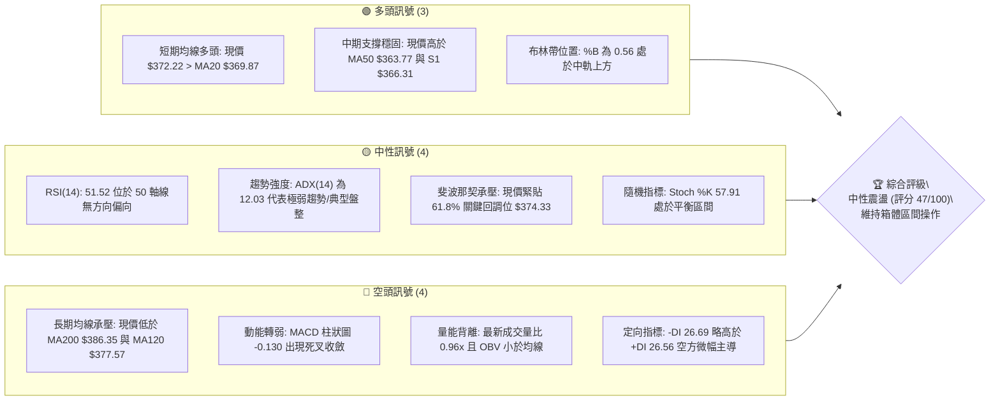
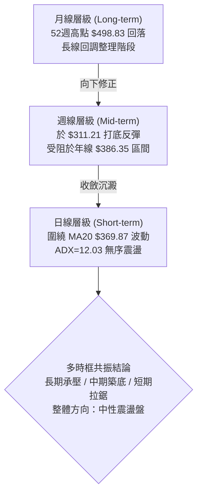
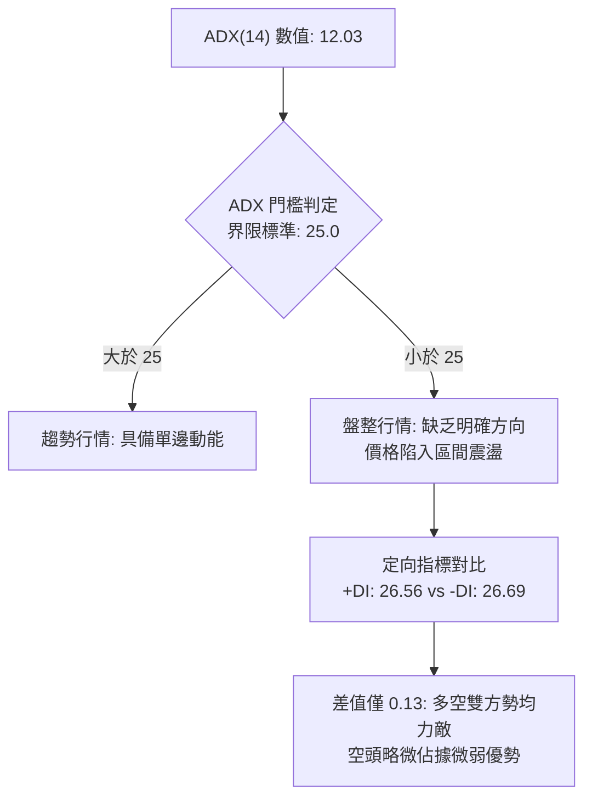
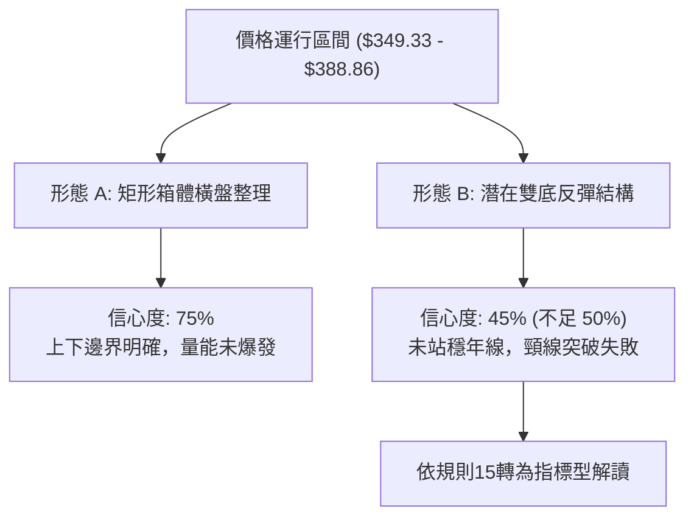
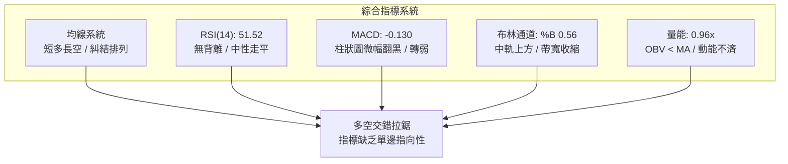
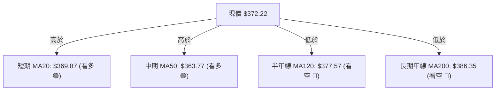
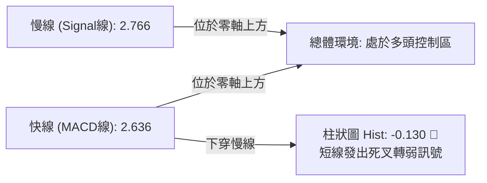
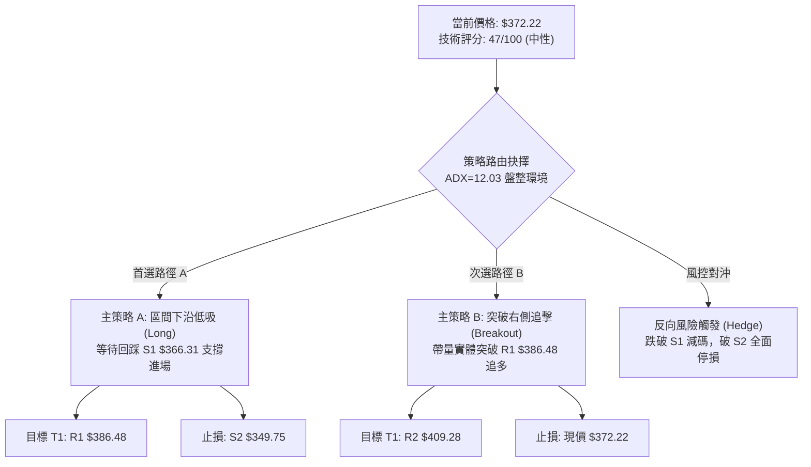
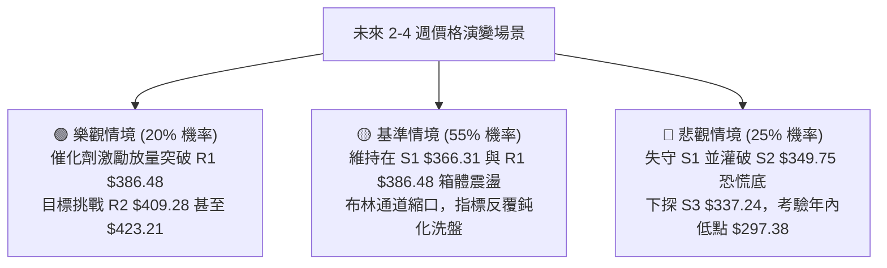

# TSLA 技術分析報告

> **報告日期**：2026-10-24 ｜ **語言**：繁體中文 ｜ **數據來源**：Yahoo Finance ｜ **當前價格**：$372.22

---

## 目錄

| 章節 | 內容 |
|------|------|
| [1. 技術面概覽](#1-技術面概覽) | 訊號儀表板、核心指標、評分卡 |
| [2. 趨勢分析](#2-趨勢分析) | 多時框趨勢、長中短期走勢、ADX解讀 |
| [3. 圖表形態分析](#3-圖表形態分析) | 形態識別、K線組合、目標價推算 |
| [4. 支撐與阻力](#4-支撐與阻力) | 關鍵價位、斐波那契回調結構 |
| [5. 技術指標深度解讀](#5-技術指標深度解讀) | 均線系統、RSI、MACD、布林通道、OBV |
| [6. 動能與波動率](#6-動能與波動率) | 動能四象限、ATR波幅、Beta敏感度 |
| [7. 多時框架總結](#7-多時框架總結) | 時框架矩陣、多時框收斂定調 |
| [8. 交易策略建議](#8-交易策略建議) | 策略路由、情境階梯、進出場風報比 |
| [9. 風險提示與監控](#9-風險提示與監控) | 關鍵監控清單、極端情境與倉位管控 |

---

## 1. 技術面概覽

### 🎯 技術訊號儀表板



---

### 📊 核心指標速覽表

| 指標類別 | 指標名稱 | 當前數值 | 訊號 | 解讀 |
|:---|:---|:---|:---:|:---|
| **價格** | 當前收盤價 | $372.22 | 🟡 | 位於52週區間 37.2% 位置，處於中低位橫盤打底 |
| **均線** | MA20 (短中軌) | $369.87 | 🟢 | 現價位於上方 (+0.64%)，短線多頭具備微幅主控權 |
| **均線** | MA50 (季線) | $363.77 | 🟢 | 現價高於季線 (+2.32%)，中期回踩有支撐力道 |
| **均線** | MA200 (年線) | $386.35 | 🔴 | 現價低於年線 (-3.66%)，長期下行壓力尚未有效化解 |
| **動能** | RSI(14) | 51.52 | 🟡 | 緊貼 50 中軸，多空勢力均衡，無超買或超賣跡象 |
| **動能** | MACD 柱狀圖 | -0.130 | 🔴 | MACD線(2.636)下穿訊號線(2.766)，短線動能翻黑 |
| **趨勢** | ADX(14) | 12.03 | 🟡 | 數值遠低於 25，確定為典型無方向性盤整洗盤行情 |
| **通道** | Bollinger %B | 0.56 | 🟢 | 位於布林帶中軌($369.87)與上軌($390.78)間，略顯強勢 |
| **量能** | 20日成交量比 | 0.96x | 🔴 | 日成交量 34.69M 低於 20MA (36.25M)，OBV疲弱 |
| **波動** | ATR(14) | $12.58 | 🟡 | 佔現價 3.38%，每日波幅適中，未出現極端波動收斂或擴散 |

---

### 🏆 技術評分卡

```
╔══════════════════════════════════════════════════════════════════╗
║                   技術評分卡 — TSLA (2026-10-24)                 ║
╠══════════════════════════════════════════════════════════════════╣
║ 趨勢強度 (ADX=12.03 極弱趨勢)   ███████░░░░░░░░░░░░░  35/100 🔴  ║
║ 動能指標 (RSI=51.5, MACD死叉)   ██████████░░░░░░░░░░  48/100 🟡  ║
║ 支撐穩定度 (S1/S2支撐結構明確)  ████████████░░░░░░░░  62/100 🟢  ║
║ 成交量配合 (量縮無增量, OBV弱)  ████████░░░░░░░░░░░░  42/100 🟡  ║
║ 形態完整度 (箱體整理尚未突破)   ██████████░░░░░░░░░░  50/100 🟡  ║
║ 均線排列 (短強長弱, 糾結混亂)   █████████░░░░░░░░░░░  45/100 🟡  ║
╠══════════════════════════════════════════════════════════════════╣
║ 綜合評分 (依規則18算術平均值)   █████████░░░░░░░░░░░  47/100 🟡  ║
║ 評級結論：中性震盪 (Neutral Consolidation) — 建議區間低買高賣   ║
╚══════════════════════════════════════════════════════════════════╝
```

*計算依據：(35 + 48 + 62 + 42 + 50 + 45) ÷ 6 = 282 ÷ 6 = 47.0分（四捨五入至整數為 47/100）。*

---

## 2. 趨勢分析

### 🌐 多時框趨勢分析



---

### 📈 長期趨勢 — 12個月走勢圖（Unicode）

以下為 TSLA 過去 12 個月（2025-11 至 2026-10）之月線收盤價格路徑圖，標注歷史波段高低點與最新位置：

```
TSLA 月線收盤走勢圖（過去12個月：2025-11 至 2026-10）
價格軸 ($)
$460 ┤               ● (2025-12: $449.72)
$440 ┤ ●(2025-11: 430.17)   ●(2026-01: 430.41)
$420 ┤                               ●(2026-05: 435.79)
$400 ┤                       ●(2026-02: 402.51)  ●(2026-06: 420.60)
$380 ┤                                   ●(2026-04: 381.63)
$360 ┤                               ●(2026-03: 371.75)      ●(2026-08: 367.95)
$340 ┤                                                    ●(2026-09: 354.81)
$320 ┤                                            ●(2026-07: 311.21 波段低點)
$300 ┤
     └───────────────────────────────────────────────────────────────► 時間
       11M   12M   01M   02M   03M   04M   05M   06M   07M   08M   09M   10M
      '25   '25   '26   '26   '26   '26   '26   '26   '26   '26   '26   '26
                                                                     ▲
                                                          現價位置: $372.22
```

#### 長期月線階段走勢特徵表

| 階段區間 | 起始價 → 結束價 | 期間漲跌幅 | 趨勢特徵與技術解讀 |
|:---|:---|:---:|:---|
| **2025-11 ~ 2026-01** | $430.17 → $430.41 | +0.06% | 高位平頂震盪，多頭無法刷新高點，量能出現高檔疲態 |
| **2026-02 ~ 2026-03** | $402.51 → $371.75 | -7.64% | 跌破月線上升軌道，均線由多翻空，獲利了結賣壓湧現 |
| **2026-04 ~ 2026-06** | $381.63 → $420.60 | +10.21% | 中期強力反彈波，一度站上 $435.79，形成次級高點確認 |
| **2026-07 (急跌谷底)** | $420.60 → $311.21 | -26.01% | 帶量單邊下殺，創下 52 週次低點，殺出恐慌籌碼 |
| **2026-08 ~ 2026-10** | $367.95 → $372.22 | +1.16% | 低檔超跌後之修復性橫盤整理，目前正於 $370 附近凝聚新共識 |

---

### 📊 中期趨勢（週線分析）

從近 20 週收盤走勢可見，TSLA 在 2026 年 7 月下旬打出低點 $311.21 後，週線 RSI 跌至 28.0 嚴重超賣，隨後展開技術性反彈，最高於 2026-10-09 當週摸至 $388.56（收盤 $382.70）。近期兩週價格在 $354.72 與 $372.22 間大幅震盪，上方明顯受到下降中的長期均線與密集套牢區壓制。

```
TSLA 週線關鍵支撐與壓力拓撲示意圖
$418.36 ────────────────────────────────── 強阻力 R3 (前波反彈高位平台)
$409.28 ────────────────────────────────── 阻力 R2 (反彈波段頂部)
$386.48 ══════════════════════════════════ 關鍵頸線/年線阻力 R1 (當前反彈天花板)
                  ▲
    現價震盪區     │  $372.22 (當前收盤價，面臨斐波 61.8% $374.33 考驗)
                  ▼
$366.31 ────────────────────────────────── 近期波段支撐 S1 (週K密集回測點)
$349.75 ══════════════════════════════════ 強支撐 S2 (10/16 探底低點 $349.33 防線)
$337.24 ────────────────────────────────── 終極支撐 S3 (築底反彈平台下沿)
```

---

### ⚡ 趨勢強度評估（ADX 解讀）



#### ADX 趨勢強度對照表

| 指標名稱 | 當前數值 | 參考標準區間 | 趨勢狀態判定 | 交易策略啟示 |
|:---|:---:|:---:|:---:|:---|
| **ADX(14)** | **12.03** | 0 ~ 20: 極弱趨勢/完全無方向 | **無趨勢盤整市場** | 嚴禁使用順勢突破追單，應以邊界逆勢策略為主 |
| **+DI(14)** | **26.56** | > 25 表示多方具備動能 | 多方動能尚存 | 反彈動能未完全潰散，下方存在買盤承接 |
| **-DI(14)** | **26.69** | > 25 表示空方主導市場 | 空方略勝一籌 | 上方解套賣壓沈重，高檔隨時受阻回落 |
| **DI 差值** | **-0.13** | 絕對值 < 5 代表僵局 | **絕對多空均衡** | 價格將在近期主要均線上下反覆洗盤糾纏 |

---

## 3. 圖表形態分析

### 🔍 形態識別系統



#### 圖表形態判定與信心度評估表

| 識別形態 | 形態信心度 | 判斷依據（嚴格引用數據） | 形態完成度 | 理論目標價（附精確計算式） |
|:---|:---:|:---|:---:|:---|
| **矩形箱體震盪**<br/>(Rectangle Range) | **75%** | 價格在 S2 ($349.75，近10日低點 $349.33) 與 R1 ($386.48，近10日高點 $388.86) 之間反覆來回震盪，ADX=12.03 確認無趨勢特徵。 | 85% | **箱體等距向上突破目標**：<br/>$386.48 + ($386.48 - $349.75) = **$423.21**<br/>*(需等待日K收盤站穩 R1 以上確認)* |
| **潛在雙重底**<br/>(Double Bottom) | **45%** | 2026-10-16 探底低點 $349.33，回踩 9 月初低點支撐；但頸線 R1 ($386.48) 於 10-21、10-22 兩度衝高回落，未收盤站穩。 | 40% | **訊號不足，僅做指標型解讀**：<br/>依規則 15，信心度 < 50% 不預設成形目標價，視為箱體內部震盪。 |

---

### 🕯️ 重要 K 線形態分析

嚴格依據數據中「近 10 根日 K」與「近 8 根週 K」實際數據判讀分析：

#### 近 10 根日 K 棒形態解讀

| 日期 (日K) | 開盤價 | 最高價 | 最低價 | 收盤價 | K線形態名稱 | 技術解讀 | 訊號 |
|:---|:---:|:---:|:---:|:---:|:---|:---|:---:|
| **2026-10-12** | 382.61 | 382.70 | 377.58 | 378.03 | 光頭小黑棒 | 開盤即為全日最高，承接力弱，短線轉弱跡象 | 🔴 |
| **2026-10-13** | 372.33 | 377.05 | 371.30 | 375.23 | 跳空低開小陽線 | 開盤向下跳空，隨後多頭進場抵抗收復部分跌幅 | 🟡 |
| **2026-10-14** | 371.16 | 371.39 | 363.82 | 367.16 | 下行中黑棒 | 連續跌破短期均線，收盤創短線低點，空方主導 | 🔴 |
| **2026-10-15** | 360.57 | 363.75 | 355.23 | 362.44 | 探底小紅十字 | 創波段低點後回升，留上下影線，空方動能減緩 | 🟡 |
| **2026-10-16** | 369.15 | 370.50 | 349.33 | 354.72 | **長下影巨量大陰線** | 成交量爆增至 62.06M，下探 $349.33 後獲逢低承接，形成恐慌清洗盤 | 🟡 |
| **2026-10-19** | 357.50 | 369.58 | 354.47 | 368.06 | 下影中陽線 | 確認 10/16 底部支撐，多頭發動反撲站回 $368 | 🟢 |
| **2026-10-20** | 370.28 | 377.59 | 363.64 | 373.71 | 震盪實體陽線 | 延續反彈，收盤穩居 MA20 均線上方 | 🟢 |
| **2026-10-21** | 381.43 | 388.84 | 380.51 | 386.47 | **長陽衝高受阻線** | 放量至 48.87M 測試 R1 ($386.48)，觸及 $388.84 遇年線壓回 | 🟡 |
| **2026-10-22** | 374.29 | 388.86 | 373.71 | 374.58 | **高檔避雷針 (長上影陰線)** | 成交量 51.61M，二度挑戰 $388.86 未果暴跌回開盤，標準多頭力竭 | 🔴 |
| **2026-10-23** | 373.20 | 377.32 | 365.27 | 372.22 | 縮量平衡小紡錘線 | 量縮至 34.68M，下探 $365.27 後拉回 $372.22，市場進入冷靜觀望 | 🟡 |

#### 近 8 根週 K 棒形態解讀

| 日期 (週K) | 開盤價 | 最高價 | 最低價 | 收盤價 | K線形態名稱 | 技術解讀 | 訊號 |
|:---|:---:|:---:|:---:|:---:|:---|:---|:---:|
| **2026-09-04** | 347.21 | 384.04 | 347.15 | 354.08 | 長上影倒槌週線 | 週量 260M 巨量衝高受阻，代表 $384 附近籌碼套牢沉重 | 🔴 |
| **2026-09-11** | 357.10 | 375.44 | 355.75 | 365.44 | 縮量溫和中陽線 | 震盪收紅，多頭於 $355 建立防禦基地 | 🟢 |
| **2026-09-18** | 359.78 | 374.12 | 354.05 | 364.27 | 平衡十字小陰線 | 多空在季線周圍拉鋸，方向未明 | 🟡 |
| **2026-09-25** | 371.64 | 386.83 | 367.67 | 372.11 | 上影實體陽線 | 多頭推升再次觸及 R1 邊緣，週線重心持續上移 | 🟢 |
| **2026-10-02** | 368.06 | 374.60 | 345.88 | 370.59 | **長下影探底陽線** | 測試 $345.88 獲得強力抄底買盤支撐，低點逐步抬高 | 🟢 |
| **2026-10-09** | 369.00 | 388.56 | 364.91 | 382.70 | 光腳中陽線 | 週線收盤站上 $380，展現突破氣勢 | 🟢 |
| **2026-10-16** | 382.61 | 382.70 | 349.33 | 354.72 | **光頭大黑棒 (週陰吞噬)** | 開盤即最高，全週重挫跌破多條短均線，破壞進攻架構 | 🔴 |
| **2026-10-23** | 357.50 | 388.86 | 354.47 | 372.22 | **長上下影寬幅震盪週線** | 振幅達 9.7%，上探 $388.86 下探 $354.47，最後收於中間，典型洗盤 | 🟡 |

---

### 📉 ASCII 走勢形態示意圖

```
TSLA 近 10 日走勢與箱體結構示意圖
價格 ($)
$388.86 ┬                    ●(10/22 高點)
$386.48 ┼───────────●(10/21)───────────────── 阻力位 R1 / 箱體頂部
$380.00 ┼  ●(10/12)
$375.00 ┼      ●(10/13)                   ●(10/23 收盤: $372.22)
$370.00 ┼              ●(10/20)    ●(10/22)
$365.00 ┼          ●(10/14)  ●(10/19)
$360.00 ┼              ●(10/15)
$355.00 ┼                  ●(10/16 收盤)
$349.33 ┴──────────────────●(10/16 低點)───── 支撐位 S2 / 箱體底部
        └──────────────────────────────────────────► 日期
          10-12 10-13 10-14 10-15 10-16 10-19 10-20 10-21 10-22 10-23
```

---

### 🎯 形態目標價計算

基於當前確認之「矩形箱體橫盤整理（寬度約 $36.73 美元）」：
1. **箱體上限頸線 (Neckline)**：引用 R1 關鍵價位 = **$386.48**
2. **箱體下限底線 (Base)**：引用 S2 關鍵價位 = **$349.75**
3. **形態垂直高度 (H)**：$386.48 - $349.75 = **$36.73**
4. **向上突破理論目標價 (T_up)**：
   $$\text{T}_{\text{up}} = \text{Neckline} + H = 386.48 + 36.73 = \mathbf{\$423.21}$$
5. **向下跌破理論測幅目標 (T_down)**：
   $$\text{T}_{\text{down}} = \text{Base} - H = 349.75 - 36.73 = \mathbf{\$313.02}$$
   *(註：此測幅目標 $313.02 恰好與 2026-07-24 當週打出的波段大底低點 $313.03 極度吻合，具備高度技術幾何一致性)*

---

## 4. 支撐與阻力

### 🗺️ 關鍵價位分布圖（Unicode）

```
TSLA 價位結構分布圖（OHLCV 密集聚類分析）
═══════════════════════════════════════════════════════════════════
$418.36 ║██████████████████████████████║ 強阻力 R3 (年內反彈密集成交高點)
$409.28 ║████████████████████          ║ 阻力 R2 (中期波段頂部阻力)
$386.48 ║██████████████████████████████║ 關鍵阻力 R1 / 年線 MA200 ($386.35)
$374.33 ╟──────────────────────────────╢ 斐波那契 61.8% 關鍵回調分水嶺
$372.22 ╠══════════════════════════════╣ ◄ 當前收盤價 ($372.22)
$366.31 ║▓▓▓▓▓▓▓▓▓▓▓▓▓▓▓▓              ║ 近期波段支撐 S1 / 均線糾結處
$349.75 ║██████████████████████████████║ 強支撐 S2 / 10/16 恐慌低點防線
$340.49 ╟──────────────────────────────╢ 斐波那契 78.6% 回調保護位
$337.24 ║██████████████████            ║ 終極防禦支撐 S3 (前期築底平台)
═══════════════════════════════════════════════════════════════════
```

---

### 🚧 阻力位分析表

*嚴格引用數據中「關鍵價位」區塊由 OHLCV 聚類計算之數值：*

| 阻力級別 | 準確價位 | 距現價幅標 | 形成原因與籌碼特徵 | 突破難度 | 技術重要性 |
|:---|:---:|:---:|:---|:---:|:---:|
| **R1** | **$386.48** | +3.83% | 近一年波段高點聚類；極度貼近年線 MA200 ($386.35)，且 10-21、10-22 連續兩日爆量受阻，聚集大量解套賣壓。 | 🔴 高 | ★★★★★ |
| **R2** | **$409.28** | +9.96% | 2026年6月中旬反彈平台高點、7月初反彈頂點 ($407.76) 密集套牢區，為中期多空多空爭奪中樞。 | 🔴 極高 | ★★★★☆ |
| **R3** | **$418.36** | +12.40% | 2026年6月起跌大陰線起點聚類，屬於強烈機構法人減碼防線，若攻克代表長線反轉成立。 | 🔴 極難 | ★★★☆☆ |

---

### 🛡️ 支撐位分析表

*嚴格引用數據中「關鍵價位」區塊由 OHLCV 聚類計算之數值：*

| 支撐級別 | 準確價位 | 距現價幅標 | 形成原因與籌碼特徵 | 守住機率 | 技術重要性 |
|:---|:---:|:---:|:---|:---:|:---:|
| **S1** | **$366.31** | -1.59% | 近一年波段低點聚類；介於 MA50 ($363.77) 與 MA20 ($369.87) 之間，近 10 日多根 K 棒收盤價防守平台。 | 🟢 70% | ★★★★☆ |
| **S2** | **$349.75** | -6.04% | 2026-10-16 恐慌爆量日之極限低點 ($349.33) 聚類點，亦為 9 月初起漲平台底部，為當前多頭生死線。 | 🟢 80% | ★★★★★ |
| **S3** | **$337.24** | -9.40% | 2026年8月中旬整理平台低點聚類，接近斐波那契 78.6% 回調位 ($340.49)，為最後多頭反攻壕溝。 | 🟢 90% | ★★★☆☆ |

---

### 📐 斐波那契回調位分析

依據 52 週完整波段（低點 $297.38 至高點 $498.83，垂直落差 $201.45）計算之標準黃金分割體系：

| 回調比率 | 準確價位 | 與現價關係 | 技術意義解讀 |
|:---:|:---:|:---:|:---|
| **0.0%** | **$498.83** | +34.01% | 52 週最高價，歷史牛市頂部強阻力 |
| **23.6%** | **$451.29** | +21.24% | 牛市第一回調點，現已轉為極強長線天花板 |
| **38.2%** | **$421.88** | +13.34% | 弱勢反彈極限阻力位，接近形態測幅目標 $423.21 |
| **50.0%** | **$398.10** | +6.95% | 多空平衡中軸線，整數心理防線 $400 大關 |
| **61.8%** | **$374.33** | +0.57% | **黃金分割關鍵分水嶺（現價緊貼於其下方 $2.11）** |
| **78.6%** | **$340.49** | -8.52% | 深幅回調防線，落於 S2 與 S3 支撐緩衝帶內 |
| **100.0%** | **$297.38** | -20.11% | 52 週最低價，年內多頭終極底線 |

**斐波那契落點位置核心解讀**：
當前收盤價 **$372.22** 緊貼於 **61.8% ($374.33)** 與 **78.6% ($340.49)** 區間的頂部邊緣。在傳統道氏理論與斐波那契戰略中，自高點回調 61.8% 的價位是研判「多頭趨勢回檔修正」還是「徹底轉為長期熊市」的生死分野。現價在此位階反覆震盪收小實體 K 線，顯示市場資金正於此進行激烈防禦，一旦日 K 能跳空或帶量實體站穩 $374.33 上方，將打開通往 50% 回調位 ($398.10) 的反彈通道。

---

## 5. 技術指標深度解讀

### 🎛️ 指標訊號總覽



---

### 📈 移動平均線排列分析



#### 各週期均線狀態詳解

| 均線名稱 | 當前價格 | 與現價乖離 | 走勢趨向 | 技術含義解讀 |
|:---|:---:|:---:|:---:|:---|
| **MA 5** | $375.01 | -0.74% | ▼ 下行 | 短線追高意願不足，受 10-22 長上影線拉回影響走跌 |
| **MA 10** | $371.26 | +0.26% | ▲ 上行 | 提供現價最直接的短線貼身動態支撐 |
| **MA 20** | $369.87 | +0.64% | ▲ 上行 | 月均線連續走升，奠定短波段震盪偏多的防禦基礎 |
| **MA 50** | $363.77 | +2.32% | ▲ 上行 | 季線穩定向上，拉長中期築底的下檔安全墊 |
| **MA 60** | $357.50 | +4.12% | ▲ 上行 | 快速上移，正與 S2 支撐平台匯合產生共振保護 |
| **MA 120** | $377.57 | -1.42% | ▼ 下行 | 下移壓制現價，為多頭短期向上挑戰的第一道均線防線 |
| **MA 200** | $386.35 | -3.66% | ▼ 下行 | 具有決定性的「牛熊分界線」，與 R1 ($386.48) 形成雙重阻力 |
| **MA 240** | $395.80 | -5.96% | ▼ 下行 | 長週期均線空頭排列，限制了中長線大規模爆發空間 |

**排列總結**：目前均線系統呈現「**短天期金叉向上、長天期空頭下壓**」之典型**混合排列**。這種排列通常伴隨持續的「震盪洗盤」與「均線靠攏收斂」，而非爆發性單邊行情。

---

### 📉 RSI(14) 分析

*   **當前數值**：**51.52**（Wilder 計算方法）
*   **強度進度條**：`██████████░░░░░░░░░░` 51.5%

```
RSI(14) 區間位置示意
0 ──────── 30 ──────────────── 50 ──────────────── 70 ──────── 100
[ 極度超賣 ]    [ 弱勢區間 ]     ▲    [ 強勢區間 ]    [ 極度超買 ]
                              51.52 (當前完全平衡中性)
```

#### 背離現象客觀判讀
根據近 20 根 K 棒首尾之價格與 RSI 走向比對：
*   **價格走勢**：10 月中旬打出低點 $349.33 後反彈至 $388.86，隨後收於 $372.22。
*   **RSI 走勢**：由 10-16 恐慌時點之低位約 42 附近反彈至 10-21 高點 59.7，目前平緩滑落至 51.52。
*   **背離結論**：**無明顯背離**（既無高位頂背離，亦無低位底背離）。RSI 運行軌跡與價格波動高度同步，反映出目前多空力量極其對等，尚未出現動能耗竭之領先反轉訊號。

---

### 📊 MACD(12, 26, 9) 訊號解讀



*   **指標數據**：MACD 線 = **2.636** ｜ Signal 線 = **2.766** ｜ 柱狀圖 = **-0.130**
*   **訊號解讀**：
    1.  **零軸維度**：快慢線雙雙維持在 0 軸上方運行，代表 7 月底反彈以來的多頭架構未遭根本破壞。
    2.  **交叉維度**：由於 10-22 出現長上影線回落，帶動 MACD 快線下彎穿過訊號線，柱狀圖自微幅紅柱轉為負向 -0.130，釋放**短線動能減速、需進行整理消化**之空頭微調訊號。
    3.  **背離檢視**：觀察週線層級 MACD，前波高點柱狀圖為 +6.229 (8/21)，隨後兩次反彈柱狀圖僅達 +2.926 與 +1.070，顯示週線級別動能呈現遞減收縮態勢，限制了日線向上衝關的續航力。

---

### 📦 布林通道分析

```
TSLA 日線布林通道 (20, 2) 結構示意圖
價格 ($)
$390.78 ┬────────────────────────────────────────── 布林上軌 (Resistance)
        │
$380.00 ┤                   ● (10-21 衝高至 $388.84 觸碰上軌壓回)
$372.22 ┼───────────────────●────────────────────── 現價位置 (%B = 0.56)
$369.87 ┼────────────────────────────────────────── 布林中軌 (MA20 基準線)
        │
$360.00 ┤
$348.95 ┴────────────────────────────────────────── 布林下軌 (Support, 接近 S2 $349.75)
```

*   **通道上軌**：**$390.78**（壓制於 R1 $386.48 上方約 4 美元處）
*   **通道中軌 (MA20)**：**$369.87**（現價最關鍵的第一防線）
*   **通道下軌**：**$348.95**（與強支撐 S2 $349.75 完全重合）
*   **帶寬指標 %B**：**0.56**
    *   解讀：%B 數值 0.50 代表剛好位於中軌，0.56 表示價格剛好回踩至中軌上方獲得支撐，仍保有向通道上半部探索的微幅技術優勢。由於布林帶寬目前呈現水平收縮走勢，印證行情將高機率被鎖定在 **$348.95 ~ $390.78** 寬幅震盪區間內。

---

### 💹 成交量分析（量價配合度）

```
近期日成交量柱狀示意 (百萬股 M)
10-16 (下探恐慌) : ████████████████████████████████ 62.07M (放量探底 🟢)
10-19 (止跌反彈) : ███████████████████ 38.82M
10-20 (延續推升) : ████████████████ 32.12M (縮量推升 🟡)
10-21 (測試阻力) : ████████████████████████ 48.88M (增量遇阻 🔴)
10-22 (衝高回落) : ██████████████████████████ 51.61M (放量滯漲 🔴)
10-23 (平靜收斂) : █████████████████ 34.69M (量縮觀望 🟡)
20日均量基準線  : ██████████████████ 36.25M
```

*   **最新成交量**：34,689,700 股
*   **20日平均量**：36,252,695 股（量比：**0.96x**）
*   **50日平均量**：37,444,670 股
*   **OBV (能量潮指標) 走勢**：**OBV < MA（量能疲弱）**
*   **量價關係綜合評判**：
    1.  **高檔放量滯漲**：10 月 21 日與 22 日挑戰 R1 ($386.48) 過程中，日成交量分別擴增至 48.88M 與 51.61M，但收盤均無法突破阻力，留下沉重上影線，代表高檔浮額籌碼大量倒出。
    2.  **回檔量能收縮**：最新交易日 (10-23) 成交量迅速降至 34.69M，低於 20 日均量，顯示在回調過程中並無恐慌殺跌盤，主要以獲利了結後的縮量觀望為主。
    3.  **OBV 警訊**：OBV 線持續運行於其移動平均線下方，說明整體資金在中期反彈中的跟進意願偏弱，未形成實質性的機構主力建倉量價齊揚架構。

---

## 6. 動能與波動率

### ⚡ 動能評估四象限

```
動能與波動率矩陣定位
               ▲ 動能強度 (Momentum)
               │
      Q4 (強動能 / 低波動)  │  Q1 (強動能 / 高波動)
      [ 穩健趨勢上行 ]      │  [ 爆發單邊主升/主跌 ]
               │
───────────────┼────────────────────────► 波動率 (Volatility)
               │
      Q2 (弱動能 / 低波動)  │  Q3 (弱動能 / 高波動)
  ──► ★ TSLA 當前定位 ★   │  [ 劇烈洗盤震盪 ]
      (ADX=12 / ATR=3.38%) │
               │
```

#### 動能狀態評估說明

| 象限代號 | 動能維度 | 波動維度 | 當前狀態吻合度 | 交易環境與戰略評估 |
|:---:|:---:|:---:|:---:|:---|
| **Q1** | 強 | 高 | 否 | 缺乏單邊動能驅動，ADX 遠低於 25，不符合主升段特徵 |
| **Q2** | **弱** | **低/中** | **✓ 完全吻合** | **動能指標走平 (RSI=51.5)，ATR 處於 3.38% 之溫和常態，市場處於休眠整理期** |
| **Q3** | 弱 | 高 | 否 | 波動未失控，隱含波動無爆發跡象，未見無序巨震 |
| **Q4** | 強 | 低 | 否 | 均線尚未形成單邊發散的多頭順勢形態 |

---

### 📊 ATR 波動率分析

*   **ATR(14) 絕對數值**：**$12.58**（基於 Wilder 平滑法）
*   **ATR 相對價格比**：**3.38%**
*   **歷史波動環境**：當前 TSLA 每日平均波動約 $12.6 美元，波動水準處於過去一年之中位數偏低區間，顯示籌碼清洗正進入尾聲，橫盤收斂特徵明顯。

#### 風控停損防護距離設計建議表

| 交易風格 | 採用倍數 | 止損保護緩衝距離 | 建議止損價位設定邏輯 |
|:---|:---:|:---:|:---|
| **日內短線 (Day Trading)** | 1.0 × ATR | **$12.58** | 適用於現價附近日內試單，跌破即撤 |
| **波段交易 (Swing Trading)** | 1.5 × ATR | **$18.87** | **主推薦標準**：現價 $372.22 - $18.87 = $353.35（剛好防守在 S2 $349.75 上方） |
| **中期防守 (Position Trading)** | 2.0 × ATR | **$25.16** | 允許承受完整箱體震盪波幅，跌破代表箱體破位 |

---

### 📐 Beta 與市場相關性

*   **Beta 係數**：**1.916**（極高系統性風險敞口）
*   **解讀**：
    1.  TSLA 的價格彈性接近標普 500 指數的 **1.92 倍**。當美股大盤指數波動 1% 時，TSLA 統計上將產生近 2% 的同向波動。
    2.  在當前 ADX 為 12.03 的無趨勢環境下，高 Beta 意味著 TSLA 容易受到外部大盤突發消息或總體經濟數據牽引，引發偽突破（如 10-22 挑戰 $388.86 失敗即受美股大盤波動共振所致）。

---

## 7. 多時框架總結

### 📋 時框架評分表

| 時框架層級 | 趨勢方向 | 動能狀態 | 均線系統排列 | 形態結構特徵 | 維度綜合評分 | 戰略操作建議 |
|:---|:---:|:---:|:---:|:---|:---:|:---|
| **長期 (月線)** | 🔴 偏空 | 弱勢反彈 | 空頭排列 (低於 MA240 $395.80) | 自高位 $498.83 下跌後的反彈中繼 | **38 / 100** | 逢高減碼長線持股，不宜重倉追高 |
| **中期 (週線)** | 🟡 中性 | 中平糾結 | 均線糾纏 (MA20上穿，MA60下壓) | 打出 $311.21 低點後的寬幅築底箱體 | **52 / 100** | 在 S2 至 R1 區間內耐心進行網格波段操作 |
| **短期 (日線)** | 🟡 中性偏多 | 略顯鈍化 | 短天期多頭 (現價高於 MA20/MA50) | 衝高回落後的縮量震盪整理 | **51 / 100** | 依託 MA20 與 S1 回踩支撐輕倉短多試單 |

---

### 🔲 綜合訊號矩陣

```
時框架訊號交叉驗證表
┌───────────┬──────────────┬──────────────┬──────────────┬──────────────┐
│ 時框 / 維度│ 均線架構     │ 動能指標     │ 型態結構     │ 量價配合     │
├───────────┼──────────────┼──────────────┼──────────────┼──────────────┤
│ 長期 (月線)│ 🔴 空頭壓制  │ 🔴 偏弱無力  │ 🔴 跌勢未止  │ 🟡 量能萎縮  │
│ 中期 (週線)│ 🟡 混合糾結  │ 🟡 中軸 51.5 │ 🟡 箱體打底  │ 🔴 OBV疲弱   │
│ 短期 (日線)│ 🟢 站上MA20  │ 🔴 MACD死叉  │ 🟡 區間收斂  │ 🟡 縮量觀望  │
└───────────┴──────────────┴──────────────┴──────────────┴──────────────┘
訊號共振度：低 (各週期方向存在矛盾，短期多頭試圖抵抗，但長期結構依然受限)
```

---

### ⚖️ 多時框收斂結論

> **依「嚴格要求 14」進行多時框架衝突收斂裁決：**
> 
> 1.  **市場屬性裁定**：當前日線 ADX(14) 數值為 **12.03**，遠低於趨勢行情臨界點 25。因此，市場**定性為典型的「盤整行情（Consolidation Market）」**，趨勢跟隨模型自動失效。
> 2.  **主導維度收斂**：依照規則，盤整行情中應**以日線布林通道上下軌（$348.95 ~ $390.78）及核心支撐阻力結構（S2 $349.75 ~ R1 $386.48）為主要交易區間**。
> 3.  **唯一方向性定調**：
>     **中性區間觀望（偏多回踩低吸，嚴禁高位追價）**。
>     在價格未帶量有效收盤跌破 S2 ($349.75) 或突破 R1 ($386.48) 之前，一律視為箱體內部無序波動。

---

## 8. 交易策略建議

### 🗺️ 策略決策流程圖



---

### 🧭 策略路由

*   **當前主策略方向**：**中性區間震盪操作（評分 47/100，40–60 區間內標注：等待突破確認，以箱體邊界操作為主）**。
*   **戰術方針**：摒棄單邊多空執念，嚴格按照**「回踩支撐買進、受阻阻力高拋、突破順勢跟進」**紀律執行。

---

### 🎯 價格情境階梯（Price Scenarios）

*全部價位嚴格引用下方數據「關鍵價位」與「斐波那契」精確數值：*

| 觸發條件 | 下一目標 | 後續延伸目標 | 情境技術含義 |
|:---|:---:|:---:|:---|
| **向上突破 R1 $386.48** | **R2 $409.28** | **R3 $418.36** | **短線強勢突破**：正式站上年線，箱體等距向上測幅啟動 |
| **持穩現價至 S1 ($366.31 - $374.33)** | **MA20 $369.87** | **R1 $386.48** | **常態箱體震盪**：消化套牢浮額，等待均線進一步收斂糾結 |
| **向下跌破 S1 $366.31** | **S2 $349.75** | **S3 $337.24** | **短線破位走弱**：重新測試 10/16 恐慌低點防禦力道 |

---

### 📊 情境機率分佈

| 運行情境 | 發生機率 | 主要技術與量化依據 |
|:---|:---:|:---|
| **區間橫盤震盪** | **55%** | **ADX=12.03 極弱趨勢、布林帶寬收縮、成交量低於均量、RSI 51.5 走平**。 |
| **回落測試下檔 (再探底)** | **25%** | MACD 柱狀圖翻黑 (-0.130)、10/22 放量長上影線留下解套賣壓、OBV 偏弱。 |
| **向上反彈突破 (衝關)** | **20%** | 年線 MA200 ($386.35) 下壓，短期缺乏催化量能，直接突破 R1 難度較高。 |

---

### 🟢 主策略詳情

依據嚴格要求 17，風險報酬比公式為：
$$\text{風險報酬比} = \frac{\text{目標價 T1} - \text{進場價}}{\text{進場價} - \text{止損價}}$$

| 策略要素 | 策略 A（區間下沿逢低吸納策略） | 策略 B（右側確認突破追多策略） |
|:---|:---|:---|
| **策略類型** | 逆勢左側 / 箱體下軌支撐回踩 | 順勢右側 / 帶量衝破關鍵阻力 |
| **進場條件** | 價格回踩 S1 獲得支撐不破，出現 15分/日K 止跌收陽線 | 日 K 收盤價實體放量突破關鍵阻力位 R1 |
| **進場價格** | **$366.31**（以 S1 關鍵價位為準） | **$386.48**（以 R1 突破確認價為準） |
| **目標價 T1** | **$386.48**（關鍵阻力 R1） | **$409.28**（阻力位 R2） |
| **目標價 T2** | **$409.28**（阻力位 R2） | **$418.36**（強阻力 R3） |
| **止損價格** | **$349.75**（跌破強支撐 S2 嚴格止損） | **$372.22**（回跌破當前收盤價/斐波61.8%止損）|
| **風險報酬比 (T1)** | **1 : 1.22（以 T1 計）**<br/>計算式：$(386.48 - 366.31) \div (366.31 - 349.75)$<br/>$= 20.17 \div 16.56 = \mathbf{1.22}$ | **1 : 1.60（以 T1 計）**<br/>計算式：$(409.28 - 386.48) \div (386.48 - 372.22)$<br/>$= 22.80 \div 14.26 = \mathbf{1.60}$ |
| **風險報酬比 (T2)** | **1 : 2.60（以 T2 計）**<br/>計算式：$(409.28 - 366.31) \div 16.56 = \mathbf{2.60}$ | **1 : 2.24（以 T2 計）**<br/>計算式：$(418.36 - 386.48) \div 14.26 = \mathbf{2.24}$ |
| **預估勝率** | 60% | 45% (受制於 ADX 弱勢環境，追多勝率較低) |
| **建議配置倉位** | **15% ~ 20%** 總投資資本 | **10%** 總投資資本（突破後加碼） |

---

### 🔴 反向風險觸發點（對沖提示）

*非完整做空推薦，僅作為持有多頭倉位時之風控警戒與避險對沖指引：*
1.  **一級警報（減碼點）**：若日 K 跌破 **S1 ($366.31)**，意味著失守 MA20 中軌支撐，多頭應主動減持 50% 倉位。
2.  **全面停損（多轉空觸發點）**：若日 K 收盤實體跌破 **S2 ($349.75)**，代表 10/16 恐慌低點被有效擊穿，箱體向下破位成形，將直接開啟通往 S3 ($337.24) 與斐波 100% ($297.38) 的下跌通道，多單必須無條件全數止損離場，空單可建立反向避險對沖。

---

### ⭐ 整體訊號強度評星

```
╔═══════════════════════════════════════════════════════╗
║ 做多訊號強度：★★☆☆☆  (2.5 / 5 星，受阻年線量能不足)    ║
║ 做空訊號強度：★★☆☆☆  (2.0 / 5 星，下方均線支撐密集)    ║
║ 整體可信度：  ★★★☆☆  (3.5 / 5 星，區間震盪指標吻合)    ║
╚═══════════════════════════════════════════════════════╝
```

---

## 9. 風險提示與監控

### ✅ 關鍵監控指標 Checklist

```
╔══════════════════════════════════════════════════════════════════╗
║                    交易風險與關鍵指標監控清單                     ║
╠══════════════════════════════════════════════════════════════════╣
║ [ ] 價格突破監控：收盤價是否實體站上 R1 $386.48 或跌破 S2 $349.75 ║
║ [ ] 動能趨勢重啟：ADX(14) 是否自 12.03 快速抬升穿過 20 ~ 25 臨界線║
║ [ ] 均線動態支撐：收盤價能否持續穩守在 MA20 ($369.87) 基準線上方 ║
║ [ ] 動能死叉化解：MACD 柱狀圖是否收斂翻紅（由當前 -0.130 回升） ║
║ [ ] 量能擴張檢驗：單日成交量是否有效放大至 50M 股以上配合突破    ║
║ [ ] 總經環境聯動：Beta=1.92，關注標普/納指波動及美債殖利率變化    ║
╚══════════════════════════════════════════════════════════════════╝
```

---

### ⚠️ 風險場景分析



---

### 🛡️ 風險管理重要提醒

1.  **拒絕高位追高**：當前價位 $372.22 距離上方強阻力 R1 ($386.48) 僅約 3.8% 空間，若在現價追多，上方將直接面臨下行的 MA200 年線壓制，盈虧比極度不對稱。
2.  **單筆最大虧損限制**：嚴格落實**單筆交易最大虧損不超過帳戶總淨值 1.5%** 的鐵律。若以策略 A 操作（停損空間約 $16.56 美元），每 10 萬美元帳戶規模，持倉上限應嚴格限制在 90 股以內。
3.  **防範假突破風險**：近期 10-21、10-22 連續兩日衝高至 $388.86 後均爆量跳水，證明主力資金頻繁利用盤中脈衝進行誘多出貨。在 ADX 趨勢強度未確認抬升前，一切突破均需等待**「日 K 實體收盤確認」**，切忌在盤中盲目追價。

---

## 📋 報告總結

```
╔══════════════════════════════════════════════════════════════════╗
║                     TSLA 技術分析報告總結                        ║
╠══════════════════════════════════════════════════════════════════╣
║ 報告日期：2026-10-24                                             ║
║ 當前價格：$372.22                                                ║
║ 分析評級：⚖️ 中性觀望 (技術評分: 47/100，區間震盪整理格局)       ║
║                                                                  ║
║ 關鍵技術維度結論：                                               ║
║ ├─ 長期趨勢：🔴 偏空運行，受制於下降中的 MA200 ($386.35)         ║
║ ├─ 中期趨勢：🟡 箱體築底，在 S2 ($349.75) 與 R1 ($386.48) 間拉鋸 ║
║ ├─ 短期趨勢：🟢 溫和偏多，現價穩居 MA20 ($369.87) 與季線上層     ║
║ ├─ 關鍵支撐：S1 $366.31 ｜ S2 $349.75 ｜ S3 $337.24              ║
║ ├─ 關鍵阻力：R1 $386.48 ｜ R2 $409.28 ｜ R3 $418.36              ║
║ └─ 分析師共識目標：$407.22 (現有覆蓋分析師 39 位)                ║
║                                                                  ║
║ 最優交易策略組合：                                               ║
║ 1. 🥇 最佳機會：策略 A (回踩 S1 $366.31 輕倉做多，風報比 1:1.22)  ║
║ 2. 🥈 次選機會：策略 B (帶量突破 R1 $386.48 追多，風報比 1:1.60)  ║
║ 3. 🥉 保守選擇：完全空倉觀望，耐心等待箱體破位或 ADX > 25 趨勢明朗║
╚══════════════════════════════════════════════════════════════════╝
```

---

> ⚠️ **免責聲明**：本報告為依據特定量化技術指標與歷史行情數據生成之專業技術分析，所載之技術點位、支撐阻力及策略模擬均**僅供學術研究與交易架構參考**，**不構成任何形式的要約、招攬或實質投資建議**。金融市場瞬息萬變，高 Beta 標的風險極高，投資人應獨立評估財務狀況並自負投資盈虧。

---
*報告生成時間：2026-10-24 ｜ 數據來源：Yahoo Finance ｜ 分析框架：多時框技術分析模型*