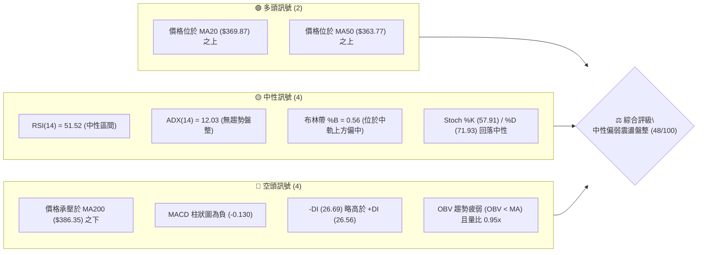
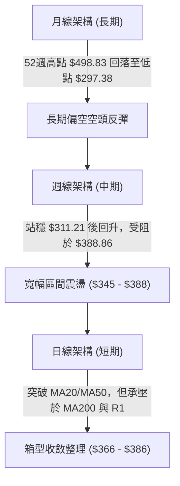
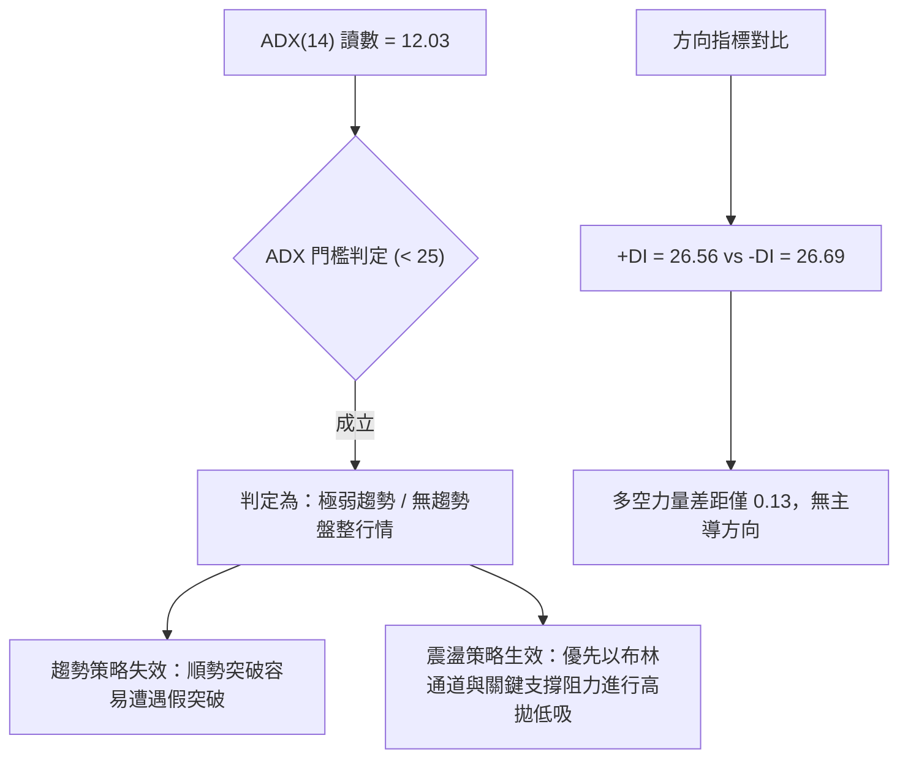
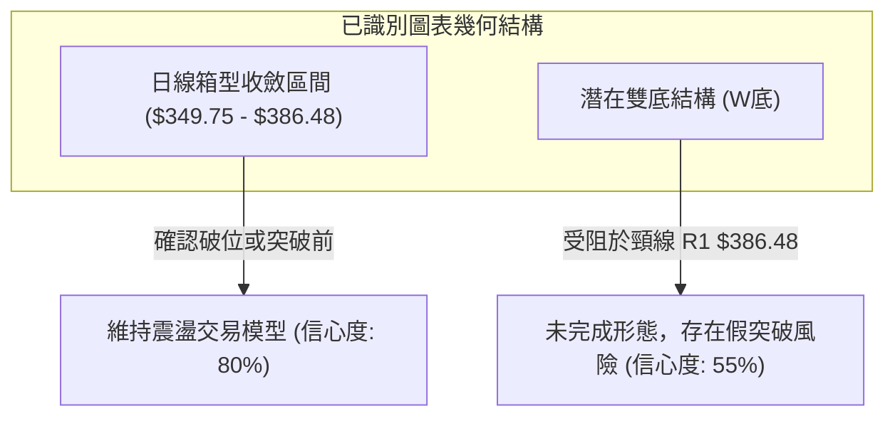
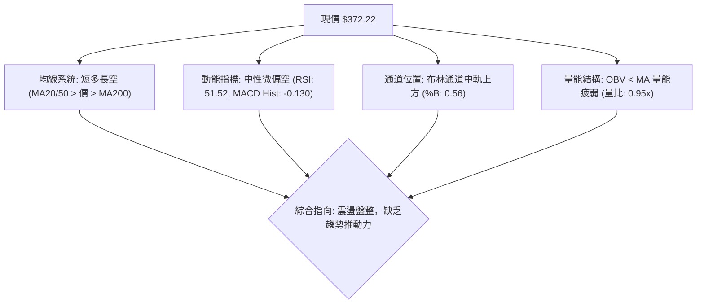
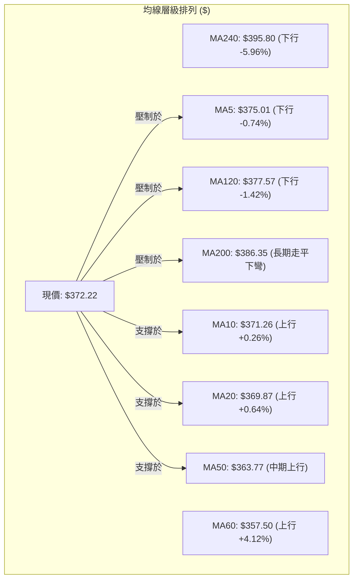
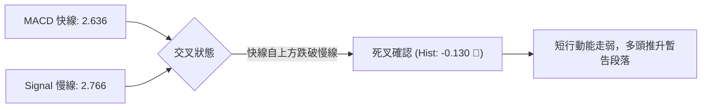
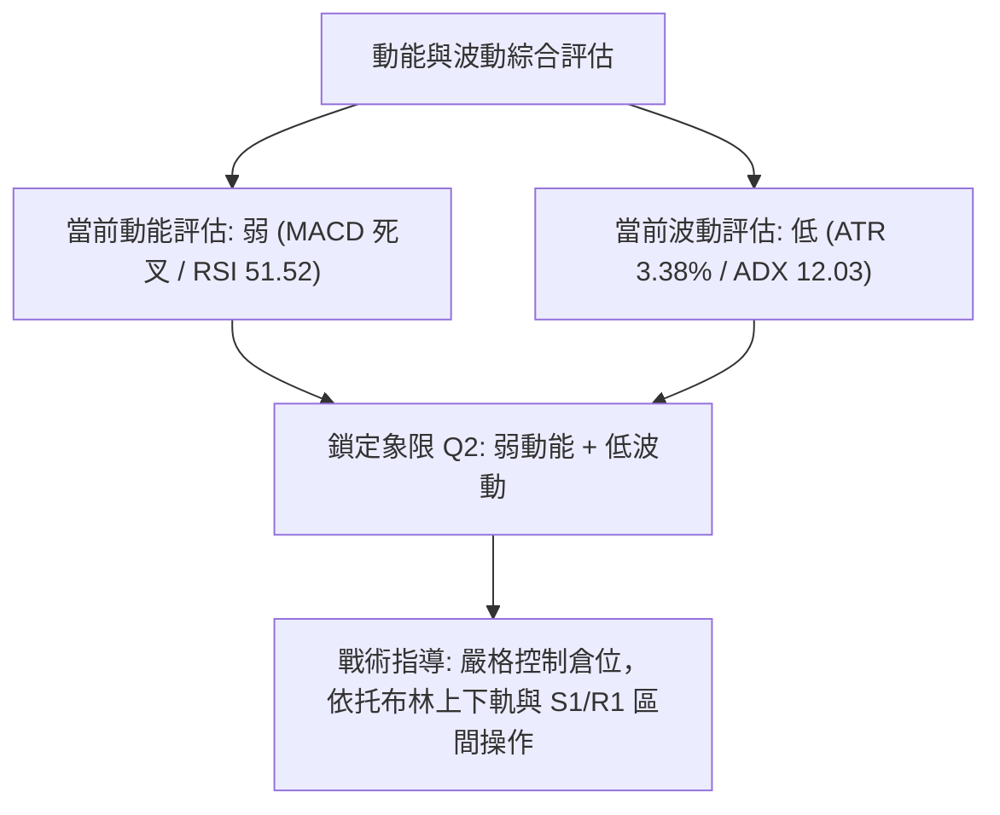
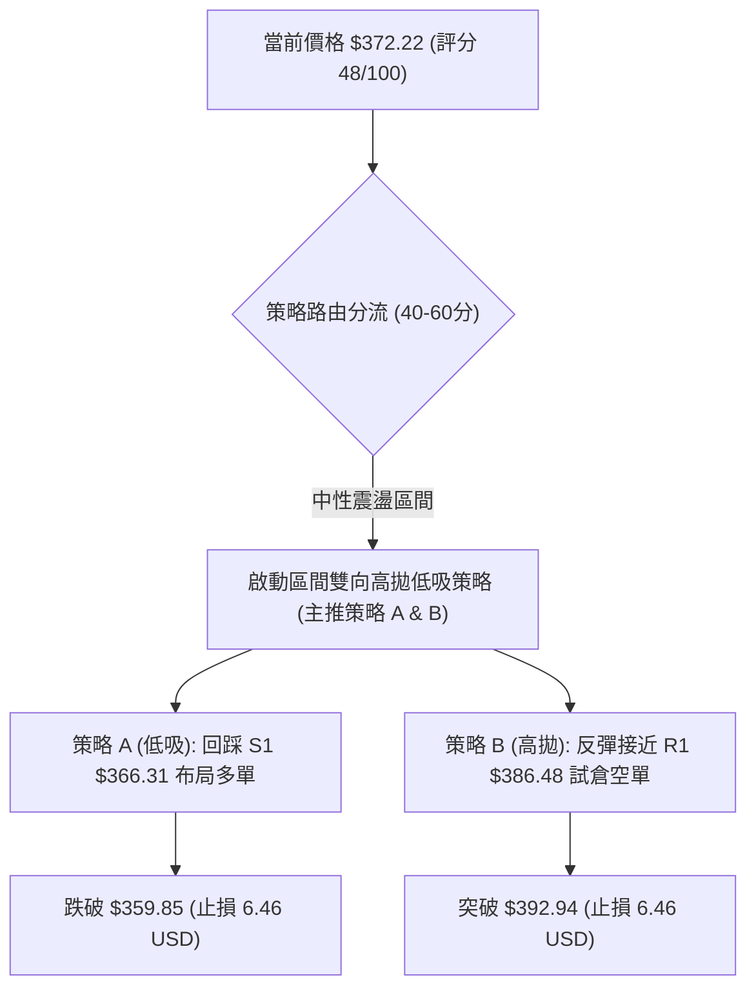
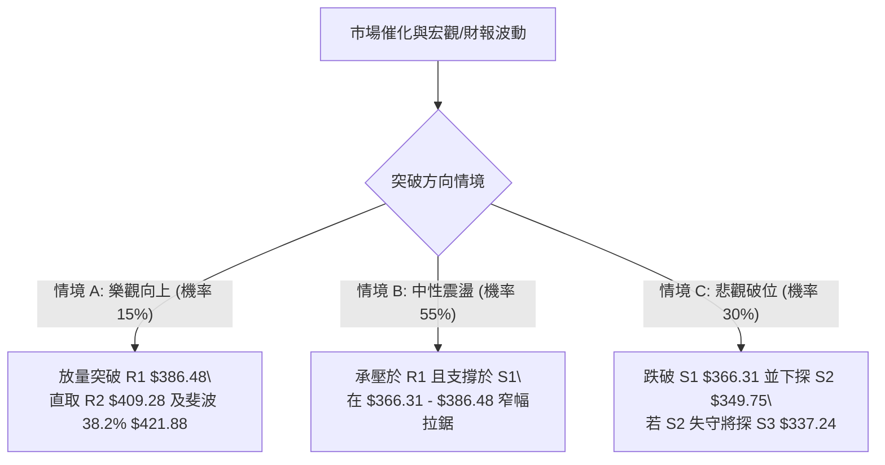

# TSLA 技術分析報告

> **報告日期**：2026-10-24 ｜ **語言**：繁體中文 ｜ **數據來源**：Yahoo Finance ｜ **當前價格**：$372.22 USD

---

## 目錄

| 章節 | 內容 |
|------|------|
| [1. 技術面概覽](#1-技術面概覽) | 訊號儀表板、核心指標、評分卡 |
| [2. 趨勢分析](#2-趨勢分析) | 多時框趨勢、長中短期走勢、ADX解讀 |
| [3. 圖表形態分析](#3-圖表形態分析) | 形態識別、K線組合、目標價計算 |
| [4. 支撐與阻力](#4-支撐與阻力) | 關鍵價位、斐波那契回調 |
| [5. 技術指標深度解讀](#5-技術指標深度解讀) | MA/RSI/MACD/布林/成交量 |
| [6. 動能與波動率](#6-動能與波動率) | 動能評估、ATR、Beta |
| [7. 多時框架總結](#7-多時框架總結) | 時框架評分矩陣、收斂結論 |
| [8. 交易策略建議](#8-交易策略建議) | 策略路由、主策略詳情、風險報酬比 |
| [9. 風險提示與監控](#9-風險提示與監控) | 監控指標、風險情境、風控原則 |
| [📋 報告總結](#-報告總結) | 核心結論與最優策略組合 |

---

## 1. 技術面概覽

### 🎯 技術訊號儀表板



---

### 📊 核心指標速覽表

| 指標類別 | 指標名稱 | 當前數值 | 訊號 | 解讀 |
|----------|----------|----------|------|------|
| **價格** | 當前收盤價 | $372.22 | 🟡 | 位於52週區間 37.2%，處於中長期底部反彈後的震盪整理位 |
| **均線** | 短期 MA20 | $369.87 | 🟢 | 現價高於 MA20（+0.64%），短期呈現防禦支撐 |
| **均線** | 中期 MA50 | $363.77 | 🟢 | 現價高於 MA50（+2.32%），中期均線向上微彎提供支撐 |
| **均線** | 長期 MA200 | $386.35 | 🔴 | 現價低於 MA200（-3.66%），長期牛熊分界線構成重大壓力 |
| **動能** | RSI(14) | 51.52 | 🟡 | 位於 30–70 中性區間，多空力量處於完全均勢狀態 |
| **動能** | MACD (12,26,9) | 2.636 / 2.766 (Hist: -0.130) | 🔴 | 快慢線高位糾結，柱狀圖轉負，動能短線出現微幅衰竭 |
| **波動** | ATR(14) | $12.58 | 🟡 | 佔股價 3.38%，每日波動幅度常態收斂，處於蓄勢期 |

---

### 🏆 技術評分卡

```
╔══════════════════════════════════════════════════════════════════╗
║                   技術評分卡 — TSLA (2026-10-24)                 ║
╠══════════════════════════════════════════════════════════════════╣
║ 趨勢強度      ██████░░░░░░░░░░░░░░  30/100  🔴 (ADX=12.03，極弱) ║
║ 動能指標      ██████████░░░░░░░░░░  50/100  🟡 (RSI中性/MACD翻黑) ║
║ 支撐穩定度    ████████████░░░░░░░░  60/100  🟢 (S1 $366.31 有撐) ║
║ 成交量配合    ████████░░░░░░░░░░░░  40/100  🔴 (OBV<MA，量能收縮)║
║ 形態完整度    ██████████░░░░░░░░░░  50/100  🟡 (日線區間整理)     ║
║ 均線排列      ████████████░░░░░░░░  60/100  🟡 (短多長空混合排列) ║
╠══════════════════════════════════════════════════════════════════╣
║ 綜合評分      ██████████░░░░░░░░░░  48/100  🟡 中性偏弱區間震盪   ║
║ 評分公式      (30 + 50 + 60 + 40 + 50 + 60) ÷ 6 = 48.33 → 48/100  ║
╚══════════════════════════════════════════════════════════════════╝
```

---

## 2. 趨勢分析

### 🌐 多時框趨勢分析



---

### 📈 長期趨勢 — 12個月走勢圖（Unicode）

```
TSLA 月線走勢圖（過去12個月：2025-11 至 2026-10）
價格軸 ($)
$460 ┤       
$450 ┤ ●(2025-12 $449.72)
$430 ┤●(11)     ●(2026-01 $430.41)      ●(2026-05 $435.79)
$420 ┤                                      ●(06)
$400 ┤              ●(2026-02 $402.51)
$380 ┤                                ●(04)
$370 ┤                                            ●(08)       ●(現價 $372.22)
$360 ┤                   ●(03 $371.75)                    ●(09)
$310 ┤                                              ●(2026-07 $311.21 低點)
     └────────────────────────────────────────────────────────────────────────
       11   12   01   02   03   04   05   06   07   08   09   10 (月份)
```

#### 走勢特徵分析表格

| 階段區間 | 起止價格 | 區間漲跌幅 | 主要走勢特徵與結構分析 |
|----------|----------|------------|------------------------|
| **2025-11 ~ 2026-01** | $430.17 → $430.41 | +0.06% | **高位頂部構築期**：在歷史高位 $450 附近反覆衝高無力，形成複合式頂部結構。 |
| **2026-02 ~ 2026-03** | $402.51 → $371.75 | -7.64% | **主跌加速期**：跌破 $400 整數心理關卡，空頭排列初成。 |
| **2026-04 ~ 2026-06** | $381.63 → $420.60 | +10.21% | **中繼反彈期**：在 2026-05 觸及 $435.79 次高點，隨後快速遭空方摜壓。 |
| **2026-07** | $420.60 → $311.21 | -26.01% | **恐慌殺跌底**：單月暴跌超過 100 美元，創下 52 週低點聚類區間（$297.38–$311.21）。 |
| **2026-08 ~ 2026-10** | $367.95 → $372.22 | +1.16% | **底部修復與箱型築底**：價格自超跌反彈至斐波那契 61.8% ($374.33) 處，進入量縮盤整。 |

---

### 📊 中期趨勢（週線分析）

```
TSLA 週線關鍵架構與密集交易區示意圖
═══════════════════════════════════════════════════════════════
$409.28 ─────────────────────────────── 週線波段強阻力 (R2)
$388.86 ═══════════════════════════════ 近期週K衝高頂部（2026-10-23高點）
$386.48 ─────────────────────────────── 近一年波段高點聚類 (R1 / MA200)
$372.22 ◄──────── 現價（2026-10-23 收盤價，受阻於斐波那契 61.8% $374.33）
$366.31 ─────────────────────────────── 近期波段回撤低點聚類 (S1)
$349.75 ═══════════════════════════════ 週線強支撐箱底 (S2)
$311.21 ─────────────────────────────── 前波暴跌極限低點（2026-07-31收盤）
═══════════════════════════════════════════════════════════════
```

週線指標顯示，RSI 由 2026-07 探底的 28.0 逐步攀升至目前的 51.5，但近 4 週收盤價於 $370–$382 之間反覆震盪，MACD 柱狀圖由 +1.070 轉為 -0.130，週線級別的反彈動能已出現顯著鈍化。

---

### ⚡ 趨勢強度評估（ADX 解讀）



| 指標名稱 | 數值 | 參考標準 | 狀態評估 | 實戰交易含義 |
|----------|------|----------|----------|--------------|
| **ADX(14)** | **12.03** | < 20 (極弱), 20–25 (轉折), > 25 (趨勢) | 🔴 極弱/無方向 | 嚴禁追高殺跌，市場缺乏機構大資金的主導性趨勢推動。 |
| **+DI** | **26.56** | 衡量多方進攻強度 | 🟡 中性均勢 | 買盤力量無法形成連續性單邊推升。 |
| **-DI** | **26.69** | 衡量空方下殺強度 | 🟡 中性均勢 | 賣盤殺跌意願亦在 $350 附近顯著衰減。 |
| **多空淨值** | **-0.13** | +DI 減 -DI | 🟡 勢均力敵 | 典型盤整市場，價格主要受邊界約束與均線纏繞。 |

---

## 3. 圖表形態分析

### 🔍 形態識別系統



| 形態名稱 | 信心度 | 判斷依據（嚴格引用數據） | 完成度 | 目標價（附嚴格計算式） |
|----------|--------|--------------------------|--------|------------------------|
| **矩形箱型整理** | **80%** | 上軌受限於近一年波段高點聚類 R1 **$386.48**；下軌獲得波段低點聚類 S2 **$349.75** 支撐。近 10 日多根 K 棒高點在 $388 附近受阻，低點在 $349–$355 獲得承接。 | 85% | 向上突破：頸線 $386.48 + 箱高 ($386.48 - $349.75 = $36.73) = **$423.21**<br>向下跌破：箱底 $349.75 - 箱高 $36.73 = **$313.02** |
| **潛在日線雙底** | **55%** | 兩次低點分別為 2026-10-16 的日低 **$349.33** 與 2026-10-02 當週低點 **$345.88**。頸線位於波段高點 R1 **$386.48**。2026-10-21、22 連續衝高至 $388.84、$388.86 均留長上影線回落，未能收盤站穩頸線。 | 60% | 若有效站穩頸線 R1 $386.48：<br>目標價 = 頸線 $386.48 + 形態高度 ($386.48 - $349.75 = $36.73) = **$423.21**（目前尚未突破，僅為潛在推算） |

---

### 🕯️ 重要K線形態分析

嚴格依據數據中「近10根日K」與「近8根週K」的實際開高低收進行量化辨識：

| 日期（日K/週K） | 開 | 高 | 低 | 收 | K線形態 | 解讀 | 訊號 |
|-----------------|----|----|----|----|---------|------|------|
| **2026-10-16 (日)** | 369.15 | 370.50 | 349.33 | 354.72 | **長下影大陰線** | 單日爆量（6,206萬股）殺破 $350，但在支撐位 S2 ($349.75) 觸底強彈，留下影線 $5.39。 | 🟡 探底承接 |
| **2026-10-20 (日)** | 370.28 | 377.59 | 363.64 | 373.71 | **實體陽線** | 開低走高收於高位，收復 MA20，形成短期島狀翻轉雛形。 | 🟢 短線多頭 |
| **2026-10-21 (日)** | 381.43 | 388.84 | 380.51 | 386.47 | **長陽衝高** | 突破 R1 ($386.48) 盤中創高至 $388.84，但收盤剛好壓在 R1，成交量放大至 4,887萬股。 | 🟢 多頭上攻 |
| **2026-10-22 (日)** | 374.29 | 388.86 | 373.71 | 374.58 | **高位長上影倒錘頭** | 盤中再次試探 $388.86 高點失敗，空方猛烈反撲，上影線長達 $14.28，實體極小，顯示高位拋壓沉重。 | 🔴 頂部停滯 |
| **2026-10-23 (日)** | 373.13 | 377.30 | 365.27 | 372.22 | **十字震盪陰線** | 振幅收斂，受阻於斐波那契 61.8% ($374.33)，多空進入觀望。 | 🟡 均勢整理 |
| **2026-10-16 (週)** | 382.61 | 382.70 | 349.33 | 354.72 | **週線實體中長陰線** | 週振幅超過 $33，週跌幅顯著，回測 S2 $349.75 箱體下沿。 | 🔴 中期承壓 |
| **2026-10-23 (週)** | 357.50 | 388.86 | 354.47 | 372.22 | **週線長上下影小陽線** | 測試高點 $388.86 與低點 $354.47 後收於中間值，標準高位震盪十字星，預示下週方向待選。 | 🟡 多空僵持 |

---

### 📉 ASCII 走勢形態示意圖

```
TSLA 近期日線形態結構（測試阻力位 R1 與回踩支撐位 S2）
價格 ($)
$390 ┤                 ▲ $388.84  ▲ $388.86 (2026-10-22 假突破)
$386 ┼─────────────────┼──────────┼─────────────── 阻力位 R1 ($386.48) / 頸線
$380 ┤                / \        / \
$375 ┤    ● $378.03  /   \      /   ● $372.22 (現價受阻)
$370 ┤     \        /     ● $373.71
$365 ┤      \  ● $368.06
$360 ┤       \/
$354 ┤       ● $354.72
$349 ┼────────┼────────────────────────────────── 支撐位 S2 ($349.75) / 箱底
     └────────┴───────────────────────────────
       10-15  10-16   10-19  10-21  10-22 10-23 (日K時間序列)
```

---

### 🎯 形態目標價計算

根據日線箱型形態高度與精確計算式：
1. **箱體上限（頸線/阻力）**：引用關鍵價位區塊 R1 = **$386.48**
2. **箱體下限（底部/支撐）**：引用關鍵價位區塊 S2 = **$349.75**
3. **箱體垂直高度**：$386.48 - $349.75 = **$36.73**
4. **理論突破目標價（向上）**：
   $$\text{向上目標價} = \text{R1} + \text{箱體高度} = 386.48 + 36.73 = \$423.21$$
   *(該目標價位於 38.2% 斐波那契回調位 $421.88 附近，具高度技術共振性)*
5. **理論跌破目標價（向下）**：
   $$\text{向下目標價} = \text{S2} - \text{箱體高度} = 349.75 - 36.73 = \$313.02$$
   *(該目標價高度契合 2026-07-24 當週收盤價 $313.03)*

---

## 4. 支撐與阻力

### 🗺️ 關鍵價位分布圖（Unicode）

```
TSLA 價位結構分布圖（嚴格依據 OHLCV 聚類計算數據）
═══════════════════════════════════════════════════════════════
$418.36 ║██████████████████████████████║ 強阻力 R3 (+12.40%)
$409.28 ║████████████████████          ║ 波段阻力 R2 (+9.96%)
$398.10 ║░░░░░░░░░░░░░░░░░░░░░░        ║ 斐波那契 50.0% 回調位
$386.48 ║██████████████████████████████║ 關鍵頸線阻力 R1 (+3.83%) / MA200
$374.33 ║▒▒▒▒▒▒▒▒▒▒▒▒▒▒▒▒▒▒▒▒▒▒▒▒▒▒▒▒  ║ 斐波那契 61.8% 密集壓制位
$372.22 ╠══════════════════════════════╣ ◄ 當前價格
$366.31 ║▓▓▓▓▓▓▓▓▓▓▓▓▓▓▓▓              ║ 近期波段支撐 S1 (-1.59%)
$349.75 ║██████████████████████████████║ 核心箱底強支撐 S2 (-6.04%)
$340.49 ║░░░░░░░░░░░░░░░░░░░░          ║ 斐波那契 78.6% 回調位
$337.24 ║██████████████████████████████║ 極限防守支撐 S3 (-9.40%)
═══════════════════════════════════════════════════════════════
```

---

### 🚧 阻力位分析表

所有價位均直接引用數據「關鍵價位」區塊數值：

| 阻力級別 | 精確價位 | 距現價幅 | 形成原因與籌碼結構 | 突破難度 | 重要性 |
|----------|----------|----------|-------------------|----------|--------|
| **R1** | **$386.48** | +3.83% | **近一年波段高點聚類**：該位置與 MA200 ($386.35) 完美重疊，2026-10-21、22 兩次日高衝至 $388 均在此承壓收黑，為當前多頭最難逾越之防線。 | 🔴 極高 | ★★★★★ |
| **R2** | **$409.28** | +9.96% | **2026 年初密集頭部下沿**：2026-07 崩跌前的震盪平台高點（如 2026-07-10 週收盤 $407.76），具大量套牢籌碼。 | 🔴 高 | ★★★★☆ |
| **R3** | **$418.36** | +12.40% | **2026年6月波段次高點聚類**：逼近斐波那契 38.2% 回調位 ($421.88)，為中期多空反轉的終極分水嶺。 | 🔴 極高 | ★★★★☆ |

---

### 🛡️ 支撐位分析表

所有價位均直接引用數據「關鍵價位」區塊數值：

| 支撐級別 | 精確價位 | 距現價幅 | 形成原因與籌碼結構 | 守住機率 | 重要性 |
|----------|----------|----------|-------------------|----------|--------|
| **S1** | **$366.31** | -1.59% | **近一年波段低點聚類**：與上升中的 MA50 ($363.77) 構成防護帶，2026-10-14 收盤 $367.16 於此獲得初步支撐。 | 🟢 70% | ★★★★☆ |
| **S2** | **$349.75** | -6.04% | **核心箱體底部聚類**：2026-10-16 帶量長下影低點 $349.33、2026-08-28 週收盤 $348.75 均驗證此處買盤極其堅固。 | 🟢 85% | ★★★★★ |
| **S3** | **$337.24** | -9.40% | **波段低點防守極限**：若 S2 失守後的最後緩衝帶，緊鄰斐波那契 78.6% 回調位 ($340.49)，一旦破位將回測 52W 低點。 | 🟡 60% | ★★★☆☆ |

---

### 📐 斐波那契回調位分析

依據 52 週完整波動區間（高點 **$498.83** → 低點 **$297.38**，垂直落差 $201.45）之嚴格回調位：

```
斐波那契水平位 (52W Range: $297.38 → $498.83)
────────────────────────────────────────────────────────────────
0.0%  (52W High)  $498.83  ── 極限牛市目標
23.6%             $451.29  ── 長期強阻力區間
38.2%             $421.88  ── 形態量度目標 ($423.21) 共振位
50.0%             $398.10  ── 心理牛熊中軸分界線
61.8%             $374.33  ◄── 現價 ($372.22) 位於 61.8% 與 78.6% 之間
78.6%             $340.49  ── 底部結構極限防守位
100.0%(52W Low)   $297.38  ── 歷史鐵底
────────────────────────────────────────────────────────────────
```

- **當前位置解讀**：現價 **$372.22** 剛好壓在 **61.8% 回調位 ($374.33)** 正下方，兩者僅差 $2.11。
- **技術意義**：在黃金分割理論中，自 $297.38 反彈以來，若無法帶量有效收復並站穩 61.8% ($374.33)，則本波反彈僅能被定義為「弱勢技術性修正」而非反轉；若跌破 78.6% ($340.49)，則意味著此波反彈行情徹底終結。

---

## 5. 技術指標深度解讀

### 🎛️ 指標訊號總覽



---

### 📈 移動平均線排列分析



- **排列狀態評估**：當前均線系統呈現典型**「混合排列（中短期均線向上，中長期均線向下）」**。
  - 短期生命線：MA20 ($369.87) 呈現正斜率走高（+0.64%），提供短期下檔承接防禦。
  - 中期支撐：MA50 ($363.77) 與 MA60 ($357.50, +4.12%) 向上運行，支撐中期架構。
  - 長期天花板：MA120 ($377.57)、MA200 ($386.35) 與 MA240 ($395.80) 呈空頭發散排列，在 $378–$396 區間堆疊厚重的長期解套賣壓。

---

### 📉 RSI(14) 分析

進度條展示：
```
RSI(14) = 51.52  [██████████░░░░░░░░░░]  51.52%  🟡 中性平衡區間
0                 30(超賣)           50(中軸)           70(超買)         100
├─────────────────┼──────────────────┼──────────────────┼─────────────────┤
```

- **超買超賣評估**：RSI 讀數為 **51.52**，緊貼 50 中軸，表明多空雙方力量處於勢均力敵狀態，市場無任何超買或超賣跡象。
- **背離分析判斷**：
  - 日線維度：系統偵測顯示「無明顯背離」。比對近 20 根 K 棒，價格自 $354 緩步爬升至 $372，RSI 亦由 42 附近平緩上升至 51.52，量能與指標變動同步。
  - 週線維度：2026-10-09 週線觸及高點 $388.56 時 RSI 為 59.7，而 2026-10-23 週線再探 $388.86 高點時 RSI 僅為 51.5，呈現**輕微週線級頂背離隱憂**，這解釋了為何週線連續衝高回落。

---

### 📊 MACD(12/26/9) 訊號解讀



- **快慢線位置**：MACD 線 (2.636) 與 Signal 線 (2.766) 均位於零軸上方，說明中線反彈格局尚未被完全破壞。
- **柱狀圖動能**：MACD Hist 為 **-0.130**（負值），連續出現紅柱萎縮轉綠，確認指標出現頂部死叉鈍化，短線反彈動能衰退，面臨拉回整理壓力。

---

### 📦 布林通道分析

```
TSLA 日線布林通道 (20, 2) 結構分布
═══════════════════════════════════════════════════════════════
$390.78 ─────────────────────────────── 布林上軌 (Resistance)
$386.48 ------------------------------- 關鍵阻力 R1
$372.22 ◄────────── 現價 (%B = 0.56，略高於中軌)
$369.87 ═══════════════════════════════ 布林中軌 (MA20 Support)
$348.95 ─────────────────────────────── 布林下軌 (Support)
═══════════════════════════════════════════════════════════════
```

- **通道寬度與狀態**：布林帶寬度為 $41.83 ($390.78 - $348.95)，寬度收窄至約 11%，通道走向平緩，確認目前為**無趨勢的區間走勢**。
- **%B 指標解讀**：%B 讀數為 **0.56**，價格略高於中軌 ($369.87)，但距離上軌 ($390.78) 仍有空間，並未觸及超買軌道，下檔中軌與 S1 ($366.31) 形成共振防線。

---

### 💹 成交量分析（量價配合度）

1. **成交量與均量對比**：
   - 最新成交量：**34,615,357**
   - 20日均量：**36,248,978**（量比：**0.95x**）
   - 50日均量：**37,443,183**
   - *解讀*：成交量小於 20 日與 50 日均量，量能處於萎縮狀態，市場參與者觀望情緒濃厚。
2. **OBV（能量潮）走勢**：
   - 數據明確指出：`OBV < MA → 量能疲弱`。
   - *解讀*：OBV 長期運行於其均線下方，反映自 2026-07 暴跌以來的反彈並未獲得機構性持續資金的大幅進場沉積，屬於存量資金博弈的無量反彈，容易隨時回吐。

---

## 6. 動能與波動率

### ⚡ 動能評估四象限

| 象限 | 動能維度 | 波動維度 | 當前狀態標記 | 市場狀態解讀與因應策略 |
|------|----------|----------|--------------|------------------------|
| **Q1** | 強動能 | 低波動 | — | 趨勢蓄勢突破初期，最佳加碼機會 |
| **Q2 (當前)** | **弱動能 (MACD轉負/RSI 51)** | **低波動 (ATR 3.38%/ADX 12)** | **✓ TSLA 當前落點** | **謹慎觀望期：價格於箱體內縮量震盪，適合網格高拋低吸，嚴禁趨勢性追單** |
| **Q3** | 強動能 | 高波動 | — | 單邊極端趨勢行情，高風險高收益 |
| **Q4** | 弱動能 | 高波動 | — | 無方向混亂洗盤，最易遭受多空雙巴 |



---

### 📊 ATR 波動率分析

- **ATR(14) 數值**：**$12.58**（佔當前股價之 **3.38%**，採 Wilder 平滑算法）。
- **日內波動區間推算**：
  - 理論日內高點預期：現價 $372.22 + (0.5 × ATR $6.29) = **$378.51**（接近 MA120 $377.57）。
  - 理論日內低點預期：現價 $372.22 - (0.5 × ATR $6.29) = **$365.93**（接近支撐位 S1 $366.31）。
- **止損距離配置建議**：
  - 震盪策略止損距離（1.0 × ATR）：**$12.58**。
  - 突破/趨勢防護止損（1.5 × ATR）：**$18.87**。

---

### 📐 Beta 與市場相關性

- **Beta 係數**：**1.916**。
- **市場特徵解析**：TSLA 的波動敏感度接近大盤（標普 500 指數）的 2 倍。在大盤微幅震盪時，TSLA 往往呈現放大波動；在當前日線 ADX 僅 12.03 的盤整背景下，高 Beta 特性意味著一旦外部大盤出現方向性破位，TSLA 將極易以大陰或大陽脫離目前的 $349–$386 整理箱體。

---

## 7. 多時框架總結

### 📋 時框架評分表

| 時框架 | 趨勢方向 | 動能狀態 | 均線排列 | 形態特徵 | 綜合評分 | 戰術建議 |
|--------|----------|----------|----------|----------|----------|----------|
| **短期 (日線)** | 🟡 橫盤震盪 | 🔴 MACD死叉/轉負 | 🟡 短期纏繞 (價>MA20/50) | 矩形箱型整理 | 48/100 | S1 逢低買入，R1 逢高減磅 |
| **中期 (週線)** | 🟡 底部回升遇阻 | 🟡 RSI 51.5/動能收斂 | 🔴 均線反壓於前高 | 潛在雙底反彈遇頸線 | 50/100 | 嚴密關注 R1 $386.48 突破有效性 |
| **長期 (月線)** | 🔴 偏空下行修復 | 🔴 處於 52W 區間低位 (37%) | 🔴 長期下彎 (MA200/240) | 自高位回撤修復 | 40/100 | 僅供戰略防禦，非長期右側加碼點 |

---

### 🔲 綜合訊號矩陣

| 評估維度 | 短期訊號 (日線) | 中期訊號 (週線) | 長期訊號 (月線) | 多時框一致性評價 |
|----------|-----------------|-----------------|-----------------|------------------|
| **趨勢方向** | 橫盤整理 (無方向) | 寬幅箱型 | 下行修復趨勢 | 矛盾：長線偏空 vs 中短線築底 |
| **動能狀態** | 負向擴大 (柱狀圖 -0.130) | 動能鈍化 (Hist -0.130) | 疲弱 | 一致：缺乏強勢上攻動能 |
| **量能支撐** | 疲弱 (量比 0.95x) | 均量萎縮 | 萎縮 | 一致：缺乏機構推動量能 |
| **關鍵考驗** | 布林中軌 ($369.87) | 頸線位 ($386.48) | 斐波 50% ($398.10) | 階梯式重重壓力壓制 |

---

### ⚖️ 多時框收斂結論

依據多時框收斂規則（規則 14）：
1. **行情性質判定**：當前日線 **ADX(14) = 12.03 (< 25)**，明確定義為**「無趨勢的盤整行情」**。
2. **主導規則應用**：在盤整行情中，中長期順勢指標鈍化，**必須以日線布林通道上下軌 ($348.95 – $390.78) 與波段高低點聚類 ($349.75 – $386.48) 為主要交易區間**。
3. **唯一方向性結論**：**中性偏弱區間震盪（Neutral to Slightly Bearish Range-bound）**。
   - 價格連續在阻力位 R1 ($386.48) 與 MA200 形成假突破（10-21、10-22 長上影線），MACD 轉負且量能疲軟，短線有回測布林中軌 MA20 ($369.87) 乃至波段支撐 S1 ($366.31) 的拉回要求。第 8 章策略將以此區間震盪框架作為核心依據。

---

## 8. 交易策略建議

### 🗺️ 策略決策流程圖



---

### 🧭 策略路由（依評分卡分流）

> **當前主策略方向 = 中性區間震盪操作（依評分 48/100，落於 40–60 震盪分流區間）**  
> 說明：綜合評分 48 分，ADX=12.03，多空未分勝負，禁止單邊趨勢下注。核心策略為依託 S1 支撐回踩做多（策略 A），以及在 R1 與布林上軌承壓做空（策略 B），兩者皆須執行嚴格止損。

---

### 🎯 價格情境階梯（Price Scenarios）

價位嚴格引用第 4 章及數據計算數值：

| 觸發條件 | 下一目標 | 後續延伸 | 情境含義 |
|----------|----------|----------|----------|
| **突破 R1 $386.48** | **R2 $409.28** | **R3 $418.36** | **短線突破轉強**：突破 MA200 牛熊線，完成日線雙底，挑戰前波套牢平台。 |
| **站穩現價區間 ($366–$386)** | **BB上軌 $390.78** | **BB下軌 $348.95** | **標準區間震盪**：多空於布林通道內反覆拉鋸，維持箱型運行。 |
| **跌破 S1 $366.31** | **S2 $349.75** | **S3 $337.24** | **中期破位轉弱**：跌破短均線支撐，回測箱底強支撐甚至考驗 52W 低點。 |

---

### 📊 情境機率分佈

| 情境類別 | 發生機率 | 主要技術依據（嚴格引用指標數據） |
|----------|----------|----------------------------------|
| **情境一：箱體區間震盪** | **55%** | **ADX=12.03** 極弱趨勢、**布林帶寬收窄**、**RSI=51.52** 勢均力敵，上下皆有強均線阻隔。 |
| **情境二：回落回踩再探底** | **30%** | **MACD 柱狀圖翻黑 (-0.130)**、**OBV < MA 量能疲弱**、高位長上影倒錘頭顯現拋壓。 |
| **情境三：放量向上突破** | **15%** | **成交量僅 0.95x**，無法提供突破 MA200 ($386.35) 與 R1 ($386.48) 所需之爆發性買盤。 |

---

### 🟢 主策略詳情（區間高拋低吸模型）

所有價位均依據規則 13、17 計算，風險報酬比以精確公式計算：
$$\text{多頭 RR} = \frac{\text{T1} - \text{進場價}}{\text{進場價} - \text{止損價}}, \quad \text{空頭 RR} = \frac{\text{進場價} - \text{T1}}{\text{止損價} - \text{進場價}}$$

| 策略要素 | 策略 A（區間下沿低吸多單） | 策略 B（區間上沿高拋空單） |
|----------|----------------------------|----------------------------|
| **策略邏輯** | 回踩 S1 且靠近 MA50 支撐不破低吸 | 測試 R1 與 MA200 阻力受阻高空 |
| **進場條件** | 價格拉回至 S1 不破，收盤止跌 | 盤中反彈測試 R1，出現衝高回落十字星 |
| **進場價格** | **$366.31**（支撐位 S1） | **$386.48**（阻力位 R1） |
| **目標價 T1** | **$386.48**（阻力位 R1） | **$366.31**（支撐位 S1） |
| **目標價 T2** | **$409.28**（阻力位 R2） | **$349.75**（強支撐 S2） |
| **止損價格** | **$359.85**（S1 - 0.5×ATR $6.46） | **$392.94**（R1 + 0.5×ATR $6.46） |
| **風險報酬比** | **1 : 3.12（以 T1 計）**<br>*(386.48 - 366.31) ÷ (366.31 - 359.85) = 20.17 ÷ 6.46 = 3.12*<br>*(以 T2 計: 1 : 6.65)* | **1 : 3.12（以 T1 計）**<br>*(386.48 - 366.31) ÷ (392.94 - 386.48) = 20.17 ÷ 6.46 = 3.12*<br>*(以 T2 計: 1 : 5.69)* |
| **成功機率** | **55%** | **50%** |
| **建議倉位** | **8% - 10%**（輕倉試探） | **5% - 8%**（輕倉防禦） |

---

### 🔴 反向風險觸發點（對沖與風控提示）

1. **多頭策略 A 失效點**：若日線收盤價有效跌破 **$363.77 (MA50)** 及 **$359.85**，則宣告箱體支撐失守，行情將奔向 S2 **$349.75**，多頭必須立即無條件止損出局。
2. **空頭策略 B 失效點**：若放量（單日成交量突破 5,000 萬股）長陽收盤站穩 **$386.48 (R1)** 與 **$390.78 (布林上軌)**，則確認突破日線雙底頸線，空單立即止損，並反手順勢跟進多單，目標看至 R2 **$409.28**。

---

### ⭐ 整體訊號強度評星

```
做多訊號強度：★★☆☆☆  (2.5/5星 — 受制於 MA200 與量能不足)
做空訊號強度：★★★☆☆  (3.0/5星 — 受阻於 R1 且 MACD 死叉，但下檔有短均線保護)
整體可信度：  ★★★☆☆  (3.0/5星 — ADX 極低，缺乏單邊可信度，維持震盪評級)
```

---

## 9. 風險提示與監控

### ✅ 關鍵監控指標 Checklist

```
╔══════════════════════════════════════════════════════════════════╗
║               TSLA 交易日常監控技術清單 (Checklist)             ║
╠══════════════════════════════════════════════════════════════════╣
║ [ ] 價格是否跌破生命線 MA20 ($369.87)？                         ║
║ [ ] 阻力位 R1 ($386.48) 是否再度出現長上影線壓制？               ║
║ [ ] 日成交量是否顯著放大至 5,000 萬股以上（量能確認訊號）？       ║
║ [ ] 日線 MACD 柱狀圖是否持續在負值區擴散 (<-0.50)？              ║
║ [ ] ADX(14) 是否脫離 12 底部並突破 20（趨勢啟動預警）？          ║
║ [ ] 布林通道帶寬是否開始向外擴張？                               ║
╚══════════════════════════════════════════════════════════════════╝
```

---

### ⚠️ 風險場景分析



---

### 🛡️ 風險管理重要提醒

1. **波動率管理**：TSLA 之 ATR 高達 $12.58，Beta 達 1.916。單日振幅極易超出預期，每筆交易風險敞口嚴格控制在總投資組合淨值的 **1.0%–1.5%** 之內。
2. **震盪市紀律**：在 ADX < 25 期間，嚴禁在箱體中部（如現價 $372 附近）盲目追單；必須堅決執行「不至 S1 不低吸，不碰 R1 不做空」的邊界交易紀律。
3. **假突破防範**：近期日K多次在 $388 出現盤中衝高但收盤下挫的假突破，所有突破交易必須以**日線收盤價**或**連續兩日站穩**作為過濾條件。

---

## 📋 報告總結

```
╔══════════════════════════════════════════════════════════════════╗
║                    TSLA 技術分析報告總結                         ║
╠══════════════════════════════════════════════════════════════════╣
║ 報告日期：2026-10-24                                             ║
║ 當前價格：$372.22 USD                                            ║
║ 分析評級：⚖️ 中性偏弱區間震盪 (綜合評分: 48/100)                  ║
║                                                                  ║
║ 關鍵技術結論：                                                   ║
║ ├─ 長期趨勢：🔴 偏空下行修復，承壓於 MA200 ($386.35)             ║
║ ├─ 中期趨勢：🟡 寬幅箱型築底，受阻於斐波那契 61.8% ($374.33)    ║
║ ├─ 短期趨勢：🟡 短期短多長空，於 MA20 與 R1 間拉鋸              ║
║ ├─ 關鍵支撐：S1 $366.31  /  強支撐：S2 $349.75                   ║
║ ├─ 關鍵阻力：R1 $386.48  /  強阻力：R2 $409.28                   ║
║ └─ 分析師目標均價：$407.22 (共識評級: Buy, 39位分析師)           ║
║                                                                  ║
║ 最優策略組合：                                                   ║
║ 1. 🥇 最佳機會：回踩支撐位 S1 $366.31 布局多單，止損 $359.85，    ║
║                 目標 R1 $386.48 (風險報酬比 1 : 3.12)            ║
║ 2. 🥈 次選機會：反彈測試 R1 $386.48 承壓做空，止損 $392.94，    ║
║                 目標 S1 $366.31 (風險報酬比 1 : 3.12)            ║
║ 3. 🥉 保守選擇：空倉觀望，等待日線收盤實體帶量突破 R1 $386.48    ║
║                 或跌破 S1 $366.31 後再行順勢跟進。               ║
╚══════════════════════════════════════════════════════════════════╝
```

---

> ⚠️ **免責聲明**：本報告為技術分析研究，所有數據、圖表及估算均嚴格基於所提供的歷史 OHLCV 價格與指標資訊。本報告**僅供學術研究與交易架構參考**，**不構成任何要約、招攬或具體投資建議**。金融市場瞬息萬變，高 Beta 股票風險顯著，投資人應獨立評估風險並自負盈虧。

---

*報告生成時間：2026-10-24 ｜ 數據來源：Yahoo Finance ｜ 分析框架：多時框架量化技術分析*