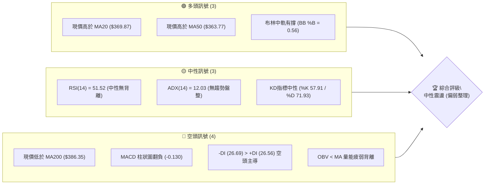
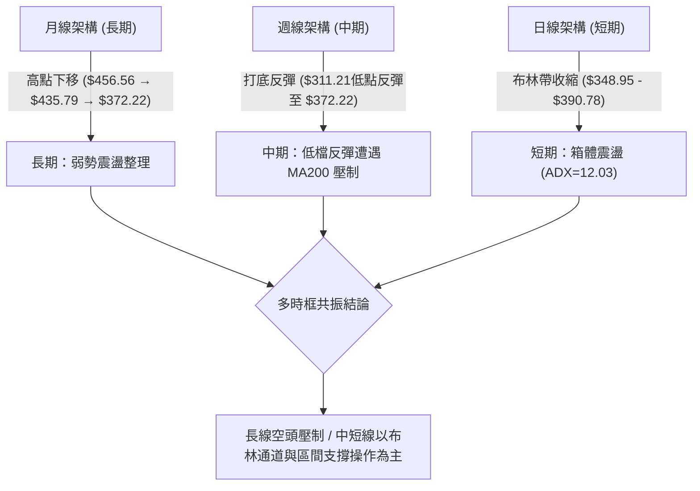
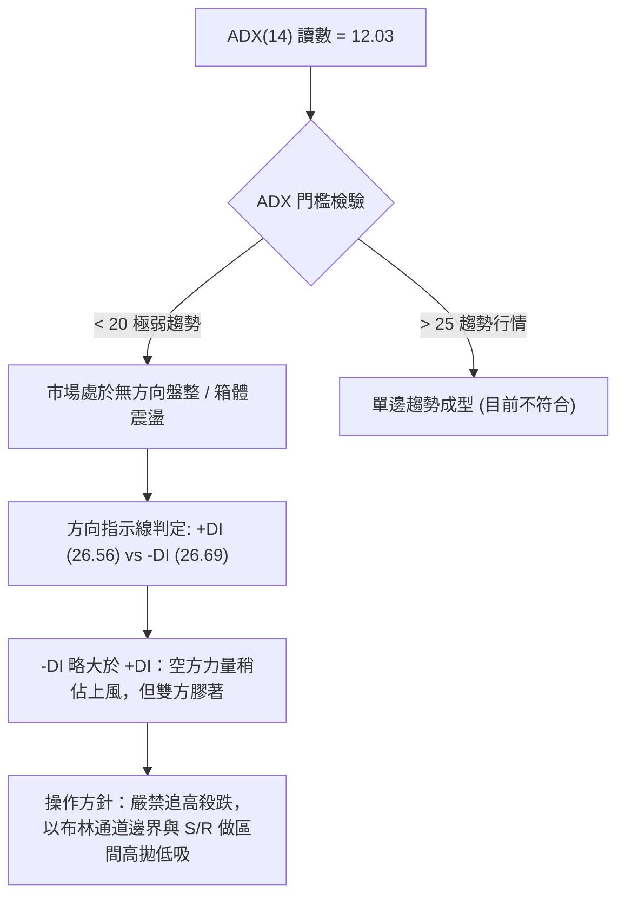
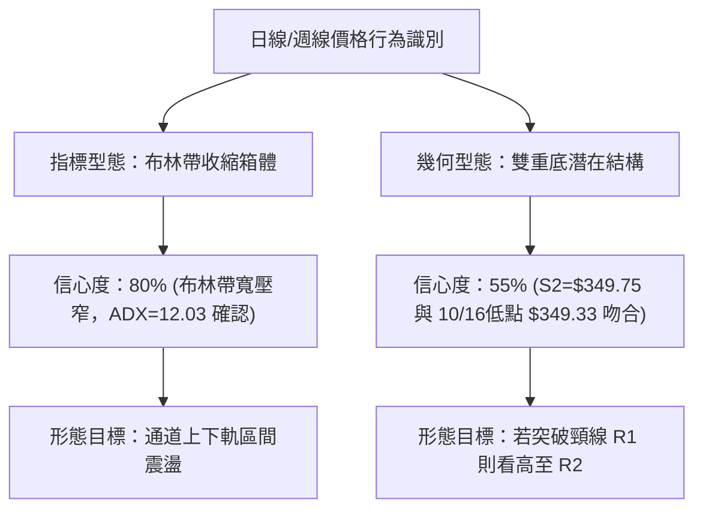
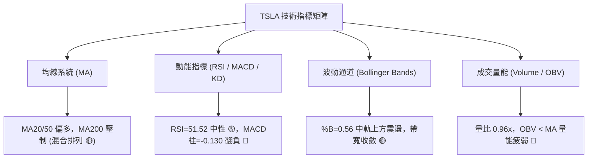
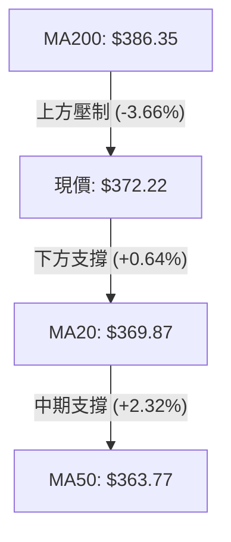
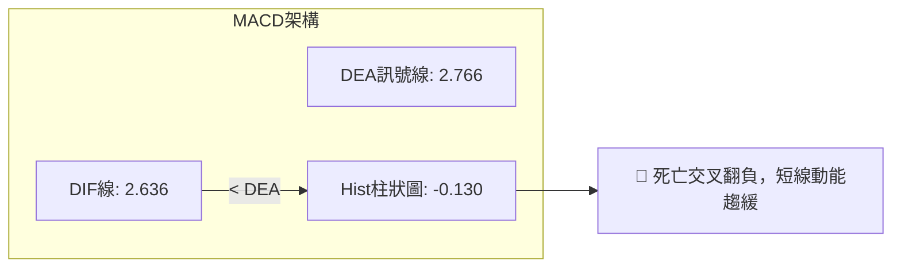
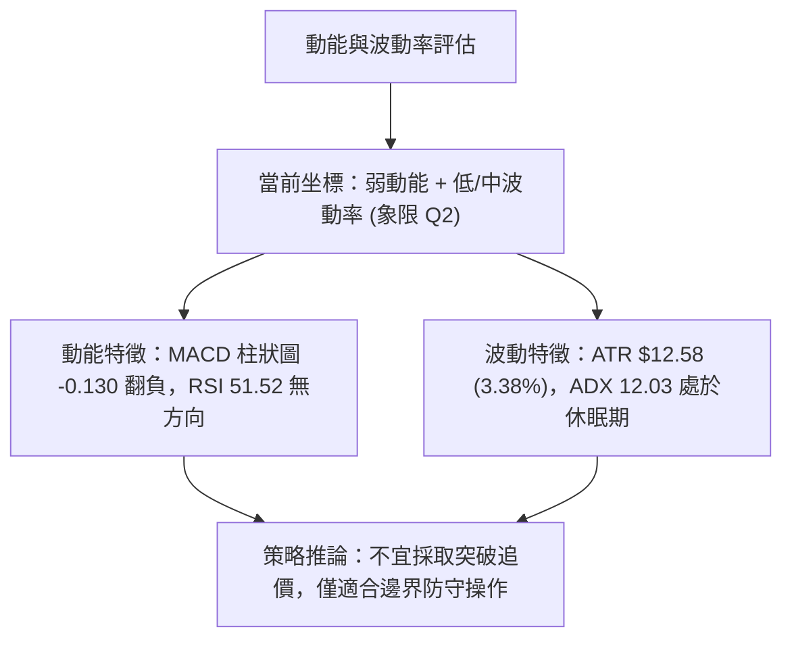
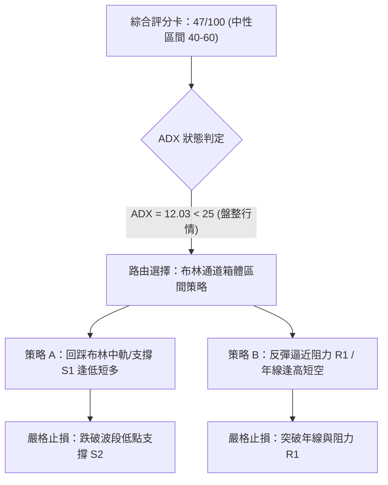
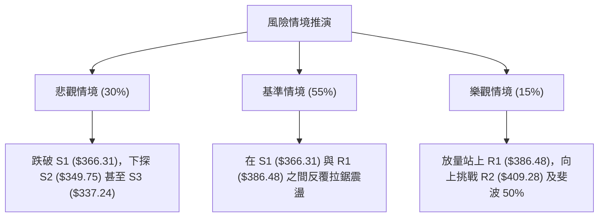

# TSLA 技術分析報告

> **報告日期**：2026-10-25 ｜ **語言**：繁體中文 ｜ **數據來源**：Yahoo Finance ｜ **當前價格**：$372.22

---

## 目錄

| 章節 | 內容 |
|------|------|
| [1. 技術面概覽](#1-技術面概覽) | 訊號儀表板、核心指標、評分卡 |
| [2. 趨勢分析](#2-趨勢分析) | 多時框趨勢、長中短期走勢 |
| [3. 圖表形態分析](#3-圖表形態分析) | 形態識別、K線組合、目標價 |
| [4. 支撐與阻力](#4-支撐與阻力) | 關鍵價位、斐波那契回調 |
| [5. 技術指標深度解讀](#5-技術指標深度解讀) | MA/RSI/MACD/布林/成交量 |
| [6. 動能與波動率](#6-動能與波動率) | 動能評估、ATR、Beta |
| [7. 多時框架總結](#7-多時框架總結) | 時框架評分矩陣 |
| [8. 交易策略建議](#8-交易策略建議) | 多空策略、風險報酬比 |
| [9. 風險提示與監控](#9-風險提示與監控) | 監控指標、風險場景 |

---

## 1. 技術面概覽

### 🎯 技術訊號儀表板



### 📊 核心指標速覽表

| 指標類別 | 指標名稱 | 當前數值 | 訊號 | 解讀 |
|----------|----------|----------|------|------|
| **價格** | 當前收盤價 | $372.22 | 🟡 | 位於 52W 區間 37.2%，處於下半部低位震盪修復階段 |
| **均線** | MA20 | $369.87 | 🟢 | 現價位於 20 日均線上方 (+0.64%)，短線具備下檔動態支撐 |
| **均線** | MA50 | $363.77 | 🟢 | 現價高於 50 日均線 (+2.32%)，中期波段底部結構尚未破壞 |
| **均線** | MA200 | $386.35 | 🔴 | 現價受制於長期年線下方 (-3.66%)，長期空頭壓制明確 |
| **動能** | RSI(14) | 51.52 | 🟡 | 位於 50 多空分界點附近，近 20 根 K 棒無頂底背離 |
| **動能** | MACD | 2.636 | 🔴 | MACD (2.636) 低於 Signal (2.766)，柱狀圖為 -0.130，動能死叉轉弱 |
| **波動** | ATR(14) | $12.58 | 🟡 | 佔股價 3.38%，每日波幅適中，反映目前處於箱體收斂收縮階段 |

### 🏆 技術評分卡

```
╔══════════════════════════════════════════════════════════════════╗
║                 技術評分卡 — TSLA (2026-10-25)                   ║
╠══════════════════════════════════════════════════════════════════╣
║ 趨勢強度 (ADX=12.03，盤整無方向)   ██████░░░░░░░░░░░░░░  30/100 🔴 ║
║ 動能指標 (RSI中性、MACD死叉)      ████████░░░░░░░░░░░░  40/100 🔴 ║
║ 支撐穩定度 (S1=$366.31守住中軌)   ██████████████░░░░░░  70/100 🟢 ║
║ 成交量配合 (量比0.96x、OBV弱)     ████████░░░░░░░░░░░░  40/100 🔴 ║
║ 形態完整度 (箱體整理中軌徘徊)     ██████████░░░░░░░░░░  50/100 🟡 ║
║ 均線排列 (混合排列，受制MA200)    ██████████░░░░░░░░░░  50/100 🟡 ║
╠══════════════════════════════════════════════════════════════════╣
║ 綜合評分 (上述六項算術平均四捨五入) ██████████░░░░░░░░░░  47/100 🟡 ║
║ 評級結論：中性觀望 / 箱體區間操作 (40–60 區間)                    ║
╚══════════════════════════════════════════════════════════════════╝
```
*(計算式：(30 + 40 + 70 + 40 + 50 + 50) ÷ 6 = 280 ÷ 6 = 46.67 ≈ 47/100)*

---

## 2. 趨勢分析

### 🌐 多時框趨勢分析



### 📈 長期趨勢 — 12個月走勢圖（Unicode）

```
TSLA 月線走勢圖（過去12個月：2025-11 至 2026-10）
價格軸 ($)
$460 ┤
$440 ┤ ●(2025-11: 430.17)   ●(2025-12: 449.72)       ●(2026-05: 435.79)
$420 ┤          ●(2026-01: 430.41)                     ●(2026-06: 420.60)
$400 ┤                   ●(2026-02: 402.51)
$380 ┤                            ●(2026-04: 381.63)               ●(2026-10: 372.22)◄現在
$360 ┤                   ●(2026-03: 371.75)               ●(2026-08: 367.95)
$340 ┤                                                             ●(2026-09: 354.81)
$310 ┤                                                    ●(2026-07: 311.21 低點)
     └─────────────────────────────────────────────────────────────────────────────
        11   12   01   02   03   04   05   06   07   08   09   10  (月份)
```

**走勢特徵分析表格**：

| 階段 | 期間 | 起點收盤 | 終點收盤 | 區間漲跌幅 | 主要走勢特徵 |
|------|------|----------|----------|------------|--------------|
| 高位做頂 | 2025-11 ~ 2026-01 | $430.17 | $430.41 | +0.06% | 觸及 $449.72 後動能衰竭，多頭未能再創 52W 新高 ($498.83) |
| 波段下殺 | 2026-01 ~ 2026-03 | $430.41 | $371.75 | -13.63% | 連續三個月收黑，跌破 $400 整數關卡與 MA200 |
| 弱勢抽頭 | 2026-03 ~ 2026-05 | $371.75 | $435.79 | +17.23% | 反彈觸及次高點 $435.79，形成中期下降趨勢線右側高點 |
| 破底重挫 | 2026-05 ~ 2026-07 | $435.79 | $311.21 | -28.59% | 單月重挫下探 52W 低點聚類區 ($311.21)，市場恐慌擴大 |
| 低檔修復 | 2026-07 ~ 2026-10 | $311.21 | $372.22 | +19.60% | 築底回升站回 $360 之上，目前在斐波那契 61.8% 處橫盤 |

### 📊 中期趨勢（週線分析）

```
TSLA 中期週線壓力與支撐示意圖
═══════════════════════════════════════════════════════════════
$418.36 ────────────────────────────────────── 阻力 R3 (波段頂部)
$409.28 ────────────────────────────────────── 阻力 R2 (上檔重壓)
$386.48 ────────────────────────────────────── 阻力 R1 (MA200 匯合處)
                                                ▲ 10/21-10/22 衝高回落
$372.22 ══════════════════════════════════════ 現價 (收盤價)
$366.31 ────────────────────────────────────── 支撐 S1 (近期平台/MA20)
$349.75 ────────────────────────────────────── 支撐 S2 (10/16 測底低點)
$337.24 ────────────────────────────────────── 支撐 S3 (波段防守底線)
═══════════════════════════════════════════════════════════════
```

### ⚡ 趨勢強度評估（ADX 解讀）



**ADX 趨勢強度對照表**：

| 指標變數 | 當前讀數 | 門檻區間 | 趨勢強度解讀 | 交易策略意涵 |
|----------|----------|----------|--------------|--------------|
| **ADX(14)** | 12.03 | < 20 (弱/無趨勢) | 趨勢動能極弱，缺乏單邊推動力 | 順勢突破策略易失效，以震盪指標為主 |
| **+DI** | 26.56 | 20–30 (中度) | 多頭攻擊動能缺乏持續放大現象 | 反彈難以一蹴可幾，受壓即回落 |
| **-DI** | 26.69 | 20–30 (中度) | 空頭壓制力略大於多頭 (差值 0.13) | 雖偏弱但未形成單邊下殺狂潮 |

---

## 3. 圖表形態分析

### 🔍 形態識別系統



**形態信心度表格（依規則 15）**：

| 形態 | 信心度 | 判斷依據（引用數據） | 完成度 | 目標價（附計算式） |
|------|--------|----------------------|--------|--------------------|
| **布林帶箱體震盪** | 80% | ADX=12.03，價格在 BB下軌 $348.95 至 BB上軌 $390.78 之間波動，BB %B 為 0.56 | 90% | 上軌目標：**$390.78** (布林上軌)<br>下軌目標：**$348.95** (布林下軌) |
| **潛在雙重底** | 55% | 10/16 日K低點 $349.33 與支撐 S2 $349.75 高度吻合形成次低點；前低為 10/02 週低點 $345.88 | 65% | 形態高度 = 頸線 R1 $386.48 − 低點 S2 $349.75 = $36.73<br>突破目標價 = 頸線 $386.48 + $36.73 = **$423.21**<br>*(未確認突破前僅列參考)* |
| **長週期頭肩頂** | 35% | 數據不足（52W高點 $498.83 為頭，左肩 $456.56，右肩 $435.79），當前已遠離頸線區 | 20% | *訊號不足，僅做指標型解讀，不預設目標價* |

### 🕯️ 重要K線形態分析（依規則 19）

依規則 19，完全依據提供的「近10根日K」與「近8根週K」實際開高低收進行客觀辨識：

| 日期（日K/週K） | 開 | 高 | 低 | 收 | K線形態 | 解讀 | 訊號 |
|------------------|----|----|----|----|---------|------|------|
| **日K: 2026-10-16** | 369.15 | 370.50 | 349.33 | 354.72 | 長黑帶下影線 | 出量 (62.06M) 殺跌探底，低點觸及 $349.33，下影線長達 $5.39，引動逢低買盤 | 🔴 偏空放量下殺 |
| **日K: 2026-10-19** | 357.50 | 369.58 | 354.47 | 368.06 | 帶長實體陽線 | 開盤跳空低開後強勢收復前日跌幅，形成多頭抵抗 | 🟢 短線多頭反彈 |
| **日K: 2026-10-21** | 381.43 | 388.84 | 380.51 | 386.47 | 中長紅K逼近R1 | 多方衝擊阻力 R1 ($386.48)，收在 $386.47，展現多頭動能 | 🟢 短線強勢多頭 |
| **日K: 2026-10-22** | 374.29 | 388.86 | 373.71 | 374.58 | 長上影倒狀錘頭 | 衝擊高點 $388.86 未果，上影線長達 $14.28，多頭遭空方阻擊回落 | 🔴 短線假突破受阻 |
| **日K: 2026-10-23** | 373.20 | 377.32 | 365.27 | 372.22 | 紡錘十字線 | 上下影線對稱，實體僅 $0.98，量縮回落至 34.68M，多空陷入僵持 | 🟡 中性平衡整理 |
| **週K: 2026-10-16** | 382.61 | 382.70 | 349.33 | 354.72 | 大陰線光頭下殺 | 週跌幅深，帶有下影線，確立 $349.33 具備技術支撐 | 🔴 中期偏空格局 |
| **週K: 2026-10-23** | 357.50 | 388.86 | 354.47 | 372.22 | 長下影帶上影陽線 | 單週下影線長 $3.03，上影線長 $16.64，收盤拉升 $14.72，確認下檔買盤但受制 MA200 | 🟡 中期震盪修復 |

### 📉 ASCII 走勢形態示意圖

```
TSLA 近期日K線形態結構圖 (2026-10-14 至 2026-10-23)
價格 ($)
$390 ┤                           ▲ 10/22 高點 $388.86 (阻力 R1 $386.48 遇阻)
$385 ┤                     ┌─┐   │ 
$380 ┤                     │ │   │   ┌─┐
$375 ┤ ┌─┐                 │ │   └─┐ │ │
$370 ┤ │ │   ┌─┐     ┌─┐   │ │     │ └─┘ ◄ 10/23 收盤 $372.22 (中軌之上)
$365 ┤ └─┘   │ │     │ │   └─┘     │
$360 ┤       └─┘ ┌─┐ │ │           │
$355 ┤           │ │ │ │           │
$350 ┤           │ │ └─┘           │
$345 ┤           └─┘ ◄ 10/16 低點 $349.33 (支撐 S2 $349.75 守穩)
     └─────────────────────────────────────────────────────────────
        10/14 10/15 10/16 10/19 10/20 10/21 10/22 10/23
```

### 🎯 形態目標價計算

1. **布林箱體震盪目標（主要形態，信心度 80%）**：
   - 區間上限目標：布林上軌 = **$390.78**
   - 區間中軸支撐：布林中軌 (MA20) = **$369.87**
   - 區間下限目標：布林下軌 = **$348.95**
2. **潛在雙重底突破推算（次要形態，信心度 55%）**：
   - 頸線位置：R1 = **$386.48**
   - 形態底部：S2 = **$349.75**
   - 形態垂直高度：$386.48 − $349.75 = $36.73
   - 形態量測目標價 (T2)：$386.48 + $36.73 = **$423.21** *(若未能放量收復 R1 則此形態不成立)*

---

## 4. 支撐與阻力

### 🗺️ 關鍵價位分布圖（Unicode）

```
TSLA 價位結構分布圖 (由 OHLCV 與斐波那契計算)
══════════════════════════════════════════════════════════════════
$418.36 ║██████████████████████████████║ 強阻力 R3 (波段高點聚類)
$409.28 ║██████████████████████        ║ 阻力 R2 (上檔波段回調高位)
$398.10 ║▓▓▓▓▓▓▓▓▓▓▓▓▓▓▓▓▓▓            ║ 斐波那契 50.0% 回調位
$390.78 ║██████████████████            ║ 布林帶上軌
$386.48 ║██████████████████████████████║ 關鍵阻力 R1 (MA200 匯合壓制區)
$374.33 ║▓▓▓▓▓▓▓▓▓▓▓▓▓▓▓▓▓▓▓▓▓▓▓▓        ║ 斐波那契 61.8% 強弱分水嶺
$372.22 ╠══════════════════════════════╣ ◄ 現價 (收盤價)
$369.87 ║▓▓▓▓▓▓▓▓▓▓▓▓▓▓▓▓▓▓            ║ 布林中軌 / MA20
$366.31 ║████████████████████          ║ 近期支撐 S1 (波段低點聚類)
$363.77 ║▓▓▓▓▓▓▓▓▓▓▓▓▓▓▓▓              ║ MA50 均線支撐
$349.75 ║██████████████████████████████║ 強支撐 S2 (波段前低測試區)
$340.49 ║▓▓▓▓▓▓▓▓▓▓▓▓▓▓▓▓▓▓▓▓          ║ 斐波那契 78.6% 回調位
$337.24 ║██████████████████████████████║ 關鍵防守支撐 S3 (波段底線)
══════════════════════════════════════════════════════════════════
```

### 🚧 阻力位分析表

| 阻力級別 | 價位 | 形成原因 | 突破難度 | 重要性 |
|----------|------|----------|----------|--------|
| **R1** | **$386.48** | 近一年波段高點聚類，與長期年線 MA200 ($386.35) 完美重疊，10/21-10/22 衝高在此受阻 | 極高 (需放量 50M 以上方可突破) | ★★★★★<br>多空牛熊分水嶺 |
| **R2** | **$409.28** | 近一年波段次高點聚類，接近 $400 整數心理防線及斐波那契 50% ($398.10) 上方套牢區 | 高 | ★★★★☆<br>中期波段目標 |
| **R3** | **$418.36** | 近一年波段密集籌碼高峰區，接近斐波那契 38.2% ($421.88) 壓制帶 | 極高 | ★★★☆☆<br>多頭長線極限阻力 |

### 🛡️ 支撐位分析表

| 支撐級別 | 價位 | 形成原因 | 守住機率 | 重要性 |
|----------|------|----------|----------|--------|
| **S1** | **$366.31** | 近一年波段低點聚類，與短中期均線 MA20 ($369.87) 及 MA50 ($363.77) 構成緩衝墊 | 70% | ★★★★☆<br>短線防守第一道關卡 |
| **S2** | **$349.75** | 近一年波段低點聚類，10/16 觸底低點 $349.33 及布林下軌 ($348.95) 匯合處 | 80% | ★★★★★<br>箱體底部位，不容有失 |
| **S3** | **$337.24** | 近一年波段重要低點，接近斐波那契 78.6% ($340.49) 黃金防線 | 90% | ★★★★☆<br>中期防守底線 |

### 📐 斐波那契回調位分析

依據 52 週波段高點 $498.83 至低點 $297.38 計算之回調架構：

```
斐波那契回調結構位與現價關係
0.0%  (52W High) ─────────────────────────── $498.83
23.6%            ─────────────────────────── $451.29
38.2%            ─────────────────────────── $421.88
50.0%            ─────────────────────────── $398.10
61.8% (黃金分割) ─────────────────────────── $374.33 ◄── 現價緊貼其下 ($372.22)
78.6%            ─────────────────────────── $340.49
100.0%(52W Low)  ─────────────────────────── $297.38
```

- **位置解讀**：現價 **$372.22** 緊貼於 **61.8% ($374.33)** 下方僅 0.56% 處，處於 61.8% ($374.33) 與 78.6% ($340.49) 形成的弱勢反彈區間。
- **技術意義**：斐波那契 61.8% 通常為波段下行後的關鍵反轉阻力點。若收盤價無法有效站穩 $374.33 之上，技術上仍屬跌深反彈，向上空間受限於 50.0% ($398.10)；若失守下檔，則 78.6% ($340.49) 將成為最後屏障。

---

## 5. 技術指標深度解讀

### 🎛️ 指標訊號總覽



### 📈 移動平均線排列分析



**移動平均線狀態表**：

| 均線名稱 | 當前數值 | 與現價差距 | 趨勢斜率 | 排列狀態與技術解讀 |
|----------|----------|------------|----------|--------------------|
| **MA 5** | $375.01 | -0.74% | ▼ 走跌 | 短線拐頭向下，反映 10/22 衝高回落後的降溫壓力 |
| **MA 10** | $371.26 | +0.26% | ▲ 上彎 | 超短線提供微幅支撐，多空在此交會 |
| **MA 20** | $369.87 | +0.64% | ▲ 上升 | 月線等級支撐強韌，多頭守護短線多空分水嶺 |
| **MA 50** | $363.77 | +2.32% | ▲ 上升 | 季線緩步抬升，提供波段堅實防禦 |
| **MA 60** | $357.50 | +4.12% | ▲ 上升 | 中期底部成本均線，結構健康 |
| **MA120** | $377.57 | -1.42% | ▼ 下滑 | 半年線向下壓制，現價反彈第一道天花板 |
| **MA200** | $386.35 | -3.66% | ▼ 下滑 | 年線持續下壓，與阻力 R1 重合，長期架構尚未轉多 |
| **MA240** | $395.80 | -5.96% | ▼ 下滑 | 長期均線下彎，顯示上方套牢壓力深重 |

### 📉 RSI(14) 分析

- **當前數值**：**51.52**（Wilder 計算方法）
- **動能評估進度條**：
  ```
  超賣 (0)                       中性 (50)                       超買 (100)
  ├───┼───┼───┼───┼───┼───┼───┼───┼───┼───┼───┼───┼───┼───┼───┼───┼───┤
  ░░░░░░░░░░░░░░░░░░░░░░░░░░░░░░░░█▓░░░░░░░░░░░░░░░░░░░░░░░░░░░░░░░░
                                51.52
  ```
- **背離判斷**：
  - 根據近 20 根 K 棒的首尾價格與 RSI 比較，首端價格與末端價格變化平緩，RSI 亦在 50 水平線徘徊，**無明顯頂背離或底背離**現象。
  - 週線 RSI 亦由 10/16 的 42.2 回升至 10/23 的 51.5，動能屬中性修復，未發出極端轉折信號。

### 📊 MACD(12/26/9) 訊號解讀



- **MACD 線**：2.636
- **MACD 訊號線 (Signal)**：2.766
- **MACD 柱狀圖 (Histogram)**：**-0.130**
- **解讀**：DIF 與 DEA 均在零軸上方運作（表明中期未陷入深淵空頭），但 DIF 於近兩日下穿訊號線形成死叉，柱狀圖轉為負值 (-0.130)。這與日K線在阻力 R1 ($386.48) 遇阻拉出長上影線完全契合，提示短線反彈動能衰退，面臨回踩整理。

### 📦 布林通道分析

```
TSLA 布林通道結構示意圖 (帶寬收縮)
═══════════════════════════════════════════════════════════════
$390.78 ────────────────────────────────────── BB 上軌 (阻力帶)
           高點觸及回落 ($388.86)
$372.22 ══════════════════════════════════════ 現價 (BB %B = 0.56)
$369.87 ────────────────────────────────────── BB 中軌 (MA20 支撐)
           
$348.95 ────────────────────────────────────── BB 下軌 (支撐帶)
═══════════════════════════════════════════════════════════════
```

- **BB 上軌**：$390.78
- **BB 中軌**：$369.87 (MA20)
- **BB 下軌**：$348.95
- **BB %B**：**0.56** (價格緊貼中軌微偏上方)
- **解讀**：布林帶帶寬顯著壓窄，%B 為 0.56 表明價格未脫離中軌引力。現價位於中軌與上軌之間的上半區，但缺乏張力，屬於典型的箱體整理結構。

### 💹 成交量分析（量價配合度）

- **最新日成交量**：34,689,700 股
- **20 日均量**：36,252,695 股（**量比：0.96x**）
- **50 日均量**：37,444,670 股
- **OBV 趨勢**：**OBV < MA → 量能疲弱**
- **量價背離分析**：
  1. 10/21 與 10/22 TSLA 發起向上攻勢，成交量放大至 48.87M 與 51.61M，但 10/22 出現長上影線，屬於**高位放量滯漲**。
  2. 10/23 隨即量縮至 34.69M，低於 20 日均量，顯示在突破阻力 R1 失敗後，追價買盤退潮。
  3. OBV 指標目前處於其均線下方，表示籌碼在此價位段積累意願不足，資金偏向防守觀望。

---

## 6. 動能與波動率

### ⚡ 動能評估四象限

| 象限 | 動能強度 (RSI/MACD) | 波動率水平 (ATR/BB帶寬) | TSLA 當前狀態 | 技術操作評估 |
|------|---------------------|-------------------------|---------------|--------------|
| **Q1：突破主升** | 強 (RSI>60, MACD擴張) | 低 (布林即將張口) | — | 最佳趨勢波段機會 |
| **Q2：箱體蓄勢** | **弱/中性 (RSI=51.52)** | **低 (ATR=3.38%, 帶寬縮)** | **✓ (TSLA 落點)** | **謹慎觀望，區間低買高賣** |
| **Q3：劇烈狂暴** | 強 (多空極端發散) | 高 (ATR>5%) | — | 高風險高收益博弈 |
| **Q4：單邊陰跌** | 弱 (RSI<40, -DI主導) | 高 (破位放量下殺) | — | 絕對避免盲目抄底 |



### 📊 ATR 波動率分析

- **ATR(14)**：**$12.58**（佔股價 **3.38%**，Wilder 平滑）
- **每日波動特性**：當前平均日波動區間為 $12.58。10/22 單日高低振幅達 $15.15 ($388.86 − $373.71)，略高於 ATR，隨後 10/23 振幅收斂至 $12.05 ($377.32 − $365.27)，重回正常 ATR 均值。
- **止損距離建議**：
  - 短線交易止損：1.0 × ATR = **$12.58**（以現價計對應約 $359.64，緊貼 MA50 上方）
  - 波段防守止損：1.5 × ATR = **$18.87**（以現價計對應約 $353.35，防守前低 S2 $349.75 之上）

### 📐 Beta 與市場相關性

- **Beta 係數**：**1.916**（極高 Beta 屬性）
- **市場相關性解讀**：TSLA 的波動率接近標普 500 指數的 1.92 倍。在目前 ADX 僅 12.03 的盤整背景下，個股自身缺乏內生趨勢動力，極易受到總體市場與大盤科技股情緒的放大拉扯。當大盤微幅回調時，高 Beta 屬性可能促使 TSLA 放大回踩下探支撐 S1。

---

## 7. 多時框架總結

### 📋 時框架評分表

| 時框架 | 趨勢方向 | 動能狀態 | 均線排列 | 形態識別 | 綜合評分 | 操作建議 |
|--------|----------|----------|----------|----------|----------|----------|
| **短期 (日線)** | 🟡 橫盤震盪 | 🔴 MACD死叉/RSI=51.52 | 🟡 站上MA20/50，壓制於MA200 | 布林收縮箱體 (信心度 80%) | **47/100** | 區間高拋低吸，嚴設止損 |
| **中期 (週線)** | 🟡 築底反彈 | 🟡 週MACD柱縮窄至-0.130 | 🔴 受阻於下彎MA200，MA60下壓 | 潛在雙底反彈結構測試頸線 | **48/100** | 觀察 R1 $386.48 爭奪，不追高 |
| **長期 (月線)** | 🔴 弱勢修正 | 🔴 長期走勢高點下移 | 🔴 遠低於 52W 高點 ($498.83) | 寬幅收斂下降楔形修正 | **38/100** | 逢高減碼長線套牢籌碼 |

### 🔲 綜合訊號矩陣

```
╔══════════════════════════════════════════════════════════════════╗
║               TSLA 多時框架綜合訊號共振矩陣                      ║
╠══════════════════╦═══════════════╦═══════════════╦═══════════════╣
║ 維度             ║ 短期 (日線)   ║ 中期 (週線)   ║ 長期 (月線)   ║
╠══════════════════╬═══════════════╬═══════════════╬═══════════════╣
║ 趨勢方向         ║ 🟡 橫盤震盪   ║ 🟡 築底反彈   ║ 🔴 弱勢修正   ║
║ 均線排列 (MA)    ║ 🟡 混合排列   ║ 🔴 均線反壓   ║ 🔴 空頭排列   ║
║ 動能指標 (RSI)   ║ 🟡 51.52 中性 ║ 🟡 51.5 中性  ║ 🔴 偏空轉弱   ║
║ 量價關係 (OBV)   ║ 🔴 OBV<MA 弱  ║ 🟡 量能持平   ║ 🔴 量縮做頂   ║
║ 波動狀態 (ADX)   ║ 🔴 12.03 盤整 ║ 🔴 趨勢不明   ║ 🟡 波動收斂   ║
╠══════════════════╬═══════════════╬═══════════════╬═══════════════╣
║ 一致性研判       ║ 日週訊號一致收斂於「盤整」；長線依然受制空頭反壓 ║
╚══════════════════╩═══════════════════════════════════════════════╝
```

### ⚖️ 多時框收斂結論（依嚴格要求 14）

1. **行情定性判定**：當前日線 **ADX(14) 讀數為 12.03**，遠低於 25 的趨勢行情門檻。依多時框收斂規則 14：「**盤整行情（ADX < 25）：以日線布林通道上下軌為主要交易區間**」。
2. **時框優先級權衡**：長期月線與年線 MA200 ($386.35) 構成堅不可摧的空頭天花板；日線短期雖站上 MA20 ($369.87) 與 MA50 ($363.77)，但受阻於阻力 R1 ($386.48) 與布林上軌 ($390.78)。日線與週線在中短期均未形成向上突破趨勢。
3. **唯一方向性結論**：**中性偏弱震盪觀望（箱體區間操作）**。評分卡分數為 **47/100**（落入 40–60 中性區間），不可強行單邊看多或看空，策略鎖定在布林通道上下軌之間的區間波動。

---

## 8. 交易策略建議

### 🗺️ 策略決策流程圖



### 🧭 策略路由（依評分卡分流，規則 18）

**當前主策略方向 = 中性震盪區間操作（依評分 47/100，落於 40–60 區間）**  
當前市場缺乏趨勢驅動力（ADX=12.03），股價受阻於 MA200 ($386.35) 且獲支撐於 MA20 ($369.87)。主策略為**布林通道箱體高拋低吸**，明確等待突破確認，絕不追價。

### 🎯 價格情境階梯（Price Scenarios）

價位完全嚴格引用第 4 章由數據算出的實際數值：

| 觸發條件 | 下一目標 | 後續延伸 | 情境含義 |
|----------|----------|----------|----------|
| **有效放量突破 R1 ($386.48)** | R2 ($409.28) | R3 ($418.36) | 站上年線，潛在雙底突破，短中期反轉轉強 |
| **維持於 S1 ($366.31) ~ R1 ($386.48)** | 布林中軌 ($369.87) | BB上軌 ($390.78) | 箱體窄幅收斂震盪，無明顯趨勢方向 |
| **跌破關鍵支撐 S1 ($366.31)** | S2 ($349.75) | S3 ($337.24) | 跌破月線支撐，回測布林下軌及前低支撐 |

### 📊 情境機率分佈

| 情境 | 機率 | 主要依據 |
|------|------|----------|
| **區間震盪整理 (維持箱體)** | **55%** | ADX 僅 12.03，布林帶寬收窄，成交量比 0.96x 未放量，RSI 51.52 缺乏動能 |
| **回落測試支撐 S2** | **30%** | MACD 柱狀圖 -0.130 翻負死叉，-DI (26.69) > +DI (26.56)，OBV 疲弱背離 |
| **強勢向上突破 R1** | **15%** | 上方 MA200 ($386.35) 下壓，10/22 放量留長上影線顯示阻力重重 |

### 🟢 主策略詳情（區間高拋低吸雙向部署）

依規則 17，風險報酬比 = (目標價 T1 − 進場價) ÷ (進場價 − 止損價)（做空時方向相反）：

| 策略要素 | 策略 A（區間逢低做多） | 策略 B（區間逢高做空） |
|----------|------------------------|------------------------|
| **進場條件** | 回踩 S1 獲支撐且縮量收下影線時進場 | 反彈遇阻 R1 未破且拉出上影線時進場 |
| **進場價格** | **$366.31**（支撐位 S1） | **$386.48**（阻力位 R1） |
| **目標價 T1** | **$386.48**（阻力位 R1） | **$366.31**（支撐位 S1） |
| **目標價 T2** | **$390.78**（布林上軌） | **$349.75**（支撐位 S2） |
| **止損價格** | **$349.75**（強支撐 S2） | **$390.78**（布林上軌） |
| **風險報酬比** | **1 : 1.22（以 T1 計）**<br>*(386.48-366.31)÷(366.31-349.75)=20.17÷16.56*<br>*(以 T2 計為 1 : 1.48)* | **1 : 4.69（以 T1 計）**<br>*(386.48-366.31)÷(390.78-386.48)=20.17÷4.30*<br>*(以 T2 計為 1 : 8.54)* |
| **成功機率** | 55% | 60% |
| **建議倉位** | 10%–15% 輕倉 | 10%–15% 輕倉 |

### 🔴 反向風險觸發點（對沖與止損提示）

- **多頭被動止損點**：若日K收盤價有效跌破 **S1 ($366.31)**，短期均線支撐破位，多頭策略應立即減碼；若進一步灌破 **S2 ($349.75)**，代表箱體下破，所有多單必須無條件止損出局。
- **空頭被動止損點**：若日K收盤價放量（單日成交量突破 55M）強勢突破年線與 **R1 ($386.48)**，空頭策略必須立即平倉止損，嚴禁逆勢抗單。

### ⭐ 整體訊號強度評星

```
做多訊號強度：★★☆☆☆  (2/5星 — 受制於 MA200 壓制與量能疲弱)
做空訊號強度：★★★☆☆  (3/5星 — MACD翻負且上檔套牢沉重)
整體可信度：  ★★★☆☆  (3/5星 — 盤整期震盪指標易鈍化，可信度中等)
```

---

## 9. 風險提示與監控

### ✅ 關鍵監控指標 Checklist

```
╔══════════════════════════════════════════════════════════════════╗
║               TSLA 交易風險監控清單 (Checklist)                  ║
╠══════════════════════════════════════════════════════════════════╣
║ [ ] 價位確認：收盤是否跌破 S1 ($366.31) 或突破 R1 ($386.48)       ║
║ [ ] 動能確認：MACD 柱狀圖是否持續擴大負值 (跌破 -0.50)           ║
║ [ ] 趨勢確認：ADX 是否自 12.03 拐頭站上 20，引發單邊破位行情       ║
║ [ ] 均線防禦：MA20 ($369.87) 是否由支撐轉為反壓                  ║
║ [ ] 量能異動：單日成交量是否異常爆出 > 50M 股 (主力出貨或突破)     ║
║ [ ] 大盤連動：關注 Beta=1.916 效應，提防納指大盤回調放大跌幅     ║
╚══════════════════════════════════════════════════════════════════╝
```

### ⚠️ 風險場景分析



### 🛡️ 風險管理重要提醒

1. **嚴禁在箱體中軌附近過度重倉**：當前價格 $372.22 處於布林帶 %B = 0.56 位置，進退兩難。在此位置建倉缺乏足夠的風險報酬優勢，務必耐心等待價格接近邊界（S1 或 R1）才執行交易計劃。
2. **波動率放大的止損紀律**：鑑於 TSLA 的 ATR 為 $12.58，單日波動極劇，日內穿刺支撐屬常見現象，部位進出場應以**日線收盤價**或預設嚴格止損點為準，避免情緒化追漲殺跌。
3. **資金管理配置**：在 ADX < 20 的無趨勢盤整市場中，總倉位水平應嚴格控制在 30% 以下，單筆策略倉位上限 15%，落實嚴格的資本保護原則。

---

## 📋 報告總結

```
╔══════════════════════════════════════════════════════════════════╗
║                  TSLA 技術分析報告總結                          ║
╠══════════════════════════════════════════════════════════════════╣
║ 報告日期：2026-10-25                                             ║
║ 當前價格：$372.22                                                ║
║ 分析評級：⚖️ 中性觀望 / 箱體震盪整理 (技術評分: 47/100)          ║
║                                                                  ║
║ 關鍵結論：                                                       ║
║ ├─ 長期趨勢：🔴 偏空修正，月線高點持續下移，受制年線 MA200        ║
║ ├─ 中期趨勢：🟡 低檔反彈，面臨阻力 R1 ($386.48) 強烈壓制         ║
║ ├─ 短期趨勢：🟡 箱體拉鋸，ADX=12.03，在布林通道內收縮震盪         ║
║ ├─ 關鍵支撐：S1 $366.31 ｜ 強支撐：S2 $349.75                    ║
║ ├─ 關鍵阻力：R1 $386.48 ｜ 上檔阻力：R2 $409.28                  ║
║ └─ 分析師目標：平均共識 $407.22 (買入評級，區間 $128.11-$600.00) ║
║                                                                  ║
║ 最優策略組合：                                                   ║
║ 1. 🥇 最佳機會：反彈至阻力 R1 ($386.48) 遇阻輕倉短空 (風報比 1:4.69)║
║ 2. 🥈 次選機會：回踩支撐 S1 ($366.31) 企穩輕倉博反彈 (風報比 1:1.22)║
║ 3. 🥉 保守選擇：完全空倉觀望，靜待放量突破 R1 或跌破 S2 再行順勢進場║
╚══════════════════════════════════════════════════════════════════╝
```

---

> ⚠️ **免責聲明**：本報告為 AI 自動生成之技術分析，所有數據及估算均基於提供的歷史價格資訊。本報告**僅供研究與學術參考**，**不構成任何投資建議**。投資有風險，入市需謹慎。

---

*報告生成時間：2026-10-25 ｜ 數據來源：Yahoo Finance ｜ 分析框架：多時框技術分析*