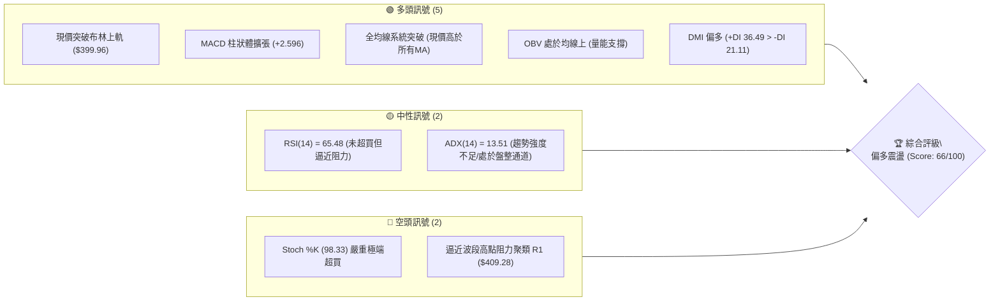
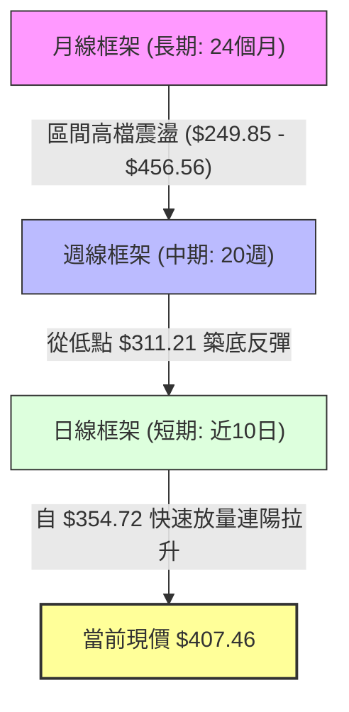
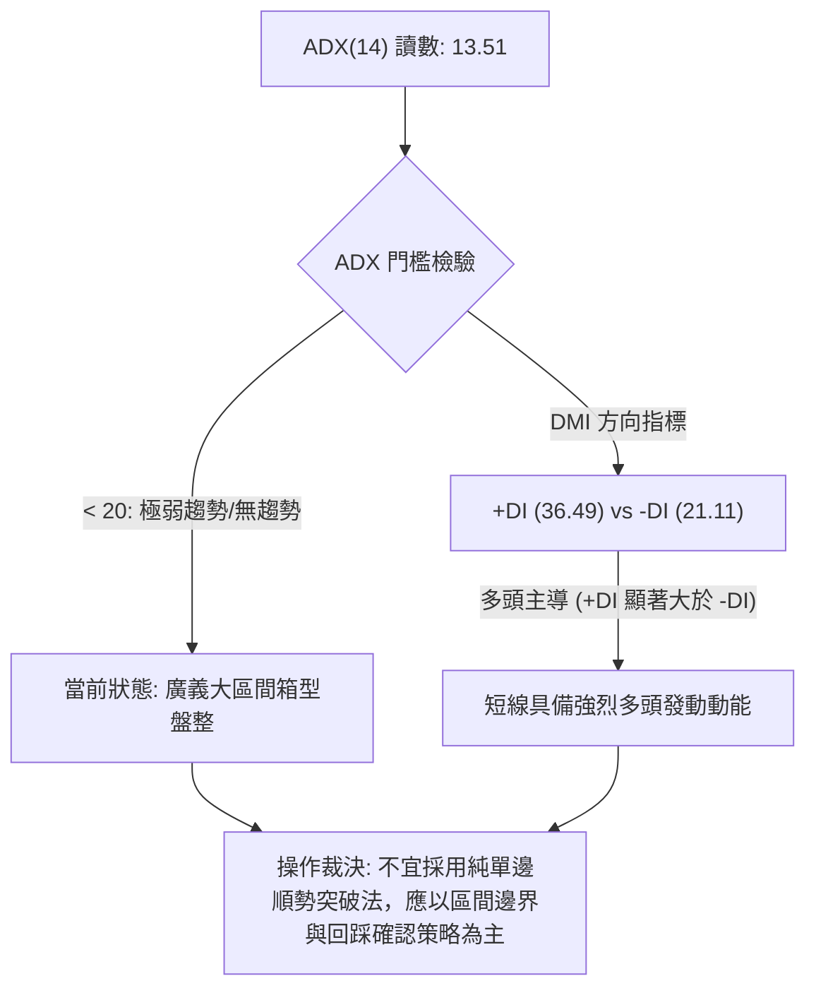
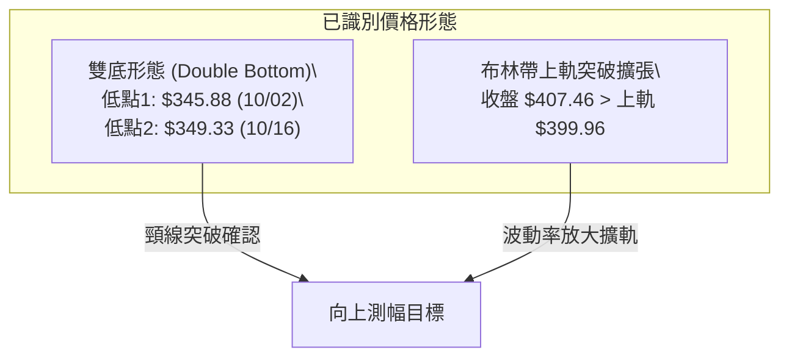
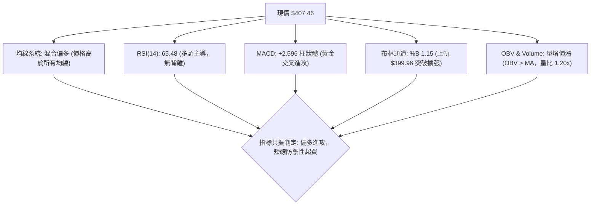
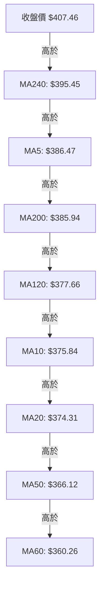
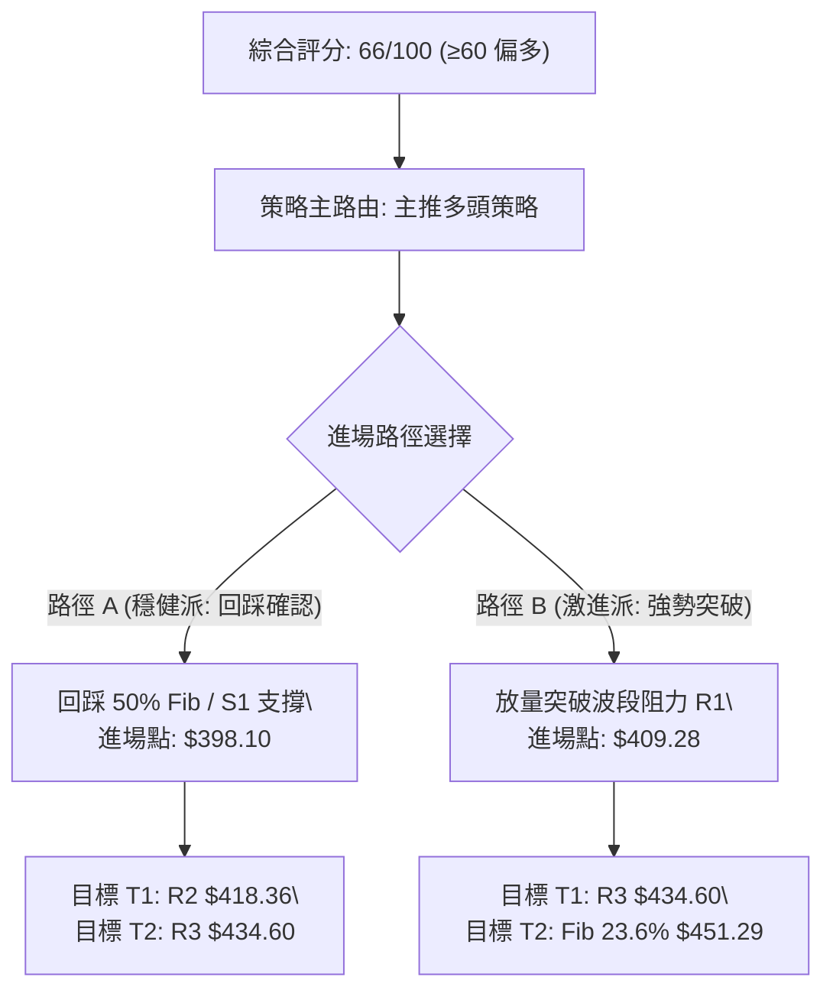
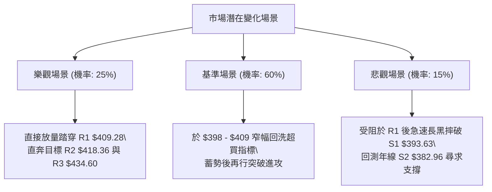

# TSLA 技術分析報告

> **報告日期**：2026-10-28 ｜ **語言**：繁體中文 ｜ **數據來源**：Yahoo Finance ｜ **當前價格**：$407.46 USD

---

## 目錄

| 章節 | 內容 |
|------|------|
| [1. 技術面概覽](#1-技術面概覽) | 訊號儀表板、核心指標、評分卡 |
| [2. 趨勢分析](#2-趨勢分析) | 多時框趨勢、長中短期走勢、ADX強度 |
| [3. 圖表形態分析](#3-圖表形態分析) | 形態識別、K線組合、目標價推算 |
| [4. 支撐與阻力](#4-支撐與阻力) | 關鍵價位、斐波那契回調結構 |
| [5. 技術指標深度解讀](#5-技術指標深度解讀) | MA系統、RSI、MACD、布林通道、OBV |
| [6. 動能與波動率](#6-動能與波動率) | 動能四象限、ATR、Beta 市場敏感度 |
| [7. 多時框架總結](#7-多時框架總結) | 時框架矩陣、多時框收斂與裁決 |
| [8. 交易策略建議](#8-交易策略建議) | 策略路由、階梯情境、主策略詳情 |
| [9. 風險提示與監控](#9-風險提示與監控) | 監控清單、情境模擬、風控指引 |

---

## 1. 技術面概覽

### 🎯 技術訊號儀表板



### 📊 核心指標速覽表

| 指標類別 | 指標名稱 | 當前數值 | 訊號 | 解讀 |
|----------|----------|----------|------|------|
| **價格** | 當前收盤價 | $407.46 | 🟢 | 站上 52 週中軸 (54.6%)，短線多頭突破 |
| **均線** | 短期 MA20 | $374.31 | 🟢 | 價格在其上方 +8.86%，月線級別多頭支撐牢固 |
| **均線** | 中期 MA50 | $366.12 | 🟢 | 價格在其上方 +11.29%，中期底部墊高確認 |
| **均線** | 長期 MA200 | $385.94 | 🟢 | 價格重返年線上方 +5.58%，扭轉中長期空頭格局 |
| **動能** | RSI(14) | 65.48 | 🟡 | 位於健康偏強的多頭進攻區（50-70），未見背離 |
| **動能** | MACD (12,26,9) | 6.254 / 3.658 | 🟢 | DIF 線與 MACD 雙線維持黃金交叉，柱狀圖 +2.596 |
| **擺動** | Stoch %K / %D | 98.33 / 81.48 | 🔴 | 進入極度超買區，短線隨時有回測或拉回可能 |
| **趨勢** | ADX(14) | 13.51 | 🟡 | 數值低於 25，表明大格局仍屬大箱型盤整行情 |
| **波動** | ATR(14) | $13.71 | 🟡 | 日波動率為 3.36%，處於常態波動區間 |
| **量能** | 20日成交量比 | 1.20x | 🟢 | 最新量 4,501 萬股高於 20 日均量，量增價揚 |

### 🏆 技術評分卡

```
╔══════════════════════════════════════════════════════════════════╗
║               技術評分卡 — TSLA (2026-10-28)                     ║
╠══════════════════════════════════════════════════════════════════╣
║ 趨勢強度 (Trend)     ██████████░░░░░░░░░░  52/100 🟡 (ADX偏低)   ║
║ 動能指標 (Momentum)  ████████████████░░░░  78/100 🟢 (MACD強勁)  ║
║ 支撐穩定度 (Support) ██████████████░░░░░░  72/100 🟢 (均線密集)  ║
║ 成交量配合 (Volume)  █████████████░░░░░░░  68/100 🟢 (量比1.20)  ║
║ 形態完整度 (Pattern) ████████████░░░░░░░░  62/100 🟡 (雙重底雛形)║
║ 均線排列 (Moving Avg)█████████████░░░░░░░  64/100 🟡 (混合均線)  ║
╠══════════════════════════════════════════════════════════════════╣
║ 綜合評分             █████████████░░░░░░░  66/100 🟢 偏多進攻    ║
╚══════════════════════════════════════════════════════════════════╝
```
*註：綜合評分由六項子評分算術平均得出：(52 + 78 + 72 + 68 + 62 + 64) ÷ 6 = 66 分。*

---

## 2. 趨勢分析

### 🌐 多時框趨勢分析



### 📈 長期趨勢 — 12個月走勢圖（Unicode）

以下為 TSLA 過去 12 個月（2025-11 至 2026-10）月線收盤走勢：

```
TSLA 月線走勢圖（2025-11 至 2026-10）
價格軸 ($)
$460 ┤               ● $449.72 (12月)
$440 ┤ ● $430.17(11月)      ● $430.41   ● $435.79 (5月)
$420 ┤                                      ● $420.60
$400 ┤                   ● $402.51                       ● $407.46(當前)
$380 ┤                               ● $381.63
$360 ┤                           ● $371.75           ● $367.95
$340 ┤                                                   ● $354.81
$320 ┤                                           ● $311.21 (7月波段低點)
     └─────────────────────────────────────────────────────────────
       11M   12M   01M   02M   03M   04M   05M   06M   07M   08M   09M   10M
```

#### 走勢特徵分析表格

| 階段區間 | 時間跨度 | 起訖收盤價 | 漲跌幅 | 走勢特徵解讀 |
|----------|----------|------------|--------|--------------|
| 高位震盪回落 | 2025-11 至 2026-03 | $430.17 → $371.75 | -13.58% | 承接 2025 年 10 月歷史高點 $456.56 後的獲利了結與估值消化 |
| 中繼反彈測試 | 2026-04 至 2026-06 | $381.63 → $420.60 | +10.21% | 嘗試重測 $430 阻力未果，形成下降大通道頂部 |
| 恐慌探底清洗 | 2026-06 至 2026-07 | $420.60 → $311.21 | -26.01% | 快速回撤至 52 週低點附近（年內最低收盤價 $311.21） |
| 底部修復攻堅 | 2026-08 至 2026-10 | $367.95 → $407.46 | +10.74% | 逐步打底墊高，10月大陽線收復 $400 大關，重返上升格局 |

### 📊 中期趨勢（週線分析）

中期走勢呈現「V型觸底後的階梯式推升」。從近 20 週數據觀察，週收盤價於 2026-07-31 探底至 $311.21 後止跌，經歷了 8-9 月的震盪築底（區間 $342 - $372），於 10 月中旬短暫跌至 $354.72 進行最後一次假跌破洗盤，隨後迅速放量拉起。

```
TSLA 中期週線壓力與支撐結構示意
  $418.36 ───────────────────────────── 阻力位 R2 (波段頸線密集區)
  $409.28 ═════════════════════════════ 阻力位 R1 (近一年波段高點)
  $407.46 ◀── 現價 (強勢挑戰前高)
  $393.63 ----------------------------- 支撐位 S1 (回踩突破點)
  $382.96 ───────────────────────────── 支撐位 S2 (週線多頭防守樞紐)
  $366.31 ============================= 支撐位 S3 (雙底頸線基底)
```

### ⚡ 趨勢強度評估（ADX 解讀）



#### ADX 強度指標對照表

| 指標名稱 | 當前數值 | 參考標準區間 | 趨勢判定 | 操作涵義 |
|----------|----------|--------------|----------|----------|
| **ADX(14)** | **13.51** | < 20 (弱/盤整), 20-25 (形成中), > 25 (強趨勢) | 弱趨勢 / 盤整 | 總體趨勢並未形成單邊奔馳，隨時有轉向箱型內部震盪之風險 |
| **+DI (14)** | **36.49** | 相對強弱比較 | 多頭優勢明顯 | 短線買盤力道充沛，主導當前推進方向 |
| **-DI (14)** | **21.11** | 相對強弱比較 | 空頭受挫退守 | 空方動能遭壓制，未形成有效拋壓 |

---

## 3. 圖表形態分析

### 🔍 形態識別系統



#### 形態識別與信心度評估表

| 形態名稱 | 信心度 | 判斷依據（引用數據） | 完成度 | 目標價（附嚴謹計算式） |
|----------|--------|----------------------|--------|------------------------|
| **短週期雙底 (W底)** | **75%** | 依近8週K棒：2026-10-02 低點 $345.88 與 2026-10-16 低點 $349.33 構成雙底底部，中間頸線為 2026-10-09 高點 $388.56。現價已實質突破頸線。 | 90% | 頸線 $388.56 + 形態高度 ($388.56 − $345.88 = $42.68) = **$431.24**（由形態高度推算，貼近 R3 $434.60） |
| **布林帶向上喇叭口突破** | **68%** | 依日線數據：%B 達 1.15，收盤價 $407.46 穿透 BB 上軌 $399.96，帶動帶寬擴張，屬於動能爆發突破。 | 85% | 依日線 ATR 擴展測幅：突破點 $399.96 + (2 × ATR $13.71) = **$427.38**（由形態高度推算） |
| **大級別頭肩頂/底** | **25%** | 過去 12 個月月線走勢雖有起伏，但結構對稱性與右肩形態尚未構築成型。 | 15% | 訊號不足，僅做指標型解讀，不預設目標價。 |

### 🕯️ 重要 K 線形態分析

嚴格依據提供的「近10根日K」與「近8根週K」四價分析關鍵轉折與進攻 K 線：

| 日期（維度） | 開 | 高 | 低 | 收 | K線形態 | 解讀 | 訊號 |
|--------------|----|----|----|----|---------|------|------|
| **2026-10-16 (日K)** | 369.15 | 370.50 | 349.33 | 354.72 | 放量長下影陰棒 (成交量 6,206 萬) | 空頭向下殺跌遭逢極端承接，低點 $349.33 確立為第二隻腳，恐慌盤洗出 | 🟢 (轉折) |
| **2026-10-21 (日K)** | 381.43 | 388.84 | 380.51 | 386.47 | 實體大陽線 | 跳空向上高走，強勢收復 MA200 ($385.94)，確認均線突破 | 🟢 (進攻) |
| **2026-10-22 (日K)** | 374.29 | 388.86 | 373.71 | 374.58 | 長上影紡錘線 | 衝高至 $388.86 遭遇頸線阻力回落，完成短線回踩確認 | 🟡 (蓄勢) |
| **2026-10-26 (日K)** | 383.83 | 397.27 | 383.73 | 391.62 | 實體中長陽線 | 重新放量上攻，收盤站上 $390，瓦解空頭反撲 | 🟢 (進攻) |
| **2026-10-27 (日K)** | 397.80 | 408.45 | 395.25 | 407.46 | 強勢光腳長陽線 | 盤中突破 $400 整數心理關卡與布林上軌，以最高檔收盤 ($407.46) | 🟢 (突破) |
| **2026-10-16 (週K)** | 382.61 | 382.70 | 349.33 | 354.72 | 探底長下影週陰線 | 週線級別在斐波那契 78.6% 之上獲得關鍵承托 | 🟡 (築底) |
| **2026-10-27 (週K)** | 383.83 | 408.45 | 383.73 | 407.46 | 大幅跳空實體週陽線 | 兩日內推升逾 23 點，週線動能極度亢奮 | 🟢 (突破) |

### 📉 ASCII 走勢形態示意圖

```
TSLA 雙底築底突破形態示意（日線維度）
價格軸 ($)
$410 ┤                                                 ▲ 突破現價 $407.46
$400 ┤                                            ╭───╯
$390 ┤                            頸線 $388.56 ─┼─ (10/09, 10/21)
$380 ┤                    ╭───╮                │
$370 ┤        ╭───╮      │   │            ╭───╯
$360 ┤        │   │      │   ╰──╮        │
$350 ┤        │   ╰──────╯      ╰────────╯
$340 ┤        ▲                           ▲
            第 1 腳: $345.88            第 2 腳: $349.33
           (2026-10-02 低點)          (2026-10-16 低點)
```

### 🎯 形態目標價計算

根據雙底形態（W底）標準對稱測幅公式：
*   **第 1 低點**：$345.88 (2026-10-02)
*   **第 2 低點**：$349.33 (2026-10-16)
*   **頸線水平**：取 2026-10-09 與 2026-10-22 之雙頂連線高點聚類 **$388.56**
*   **形態高度 ($H$)**：$388.56 − $345.88 = **$42.68**
*   **理論測幅目標價**：頸線 $388.56 + $42.68 = **$431.24**（由雙底形態高度推算，與波段阻力 R3 $434.60 形成極高重疊收斂）

---

## 4. 支撐與阻力

### 🗺️ 關鍵價位分布圖（Unicode）

```
TSLA 價位結構分布圖（OHLCV 精確計算）
═══════════════════════════════════════════════════════════════════
$498.83 ║████████████████████████████████║ 52週最高點 (Fib 0.0%)
$451.29 ║████████████████                ║ Fib 23.6% 回調位
$434.60 ║████████████████████████        ║ 強阻力 R3 (形態測幅目標 $431.24 聚類)
$418.36 ║████████████████                ║ 阻力 R2 (Fib 38.2% $421.88 緩衝帶)
$409.28 ║████████████████████████        ║ 關鍵阻力 R1 (近一年波段高點聚類)
$407.46 ╠════════════════════════════════╣ ◄ 當前收盤價 ($407.46)
$398.10 ║▓▓▓▓▓▓▓▓▓▓▓▓▓▓▓▓▓▓▓▓▓▓▓▓        ║ Fib 50.0% 中軸樞紐位
$393.63 ║▓▓▓▓▓▓▓▓▓▓▓▓▓▓▓▓▓▓▓▓▓▓▓▓        ║ 近期支撐 S1 (短線突破防守點)
$385.94 ║▓▓▓▓▓▓▓▓▓▓▓▓                    ║ MA200 年線支撐
$382.96 ║████████████████████████        ║ 強支撐 S2 (波段頸線密集區)
$374.31 ║▓▓▓▓▓▓▓▓▓▓▓▓▓▓▓▓▓▓▓▓            ║ MA20 / Fib 61.8% ($374.33)
$366.31 ║████████████████████████        ║ 鐵底支撐 S3 (MA50 $366.12 重合區)
$297.38 ║████████████████████████████████║ 52週最低點 (Fib 100.0%)
═══════════════════════════════════════════════════════════════════
```

### 🚧 阻力位分析表

以下價位嚴格引用自數據之「關鍵價位」高點聚類：

| 阻力級別 | 精確價位 | 距現價幅 | 形成原因與技術共振 | 突破難度 | 重要性 |
|----------|----------|----------|--------------------|----------|--------|
| **R1** | **$409.28** | +0.45% | 近一年日線波段高點密集聚類，逼近今日盤中最高點 ($408.45)，為短線空頭防守第一線 | 中等 | 🟡 極高（短線分水嶺） |
| **R2** | **$418.36** | +2.68% | 2026年6月月線收盤密集區 ($420.60) 與斐波那契 38.2% ($421.88) 構築之空頭堡壘 | 高 | 🔴 強阻力（波段主目標） |
| **R3** | **$434.60** | +6.66% | 2025年11月至2026年5月多次波段衝頂反轉點，雙底形態目標價 ($431.24) 終極阻力 | 極高 | 🔴 核心反轉壓力位 |

### 🛡️ 支撐位分析表

以下價位嚴格引用自數據之「關鍵價位」低點聚類：

| 支撐級別 | 精確價位 | 距現價幅 | 形成原因與技術共振 | 守住機率 | 重要性 |
|----------|----------|----------|--------------------|----------|--------|
| **S1** | **$393.63** | -3.39% | 10月26日陽線實體上方，貼近斐波那契 50.0% ($398.10) 及布林上軌突破口 ($399.96) | 70% | 🟢 短線多頭防線 |
| **S2** | **$382.96** | -6.01% | 雙底突破頸線 ($388.56) 下方承接區，緊鄰 MA200 ($385.94) 與 5日均線 ($386.47) | 85% | 🟢 波段生命線 |
| **S3** | **$366.31** | -10.10% | 10月中旬起漲點平台低位聚類，與 MA50 ($366.12) 形成絕對完美之多頭共振 | 95% | 🟢 終極戰略防守位 |

### 📐 斐波那契回調位分析

依據 52 週完整波段（低點 $297.38 至 高點 $498.83，總垂直落差 $201.45）計算之回調位：

*   **0.0% (52W High)**: $498.83
*   **23.6%**: $451.29
*   **38.2%**: $421.88
*   **50.0%**: $398.10
*   **61.8% (黃金分割)**: $374.33
*   **78.6%**: $340.49
*   **100.0% (52W Low)**: $297.38

#### 位置解讀
當前收盤價 **$407.46** 坐落於 **50.0% ($398.10)** 與 **38.2% ($421.88)** 之間：
1.  **收復 50.0% 水平**：多頭重新奪回整體 52 週跌幅的半數失土，確認中長期的空頭壓制正式解除。
2.  **上望 38.2% 水平**：$421.88 為傳統道氏理論與波浪理論之強阻力帶，與波段高點 R2 ($418.36) 構成密集夾層，將是接下來多頭推升的最大阻礙區。

---

## 5. 技術指標深度解讀

### 🎛️ 指標訊號總覽



### 📈 移動平均線排列分析



#### 均線數據透視與狀態解讀

| 均線名稱 | 數值 | 距現價差距 | 排列趨勢解讀 |
|----------|------|------------|--------------|
| **MA5** | $386.47 | +5.43% | 急速陡峭上揚，提供極短線滾動推升支撐 |
| **MA10** | $375.84 | +8.41% | 短天期追隨向上，多頭排列初具雛形 |
| **MA20** | $374.31 | +8.86% | 與布林中軌完全重合，中短線分水嶺，支撐力極強 |
| **MA50** | $366.12 | +11.29% | 中期基底，近期走勢自下方勾頭向上 |
| **MA60** | $360.26 | +13.10% | 季線位置，構築中長線第一道防火牆 |
| **MA120** | $377.66 | +7.89% | 半年線開始走平，價格向上穿越形成黃金交叉 |
| **MA200** | $385.94 | +5.58% | 關鍵牛熊年線，現價站穩其上 +21.52 點，多頭掌握戰略主動權 |
| **MA240** | $395.45 | +3.04% | 兩年線壓力已被現價強勢突破 |

*結論*：均線排列雖呈「混合排列」（因長週期 MA200/MA240 仍在 MA20 之上），但現價已經超越所有短期、中期與長期均線，構成強大的「均線全穿越多頭噴發」格局。

### 📉 RSI(14) 分析

*   **當前數值**：**65.48**
*   **區間定位**：健康多頭進攻區間（60–70）

```
RSI(14) 讀數進度條：
0 ─────── 30 ───────────── 50 ──────────── 70 ─────── 100
[░░░░░░░░░░░░░░░░░░░░░░░░░░░▓▓▓▓▓▓▓▓▓▓▓▓▓▓▓▓░░░░░░░░░░] 65.48
                           ▲ 50分水嶺     ▲ 65.48
```

#### 背離檢驗
*   **價格走勢**：近 20 根 K 棒中，價格自 2026-10-16 低點 $354.72 快速上升至 2026-10-27 收盤 $407.46（走高）。
*   **RSI 軌跡**：週線 RSI 自 42.2 攀升至 65.5，日線 RSI 同步自 40 下方拉升至 65.48。
*   **結論**：**無明顯背離**。指標與價格同步創近期新高，量價齊揚，屬強勢健康推升。

### 📊 MACD(12,26,9) 訊號解讀


*   **數值表現**：MACD 線（6.254）遠大於訊號線（3.658），歷史柱狀圖達到 **+2.596**，創下近 10 週以來最大多頭動能擴張。
*   **週線級別驗證**：近 4 週週線 MACD 柱由負翻正（-2.091 → -0.130 → +2.596），形成週線級別的大型零軸下金叉，確立中級反彈行情升級為中長期波段反轉。

### 📦 布林通道分析

```
TSLA 布林通道 (20, 2) 結構圖
───────────────────────────────────────────── $399.96 上軌 (已突破)
  ▲ $407.46 現價 (處於通道外軌超買帶, %B = 1.15)
─────────────────────────────────────────────
              ↑
          通道帶寬
              ↓
───────────────────────────────────────────── $374.31 中軌 (MA20 基準支撐)
───────────────────────────────────────────── $348.65 下軌 (波段安全底)
```

*   **指標數據**：上軌 $399.96，中軌 $374.31，下軌 $348.65，**%B = 1.15**。
*   **形態意涵**：%B 大於 1.0 表明價格已脫離常態常態分佈軌道，屬於極端強勢的「穿軌突破（Walking the Bands）」。若帶寬持續開口擴張，將推動動能單邊延伸；但若無法快速突破 R1 $409.28，則隨時可能收斂拉回回測上軌 $399.96。

### 💹 成交量分析（量價配合度）

1.  **量比結構**：最新日成交量為 **45,019,044 股**，相較於 20 日均量（37,564,557 股）達到 **1.20x 量比**，呈現良性的突破放量。
2.  **OBV 能量潮**：數據明確提示「**OBV > MA → 量能支撐上漲**」。資金流向呈現淨流入，顯示此波自 $354 向上推進並非無量空拔，而是具備實質買盤進場鎖碼。

---

## 6. 動能與波動率

### ⚡ 動能評估四象限

| 象限 | 動能維度 | 波動維度 | 處於此象限狀態之意涵 | 當前判定 |
|------|----------|----------|----------------------|----------|
| **Q1 (高動能·低波動)** | 強 | 低 | 穩定單邊趨勢，最佳順勢加碼環境 | — |
| **Q2 (低動能·低波動)** | 弱 | 低 | 窄幅盤整收斂，觀望等待方向突破 | — |
| **Q3 (高動能·高波動)** | **強** | **高** | **突破爆發期，動能強烈但洗盤劇烈，高風險高收益** | **✓ 當前狀態 (TSLA)** |
| **Q4 (低動能·高波動)** | 弱 | 高 | 無序震盪洗盤，容易多空雙巴，避免進場 | — |

*分析說明*：TSLA 具備高 Beta 屬性，且短線動能指標（MACD柱 +2.596、RSI 65.48、突破布林上軌）處於高亢區，搭配 ATR 每日達 $13.71 之大幅波動，精準坐落於 **Q3 象限**。

### 📊 ATR 波動率分析

*   **ATR(14) 數值**：**$13.71**（占股價比重 **3.36%**，Wilder平滑法）。
*   **日間波動範圍預估**：在常態分佈下，單日波動區間達 ±$13.71，代表當日震幅預期介於 $393.75 至 $421.17 之間。
*   **動態止損建議**：
    *   *超短線當沖/隔夜*：1.0 × ATR = **$13.71**
    *   *波段波段交易*：1.5 × ATR = **$20.57**（由現價回測約落在 $386.89，恰好緊貼 MA5 與 MA200 關鍵支撐）
    *   *中長線防守*：2.0 × ATR = **$27.42**（對應防守價 $380.04，貼近 S2 $382.96）

### 📐 Beta 與市場相關性

*   **Beta 係數**：**1.916**（極高系統性風險敏感度）。
*   **市場連動解讀**：
    1.  TSLA 相較於 S&P 500 指數擁有接近 2 倍的放大效應。當科技大盤上漲 1% 時，TSLA 預期推進 1.92%；反之大盤承壓回調時，其下行殺傷力亦倍增。
    2.  目前機構持股比例為 43.7%，內部人持股 17.8%，流通股做空比例僅 2.0%（Short Ratio 1.79），表明目前並無大規模扎空（Short Squeeze）推動，純屬多頭主動性買盤推升。

---

## 7. 多時框架總結

### 📋 時框架評分表

| 時框架 | 趨勢方向 | 動能狀態 | 均線系統 | 圖表形態 | 綜合評分 | 交易建議 |
|--------|----------|----------|----------|----------|----------|----------|
| **短期 (日線)** | 🟢 強烈看多 | MACD金叉/Stoch超買 | 站上所有MA | 突破布林上軌 | 78/100 | 拉回布林上軌或突破追擊 |
| **中期 (週線)** | 🟢 震盪轉強 | 週MACD翻正/RSI 65.5 | 重返MA200之上 | 雙重底頸線突破 | 68/100 | 波段持有，逢回加碼 |
| **長期 (月線)** | 🟡 箱型震盪 | 月線收斂，ADX偏低 | 糾結於兩年線邊界 | 寬幅區間整理 | 52/100 | 高出低進，以關鍵價位為綱 |

### 🔲 綜合訊號矩陣

```
訊號維度對照矩陣
┌──────────────┬──────────────┬──────────────┬──────────────┐
│  分析週期    │   趨勢狀態   │   量能支撐   │   超買超賣   │
├──────────────┼──────────────┼──────────────┼──────────────┤
│  日線 (Short)│   🟢 向上突破│   🟢 放量配合│   🔴 極度超買│
│  週線 (Mid)  │   🟢 築底反轉│   🟢 OBV轉強 │   🟡 中性偏強│
│  月線 (Long) │   🟡 大箱震盪│   🟡 常態均量│   🟡 處於中軸│
└──────────────┴──────────────┴──────────────┴──────────────┘
```

### ⚖️ 多時框收斂結論

嚴格遵循「**多時框收斂規則（規則 14）**」進行判定：
1.  **趨勢 vs 盤整檢驗**：當前 ADX(14) 讀數為 **13.51**，低於 25 臨界值，技術面本質上判定為「**大格局處於寬幅盤整行情**」。
2.  **規則優先級應用**：在盤整行情中，應「**以日線布林通道上下軌為主要交易區間**」。然而，日線收盤價 $407.46 已突破日線布林上軌 $399.96（%B = 1.15），且 +DI (36.49) 遠勝 -DI (21.11)。
3.  **衝突取捨與收斂裁決**：日線雖然爆發突破，但由於宏觀屬於盤整行情（ADX < 25），且日線隨機指標（Stoch %K 98.33）極度超買，股價正面臨波段高點阻力 R1 $409.28。因此，**不得在阻力位前盲目市價追高**。
4.  **唯一方向性結論**：**【偏多震盪，拉回支撐做多】**。中短期主導方向轉多，操作核心在於等待回踩確認支撐，而非押注單邊無回調噴發。此結論與下方第 8 章之主策略完全一致。

---

## 8. 交易策略建議

### 🗺️ 策略決策流程圖



### 🧭 策略路由（依評分卡分流）

> **當前主策略方向 = 【多頭進攻策略】（依評分 66/100，評級 ≥ 60 偏多）**

基於綜合評分 66 分，技術指標呈多頭排列，且週線雙底成型，主推**多頭交易策略**；空頭方向僅做為多頭失效時之「反轉風險停損與對沖提示」，不進行逆勢放空推薦。

### 🎯 價格情境階梯（Price Scenarios）

價位嚴格引用自「第 4 章／關鍵價位區塊」實際數值：

| 觸發條件 | 下一目標 | 後續延伸 | 情境含義 |
|----------|----------|----------|----------|
| **有效突破 R1 ($409.28)** | **R2 ($418.36)** | **R3 ($434.60)** | 短線多頭完全打破日線盤整箱頂，動能加速延展 |
| **守穩現價與 S1 ($393.63)** | **R1 ($409.28)** | **R2 ($418.36)** | 消化超買指標，高檔換手蓄勢，維持多頭架構 |
| **失守支撐 S1 ($393.63)** | **S2 ($382.96)** | **S3 ($366.31)** | 短線假突破確立，價格回歸回踩 MA200 與頸線支撐 |

### 📊 情境機率分佈

| 情境劇本 | 機率 | 主要依據 |
|----------|------|----------|
| **情境一：強勢震盪後上攻突破** | **55%** | MACD 柱狀體達 +2.596 大幅擴張，OBV 處於均線之上顯示主力建倉，日線收盤創近期新高 |
| **情境二：回測支撐洗盤 (S1/Fib 50%)** | **35%** | ADX 僅 13.51 缺乏強單邊動力，Stoch %K 高達 98.33 極度超買，極易產生日內或數日回抽 |
| **情境三：全面反轉破位下殺** | **10%** | 均線系統形成層層托底，除非大盤遭遇系統性崩跌，否則直接跌破 S2 ($382.96) 機率低 |

### 🟢 主策略詳情（方向：多頭）

嚴格依據規則 17 計算風險報酬比：`(目標價 T1 − 進場價) ÷ (進場價 − 止損價)`。

| 策略要素 | 策略 A（穩健型：回踩支撐佈局） | 策略 B（動能型：強勢突破跟進） |
|----------|--------------------------------|--------------------------------|
| **進場條件** | 股價回踩 50% 斐波那契回調位與布林上軌支撐不破 | 盤中放量有效突破波段高點阻力 R1 |
| **進場價格** | **$398.10** (斐波那契 50.0% 關鍵位) | **$409.28** (突破阻力位 R1) |
| **目標價 T1** | **$418.36** (阻力位 R2) | **$434.60** (強阻力位 R3) |
| **目標價 T2** | **$434.60** (強阻力位 R3) | **$451.29** (斐波那契 23.6%) |
| **止損價格** | **$382.96** (強支撐位 S2 / 頸線防守) | **$393.63** (支撐位 S1 / 前高轉換) |
| **風險報酬比** | **1 : 1.34**（以 T1 計）<br>*(418.36 − 398.10) ÷ (398.10 − 382.96) = 20.26 ÷ 15.14*<br>*(以 T2 計為 1 : 2.41)* | **1 : 1.62**（以 T1 計）<br>*(434.60 − 409.28) ÷ (409.28 − 393.63) = 25.32 ÷ 15.65*<br>*(以 T2 計為 1 : 2.68)* |
| **成功機率** | **65%** | **55%** |
| **建議倉位** | **15% - 20%** 總資金倉位 | **10% - 15%** 總資金倉位 |

### 🔴 反向風險觸發點（對沖與停損提示）

若出現以下情況，主推之多頭策略全面失效，必須立刻停損離場或反手佈局防禦性部位：
1.  **關鍵破位訊號**：日線收盤價跌破 **S1 ($393.63)** 且次日未能收復，表明布林通道突破為「假突破陷阱」。
2.  **形態破壞訊號**：日線長黑實體貫穿 **S2 ($382.96)** 與 **MA200 ($385.94)**，意味著雙底頸線徹底淪陷，走勢將重新下探 S3 ($366.31)。
3.  **指標惡化訊號**：日線 MACD 出現柱狀體快速收斂並轉為死叉，且 Stoch 跌破 80 形成「死叉超買逃脫」。

### ⭐ 整體訊號強度評星

```
做多訊號強度：★★★★☆  (4/5星 — 多頭動能充沛，但短線面臨超買)
做空訊號強度：★☆☆☆☆  (1/5星 — 均線與量能全多頭，逆勢做空風險極大)
整體可信度：  ★★★★☆  (4/5星 — 多時框指標高度共振確認)
```

---

## 9. 風險提示與監控

### ✅ 關鍵監控指標 Checklist

```
╔══════════════════════════════════════════════════════════════════╗
║               TSLA 交易日常風控監控清單 (Checklist)              ║
╠══════════════════════════════════════════════════════════════════╣
║ [ ] 價格能否守在斐波那契 50.0% ($398.10) 與 S1 ($393.63) 之上？   ║
║ [ ] 每日成交量是否持續高於 20 日均量 (37.56M)，維持放量攻擊？   ║
║ [ ] 盤中觸及 R1 ($409.28) 時，Stoch %K 是否自 98.33 形成死亡交叉？║
║ [ ] RSI(14) 能否在 65-75 區間健康運作，避免跌破 50 多空分水嶺？ ║
║ [ ] 布林上軌 ($399.96) 是否提供強固支撐？(%B 是否維持 > 1.0)   ║
║ [ ] 大盤 Nasdaq/S&P500 是否同步配合 (留意 TSLA Beta = 1.916 效應)║
╚══════════════════════════════════════════════════════════════════╝
```

### ⚠️ 風險場景分析



### 🛡️ 風險管理重要提醒

1.  **極端波動性控管**：TSLA 之 ATR 高達 **$13.71**，單日波動極其猛烈。嚴格禁止滿倉操作，單筆交易之最大止損本金虧損額應限制於整體投資組合的 **1.0% – 1.5%** 之內。
2.  **估值與基本面背離風險**：雖然技術面轉強，但公司 Trailing P/E 達 447.8 倍，且最新季度淨利潤年減 -42.7%。高估值意味著股價容錯率極低，任何宏觀或業績利空皆可能引發技術面「閃崩式回調」。
3.  **阻力聚類防禦思維**：R1 ($409.28) 距離現價僅 +0.45%，切勿在未見到「放量實體突破」前盲目追入。穩健交易者應以等待回踩 S1 ($393.63) 或突破站穩後之回測確認為唯一進場標準。

---

## 📋 報告總結

```
╔══════════════════════════════════════════════════════════════════╗
║                    TSLA 技術分析報告總結                         ║
╠══════════════════════════════════════════════════════════════════╣
║ 報告日期：2026-10-28                                             ║
║ 當前價格：$407.46 USD                                            ║
║ 分析評級：🟢 偏多進攻（技術綜合評分：66 / 100）                  ║
║                                                                  ║
║ 關鍵結論：                                                       ║
║ ├─ 長期趨勢：🟡 月線寬幅大箱型震盪 ($297 - $498)                 ║
║ ├─ 中期趨勢：🟢 週線雙底成型，正式突破頸線收復年線 MA200        ║
║ ├─ 短期趨勢：🟢 日線放量突破布林上軌，均線全線多頭穿越          ║
║ ├─ 關鍵支撐：S1 $393.63  /  S2 $382.96  /  S3 $366.31          ║
║ ├─ 關鍵阻力：R1 $409.28  /  R2 $418.36  /  R3 $434.60          ║
║ └─ 機構共識：分析師目標均價 $410.68（極限區間 $128.11 - $600.00）║
║                                                                  ║
║ 最優策略組合：                                                   ║
║ 1. 🥇 最佳機會：回踩 50% 斐波那契回調位 $398.10 逢低做多         ║
║                (止損 $382.96，目標 T1 $418.36，風報比 1 : 1.34)  ║
║ 2. 🥈 次選機會：突破波段高點 R1 $409.28 後追隨做多               ║
║                (止損 $393.63，目標 T1 $434.60，風報比 1 : 1.62)  ║
║ 3. 🥉 保守選擇：在 $393.63 至 $409.28 區間內觀望，待超買降溫    ║
╚══════════════════════════════════════════════════════════════════╝
```

---

> ⚠️ **免責聲明**：本報告為技術分析專項研究，所有數據、圖表及估算均嚴格基於歷史量價與技術指標模型推算。本報告**僅供研究與學術參考**，**不構成任何形式的投資要約、招攬或具體操作建議**。金融市場瞬息萬變，高 Beta 股票風險巨大，投資人應獨立評估自身財務能力並自負盈虧。

---

*報告生成時間：2026-10-28 ｜ 數據來源：Yahoo Finance ｜ 分析框架：多時框技術分析模型*