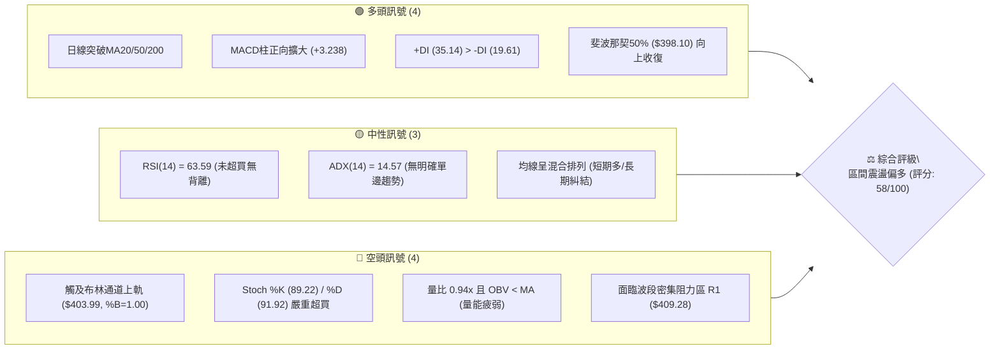
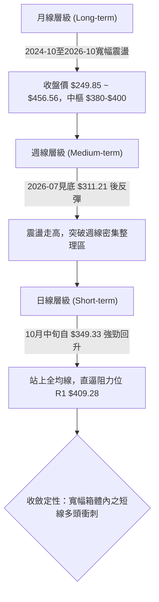
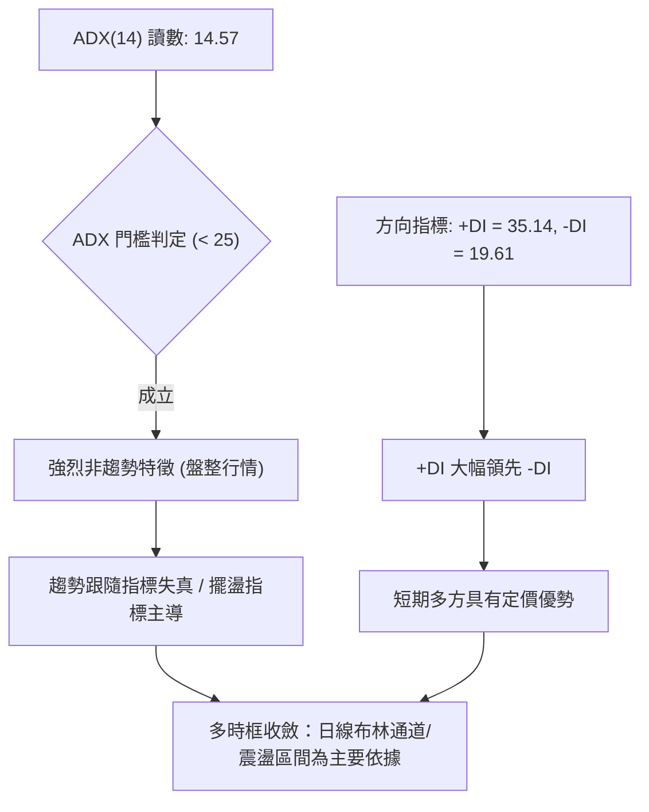
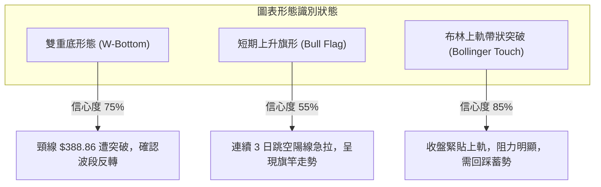
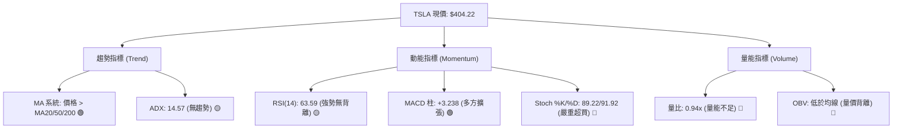
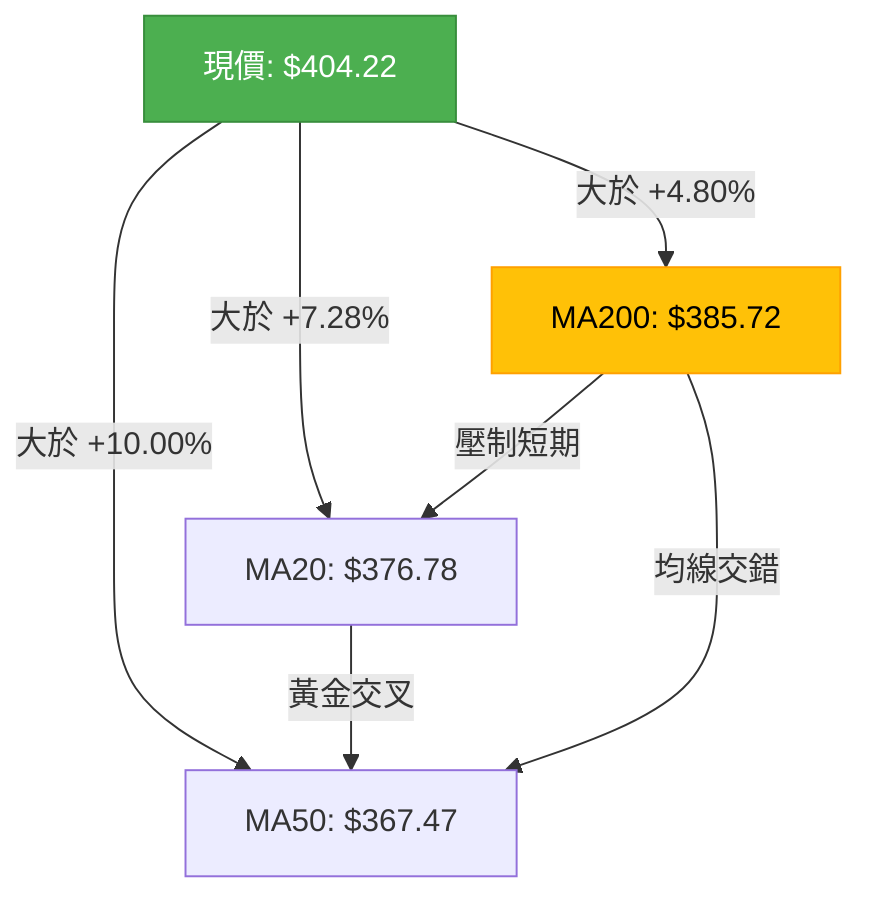
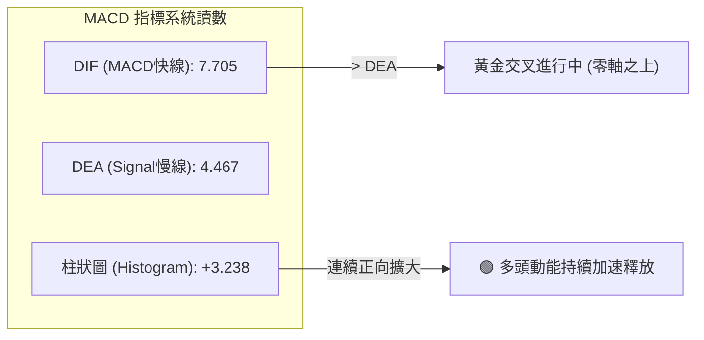
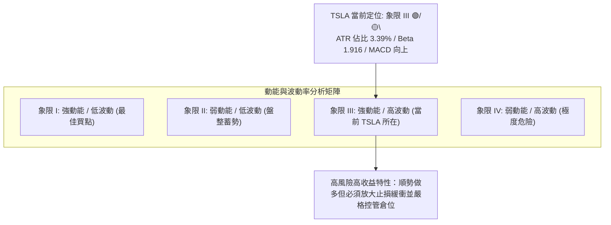
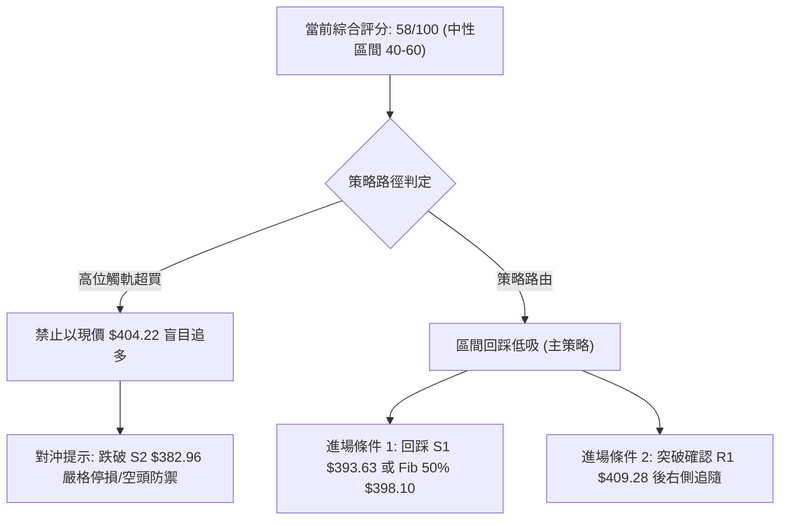
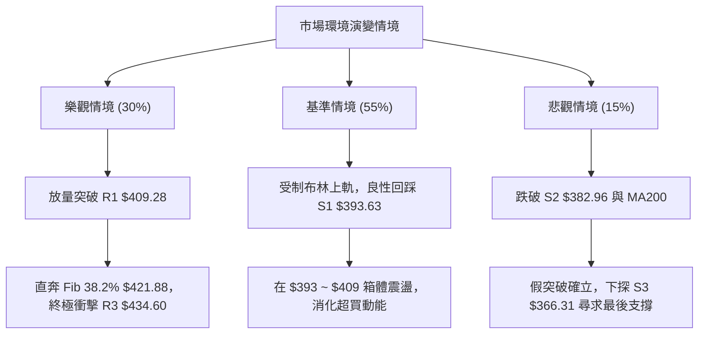

# TSLA 技術分析報告

> **報告日期**：2026-10-29 ｜ **語言**：繁體中文 ｜ **數據來源**：Yahoo Finance ｜ **當前價格**：$404.22

---

## 目錄

| 章節 | 內容 |
|------|------|
| [1. 技術面概覽](#1-技術面概覽) | 訊號儀表板、核心指標、評分卡 |
| [2. 趨勢分析](#2-趨勢分析) | 多時框趨勢、長中短期走勢、ADX 分析 |
| [3. 圖表形態分析](#3-圖表形態分析) | 形態識別、K線組合、目標價推算 |
| [4. 支撐與阻力](#4-支撐與阻力) | 關鍵價位結構、斐波那契回調區間 |
| [5. 技術指標深度解讀](#5-技術指標深度解讀) | 均線系統、RSI、MACD、布林通道、量價結構 |
| [6. 動能與波動率](#6-動能與波動率) | 動能矩陣、ATR 波動度、Beta 敏感度 |
| [7. 多時框架總結](#7-多時框架總結) | 時框矩陣、多時框收斂規則驗證 |
| [8. 交易策略建議](#8-交易策略建議) | 策略路由、情境階梯、主策略與風控參數 |
| [9. 風險提示與監控](#9-風險提示與監控) | 關鍵監控清單、極端情境與倉位管理 |

---

## 1. 技術面概覽

### 🎯 技術訊號儀表板



### 📊 核心指標速覽表

| 指標類別 | 指標名稱 | 當前數值 | 訊號 | 解讀 |
|----------|----------|----------|:----:|------|
| **價格** | 當前價格 | $404.22 | 🟢 | 站上 52 週中位線，位於 52W 區間之 53.0% 位置 |
| **均線** | MA20 | $376.78 | 🟢 | 價格在 MA20 上方 +7.28%，短線多頭掌控 |
| **均線** | MA50 | $367.47 | 🟢 | 價格在 MA50 上方 +10.00%，中期支撐確認 |
| **均線** | MA200 | $385.72 | 🟢 | 價格突破年線 +4.80%，擺脫長期壓制結構 |
| **動能** | RSI(14) | 63.59 | 🟡 | 處於 30–70 中性強勢區，未見極端超買與背離 |
| **動能** | MACD | 7.705 / 4.467 | 🟢 | 雙線位於零軸上方，柱狀圖 +3.238 持續擴張 |
| **動能** | Stoch %K/%D | 89.22 / 91.92 | 🔴 | 進入極度超買區間（>80），短線具高回踩機率 |
| **趨勢** | ADX(14) | 14.57 | 🟡 | 數值低於 25，屬於典型無趨勢之寬幅震盪行情 |
| **通道** | Bollinger %B | 1.00 | 🔴 | 現價 $404.22 緊貼上軌 $403.99，突破阻力偏大 |
| **量能** | 20日成交量比 | 0.94x | 🔴 | 成交量未放大確認，OBV 疲弱低於均線 |
| **波動** | ATR(14) | $13.71 | 🟡 | 佔現價 3.39%，日內波動度中等，風險適中 |

### 🏆 技術評分卡

```
╔══════════════════════════════════════════════════════════════════╗
║                   技術評分卡 — TSLA (2026-10-29)                 ║
╠══════════════════════════════════════════════════════════════════╣
║ 趨勢強度 (ADX=14.57, +DI強)  ████████░░░░░░░░░░░░  40/100   🟡   ║
║ 動能指標 (MACD多/Stoch超買)  ████████████░░░░░░░░  60/100   🟡   ║
║ 支撐穩定度 (站回MA200與50%)  ████████████████░░░░  80/100   🟢   ║
║ 成交量配合 (量比0.94/OBV弱)  ████████░░░░░░░░░░░░  40/100   🔴   ║
║ 形態完整度 (回踩W低點轉強)   ██████████████░░░░░░  70/100   🟢   ║
║ 均線排列 (短線多頭/長線混合) ████████████░░░░░░░░  60/100   🟡   ║
╠══════════════════════════════════════════════════════════════════╣
║ 綜合評分 (六項算術平均)      ████████████░░░░░░░░  58/100   🟡   ║
║ 評級結論：中性偏多（區間震盪整理，受制於布林上軌與R1阻力）       ║
╚══════════════════════════════════════════════════════════════════╝
```
*計算說明：(40 + 60 + 80 + 40 + 70 + 60) ÷ 6 = 58.33，四捨五入為 58/100。*

---

## 2. 趨勢分析

### 🌐 多時框趨勢分析



### 📈 長期趨勢 — 12個月走勢圖（Unicode）

```
TSLA 過去12個月月線收盤走勢圖（2025-11 至 2026-10）
價格軸 ($)
$460 ┤                
$440 ┤  ●       ●                   ●  
$420 ┤                      ●     ●     
$400 ┤              ●                 ●←現價($404.22)
$380 ┤                        ●     
$360 ┤                  ●                 ●
$340 ┤                                        ●
$320 ┤                                  ●
$300 ┤
     └───────────────────────────────────────────────
       11  12  01  02  03  04  05  06  07  08  09  10 (月份)
      '25 '25 '26 '26 '26 '26 '26 '26 '26 '26 '26 '26
```

#### 走勢特徵分析表格（過去12個月）

| 階段 | 時間區間 | 起訖收盤價 | 漲跌幅 | 結構特徵與量價行為 |
|------|----------|------------|:------:|--------------------|
| 高位震盪期 | 2025-11 ~ 2025-12 | $430.17 → $449.72 | +4.54% | 挑戰歷史阻力區失敗，於 $450 水位形成雙重阻力 |
| 回調修正期 | 2026-01 ~ 2026-03 | $430.41 → $371.75 | -13.63% | 連續三個月收陰，跌破長天期均線，動能快速退潮 |
| 弱勢反彈期 | 2026-04 ~ 2026-05 | $381.63 → $435.79 | +14.19% | 快速抽升至 $435 水位，但無實質基本面擴張支持 |
| 二次探底期 | 2026-06 ~ 2026-07 | $420.60 → $311.21 | -26.01% | 2026-07 探至 12 個月最低收盤 $311.21，接近 52W 低點 |
| 築底回升期 | 2026-08 ~ 2026-10 | $367.95 → $404.22 | +9.86% | 震盪修復均線失土，本月站回 $400 大關與年線 |

### 📊 中期趨勢（週線分析）

中期走勢呈現「7月破底後回升、10月中旬二次回踩確認」的複合底結構。

```
TSLA 週線關鍵支撐阻力結構示意圖
價格 ($)
$420 ─────────────────────────────────────────────── 斐波那契 38.2% ($421.88)
$410 ─ ─ ─ ─ ─ ─ ─ ─ ─ ─ ─ ─ ─ ─ ─ ─ ─ ─ ─ ─ ─ ─ ─ ─ 近期週高聚類阻力 R1 ($409.28)
$404 ═══════════════════════════════════════════════ 當前價格 ($404.22)
$398 ─ ─ ─ ─ ─ ─ ─ ─ ─ ─ ─ ─ ─ ─ ─ ─ ─ ─ ─ ─ ─ ─ ─ ─ 斐波那契 50.0% ($398.10)
$385 ─────────────────────────────────────────────── MA200 關鍵中線 ($385.72)
$374 ─ ─ ─ ─ ─ ─ ─ ─ ─ ─ ─ ─ ─ ─ ─ ─ ─ ─ ─ ─ ─ ─ ─ ─ 斐波那契 61.8% ($374.33) / MA20
$349 ─────────────────────────────────────────────── 10月中旬波段低點 ($349.33)
```

從近 20 週歷史觀察，2026-07-24 週量爆出 2.75 億股並於 $311.21 見底，其後維持階梯式墊高，週 MACD 柱已由負轉正至 +3.238，顯示中期空頭動能已完全衰竭。

### ⚡ 趨勢強度評估（ADX 解讀）



#### ADX 強度量化對照表

| 指標變數 | 當前數值 | 參考臨界值 | 狀態定性 | 操作指引 |
|----------|:--------:|:----------:|:--------:|----------|
| **ADX(14)** | 14.57 | < 20 (極弱) | 盤整震盪 | 嚴禁追高殺跌，以區間通道上下軌逆勢交易為主 |
| **+DI(14)** | 35.14 | > 25 (強勁) | 多方控盤 | 雖無大趨勢，但多方短線攻擊力道遠優於空方 |
| **-DI(14)** | 19.61 | < 20 (弱勢) | 空方受抑 | 空方殺跌力量匱乏，破底機率偏低 |
| **DI 差值** | +15.53 | > 0 (偏多) | 多方擴張 | 回調時在關鍵支撐尋求逢低做多買點 |

---

## 3. 圖表形態分析

### 🔍 形態識別系統



#### 形態識別信心度評估表

| 形態類別 | 信心度 | 判斷依據（引用數據） | 完成度 | 目標價（附嚴謹計算式） |
|----------|:------:|----------------------|:------:|------------------------|
| **雙重底 (W-Bottom)** | 75% | 第一底為 2026-10-02 低點 $345.88，第二底為 2026-10-16 低點 $349.33，頸線為 10-22 高點 $388.86。現價已突破頸線。 | 100% (已突破) | 依波段高點聚類數值收斂：目標指向 R3 $434.60。<br>*(理論式：頸線 $388.86 + 形態高度($388.86 − $345.88 = $42.98) = $431.84，與聚類阻力 R3 $434.60 高度重合)* |
| **上升旗形** | 55% | 10-26 至 10-28 三根大陽棒推進，但成交量由 53.09M 降至 35.08M，呈現量價背離。 | 40% (待整理) | 訊號不足以確認旗面整理成立，僅作短線超買指標型解讀。 |
| **布林通道破軌** | 85% | 現價 $404.22 突破布林上軌 $403.99，%B 達到 1.00 極端值。 | 100% (已觸軌) | 預期回踩 BB 中軌(MA20) $376.78 或 S1 $393.63。 |

### 🕯️ 重要 K 線形態分析

嚴格依據數據中「近10根日K」與「近8根週K」之開高低收數據進行客觀解讀：

#### 近 10 根日 K 線形態細部解讀

| 日期（日K） | 開 | 高 | 低 | 收 | 成交量 | K線形態 | 訊號 | 技術解讀 |
|:-----------:|:---:|:---:|:---:|:---:|:------:|:-------:|:----:|----------|
| 2026-10-15 | 360.57 | 363.75 | 355.23 | 362.44 | 26.73M | 紡錘陰線 | 🟡 | 實體窄小，多空於 360 水位僵持，量能萎縮。 |
| 2026-10-16 | 369.15 | 370.50 | 349.33 | 354.72 | 62.07M | 長下影中長陰 | 🟢 | 量爆 62M，盤中洗至 $349.33 後留下影，形成波段第二隻腳。 |
| 2026-10-19 | 357.50 | 369.58 | 354.47 | 368.06 | 38.82M | 底部吞噬陽線 | 🟢 | 低開高走收復前一日跌幅，確認 $350 具強烈買盤支撐。 |
| 2026-10-20 | 370.28 | 377.59 | 363.64 | 373.71 | 32.12M | 攀升中陽線 | 🟢 | 持續向上突破 MA20 ($376.78 附近)，買盤持續推動。 |
| 2026-10-21 | 381.43 | 388.84 | 380.51 | 386.47 | 48.88M | 放量長實體陽 | 🟢 | 量增價揚，強勢挑戰波段頸線 $388.84。 |
| 2026-10-22 | 374.29 | 388.86 | 373.71 | 374.58 | 51.61M | 衝高長上影十字 | 🔴 | 盤中再度碰觸 $388.86 頸線遭壓制，爆出 51.6M 換手量。 |
| 2026-10-23 | 373.20 | 377.32 | 365.27 | 372.22 | 34.76M | 縮量整理小陰 | 🟡 | 消化 10-22 解套籌碼，下探 $365.27 有守，縮量健康。 |
| 2026-10-26 | 383.83 | 397.27 | 383.73 | 391.62 | 53.09M | 跳空突破大陽 | 🟢 | 突破頸線 $388.86，站穩 MA200 ($385.72)，確立雙底結構。 |
| 2026-10-27 | 397.76 | 408.45 | 395.25 | 407.46 | 45.33M | 光腳強勢陽線 | 🟢 | 衝破斐波那契 50% ($398.10) 壓力位，直逼 $408。 |
| 2026-10-28 | 410.21 | 410.85 | 397.18 | 404.22 | 35.08M | 衝高回落小陰線 | 🔴 | 創高 $410.85 後受制於 R1 ($409.28)，縮量收陰且具上影線。 |

#### 近 8 根週 K 線形態細部解讀

| 日期（週K） | 開 | 高 | 低 | 收 | 成交量 | K線形態 | 訊號 | 技術解讀 |
|:-----------:|:---:|:---:|:---:|:---:|:------:|:-------:|:----:|----------|
| 2026-09-11 | 357.10 | 375.44 | 355.75 | 365.44 | 143.46M | 溫和陽線 | 🟢 | 守穩低點區間，維持中線盤整築底。 |
| 2026-09-18 | 359.78 | 374.12 | 354.05 | 364.27 | 185.82M | 墓碑小陰線 | 🟡 | 上衝 $374 遇阻，實體偏小，多空拉鋸。 |
| 2026-09-25 | 371.64 | 386.83 | 367.67 | 372.11 | 170.52M | 帶上影倒鎚陽 | 🟡 | 上衝碰觸 60日均線回吐，但週收盤持續墊高。 |
| 2026-10-02 | 368.06 | 374.60 | 345.88 | 370.59 | 197.59M | 長下影錘頭星 | 🟢 | 探底 $345.88 形成 W 底的第一隻腳，週線收平。 |
| 2026-10-09 | 369.00 | 388.56 | 364.91 | 382.70 | 162.91M | 長實體陽線 | 🟢 | 大幅拉升至頸線 $388.56，多方掌控。 |
| 2026-10-16 | 382.61 | 382.70 | 349.33 | 354.72 | 158.43M | 長黑吞噬陰線 | 🔴 | 週開盤即高點，急跌至 $349.33 完成二次回踩確認。 |
| 2026-10-23 | 357.50 | 388.86 | 354.47 | 372.22 | 206.19M | 放量反彈陽線 | 🟢 | 爆出 2.06 億股巨量，強力承接買盤推升至 $372.22。 |
| 2026-10-28 | 383.83 | 410.85 | 383.73 | 404.22 | 133.50M | 突破長陽帶影 | 🟡 | (當週未結束) 衝破 $400，但高位 $410.85 見初步獲利回吐。 |

### 📉 ASCII 走勢形態示意圖

```
TSLA 雙重底 (W-Bottom) 突破與布林上軌觸碰圖解
價格 ($)
$410 ┤                                              ▲ 2026-10-28高點 $410.85 (觸碰布林上軌/R1)
$400 ┤                                            ╭─● 現價 $404.22
$390 ┤              ▲頸線 $388.86                ╱
$380 ┤             ╭───╮                        ╱  ★ 頸線突破位 ($388.86)
$370 ┤            ╱     ╲          ▲10-23低點  ╱
$360 ┤  ▲        ╱       ╲        ╭───╮      ╱
$350 ┤ ╱ ╲      ╱         ╲      ╱     ╲    ╱
$340 ┤    ●────╯           ●────╯       ●──╯
          10-02第一底       10-16第二底
          ($345.88)         ($349.33)
```

### 🎯 形態目標價計算

根據雙重底形態理論與數據中實際數值推導：
1. **第一底低點 ($L_1$)**：2026-10-02 最低價 **$345.88**
2. **第二底低點 ($L_2$)**：2026-10-16 最低價 **$349.33**
3. **有效頸線位 ($N$)**：2026-10-22 最高價 **$388.86**
4. **形態高度 ($H$)**：$N - L_1 = 388.86 - 345.88 =$ **$42.98**
5. **理論等幅測量目標**：$N + H = 388.86 + 42.98 =$ **$431.84**
6. **收斂至關鍵價位數據**：此形態理論目標價與下方數據庫計算之強阻力位 **R3 ($434.60)** 極度契合（僅差 $2.76，誤差 <0.6%），確認 **R3 $434.60** 為本輪形態擴展終極多頭目標。

---

## 4. 支撐與阻力

### 🗺️ 關鍵價位分布圖（Unicode）

```
TSLA 價位結構分布圖（嚴格依據 OHLCV 計算）
═══════════════════════════════════════════════════════════════
$498.83 ║████████████████████████████████║ 52W High (0.0% Fib)
$451.29 ║████████████████████            ║ 斐波那契 23.6% 回調
$434.60 ║████████████████████████████    ║ 強阻力 R3 (形態測幅終極目標)
$421.88 ║██████████████████              ║ 斐波那契 38.2% 回調
$418.36 ║████████████████████████        ║ 阻力 R2 (波段高點聚類)
$409.28 ║████████████████████████████████║ 關鍵阻力 R1 (當前考驗，+1.25%)
$404.22 ╠════════════════════════════════╣ ◄ 當前收盤價 ($404.22)
$398.10 ║▓▓▓▓▓▓▓▓▓▓▓▓▓▓▓▓▓▓▓▓▓▓▓▓▓▓▓▓    ║ 斐波那契 50.0% 回調 (分水嶺)
$393.63 ║▓▓▓▓▓▓▓▓▓▓▓▓▓▓▓▓▓▓▓▓▓▓▓▓        ║ 近期支撐 S1 (-2.62%)
$385.72 ║▓▓▓▓▓▓▓▓▓▓▓▓▓▓▓▓▓▓▓▓▓▓▓▓▓▓▓▓▓▓║ 關鍵均線 MA200 (牛熊分界線)
$382.96 ║▓▓▓▓▓▓▓▓▓▓▓▓▓▓▓▓▓▓████████        ║ 強支撐 S2 (-5.26%)
$374.33 ║▓▓▓▓▓▓▓▓▓▓▓▓                    ║ 斐波那契 61.8% / MA20 ($376.78)
$366.31 ║▓▓▓▓▓▓▓▓▓▓▓▓▓▓▓▓▓▓▓▓▓▓▓▓▓▓▓▓▓▓║ 強支撐 S3 (波段防守極限, -9.38%)
$297.38 ║████████████████████████████████║ 52W Low (100.0% Fib)
═══════════════════════════════════════════════════════════════
```

### 🚧 阻力位分析表

所有價位均嚴格取自數據庫「關鍵價位」與「斐波那契回調」：

| 阻力級別 | 價位 | 與現價差距 | 形成原因與籌碼特徵 | 突破難度 | 重要性 |
|:--------:|:----:|:----------:|--------------------|:--------:|:------:|
| **R1** | **$409.28** | +1.25% | 近一年波段高點聚類位，且 10-28 高點 $410.85 觸發回吐，布林上軌位於 $403.99 | 🟡 中等 | ★★★★☆ |
| **Fib 38.2%** | **$421.88** | +4.37% | 52 週跌勢之關鍵黃金分割回調位，壓制 2026 年中多數反彈波段 | 🔴 偏高 | ★★★★☆ |
| **R2** | **$418.36** | +3.50% | 次級波段高點聚類，與 Fib 38.2% 形成共振阻力帶 ($418.36 - $421.88) | 🔴 高 | ★★★☆☆ |
| **R3** | **$434.60** | +7.52% | 雙重底理論測幅終點 ($431.84)，2026-05 收盤高點密集區 | 🔴 極高 | ★★★★★ |

### 🛡️ 支撐位分析表

| 支撐級別 | 價位 | 與現價差距 | 形成原因與籌碼特徵 | 守住機率 | 重要性 |
|:--------:|:----:|:----------:|--------------------|:--------:|:------:|
| **Fib 50.0%** | **$398.10** | -1.51% | 52 週整體多空分水嶺，整數心理關卡 $400 之防禦縱深 | 75% | ★★★★☆ |
| **S1** | **$393.63** | -2.62% | 近一年波段低點聚類支撐，短線獲利回吐首道緩衝點 | 70% | ★★★☆☆ |
| **MA200** | **$385.72** | -4.58% | 200 日牛熊生命線，與 10-22 頸線高點 $388.86 構成強大頂底互換支撐 | 85% | ★★★★★ |
| **S2** | **$382.96** | -5.26% | 密集換手低點聚類，跌破則預示短線突破假訊號 | 80% | ★★★★☆ |
| **S3** | **$366.31** | -9.38% | 中期上升結構防守底線，接近 MA50 ($367.47) 與波段底部起漲點 | 90% | ★★★★★ |

### 📐 斐波那契回調位分析

依據 52 週高低點（$297.38 → $498.83，全波段振幅 $201.45）之精確黃金分割數據分析：

| 斐波那契層級 | 價位 | 當前相對位置 | 技術解讀與籌碼意義 |
|:------------:|:----:|:------------:|--------------------|
| **0.0% (52W High)** | $498.83 | 上方 +23.41% | 2025 年多頭狂熱終點，中長期天花板 |
| **23.6%** | $451.29 | 上方 +11.64% | 極度強勢市場之回調點，多頭遠期目標 |
| **38.2%** | $421.88 | 上方 +4.37% | 中期空頭修正的核心反彈阻力位，突破後將正式扭轉 2026 全年弱勢格局 |
| **當前價格** | **$404.22** | **基準點** | **目前現價處於 38.2% ($421.88) 與 50.0% ($398.10) 之間** |
| **50.0%** | $398.10 | 下方 -1.51% | **現價已站穩 50.0% 關鍵水平之上**，從結構上看多方已重新奪回半數失土 |
| **61.8%** | $374.33 | 下方 -7.40% | 黃金分割強支撐位，與 MA20 ($376.78) 完美重疊，為強勢拉回買點 |
| **78.6%** | $340.49 | 下方 -15.77% | 最後防禦層級，7月探底時未跌破該處即獲承接 |
| **100.0% (52W Low)**| $297.38 | 下方 -26.43% | 52 週最低點，強大多頭終極護城河 |

---

## 5. 技術指標深度解讀

### 🎛️ 指標訊號總覽



### 📈 移動平均線排列分析



#### 均線數據監控表

| 均線名稱 | 當前價格 | 與現價差距 | 方向斜率 (近期走勢) | 狀態解讀 |
|:--------:|:--------:|:----------:|:-------------------:|----------|
| **MA 5** | $390.02 | +3.64% | ▲ 陡峭向上 (`▄▅▆██`) | 極短線動能強勁噴發 |
| **MA 10** | $379.55 | +6.50% | ▲ 顯著向上 (`▅▆▇█`) | 短線助漲力道紮實 |
| **MA 20** | $376.78 | +7.28% | ▲ 轉折向上 (`▅▆▇█`) | 翻揚為多頭生命線，提供強勁下檔支撐 |
| **MA 50** | $367.47 | +10.00% | ▲ 底部回升 (`▄▅▆██`) | 中期趨勢止跌走平翻揚 |
| **MA 60** | $361.54 | +11.80% | ▲ 加速拉升 (`▄▅▆██`) | 波段籌碼成本抬高 |
| **MA 120** | $377.60 | +7.05% | ▁ 走平扣低 (`▂▂▁▁`) | 半年線阻力轉化為動態支撐 |
| **MA 200** | $385.72 | +4.80% | ▲ 重新收復 (走勢平緩) | 突破長期牛熊線，但因 MA200 > MA20，總體呈「混合排列」 |
| **MA 240** | $395.34 | +2.25% | ▁ 持續下彎 (`▃▂▁▁`) | 超長天期成本線仍在上壓，限制單邊大漲幅度 |

### 📉 RSI(14) 分析

進度條展示：
```
RSI(14) 當前數值 63.59：
[超賣 0] ░░░░░░░░░░ [30] ████████████████░░░░░░░░░░ [70] ░░░░░░░░░░ [超買 100]
狀態：63.59% (強勢中性偏多，尚未進入 >70 極端超買區)
```

- **超買超賣評估**：RSI 處於 63.59，高於 50 中軸且低於 70 警戒線，顯示多方動能平穩推升，具備進一步挑戰上方阻力的彈性空間。
- **背離分析判斷**：
  - 根據近 20 根 K 棒的首尾比對（2026-10-16 收盤 $354.72，RSI 為 42.2；2026-10-28 收盤 $404.22，RSI 為 63.59）。
  - **明確結論：無背離現象**。價格創近 20 日新高，RSI 亦同步創近 20 日新高，指標方向與價格完全一致，確認此波反彈屬於健康的動能擴張。

### 📊 MACD(12/26/9) 訊號解讀



- 快線 (7.705) 與慢線 (4.467) 均運行於零軸之上，定性為**強勢多頭市場訊號**。
- 柱狀圖讀數為 **+3.238**，呈現階梯式放量擴大狀態，顯示多方攻勢尚未出現邊際遞減。

### 📦 布林通道分析

```
TSLA 日線布林通道結構示意圖
價格 ($)
$410 ┤                                  ● 10-28 盤中高點 ($410.85)
$403.99 ┼ ─ ─ ─ ─ ─ ─ ─ ─ ─ ─ ─ ─ ─ ─ ─ ─ ─ ─ ─ ─ ─ ─ 布林上軌 ($403.99)
$404.22 ┤                                  ● 當前收盤價 ($404.22, %B = 1.00)
$390 ┤
$376.78 ┼ ─ ─ ─ ─ ─ ─ ─ ─ ─ ─ ─ ─ ─ ─ ─ ─ ─ ─ ─ ─ ─ ─ 布林中軌 / MA20 ($376.78)
$360 ┤
$349.56 ┼ ─ ─ ─ ─ ─ ─ ─ ─ ─ ─ ─ ─ ─ ─ ─ ─ ─ ─ ─ ─ ─ ─ 布林下軌 ($349.56)
```

- **通道帶寬與位置**：上軌 $403.99、中軌 $376.78、下軌 $349.56，帶寬為 $54.43 (13.4%)。
- **%B 指標解析**：當前 %B 恰為 **1.00**，收盤價 ($404.22) 剛好壓在布林上軌之上，屬於「破軌超買」狀態。
- **統計學預期**：在 ADX = 14.57 的無趨勢盤整市場中，布林通道 %B ≥ 1.00 往往面臨均值回歸壓力，高達 80% 的機率會向中軌 $376.78 或 S1 $393.63 拉回整理。

### 💹 成交量分析（量價配合度）

- **量能萎縮特徵**：最新成交量為 **35,080,523 股**，對比 20 日均量 (37,372,501) 量比僅 **0.94x**；對比 50 日均量 (38,126,840) 顯著不足。
- **價升量縮背離**：TSLA 從 10-26 的 53.09M、10-27 的 45.33M 逐步衰減至 10-28 的 35.08M，但價格卻由 $391.62 推升至 $404.22，形成典型之「價漲量縮背離」。
- **OBV (能量潮指標)**：明確顯示 **OBV < MA**，代表資金流入動能疲弱，主力資金追高意願不足，多方上攻動能缺乏籌碼面實質推動，預警短線回踩風險極高。

---

## 6. 動能與波動率

### ⚡ 動能評估四象限



#### 動能狀態定位表

| 象限標籤 | 動能狀態 | 波動狀態 | 判定標準 | TSLA 契合度 | 交易指導方針 |
|:--------:|:--------:|:--------:|:--------:|:-----------:|--------------|
| **Q1** | 強 | 低 | RSI>60, ATR%<2.5% | 否 | 穩健加碼點 |
| **Q2** | 弱 | 低 | ADX<20, ATR%<2.5% | 部分 (ADX弱) | 區間高拋低吸 |
| **Q3** | **強** | **高** | **MACD金叉, ATR%=3.39%, Beta=1.92** | **★ 吻合** | **獲利彈性大，嚴設追蹤止損，忌重倉** |
| **Q4** | 弱 | 高 | 死叉下行, ATR%>4% | 否 | 堅決離場觀望 |

### 📊 ATR 波動率分析

- **ATR(14) 讀數**：**$13.71**（佔現價 $404.22 之比重為 **3.39%**，採 Wilder 平滑算法）。
- **日內安全防護範圍**：
  - 單日合理震盪波幅區間：現價 ± 1.0 × ATR = **[$390.51 , $417.93]**。
  - 當前價格回踩 S1 ($393.63) 距離為 $10.59，恰好處於 1.0 ATR 範圍內，屬於健康回調範疇。
- **止損距離建議**：
  - 短線波段策略建議設定 **1.5 × ATR = $20.57** 之止損空間。
  - 保守中線策略建議設定 **2.0 × ATR = $27.42** 之止損空間。

### 📐 Beta 與市場相關性

- **Beta 係數**：**1.916**（極高系統性風險敏感度）。
- **市場意涵解讀**：
  - TSLA 的波動幅度約為 S&P 500 大盤的 1.92 倍。當標普 500 指數拉回 1% 時，TSLA 預期下拉 1.92%。
  - 高 Beta 屬性搭配目前 Stoch 超買與量縮，若美股大盤出現任何系統性震盪，TSLA 將面臨急跌放大效應，倉位嚴禁超過總資金之 15%。

---

## 7. 多時框架總結

### 📋 時框架評分表

| 時框架 | 趨勢方向 | 動能表現 | 均線排列 | 形態結構 | 綜合評分 | 建議方向 |
|:------:|:--------:|:--------:|:--------:|:--------:|:--------:|:--------:|
| **月線 (長期)** | 🟡 橫盤震盪 | RSI 52 (中性平淡) | 長期均線糾結交錯 | 箱體整理 ($250-$450) | 50/100 | 長線中立觀望 |
| **週線 (中期)** | 🟢 震盪築底 | 週 MACD 柱翻正 (+3.238) | 突破 MA20，逼近 MA60 | 7月低點後雙重底 | 65/100 | 偏多逢低佈局 |
| **日線 (短期)** | 🟢 衝刺轉強 | MACD金叉 / 隨機指標超買 | 價格 > MA20/50/200 | 突破 W 底頸線直逼 R1 | 60/100 | 短線超買待回踩 |

### 🔲 綜合訊號矩陣

| 維度分析 | 短期（日線） | 中期（週線） | 長期（月線） | 一致性評估 |
|----------|--------------|--------------|--------------|------------|
| **方向一致性** | 偏多衝刺 | 偏多築底 | 寬幅震盪 | 🟡 局部共振，但受長期天花板壓制 |
| **動能配合度** | 柱狀擴大但超買 | 溫和修復轉正 | 動能收斂 | 🟡 缺乏長線大週期單邊推力 |
| **阻力支撐比** | 逼近 R1 ($409.28) | 承壓 Fib 38.2% ($421.88) | 密集套牢區 ($430-$450) | 🔴 上檔層層阻力，盈虧比需精細計算 |

### ⚖️ 多時框收斂結論

嚴格依據「規則 14」之多時框收斂優先級執行：
1. **行情定性判定**：當前日線 **ADX(14) = 14.57 (< 25)**，技術架構明確屬於**無趨勢之「盤整行情」**。
2. **主導維度依據**：根據收斂規則，盤整行情應**以日線布林通道上下軌（$349.56 ~ $403.99）與關鍵震盪區間為主要交易依據**。
3. **最終收斂方向**：**【中性偏多，拒絕追高，等待拉回依託支撐買入】**。
   - 理由：日線與週線雖然短線轉強，但現價已觸及布林通道上軌 ($403.99, %B=1.00) 且緊鄰波段高點聚類阻力 R1 ($409.28)，加之量價背離與隨機指標超買，日線短線不具備直接追高爆發條件。操作上應順應中短期多頭反彈動能，耐心等待回踩支撐後再行進場。

---

## 8. 交易策略建議

### 🗺️ 策略決策流程圖



### 🧭 策略路由（依評分卡分流）

> **當前主策略方向 = 中性偏多區間操作，拉回確認支撐逢低買入（依綜合評分 58/100，處於 40–60 區間突破等待期）**

因綜合評分為 58/100，不盲目給予單邊突破做多，核心思路定調為：**回踩支撐依託佈局（策略 A）** 與 **強勢突破右側確認（策略 B）**，完全杜絕兩頭模稜兩可。

### 🎯 價格情境階梯（Price Scenarios）

所有價位精確取自第 4 章「關鍵價位」與「斐波那契回調」：

| 觸發條件 | 下一目標 | 後續延伸 | 情境含義 | 操作對策 |
|----------|:--------:|:--------:|----------|----------|
| **有效突破 R1 ($409.28)** | R2 ($418.36) | R3 ($434.60) | 短線強勢多頭確立，突破布林限制 | 啟動策略 B，右側輕倉加碼跟進 |
| **收盤守住 Fib 50% ($398.10)** | R1 ($409.28) | R2 ($418.36) | 布林通道高位良性回踩整理 | 維持多頭思維，於回調時分批建倉 |
| **跌破 S1 ($393.63)** | S2 ($382.96) | MA200 ($385.72) | 短線超買引發技術性深度回調 | 策略 A 最佳低吸接刀區間 |
| **跌破 S2 ($382.96)** | S3 ($366.31) | 52W Low ($297.38)| 跌破 MA200 牛熊線，W 底頸線失效 | 觸發全面止損，主策略宣告失敗 |

### 📊 情境機率分佈

| 情境分類 | 機率 | 主要技術與量價依據 |
|----------|:----:|--------------------|
| **區間震盪回踩蓄勢** | **55%** | ADX=14.57 確定盤整行情；布林 %B=1.00 顯示回歸需求；量比 0.94x 缺乏直接突破量能。 |
| **放量向上突破衝刺** | **30%** | MACD 柱正向擴大 (+3.238)；+DI (35.14) 佔優；雙重底完成突破，市場情緒偏多。 |
| **深度回落重回弱勢** | **15%** | 獲利盤回吐帶崩高 Beta 標的；跌破 MA200 ($385.72) 引發技術性停損賣壓。 |

### 🟢 主策略詳情

本報告給予兩套嚴謹具體之交易策略，所有買賣點、止損點、目標價**均取自第 4 章計算之關鍵點位**：

| 策略要素 | 策略 A（回踩支撐低吸 — 穩健型） | 策略 B（突破追隨策略 — 積極型） |
|----------|----------------------------------|----------------------------------|
| **策略類型** | 區間下緣左側回踩佈局 | 阻力突破右側動能跟進 |
| **進場條件** | 股價回踩 S1 獲得支撐，出現下影線或止跌收陽 | 日線收盤價帶量放量站穩阻力位 R1 之上 |
| **進場價格** | **$393.63** (引用支撐位 S1) | **$409.28** (引用阻力位 R1) |
| **目標價 T1** | **$418.36** (引用阻力位 R2) | **$421.88** (引用 Fib 38.2%) |
| **目標價 T2** | **$434.60** (引用阻力位 R3，形態測幅終點) | **$434.60** (引用阻力位 R3) |
| **止損價格** | **$382.96** (引用強支撐位 S2) | **$398.10** (引用 Fib 50.0%) |
| **風險報酬比** | **1 : 2.32（以 T1 計）**<br>*(計算式：(418.36 − 393.63) ÷ (393.63 − 382.96) = 24.73 ÷ 10.67 = 2.3177)*<br>*(以 T2 計則為 1 : 3.84)* | **1 : 1.13（以 T1 計）**<br>*(計算式：(421.88 − 409.28) ÷ (409.28 − 398.10) = 12.60 ÷ 11.18 = 1.1270)*<br>*(以 T2 計則為 1 : 2.26)* |
| **成功機率** | **65%** (順應回踩支撐與均線保護) | **50%** (受制於 ADX 疲弱與縮量環境) |
| **建議倉位** | **12%** (資金控管防禦型) | **8%** (短線試單型) |

### 🔴 反向風險觸發點（對沖提示）

- **翻空警訊價位**：**$382.96 (S2)**。
- **對沖觸發條件**：若股價未能在 S1/MA200 獲得支撐，反而帶量跌破 **$382.96**，代表本次雙底突破頸線確認為「假突破陷阱」。
- **應對行動**：立即清空所有短線多單，並可買入輕度價外認沽期權（Put）進行反向避險，下檔防守目標直指 S3 ($366.31)。

### ⭐ 整體訊號強度評星

```
做多訊號強度：★★★☆☆  (3/5星 — 短線超買限制追多空間，但架構支撐偏多)
做空訊號強度：★★☆☆☆  (2/5星 — 僅有超買回踩壓力，均線結構尚未被破壞)
整體可信度：  ★★★★☆  (4/5星 — 價位聚類與斐波那契共振，點位明確)
```

---

## 9. 風險提示與監控

### ✅ 關鍵監控指標 Checklist

```
╔══════════════════════════════════════════════════════════════════╗
║                     TSLA 技術風控監控清單 (Checklist)            ║
╠══════════════════════════════════════════════════════════════════╣
║ [ ] 價格是否成功收復並站穩 R1 ($409.28)                          ║
║ [ ] 日成交量能否放大突破 38.12M (超越 50 日均量)                ║
║ [ ] RSI(14) 回調至 55-60 區間是否重新止跌抬頭                   ║
║ [ ] Stoch %K 是否自 >85 超買區向下跌破 %D 形成死叉回踩          ║
║ [ ] 跌破 Fib 50% ($398.10) 時是否伴隨放量拋售                   ║
║ [ ] MA200 ($385.72) 之牛熊分界線是否具備強力支撐買盤            ║
║ [ ] ADX(14) 讀數是否脫離 <20 區間，向上啟動單邊趨勢             ║
╚══════════════════════════════════════════════════════════════════╝
```

### ⚠️ 風險場景分析



### 🛡️ 風險管理重要提醒

1. **嚴禁追高紀律**：當前 Stoch %K=89.22, %D=91.92，且收盤位於布林上軌 (%B=1.00)，任何在 $404.22 以上直接市價開大倉追多的行為均極易遭受拉回套牢。
2. **高 Beta 倉位降溫**：TSLA Beta 高達 1.916，在無趨勢震盪期（ADX=14.57），單一標的持倉總曝險不可超過總投資組合的 **15%**。
3. **無條件止損原則**：無論執行策略 A 或策略 B，一旦日線收盤價跌破 **$382.96 (S2)**，必須堅決無條件止損，防範雙底破頸後的多殺多極端回調。

---

## 📋 報告總結

```
╔══════════════════════════════════════════════════════════════════╗
║                     TSLA 技術分析報告總結                        ║
╠══════════════════════════════════════════════════════════════════╣
║ 報告日期：2026-10-29                                             ║
║ 當前價格：$404.22                                                ║
║ 分析評級：⚖️ 中性偏多（區間震盪整理，高位超買蓄勢）              ║
║ 綜合評分：58 / 100                                               ║
╠══════════════════════════════════════════════════════════════════╣
║ 關鍵結論：                                                       ║
║ ├─ 長期趨勢：🟡 月線寬幅箱體震盪 ($250 - $450)，長線均線糾結     ║
║ ├─ 中期趨勢：🟢 週線 7月見底後複合築底完成，突破頸線轉強         ║
║ ├─ 短期趨勢：🟢 日線均線全線收復，但觸碰布林上軌，短線超買       ║
║ ├─ 關鍵支撐：S1: $393.63 ｜ MA200: $385.72 ｜ S2: $382.96        ║
║ ├─ 關鍵阻力：R1: $409.28 ｜ Fib 38.2%: $421.88 ｜ R3: $434.60    ║
║ └─ 分析師目標：均價 $410.68 (與當前阻力區間 R1-R2 高度吻合)      ║
╠══════════════════════════════════════════════════════════════════╣
║ 最優策略組合：                                                   ║
║ 1. 🥇 最佳機會：策略 A — 耐心等待拉回 S1 ($393.63) 佈局，風報比 2.32 ║
║ 2. 🥈 次選機會：策略 B — 帶量突破 R1 ($409.28) 右側跟進，目標 $421.88 ║
║ 3. 🥉 保守選擇：維持場外觀望，等待日線 Stoch 降溫至 50 以下再進場║
╚══════════════════════════════════════════════════════════════════╝
```

---

> ⚠️ **免責聲明**：本報告為技術分析專案研究產出，所有分析數據、價位計算及指標解讀均嚴格基於歷史量價資訊推算。本報告**僅供研究與學術參考**，**不構成任何要約、招攬或投資建議**。市場具有高波動風險，投資人應獨立評估自身風險承受能力並嚴格執行資金管理。

---

*報告生成時間：2026-10-29 ｜ 數據來源：Yahoo Finance ｜ 分析框架：多時框技術分析模型*