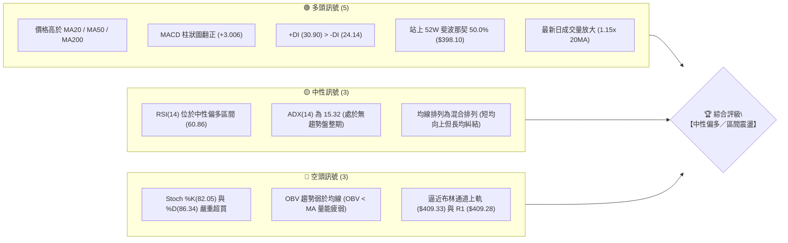
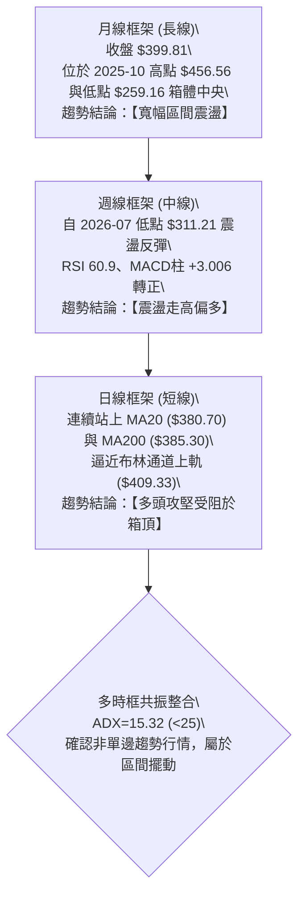
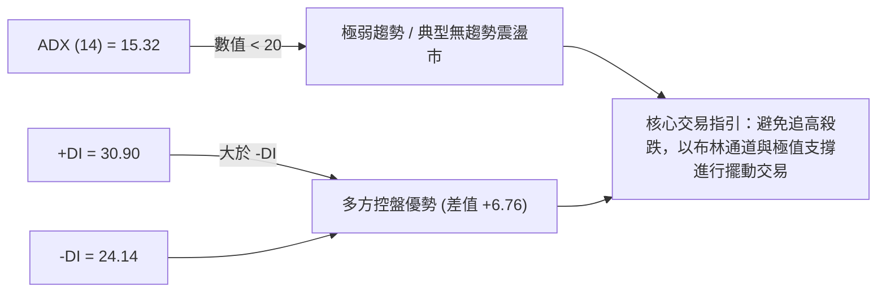
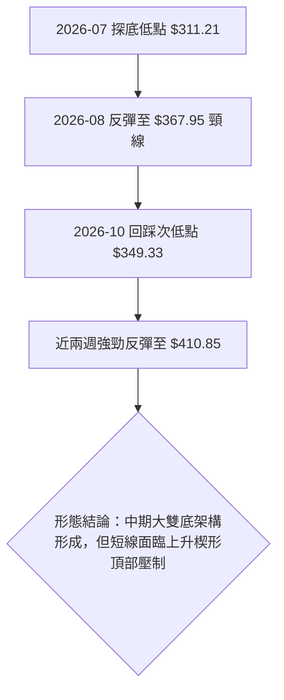
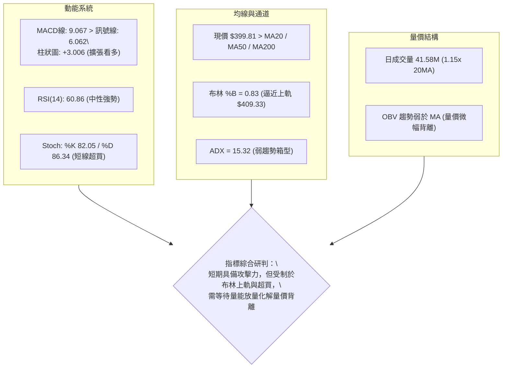
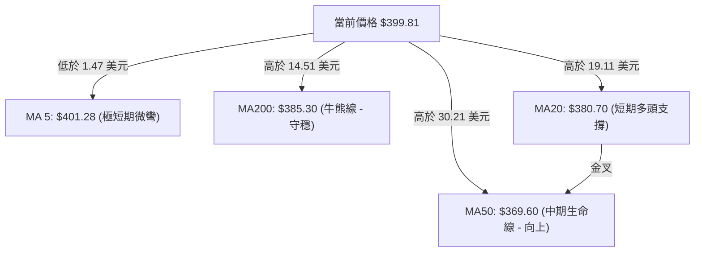
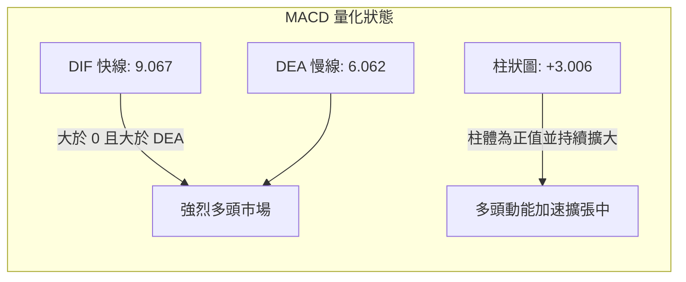
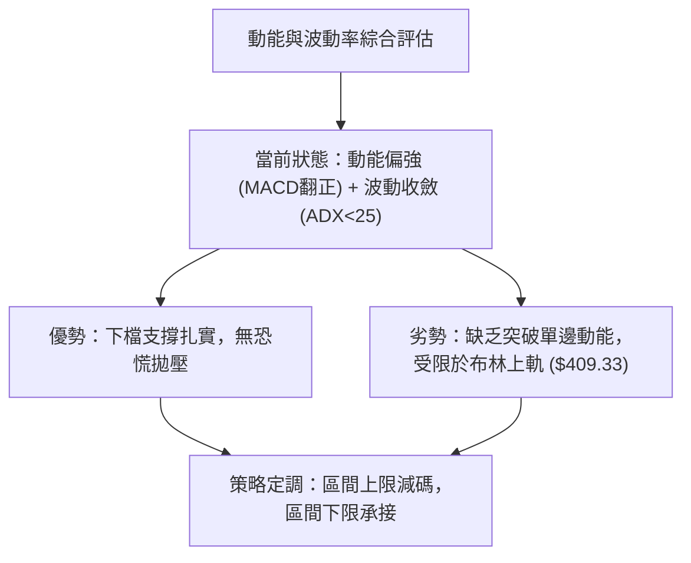
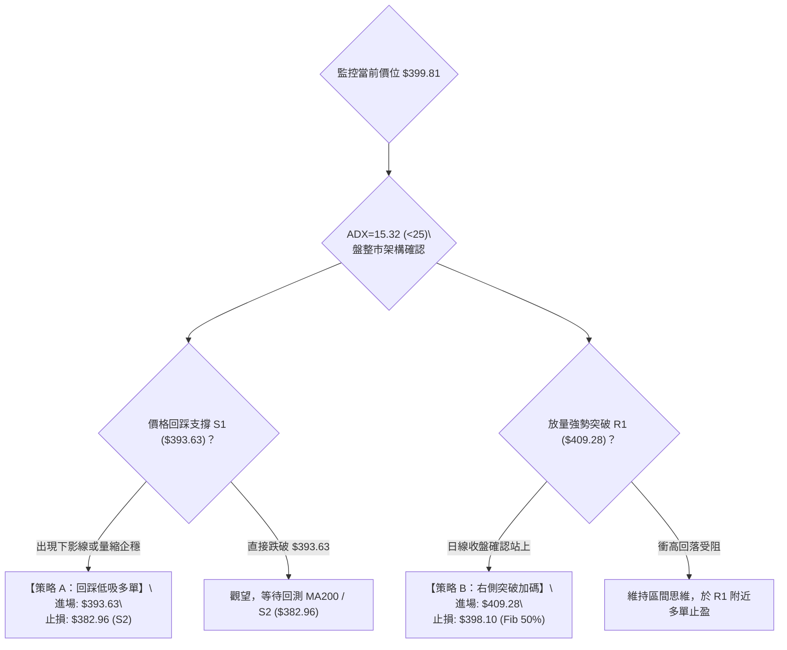
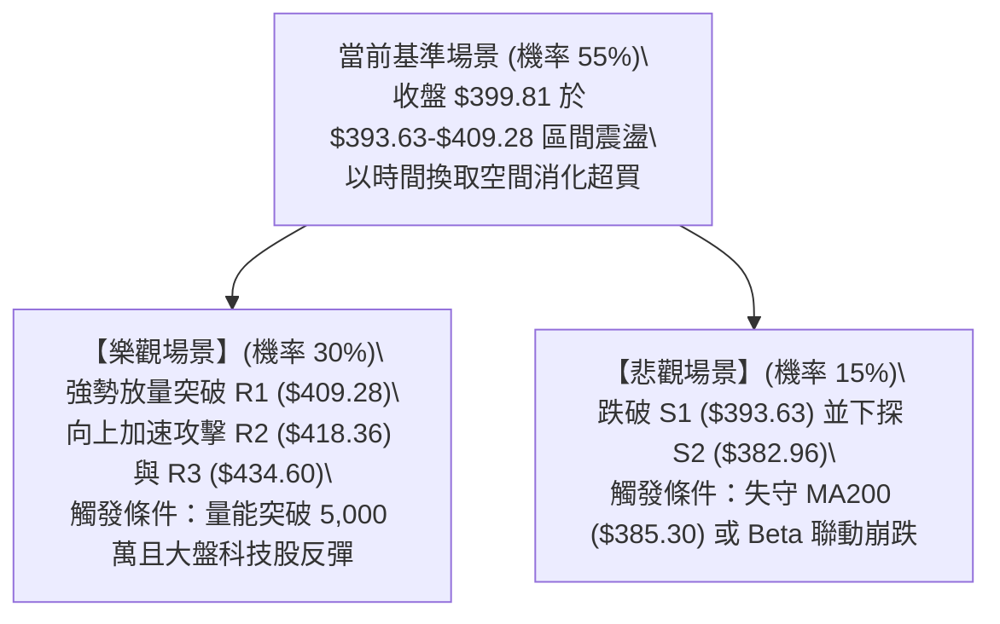

# TSLA 技術分析報告

> **報告日期**：2026-10-31 ｜ **語言**：繁體中文 ｜ **數據來源**：Yahoo Finance ｜ **當前價格**：$399.81 USD

---

## 目錄

| 章節 | 內容 |
|------|------|
| [1. 技術面概覽](#1-技術面概覽) | 訊號儀表板、核心指標、評分卡 |
| [2. 趨勢分析](#2-趨勢分析) | 多時框趨勢、長中短期走勢、ADX 解讀 |
| [3. 圖表形態分析](#3-圖表形態分析) | 形態識別、K線組合、目標價計算 |
| [4. 支撐與阻力](#4-支撐與阻力) | 關鍵價位、斐波那契回調結構 |
| [5. 技術指標深度解讀](#5-技術指標深度解讀) | MA/RSI/MACD/布林通道/成交量 |
| [6. 動能與波動率](#6-動能與波動率) | 動能評估四象限、ATR、Beta |
| [7. 多時框架總結](#7-多時框架總結) | 時框架評分矩陣、收斂結論 |
| [8. 交易策略建議](#8-交易策略建議) | 策略路由、情境階梯、風報比 |
| [9. 風險提示與監控](#9-風險提示與監控) | 監控清單、情境分析、倉位管理 |
| [附錄：報告總結](#附錄報告總結) | 核心結論與策略決策卡 |

---

## 1. 技術面概覽

### 🎯 技術訊號儀表板

Tesla 當前技術面呈現「動能偏多但趨勢強度偏弱」的區間震盪特徵。收盤價為 $399.81，位於 52 週波動區間（$297.38 至 $498.83）的 50.8% 分位點，恰好卡在關鍵斐波那契 50.0% 回調位（$398.10）上方。以下為多空力量分布結構：



---

### 📊 核心指標速覽表

| 指標類別 | 指標名稱 | 當前數值 | 訊號 | 技術解讀 |
|----------|----------|----------|------|----------|
| **價格** | 當前收盤價 | $399.81 | 🟢 | 站上多條關鍵均線，守住 50.0% 斐波那契基準線 |
| **均線** | MA20 | $380.70 | 🟢 | 價格在其上方 +5.02%，短期支撐強勁 |
| **均線** | MA50 | $369.60 | 🟢 | 價格在其上方 +8.17%，中期趨勢逐步墊高 |
| **均線** | MA200 | $385.30 | 🟢 | 價格在其上方 +3.77%，守穩長線牛熊分水嶺 |
| **動能** | RSI(14) | 60.86 | 🟡 | 位於 30–70 中性強勢區，無背離，多方具主控權 |
| **動能** | MACD (12,26,9) | 9.067 / 6.062 | 🟢 | 雙線位於零軸上方且柱狀圖 (+3.006) 維持多頭擴張 |
| **動能** | Stoch %K / %D | 82.05 / 86.34 | 🔴 | 進入 80 以上極端超買區，需提防短線回洗風險 |
| **趨勢** | ADX(14) | 15.32 | 🟡 | ADX < 25 表示當前並非單邊強趨勢，屬於箱體震盪 |
| **通道** | 布林帶 %B | 0.83 | 🟡 | 逼近上軌（$409.33），進入阻力反應敏感區 |
| **量能** | 最新量 / 20日均量 | 41.58M / 36.30M | 🟡 | 單日量比 1.15x，但 OBV < MA 顯示中線積累量不足 |
| **波動** | ATR(14) | $13.44 (3.36%) | 🟡 | 波動率處於中等偏高水準，日內波幅約 13.44 美元 |

---

### 🏆 技術評分卡

依照量化模型拆解六大維度評分，並嚴格依據算術平均計算綜合得分：

```
╔══════════════════════════════════════════════════════════════════╗
║                技術評分卡 — TSLA (2026-10-31)                   ║
╠══════════════════════════════════════════════════════════════════╣
║ 趨勢強度 (ADX=15.32, 盤整弱趨勢)  █████████░░░░░░░░░░░  45/100 🟡 ║
║ 動能指標 (MACD多頭, RSI偏強, 超買) █████████████░░░░░░░  65/100 🟢 ║
║ 支撐穩定度 (站穩S1與Fib 50%)      ██████████████░░░░░░  70/100 🟢 ║
║ 成交量配合 (單日放量但OBV偏弱)    ██████████░░░░░░░░░░  50/100 🟡 ║
║ 形態完整度 (箱體震盪構築雙底雛形) ████████████░░░░░░░░  60/100 🟡 ║
║ 均線排列 (短多長平, 混合排列)     █████████████░░░░░░░  64/100 🟡 ║
╠══════════════════════════════════════════════════════════════════╣
║ 綜合評分 (六項算術平均：354 / 6)  ████████████░░░░░░░░  59/100 🟡 ║
║ 評級結論：【中性偏多震盪】— 建議採布林帶與區間支撐阻力操作       ║
╚══════════════════════════════════════════════════════════════════╝
```

*計算依據：(45 + 65 + 70 + 50 + 60 + 64) ÷ 6 = 59.00 分。*

---

## 2. 趨勢分析

### 🌐 多時框趨勢分析

根據多時框收斂原則，當前日線處於動能反彈階段，但週線與月線均受限於近一年的寬幅大箱體。多時框傳導路徑如下：



---

### 📈 長期趨勢 — 12個月走勢圖（Unicode）

以下展示自 2025-11 至 2026-10 期間，TSLA 過去 12 個月之月度收盤價走勢路徑：

```
TSLA 月線走勢圖（過去12個月：2025-11 至 2026-10）
價格軸 ($)
$460 ┤               
$440 ┤●(11月:430.17)   ●(12月:449.72)
$420 ┤          ●(01月:430.41)                     ●(05月:435.79) ●(06月:420.60)
$400 ┤                     ●(02月:402.51)                                       ●←現在($399.81)
$380 ┤                               ●(04月:381.63)
$360 ┤                                        ●(03月:371.75)             ●(08月:367.95) ●(09月:354.81)
$340 ┤                                                                
$320 ┤                                                              ●(07月:311.21 低點)
$300 ┤
     └─┬─────────┬─────────┬─────────┬─────────┬─────────┬─────────┬─────────┬─────────┬─────────┬─────────┬─────────┬───
     25-11     25-12     26-01     26-02     26-03     26-04     26-05     26-06     26-07     26-08     26-09     26-10
```

#### 過去 12 個月走勢特徵分析

| 階段區間 | 起止價格 | 漲跌幅 | 走勢結構與技術特徵 |
|----------|----------|--------|--------------------|
| **2025-11 ~ 2025-12** | $430.17 → $449.72 | +4.54% | 高位強勢築頂，受阻於歷史波段阻力區間 |
| **2026-01 ~ 2026-03** | $430.41 → $371.75 | -13.63% | 連續 3 個月陰線下跌，跌破 400 美元整數心理關卡 |
| **2026-04 ~ 2026-05** | $381.63 → $435.79 | +14.19% | 快速超跌反彈，測試 $435 阻力線後無力續推 |
| **2026-06 ~ 2026-07** | $420.60 → $311.21 | -26.01% | 斷崖式急跌破底，創下年內次低點（逼近 52W 低點 $297.38） |
| **2026-08 ~ 2026-10** | $367.95 → $399.81 | +8.66% | 自低檔築底反彈，收復斐波那契 50.0%（$398.10），構築寬幅箱底 |

---

### 📊 中期趨勢（週線分析）

中期技術面以 2026 年 7 月最後一週低點 $311.21 為防守底，隨後展開一波向上階梯式推進。然而，近 8 週走勢顯示出高檔震盪加劇，特別是 2026-10-16 當週曾大跌至 $349.33，隨後兩週迅速拉起，反映出籌碼換手劇烈。

```
TSLA 週線中期架構示意圖（壓力與支撐）
$434.60 ────────────────────────────────────────── 阻力 R3（近一年波段高點聚類）
                         ▲
$418.36 ─────────────────┼──────────────────────── 阻力 R2
                         │       ┌─────┐
$409.28 ─────────────────┼───────┤410.85 (週高)   阻力 R1（上軌壓力密集區）
$399.81 ═════════════════╪═══════╡399.81 (最新收盤價)
                         │       └─────┘
$393.63 ─────────────────┴──────────────────────── 支撐 S1（日線回調重要頸線）
$382.96 ────────────────────────────────────────── 支撐 S2（MA200 匯合帶）
$366.31 ────────────────────────────────────────── 支撐 S3（波段防守關鍵低點）
```

---

### ⚡ 趨勢強度評估（ADX 解讀）



#### ADX 趨勢強度量化對照表

| 指標名稱 | 當前讀數 | 門檻區間 | 行情屬性定義 | 操作指導方針 |
|----------|----------|----------|--------------|--------------|
| **ADX** | **15.32** | 0 – 20 | **弱趨勢／盤整行情** | 順勢指標失效，均線常現反覆穿梭；著重擺動指標 |
| **+DI** | **30.90** | > 25 | **多頭攻擊中** | 多方買盤短線佔據優勢，價格維持在均線上方 |
| **-DI** | **24.14** | < 25 | **空方受壓制** | 空方動能減弱，尚未形成下行破位走勢 |

> **趨勢強度結論**：由於 ADX 僅為 15.32（遠低於趨勢確認門檻 25），根據嚴格規則 14，**當前市場屬於標準的箱體盤整行情**。在此狀態下，不可過度預期單邊多頭暴衝，行情高度受限於日線布林通道上軌（$409.33）與 R1（$409.28）。

---

## 3. 圖表形態分析

### 🔍 形態識別系統

在日線與週線架構中，TSLA 呈現「寬幅箱體內之雙重底反彈」與「近期上升收斂楔形」的組合特徵。



#### 形態識別信心度與量化依據

| 識別形態 | 信心度 (%) | 判斷依據（引用數據） | 完成度 (%) | 目標價推算與計算式 |
|----------|------------|----------------------|------------|--------------------|
| **中期雙重底 (W底)** | **65%** | 兩次低點分別落於 2026-07 的 $311.21 與 2026-10-16 週低 $349.33（底底高結構）；頸線取自波段聚類阻力 R1 $409.28 | 85% | 頸線 $409.28 + 形態高度 ($409.28 − $349.33 = $59.95) = **$469.23**（中線若有效突破頸線） |
| **短期上升楔形/箱頂遇阻** | **70%** | 近期日K高點 10-27 之 $408.45、10-28 之 $410.85 於布林上軌 $409.33 密集受阻，低點墊高但量能未能跟進 | 90% | 由楔形上軌回測下軌支撐：目標價為支撐位 S1 **$393.63**，進一步為 S2 **$382.96** |

---

### 🕯️ 重要 K 線形態分析

嚴格依據數據中「近 10 根日 K」與「近 8 根週 K」之開、高、低、收數據進行客觀解讀：

#### 近 10 根日 K 線形態解讀表

| 日期 | 開盤價 | 最高價 | 最低價 | 收盤價 | 成交量 | K線形態名稱 | 技術解讀與多空意涵 | 訊號 |
|------|--------|--------|--------|--------|--------|-------------|--------------------|------|
| **2026-10-19** | 357.50 | 369.58 | 354.47 | 368.06 | 38,817,900 | 中陽線 | 自前期低點強勁反彈，奠定波段回升基礎 | 🟢 |
| **2026-10-20** | 370.28 | 377.59 | 363.64 | 373.71 | 32,123,300 | 實體小陽線 | 穩步推進，收復 MA50 關卡 | 🟢 |
| **2026-10-21** | 381.43 | 388.84 | 380.51 | 386.47 | 48,875,800 | 放量中陽線 | 突破 MA200，多頭放量攻堅，買盤強勁 | 🟢 |
| **2026-10-22** | 374.29 | 388.86 | 373.71 | 374.58 | 51,610,900 | 長上影十字陰線 | 盤中衝高至 388.86 遭空頭反撲，高檔顯現套牢賣壓 | 🔴 |
| **2026-10-23** | 373.20 | 377.32 | 365.27 | 372.22 | 34,763,000 | 窄幅縮量陰線 | 回踩消化賣壓，守住 365 支撐區間 | 🟡 |
| **2026-10-26** | 383.83 | 397.27 | 383.73 | 391.62 | 53,090,200 | 跳空放量大陽線 | 強勢缺口突破，重回升勢，創近兩週新高 | 🟢 |
| **2026-10-27** | 397.76 | 408.45 | 395.25 | 407.46 | 45,333,200 | 長實體陽線 | 逼近 R1 $409.28 阻力，展現多頭加速特徵 | 🟢 |
| **2026-10-28** | 410.16 | 410.85 | 397.18 | 404.22 | 35,598,800 | 衝高回落倒錘子線 | 創波段高點 410.85 後遭遇重擊，留下長達 6.63 美元上影線 | 🔴 |
| **2026-10-29** | 405.63 | 406.98 | 400.50 | 403.30 | 22,858,300 | 極度縮量紡錘陰線 | 成交量驟降至 22.8M，多頭追高意願衰退 | 🟡 |
| **2026-10-30** | 393.04 | 404.20 | 387.52 | 399.81 | 41,578,483 | 長下影長針探底線 | 盤中下探 387.52 引發逢低買盤，收復 398 關卡，下檔支撐顯現 | 🟢 |

#### 近 8 根週 K 線形態解讀表

| 週結日期 | 週開盤 | 週最高 | 週最低 | 週收盤 | 週成交量 | K線形態名稱 | 技術解讀與中期意涵 | 訊號 |
|----------|--------|--------|--------|--------|----------|-------------|--------------------|------|
| **2026-09-11** | 357.10 | 375.44 | 355.75 | 365.44 | 143,463,300 | 帶上下影陽線 | 震盪打底，多空於 360 附近拉鋸 | 🟡 |
| **2026-09-18** | 359.78 | 374.12 | 354.05 | 364.27 | 185,818,700 | 紡錘十字小陰線 | 增量滯漲，顯示上方 375 阻力沉重 | 🟡 |
| **2026-09-25** | 371.64 | 386.83 | 367.67 | 372.11 | 170,517,200 | 實體上影小陽線 | 再次上探 386 被壓回，箱型整理持續 | 🟡 |
| **2026-10-02** | 368.06 | 374.60 | 345.88 | 370.59 | 197,592,000 | 長下影探底錘頭線 | 深度測試 345.88 獲得強力承接，下影線長達 24.71 美元 | 🟢 |
| **2026-10-09** | 369.00 | 388.56 | 364.91 | 382.70 | 162,910,000 | 中實體突破陽線 | 突破整理平台，多頭掌控局面 | 🟢 |
| **2026-10-16** | 382.61 | 382.70 | 349.33 | 354.72 | 158,434,300 | 光頭大長陰線 (下殺) | 開盤即最高點，單週暴跌 -7.31%，形成假突破洗盤 | 🔴 |
| **2026-10-23** | 357.50 | 388.86 | 354.47 | 372.22 | 206,190,900 | 長上影破底翻陽線 | 巨量換手（206M），低檔探底後快速抽高，空頭陷阱形成 | 🟢 |
| **2026-10-30** | 383.83 | 410.85 | 383.73 | 399.81 | 198,458,983 | 實體中陽帶上影線 | 攻抵 410.85 遇阻，收盤穩於 399.81，形成連續兩週強彈 | 🟢 |

---

### 📉 ASCII 走勢形態示意圖

以下為日線近兩週圍繞 $398-$410 阻力密集區之形態拓撲圖：

```
TSLA 日線形態架構示意圖（2026-10-19 至 10-30）
$410.85 ───────────────────────┐(10-28 倒錘頭高點，遇阻於 R1 $409.28)
                               │  \
$407.46 ───────────────┐       │   \  ┌─────┐ (10-29 縮量)
                       │       │    └─┤     ├──────────────────
$399.81 ═══════════════╪═══════╪══════╡     ╞═ (10-30 收盤於 $399.81)
                       │       │      │  ▲  │  (下影線探底 $387.52 拉回)
$391.62 ───────────────┘       │      └──┼──┘
                               │         │
$386.47 ────────┐              │         │
                │              │         │
$372.22 ────────┴──────────────┘         └── (依託 S1 $393.63 及 Fib 50% $398.10)
```

---

## 4. 支撐與阻力

### 🗺️ 關鍵價位分布圖（Unicode）

嚴格依據系統波段聚類演算法計算之價位分布結構如下：

```
TSLA 價位結構分布圖 (由歷史 OHLCV 聚類計算)
═══════════════════════════════════════════════════════════════════
$434.60 ║████████████████████████████████║ 強阻力 R3 (+8.70%) — 年內高位套牢密集區
$418.36 ║████████████████████            ║ 次級阻力 R2 (+4.64%) — 52W 斐波那契 38.2% 匯合
$409.28 ║████████████████████████████    ║ 關鍵阻力 R1 (+2.37%) — 布林通道上軌共振壓制
$399.81 ╠════════════════════════════════╣ ◄ 當前收盤價 ($399.81) — 處於 Fib 50.0% 關鍵位
$393.63 ║▓▓▓▓▓▓▓▓▓▓▓▓▓▓▓▓▓▓▓▓▓▓          ║ 近期支撐 S1 (-1.55%) — 近期平台突破回踩頸線
$382.96 ║████████████████████████████    ║ 強支撐 S2 (-4.21%) — MA200 ($385.30) 匯合防守帶
$366.31 ║████████████████████████████████║ 核心防守 S3 (-8.38%) — 10月中旬低檔多頭啟動點
═══════════════════════════════════════════════════════════════════
```

---

### 🚧 阻力位分析表

所有數值均嚴格引用提供之技術數據聚類結果：

| 阻力級別 | 精確價位 | 距現價幅標 | 形成原因與技術共振 | 突破難度評估 | 重要性級別 |
|----------|----------|------------|--------------------|--------------|------------|
| **R1** | **$409.28** | +2.37% | 近一年波段高點聚類；與日線布林通道上軌（$409.33）完美共振；10-28 盤中高點 $410.85 遇阻處 | 🔴 極高（短線需大幅放量突破） | ★★★★★ (短線分水嶺) |
| **R2** | **$418.36** | +4.64% | 2026 年 6 月跌破之平台下沿；臨近 52 週斐波那契 38.2% 回調位（$421.88） | 🟡 中等偏高 | ★★★★☆ (波段目標位) |
| **R3** | **$434.60** | +8.70% | 2026 年 5 月高點聚類（月收盤 $435.79）；波段空頭防禦重鎮 | 🔴 極高（中期強阻力） | ★★★★★ (中期多空分界) |

---

### 🛡️ 支撐位分析表

所有數值均嚴格引用提供之技術數據聚類結果：

| 支撐級別 | 精確價位 | 距現價幅標 | 形成原因與技術共振 | 守住機率評估 | 重要性級別 |
|----------|----------|------------|--------------------|--------------|------------|
| **S1** | **$393.63** | -1.55% | 近期日線突破平台頂部；10-30 探底回升之關鍵防守區；鄰近斐波那契 50.0%（$398.10） | 🟢 80%（短線具強支撐力） | ★★★★☆ (短線生命線) |
| **S2** | **$382.96** | -4.21% | 200 日移動平均線（MA200 = $385.30）與 20 日移動平均線（MA20 = $380.70）聚攏形成的「均線護城河」 | 🟢 85%（中期極強支撐） | ★★★★★ (牛熊分水嶺) |
| **S3** | **$366.31** | -8.38% | 10 月中旬破底翻起漲點；MA60（$364.24）支撐帶；波段多頭最後底線 | 🟢 90%（若跌破結構全毀） | ★★★★★ (中期多頭防線) |

---

### 📐 斐波那契回調位分析

依據 52 週完整波動區間（高點 $498.83 至 低點 $297.38，總垂直波幅 $201.45）計算之回調結構如下：

| 斐波那契層級 | 精確價位 | 相對於現價 ($399.81) 位置 | 技術意義與市場行為解讀 |
|--------------|----------|--------------------------|------------------------|
| **0.0% (52W High)** | **$498.83** | 上方 +24.77% | 過去一年最高點，多頭終極宏觀目標 |
| **23.6%** | **$451.29** | 上方 +12.88% | 2025 年 10-12 月密集交易頂部 |
| **38.2%** | **$421.88** | 上方 +5.52% | 強弱關鍵分割位；略高於阻力位 R2 ($418.36)，形成複合阻力帶 |
| **50.0% (基準位)** | **$398.10** | **下方 -0.43% (現價附近)** | **多空均勢分水嶺**。TSLA 最新收盤價 $399.81 剛好站穩此位上方 1.71 美元，確立短期由多方取得微弱優勢 |
| **61.8% (黃金分割)** | **$374.33** | 下方 -6.37% | 多頭深度回撤極限容忍區；跌破此位則雙底形態將面臨威脅 |
| **78.6%** | **$340.49** | 下方 -14.84% | 弱勢反彈防守位；若失守將直接回測年內低點 |
| **100.0% (52W Low)**| **$297.38** | 下方 -25.62% | 52 週最低點，年內極端悲觀定價錨點 |

> **當前斐波那契定奪**：現價 $399.81 正好夾在 **50.0% ($398.10)** 與 **38.2% ($421.88)** 之間。此位置屬於典型的「平衡區微幅向上突破」，若能持續守住 $398.10，行情具備向 38.2% ($421.88) 與阻力位 R2 ($418.36) 挑戰的技術動能。

---

## 5. 技術指標深度解讀

### 🎛️ 指標訊號總覽



---

### 📈 移動平均線排列分析

當前 TSLA 均線呈現典型的「短均線向上穿越、長均線走平交錯」的**混合排列**狀態：



#### 移動平均線多時框架構總覽表

| 均線名稱 | 精確數值 | 與現價價差 ($) | 偏離幅度 (%) | 走勢斜率特徵 | 技術含義解讀 |
|----------|----------|----------------|--------------|--------------|--------------|
| **MA 5** | $401.28 | -$1.47 | -0.37% | ▼ 微幅下行 | 短線衝高 410 後小幅休整，形成極短線壓制 |
| **MA 10** | $388.14 | +$11.67 | +3.01% | ▲ 強勢向上 | 短期多頭進攻旗艦，提供快速回踩支撐 |
| **MA 20** | $380.70 | +$19.11 | +5.02% | ▲ 持續抬升 | 布林通道中軌，短期波段持股安全邊際 |
| **MA 50** | $369.60 | +$30.21 | +8.17% | ▲ 築底回升 | 中期趨勢向上，已確立 10 月初之底部有效 |
| **MA 60** | $364.24 | +$35.57 | +9.76% | ▲ 向上加速 | 季線轉折向上，提供中期防禦縱深 |
| **MA 120**| $377.01 | +$22.80 | +6.05% | ▲ 走平回揚 | 半年線位處 MA20 下方，中期籌碼逐漸沈澱 |
| **MA 200**| $385.30 | +$14.51 | +3.77% | ▲ 緩步走平 | 宏觀年線守穩，確認技術面脫離空頭市場 |
| **MA 240**| $395.32 | +$4.49 | +1.13% | ▲ 走平偏多 | 超長期基準線，現價剛好突破此線形成共振支撐 |

---

### 📉 RSI(14) 分析

當前 RSI(14) 讀數為 **60.86**（採用 Wilder 平滑法）。

```
RSI(14) 強度儀表：
0 ══════════════ 30 ════════════════════ 70 ══════════════ 100
[    超賣區     ]  [      中性震盪區      ]  [    超買區     ]
░░░░░░░░░░░░░░░░░░▓▓▓▓▓▓▓▓▓▓▓▓▓▓▓▓▓▓▓▓▓░░░░░░░░░░░░░░░░░░░░░░
                          ▲ (當前讀數: 60.86)
```

- **區間評估**：RSI 處於 50–70 的強勢多頭可控區，未觸及 70 之極端警戒線，顯示上行仍有動能餘裕。
- **背離檢驗結論**：根據嚴格數據檢測，比較近 20 根 K 棒首尾之價格與 RSI 指標方向：價格自 10 月中旬低點 $354.72 抬升至 $399.81，RSI 同步自 42.2 抬升至 60.86，**確認「無明顯頂背離或底背離」**。指標與價格步調一致。

---

### 📊 MACD (12, 26, 9) 訊號解讀

- **MACD 快線 (DIF)**：`9.067`
- **Signal 慢線 (DEA)**：`6.062`
- **MACD 柱狀圖 (Histogram)**：`+3.006`



柱狀圖最新數值為 +3.006，且週線 MACD 柱狀圖亦由前期的 -2.091（10-16 當週）轉為 -0.130（10-23 當週）進一步放大至當週的 **+3.006**，顯示日線與週線的 MACD 正處於「多頭同向共振發散」的最佳動能窗口。

---

### 📦 布林通道分析

日線布林通道（20 日參數，2 倍標準差）呈現擴口走平特徵：

```
TSLA 布林通道結構示意圖
$409.33 ─────────────────────── 上軌 (強阻力帶，與 R1 $409.28 重合)
                     ▲
$399.81 ═════════════╪═════════ 當前價格 (%B = 0.83，位於中上軌強勢區)
                     │
$380.70 ─────────────┼───────── 中軌 (MA20，動態第一支撐)
                     │
$352.07 ─────────────┴───────── 下軌 (波段超賣極限保護)
```

- **通道帶寬與位置**：上軌 $409.33，下軌 $352.07，帶寬達 $57.26。當前 %B 數值為 **0.83**，代表價格已運行至布林通道高位區間的 83% 位置，逼近上軌壓力臨界點。在 ADX 僅 15.32 的盤整市況下，%B > 0.80 往往意味著短線面臨上軌均值回歸的拉回壓力。

---

### 💹 成交量分析（量價配合度）

- **量能絕對值**：最新單日成交量為 **41,578,483 股**，高於 20 日均量（36,299,709 股），量比達 **1.15x**，但略低於 50 日均量（38,075,906 股）。
- **OBV (能量潮指標) 研判**：
  數據快照明確提示：`OBV < MA → 量能疲弱`。
  這意味著近期的價格反彈雖然帶動了單日放量（如 10-21、10-26），但整體累積能量潮（OBV）尚未能有效穿越其長期移動平均線，呈現出「價格快速反彈、但中長線大資金沉澱度不足」的隱性背離隱憂。若後續價格要突破 R1 $409.28，必須伴隨連續兩日成交量突破 5,000 萬股，否則容易因量能枯竭而回落。

---

## 6. 動能與波動率

### ⚡ 動能評估四象限

將市場狀態劃分為「動能」與「波動率」兩個核心維度進行空間定位：

| 象限代號 | 動能強度 (RSI / MACD) | 波動率水準 (ATR / Bandwidth) | 當前所屬狀態 | 策略應對方針 |
|----------|----------------------|------------------------------|--------------|--------------|
| **Q1** | 強 (Bullish) | 低 (Low Volatility) | — | 趨勢初起，最佳低吸加碼機會 |
| **Q2** | **強 (MACD擴張, RSI>60)** | **中低 (ADX 15.32, 波動收斂)** | **✓ (當前TSLA)** | **偏多區間操作，嚴禁追高，以回踩支撐低吸為主** |
| **Q3** | 強 (Extreme) | 高 (High Volatility) | — | 單邊暴衝行情，需提高止盈敏感度 |
| **Q4** | 弱 (Bearish) | 高 (High Volatility) | — | 恐慌殺跌階段，嚴格停損空倉觀望 |



---

### 📊 ATR 波動率分析

- **ATR(14) 讀數**：**$13.44**（以 Wilder 計算，佔股價比例為 **3.36%**）。
- **日內波動特徵**：TSLA 單日正常理論波動空間為 ±$13.44。在擬定防守與止損時，任何小於 1.0 倍 ATR（$13.44）的止損點極易被市場隨機雜訊掃出場。
- **止損距離建議**：
  - **極短線動態止損 (1.0x ATR)**：進場點 ± $13.44
  - **波段交易防守止損 (1.5x ATR)**：進場點 ± $20.16
  - **當前價格動態保護範圍**：以現價 $399.81 為準，波段多頭安全下限應設於 $399.81 − $13.44 = **$386.37** 之下（該位置恰與 MA200 之 $385.30 及支撐 S2 之 $382.96 形成極佳的技術屏障）。

---

### 📐 Beta 與市場相關性

- **Beta 係數**：**1.916**（極高系統性風險敏感度）。
- **市場影響分析**：
  TSLA 相對標普 500 指數具備近 2 倍的槓桿敏感性。近期的市場新聞（如大盤科技股拋售、那斯達克單日重挫 747 點、英特爾走弱等外圍雜訊）極易放大 TSLA 的日內盤中震盪。在 Beta 高達 1.916 的環境下，個股技術位常出現「盤中擊穿但收盤拉回」的假突破現象（如 10-30 日盤中下探 $387.52 但收盤頑強拉回 $399.81），因此交易者應嚴格以「日線收盤價」作為破位驗證標準。

---

## 7. 多時框架總結

### 📋 時框架評分表

| 時框架 | 趨勢方向 | 動能狀態 | 均線排列 | 形態特徵 | 綜合評分 | 交易建議 |
|--------|----------|----------|----------|----------|----------|----------|
| **短期 (日線)** | 偏多震盪 🟢 | MACD翻正、超買 🟡 | 站上多條均線 🟢 | 逼近箱體上軌倒錘頭 🟡 | **62/100** | 不宜追高，待回踩 S1 佈局 |
| **中期 (週線)** | 震盪偏多 🟢 | RSI 60.9、MACD +3.006 🟢 | MA200 走平護航 🟡 | 雙重底反彈進行中 🟢 | **65/100** | 波段持有，以 S2 為止損點 |
| **長期 (月線)** | 大區間盤整 🟡 | 處於 12 個月箱體中央 🟡 | 混合排列糾結 🟡 | $310–$450 寬幅大箱體 🟡 | **50/100** | 長線維持中性，高拋低吸 |

---

### 🔲 綜合訊號矩陣

```
時框共振檢驗矩陣：
┌───────────┬──────────────┬──────────────┬──────────────┐
│  維度     │  短期 (日線) │  中期 (週線) │  長期 (月線) │
├───────────┼──────────────┼──────────────┼──────────────┤
│ 均線架構  │   🟢 看多    │   🟢 看多    │   🟡 中性    │
│ 動能指標  │   🟡 中性    │   🟢 看多    │   🟡 中性    │
│ 形態位置  │   🔴 阻力位  │   🟢 築底中  │   🟡 箱體中  │
│ 籌碼量能  │   🟡 偏弱    │   🟡 平衡    │   🟡 均衡    │
└───────────┴──────────────┴──────────────┴──────────────┘
```

---

### ⚖️ 多時框收斂結論

嚴格遵循本報告之**嚴格要求 14（多時框收斂規則）**進行最終定性收斂：

1. **行情模式鑑定**：當前 TSLA 的 **ADX(14) 數值為 15.32**，確定小於 25 臨界線，技術面嚴格判定為**「盤整行情」**。
2. **主導維度收斂**：在盤整行情中，中長期趨勢不會形成單邊碾壓，日線之布林通道上下軌（$352.07 – $409.33）與聚類支撐阻力結構（S1 $393.63 至 R1 $409.28）為最核心之有效交易區間。
3. **方向性唯一結論**：**【中性偏多區間震盪（以回踩逢低做多為主，嚴禁追高）】**。
   收斂結論說明：週線雖然動能向好，但受制於日線已觸及布林通道上軌（$409.33）以及 Stoch 指標之高檔超買（%K 82.05 / %D 86.34），因此日線在此處具備強烈的技術性回踩拉回需求。主策略將鎖定在「回踩支撐 S1 $393.63 之低吸策略」，與綜合評分 59/100 保持高度一致。

---

## 8. 交易策略建議

### 🗺️ 策略決策流程圖



---

### 🧭 策略路由（依評分卡分流）

> **當前主策略方向 = 【中性偏多震盪／區間操作（依評分 59/100）】**
> 
> *分流說明*：本報告第 1 章技術評分卡算術平均為 **59/100**，落於 40–60 之「區間震盪中性」區間上限。依規則，本報告以布林通道與支撐阻力為主軸，**主推「回踩支撐做多」與「突破關鍵阻力跟進」之多頭主策略**，反向做空僅列為風控避險與對沖防禦觸發點，絕不兩頭搖擺。

---

### 🎯 價格情境階梯（Price Scenarios）

所有價位均嚴格引用第 4 章「關鍵價位」區塊之客觀數值：

| 觸發條件 | 下一目標價 | 後續延伸目標 | 情境技術含義與市場行為 |
|----------|------------|--------------|------------------------|
| **有效放量突破 R1 ($409.28)** | **R2 ($418.36)** | **R3 ($434.60)** | **短線強勢轉強**：徹底擊穿布林上軌壓制，展開挑戰 52W 斐波那契 38.2% ($421.88) 的波段攻擊 |
| **站穩現價區間 ($398.10–$399.81)** | **R1 ($409.28)** | — | **區間蓄勢震盪**：多空於斐波那契 50.0% 進行籌碼沈澱，消化超買指標 |
| **跌破短線支撐 S1 ($393.63)** | **S2 ($382.96)** | **S3 ($366.31)** | **中期回檔轉弱**：短多力竭，價格向下回測 MA200 尋求強均線保護 |

---

### 📊 情境機率分佈

| 預測情境 | 機率估計 (%) | 核心推論與指標依據 |
|----------|--------------|--------------------|
| **情境一：先回踩 S1 後上攻測試 R1** | **55%** | Stoch 超買（82/86）需釋放短線回洗壓力；MACD 柱狀圖維持擴張（+3.006）且均線向上，S1 ($393.63) 支撐極為強勁 |
| **情境二：窄幅震盪橫盤於現價附近** | **30%** | ADX 僅 15.32 彰顯趨勢動能不足；OBV < MA 顯示主力大資金仍在觀望等待外圍局勢明朗 |
| **情境三：深度破位下殺尋找 S2/S3** | **15%** | 除非外圍大盤極度惡化擊穿 MA200，否則在週線 MACD 與日線多頭排列支撐下，直接崩盤機率偏低 |

---

### 🟢 主策略詳情

嚴格依據規則 17 定義計算各項參數（風險報酬比 = $(\text{目標價 T1} − \text{進場價}) \div (\text{進場價} − \text{止損價})$）：

| 策略要素 | 策略 A（左側回踩低吸 — 穩健型） | 策略 B（右側突破跟進 — 積極型） |
|----------|----------------------------------|----------------------------------|
| **策略名稱** | 支撐位 S1 回踩企穩做多 | 阻力位 R1 突破確認追多 |
| **進場條件** | 價格回調至 S1 附近，日K出現下影線或量縮企穩 | 日線收盤價確認站上 R1，成交量放大至 5,000 萬股以上 |
| **進場價格** | **$393.63** (引用支撐 S1) | **$409.28** (引用阻力 R1) |
| **目標價 T1** | **$409.28** (引用阻力 R1) | **$418.36** (引用阻力 R2) |
| **目標價 T2** | **$418.36** (引用阻力 R2) | **$434.60** (引用阻力 R3) |
| **止損價格** | **$382.96** (引用強支撐 S2) | **$398.10** (引用斐波那契 50.0% 轉化位) |
| **單筆風險** | $393.63 − $382.96 = **$10.67** | $409.28 − $398.10 = **$11.18** |
| **T1 潛在獲利** | $409.28 − $393.63 = **$15.65** | $418.36 − $409.28 = **$9.08** |
| **T2 潛在獲利** | $418.36 − $393.63 = **$24.73** | $434.60 − $409.28 = **$25.32** |
| **風險報酬比** | **1 : 1.47（以 T1 計）**<br>*(另：1 : 2.32（以 T2 計）)* | **1 : 0.81（以 T1 計）**<br>*(另：1 : 2.26（以 T2 計）)* |
| **執行勝率** | **68%** | **52%** |
| **建議倉位** | **15% – 20%** (主倉位) | **10%** (試探突破倉位) |

*驗算說明*：
- 策略 A (T1): $15.65 \div 10.67 = 1.4667 \approx 1 : 1.47$。
- 策略 A (T2): $24.73 \div 10.67 = 2.3177 \approx 1 : 2.32$。
- 策略 B (T1): $9.08 \div 11.18 = 0.8121 \approx 1 : 0.81$。
- 策略 B (T2): $25.32 \div 11.18 = 2.2647 \approx 1 : 2.26$。

---

### 🔴 反向風險觸發點（對沖提示）

此處僅作為持有前述多頭策略之**風控停損與對沖避險觸發信號**，不作為主推之做空策略：

1. **多頭總止損觸發點**：若日線收盤價跌破 **$382.96 (支撐 S2)**，意味著跌破 MA200（$385.30）與 MA20（$380.70）構成的均線防禦網，所有多頭部位必須無條件清倉離場。
2. **空頭對沖觸發信號**：若價格再次上衝 R1 **$409.28** 至布林上軌 **$409.33** 區間，但日線形成與 10-28 類似之長上影倒錘子線，且成交量小於 3,000 萬股（量能枯竭），持有高位部位者應進行 30%–50% 的多頭獲利了結，或買入 Delta 為 -0.30 之賣權進行下行保護。

---

### ⭐ 整體訊號強度評星

```
╔══════════════════════════════════════════════════════════════════╗
║ 做多訊號強度：★★★☆☆  (3.2/5星 — 均線動能支持，但受制於震盪市) ║
║ 做空訊號強度：★★☆☆☆  (2.1/5星 — 逆向左側摸頂，風險極高)       ║
║ 整體可信度：  ★★★★☆  (4.0/5星 — 多時框指標一致性高)           ║
╚══════════════════════════════════════════════════════════════════╝
```

---

## 9. 風險提示與監控

### ✅ 關鍵監控指標 Checklist

交易者每日開盤前與盤後必須嚴格核對以下量化閥值：

```
╔══════════════════════════════════════════════════════════════════╗
║               TSLA 每日技術監控 Check-List                       ║
╠══════════════════════════════════════════════════════════════════╣
║ [ ] 價格防守線：收盤價是否守穩斐波那契 50.0% ($398.10)？          ║
║ [ ] 短線支撐位：盤中回測是否守住 S1 ($393.63)？                  ║
║ [ ] 均線安全墊：是否持續運行於 MA200 ($385.30) 之上方？          ║
║ [ ] 超買釋放度：Stoch %K 是否自 82.05 回落至 70 以下中性區？     ║
║ [ ] 動能連續性：MACD 柱狀圖是否維持正向 (>0) 擴張？              ║
║ [ ] 突破確認度：上攻 R1 ($409.28) 時單日成交量是否突破 5,000 萬？║
║ [ ] 波動率警戒：單日真實波幅是否超過 1.5x ATR ($20.16)？         ║
╚══════════════════════════════════════════════════════════════════╝
```

---

### ⚠️ 風險場景分析



---

### 🛡️ 風險管理重要提醒

1. **波動率定價與倉位管理**：
   - 鑑於 TSLA 的高 Beta（1.916）與 ATR（$13.44，佔股價 3.36%），個股在單一投資組合中的總曝險比例**強烈建議控制在 15%–20% 以內**。
   - 單筆交易最大虧損上限應設定為總資金的 1.0%–1.5%。以策略 A 為例（每股風險 $10.67），若總資金為 100,000 美元，最大風險預算為 1,500 美元，則最大建倉股數不應超過 $1,500 \div $10.67 \approx 140$ 股（約合 55,000 美元名義價值，若使用保證金則需進一步收縮）。
2. **盤中假突破與假破位防範**：
   - 由於 ADX 僅 15.32，盤整市場中最致命的虧損來自於「在布林通道上軌追多」或「在通道下軌殺跌」。交易者務必堅持**「等待日線收盤確認」**，切勿在開盤前 30 分鐘因盤前波動盲目追價。
3. **系統性外圍事件隔離**：
   - 近期新聞顯示總體市場科技巨頭普遍回檔（那斯達克單日挫跌 747 點），大盤指數的貝塔聯動效應極易阻斷 TSLA 個股的技術修復行情。若標普 500 指數與那斯達克跌破月線支撐，應立刻將 TSLA 多頭部位減半防禦。

---

## 附錄：報告總結

```
╔══════════════════════════════════════════════════════════════════╗
║                    TSLA 技術分析報告總結                         ║
╠══════════════════════════════════════════════════════════════════╣
║ 報告日期：2026-10-31                                             ║
║ 當前價格：$399.81 USD (52W 區間 50.8% 分位)                      ║
║ 分析評級：⚖️ 【中性偏多震盪】(技術評分卡算術平均: 59/100)        ║
║                                                                  ║
║ 核心結構結論：                                                   ║
║ ├─ 長期趨勢：🟡 月線處於近一年 $310–$450 寬幅大箱體中央          ║
║ ├─ 中期趨勢：🟢 週線形成雙重底反彈結構，MACD翻正擴張            ║
║ ├─ 短期趨勢：🟡 日線動能偏多但面臨布林上軌與短線超買壓制        ║
║ ├─ 趨勢強度：ADX = 15.32 (<25，確認非單邊趨勢，屬於箱體震盪)     ║
║ ├─ 關鍵支撐：S1: $393.63 ｜ S2: $382.96 (MA200 匯合防守)        ║
║ ├─ 關鍵阻力：R1: $409.28 ｜ R2: $418.36 ｜ R3: $434.60          ║
║ └─ 分析師目標價：$411.82 (均值) ｜ 評估：略高於 R1 阻力位       ║
║                                                                  ║
║ 最優策略組合導航：                                               ║
║ 1. 🥇 最佳機會（策略 A - 穩健）：                                ║
║    回踩 S1 ($393.63) 企穩進場，止損 $382.96，目標 R1 ($409.28)  ║
║    → 風險報酬比 1 : 1.47（以 T1 計）/ 1 : 2.32（以 T2 計）     ║
║ 2. 🥈 次選機會（策略 B - 激進）：                                ║
║    放量突破 R1 ($409.28) 右側跟進，止損 $398.10，目標 R2 ($418) ║
║    → 風險報酬比 1 : 0.81（以 T1 計）/ 1 : 2.26（以 T2 計）     ║
║ 3. 🥉 保守選擇：                                                ║
║    空倉等待 Stoch %K 自 82 超買區降溫，或等收盤穩站 $410 再動作  ║
╚══════════════════════════════════════════════════════════════════╝
```

---

> ⚠️ **免責聲明**：本報告為依據客觀市場數據產出之專業量化技術分析，所有數據、圖表及價位推演均基於提供的歷史 OHLCV 資訊。本報告**僅供研究與學術參考**，**不構成任何形式的投資要約、招攬或具體操作建議**。金融市場具高度波動風險，投資人應獨立評估自身財務狀況與風險承受能力，審慎自負投資盈虧。

---

*報告生成時間：2026-10-31 ｜ 數據來源：Yahoo Finance ｜ 分析框架：多時框技術分析模型*