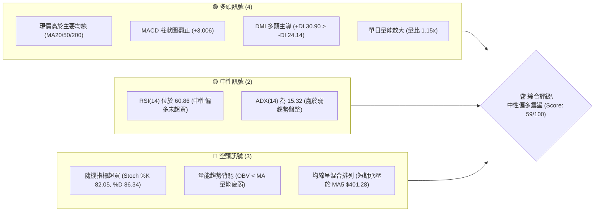
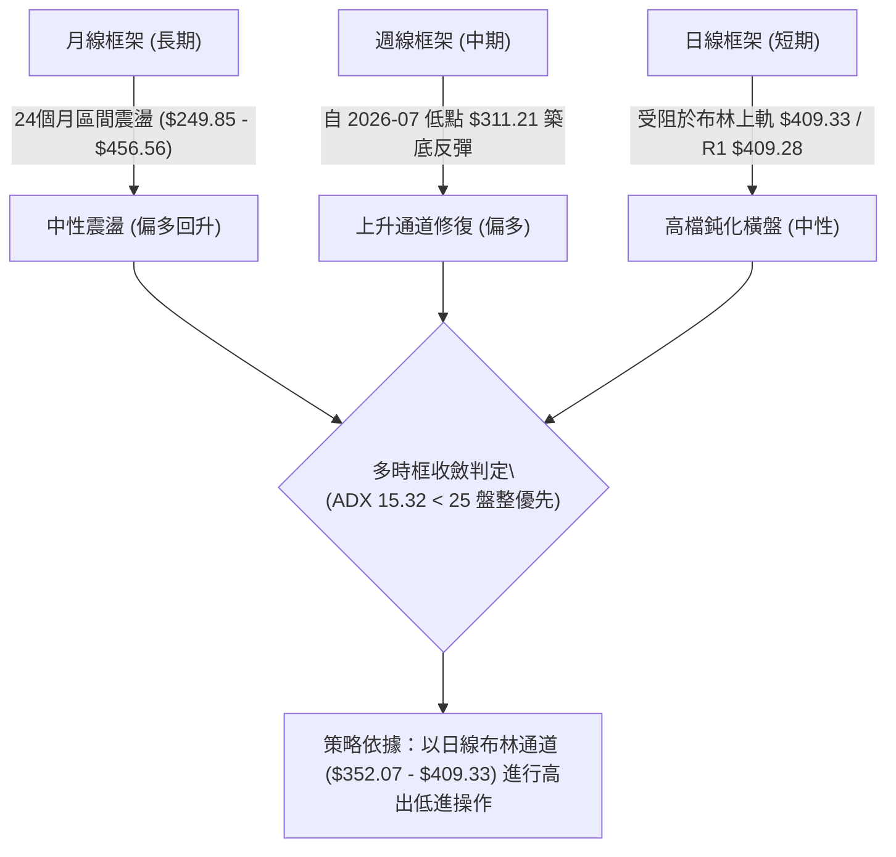
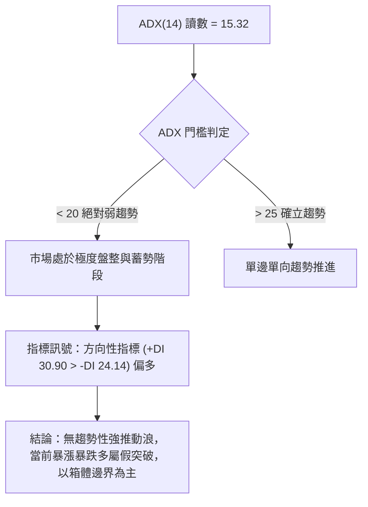
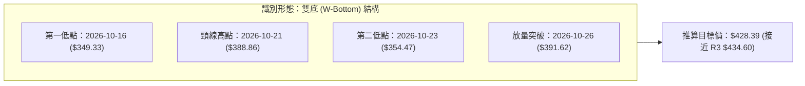
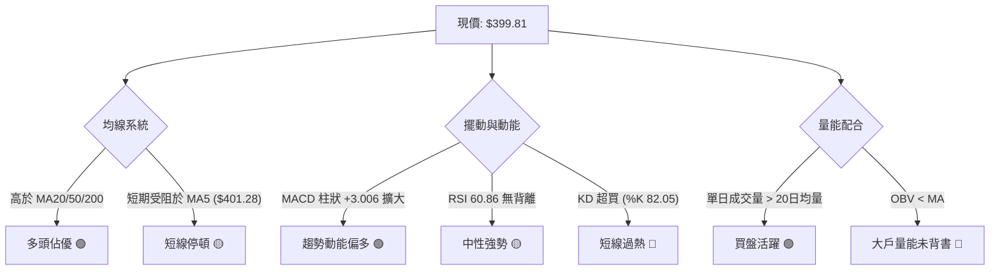
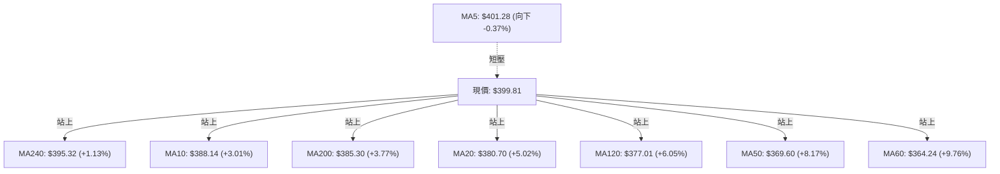
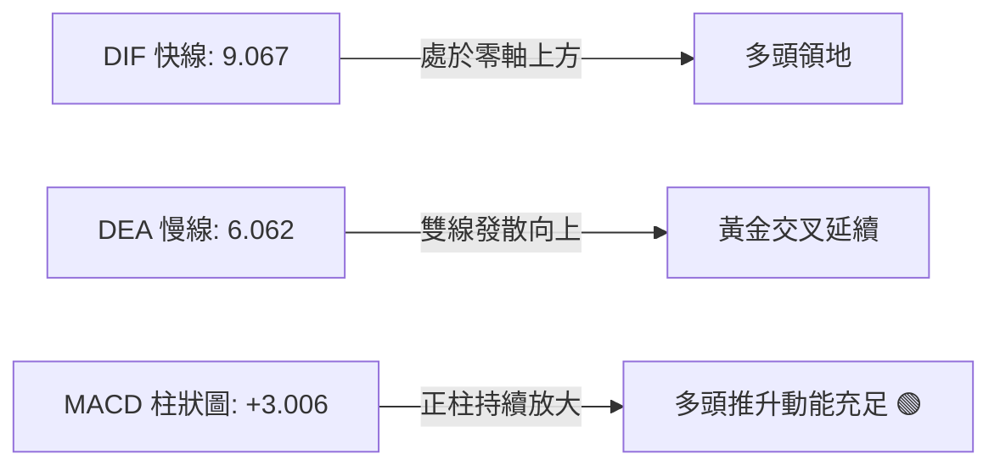
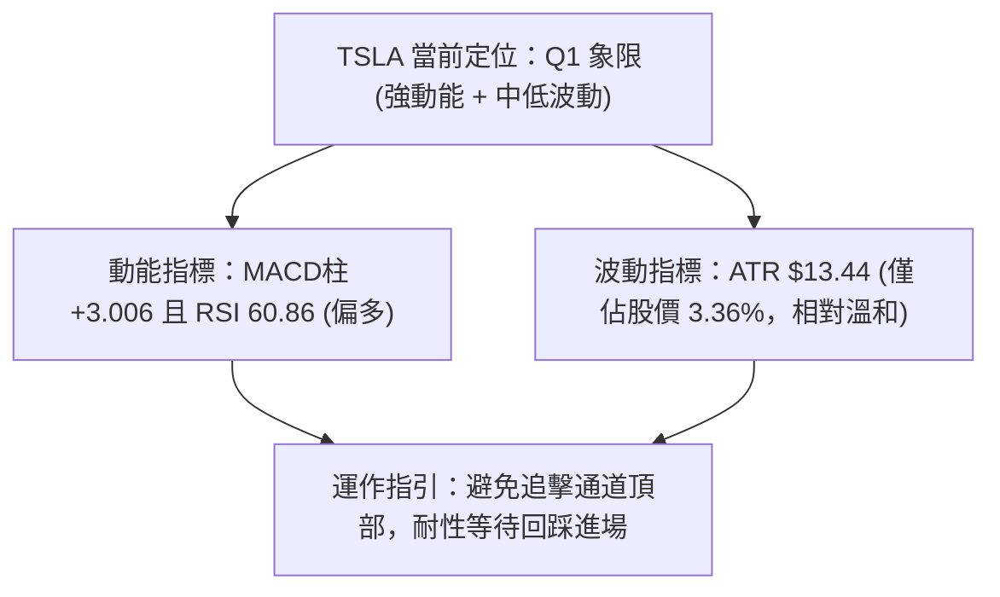
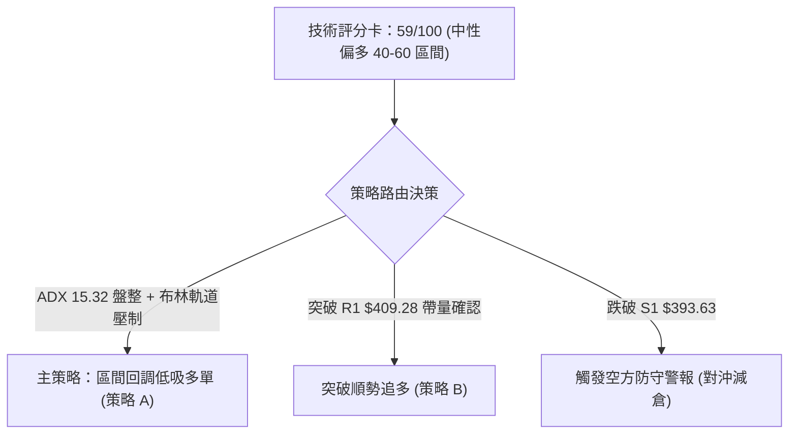
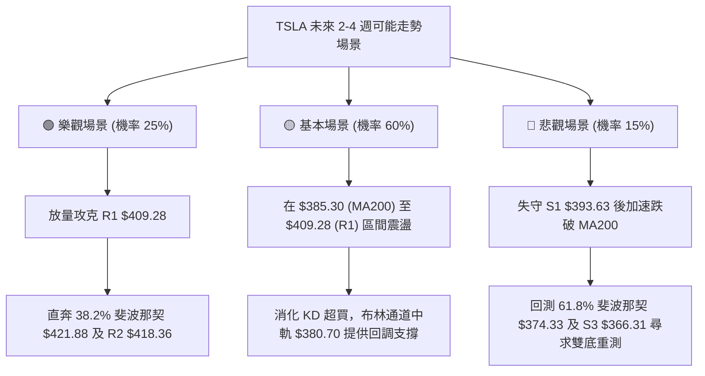

# TSLA 技術分析報告

> **報告日期**：2026-11-01 ｜ **語言**：繁體中文 ｜ **數據來源**：Yahoo Finance ｜ **當前價格**：$399.81

---

## 目錄

| 章節 | 內容 |
|------|------|
| [1. 技術面概覽](#1-技術面概覽) | 訊號儀表板、核心指標、評分卡 |
| [2. 趨勢分析](#2-趨勢分析) | 多時框趨勢、長中短期走勢 |
| [3. 圖表形態分析](#3-圖表形態分析) | 形態識別、K線組合、目標價 |
| [4. 支撐與阻力](#4-支撐與阻力) | 關鍵價位、斐波那契回調 |
| [5. 技術指標深度解讀](#5-技術指標深度解讀) | MA/RSI/MACD/布林/成交量 |
| [6. 動能與波動率](#6-動能與波動率) | 動能評估、ATR、Beta |
| [7. 多時框架總結](#7-多時框架總結) | 時框架評分矩陣 |
| [8. 交易策略建議](#8-交易策略建議) | 多空策略、風險報酬比 |
| [9. 風險提示與監控](#9-風險提示與監控) | 監控指標、風險場景 |

---

## 1. 技術面概覽

### 🎯 技術訊號儀表板



### 📊 核心指標速覽表

| 指標類別 | 指標名稱 | 當前數值 | 訊號 | 解讀 |
|----------|----------|----------|------|------|
| **價格** | 當前收盤價 | $399.81 | 🟢 | 站上 52 週 50% 斐波那契平衡位（$398.10） |
| **均線** | MA20 | $380.70 | 🟢 | 價格在 MA20 上方 +5.02%，短期動能穩健向上 |
| **均線** | MA50 | $369.60 | 🟢 | 價格在 MA50 上方 +8.17%，中期支撐結構扎實 |
| **均線** | MA200 | $385.30 | 🟢 | 價格在 MA200 上方 +3.77%，重返長期牛熊分水嶺 |
| **動能** | RSI(14) | 60.86 | 🟡 | 位於 30–70 中性強勢區，未見極端超買 |
| **動能** | MACD (12,26,9) | 9.067 / 6.062 (柱狀圖 +3.006) | 🟢 | 位於零軸上方黃金交叉，多頭動能延續擴散 |
| **擺動** | KD 隨機指標 | %K 82.05 / %D 86.34 | 🔴 | 進入 80 以上嚴重超買區，存在高檔死叉回洗壓力 |
| **趨勢** | ADX(14) | 15.32 (+DI: 30.90, -DI: 24.14) | 🟡 | ADX < 25 表明處於無單邊趨勢之箱體震盪行情 |
| **波動** | ATR(14) | $13.44 (3.36%) | 🟡 | 波動率處於中等水準，未見極端放量破位 |
| **量能** | 20日成交量比 | 1.15x (最新量: 41,644,400) | 🟢 | 量能略高於均量，但 OBV < MA 顯示量能累積度疲弱 |

### 🏆 技術評分卡

```
技術評分卡 — TSLA (2026-11-01)
════════════════════════════════════════════════════
趨勢強度      ████████░░░░░░░░░░░░  40/100  🟡 中性 (ADX 15.32 弱趨勢)
動能指標      ██████████████░░░░░░  70/100  🟢 偏多 (MACD柱 +3.006, RSI 60.86)
支撐穩定度    ██████████████░░░░░░  70/100  🟢 偏多 (站穩 MA200 與 50% 回調位)
成交量配合    ████████░░░░░░░░░░░░  40/100  🟡 偏弱 (OBV < MA, 累積量能未跟上)
形態完整度    ██████████████░░░░░░  70/100  🟢 偏多 (近兩月底部墊高，雙底成形)
均線排列      ██████████████░░░░░░  65/100  🟢 偏多 (現價重回所有核心均線之上)
════════════════════════════════════════════════════
綜合評分      ████████████░░░░░░░░  59/100  🟡 中性偏多區間震盪 (平均四捨五入)
════════════════════════════════════════════════════
```

---

## 2. 趨勢分析

### 🌐 多時框趨勢分析



### 📈 長期趨勢 — 12個月走勢圖（Unicode）

```
TSLA 月線走勢圖（2025-11 至 2026-10）
價格軸 ($)
$460 ┤             
$440 ┤  ●       ●               ●
$420 ┤      ●               ●       ●
$400 ┤          ●   ●                   ●← 現價 ($399.81)
$380 ┤                  ●
$360 ┤                      ●               ●
$340 ┤                                  ●
$320 ┤                              ● (低點 $311.21)
     └────────────────────────────────────────────────
       11  12  01  02  03  04  05  06  07  08  09  10 (月份)
       2025年 ───►  2026年
```

**歷史月度走勢特徵分析表**：

| 階段區間 | 起止月份 | 價格變化 ($) | 漲跌幅 (%) | 走勢特徵與結構意涵 |
|----------|----------|--------------|------------|--------------------|
| 頂部盤整 | 2025-11 → 2025-12 | $430.17 → $449.72 | +4.54% | 挑戰前高 $456.56 未果，構築波段雙頂雛形 |
| 震盪下行 | 2026-01 → 2026-03 | $430.41 → $371.75 | -13.63% | 連續三個月收陰，跌破長期支撐帶 |
| 中期反彈 | 2026-04 → 2026-05 | $381.63 → $435.79 | +14.19% | 快速回抽頸線，但動能未能延續至 $450 以上 |
| 主跌破位 | 2026-06 → 2026-07 | $420.60 → $311.21 | -26.01% | 出現單月崩跌，下探至 52 週低點附近（$311.21） |
| 築底回升 | 2026-08 → 2026-10 | $367.95 → $399.81 | +8.66% | 月線呈現紅三兵反彈架構，重新收復 $390 關鍵中樞 |

### 📊 中期趨勢（週線分析）

```
TSLA 週線關鍵支撐阻力結構圖 (近8週)
$420 ┤                                             [阻力 R2: $418.36]
$410 ┤                                      ┬ (週高 $410.85 / R1: $409.28)
$400 ┤                                      █ ◄ 當前收盤 $399.81
$390 ┤                            ┬         │
$380 ┤                  ┬         █         │
$370 ┤        ┬    ┬    █    ┬    │    ┬    │
$360 ┤   ┬    │    │    │    │    │    │    │
$350 ┤   █    │    │    │    █    █    │    │
$340 ┴───┴────┴────┴────┴────┴────┴────┴────┴────── [支撐 S3: $366.31]
       09-11 09-18 09-25 10-02 10-09 10-16 10-23 10-30
```

中期週線在 2026-10-16 回測低點 $349.33 成功守穩後，近兩週連續拉出實體紅棒，並於 10-30 當週最高衝至 $410.85，成功突破近三個月下降壓力線，中期均線系統開始向上扣抵。

### ⚡ 趨勢強度評估（ADX 解讀）



| 指標名稱 | 當前讀數 | 狀態門檻 | 趨勢強度評估 | 實戰指導原則 |
|----------|----------|----------|--------------|--------------|
| **ADX(14)** | 15.32 | < 20 極弱趨勢 | 🟡 缺乏單邊推進動能 | 嚴禁追高殺跌，以擺動指標做區間交易 |
| **+DI** | 30.90 | > 25 強多頭 | 🟢 多方佔據主動權 | 回踩關鍵支撐可低吸，勝率較高 |
| **-DI** | 24.14 | 處於 20–25 中性 | 🟡 空方動能減弱 | 空頭未發起全面性壓制 |

---

## 3. 圖表形態分析

### 🔍 形態識別系統



**形態信心度與目標價計算表**（依規則 15）：

| 形態名稱 | 信心度 (%) | 判斷依據（引用實際數據） | 完成度 (%) | 目標價（附嚴謹計算式） |
|----------|------------|--------------------------|------------|------------------------|
| **短期雙底 (W底)** | 70% | 左底 10-16 低點 $349.33，右底 10-23 低點 $354.47（底部墊高），突破頸線 10-21 高點 $388.86 | 85% (已突破頸線正受阻於R1) | 頸線 $388.86 + 形態高度 ($388.86 − $349.33 = $39.53) = **$428.39** |
| **日線布林通道擠壓** | 60% | 10-27 帶量突破布林中軌 $380.70 並直奔上軌 $409.33，當前 %B 達 0.83 | 90% (已逼近通道邊界) | 上軌阻力 = **$409.33**（對應關鍵阻力 R1 $409.28） |
| **頭肩底形態** | 35% | 數據中左肩與頭部層次不均，訊號不足 | 0% | 訊號不足，僅做指標型解讀，不預設幾何目標 |

### 🕯️ 重要K線形態分析

依規則 19，完全依據數據中「近10根日K」與「近8根週K」的開高低收進行客觀形態解讀：

| 日期（時框） | 開盤價 ($) | 最高價 ($) | 最低價 ($) | 收盤價 ($) | K線形態名稱 | 形態專業解讀 | 訊號評級 |
|--------------|------------|------------|------------|------------|-------------|--------------|----------|
| **2026-10-22 (日)** | 374.29 | 388.86 | 373.71 | 374.58 | **長上影墓碑十字** | 盤中衝高至頸線阻力遭強壓打回，短線獲利盤湧出 | 🔴 看跌回調 |
| **2026-10-26 (日)** | 383.83 | 397.27 | 383.73 | 391.62 | **大陽線跳空突破** | 成交量放大至 53M，跳空站上均線密集群，確立破頸線 | 🟢 強烈看漲 |
| **2026-10-27 (日)** | 397.76 | 408.45 | 395.25 | 407.46 | **光頭中陽線** | 買盤強勢推升，收盤價逼近全日最高，測試 $409 阻力 | 🟢 延續多頭 |
| **2026-10-28 (日)** | 410.16 | 410.85 | 397.18 | 404.22 | **高檔流星線 (Shooting Star)** | 跳空高開衝上 $410.85 後遭遇 R1 強烈賣壓，收盤留下長上影線 | 🔴 見頂預警 |
| **2026-10-29 (日)** | 405.63 | 406.98 | 400.50 | 403.30 | **縮量紡錘線** | 成交量驟降至 22.8M（近期極低量），多空在 $403 陷入觀望 | 🟡 橫盤猶豫 |
| **2026-10-30 (日)** | 393.22 | 404.22 | 387.52 | 399.81 | **長下影錘頭反彈線** | 低開測試 $387.52（守穩S1與MA200）後強勁收復至 $399.81 | 🟢 下檔有撐 |
| **2026-10-23 (週)** | 357.50 | 388.86 | 354.47 | 372.22 | **週線看漲錘頭** | 探底 $354.47 獲強大買盤承接，週線形成堅實右底 | 🟢 底部確認 |
| **2026-10-30 (週)** | 383.83 | 410.85 | 383.73 | 399.81 | **放量突破中陽棒** | 單週巨量近兩億股，高檔雖有引線，但週線實體大幅抬升 | 🟢 中期轉強 |

### 📉 ASCII 走勢形態示意圖

```
TSLA 短期雙底突破與回測形態示意圖 (2026-10)
  價格 ($)
   $410 ┤                                ╭── 突破測試高點 ($410.85, 遇 R1 受阻)
   $405 ┤                                │   
   $400 ┤                                │   ● 現價 ($399.81)
   $395 ┤                                │  ╱
   $390 ┤              頸線高點 ($388.86)─┼─╱──── 頸線突破點 ($391.62)
   $385 ┤              ╭─────╮           │╱
   $380 ┤             ╱       ╲          ╱
   $375 ┤            ╱         ╲        ╱
   $370 ┤           ╱           ╲      ╱ 
   $365 ┤          ╱             ╲    ╱  
   $360 ┤         ╱               ╰──╯ ◄── 第二低點 ($354.47, 2026-10-23)
   $355 ┤        ╱                
   $350 ┤       ╰── ◄── 第一低點 ($349.33, 2026-10-16)
        └──────────────────────────────────────────────
         10-16           10-21       10-23  10-26    10-30 (日期)
```

### 🎯 形態目標價計算

1. **頸線價位確定**：依據 2026-10-21 波段反彈高點，精確確定為 **$388.86**。
2. **形態低點確定**：依據 2026-10-16 波段最低點，精確確定為 **$349.33**。
3. **形態垂直高度**：
   $$\text{高度 } H = \$388.86 - \$349.33 = \$39.53$$
4. **理論突破等幅測量目標 (Measured Move Target)**：
   $$\text{目標價 } T = \text{頸線 } \$388.86 + H (\$39.53) = \mathbf{\$428.39}$$
5. **關鍵價位對照檢驗**：理論目標 $428.39 位於關鍵阻力位 R2 ($418.36) 與 R3 ($434.60) 之間，受限於 R2 之歷史聚類壓力，多頭上行第一道實質阻礙將在 **$418.36** 爆發。

---

## 4. 支撐與阻力

### 🗺️ 關鍵價位分布圖（Unicode）

```
TSLA 價位結構分布圖 (2026-11-01)
═══════════════════════════════════════════════════════════════
$498.83 ║ 52週最高點 (0.0% 斐波那契)
$451.29 ║ 23.6% 斐波那契阻力位
$434.60 ║████████████████████████████████████████████ 強阻力 R3 (+8.70%)
$421.88 ║ 38.2% 斐波那契阻力位
$418.36 ║██████████████████████████████              波段阻力 R2 (+4.64%)
$409.28 ║████████████████████████████████████████████ 關鍵阻力 R1 / BB上軌 ($409.33)
$399.81 ╠════════════════════════════════════════════ ◄ 當前收盤價 ($399.81)
$398.10 ║ 50.0% 斐波那契平衡中樞 (多空關鍵分水嶺)
$393.63 ║▓▓▓▓▓▓▓▓▓▓▓▓▓▓▓▓▓▓▓▓▓▓▓▓▓▓▓▓▓▓              近端支撐 S1 (-1.55%)
$385.30 ║ MA200 牛熊線 / MA20 ($380.70)
$382.96 ║████████████████████████████████████████████ 強支撐 S2 (-4.21%)
$374.33 ║ 61.8% 斐波那契回調位
$366.31 ║████████████████████████████████████████████ 核心波段防守 S3 (-8.38%)
$297.38 ║ 52週最低點 (100.0% 斐波那契)
═══════════════════════════════════════════════════════════════
```

### 🚧 阻力位分析表

所有價位均嚴格引用自數據之「關鍵價位」波段高點聚類與斐波那契計算：

| 阻力級別 | 精確價位 | 距現價幅標 | 形成原因與籌碼解讀 | 突破難度 | 重要性 |
|----------|----------|------------|--------------------|----------|--------|
| **R1 (近端阻力)** | **$409.28** | +2.37% | 近一年波段高點聚類、日線布林通道上軌（$409.33）共振壓制、10-28 留下 $410.85 拋壓 | 🔴 極高 | ★★★★★ |
| **R2 (波段阻力)** | **$418.36** | +4.64% | 近期波段密集成交反彈高點聚類，與 38.2% 斐波那契位（$421.88）形成上方夾殺區 | 🟡 中高 | ★★★★☆ |
| **R3 (強阻力)** | **$434.60** | +8.70% | 2026-05 反彈頂部聚類籌碼解套區，雙底形態極限推算阻力帶 | 🔴 極難 | ★★★★☆ |

### 🛡️ 支撐位分析表

所有價位均嚴格引用自數據之「關鍵價位」波段低點聚類與核心均線：

| 支撐級別 | 精確價位 | 距現價幅標 | 形成原因與籌碼解讀 | 守住機率 | 重要性 |
|----------|----------|------------|--------------------|----------|--------|
| **S1 (近端支撐)** | **$393.63** | -1.55% | 近一年波段低點聚類、50% 斐波那契（$398.10）下方防線、10-30 日K反彈起點 | 75% | ★★★★☆ |
| **S2 (強支撐)** | **$382.96** | -4.21% | 波段強支撐聚類，重合 MA200（$385.30）與 MA20（$380.70），機構波段底倉防線 | 85% | ★★★★★ |
| **S3 (核心防守)** | **$366.31** | -8.38% | 近期打底結構核心低點聚類，逼近 61.8% 斐波那契（$374.33）與 MA60（$364.24） | 95% | ★★★★★ |

### 📐 斐波那契回調位分析

依據 52 週完整區間（低點 **$297.38** → 高點 **$498.83**，波幅達 $201.45）之精確黃金分割點位分析：

| 分割比例 | 精確價位 | 相對現價位置 | 深度技術解讀 |
|----------|----------|--------------|--------------|
| **0.0% (52W High)** | **$498.83** | 上方 +24.77% | 歷史大頂，年內極限多頭終極目標 |
| **23.6%** | **$451.29** | 上方 +12.88% | 2025 年末高檔震盪箱底，重壓區 |
| **38.2%** | **$421.88** | 上方 +5.52% | 多頭防守反擊之強弱分水嶺，若能收復此位則確立中期反轉 |
| **50.0%** | **$398.10** | **現價 ($399.81) 附** | **當前價格正處於 50% 回調位 ($398.10) 緊密爭奪區**，收盤 $399.81 剛好微幅站上此位 +0.43%，此處為極度敏感的多空中樞 |
| **61.8%** | **$374.33** | 下方 -6.37% | 黃金分割黃金支撐位，10-23 回測 $372-$374 帶迅速引發強烈買盤 |
| **78.6%** | **$340.49** | 下方 -14.84% | 深度回調安全墊，守穩則大週期多頭架構未破 |
| **100.0% (52W Low)** | **$297.38** | 下方 -25.62% | 52 週最低點，年內終極多頭防線 |

---

## 5. 技術指標深度解讀

### 🎛️ 指標訊號總覽



### 📈 移動平均線排列分析



**均線系統深度解讀**：
1. **現價超越長期生命線**：收盤價 $399.81 全面收復 MA20 ($380.70)、MA50 ($369.60) 及最重要的牛熊分水嶺 MA200 ($385.30)，技術結構由空翻多。
2. **短期排列糾結**：MA5 位於 $401.28 呈現單日下滑（-0.37%），現價略處於 MA5 之下，說明自 10-23 發動的反彈面臨第一道超短線均線反壓。
3. **排列狀態定性**：當前系統為典型的「**混合排列**」（短期均線發散向上，但中長期均線 MA120、MA240 仍在上方橫向盤整），表明市場尚未進入全面性單邊多頭主升浪，仍需震盪消化歷史套牢籌碼。

### 📉 RSI(14) 分析

```
RSI(14) 指標狀態儀表
0 ────── 30 ───────────── 50 ────── 60.86 ────── 70 ────── 100
[ 極度超賣 ]   [ 弱勢區 ]     [ 中性平衡 ]  ▲  [ 強勢區 ]   [ 極端超買 ]
                                        現值
強度進度條：████████████░░░░░░░░  60.86%
```

- **當前數值**：**60.86**（Wilder 計算方法）。
- **區間判定**：位於 50–70 強勢多頭控盤區，未觸及 70 以上極端超買門檻，顯示多頭推升仍有運作空間。
- **背離分析**：檢視近 20 根 K 棒價格由 10-16 的 $354.72 升至 10-30 的 $399.81，RSI 同步由 42.2 升至 60.9；首尾兩端價格高點墊高、RSI 同步走高，**明確判定：無頂背離、亦無底背離**，動能與價格走勢匹配一致。

### 📊 MACD(12,26,9) 訊號解讀



- **MACD 快慢線**：DIF 9.067，DEA 6.062，位於零軸正值區間，確立波段多頭走勢。
- **柱狀圖 (Histogram)**：讀數為 **+3.006**，呈現連續擴張態勢，顯示買盤推升節奏並未衰退。
- **背離檢視**：MACD 週線柱狀圖亦由 -0.130 翻正至 +3.006，日線與週線動能共振翻多，無指標背離現象。

### 📦 布林通道分析

```
TSLA 日線布林通道 (Bollinger Bands, 20, 2) 結構示意圖
$415 ┤
$409 ┤-------------------------------------- 上軌: $409.33 (與 R1 $409.28 高度重合)
$400 ┤                             ● 現價: $399.81 (%B = 0.83)
$390 ┤                          ╱
$380 ┤-------------------------●------------ 中軌 (MA20): $380.70 (強支撐)
$370 ┤                      ╱
$360 ┤                   ╱
$352 ┤-------------------------------------- 下軌: $352.07 (極端回撤保護)
$345 ┴──────────────────────────────────────
```

- **帶寬與位置**：上軌 $409.33，中軌 $380.70，下軌 $352.07。通道帶寬為 $57.26。
- **%B 讀數**：**0.83**（逼近 1.0 上軌臨界線）。
- **技術解讀**：當前價格逼近布林上軌極限，通道並未呈現喇叭口強烈擴張，在 ADX < 25 的環境下，價格極易在上軌受到壓制並向通道中軌 $380.70（即 MA20）尋求回踩回調。

### 💹 成交量分析（量價配合度）

```
量能多空對比圖
最新單日成交量：41,644,400 股  ████████████████████████ (量比 1.15x)
20日平均成交量：36,303,005 股  █████████████████████
50日平均成交量：38,077,224 股  ██████████████████████
```

- **單日量價配合**：最新成交量 41.64M，相較 20 日均量（36.30M）呈現 1.15 倍之溫和放量，10-30 下影線測試顯示有機構資金逢低換手。
- **量價隱患 (OBV 背離)**：數據明確指出 **OBV < MA（OBV 趨勢疲弱）**。這表明雖然短期價格快速衝高，但累積能量潮並未突破均線壓制，大級別主力資金尚未呈現全面淨流入，量能結構未能對價格突破 R1 給予充分背書，存在「量能虛浮」的衝高回落風險。

---

## 6. 動能與波動率

### ⚡ 動能評估四象限

| 象限 | 動能強度 | 波動率水準 | 當前 TSLA 定位狀態 | 交易策略評估 |
|------|----------|------------|--------------------|--------------|
| **第一象限 (Q1)** | 強動能 (MACD > 0, RSI > 50) | 低波動 (ATR < 4%) | **✓ 當前 TSLA 所在位置** | **最佳波段持有區間**：回調買入，以均線推進 |
| **第二象限 (Q2)** | 弱動能 (MACD < 0, RSI < 50) | 低波動 (ATR < 4%) | — | 謹慎觀望：市場乏味，流動性枯竭 |
| **第三象限 (Q3)** | 強動能 (MACD > 0, RSI > 50) | 高波動 (ATR > 5%) | — | 高風險高收益：單邊暴走，嚴格追蹤止損 |
| **第四象限 (Q4)** | 弱動能 (MACD < 0, RSI < 50) | 高波動 (ATR > 5%) | — | 避免進場：主跌浪與恐慌拋售行情 |



### 📊 ATR 波動率分析

- **ATR(14) 絕對數值**：**$13.44**（以 Wilder 平滑法計算）。
- **ATR 佔價格比率**：$$\frac{\$13.44}{\$399.81} = 3.36\%$$，顯示日常常規日間波動幅度約為 13.5 美元。
- **止損距離動態設定建議**：
  - **短線交易（1.5 倍 ATR）**：$$1.5 \times \$13.44 = \mathbf{\$20.16}$$。現價止損位應設於 $\$399.81 - \$20.16 = \$379.65$（剛好落於 MA20 $380.70 與 S2 $382.96 密集支撐下方，符合技術避雷原則）。
  - **波段持倉（2.0 倍 ATR）**：$$2.0 \times \$13.44 = \mathbf{\$26.88}$$。關鍵防守位設於 $\$399.81 - \$26.88 = \$372.93$（切合 61.8% 斐波那契 $374.33 與前低安全區）。

### 📐 Beta 與市場相關性

- **Beta 數值**：**1.916**（極高系統性風險敞口）。
- **市場敏感度解讀**：TSLA 波動率約為標普 500 指數的 1.92 倍。在當前大盤面臨選舉與總體經濟不確定性時，高 Beta 意味著指數若回調 2%，TSLA 預期將出現接近 3.8%–4.0% 的下挫，持倉需嚴格控制總部位曝險。
- **空頭部位狀態**：Short Ratio 2.04，Short % of Float 僅為 2.0%，市場空頭籌碼未見極端群聚，短期無軋空（Short Squeeze）推力，走勢純粹取決於多頭基本買盤與獲利盤籌碼交換。

---

## 7. 多時框架總結

### 📋 時框架評分表

| 時框架 | 趨勢方向 | 動能狀態 | 均線排列 | 形態結構 | 綜合評分 | 操作建議 |
|--------|----------|----------|----------|----------|----------|----------|
| **月線 (長期)** | 🟡 中性箱體 | RSI 55 偏強 | 糾結未發散 | 24個月大震盪 | 55/100 | 長線底倉續抱，等待歷史箱體突破 |
| **週線 (中期)** | 🟢 轉強回升 | MACD翻正(+3.00) | 底部向上抬升 | 雙底突破初成 | 65/100 | 回測頸線尋求波段加碼機會 |
| **日線 (短期)** | 🟡 震盪偏多 | KD高檔超買 | 現價站上MA200 | 受阻布林上軌 | 58/100 | 不追高，高拋低吸，留意阻力壓制 |

### 🔲 綜合訊號矩陣

```
訊號共振矩陣分析：
┌─────────────────┬──────────┬──────────┬──────────┬─────────────────┐
│ 分析維度        │ 短期日線 │ 中期週線 │ 長期月線 │ 訊號共振判定    │
├─────────────────┼──────────┼──────────┼──────────┼─────────────────┤
│ 趨勢方向        │ 🟡 中性  │ 🟢 多頭  │ 🟡 中性  │ 局部偏多修復    │
│ 動能強度        │ 🔴 超買  │ 🟢 擴張  │ 🟡 中性  │ 短線過熱，中期良好│
│ 均線位階        │ 🟢 突破  │ 🟢 支撐  │ 🟡 混合  │ 均線具備防守支撐│
│ 量能配合        │ 🟢 放量  │ 🟢 放大  │ 🔴 疲弱  │ 量能累積未達全面│
└─────────────────┴──────────┴──────────┴──────────┴─────────────────┘
```

### ⚖️ 多時框收斂結論

依據「嚴格要求 14」與「多時框收斂規則」進行權威收斂裁決：
1. **趨勢/盤整優先級判定**：當前日線 **ADX(14) 讀數為 15.32**，遠低於單邊趨勢門檻值 25，明確判定目前處於**「盤整行情（Range-bound Market）」**。
2. **操作核心依據**：根據收斂規則，盤整行情必須**以日線布林通道上下軌（$352.07 – $409.33）為主要交易區間**，中長期均線僅作為箱體內之多空強弱支撐參考，不得妄想單邊大單推升。
3. **主導方向定調**：日線雖短線超買，但週線連續兩週放量長紅且價格已站穩 MA200（$385.30）與 50% 斐波那契（$398.10），因此收斂結論為：**「唯一方向性結論：中性偏多震盪，區間操作為主，逢回調買進」**。此定調將貫穿第 8 章交易策略。

---

## 8. 交易策略建議

### 🗺️ 策略決策流程圖



### 🧭 策略路由（依評分卡分流）

> **當前主策略方向 = 中性偏多震盪回調低吸（依技術評分卡 59/100 判定）**
> 
> 因評分處於 40–60 之邊界偏多區間（59 分），且 ADX=15.32 判定為盤整市，本報告**主推以布林通道與關鍵支撐為核心之區間多頭策略**，絕不追高；空頭方向僅列為風控與下破保護觸發點。

### 🎯 價格情境階梯（Price Scenarios）

所有價位均嚴格引用自第 4 章波段聚類數據與斐波那契位：

| 觸發條件 | 下一目標 | 後續延伸 | 情境技術含義 |
|----------|----------|----------|--------------|
| **帶量突破 R1 ($409.28)** | **R2 ($418.36)** | **R3 ($434.60)** | 短線強勢突破布林上軌，挑戰 38.2% 斐波那契壓力帶 |
| **站穩現價區間 ($398.10–$399.81)** | **R1 ($409.28)** | — | 於 50% 斐波那契平衡位反覆蓄勢震盪 |
| **失守 S1 ($393.63)** | **S2 ($382.96)** | **S3 ($366.31)** | 宣告布林上軌衝關失敗，價格將回踩 MA200 尋求強支撐 |

### 📊 情境機率分佈

| 預期情境 | 發生機率 | 主要技術指標依據 |
|----------|----------|------------------|
| **高檔區間震盪蓄勢** | **50%** | ADX 15.32 處於低位，布林通道尚未開口，KD 高檔需要時間修正鈍化 |
| **回調確認支撐後上攻** | **35%** | 現價重返 MA200，MACD 柱狀正向擴散，週線實體轉強，下檔支撐強勁 |
| **直接破位回落再探底** | **15%** | OBV 量能未配合，若大盤重挫跌破 S2 ($382.96)，反彈結構方告失敗 |

### 🟢 主策略詳情

進場價採區間中點嚴格計算風險報酬比（規則 17）：

| 策略要素 | 策略 A（回踩支撐低吸 — 首選） | 策略 B（突破阻力追擊 — 次選） |
|----------|--------------------------------|--------------------------------|
| **策略類型** | 順勢回調低吸多單 | 突破關鍵阻力順勢多單 |
| **進場條件** | 價格回踩 S1 與 50% 斐波那契區間企穩 | 日K收盤明確放量站上 R1 阻力位 |
| **進場價格** | **$395.00**（區間 $393.63–$396.37 中點） | **$410.00**（突破 R1 $409.28 後確認進場） |
| **目標價 T1** | **$409.28**（阻力位 R1） | **$418.36**（阻力位 R2） |
| **目標價 T2** | **$418.36**（阻力位 R2） | **$434.60**（阻力位 R3） |
| **止損價格** | **$382.96**（跌破強支撐 S2 及 MA200） | **$399.81**（跌回現價關鍵中樞及 50% 回調位） |
| **風險報酬比** | **1 : 1.19（以 T1 計）** <br>*(算式: (409.28-395.00)/(395.00-382.96) = 14.28/12.04)*<br>*(註：以 T2 計則為 1 : 1.94)* | **1 : 0.82（以 T1 計）** <br>*(算式: (418.36-410.00)/(410.00-399.81) = 8.36/10.19)*<br>*(註：以 T2 計則為 1 : 2.41)* |
| **成功機率** | **65%** | **45%**（受制於 ADX 疲弱假突破風險） |
| **建議倉位** | **15% - 20%**（分批掛單） | **10%**（輕倉嚴格止損） |

### 🔴 反向風險觸發點（對沖提示）

若出現下列極端走勢，主策略全面失效，多頭部位應立即止損對沖：
- **空方反轉點**：日K長陰線實體有效**跌破 S1 ($393.63)**，並進一步灌破 **S2 ($382.96)** 與 MA200。
- **指標共振破位**：MACD 柱狀圖高檔反轉翻綠，KD 指標在 80 以上形成高檔死叉且跌破 70。
- **對沖應對指引**：多單全面離場，防守型投資者可建立適度反向部位，第一防守目標下看 **S3 ($366.31)**。

### ⭐ 整體訊號強度評星

```
做多訊號強度：★★★☆☆  (3/5星 — 均線與動能偏多，但受阻於上軌與超買)
做空訊號強度：★★☆☆☆  (2/5星 — 處於支撐上方，空頭未見結構性訊號)
整體可信度：  ★★★★☆  (4/5星 — 價量及支撐阻力結構高度吻合)
```

---

## 9. 風險提示與監控

### ✅ 關鍵監控指標 Checklist

```
╔══════════════════════════════════════════════════════════════════╗
║              TSLA 每日盤後關鍵技術監控 CHECKLIST                 ║
╠══════════════════════════════════════════════════════════════════╣
║ [ ] 價格能否守穩 50% 斐波那契平衡位 $398.10 及 S1 $393.63        ║
║ [ ] 突破考驗：日K收盤價是否能有效站上 R1 $409.28 與布林上軌     ║
║ [ ] 動能警訊：Stoch %K (82.05) 是否死叉 %D 形成高檔回跌          ║
║ [ ] 均線生命線：現價與 MA200 ($385.30) 之距離是否保持在正向安全區║
║ [ ] 量能指標：OBV 是否由負轉正穿越 MA，確認主力機構資金回流      ║
║ [ ] 波動警戒：單日波幅是否超過 ATR ($13.44) 產生異常破位放量     ║
╚══════════════════════════════════════════════════════════════════╝
```

### ⚠️ 風險場景分析



### 🛡️ 風險管理重要提醒

1. **極高 Beta 倉位縮減原則**：TSLA Beta 高達 **1.916**，系統性波動劇烈。單一標的持倉上限建議不超過總投資組合的 **10%–15%**，避免單一股票劇烈回檔對整體淨值造成不可逆之傷害。
2. **區間操作嚴禁追價**：在 **ADX = 15.32** 的弱趨勢盤整背景下，70% 以上的突破上軌皆為假突破。在 $409.28 阻力位前嚴格禁止市價追多，唯一獲利之道為耐心等待回調至 S1 ($393.63) 或 S2 ($382.96) 附近掛單承接。
3. **ATR 動態風控保護**：每筆多單必須搭配 **$13.44（1.0 ATR）** 的硬性追蹤止損保護，一旦行情跌破進場支撐下方 1.5 倍 ATR 門檻，必須無條件嚴格執行停損紀律。

---

## 📋 報告總結

```
TSLA 技術分析報告總結
════════════════════════════════════════════════════════
報告日期：2026-11-01
當前價格：$399.81
分析評級：⚖️ 59/100 🟡 中性偏多區間震盪（建議逢回調低吸）

關鍵結論：
├─ 長期趨勢：🟡 中性震盪（受制於 52週 $297.38 - $498.83 區間中樞）
├─ 中期趨勢：🟢 偏多回升（週線底部墊高，收復 MA200 與 50% 回調位）
├─ 短期趨勢：🟡 高檔震盪（受阻於布林上軌 $409.33，KD指標嚴重超買）
├─ 關鍵支撐：S1 $393.63 ｜ S2 $382.96 ｜ S3 $366.31
├─ 關鍵阻力：R1 $409.28 ｜ R2 $418.36 ｜ R3 $434.60
└─ 分析師目標：華爾街平均目標價 $411.82（最高 $600.00 / 最低 $128.11）

最優策略組合：
1. 🥇 最佳機會：策略 A —— 回踩 S1 區間中點 $395.00 低吸多單，止損 $382.96，
                 目標 R1 $409.28（風報比 1 : 1.19，以 T1 計；至 T2 為 1 : 1.94）。
2. 🥈 次選機會：策略 B —— 待強勢放量突破 R1 $409.28 後於 $410.00 追多，
                 目標 R2 $418.36，止損 $399.81（風報比 1 : 0.82，以 T1 計）。
3. 🥉 保守選擇：在現價 $399.81 與布林上軌之間保持觀望，等待指標自超買區
                 回調至中軌 $380.70 附近再行評估進場。
════════════════════════════════════════════════════════
```

---

> ⚠️ **免責聲明**：本報告為技術分析專用模型依據歷史市場交易數據自動生成，所有點位、指標與情境推算均基於提供之客觀價格資訊。本報告**僅供學術研究與交易架構參考**，**不構成任何要約、推薦或投資買賣建議**。股市投資涉及本金大幅虧損之高風險，投資人進場前應自行審慎評估風險承受能力並自負盈虧。

---

*報告生成時間：2026-11-01 ｜ 數據來源：Yahoo Finance ｜ 分析框架：多時框技術分析模型*