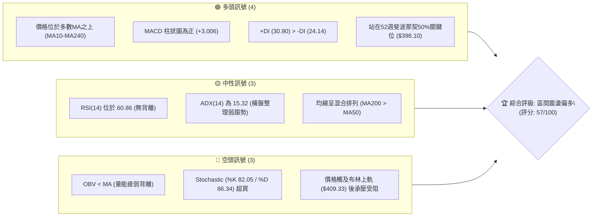
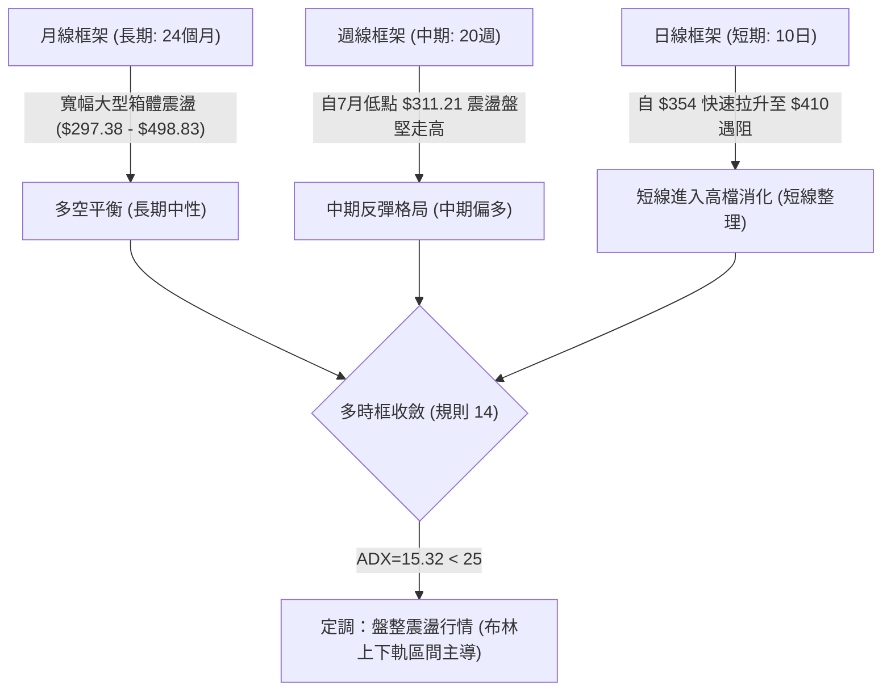
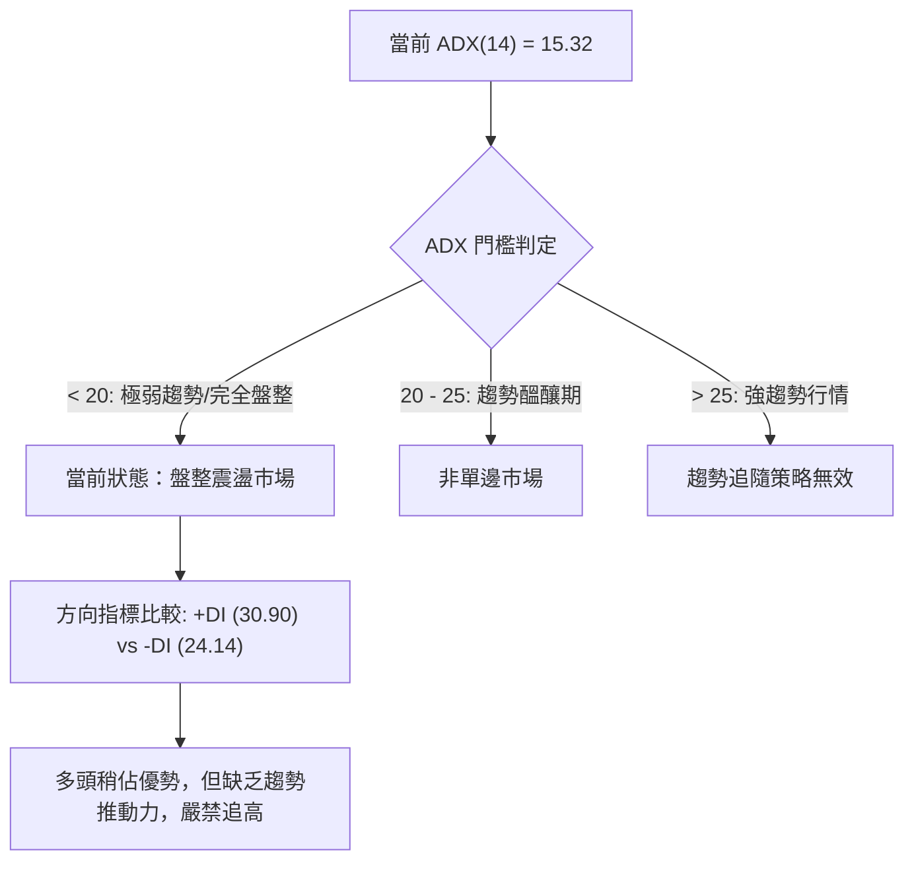
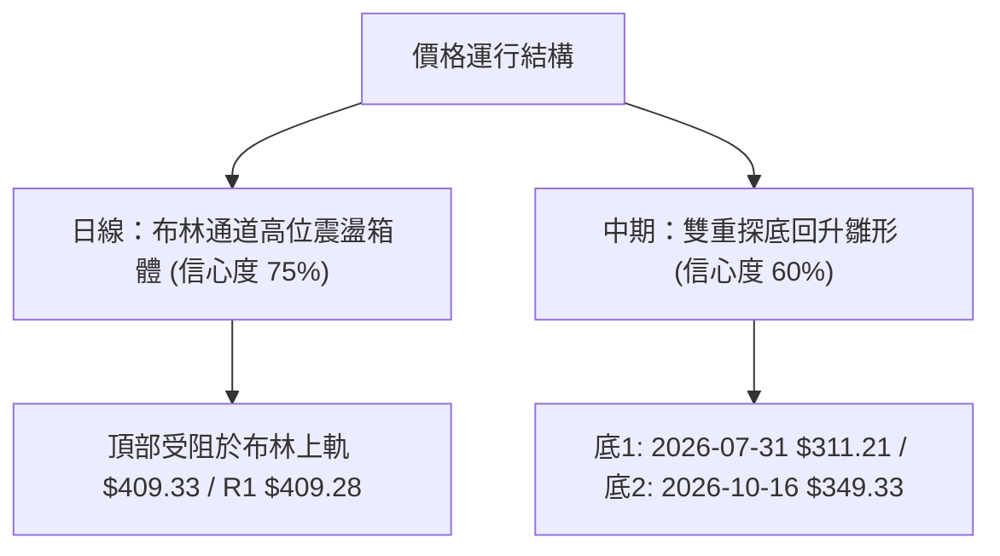
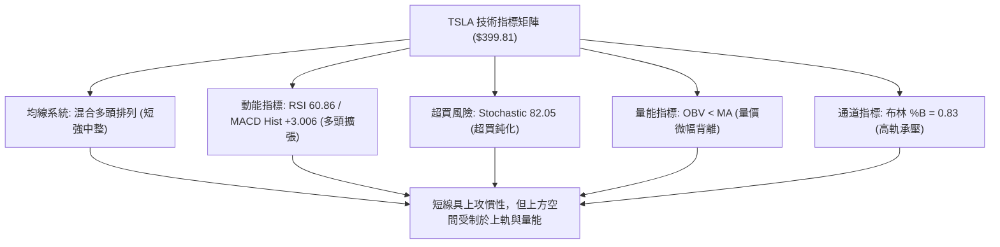
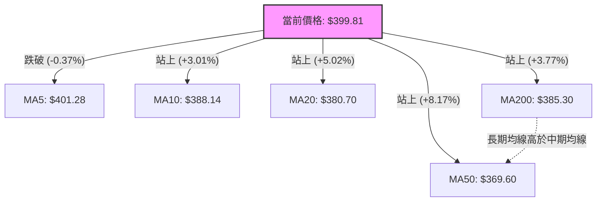
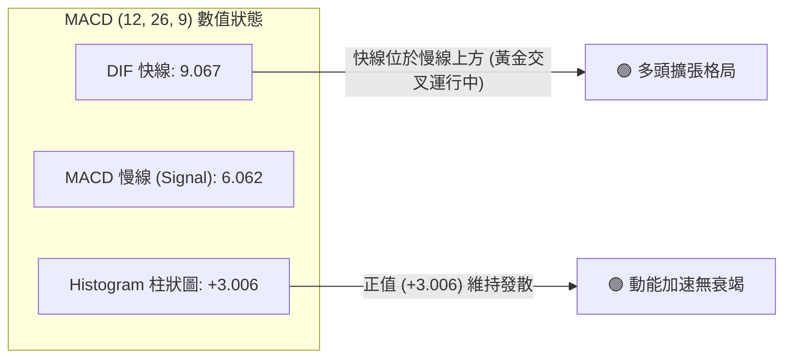
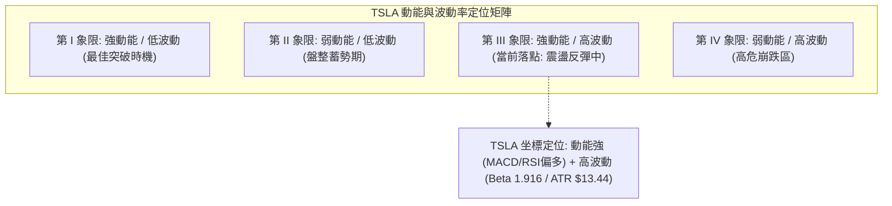
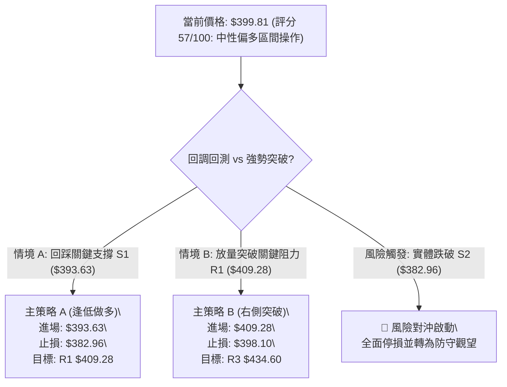
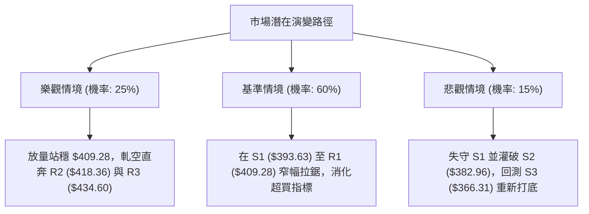

# TSLA 技術分析報告

> **報告日期**：2026-11-02 ｜ **語言**：繁體中文 ｜ **數據來源**：Yahoo Finance ｜ **當前價格**：$399.81 USD

---

## 目錄

| 章節 | 內容 |
|------|------|
| [1. 技術面概覽](#1-技術面概覽) | 訊號儀表板、核心指標、評分卡 |
| [2. 趨勢分析](#2-趨勢分析) | 多時框趨勢、長中短期走勢、ADX解讀 |
| [3. 圖表形態分析](#3-圖表形態分析) | 形態識別、K線組合、目標價推算 |
| [4. 支撐與阻力](#4-支撐與阻力) | 關鍵價位結構、斐波那契回調位深入剖析 |
| [5. 技術指標深度解讀](#5-技術指標深度解讀) | 均線系統、RSI、MACD、布林通道、量能OBV |
| [6. 動能與波動率](#6-動能與波動率) | 動能四象限、ATR波動度、Beta係數分析 |
| [7. 多時框架總結](#7-多時框架總結) | 時框矩陣、多時框收斂定調 |
| [8. 交易策略建議](#8-交易策略建議) | 策略路由、情境階梯、進出場與嚴格風報比 |
| [9. 風險提示與監控](#9-風險提示與監控) | 監控清單、情境模擬、資金控管 |
| [📋 報告總結](#-報告總結) | 核心結論與最佳策略配置 |

---

## 1. 技術面概覽

### 🎯 技術訊號儀表板



---

### 📊 核心指標速覽表

| 指標類別 | 指標名稱 | 當前數值 | 訊號 | 解讀 |
|:---|:---|:---|:---:|:---|
| **價格** | 當前價格 (收盤) | $399.81 | 🟢 | 站穩 $398.10 (斐波那契 50.0% 分水嶺)，收盤於短期均線密集區上方 |
| **均線** | 短期 MA5 | $401.28 | 🔴 | 價格低於 MA5 (-0.37%)，短線出現微幅回踩整理 |
| **均線** | 短期 MA20 | $380.70 | 🟢 | 價格高於 MA20 (+5.02%)，短線多頭生命線支撐穩固 |
| **均線** | 中期 MA50 | $369.60 | 🟢 | 價格高於 MA50 (+8.17%)，中期底部抬升明確 |
| **均線** | 長期 MA200 | $385.30 | 🟢 | 價格高於 MA200 (+3.77%)，處於長期牛熊分界線之上 |
| **動能** | RSI(14) | 60.86 | 🟡 | 處於 30–70 中性偏多區間，未見超買或頂底背離跡象 |
| **動能** | MACD (12,26,9) | 9.067 / 6.062 | 🟢 | MACD 線高於訊號線，柱狀圖 +3.006，多頭動能維持釋放 |
| **動能** | KD指標 (%K/%D) | 82.05 / 86.34 | 🔴 | 進入超買鈍化區間且高檔微幅死叉，提防衝高回落 |
| **通道** | 布林帶 (%B) | 0.83 (軌道寬度 $57.26) | 🟡 | 位於上軌 ($409.33) 與中軌 ($380.70) 間高位，逼近阻力區 |
| **趨勢** | ADX(14) | 15.32 (+DI: 30.90) | 🟡 | ADX < 25 表明處於非單邊強趨勢的盤整格局，多頭稍佔優勢 |
| **成交量**| 最新量 / 20日均量 | 41.64M / 36.30M | 🟡 | 量比 1.15x 微幅放量，但 OBV < MA 顯示中長期籌碼跟進不足 |
| **波動** | ATR(14) | $13.44 | 🟢 | 波動率佔價格 3.36%，處於合理震盪幅度，未見恐慌性波動 |

---

### 🏆 技術評分卡

```
╔══════════════════════════════════════════════════════════════════╗
║                技術評分卡 — TSLA (2026-11-02)                    ║
╠══════════════════════════════════════════════════════════════════╣
║ 趨勢強度 (ADX=15.32, +DI> -DI)  ██████████░░░░░░░░░░  52/100 🟡  ║
║ 動能指標 (RSI=60.86, MACD多頭)  █████████████░░░░░░░  68/100 🟢  ║
║ 支撐穩定度 (站上Fib50%及S1)     █████████████░░░░░░░  65/100 🟢  ║
║ 成交量配合 (OBV<MA, 短線放量)   █████████░░░░░░░░░░░  45/100 🔴  ║
║ 形態完整度 (受阻布林上軌R1)     ███████████░░░░░░░░░  55/100 🟡  ║
║ 均線排列 (混合排列, MA200>MA50) ███████████░░░░░░░░░  57/100 🟡  ║
╠══════════════════════════════════════════════════════════════════╣
║ 綜合評分 (依規則18算術平均)     ███████████░░░░░░░░░  57/100 ⚖️  ║
║ 綜合評級：中性偏多 (40–60 區間操作格局，布林通道內高出低進)     ║
╚══════════════════════════════════════════════════════════════════╝
```
> **評分計算說明**：(52 + 68 + 65 + 45 + 55 + 57) ÷ 6 = 342 ÷ 6 = 57.0 分，四捨五入為 **57/100**。

---

## 2. 趨勢分析

### 🌐 多時框趨勢分析



---

### 📈 長期趨勢 — 12個月走勢圖（Unicode）

以下展示 TSLA 過去 12 個月（2025-11 至 2026-10）收盤價走勢：

```
TSLA 月線走勢圖（過去12個月收盤價）
價格軸 ($)
$460 ┤               
$440 ┤ ●(12月:449.72)               ●(5月:435.79)
$420 ┤ ●(11月:430.17) ●(1月:430.41)         ●(6月:420.60)
$400 ┤        ●(2月:402.51)                                 ●(10月:399.81) ◄ 現價
$380 ┤                               ●(4月:381.63)
$360 ┤               ●(3月:371.75)                   ●(8月:367.95)
$340 ┤                                                       ●(9月:354.81)
$320 ┤
$300 ┤                                       ●(7月:311.21 低點)
     └───────────────────────────────────────────────────────────────────
       11M   12M   01M   02M   03M   04M   05M   06M   07M   08M   09M   10M
```

#### 走勢特徵分析表格

| 階段區間 | 起止月份 | 價格變化 (收盤) | 區間幅度 | 走勢性質與成交量特徵 |
|:---|:---|:---|:---:|:---|
| **第一階段：高檔震盪回落** | 2025-11 → 2026-03 | $430.17 → $371.75 | -13.58% | 2025 年末衝高 $449.72 後動能衰竭，月K連續陰線回調，獲利盤了結 |
| **第二階段：春季反彈破頂失敗** | 2026-03 → 2026-05 | $371.75 → $435.79 | +17.23% | 築底後快速拉升，但未能突破前期高位，形成次高點壓力 |
| **第三階段：夏季恐慌殺跌** | 2026-05 → 2026-07 | $435.79 → $311.21 | -28.59% | 快速重挫，7月觸及 52 週低點區間 ($311.21)，週成交量暴增至 275M 籌碼換手 |
| **第四階段：秋季築底修復** | 2026-07 → 2026-10 | $311.21 → $399.81 | +28.47% | 底部緩步抬升，歷經9月整固後，10月強勢收復 $398.10 (斐波那契 50%) |

---

### 📊 中期趨勢（週線分析）

從近 20 週走勢觀察，自 2026-07-31 收盤低點 $311.21 起，週線呈現低點逐級抬高（$311.21 → $348.75 → $354.72 → $372.22）的上升通道結構。

```
週線關鍵壓力與支撐示意圖
$434.60 ───────────────────────────────────────────── [R3 強阻力]
$418.36 ───────────────────────────────────────────── [R2 波段阻力]
$409.28 ═════════════════════════════════════════════ [R1 / 10-30週高點 $410.85]
$399.81 --------------------------------------------- [當前收盤價]
$393.63 ───────────────────────────────────────────── [S1 近期轉換位]
$382.96 ═════════════════════════════════════════════ [S2 中期頸線支撐]
$366.31 ───────────────────────────────────────────── [S3 週線防守底限]
```

---

### ⚡ 趨勢強度評估（ADX 解讀）



#### ADX 數值強度對照解析

| 指標變數 | 當前讀數 | 門檻區間 | 市場狀態解讀 |
|:---|:---:|:---:|:---|
| **ADX(14)** | **15.32** | `< 25` | **弱趨勢 / 盤整震盪**。價格缺乏持續單向突破動能，假突破概率高。 |
| **+DI (14)** | **30.90** | `> 25` | 多頭力量佔優，反映自 $354.72 快速拉升的推動波。 |
| **-DI (14)** | **24.14** | `< +DI` | 空頭壓制力暫時減退，但未完全潰退（高於 20）。 |
| **策略導向** | — | — | **回歸布林通道與支撐阻力之區間擺盪操作**，切勿採用順勢突破追價。 |

---

## 3. 圖表形態分析

### 🔍 形態識別系統

依據規則 15，各圖表形態必須根據數據真實波段賦予信心度與幾何推算：



| 識別形態 | 信心度 | 判斷依據（引用數據） | 完成度 | 目標價（附嚴格計算式） |
|:---|:---:|:---|:---:|:---|
| **箱體通道整理** | **75%** | 價格受制於布林上軌 $409.33 與阻力 R1 $409.28，下有中軌 $380.70 及 S2 $382.96 支撐 | 85% | 上軌目標 = **$409.28**（阻力位 R1）<br>下軌目標 = **$380.70**（布林中軌） |
| **中期雙重底 (W底)** | **60%** | 第一底為 7/31 低點 $311.21，第二底為 10/16 週低點 $349.33（低點抬高）。近期頸線測試 10/28 高點 $410.85 | 70% | 形態高度 = $410.85 - $349.33 = $61.52<br>破位目標 = $410.85 + $61.52 = **$472.37**（數據中未確認突破頸線） |
| **旗形突破** | **<50%** | 數據中未偵測到連續旗面收斂特徵，信心度不足 | — | 訊號不足，僅做指標型解讀（規則 15） |

---

### 🕯️ 重要 K 線形態分析

嚴格遵循規則 19，僅使用數據庫中「近 10 根日 K」與「近 8 根週 K」之精確數值進行解讀：

#### 近 10 根日 K 棒形態解讀

| 日期 | 開 | 高 | 低 | 收 | 成交量 | K線形態 | 解讀與訊號 |
|:---|:---:|:---:|:---:|:---:|:---:|:---|:---|
| **10-19** | 357.50 | 369.58 | 354.47 | 368.06 | 38,817,900 | 中陽線 | 探底 $354.47 獲利回升，確認前期底部支撐 🟢 |
| **10-20** | 370.28 | 377.59 | 363.64 | 373.71 | 32,123,300 | 溫和小陽線 | 站上 MA50 ($369.60)，多頭續攻 🟢 |
| **10-21** | 381.43 | 388.84 | 380.51 | 386.47 | 48,875,800 | 放量中陽線 | 帶量突破 MA20 ($380.70) 與 MA200 ($385.30) 雙重重壓 🟢 |
| **10-22** | 374.29 | 388.86 | 373.71 | 374.58 | 51,610,900 | 長上影倒錘星 | 衝高 $388.86 遭空頭反撲，巨量滯漲，短線承壓 🔴 |
| **10-23** | 373.20 | 377.32 | 365.27 | 372.22 | 34,763,000 | 縮量十字陰線 | 縮量整固，回測 $365 區域未破，多頭防守頑強 🟡 |
| **10-26** | 383.83 | 397.27 | 383.73 | 391.62 | 53,090,200 | 跳空放量大陽線 | 跳空高開，長陽突破 $390，成交量激增至 53M，主升推動 🟢 |
| **10-27** | 397.76 | 408.45 | 395.25 | 407.46 | 45,333,200 | 光頭中陽線 | 強勢逼近 $409.28 阻力，買盤動能充沛 🟢 |
| **10-28** | 410.16 | 410.85 | 397.18 | 404.22 | 35,598,800 | 高位放量流星線 | 開高衝破 $410.85 隨即下挫，長上影線顯示 R1 賣壓沉重 🔴 |
| **10-29** | 405.63 | 406.98 | 400.50 | 403.30 | 22,858,300 | 極度縮量小陰線 | 量能驟降至 22.8M，多空處於觀望僵局 🟡 |
| **10-30** | 393.22 | 404.22 | 387.52 | 399.81 | 41,644,400 | 長下影錘頭陽線 | 開盤下殺至 $387.52 隨即獲買盤承接拉回 $399.81，下影線長達 $12.29，S1 買盤活躍 🟢 |

#### 近 8 根週 K 棒形態解讀

| 日期 (週結) | 開 | 高 | 低 | 收 | 成交量 | 週K形態 | 解讀與訊號 |
|:---|:---:|:---:|:---:|:---:|:---:|:---|:---|
| **09-11** | 357.10 | 375.44 | 355.75 | 365.44 | 143,463,300 | 震盪紡錘線 | 縮量徘徊，多空於 365 附近僵持 🟡 |
| **09-18** | 359.78 | 374.12 | 354.05 | 364.27 | 185,818,700 | 窄幅十字線 | 波動收窄，量能放大，籌碼換手 🟡 |
| **09-25** | 371.64 | 386.83 | 367.67 | 372.11 | 170,517,200 | 衝高回落陽線 | 試探 $386 上方賣壓，留下上影線 🟡 |
| **10-02** | 368.06 | 374.60 | 345.88 | 370.59 | 197,592,000 | 長下影長針探底 | 殺穿 $350 探至 $345.88 隨即被拉回，強支撐確立 🟢 |
| **10-09** | 369.00 | 388.56 | 364.91 | 382.70 | 162,910,000 | 溫和實體週陽線 | 陽線反包，週線級別 MACD 翻紅 🟢 |
| **10-16** | 382.61 | 382.70 | 349.33 | 354.72 | 158,434,300 | 週線長陰吞噬 | 一週重挫近 $30，回測前低，洗盤意味濃烈 🔴 |
| **10-23** | 357.50 | 388.86 | 354.47 | 372.22 | 206,190,900 | 巨量長下影紅棒 | 206M 巨量於 $354 築出扎實第二隻腳 🟢 |
| **10-30** | 383.83 | 410.85 | 383.73 | 399.81 | 198,524,900 | 放量衝高長實體陽線 | 連續突破多條均線，收盤站上 $398.10，確立反彈波 🟢 |

---

### 📉 ASCII 走勢形態示意圖

```
TSLA 日線形態高位阻力與回測架構示意圖
$410.85 ───────┐ (10-28 遇阻流星線)
               ▼
$409.28 ═══════════════════════════════════════════ [強阻力 R1 / 布林上軌]
         ▲           ▲
        / \         / \
       /   \       /   \           ● $399.81 (10-30 長下影回升收盤)
      /     \     /     \         /
     /       \   /       ▼       ▼
    /         \_/        $387.52 (10-30 探底低點)
$380.70 ─────────────────────────────────────────── [布林中軌 / MA20 支撐]
$365.27 ─────┐ (10-23 洗盤低點)
             ▼
$354.47 ═══════════════════════════════════════════ [雙重底支撐頸線 S3 / 10-19低點]
```

---

## 4. 支撐與阻力

### 🗺️ 關鍵價位分布圖（Unicode）

```
TSLA 價位結構分布圖（嚴格依據 OHLCV 計算聚類點）
═══════════════════════════════════════════════════════════════════
$434.60 ║████████████████████████████████████████║ 強阻力 R3 (波段高點)
$418.36 ║████████████████████████                ║ 中級阻力 R2 (反彈高點聚類)
$409.28 ║████████████████████████████████████    ║ 關鍵阻力 R1 (布林上軌共振)
$399.81 ╠════════════════════════════════════════╣ ◄ 當前收盤價 ($399.81)
$398.10 ║░░░░░░░░░░░░░░░░░░░░░░░░░░░░░░░░░░░░░░░║ 斐波那契 50.0% 多空分水嶺
$393.63 ║▓▓▓▓▓▓▓▓▓▓▓▓▓▓▓▓▓▓▓▓▓▓                  ║ 短線支撐 S1 (近期密集低點)
$382.96 ║██████████████████████████████          ║ 強支撐 S2 (MA200 / 中軌共振)
$366.31 ║████████████████████████████████████████║ 核心防守底限 S3 (波段低點聚類)
═══════════════════════════════════════════════════════════════════
```

---

### 🚧 阻力位分析表

所有價位均嚴格取自數據庫「關鍵價位（由 OHLCV 計算）」區塊，嚴禁人為臆測：

| 阻力級別 | 精確價位 | 距現價幅標 | 形成原因與技術共振 | 突破難度 | 重要性 |
|:---|:---:|:---:|:---|:---:|:---:|
| **阻力 R1** | **$409.28** | +2.37% | 近一年波段高點聚類區，與日線布林上軌 ($409.33) 及 10-28 高點 ($410.85) 重疊 | 🔴 極高 | ★★★★★ |
| **阻力 R2** | **$418.36** | +4.64% | 波段反彈次高點聚類，接近斐波那契 38.2% 回調位 ($421.88) | 🟡 中等 | ★★★★☆ |
| **阻力 R3** | **$434.60** | +8.70% | 2026 年 5 月高點平台聚類，空頭強烈阻擊堡壘 | 🔴 極高 | ★★★★★ |

---

### 🛡️ 支撐位分析表

| 支撐級別 | 精確價位 | 距現價幅標 | 形成原因與技術共振 | 守住機率 | 重要性 |
|:---|:---:|:---:|:---|:---:|:---:|
| **支撐 S1** | **$393.63** | -1.55% | 10-30 開盤點位 ($393.22) 及近一週密集分時換手平台 | 🟢 70% | ★★★★☆ |
| **支撐 S2** | **$382.96** | -4.21% | 關鍵技術共振位：MA20 ($380.70)、MA200 ($385.30) 與近一年低點聚類 | 🟢 85% | ★★★★★ |
| **支撐 S3** | **$366.31** | -8.38% | 中期生命線 MA50 ($369.60) 及 10-23 回測低點 ($365.27) 聚類 | 🟢 90% | ★★★★★ |

---

### 📐 斐波那契回調位分析

依據 52 週完整波段（波谷 **$297.38** → 波峰 **$498.83**，垂直振幅高達 $201.45）計算之標準黃金分割水平：

```
斐波那契層級與現價相對關係
  0.0%  (52W High) ────────────────────────────────── $498.83
 23.6%             ────────────────────────────────── $451.29
 38.2%             ────────────────────────────────── $421.88
 50.0%             ══════════════════════════════════ $398.10 ◄◄ 現價 $399.81
 61.8%             ────────────────────────────────── $374.33
 78.6%             ────────────────────────────────── $340.49
100.0%  (52W Low)  ────────────────────────────────── $297.38
```

#### 斐波那契深度解讀
1. **現價關鍵坐標**：現價 **$399.81** 精確卡位在 **50.0% 回調位 ($398.10)** 之上僅 +0.43% 處。在道氏與斐波那契理論中，50% 位為最關鍵之「均衡樞紐（Equilibrium）」。站上此位代表自 $297.38 以來的反彈已扳回半壁江山，多空進入決策點。
2. **區間夾層定位**：現價處於 **50.0% ($398.10)** 至 **38.2% ($421.88)** 的過渡箱體中。若能有效守穩 $398.10，上方首要磁吸目標即為 38.2% 回調位 $421.88（與阻力 R2 $418.36 構成目標共振帶）；反之，一旦失守 $398.10，下方必將考驗黃金分割黃金支撐 61.8% ($374.33)。

---

## 5. 技術指標深度解讀

### 🎛️ 指標訊號總覽



---

### 📈 移動平均線排列分析



#### 均線系統詳細參數與趨勢狀態

| 均線名稱 | 數值 | 價格相對位置 | 斜率與形態特徵 | 訊號評估 |
|:---|:---:|:---:|:---|:---:|
| **MA5** | $401.28 | 價格在其下方 -0.37% | 短線下彎，顯示極短線拉回整理 | 🔴 短空 |
| **MA10** | $388.14 | 價格在其上方 +3.01% | 陡峭向上翻揚，短線第一道動態支撐 | 🟢 強多 |
| **MA20** | $380.70 | 價格在其上方 +5.02% | 持續上行，布林帶中軌生命線 | 🟢 強多 |
| **MA50** | $369.60 | 價格在其上方 +8.17% | 走平微揚，中期防守大本營 | 🟢 看多 |
| **MA60** | $364.24 | 價格在其上方 +9.76% | 觸底回升，中長期底部支撐扎實 | 🟢 看多 |
| **MA120** | $377.01 | 價格在其上方 +6.05% | 走平，代表半年持倉成本線 | 🟢 看多 |
| **MA200** | $385.30 | 價格在其上方 +3.77% | 走平微跌，年線牛熊分水嶺已收復 | 🟢 看多 |
| **MA240** | $395.32 | 價格在其上方 +1.13% | 緩步走平，現價剛好越過此線 | 🟢 看多 |

> **均線排列深度診斷**：系統判定為「混合排列」。雖然現價已成功站上 MA10、MA20、MA50、MA120、MA200、MA240 等絕大多數均線，但由於過去一年深幅震盪，**MA200 ($385.30) 仍壓在 MA50 ($369.60) 與 MA20 ($380.70) 之上**，並未形成完美的「多頭排列（黃金交叉發散）」，這佐證了當前行情屬修復型反彈與區間拉鋸，非單邊爆發大牛市。

---

### 📉 RSI(14) 分析

*   **當前數值**：**60.86**（Wilder 計算模型）
*   **區間展示**：
```
超賣區 (0-30)           中性平穩區 (30-70)                 超買區 (70-100)
├──────────────────────┼─────────────────────────●────────┼──────────────┤
0                      30                      60.86     70            100
[██████████████████████████████████████████████████████░░░░░░░░░░] 60.86%
```
*   **超買超賣與背離判斷**：
    *   RSI 位於 60.86，遠離 30 以下之超賣區，亦未觸及 70 之警戒超買區，屬於多頭掌控下的「健康強勢區」。
    *   **背離分析結論**：經比對近 20 根 K 棒走勢，價格自 10-19 低點 $354.47 震盪上行至 10-28 高點 $410.85，RSI 同步自低位 42 附近攀升至 60 軸線，首尾價格方向與 RSI 指標方向一致，**無明顯頂背離或底背離**。買盤推升屬於合理力道釋放，未出現指標衰竭枯竭現象。

---

### 📊 MACD(12, 26, 9) 訊號解讀



*   **數值解讀**：MACD 快線 (9.067) 明顯大於 Signal 線 (6.062)，柱狀圖讀數為 **+3.006**，呈現典型多頭市場特徵。柱狀圖自 10-23 的負值 (-0.130) 強勢轉正並持續放大至 +3.006，反映近兩週買盤具備實質推動力。目前快慢線皆位於零軸上方，屬於「零軸上強勢多頭排列」。

---

### 📦 布林通道分析

```
TSLA 布林通道 (20, 2) 結構圖
$409.33 ═══════════════════════════════════════════════ 上軌 (Upper Band)
            ▲                
            │                ◄ 現價 $399.81 (%B: 0.83，位於上部強勢區)
$380.70 ────┼────────────────────────────────────────── 中軌 (Middle Band = MA20)
            │                
            ▼                
$352.07 ═══════════════════════════════════════════════ 下軌 (Lower Band)
```

*   **通道參數**：上軌 **$409.33** ｜ 中軌 **$380.70** ｜ 下軌 **$352.07** ｜ 帶寬帶高達 $57.26。
*   **%B 指標解讀**：%B 讀數為 **0.83**。當 %B > 0.80 時，表示股價已進入布林帶上部極端敏感區。10-28 股價最高觸及 $410.85 瞬間刺破上軌 ($409.33) 後即刻被壓回，印證布林上軌為極強勁之動態反壓線。由於 ADX 僅 15.32，布林帶難以出現「單邊開口向上單邊跑」的喇叭口走勢，高機率回歸中軌 $380.70 進行均值回歸。

---

### 💹 成交量分析（量價配合度）

1.  **量價配合狀態**：
    *   最新日成交量：**41,644,400 股**。
    *   20 日平均成交量：**36,303,005 股**（量比為 **1.15x**，小幅放量 +14.7%）。
    *   50 日平均成交量：**38,077,224 股**。
    *   10-30 下跌拉回時成交量為 41.6M，高於 20 日均量，但收出長達 $12.29 的下影線，表明低位承接買盤積極。
2.  **OBV（能量潮）走勢評估**：
    *   數據快照明確提示：**OBV 趨勢為 OBV < MA → 量能疲弱**。
    *   **量價矛盾點解讀**：股價雖已反彈至 52 週中位數上方，但 OBV 指標依然受制於其均線之下。這意味著此輪自 $311.21 啟動的反彈，主力機構資金採取的是「被動護盤與高拋低吸」，並非「主動連續搶籌」。量能未確認突破，構成後續衝擊 R2 ($418.36) 與 R3 ($434.60) 的最大技術隱憂。

---

## 6. 動能與波動率

### ⚡ 動能評估四象限



| 象限分區 | 動能維度 | 波動度維度 | 當前狀態判定 | 操作指導評估 |
|:---:|:---:|:---:|:---:|:---|
| **Q1** | 強 | 低 | — | 最佳低吸加碼機會 |
| **Q2** | 弱 | 低 | — | 橫盤窄幅縮量觀望 |
| **Q3** | **強** | **高** | **✓ 當前狀態** | **高風險高回報博弈期。需嚴設停損，鎖定利潤，嚴防急促洗盤** |
| **Q4** | 弱 | 高 | — | 空頭主導避險區間 |

---

### 📊 ATR 波動率分析

*   **當前數值**：**ATR(14) = $13.44**（以 Wilder 模型平滑計算）。
*   **波動比率**：佔當前股價之 **3.36%**。這意味著 TSLA 每個交易日的正常平均波動區間接近 $13.5 美元。
*   **風控與止損距離量化建議**：
    *   *激進超短線止損（1.0 × ATR）*：距離進場點 **$13.44**。
    *   *標準波段交易止損（1.5 × ATR）*：距離進場點 **$20.16**。
    *   *保守中期趨勢止損（2.0 × ATR）*：距離進場點 **$26.88**。
    *   *應用意義*：任何小於 $13.44 的止損設定極易被市場正常雜訊「假洗盤」掃出場；設定在 $20.00 以上方能避開日內雜訊。

---

### 📐 Beta 與市場相關性

*   **Beta 係數**：**1.916**（極高系統性風險敞口）。
*   **市場敏感度解讀**：TSLA 之 Beta 接近 2.0，代表其波動幅度約為 S&P 500 指數的 1.92 倍。當大盤指數上漲 1% 時，TSLA 理論平均上揚 1.92%；但當大盤回調 1% 時，其跌幅亦將放大至 1.92%。當前美股處於財報與大選震盪期，高 Beta 意味著個股極易受宏觀系統性情緒放大干擾，部位管理需嚴格控制在 15%–20% 資金上限。

---

## 7. 多時框架總結

### 📋 時框架評分表

| 時框架 | 趨勢方向 | 動能狀態 | 均線排列 | 關鍵形態 | 時框評分 | 交易指導意義 |
|:---|:---:|:---:|:---:|:---:|:---:|:---|
| **日線 (短期)** | 偏多震盪 🟢 | RSI 60.86 / KD超買 🟡 | 站上多數MA，短線回踩 🟢 | 布林上軌承壓回落 🟡 | **60/100** | 尋找回測 S1/S2 支撐時低吸，不追高 |
| **週線 (中期)** | 震盪反彈 🟢 | MACD柱連兩週翻紅 🟢 | 均線糾纏扭轉中 🟡 | 探底長下影築底抬升 🟢 | **65/100** | 中期築底完成，邁向 $418–$434 阻力帶 |
| **月線 (長期)** | 寬幅箱體 🟡 | 處於 52 週中軸 50% 🟡 | 圍繞 MA240 ($395) 拉鋸 🟡 | $297–$498 大區間整理 🟡 | **50/100** | 尚未脫離大箱體震盪格局，長期中性 |

---

### 🔲 綜合訊號矩陣

```
時框與指標一致性交叉矩陣
─────────────────────────────────────────────────────────────────
指標維度          短期 (日線)        中期 (週線)        長期 (月線)
─────────────────────────────────────────────────────────────────
均線系統 (MA)        🟢 看多            🟡 中性糾纏        🟡 混合整理
動能震盪 (RSI/MACD)  🟢 看多            🟢 看多            🟡 偏中性
量能結構 (Volume)    🔴 疲弱背離        🟡 溫和換手        🟡 縮量
形態通道 (Patterns)  🟡 上軌受阻        🟢 低點抬高        🟡 大箱體
─────────────────────────────────────────────────────────────────
整體方向收斂         🟢 短期多頭回踩    🟢 中期溫和反彈    🟡 長期區間震盪
─────────────────────────────────────────────────────────────────
```

---

### ⚖️ 多時框收斂結論

嚴格遵循本報告「嚴格要求 14（多時框收斂規則）」：
1.  **趨勢 vs 盤整判定**：日線 **ADX(14) 為 15.32 (< 25)**，嚴格觸發「**盤整行情規則**」。在此環境下，市場並不具備單邊單向暴走的強趨勢基礎，不可採用破位追單。
2.  **主導結構**：交易主導結構為「**日線布林通道（上軌 $409.33 / 下軌 $352.07）與關鍵波段高低點 S/R 區間**」。
3.  **唯一方向性結論**：**【中性偏多，區間操作】**。日線雖短線超買回踩，但週線連續兩週放量長下影拉升，中期反彈趨勢未破。綜合評分 **57/100** 決定了交易主軸為：**在回踩支撐位（S1 $393.63 或 S2 $382.96）時逢低佈局做多，並在阻力區（R1 $409.28 至布林上軌）嚴格停利**。

---

## 8. 交易策略建議

### 🗺️ 策略決策流程圖



---

### 🧭 策略路由（依評分卡分流）

> **當前主策略方向 = 【中性偏多，以支撐阻力之區間操作為主，等待突破確認】（依技術評分卡 57/100 定調）**

依據規則，評分處於 40–60 之中性偏多過渡帶，禁止盲目全倉押注單邊突破，主推以精密風報比主導之區間多頭策略與右側突破策略。

---

### 🎯 價格情境階梯（Price Scenarios）

價位完全採用「關鍵價位」區塊與斐波那契之客觀數值：

| 觸發條件 | 下一目標 | 後續延伸 | 技術情境含義 |
|:---|:---:|:---:|:---|
| **強勢突破 R1 ($409.28)** | **R2 ($418.36)** | **R3 ($434.60)** | 短線突破布林上軌壓制，打開朝向 38.2% 回調位之路 |
| **守穩現價 ($398.10 - $399.81)** | **R1 ($409.28)** | — | 於 50% 均衡位蓄勢震盪，延續多頭整理結構 |
| **跌破 S1 ($393.63)** | **S2 ($382.96)** | **S3 ($366.31)** | 短線回調加深，向下尋求 MA20 / MA200 均線密集防守區 |

---

### 📊 情境機率分佈

| 情境劃分 | 預估機率 | 主要技術依據 |
|:---|:---:|:---|
| **區間震盪蓄勢 (維持在 $393–$409 內)** | **55%** | ADX=15.32 確認非趨勢市；布林軌道帶寬充沛；OBV 量能未放大難以單邊破頂 |
| **向上反彈突破 (衝擊 R1 / R2)** | **30%** | MACD 柱狀圖維持 +3.006 強勢；站穩 52W 斐波那契 50% ($398.10)；週K連收下影線 |
| **回落探底 (跌破 S1 測試 S2/S3)** | **15%** | Stochastic (82.05) 超買死叉回踩壓力；OBV 呈現背離，若大盤重挫可能引發多殺多 |

---

### 🟢 主策略詳情

嚴格按照規則 17 定義計算風報比：**風險報酬比 = (目標價 T1 − 進場價) ÷ (進場價 − 止損價)**。

| 策略要素 | 策略 A：支撐位逢低吸納（左側低吸） | 策略 B：突破頸線順勢追擊（右側確認） |
|:---|:---|:---|
| **策略邏輯** | 回踩 S1 密集換手位，博弈下影線支撐反彈 | 帶量有效突破 R1 及布林上軌，博弈波段延伸 |
| **進場條件** | 股價回踩 S1 不破，並在分時出現止跌紅K | 股價日K實體收盤站上 R1 ($409.28) 且成交量放大 |
| **精確進場價** | **$393.63** (支撐 S1 精確值) | **$409.28** (阻力 R1 精確值) |
| **目標價 T1** | **$409.28** (阻力 R1) | **$434.60** (阻力 R3) |
| **目標價 T2** | **$418.36** (阻力 R2) | **$451.29** (斐波那契 23.6%) |
| **止損價格** | **$382.96** (支撐 S2，MA200 支撐下方) | **$398.10** (斐波那契 50.0% 轉換支撐) |
| **風險額 (每股)** | $393.63 − $382.96 = **$10.67** | $409.28 − $398.10 = **$11.18** |
| **回報額 T1** | $409.28 − $393.63 = **$15.65** | $434.60 − $409.28 = **$25.32** |
| **回報額 T2** | $418.36 − $393.63 = **$24.73** | $451.29 − $409.28 = **$42.01** |
| **風險報酬比** | **1 : 1.47（以 T1 計）**<br>*(1 : 2.32 以 T2 計)* | **1 : 2.26（以 T1 計）**<br>*(1 : 3.76 以 T2 計)* |
| **成功機率** | **65%** | **55%** |
| **建議倉位** | **15% 總資金** | **10% 總資金** |

---

### 🔴 反向風險觸發點（對沖與風控提示）

若出現以下訊號，主推之偏多區間策略立即失效，投資人應即刻執行對沖或離場：
1.  **關鍵破位訊號**：日K收盤價**實體跌破 $382.96 (支撐 S2)**。此處為 MA20 ($380.70) 與 MA200 ($385.30) 的核心防守交匯區，一旦失守，宣告中期反彈夭折。
2.  **量能崩裂訊號**：單日成交量暴增至 6,000 萬股以上且收在最低點（大陰線下破 $393.63），確認高檔多殺多出貨。
3.  **指標惡化訊號**：日線 MACD 柱狀圖由正轉負（跌破 0 軸），且 RSI 跌破 50 中軸線。

---

### ⭐ 整體訊號強度評星

```
╔══════════════════════════════════════════════════════════════════╗
║ 做多訊號強度：★★★☆☆  (3.5/5 星：受制於布林上軌與量能疲弱)       ║
║ 做空訊號強度：★★☆☆☆  (2.0/5 星：均線與MACD處於多頭，做空勝率低) ║
║ 整體可信度：  ★★★★☆  (4.0/5 星：價位結構明確，S/R聚類共振扎實)   ║
╚══════════════════════════════════════════════════════════════════╝
```

---

## 9. 風險提示與監控

### ✅ 關鍵監控指標 Checklist

```
╔══════════════════════════════════════════════════════════════════╗
║               TSLA 交易日常監控清單 (Checklist)                  ║
╠══════════════════════════════════════════════════════════════════╣
║ [ ] 價格能否持續收在 $398.10 (斐波那契 50%) 之上？               ║
║ [ ] 衝擊 $409.28 (R1) 時，日成交量是否突破 5,000 萬股？          ║
║ [ ] 回測 $393.63 (S1) 時，10-30 下影線低點 $387.52 是否有守？     ║
║ [ ] MACD 柱狀圖 (+3.006) 是否出現連續縮小（動能減弱前兆）？      ║
║ [ ] Stochastic (%K=82.05) 是否死叉跌破 80 超買線？               ║
║ [ ] 大盤標普500指數是否出現系統性大幅波動 (Beta 1.916 效應)？    ║
╚══════════════════════════════════════════════════════════════════╝
```

---

### ⚠️ 風險場景分析



---

### 🛡️ 風險管理重要提醒

1.  **嚴禁重倉孤注一擲**：TSLA 之 ATR 高達 $13.44（每日正常震盪 3.36%），Beta 接近 2.0。單一帳戶在 TSLA 的曝險比例**不宜超過總權益的 20%**，單筆交易的最大止損虧損金額嚴格限制在**總資金的 1.0%–1.5%** 內。
2.  **避免追價心理**：當前股價距離阻力 R1 ($409.28) 僅 +2.37%，但距離強支撐 S2 ($382.96) 有 -4.21%，在現價 ($399.81) 追高極易買在布林通道天花板，承受不對稱的下行風險。**「買支撐、賣阻力」**為震盪市不二法門。

---

## 📋 報告總結

```
╔══════════════════════════════════════════════════════════════════╗
║                    TSLA 技術分析報告總結                         ║
╠══════════════════════════════════════════════════════════════════╣
║ 報告日期：2026-11-02                                             ║
║ 當前價格：$399.81 USD                                            ║
║ 分析評級：⚖️ 57/100 (中性偏多，區間震盪操作格局)                ║
╠══════════════════════════════════════════════════════════════════╣
║ 關鍵結論：                                                       ║
║ ├─ 長期趨勢：🟡 52週寬幅箱體震盪 ($297.38 - $498.83)，長線平衡   ║
║ ├─ 中期趨勢：🟢 自7月低點 $311.21 震盪抬升，週線級別反彈結構健全║
║ ├─ 短期趨勢：🟡 自 $354 拉升至 $410 遇阻，日線進入布林上軌消化期║
║ ├─ 核心支撐：$393.63 (S1) / $382.96 (S2)                         ║
║ ├─ 核心阻力：$409.28 (R1) / $418.36 (R2)                         ║
║ └─ 華爾街共識目標價：$411.82 (買入評級，40位分析師)              ║
╠══════════════════════════════════════════════════════════════════╣
║ 最優策略組合：                                                   ║
║ 1. 🥇 最佳機會：策略 A (逢低吸納)                               ║
║    回踩 S1 $393.63 企穩進場，止損 $382.96，目標 $409.28 (風報比 1:1.47)║
║ 2. 🥈 次選機會：策略 B (破位追擊)                               ║
║    突破 R1 $409.28 追進，止損 $398.10，目標 $434.60 (風報比 1:2.26) ║
║ 3. 🥉 保守選擇：場外觀望                                         ║
║    靜待 ADX > 25 走出單邊方向，或回測 MA20/MA200 ($380-$385) 再介入║
╚══════════════════════════════════════════════════════════════════╝
```

---

> ⚠️ **免責聲明**：本報告為依據客觀歷史技術指標數據生成之研究報告，所有價位與邏輯均遵循經典技術分析理論。本報告**僅供研究與學術參考**，**不構成任何要約、推薦或投資操作建議**。金融市場投資具高度風險，投資人應獨立評估自身風險承受能力並自負盈虧。

---
*報告生成時間：2026-11-02 ｜ 數據來源：Yahoo Finance ｜ 分析框架：多時框技術分析模型*