# TSLA 技術分析報告

> **報告日期**：2026-11-03 ｜ **語言**：繁體中文 ｜ **數據來源**：Yahoo Finance ｜ **當前價格**：$403.82

---

## 目錄

| 章節 | 內容 |
|------|------|
| [1. 技術面概覽](#1-技術面概覽) | 訊號儀表板、核心指標、評分卡 |
| [2. 趨勢分析](#2-趨勢分析) | 多時框趨勢、長中短期走勢、ADX解讀 |
| [3. 圖表形態分析](#3-圖表形態分析) | 形態識別、K線組合、目標價推算 |
| [4. 支撐與阻力](#4-支撐與阻力) | 關鍵價位、斐波那契回調結構 |
| [5. 技術指標深度解讀](#5-技術指標深度解讀) | MA/RSI/MACD/布林/成交量量價背離 |
| [6. 動能與波動率](#6-動能與波動率) | 動能四象限、ATR、Beta與市場聯動 |
| [7. 多時框架總結](#7-多時框架總結) | 時框架評分矩陣與多時框收斂 |
| [8. 交易策略建議](#8-交易策略建議) | 策略路由、主策略、情境階梯、風報比 |
| [9. 風險提示與監控](#9-風險提示與監控) | 監控清單、情境模擬、風控指南 |

---

## 1. 技術面概覽

### 🎯 技術訊號儀表板

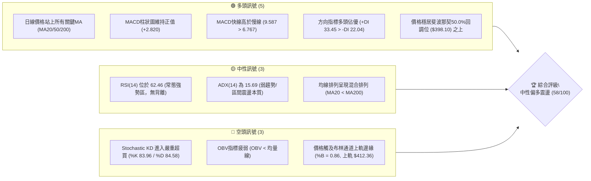

### 📊 核心指標速覽表

| 指標類別 | 指標名稱 | 當前數值 | 訊號 | 解讀 |
|:---|:---|:---|:---:|:---|
| **價格** | 當前收盤價 | $403.82 | 🟢 | 位於52週區間52.8%，站穩中期多空分水嶺 |
| **均線** | 短期 MA20 | $381.95 | 🟢 | 現價高於 MA20 達 +5.73%，短線多方掌控 |
| **均線** | 中期 MA50 | $370.42 | 🟢 | 現價高於 MA50 達 +9.02%，中期波段墊高 |
| **均線** | 長期 MA200 | $385.12 | 🟢 | 現價突破長週期年線阻力，但均線呈現混合態 |
| **動能** | RSI(14) | 62.46 | 🟡 | 位於50-70中性偏強區間，未破70超買線 |
| **動能** | MACD (12,26,9) | 9.587 / 6.767 | 🟢 | 雙線位於零軸之上且金叉運行，Hist 為 +2.820 |
| **震盪** | Stochastic %K/%D | 83.96 / 84.58 | 🔴 | 雙線處於80上方超買區，短線隨時有回踩修復需求 |
| **趨勢** | ADX(14) | 15.69 | 🟡 | ADX < 25 表明無單邊趨勢，當前為大級別寬幅震盪 |
| **通道** | 布林通道 %B | 0.86 | 🟡 | 逼近上軌 $412.36，空間收窄，面臨軌道壓制 |
| **量能** | 量比 (Volume Ratio) | 1.18x | 🟡 | 成交量 43.03M 高於20日均量 36.35M，量能略有溫和放大 |
| **量能** | OBV 能量潮 | OBV < MA | 🔴 | 資金進場意願未見全面爆發，主力追高動能受限 |
| **波動** | ATR(14) | $13.67 | 🟡 | 佔現價 3.38%，日均波動適中，提供操作空間 |

### 🏆 技術評分卡

```
╔══════════════════════════════════════════════════════════════════╗
║                 技術評分卡 — TSLA (2026-11-03)                  ║
╠══════════════════════════════════════════════════════════════════╣
║ 趨勢強度 (Trend)     ██████████░░░░░░░░░░  52/100  🟡 中性震盪   ║
║ 動能指標 (Momentum)  █████████████░░░░░░░  68/100  🟢 動能偏多   ║
║ 支撐穩定度 (Support) █████████████░░░░░░░  66/100  🟢 底部紮實   ║
║ 成交量配合 (Volume)  █████████░░░░░░░░░░░  48/100  🔴 量能背離   ║
║ 形態完整度 (Pattern) ███████████░░░░░░░░░  56/100  🟡 區間收斂   ║
║ 均線排列 (MAs)       ███████████░░░░░░░░░  58/100  🟡 混合排列   ║
╠══════════════════════════════════════════════════════════════════╣
║ 綜合評分             ███████████░░░░░░░░░  58/100  🟡 中性偏多   ║
║ 評級結論：區間震盪偏多結構（依規則18，綜合評分為六項平均 58 分） ║
╚══════════════════════════════════════════════════════════════════╝
```

---

## 2. 趨勢分析

### 🌐 多時框趨勢分析

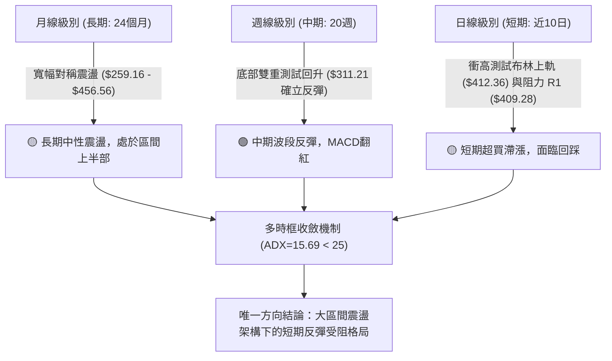

### 📈 長期趨勢 — 12個月走勢圖（Unicode）

以下展示過去 12 個月（2025-12 至 2026-11）的月線收盤走勢與關鍵波段高低點轉折：

```
TSLA 月線走勢圖（過去12個月）
價格軸 ($)
$460 ┤               ● $449.72 (2025-12)
$440 ┤                     ● $435.79 (2026-05)
$420 ┤                         ● $420.60
$400 ┤ ● $430.41    ● $402.51                  ● $399.81  ● $403.82 (現價 2026-11)
$380 ┤                    ● $381.63
$360 ┤               ● $371.75             ● $367.95
$340 ┤                                         ● $354.81
$320 ┤                               ● $311.21 (2026-07 波段低點)
$300 ┤
     └─────────────────────────────────────────────────────────────
       12   01   02   03   04   05   06   07   08   09   10   11 (月份)
      2025 2026 --------------------- 2026 -----------------------
```

#### 走勢特徵分析表格

| 階段區間 | 月收盤起止價 | 漲跌幅 | 結構特徵與技術含義 |
|:---|:---:|:---:|:---|
| **2025-12 → 2026-03** | $449.72 → $371.75 | -17.34% | 年初獲利回吐浪潮，高位破位下殺，跌破多條短期均線 |
| **2026-03 → 2026-05** | $371.75 → $435.79 | +17.23% | 次級反彈高點形成，受制於 $440 關口，呈現高點逐步下移 (Lower High) |
| **2026-05 → 2026-07** | $435.79 → $311.21 | -28.59% | 主跌浪測試52週低點區域，7月份收於 $311.21，接近年度低點 $297.38 |
| **2026-07 → 2026-10** | $311.21 → $399.81 | +28.47% | 自底部展開強勁波段修復，收復 $350、$380 兩大關口，回到中性平衡區 |
| **2026-10 → 2026-11** | $399.81 → $403.82 | +1.00% | 短線進入 $400 心理整數關卡攻防戰，月線實體縮小，動能放緩 |

### 📊 中期趨勢（週線分析）

中期走勢自 2026-07-31 的低位收盤價 $311.21 築底以來，週線呈現階梯式反彈結構。

```
TSLA 中期週線壓力與支撐示意圖
══════════════════════════════════════════════════════════════════
[阻力 R3]  $434.60  --------------------------------------------- (波段反彈強阻力)
                    ↑
[阻力 R2]  $418.36  --------------------------------------------- (前波高點密集區)
                    ↑
[阻力 R1]  $409.28  --------------------------------------------- (上週測試高位)
══════════════════════════════════════════════════════════════════
[當前現價]  $403.82  <<<<< 正在測試布林通道上軌 $412.36 附近
══════════════════════════════════════════════════════════════════
[支撐 S1]  $393.63  --------------------------------------------- (10/26 跳空平台)
                    ↓
[支撐 S2]  $382.96  --------------------------------------------- (MA20/MA200 匯合區)
                    ↓
[支撐 S3]  $366.31  --------------------------------------------- (MA60 防守位)
══════════════════════════════════════════════════════════════════
```

週線指標顯示，MACD柱狀圖在連續數週的收斂後，於 2026-10-30 放大至 +3.006，本週目前為 +2.820，表明中期多頭波段動能仍在，但日線與週線的擴展動能出現遞減跡象。

### ⚡ 趨勢強度評估（ADX 解讀）

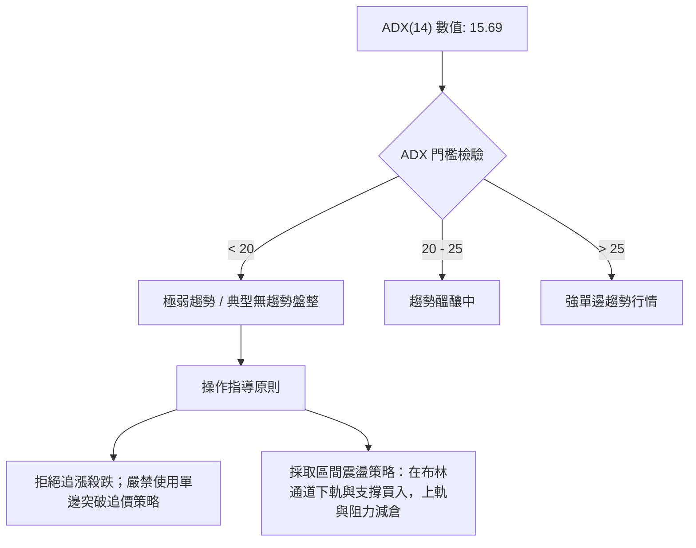

| 項目 | 當前讀數 | 門檻區間 | 趨勢狀態判定 | 操作指導 |
|:---|:---:|:---:|:---:|:---|
| **ADX(14)** | 15.69 | < 25 | 弱趨勢 / 典型無方向震盪 | 適用高拋低吸，通道操作 |
| **+DI** | 33.45 | > 20 | 多方掌控日內邊際定價權 | 逢回踩支撐做多勝率高於空頭 |
| **-DI** | 22.04 | < +DI | 空方受壓制但並未潰敗 | 警惕反彈過程中空方隨時反撲 |
| **趨勢綜合結論** | 盤整市 | ADX << 25 | **非趨勢性牛市，僅為箱體震盪波段** | 緊盯支撐 S1 與阻力 R1 |

---

## 3. 圖表形態分析

### 🔍 形態識別系統

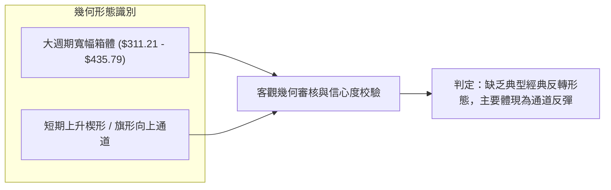

#### 圖表形態信心度評估表（依規則 15）

| 形態名稱 | 信心度 | 判斷依據（嚴格引用數據） | 完成度 | 目標價（附嚴謹計算式） |
|:---|:---:|:---|:---:|:---|
| **箱體震盪反彈** | 75% | 7月份底部收盤 $311.21，10月反彈突破箱體中軸 50% 斐波那契 $398.10 | 85% | 測試箱體頂部阻力位 R3：$434.60 |
| **短期上升楔形** | 55% | 10-20低點 $363.64 與 10-23低點 $365.27 抬高，但11-02高點 $414.23 受阻回落 | 70% | 若下破楔形下軌，目標指向支撐位 S1：$393.63 |
| **頭肩底形態** | 20% | 數據中左肩與右肩不對稱，無法滿足經典頭肩底幾何結構 | N/A | **訊號不足，僅做指標型解讀** |

### 🕯️ 重要K線形態分析（嚴格依據近10根日K與近8根週K）

依規則 19，僅使用技術數據中提供的確切開高低收數據進行深度解析：

| 日期（日K/週K） | 開盤價 | 最高價 | 最低價 | 收盤價 | K線形態名稱 | 形態解讀與市場心理 | 訊號強度 |
|:---|:---:|:---:|:---:|:---:|:---|:---|:---:|
| **日K: 2026-10-20** | 370.28 | 377.59 | 363.64 | 373.71 | 長下影錘頭線 (Hammer) | 盤中下探 $363.64 獲強勁買盤支撐，探底回升確立短線支撐 | 🟢 強烈看多 |
| **日K: 2026-10-22** | 374.29 | 388.86 | 373.71 | 374.58 | 倒轉錘頭 / 墓碑十字 | 衝高 $388.86 後遭遇空方反撲，收於開盤附近，顯示高位拋壓沉重 | 🔴 短線看空 |
| **日K: 2026-10-26** | 383.83 | 397.27 | 383.73 | 391.62 | 實體大陽線 (Marubozu) | 帶量突破 $390，光腳長陽線，多頭全面主導市場邊際定價 | 🟢 強烈看多 |
| **日K: 2026-10-27** | 397.76 | 408.45 | 395.25 | 407.46 | 續漲長陽線 | 強勢突破 $400 整數心理防線，收盤創階段新高 | 🟢 看多 |
| **日K: 2026-10-29** | 405.63 | 406.98 | 400.50 | 403.30 | 窄幅十字星 (Doji) | 成交量驟降至 22.86M，多空雙方在 $403 處陷入極度觀望 | 🟡 變盤警訊 |
| **日K: 2026-10-30** | 393.22 | 404.22 | 387.52 | 399.81 | 下影陽線 | 低開下探 $387.52 隨後強勢拉回，顯示逢低承接買盤極具韌性 | 🟢 看多 |
| **日K: 2026-11-02** | 404.66 | 414.23 | 397.61 | 403.82 | 長上影倒錘線 (Shooting Star) | 衝高觸及 $414.23 後尾盤滑落至 $403.82，上影長達 $10.41，確認 R1/布林上軌壓力 | 🔴 短線看空 |
| **週K: 2026-10-16** | 382.61 | 382.70 | 349.33 | 354.72 | 大陰線光頭下挫 | 週線實體長陰線，跌破多條短均線，測試下部支撐 | 🔴 強烈看空 |
| **週K: 2026-10-23** | 357.50 | 388.86 | 354.47 | 372.22 | 長下影反轉週K | 成交量放大至 206.19M，多頭逢低建倉，形成下影支撐反彈 | 🟢 看多 |
| **週K: 2026-10-30** | 383.83 | 410.85 | 383.73 | 399.81 | 突破實體陽線 | 連續第二週放量拉升，收盤逼近 $400，奠定反彈基調 | 🟢 強烈看多 |

### 📉 ASCII 走勢形態示意圖

```
TSLA 近期日K走勢形態與關鍵阻力受阻示意
價格 ($)
$415 ┤                                     ▲ 最高 414.23 (11/02 射擊之星上影)
$410 ┤                           ▲ 410.85 ──┼─── [阻力 R1: 409.28]
$405 ┤                 ▲ 408.45  │   ● 404.22│   ● 403.82 (現價收盤)
$400 ┤            ● 397.27       │   │       │
$395 ┤            │              │   ▼ 397.18▼ 397.61
$390 ┤     ▲ 388.86              │
$385 ┤     │                     ▼ 387.52 ──── [支撐 S1: 393.63]
$380 ┤     │
$375 ┤ ● 374.58
$370 ┤ │
$365 ┤ ▼ 363.64 ───────────────────────────── [支撐 S3: 366.31]
     └────────────────────────────────────────────────────────
       10-20  10-22  10-26  10-27  10-28  10-30  11-02 (日期)
```

### 🎯 形態目標價計算

根據 2026-10-20 至 2026-10-30 構建的短期反彈旗形通道推算：
1. **通道底部支撐**：$387.52（10-30 低點）
2. **通道突破頸線**：$408.45（10-27 高點）
3. **形態垂直高度**：$408.45 − $387.52 = $20.93
4. **理論上行突破目標價**：
   $$\text{目標價} = \text{頸線 } \$408.45 + \text{形態高度 } \$20.93 = \$429.38$$
   *(該數值與技術數據中關鍵阻力位 R3: $434.60 高度重合，進一步確認其作為中級反彈目標的技術有效性)*
5. **理論下行破位目標價**：
   $$\text{回踩目標價} = \text{頸線 } \$408.45 - \text{形態高度 } \$20.93 = \$387.52$$
   *(精準落於 10-30 低點 $387.52 與支撐位 S2: $382.96 之間)*

---

## 4. 支撐與阻力

### 🗺️ 關鍵價位分布圖（Unicode）

```
TSLA 價位結構分布圖（嚴格依據 OHLCV 計算聚類與斐波那契回調）
══════════════════════════════════════════════════════════════════════
$451.29 ║░░░░░░░░░░░░░░░░░░░░░░░░░░░░░░░░░░║ 斐波那契 23.6% 回調位
$434.60 ║██████████████████████████████████║ 強阻力 R3 (波段高點密集區)
$421.88 ║░░░░░░░░░░░░░░░░░░░░░░░░░░░░░░░░░░║ 斐波那契 38.2% 回調位
$418.36 ║████████████████████████          ║ 次級阻力 R2 (波段反彈高點聚類)
$412.36 ║▒▒▒▒▒▒▒▒▒▒▒▒▒▒▒▒▒▒▒▒▒▒▒▒          ║ 布林通道上軌壓制線
$409.28 ║████████████████████████████████  ║ 近期關鍵阻力 R1 (11/02 衝高回落區)
════════╠══════════════════════════════════╣ ◄ 當前價格 $403.82 (位於 50% 斐波之上)
$398.10 ║░░░░░░░░░░░░░░░░░░░░░░░░░░░░░░░░░░║ 關鍵分水嶺：斐波那契 50.0% 回調位
$393.63 ║▓▓▓▓▓▓▓▓▓▓▓▓▓▓▓▓▓▓▓▓▓▓▓▓▓▓▓▓      ║ 近期第一支撐 S1 (短期波段平台)
$385.12 ║▒▒▒▒▒▒▒▒▒▒▒▒▒▒▒▒▒▒▒▒▒▒▒▒          ║ MA200 年線支撐
$382.96 ║██████████████████████████████████║ 核心強支撐 S2 (MA20 匯聚處)
$374.33 ║░░░░░░░░░░░░░░░░░░░░░░░░░░░░░░░░░░║ 斐波那契 61.8% 黃金分割位
$366.31 ║████████████████████              ║ 深度防守支撐 S3 (MA60 防線)
══════════════════════════════════════════════════════════════════════
```

### 🚧 阻力位分析表

所有價位均來自技術數據中由 OHLCV 聚類計算的精確數值：

| 阻力級別 | 精確價位 | 距現價空間 | 技術形成原因與結構強度 | 突破難度評估 | 重要性 |
|:---|:---:|:---:|:---|:---:|:---:|
| **阻力 R1** | $409.28 | +1.35% | 近期日K波段高點密集區，2026-11-02 衝高至 $414.23 後迅速回落至此線下方 | 🟡 中等 (需日成交量放大至 50M 以上) | ★★★★☆ |
| **阻力 R2** | $418.36 | +3.60% | 近一年次級下跌波段起跌點，上方套牢盤籌碼密集區，接近斐波 38.2% ($421.88) | 🔴 偏高 (遭遇布林上軌與波段均線共振阻擊) | ★★★★☆ |
| **阻力 R3** | $434.60 | +7.62% | 2026年5月份反彈高點聚類（月線收盤 $435.79），多頭年度中級反轉分水嶺 | 🔴 極高 (為中期強大多空分界點) | ★★★★★ |

### 🛡️ 支撐位分析表

所有價位均來自技術數據中由 OHLCV 聚類計算的精確數值：

| 支撐級別 | 精確價位 | 距現價距離 | 技術形成原因與結構強度 | 守住機率評估 | 重要性 |
|:---|:---:|:---:|:---|:---:|:---:|
| **支撐 S1** | $393.63 | -2.52% | 10-26 突破放量陽線開盤價 ($383.83) 與 10-30 低點 ($387.52) 之上方的整理平台 | 🟢 70% (短期多方防守首要陣地) | ★★★★☆ |
| **支撐 S2** | $382.96 | -5.16% | MA20 ($381.95) 與 MA200 ($385.12) 形成的均線密集黏合強支撐區間 | 🟢 85% (中期多頭防守底線) | ★★★★★ |
| **支撐 S3** | $366.31 | -9.29% | 10月份築底平台底沿，接近 MA60 ($365.50) 及斐波那契 61.8% ($374.33) 下方 | 🟢 95% (跌破則意味反彈趨勢徹底瓦解) | ★★★☆☆ |

### 📐 斐波那契回調位分析

依據 52 週完整波動區間（高點 $498.83 → 低點 $297.38，總落差 $201.45）計算各關鍵黃金分割位：

| 分割比例 | 精確回調價位 | 當前價格相對位置與市場技術含義解讀 |
|:---|:---:|:---|
| **0.0% (52W High)** | $498.83 | 52週最高點，極度強大的長期天花板 |
| **23.6%** | $451.29 | 強勢回調極限位，若突破預示長期反轉確立 |
| **38.2%** | $421.88 | 中期回調強阻力位，緊鄰阻力位 R2 ($418.36) |
| **50.0%** | $398.10 | **多空中軸分水嶺**；現價 $403.82 位於其上方 +1.44%，表明多方微弱佔據主導地位 |
| **61.8%** | $374.33 | 黃金分割強防守位，與支撐位 S3 ($366.31) 構成下方防禦縱深 |
| **78.6%** | $340.49 | 弱勢反彈防守位，跌破將引發向 52 週低點探底的風險 |
| **100.0% (52W Low)** | $297.38 | 52週絕對底部，年度強支撐 |

**回調結構判定結論**：當前現價 $403.82 正好夾在 **50.0% ($398.10)** 與 **38.2% ($421.88)** 之間。在技術分析幾何學中，50.0% 往往是多空勢力轉換的核心樞紐。現價成功收復 $398.10，說明自 7 月份低點 $297.38 展開的反彈浪已完成超跌修復，正試圖向 38.2% ($421.88) 發起衝擊；但由於上方即刻面臨 R1 ($409.28) 及布林上軌 ($412.36) 的雙重阻攔，在此區間震盪整理的概率大幅高於單邊向上突破。

---

## 5. 技術指標深度解讀

### 🎛️ 指標訊號總覽

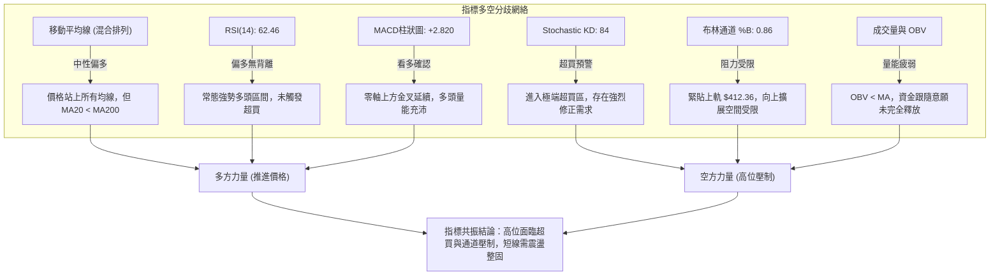

### 📈 移動平均線排列分析

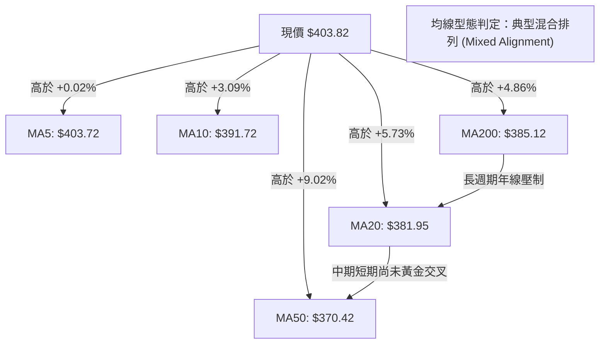

#### 各週期均線數據與排列特徵

| 均線名稱 | 當前價格 | 價格相對位置 | 斜率與走勢特徵 | 技術狀態解讀 |
|:---|:---:|:---:|:---|:---|
| **MA5** | $403.72 | +0.02% | 急速向上攀升 (▇██) | 超短期強勢，但與現價重合，上攻動能減速 |
| **MA10** | $391.72 | +3.09% | 陡峭向上發散 (▆▇█) | 短期第一動態支撐，提供逢低買盤支撐 |
| **MA20** | $381.95 | +5.73% | 穩健向上翻揚 (▅▆▇) | 布林中軌所在，短期波段強弱分水嶺 |
| **MA50** | $370.42 | +9.02% | 拐頭向上修復 (▃▄▅) | 中期上升趨勢線，多頭核心波段防線 |
| **MA60** | $365.50 | +10.49% | 築底回升 (▂▃▄) | 中期季度支撐 |
| **MA120** | $376.77 | +7.18% | 平緩走平微跌 (▅▄▃) | 半年線壓制已化解為下部支撐 |
| **MA200** | $385.12 | +4.86% | 緩慢走平向下 (██▇) | 年線，現價已突破，但 MA20 尚未金叉 MA200 |
| **MA240** | $395.30 | +2.15% | 走平略降 (▇▆▅) | 兩年線位置，現價剛好突破此關口 |

**均線綜合判定**：雖然價格運行於所有短中長期均線之上，但由於長期均線 MA200 ($385.12) 依然高於短期均線 MA20 ($381.95)，均線系統尚未完成標準的「多頭排列」（即 MA5 > MA10 > MA20 > MA50 > MA200）。系統定性為**「均線混合排列」**，這意味著當前的上漲依然定性為中級反彈浪，而非不可逆轉的單邊大牛市。

### 📉 RSI(14) 分析

* 當前 RSI(14) 讀數：**62.46**（Wilder 計算方法）
* RSI 數值強度進度條：
  `[ 0 ] ░░░░░░░░░░░░░░░░░░░░░░░░░░░░░░█████████████░░░░░░░░ [ 100 ]` (62.46%)

#### 深度背離檢驗與解讀
1. **區間定義**：RSI 處於 60–65 區間，屬於健康的「多頭強勢但未過熱」區域。尚未觸及 70 傳統超買警戒線，意味著從單純 RSI 角度看，上方仍有動能擴展空間。
2. **背離判斷**：
   * 對比近 20 根日 K 棒首尾：2026-10-20 收盤價 $373.71 對應 RSI 約 51，至 2026-11-02 收盤價 $403.82 對應 RSI 62.46。價格創出反彈新高，RSI 同步創出新高。
   * **結論：無頂背離，亦無底背離**。動能與價格同向推進，短期上漲結構真實有效，未出現縮量衰竭型頂背離。

### 📊 MACD(12,26,9) 訊號解讀

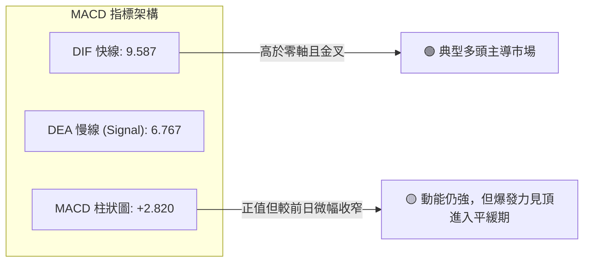

* **DIF 快線**：9.587
* **DEA 慢線**：6.767
* **MACD 柱狀圖 (Histogram)**：+2.820
* **狀態解析**：DIF 與 DEA 均位於零軸上方，且 DIF 顯著高於 DEA，表明中短期市場動能偏向多方。然而，觀察週線級別 MACD 柱狀圖自 2026-10-30 的 +3.006 略微收窄至當前的 +2.820，這表明動能增速在 $400 以上開始減緩，提示不可盲目採用高槓桿追高。

### 📦 布林通道分析

```
TSLA 日線布林通道 (20, 2) 結構示意圖
價格 ($)
$415 ┤
$412.36 ┼──────────────────────────────── 上軌 (Upper Band: 阻力位)
$410 ┤      ▲ 414.23 (11/02 衝出上軌)
$405 ┤      ● $403.82 (現價：%B = 0.86，緊貼上軌)
$400 ┤
$395 ┤
$390 ┤
$385 ┤
$381.95 ┼──────────────────────────────── 中軌 (Middle Band: MA20 支撐)
$375 ┤
$370 ┤
$365 ┤
$360 ┤
$355 ┤
$351.54 ┼──────────────────────────────── 下軌 (Lower Band: 超跌支撐)
$345 ┤
```

* **通道上軌**：$412.36
* **通道中軌 (MA20)**：$381.95
* **通道下軌**：$351.54
* **通道寬度 (Bandwidth)**：$$\frac{\$412.36 - \$351.54}{\$381.95} = 15.92\%$$（通道開口中度張開）
* **%B 指標**：0.86
* **運行特徵解讀**：
  * %B 達到 0.86 表明價格已進入極度強勢區域，但同時也逼近通道邊界。
  * 2026-11-02 盤中最高價 $414.23 曾一度刺破布林上軌 ($412.36)，隨後收盤被迅速打回軌道之內 ($403.82)。在統計學上，這屬於典型的「布林上軌壓制回吐」現象，表明上軌構成強大動態阻力，價格短線向中軌 ($381.95) 尋求均值回歸的概率顯著提升。

### 💹 成交量分析（量價配合度）

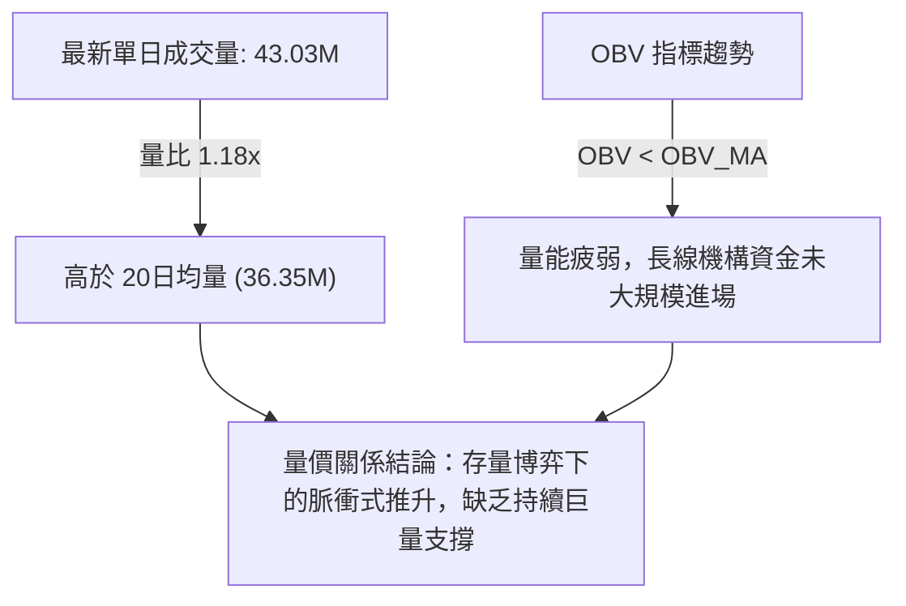

1. **成交量數據特徵**：
   * 最新單日成交量：43,028,200 股
   * 20日均量：36,347,420 股（量比 1.18x，略有放量）
   * 50日均量：37,755,164 股
2. **OBV 能量潮解讀**：
   * 數據明確標註：**「OBV < MA → 量能疲弱」**。
   * **量價背離分析**：現價從 2026-10-20 的 $373.71 連續攀升至 $403.82，但 OBV 線仍壓制在均線之下。這種現象表明，目前的價格上漲主要是由空頭回補和短期交易盤推動，而非機構長期買盤的持續建倉。若後續價格挑戰 R1 ($409.28) 及 R2 ($418.36) 時成交量無法持續站上 50M，將極易誘發量價背離引發的高位跳水。

---

## 6. 動能與波動率

### ⚡ 動能評估四象限

根據 TSLA 當前的動能指標（RSI 62.46, MACD Hist +2.820）與波動率水準（ATR 3.38%, ADX 15.69, Beta 1.743），建立動能與波動率象限評估：

| 象限 | 動能強度 | 波動率水準 | 當前狀態判定 | 操作指導與技術含義 |
|:---:|:---:|:---:|:---:|:---|
| **Q1** | 強 (High) | 低 (Low) | ── | 最佳單邊趨勢上漲行情 |
| **Q2** | 弱 (Low) | 低 (Low) | ── | 沉悶窄幅盤整，觀望為主 |
| **Q3** | **強 (High)** | **高 (High)** | **TSLA 當前位置 (✓)** | **高動能高波動區間，適合波段區間操作，嚴控止損** |
| **Q4** | 弱 (Low) | 高 (High) | ── | 恐慌拋售下跌浪，應堅決規避 |

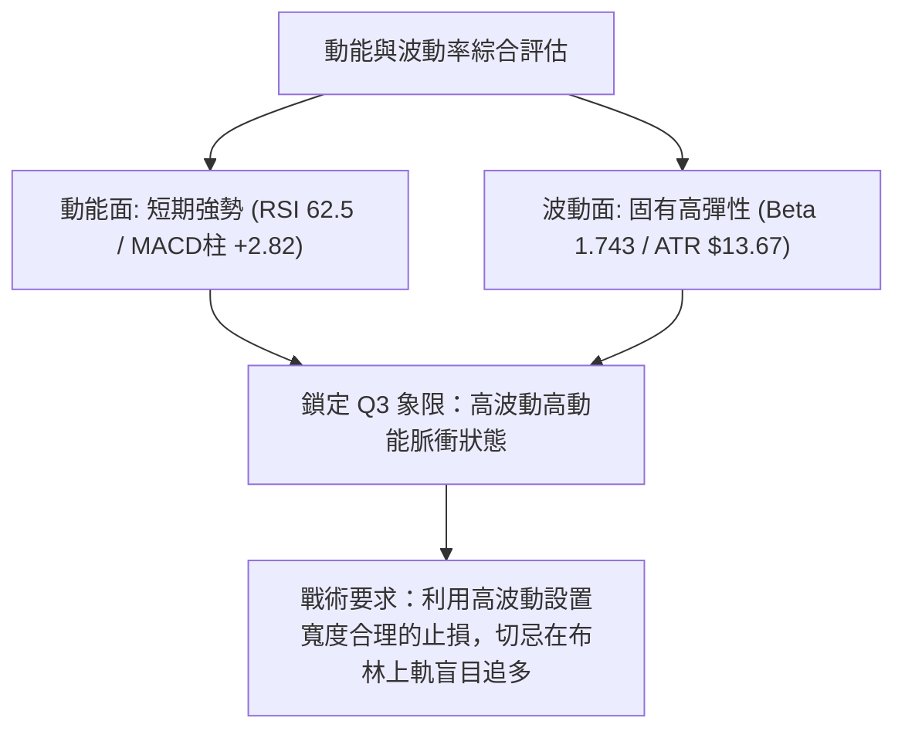

### 📊 ATR 波動率分析

* **當前 ATR(14)**：**$13.67**（佔現價 3.38%，Wilder 平滑法）
* **波動特徵**：日均波幅超過 $13.5，這意味著 TSLA 具備極強的日內與隔夜波動性。
* **交易止損與部位建議**：
  * **超短線/日內止損距離 (1.0 × ATR)**：$$\$13.67$$（當前建議最低止損安全距離）
  * **波段操作止損距離 (1.5 × ATR)**：$$1.5 \times \$13.67 = \$20.51$$
  * **保守型保護止損距離 (2.0 × ATR)**：$$2.0 \times \$13.67 = \$27.34$$
  * 現價 $403.82 減去 1.5 ATR 正好為：$$\$403.82 - \$20.51 = \$383.31$$，這與技術數據中核心強支撐 S2 ($382.96) 以及 MA20 ($381.95) 形成精確重合，驗證了 S2 作為波段止損參考的極高可靠性。

### 📐 Beta 與市場相關性

* **Beta 係數**：**1.743**
* **市場相關性深度剖析**：
  * Beta 為 1.743 表明 TSLA 具備超強的高貝塔進攻屬性。當美股大盤（標普500指數）上漲 1% 時，TSLA 理論平均上漲 1.743%；反之，大盤回調 1% 時，其回撤幅度亦擴大至 1.743%。
  * 結合近期的宏觀新聞（如「S&P 500 ends down; Apple dips」），大盤短線處於避險情緒中，TSLA 的高 Beta 屬性將會放大其受阻於 R1 ($409.28) 後的回調深度。

---

## 7. 多時框架總結

### 📋 時框架評分表

| 時框架 | 趨勢方向 | 動能表現 | 均線排列 | 關鍵形態 | 綜合評分 | 操作建議 |
|:---|:---:|:---:|:---:|:---:|:---:|:---|
| **長期 (月線)** | 🟡 寬幅箱體震盪 | RSI 52 (中性) | 均線走平交織 | $259 - $456 寬幅大箱體 | **54/100** | 長期投資者維持箱體高拋低吸 |
| **中期 (週線)** | 🟢 觸底回升反彈 | MACD柱 +2.82 | MA20向上拐頭 | 自 $311.21 低點構築回升波段 | **64/100** | 中期波段持股，未破 MA20 續抱 |
| **短期 (日線)** | 🟡 上衝阻力受挫 | KD 84 (超買) | 混合排列，站上MA | 11/02 射擊之星遇阻上軌 | **56/100** | 逢高獲利了結部分倉位，等待回踩 |

### 🔲 綜合訊號矩陣

```
時框架訊號一致性矩陣
══════════════════════════════════════════════════════════════════
維度            長期 (月線)      中期 (週線)      短期 (日線)      一致性檢驗
──────────────────────────────────────────────────────────────────
趨勢方向        🟡 震盪          🟢 多頭反彈      🟡 衝高受阻      部分一致 (震盪偏多)
動能指標        🟡 中性          🟢 柱狀擴大      🔴 KD超買/上影   短線出現衝突預警
支撐強度        🟢 底部堅實      🟢 S2強固        🟢 S1防守有效    高度一致 (回踩有撐)
成交量能        🔴 OBV疲軟       🟡 溫和換手      🟡 量比 1.18x    量能缺乏大推力
══════════════════════════════════════════════════════════════════
綜合收斂判定    大格局：ADX=15.69 決定了中長期處於無趨勢寬幅震盪市
                小格局：日線超買觸碰阻力 R1，引發向布林中軌回調的內在需求
══════════════════════════════════════════════════════════════════
```

### ⚖️ 多時框收斂結論（依規則 14）

根據「嚴格要求 14」的多時框收斂規則：
1. **趨勢強度定性**：當前日線級別 **ADX(14) 數值為 15.69**，遠低於 25 的趨勢行情門檻。依規則，**系統嚴格定性為「盤整行情（ADX < 25）」**，不可按單邊突破趨勢處理。
2. **主導交易邊界**：在盤整行情中，**以日線布林通道上下軌（下軌 $351.54 ↔ 上軌 $412.36）以及核心支撐阻力為主要交易區間**。
3. **多時框衝突收斂取捨**：雖然日線價格突破了短期均線，且週線 MACD 呈現紅柱反彈，但由於日線 Stochastic KD 已高達 84.58 嚴重超買，且 2026-11-02 日K線在布林上軌 ($412.36) 及阻力位 R1 ($409.28) 處收出長達 $10.41 上影線的倒錘線，日線已發出明確的滯漲信號。
4. **唯一方向性結論**：**中性偏多區間震盪（逢高不追，回踩布林中軌/支撐 S1 再行低吸）**。此結論嚴格貫穿後續策略章節，杜絕矛盾下注。

---

## 8. 交易策略建議

### 🗺️ 策略決策流程圖

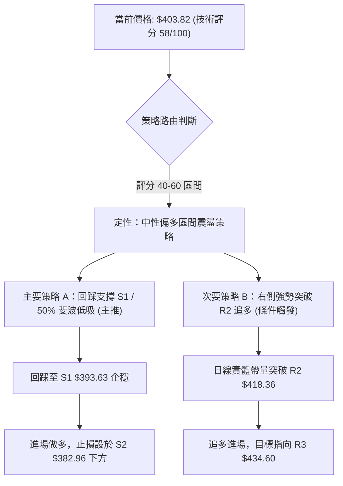

### 🧭 策略路由（依規則 18 評分分流）

> **當前主策略方向 = 中性偏多區間操作，嚴禁追高，以布林帶中軌與關鍵支撐位低吸為主（依技術評分卡綜合評分：58 / 100）**

因綜合評分落在 40–60 區間（58分），技術架構定性為標準的**「區間震盪收斂行情」**。策略核心宗旨：**以日線布林通道 ($351.54 - $412.36) 及支撐阻力為界，在上軌與阻力 R1 附近兌現利潤，在支撐 S1 / S2 處低吸**。

### 🎯 價格情境階梯（Price Scenarios）

價位嚴格引用技術數據中計算出的精確數值：

| 觸發條件 | 下一目標 | 後續延伸 | 情境技術含義與應對要點 |
|:---|:---:|:---:|:---|
| **強勢突破 R1 ($409.28)** | 阻力 R2 ($418.36) | 阻力 R3 ($434.60) | 短線強勢逼空，若突破 R2 則確立向 52週 38.2% 斐波邁進 |
| **維持現價區間 ($398 - $405)** | 阻力 R1 ($409.28) | 支撐 S1 ($393.63) | 區間震盪整固，多空在 50.0% 斐波那契回調位 ($398.10) 上方拉鋸 |
| **回踩跌破 S1 ($393.63)** | 支撐 S2 ($382.96) | 支撐 S3 ($366.31) | 短線回調加深，測試 MA20 ($381.95) 與 MA200 ($385.12) 強支撐共振區 |

### 📊 情境機率分佈

| 情境劃分 | 機率估計 | 主要技術依據（嚴格引用指標數值） |
|:---|:---:|:---|
| **情境一：高位震盪回踩 (主要)** | **55%** | Stochastic KD 嚴重超買 (%K 83.96 / %D 84.58)；11-02 衝高留下長上影線受阻於布林上軌 ($412.36) 與 R1 ($409.28)；OBV 疲軟未確認突破。 |
| **情境二：直接放量突破上攻 (次要)** | **25%** | MACD 柱狀圖仍為正值 (+2.820)；+DI (33.45) 壓制 -DI (22.04)；日線站穩 MA200。但受制於 ADX 僅 15.69，爆發阻力較大。 |
| **情境三：深度下挫破位 (極端)** | **20%** | 大盤高 Beta (1.743) 下跌共振拖累；跌破 50% 斐波那契 ($398.10) 引發止損盤踩踏。 |

### 🟢 主策略詳情

本報告擬定兩套操作策略，均基於盤整市架構下的精確數值計算：

| 策略要素 | 策略 A：回踩支撐 S1 低吸策略 (主推薦) | 策略 B：突破阻力 R2 右側順勢策略 (備選) |
|:---|:---|:---|
| **適用場景** | 短線衝高受阻，回踩測試第一支撐獲確認 | 多頭放量強勢吞噬阻力 R1/R2，打開上方空間 |
| **進場條件** | 價格回調至 S1 附近企穩，出現止跌K線 | 日線收盤價帶量突破阻力 R2 ($418.36) 確認 |
| **進場價格** | **$393.63** (引用支撐位 S1 精確數值) | **$418.36** (引用阻力位 R2 精確數值) |
| **目標價 T1** | **$409.28** (引用阻力位 R1 精確數值) | **$434.60** (引用阻力位 R3 精確數值) |
| **目標價 T2** | **$418.36** (引用阻力位 R2 精確數值) | **$451.29** (引用斐波那契 23.6% 回調位) |
| **止損價格** | **$382.96** (引用支撐位 S2 精確數值) | **$409.28** (跌回阻力位 R1 轉化之支撐下方) |
| **風險報酬比** | **1 : 1.47（以 T1 計）** <br>*計算式：(409.28 − 393.63) ÷ (393.63 − 382.96) = 15.65 ÷ 10.67* <br>*(若以 T2 計則為 1 : 2.32)* | **1 : 1.79（以 T1 計）** <br>*計算式：(434.60 − 418.36) ÷ (418.36 − 409.28) = 16.24 ÷ 9.08* <br>*(若以 T2 計則為 1 : 3.63)* |
| **成功機率** | 65% | 45% |
| **建議倉位** | 15% - 20%（標準波段底倉） | 10%（突破輔助倉位） |

### 🔴 反向風險觸發點（對沖提示）

若出現以下技術破位信號，表明主策略邏輯失效，必須立刻啟動防禦對沖或止損離場：
1. **多頭止損觸發線**：日線收盤價跌破 **$398.10**（50.0% 斐波那契回調位），且次日進一步跌破 **$393.63**（S1）。此時所有在 $400 以上建立的多頭倉位必須主動減半。
2. **中期多轉空確認線**：若價格放量擊穿 **$382.96**（S2）及 **$381.95**（MA20/布林中軌），則宣告本輪自 $311.21 以來的反彈浪徹底終結，技術形態將轉為雙重頂下殺，投資者應建立空頭對沖倉位或全線空倉觀望。

### ⭐ 整體訊號強度評星

```
╔══════════════════════════════════════════════════════════════════╗
║                    TSLA 交易訊號強度評星                         ║
╠══════════════════════════════════════════════════════════════════╣
║ 做多訊號強度：    ★★★☆☆  (3.0 / 5星 - 短線超買受阻，待回踩支撐) ║
║ 做空訊號強度：    ★★☆☆☆  (2.0 / 5星 - 均線支撐完好，逆勢盈虧比差)║
║ 整體技術可信度：  ★★★★☆  (4.0 / 5星 - 關鍵價位結構高度收斂明晰) ║
╚══════════════════════════════════════════════════════════════════╝
```

---

## 9. 風險提示與監控

### ✅ 關鍵監控指標 Checklist

```
╔══════════════════════════════════════════════════════════════════╗
║                   盤面關鍵技術指標監控清單                       ║
╠══════════════════════════════════════════════════════════════════╣
║ [ ] 監控項 1：布林通道上軌壓制 ($412.36) 是否被日線實體有效突破  ║
║ [ ] 監控項 2：阻力 R1 ($409.28) 處的高點拋壓與單日成交量變化     ║
║ [ ] 監控項 3：50.0% 斐波那契中軸 ($398.10) 能否在回調中保持有效 ║
║ [ ] 監控項 4：第一支撐位 S1 ($393.63) 是否出現量縮企穩十字星     ║
║ [ ] 監控項 5：Stochastic KD 是否自 80 以上形成高位死叉回調      ║
║ [ ] 監控項 6：日線 MACD 柱狀圖是否跌破零軸 (當前 +2.820)        ║
║ [ ] 監控項 7：OBV 能量潮能否突破均線壓制，驗證主力增量資金介入   ║
╚══════════════════════════════════════════════════════════════════╝
```

### ⚠️ 風險場景分析

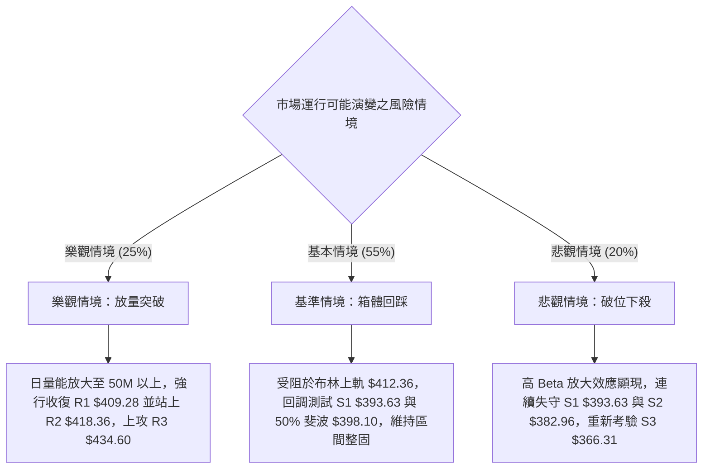

### 🛡️ 風險管理重要提醒

1. **高 Beta 波動風險控管**：
   TSLA 的 Beta 值高達 1.743，且 ATR 達 $13.67（3.38%）。在這種高波動標的上交易，**單筆交易最大虧損額必須嚴格限制在總投資組合資金的 1.0%–1.5% 以內**。切忌因為技術形態突破而進行無節制的期權裸買或高倍融資追價。
2. **盤整市嚴禁趨勢交易思維**：
   由於 ADX(14) 僅為 15.69，所有宣稱「大牛市突破」的觀點均缺乏數據支持。盤整市中最致命的錯誤就是在布林上軌（當前 $412.36）附近追高，以及在布林下軌恐慌割肉。必須嚴守**「逢阻力減倉、逢支撐布局」**的紀律。
3. **動態跟蹤止損設置**：
   若執行主推策略 A 在 $393.63 進場，一旦價格如期反彈突破 $403.82，應立即將止損點上移至保本價位（$393.63），鎖定下行風險，確保本金不受本輪震盪衝擊。

---

## 📋 報告總結

```
╔══════════════════════════════════════════════════════════════════╗
║                     TSLA 技術分析報告總結                        ║
╠══════════════════════════════════════════════════════════════════╣
║ 報告日期：2026-11-03                                             ║
║ 當前價格：$403.82                                                ║
║ 綜合評級：🟡 58 / 100（中性偏多寬幅震盪結構）                    ║
║                                                                  ║
║ 核心趨勢結論：                                                   ║
║ ├─ 長期趨勢 (月線)：🟡 處於 $259.16 - $456.56 大箱體中性區間     ║
║ ├─ 中期趨勢 (週線)：🟢 自 $311.21 展開階梯式反彈，MACD翻紅擴大   ║
║ ├─ 短期趨勢 (日線)：🟡 衝高遭遇布林上軌與阻力 R1 壓制，短線超買  ║
║ ├─ 核心支撐位：    S1: $393.63 ｜ S2: $382.96 ｜ S3: $366.31     ║
║ ├─ 關鍵阻力位：    R1: $409.28 ｜ R2: $418.36 ｜ R3: $434.60     ║
║ └─ 52W 樞紐點：    斐波那契 50.0% 回調位 $398.10 (現已收復)      ║
║                                                                  ║
║ 交易機會最優排序：                                               ║
║ 1. 🥇 最佳機會 (策略 A)：回踩第一支撐 S1 $393.63 企穩低吸，      ║
║    止損設於 S2 $382.96，第一目標看 R1 $409.28，風報比 1 : 1.47  ║
║ 2. 🥈 次選機會 (策略 B)：右側放量突破 R2 $418.36 追多，          ║
║    止損設於 R1 $409.28，目標看 R3 $434.60，風報比 1 : 1.79      ║
║ 3. 🥉 保守選擇：維持 10%–15% 輕倉觀望，等待日線 KD 指標修復完成  ║
╚══════════════════════════════════════════════════════════════════╝
```

---

> ⚠️ **免責聲明**：本報告為技術分析研究成果，所有數據、圖表及價位估算均基於客觀歷史價格與量化技術指標運算生成。本報告**僅供研究與學術參考**，**不構成任何形式的要約、招攬或投資買賣建議**。金融市場投資具有極高風險，標的價格波動劇烈，投資人應獨立評估財務狀況並自負盈虧責任。

---

*報告生成時間：2026-11-03 ｜ 數據來源：Yahoo Finance ｜ 分析框架：多時框架技術分析 (MTFA)*