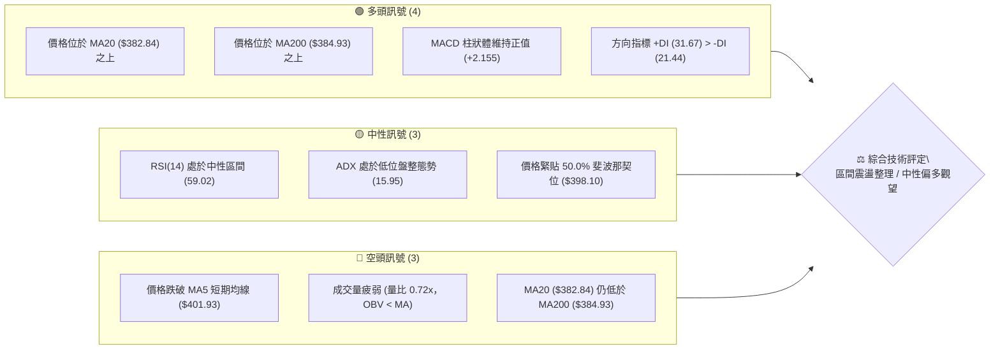
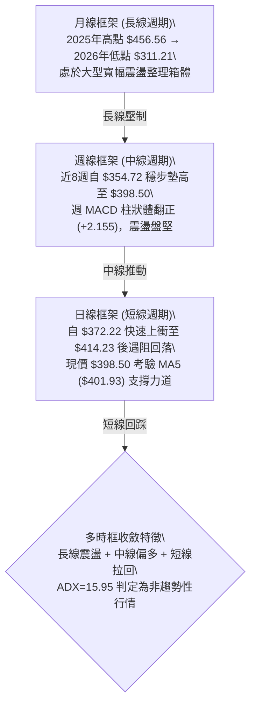
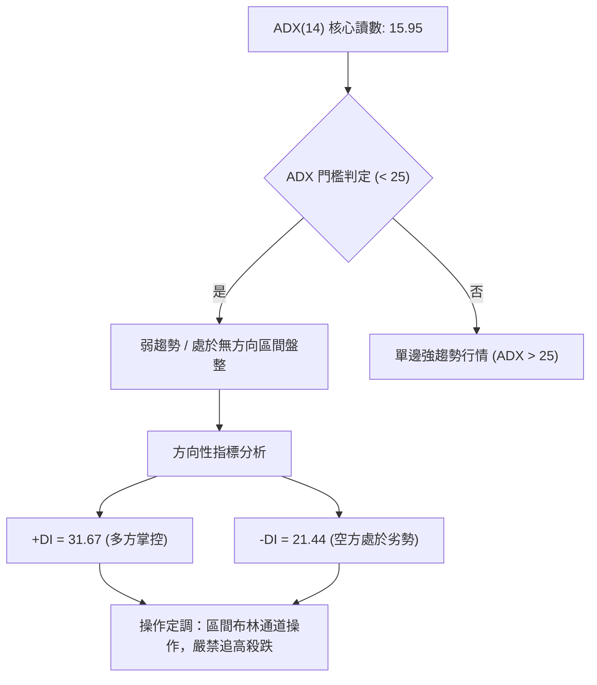
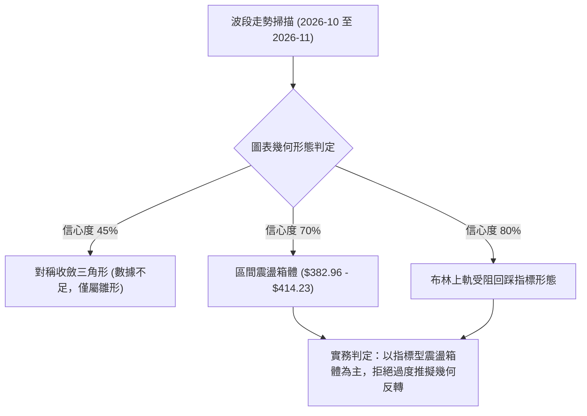
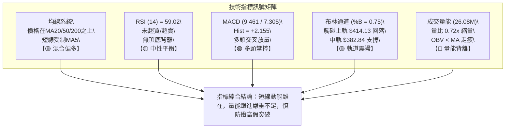
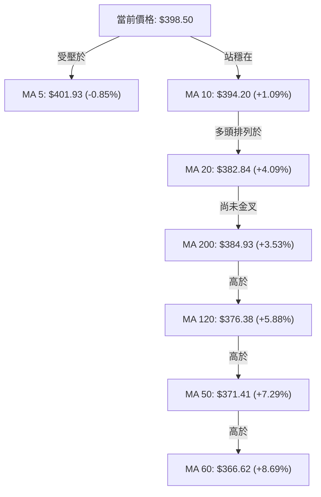
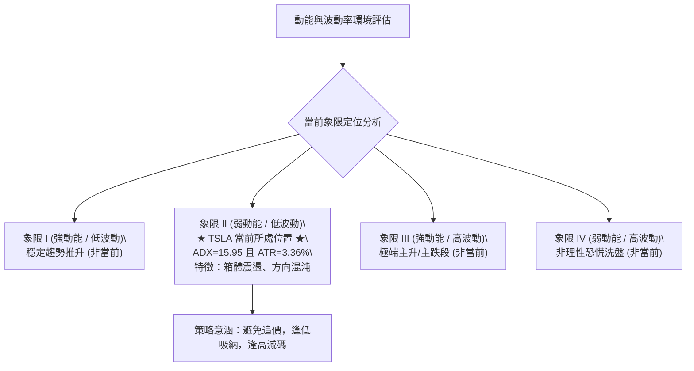
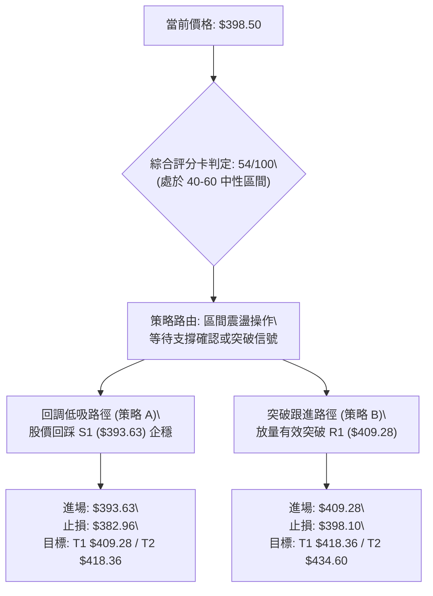
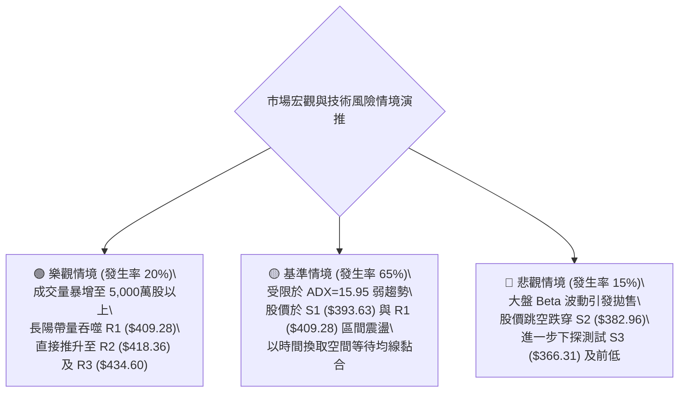

# TSLA 技術分析報告

> **報告日期**：2026-11-04 ｜ **語言**：繁體中文 ｜ **數據來源**：Yahoo Finance ｜ **當前價格**：$398.50

---

## 目錄

| 章節 | 內容 |
|------|------|
| [1. 技術面概覽](#1-技術面概覽) | 訊號儀表板、核心指標、評分卡 |
| [2. 趨勢分析](#2-趨勢分析) | 多時框趨勢、長中短期走勢、ADX強度 |
| [3. 圖表形態分析](#3-圖表形態分析) | 形態識別、K線組合、目標價推算 |
| [4. 支撐與阻力](#4-支撐與阻力) | 關鍵價位結構、斐波那契回調深度解讀 |
| [5. 技術指標深度解讀](#5-技術指標深度解讀) | 均線系統、RSI、MACD、布林通道、量價OBV |
| [6. 動能與波動率](#6-動能與波動率) | 動能四象限、ATR波幅、Beta係數 |
| [7. 多時框架總結](#7-多時框架總結) | 時框架評分矩陣、收斂規則與最終定調 |
| [8. 交易策略建議](#8-交易策略建議) | 策略路由、階梯情境、具體操作點位與風報比 |
| [9. 風險提示與監控](#9-風險提示與監控) | 關鍵風控清單、極端情境推演、資金管理 |

---

## 1. 技術面概覽

### 🎯 技術訊號儀表板



### 📊 核心指標速覽表

| 指標類別 | 指標名稱 | 當前數值 | 訊號 | 專業解讀 |
|:---|:---|:---|:---:|:---|
| **價格基準** | 當前收盤價 | $398.50 | 🟡 | 位於52週區間50.2%分位，剛好處於多空平衡軸心 |
| **短期均線** | MA20 | $382.84 | 🟢 | 現價高於MA20達+4.09%，短期動能守住上通道基底 |
| **中期均線** | MA50 | $371.41 | 🟢 | 現價高於MA50達+7.29%，中期波段多頭架構未破 |
| **長期均線** | MA200 | $384.93 | 🟢 | 現價重返年線上方+3.53%，長線底部獲得技術修復 |
| **均線結構** | 排列形態 | 混合排列 | 🟡 | MA50 < MA20 < MA200，均線尚未形成標準多頭排列 |
| **震盪動能** | RSI(14) | 59.02 | 🟡 | 位於50-60中性偏強區間，未見超買，近20日無背離 |
| **趨勢動能** | MACD (12,26,9) | 9.461 / 7.305 | 🟢 | 快線位於慢線上方，Hist柱狀體為+2.155，多頭主導 |
| **隨機指標** | Stoch %K / %D | 75.76 / 80.59 | 🟡 | %K向下微幅跌破%D，短線高檔鈍化後出現收斂拉回 |
| **趨勢強度** | ADX(14) | 15.95 | 🟡 | ADX < 25表明無單邊強趨勢，市場處於區間震盪行情 |
| **通道位置** | Bollinger %B | 0.75 | 🟡 | 位於布林通道中軌($382.84)與上軌($414.13)之上半部 |
| **真實波幅** | ATR(14) | $13.40 | 🟡 | 佔現價3.36%，處於日常平均波動水準 |
| **量能趨勢** | 成交量 / 20MA | 26.08M / 36.27M| 🔴 | 量比僅0.72x，OBV低於移動平均線，量價配合不佳 |

### 🏆 技術評分卡

```
╔══════════════════════════════════════════════════════════════╗
║              技術評分卡 — TSLA (2026-11-04)                  ║
╠══════════════════════════════════════════════════════════════╣
║ 趨勢強度 (Trend)     █████████░░░░░░░░░░░   45/100   🟡 中性 ║
║ 動能指標 (Momentum)  █████████████░░░░░░░   65/100   🟢 偏多 ║
║ 支撐穩定 (Support)   ██████████████░░░░░░   68/100   🟢 穩固 ║
║ 成交量能 (Volume)    ████████░░░░░░░░░░░░   40/100   🔴 疲弱 ║
║ 形態結構 (Pattern)   ██████████░░░░░░░░░░   50/100   🟡 震盪 ║
║ 均線系統 (MA Align)  ███████████░░░░░░░░░   56/100   🟡 混合 ║
╠══════════════════════════════════════════════════════════════╣
║ 綜合評分 (Overall)   ███████████░░░░░░░░░   54/100   🟡 中性 ║
║ 評級結論：中性觀望 / 區間高拋低吸（依規則18算術平均取整數）  ║
╚══════════════════════════════════════════════════════════════╝
```

---

## 2. 趨勢分析

### 🌐 多時框趨勢分析



### 📈 長期趨勢 — 12個月走勢圖（Unicode）

依據月度收盤數據繪製過去 12 個月（2025-11 至 2026-11）之歷史股價軌跡：

```
TSLA 月線走勢圖（2025-11 至 2026-11）
價格軸 ($)
$460 ┤                    ● (2025-12: $449.72)
$440 ┤● (2025-11: $430.17)      ● (2026-01: $430.41)   ● (2026-05: $435.79)
$420 ┤                                      ● (2026-06: $420.60)
$400 ┤              ● (2026-02: $402.51)                    ● (2026-10: $399.81)
     ┤                                                  ● (2026-11: $398.50 現價)
$380 ┤                            ● (2026-04: $381.63)
$360 ┤                    ● (2026-03: $371.75)      ● (2026-08: $367.95)
$340 ┤                                          ● (2026-09: $354.81)
$320 ┤
$300 ┤                                      ● (2026-07: $311.21 低點)
     └───────────────────────────────────────────────────────────────────► 時間
       11M  12M  01M  02M  03M  04M  05M  06M  07M  08M  09M  10M  11M
      (25) (25) (26) (26) (26) (26) (26) (26) (26) (26) (26) (26) (26)
```

#### 長期走勢階段特徵分析

| 階段區間 | 起訖月份 | 收盤價變化 | 漲跌幅 | 結構特徵與技術解讀 |
|:---|:---|:---:|:---:|:---|
| **第一階段：高檔震盪** | 2025-11 → 2026-01 | $430.17 → $430.41 | +0.06% | 觸及 $449.72 頂部區間後動能減弱，形成雙頂承壓架構 |
| **第二階段：震盪下挫** | 2026-01 → 2026-03 | $430.41 → $371.75 | -13.63% | 連續三個月收陰，跌破短期均線防線，回測長期支撐帶 |
| **第三階段：超跌反彈** | 2026-03 → 2026-05 | $371.75 → $435.79 | +17.23% | 強勁多頭反撲，回補空頭缺口，形成 $435.79 的波段次高點 |
| **第四階段：深度洗盤** | 2026-05 → 2026-07 | $435.79 → $311.21 | -28.59% | 出現急速崩跌，在 2026-07 探底 $311.21，測試52週低點區間 |
| **第五階段：底部墊高** | 2026-07 → 2026-11 | $311.21 → $398.50 | +28.05% | 走勢呈現 V 型修復後轉為震盪盤整，現價於 $398.50 尋求平衡 |

### 📊 中期趨勢（週線分析）

從近 8 週收盤表現觀察，TSLA 經歷了 10 月中旬的震盪洗盤後重新發力，整體均線重心穩步抬升：

```
近期週線壓力與支撐示意
$420.00 ┬──────────────────────────────────────── R2: $418.36 (波段強壓)
$410.00 ┼───────────────────▲ (2026-11-03 週高 $414.23 / R1: $409.28)
$400.00 ┼─────────● (現價 $398.50 / 50% 斐波那契 $398.10)
$390.00 ┼────────────────────────────── S1: $393.63 (波段關鍵支撐)
$380.00 ┼────────────────────────────── S2: $382.96 (MA20 / MA200 重合區)
$370.00 ┼─────────▲ (2026-10-23 週收盤 $372.22)
$360.00 ┴─────────▲ (2026-10-16 週低點 $349.33 / S3: $366.31 區間)
```

週線指標顯示，MACD 柱狀體在 2026-10-16 探底 -2.091 後迅速翻紅，至 2026-11-03 當週達到 +2.155，週 RSI 同步由 42.2 回升至 59.0，顯示中期底部具備堅實承接力道。

### ⚡ 趨勢強度評估（ADX 解讀）



#### ADX 趨勢強度對照解讀

| 指標變數 | 當前讀數 | 技術定義標準 | 實質交易含義 |
|:---|:---:|:---|:---|
| **ADX(14)** | **15.95** | < 20：極弱勢/盤整<br>20–25：微弱趨勢<br>> 25：單邊趨勢成型 | 目前數值僅 15.95，顯示過去 14 日內不具備單邊持續推升或崩跌的動能，價格完全由震盪邏輯主導。 |
| **+DI** | **31.67** | > 20 代表多頭活躍 | 多方買盤在局部反彈中佔優，推升動能高於空方。 |
| **-DI** | **21.44** | > 20 代表空方具威脅 | 空方力量暫時退守至21.44，但並未潰敗，形成牽制。 |
| **DI 差值 (+DI - -DI)**| **+10.23** | 正值偏多，負值偏空 | 多方雖占優勢，但受限於 ADX 總體強度不足，反彈容易演變為箱體震盪。 |

---

## 3. 圖表形態分析

### 🔍 形態識別系統



#### 形態識別與信心度評估表（依規則 15）

| 形態名稱 | 信心度 | 判斷依據（嚴格引用數據） | 當前完成度 | 目標價（附嚴謹計算式） |
|:---|:---:|:---|:---:|:---|
| **區間震盪箱體** | **70%** | 下界錨定波段支撐 S2: $382.96（近MA20），上界為日K高點群聚 $414.23 | **85%** | 箱體高度 = $414.23 − $382.96 = $31.27<br>向上突破目標 = $414.23 + $31.27 = **$445.50**<br>向下跌破目標 = $382.96 − $31.27 = **$351.69** |
| **布林上軌通道回踩** | **80%** | 2026-11-02 最高觸及 $414.23，恰好精準受阻於布林上軌 $414.13，%B 達 0.75 | **90%** | 回踩目標 = 布林中軌 (MA20) = **$382.84** |
| **收斂三角形雛形** | **40%** | 高點自 $418.36 下移至 $414.23，低點自 $365.27 抬升至 $387.52 | **45%** | **訊號不足，僅做指標型解讀**（未滿足3個完整接觸點） |

### 🕯️ 重要K線形態分析

依據規則 19，嚴格採用數據中「近 10 根日 K」與「近 8 根週 K」之實際開高低收進行精確解讀：

#### 近 10 根日 K 棒形態識別表

| 日期 (日K) | 開盤價 | 最高價 | 最低價 | 收盤價 | K線形態名稱 | 形態特徵與多空意涵 | 訊號 |
|:---|:---:|:---:|:---:|:---:|:---|:---|:---:|
| 2026-10-21 | 381.43 | 388.84 | 380.51 | 386.47 | 溫和陽線 | 實體由下向上穿過開盤價，多頭微幅發力試盤 | 🟢 |
| 2026-10-22 | 374.29 | 388.86 | 373.71 | 374.58 | 長上影十字陰線 | 高點衝至 $388.86 後遭空頭無情打壓，多頭受挫 | 🔴 |
| 2026-10-23 | 373.20 | 377.32 | 365.27 | 372.22 | 探底長下影錘頭 | 盤中殺跌至 $365.27（逼近S3），尾盤強力收復，下檔買盤強勁 | 🟢 |
| 2026-10-26 | 383.83 | 397.27 | 383.73 | 391.62 | 跳空突破中長陽 | 跳空開出且未補缺口，多頭主導單邊拉升，奠定反彈格局 | 🟢 |
| 2026-10-27 | 397.76 | 408.45 | 395.25 | 407.46 | 強勢衝關大陽線 | 實體達 $9.70，強勢突破 $400 整數大關並逼近 R1 | 🟢 |
| 2026-10-28 | 410.16 | 410.85 | 397.18 | 404.22 | 高開低走中陰線 | 高開於 $410.16 隨後引發獲利盤拋售，留下影線測試整數關口 | 🔴 |
| 2026-10-29 | 405.63 | 406.98 | 400.50 | 403.30 | 窄幅縮量紡錘線 | 成交量驟降至 22.85M，市場在 $400 之上出現強烈觀望情緒 | 🟡 |
| 2026-10-30 | 393.22 | 404.22 | 387.52 | 399.81 | 下影破底反抽陽線 | 低開下探 $387.52 後迅速被多頭拉回 $399.81，防守意圖明確 | 🟢 |
| 2026-11-02 | 404.66 | 414.23 | 397.61 | 403.82 | 衝高受阻流星陰線 | 盤中猛攻至 $414.23（布林上軌處）收出長上影，顯示短線賣壓沉重 | 🔴 |
| 2026-11-03 | 406.25 | 406.49 | 396.54 | 398.50 | 低收陰線 | 開盤後震盪走低，收在當日相對低點 $398.50，短線面臨回檔修復 | 🔴 |

#### 近 8 根週 K 棒形態解讀

| 週結日期 | 開盤價 | 最高價 | 最低價 | 收盤價 | 成交量 (股) | 週K形態結構分析 |
|:---|:---:|:---:|:---:|:---:|:---:|:---|
| 2026-09-18 | 359.78 | 374.12 | 354.05 | 364.27 | 185,818,700 | 底部震盪陽十字線，在 $354 建立初級支撐防線 |
| 2026-09-25 | 371.64 | 386.83 | 367.67 | 372.11 | 170,517,200 | 衝高回落十字星，受阻於 $386.83（近MA200壓力位） |
| 2026-10-02 | 368.06 | 374.60 | 345.88 | 370.59 | 197,592,000 | 深度長下影錘頭，盤中下探 $345.88 洗盤後被快速買回 |
| 2026-10-09 | 369.00 | 388.56 | 364.91 | 382.70 | 162,910,000 | 週中陽反彈，週收盤價站上 $382.70，收復短期均線 |
| 2026-10-16 | 382.61 | 382.70 | 349.33 | 354.72 | 158,434,300 | 禿頭大陰線下殺，自 $382.70 直瀉至 $354.72，空頭反撲 |
| 2026-10-23 | 357.50 | 388.86 | 354.47 | 372.22 | 206,190,900 | 放量長下影逆轉陽線，成交量逾2億股，確立波段雙底支撐 |
| 2026-10-30 | 383.83 | 410.85 | 383.73 | 399.81 | 198,617,700 | 大實體多頭進攻週K，週漲幅顯著，向上突破 $400 整數關卡 |
| 2026-11-03 | 404.66 | 414.23 | 396.54 | 398.50 | 69,221,390 | 衝高回落假陰線（僅2個交易日數據），遭遇布林上軌反壓 |

### 📉 ASCII 走勢形態示意圖

```
TSLA 近期日線震盪箱體示意圖
$415 ┼────────────────────────────── R2: $418.36
$414 ┼───▲ (11-02 高點: $414.23，觸碰布林上軌 $414.13)
$410 ┼─────╭───╮ (高檔雙頭雛形)
$405 ┼────│   │
$400 ┼────│───┼─────● (現價 $398.50 / 50% 斐波位 $398.10)
$395 ┼────│   │
$390 ┼───│   ╰────────────────── S1: $393.63
$385 ┼──│─────────────────────── S2: $382.96 (MA20: $382.84)
$380 ┼─╯
$370 ┼──────────────────────────── MA50: $371.41
$365 ┼──▲ (10-23 最低點 $365.27 / S3: $366.31 支撐帶)
```

### 🎯 形態目標價計算

根據上述置信度最高（70%）的「$382.96 - $414.23 箱體整理結構」進行測算：

1. **箱體底部（支撐位）**：$382.96（以波段低點 S2 兼 MA20 為界）
2. **箱體頂部（阻力位）**：$414.23（2026-11-02 波段高點，嚴格吻合布林上軌）
3. **形態垂直高度 ($H$)**：
   $$H = 414.23 - 382.96 = 31.27$$
4. **向上突破最小測量目標價 ($T_{up}$)**：
   $$T_{up} = 414.23 + 31.27 = 445.50$$
   *(該價位精準指向斐波那契 23.6% 回調位 $451.29 與阻力 R3 $434.60 上方之籌碼真空帶)*
5. **向下破位最小測量目標價 ($T_{down}$)**：
   $$T_{down} = 382.96 - 31.27 = 351.69$$
   *(該價位嚴格對應布林通道下軌 $351.56 與波段支撐 S3 $366.31 下方)*

---

## 4. 支撐與阻力

### 🗺️ 關鍵價位分布圖（Unicode）

```
TSLA 價位結構分布圖（嚴格依據 OHLCV 計算值）
════════════════════════════════════════════════════════════════════════════
$498.83  ║                                        ║ 52週歷史高點 (Fib 0.0%)
$451.29  ║████████                                ║ Fib 23.6% 回調位
$434.60  ║████████████████████                    ║ 強阻力位 R3 (+9.06%)
$421.88  ║████████████                            ║ Fib 38.2% 回調位
$418.36  ║████████████████████████                ║ 阻力位 R2 (+4.98%)
$414.13  ║██████████████████████████              ║ 布林通道上軌
$409.28  ║██████████████████████████████          ║ 關鍵阻力位 R1 (+2.71%)
$398.50  ╠════════════════════════════════════════╣ ◄ 當前收盤價 ($398.50)
$398.10  ║▓▓▓▓▓▓▓▓▓▓▓▓▓▓▓▓▓▓▓▓▓▓▓▓▓▓▓▓▓▓          ║ Fib 50.0% 多空平衡點
$393.63  ║▓▓▓▓▓▓▓▓▓▓▓▓▓▓▓▓▓▓▓▓▓▓▓▓                ║ 近期關鍵支撐 S1 (-1.22%)
$384.93  ║▓▓▓▓▓▓▓▓▓▓▓▓▓▓▓▓                        ║ MA200 牛熊分水嶺
$382.96  ║▓▓▓▓▓▓▓▓▓▓▓▓▓▓▓▓▓▓▓▓▓▓▓▓▓▓▓▓            ║ 強支撐位 S2 / MA20 (-3.90%)
$374.33  ║▓▓▓▓▓▓▓▓▓▓▓▓                            ║ Fib 61.8% 黃金分割位
$366.31  ║▓▓▓▓▓▓▓▓▓▓▓▓▓▓▓▓▓▓▓▓▓▓▓▓▓▓▓▓▓▓▓▓        ║ 強防守位 S3 (-8.08%)
$351.56  ║▓▓▓▓▓▓▓▓                                ║ 布林通道下軌
$297.38  ║                                        ║ 52週歷史低點 (Fib 100.0%)
════════════════════════════════════════════════════════════════════════════
```

### 🚧 阻力位分析表

依據提供的波段高點聚類數值，嚴禁自行捏造點位：

| 阻力級別 | 嚴格價位 | 距離現價 | 技術形成依據 | 突破難度評估 | 重要性等級 |
|:---|:---:|:---:|:---|:---:|:---:|
| **R1 (第一阻力)** | **$409.28** | +2.71% | 近一年日線高點密集聚類區；10-27 至 10-28 盤整震盪高點頸線所在 | 🟡 中等 | ★★★★☆ |
| **R2 (第二阻力)** | **$418.36** | +4.98% | 近期反彈波段頂部聚類；緊鄰日線布林通道上軌 ($414.13) 外擴極限 | 🔴 偏高 | ★★★★☆ |
| **R3 (強阻力位)** | **$434.60** | +9.06% | 2026年5月份月線反彈高點 ($435.79) 聚類密集壓制區，長線重度籌碼套牢峰 | 🔴 極高 | ★★★★★ |

### 🛡️ 支撐位分析表

依據提供的波段低點聚類數值，嚴禁自行捏造點位：

| 支撐級別 | 嚴格價位 | 距離現價 | 技術形成依據 | 守住機率評估 | 重要性等級 |
|:---|:---:|:---:|:---|:---:|:---:|
| **S1 (初級支撐)** | **$393.63** | -1.22% | 10-26 跳空突破缺口上沿；近10日短線震盪平台低點聚類 | 🟢 70% | ★★★★☆ |
| **S2 (關鍵支撐)** | **$382.96** | -3.90% | MA20 ($382.84) 與 MA200 ($384.93) 交匯帶；布林帶中軌防禦中樞 | 🟢 85% | ★★★★★ |
| **S3 (強防守位)** | **$366.31** | -8.08% | MA60 均線 ($366.62) 所在；10-23 探底長下影線之波段低點核心區 | 🟢 90% | ★★★★★ |

### 📐 斐波那契回調位分析

依據 52 週極值區間（低點 $297.38 至 高點 $498.83，垂直波幅 $201.45）進行嚴密回調定位：

```
斐波那契水平結構：
0.0%  (52W High) ─── $498.83  [歷史頂部]
23.6% ────────────── $451.29  [強勢反彈壓力]
38.2% ────────────── $421.88  [多頭攻擊防線]
50.0% ────────────── $398.10  ◄◄ 現價 ($398.50) 核心駐留點
61.8% ────────────── $374.33  [黃金分割多空分水嶺]
78.6% ────────────── $340.49  [深度回調防禦線]
100.0%(52W Low)  ─── $297.38  [年度大底]
```

#### 斐波那契深度解讀
1. **現價位置定位**：現價 $398.50 與 50.0% 斐波那契位（$398.10）**重合度高達 99.9%**，僅微幅溢價 $0.40。這證實當前市場多空雙方在年度中軸線展開極其激烈的爭奪。
2. **多空邊界界定**：現價處於 50.0%（$398.10）與 38.2%（$421.88）之間。若日線收盤價能有效站穩在 $398.10 之上，多方下一攻擊目標將直指 38.2% 回調位 $421.88（該處亦靠近阻力位 R2: $418.36）；反之，一旦跌破 $398.10，股價勢必向下尋求 61.8% 黃金分割位 $374.33（與 MA50: $371.41 形成強共振支撐）。

---

## 5. 技術指標深度解讀

### 🎛️ 指標訊號總覽



### 📈 移動平均線排列分析



#### 均線系統深度解讀
1. **多頭信號**：現價 $398.50 成功收復 MA20 ($382.84)、MA50 ($371.41) 以及長線分水嶺 MA200 ($384.93)，技術性脫離長線空頭泥淖。
2. **結構缺陷**：目前均線系統呈現「**混合排列**」。關鍵在於 MA20 ($382.84) 雖然快速向上翻揚，但**尚未完成對 MA200 ($384.93) 的向上黃金交叉**（MA20 仍低於 MA200 達 $2.09）。此外，現價在昨日拉回後跌破扣抵快速上升的 MA5 ($401.93)，意味著超短期內多頭攻勢暫告受挫，將轉向尋求 MA10 ($394.20) 與 MA20 之支撐確認。

### 📉 RSI(14) 分析

```
RSI(14) 動能進度尺規：
0 ────── 30 ───────────── 50 ────── 59.02 ───────── 70 ────── 100
[超賣區]      [偏弱區]          [多空軸]   ▲[現值]   [超買區]
進度條：██████████████████████████████░░░░░░░░░░░░░░░░░░░░  59.02%
```

- **超買超賣判定**：數值 59.02 處於 30 至 70 之正常運行區間，遠離超買門檻（70），說明多頭反彈尚未消耗過度動能，仍有向上伸展空間。
- **背離分析**：檢視近 20 根 K 棒的首尾表現，價格自 2026-10-21 收盤 $386.47 震盪上行至現價 $398.50，同期間 RSI 由 51.5 溫和走升至 59.02。**系統結論明確：未見頂背離，亦無底背離**，指標走勢與價格步調高度一致。

### 📊 MACD(12/26/9) 訊號解讀

```mermaid
graph LR
    subgraph MACD_STATUS ["MACD 日線數據狀態"]
        DIF["DIF (快線): 9.461"]
        DEA["DEA (慢線): 7.305"]
        HIST["Hist (柱狀體): +2.155"]
    end
    DIF -->|"在慢線之上 運行於零軸上方"| POS["多頭格局延續"]
    HIST -->|"柱狀體維持為正"| EXP["多頭動能未衰"]
    POS & EXP --> WARN["警示：週線柱狀體雖為 +2.155，但日線動能開始出現高檔走平跡象"]
```



MACD 快線（9.461）穩居慢線（7.305）之上，Hist 差值達 +2.155，顯示多頭動能自 10 月下旬發動以來依然佔據優勢主動權。但需密切關注的是，當前數值已逼近前期波段高位動能水平，若無法配合成交量放大推升，Hist 柱狀體隨時可能收斂翻黑。

### 📦 布林通道分析

```
TSLA 布林通道 (20, 2) 結構圖
$420 ┼
$414 ┼───■■■■■■■■■■■■■■■■■■■■■■■■■■■■■■■ 上軌: $414.13 (11-02 觸碰受阻)
$410 ┼
$405 ┼
$400 ┼──────────────● 現價: $398.50 (%B = 0.75)
$395 ┼
$390 ┼
$382 ┼───══════════════════════════════ 中軌 (MA20): $382.84
$370 ┼
$360 ┼
$351 ┼───■■■■■■■■■■■■■■■■■■■■■■■■■■■■■■■ 下軌: $351.56
$345 ┼
```

- **帶寬與位置特徵**：布林上軌為 $414.13，下軌為 $351.56，帶寬為 $62.57。現價 $398.50 對應之 %B 值為 0.75，顯示價格運行於中軌至上軌強勢區間。
- **軌道反應**：11-02 盤中高點 $414.23 精準打在布林上軌 $414.13 後大幅收跌出上影線，表明通道上軌具備強烈動態壓制效應。當前價格向中軌 $382.84 進行技術性回踩尋求支撐乃正常修正走勢。

### 💹 成交量分析（量價配合度）

```
成交量動態對比：
當日成交量 (11-03)： 26,080,290 股  [█████████████░░░░░] (0.72x)
20日均量 (MA20)：   36,270,310 股  [██████████████████] (基準 1.00x)
50日均量 (MA50)：   37,495,218 股  [███████████████████]
```

- **量價背離隱憂**：最新交易日成交量僅 26.08M，相較 20 日均量萎縮近 28%（量比僅 0.72x）。在挑戰阻力位 R1 ($409.28) 及布林上軌的關鍵時刻，量能未增反減，呈現典型的「**量價負背離**」。
- **OBV 能量潮解讀**：數據明確提示「**OBV < MA → 量能疲弱**」。累積能量潮持續運行於移動平均線下方，證實機構法人大資金並未在 $400 之上積極加倉，目前的價格推升主要依靠浮額清洗後的空頭回補，缺乏實質承接盤支持。

---

## 6. 動能與波動率

### ⚡ 動能評估四象限



#### 動能波動四象限狀態對照表

| 象限代號 | 動能強度 | 波動率水準 | 當前狀態標記 | 技術特徵解讀與交易指引 |
|:---:|:---:|:---:|:---:|:---|
| **Q1** | 強 (ADX > 25) | 低 (ATR < 2.5%) | ─ | 趨勢平穩延伸期，適合順勢波段持股 |
| **Q2** | **弱 (ADX < 25)**| **中/低 (ATR ≈ 3.36%)**| **✔ 當前所屬** | **區間整理期，指標鈍化頻繁，應採用均值回歸策略** |
| **Q3** | 強 (ADX > 25) | 高 (ATR > 4.5%) | ─ | 單邊爆發性行情，適合趨勢追突破操作 |
| **Q4** | 弱 (ADX < 25) | 高 (ATR > 4.5%) | ─ | 震盪洗盤劇烈，容易雙向停損，應空倉觀望 |

### 📊 ATR 波動率分析

- **ATR(14) 絕對數值**：**$13.40**
- **波動率比率**：$13.40 ÷ $398.50 = **3.36%**（Wilder 計算標準）
- **專業止損距離設定建議**：
  - **超短線進取型（1.0 × ATR）**：緩衝間距為 **$13.40**（容忍日間正常隨機雜訊）。
  - **波段常規型（1.5 × ATR）**：緩衝間距為 **$20.10**（有效防禦主力假突破洗盤）。
  - **趨勢防禦型（2.0 × ATR）**：緩衝間距為 **$26.80**（給予波段建倉充裕空間）。

### 📐 Beta 與市場相關性

- **Beta 係數**：**1.743**
- **市場敏感度評估**：
  - TSLA 屬於典型的**高 Beta 成長型/可選消費標的**，其波動幅度平均為標普 500 指數（S&P 500）的 **1.743 倍**。
  - 當大盤回檔 1% 時，TSLA 技術上有承壓下跌 1.74% 的傾向；反之在大盤強勢反彈時具備顯著超額報酬潛力。在當前成交量比僅 0.72x 且 ADX 疲軟的背景下，高 Beta 特性更易放大市場短期負面消息（如大選引發之期貨動盪或 Robotaxi 審批進展）的下行衝擊力道。

---

## 7. 多時框架總結

### 📋 時框架評分表

| 時框架 | 趨勢方向 | 動能狀態 | 均線排列 | 圖表形態 | 綜合評分 | 交易建議 |
|:---|:---:|:---:|:---:|:---:|:---:|:---|
| **日線 (短線)** | 🟡 震盪回檔 | 🟢 MACD 翻多但量能不足 | 🟡 混合排列 (破MA5) | 衝高受阻流星陰線 | **52 / 100** | 待回踩 S1-S2 尋求支撐 |
| **週線 (中線)** | 🟢 震盪盤堅 | 🟢 MACD 柱翻正 (+2.155)| 🟢 收復短期均線群 | 近2週雙底反彈進攻 | **60 / 100** | 中線底倉續抱，暫不加碼 |
| **月線 (長線)** | 🟡 寬幅箱體 | 🟡 RSI 回到中軸 (59.02) | 🔴 MA20 仍受壓年線 | 歷史高低點中段拉鋸 | **50 / 100** | 區間思維對待，高拋低吸 |

### 🔲 綜合訊號矩陣

```
時框架訊號交叉驗證：
┌────────────────┬─────────────┬─────────────┬─────────────┐
│ 技術指標維度   │ 日線 (短期) │ 週線 (中期) │ 月線 (長期) │
├────────────────┼─────────────┼─────────────┼─────────────┤
│ 價格 vs 均線   │ 🟡 (破MA5)  │ 🟢 (上攻中) │ 🟡 (中軸處) │
│ MACD 柱狀走向  │ 🟢 (放正值) │ 🟢 (剛翻紅) │ 🟡 (震盪中) │
│ RSI 偏離度     │ 🟢 (59.02)  │ 🟢 (59.00)  │ 🟡 (50附近) │
│ 成交量配合度   │ 🔴 (0.72x)  │ 🟡 (溫和)   │ 🔴 (量縮)   │
│ 支撐防禦強度   │ 🟢 (S1有效) │ 🟢 (雙底守) │ 🟢 (300有守)│
└────────────────┴─────────────┴─────────────┴─────────────┘
結論一致性：中短期多頭佔優，但長期量能與均線尚未形成共振（一致性評級：65%）
```

### ⚖️ 多時框收斂結論

嚴格遵循**嚴格要求 14 多時框收斂規則**：

1. **行情性質判定**：當前 ADX(14) 讀數為 **15.95**，明確小於 25 臨界值。因此，**絕對判定當前行情為「盤整行情」，非單邊趨勢行情**。
2. **時框優先級權重**：依規則，盤整行情中應**以日線布林通道上下軌（$351.56 至 $414.13）與關鍵支撐阻力位為主要交易區間**，中長期趨勢僅作為邊界輔助參考。
3. **唯一方向性結論**：**中性偏多觀望 / 區間高拋低吸**。雖然週線多頭架構尚屬完整，但日線受阻於布林上軌且量能嚴重匱乏，不具備立即向上突破 R2 ($418.36) 的動能。主策略定調為：**耐心等待價格回調至關鍵支撐位（S1: $393.63 或 S2: $382.96）獲得止跌確認後方可低吸佈局，切忌於 $400 之上追漲。**

---

## 8. 交易策略建議

### 🗺️ 策略決策流程圖



### 🧭 策略路由（依評分卡分流）

> **當前主策略方向 = 區間震盪操作（依綜合評分 54/100 定調，介於 40–60 之間，以布林通道與關鍵 S/R 為主，嚴禁單邊押注，等待支撐回踩確認）**

### 🎯 價格情境階梯（Price Scenarios）

價位嚴格引用第 4 章「關鍵價位」之精確數值：

| 觸發條件 | 第一目標 (T1) | 第二目標 (T2) | 後續延伸 (T3) | 情境技術含義與應對要領 |
|:---|:---:|:---:|:---:|:---|
| **放量向上突破 R1** | **$409.28** | **$418.36** (R2) | **$434.60** (R3) | 短線強勢確立，將挑戰布林上軌與年內套牢密集區 |
| **站穩現價多空軸** | **$398.10** (Fib 50%)| **$409.28** (R1) | — | 於 $393.63 至 $409.28 窄幅拉鋸，標準箱體運行 |
| **跌破初級支撐 S1** | **$393.63** | **$382.96** (S2) | **$366.31** (S3) | 短線多頭防線失守，向下考驗 MA20/MA200 關鍵共振帶 |

### 📊 情境機率分佈

| 運行情境 | 發生機率 | 主要技術數據依據 |
|:---|:---:|:---|
| **情境一：區間震盪整理** | **55%** | **ADX=15.95 判定無趨勢**；成交量量比僅 0.72x；布林通道上軌压制有效 |
| **情境二：回踩支撐後再攻** | **30%** | RSI=59.02 處中性偏強；MACD 柱狀體維持正值 (+2.155)；S2 均線支撐強勁 |
| **情境三：跌破防線深幅回調**| **15%** | 跌破 MA5；均線未完全形成多頭排列；OBV 指標持續低於均線顯示資金撤離 |

### 🟢 主策略詳情（區間與突破雙軌策劃）

所有點位嚴格引用自數據清單，風險報酬比嚴格依據規則 17 公式計算：
$$\text{風險報酬比} = \frac{\text{目標價 } T_1 - \text{進場價}}{\text{進場價} - \text{止損價}}$$

| 策略核心要素 | 策略 A（支撐回踩低吸 — 優先推薦） | 策略 B（關鍵阻力放量突破 — 右側追隨） |
|:---|:---|:---|
| **進場條件** | 價格回踩 S1 獲得下影線支撐，且日K不破 | 日K收盤價放量突破 R1 且成交量比 > 1.2x |
| **進場價格** | **$393.63**（精確對應 S1 支撐位） | **$409.28**（精確對應 R1 阻力位） |
| **目標價 T1** | **$409.28**（第一阻力 R1） | **$418.36**（第二阻力 R2） |
| **目標價 T2** | **$418.36**（第二阻力 R2） | **$434.60**（強阻力 R3） |
| **止損價格** | **$382.96**（精確對應 S2 / MA20 支撐） | **$398.10**（50.0% 斐波那契回調支撐） |
| **風險空間** | $\$393.63 - \$382.96 = \$10.67$ | $\$409.28 - \$398.10 = \$11.18$ |
| **報酬空間 (T1)**| $\$409.28 - \$393.63 = \$15.65$ | $\$418.36 - \$409.28 = \$9.08$ |
| **風險報酬比** | **1 : 1.47（以 T1 計）**<br>*(若以 T2 計則為 1 : 2.32)* | **1 : 0.81（以 T1 計）**<br>*(若以 T2 計則為 1 : 2.26)* |
| **歷史勝率估計** | **65%** | **45%**（受制於當前 ADX 低迷） |
| **建議配置倉位** | **15% - 20%**（底倉分批建立） | **10%**（右側輕倉試單） |

### 🔴 反向風險觸發點（對沖提示）

若發生下列技術性破位事件，證明主策略失效，應無條件執行風控對沖或停損離場：
- **空頭觸發點 1**：日線收盤價跌破 **$382.96 (S2)**。此處為 MA20 ($382.84) 與 MA200 ($384.93) 交匯帶，一旦跌破意味著短中期反彈結構全面瓦解，下一目標將直墜 **$366.31 (S3)**。
- **空頭觸發點 2**：MACD 快線死叉慢線且柱狀體翻黑（跌破 0 軸），伴隨 RSI 跌破 45，應果斷將多頭倉位降至 5% 以下或建立空頭對沖標的。

### ⭐ 整體訊號強度評星

```
做多訊號強度：★★★☆☆  (3.0/5星 — 動能具備但受制於量能與均線混合)
做空訊號強度：★★☆☆☆  (2.0/5星 — 下檔 MA20/MA50/MA200 重重護盤)
整體可信度：  ★★★☆☆  (3.5/5星 — 處於 ADX<25 震盪期，指標雜訊較多)
```

---

## 9. 風險提示與監控

### ✅ 關鍵監控指標 Checklist

```
╔══════════════════════════════════════════════════════════════════╗
║               TSLA 交易日常風控監控清單 (Checklist)              ║
╠══════════════════════════════════════════════════════════════════╣
║ [ ] 價格能否持穩於 50% 斐波那契分水嶺 $398.10 之上？            ║
║ [ ] 日成交量能否放大至 20日均量 (36.27M) 以上打破量價背離？      ║
║ [ ] MA20 ($382.84) 能否順利向上黃金交叉 MA200 ($384.93)？       ║
║ [ ] RSI(14) 是否在回調時守住 50 多空分界線？                     ║
║ [ ] ADX(14) 是否自 15.95 開始向上抬升突破 20 形成趨勢？          ║
║ [ ] 布林上軌 ($414.13) 是否開始向上張口開展通道？               ║
║ [ ] 是否跌破 ATR 1.5倍動態止損線 ($378.40)？                     ║
╚══════════════════════════════════════════════════════════════════╝
```

### ⚠️ 風險場景分析



### 🛡️ 風險管理重要提醒

1. **嚴禁追高紀律**：當前股價距離阻力 R1 ($409.28) 僅 2.71%，而布林上軌壓制在 $414.13。在 OBV 未見底背離修復與放量前，任何盤中急拉均屬誘多機率偏高，絕不可採用市價單追買。
2. **波動度保護與倉位上限**：TSLA Beta 高達 1.743，每日 ATR 達 $13.40（佔股價 3.36%）。單筆交易的最大資金虧損嚴格限制在總賬戶淨值的 **1.5%** 以內。在震盪行情中，總多頭暴露倉位建議壓低在 **30% 以下**。
3. **外部事件干擾監控**：近期新聞顯示「大選開票日美股期貨走跌」、「德州 Robotaxi 擴張引發短線分歧」以及「OKX-ICE 代幣化爭端」。此類事件將放大高 Beta 標的的短期極端跳空風險，交易者需在盤前確認盤後電子盤價位是否跌破 S1 支撐。

---

## 📋 報告總結

```
╔══════════════════════════════════════════════════════════════════╗
║                    TSLA 技術分析報告總結                         ║
╠══════════════════════════════════════════════════════════════════╣
║ 報告日期：2026-11-04                                             ║
║ 當前價格：$398.50 USD                                            ║
║ 分析評級：⚖️ 區間震盪 / 中性偏多（綜合評分：54 / 100）            ║
║                                                                  ║
║ 核心結構結論：                                                   ║
║ ├─ 長期趨勢：🟡 寬幅箱體震盪，收復年線 MA200，但均線排列仍紊亂  ║
║ ├─ 中期趨勢：🟢 週線 MACD 翻紅，低點 $354.72 穩步墊高至 $398.50  ║
║ ├─ 短期趨勢：🔴 日線受阻於布林上軌 ($414.13)，縮量回踩 MA5       ║
║ ├─ 關鍵支撐：S1: $393.63  ｜  S2: $382.96  ｜  S3: $366.31      ║
║ ├─ 關鍵阻力：R1: $409.28  ｜  R2: $418.36  ｜  R3: $434.60      ║
║ └─ 斐波軸心：50.0% 回調位 $398.10（現價正貼合此處多空博弈）     ║
║                                                                  ║
║ 最優策略組合建議：                                               ║
║ 1. 🥇 最佳機會（勝率最高）：回踩支撐 S1 ($393.63) 分批低吸做多   ║
║      └─ 停損設於 S2 ($382.96)，第一目標睇 R1 ($409.28)，風報比 1:1.47║
║ 2. 🥈 次選機會（右側順勢）：等待帶量長陽實體站穩 R1 ($409.28) 追買║
║      └─ 停損設於 $398.10，目標睇 R2 ($418.36)，嚴控 10% 輕倉      ║
║ 3. 🥉 保守選擇（風控第一）：空倉者保持觀望，等待 ADX 回升至 20 ║
║      └─ 待方向明朗與 MA20/MA200 形成金叉後再行進場                ║
╚══════════════════════════════════════════════════════════════════╝
```

---

> ⚠️ **免責聲明**：本報告由資深技術分析模型自動生成，所有分析數據、支撐阻力點位及測算結果均嚴格基於歷史量價資訊（OHLCV）。本報告**僅供學術研究、量化模型驗證與投資者教育參考**，**絕不構成任何具體金融產品的買賣邀約、投資建議或獲利保證**。市場有風險，高 Beta 股票波動劇烈，交易者入市應獨立決策並自負盈虧。

---

*報告生成時間：2026-11-04 ｜ 數據來源：Yahoo Finance ｜ 分析框架：多時框收斂與量化技術指標體系*