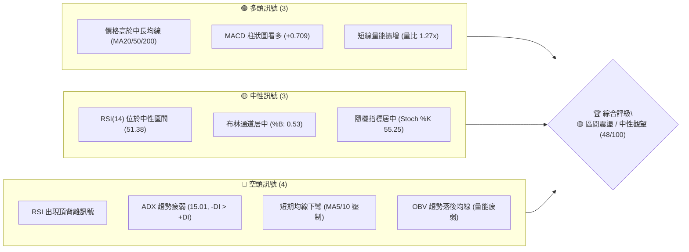
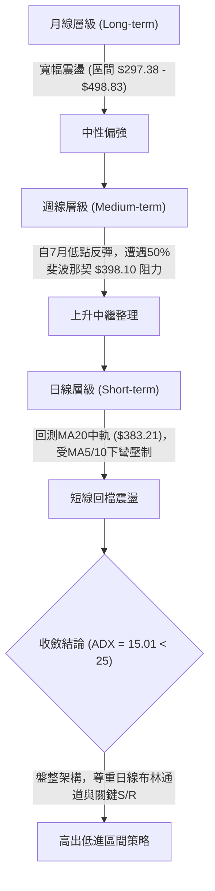
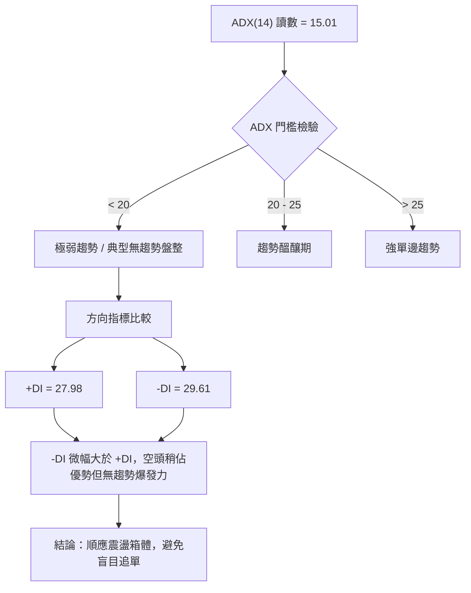
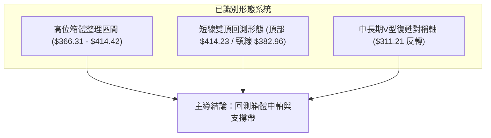
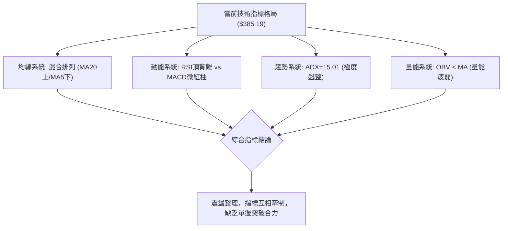
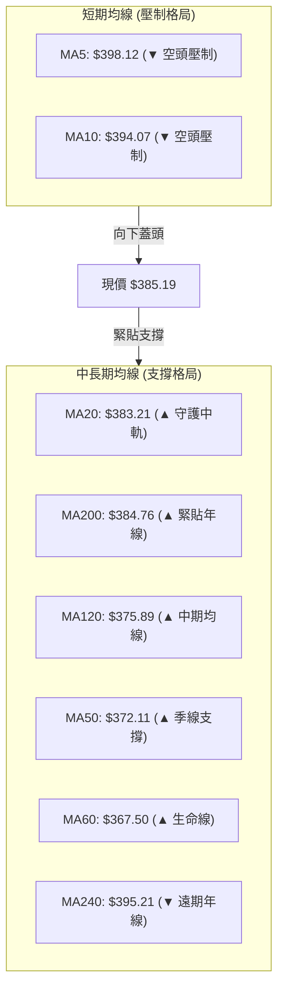
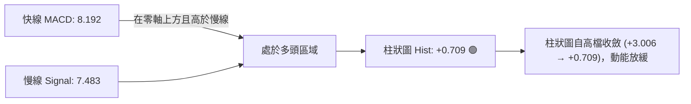
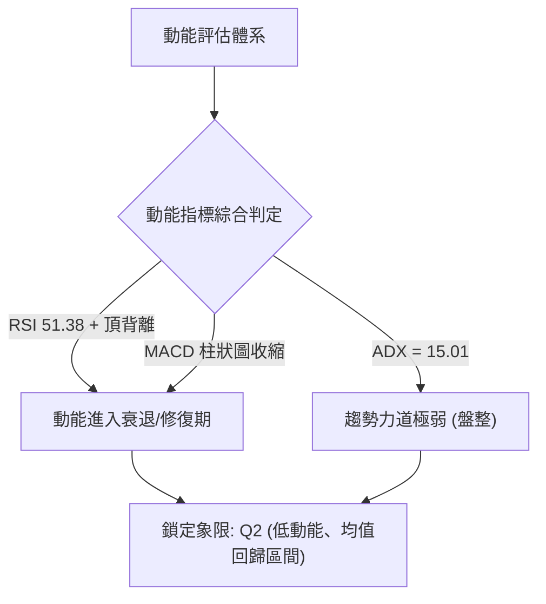
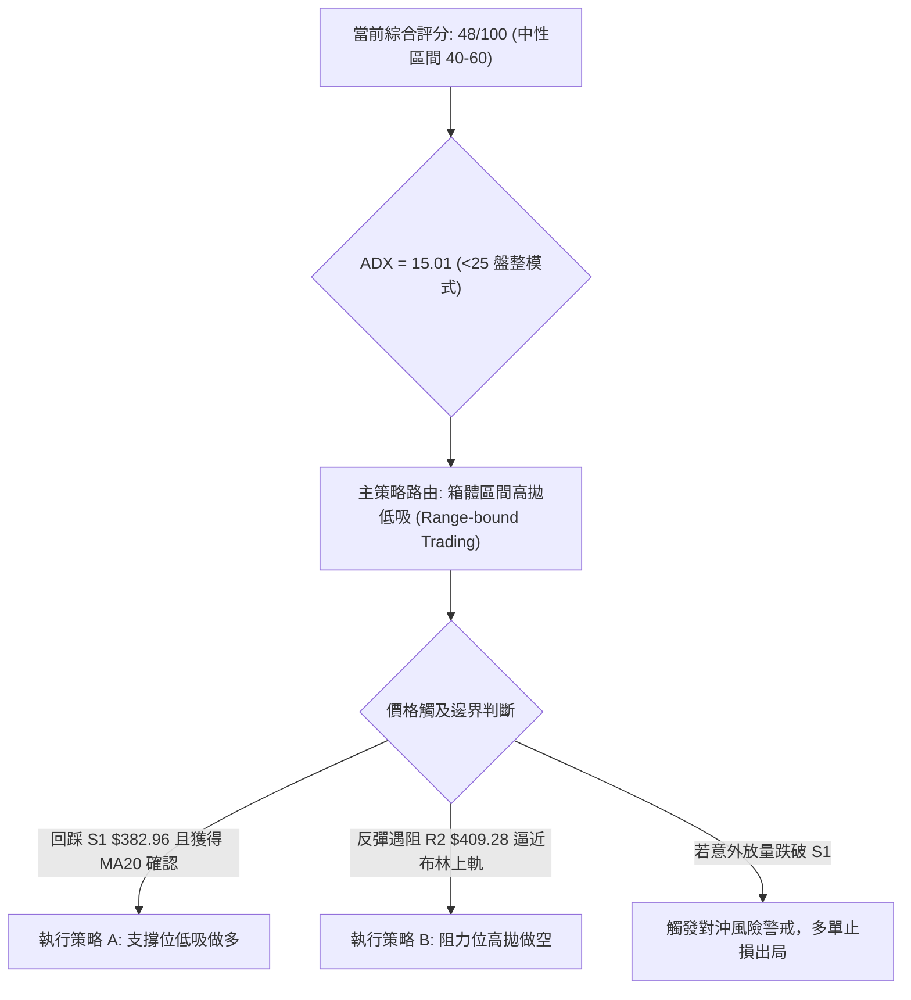
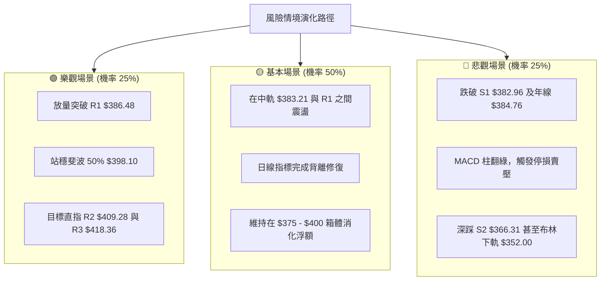

# TSLA 技術分析報告

> **報告日期**：2026-11-05 ｜ **語言**：繁體中文 ｜ **數據來源**：Yahoo Finance ｜ **當前價格**：$385.19

---

## 目錄

| 章節 | 內容 |
|------|------|
| [1. 技術面概覽](#1-技術面概覽) | 訊號儀表板、核心指標、評分卡 |
| [2. 趨勢分析](#2-趨勢分析) | 多時框趨勢、長中短期走勢 |
| [3. 圖表形態分析](#3-圖表形態分析) | 形態識別、K線組合、目標價 |
| [4. 支撐與阻力](#4-支撐與阻力) | 關鍵價位、斐波那契回調 |
| [5. 技術指標深度解讀](#5-技術指標深度解讀) | MA/RSI/MACD/布林/成交量 |
| [6. 動能與波動率](#6-動能與波動率) | 動能評估、ATR、Beta |
| [7. 多時框架總結](#7-多時框架總結) | 時框架評分矩陣 |
| [8. 交易策略建議](#8-交易策略建議) | 多空策略、風險報酬比 |
| [9. 風險提示與監控](#9-風險提示與監控) | 監控指標、風險場景 |

---

## 1. 技術面概覽

### 🎯 技術訊號儀表板



---

### 📊 核心指標速覽表

| 指標類別 | 指標名稱 | 當前數值 | 訊號 | 解讀 |
|:---|:---|:---|:---:|:---|
| **價格** | 當前收盤價 | $385.19 | 🟡 | 位於52週區間43.6%，處於區間震盪整理中樞 |
| **均線** | MA20 | $383.21 | 🟢 | 價格在MA20上方 (+0.52%)，短線獲得月線支撐 |
| **均線** | MA50 | $372.11 | 🟢 | 價格在MA50上方 (+3.52%)，中期趨勢基底尚存 |
| **均線** | MA200 | $384.76 | 🟢 | 價格微幅站上年線 (+0.11%)，多空分水嶺反覆爭奪 |
| **短線均線** | MA5 / MA10 | $398.12 / $394.07 | 🔴 | 價格低於MA5 (-3.25%) 與 MA10 (-2.25%)，短線承壓 |
| **動能** | RSI(14) | 51.38 | 🟡 | 處於50中軸水平，但伴隨近20根K棒之頂背離風險 |
| **動能** | MACD (12,26,9) | 8.192 / 7.483 | 🟢 | MACD位於零軸之上且快線在慢線上方，柱狀圖 +0.709 |
| **趨勢強度** | ADX(14) | 15.01 | 🔴 | ADX < 25 表明無顯著單邊趨勢，-DI (29.61) > +DI (27.98) |
| **通道狀態** | 布林通道 | %B = 0.53 | 🟡 | 剛自上軌 ($414.42) 回落至中軌 ($383.21) 附近整固 |
| **成交量** | 20日成交量比 | 1.27x | 🟢 | 最新成交量47.50M高於20日均量37.39M，下挫時伴隨換手 |
| **能量潮** | OBV | OBV < MA | 🔴 | 資金累積動能不足，未有效確認近期價格反彈 |
| **波動度** | ATR(14) | $14.09 | 🟡 | 日波動率約 3.66%，波動適中，提供明確止損空間 |

---

### 🏆 技術評分卡

```
╔══════════════════════════════════════════════════════════════════════════════╗
║                   技術評分卡 — TSLA (2026-11-05)                             ║
╠══════════════════════════════════════════════════════════════════════════════╣
║ 趨勢強度 (Trend Strength)       ███████░░░░░░░░░░░░░  35/100  🔴 空頭佔優/盤整 ║
║ 動能指標 (Momentum)             ██████████░░░░░░░░░░  50/100  🟡 中性 (頂背離) ║
║ 支撐穩定度 (Support Quality)    █████████████░░░░░░░  65/100  🟢 中長均線匯聚 ║
║ 成交量配合 (Volume Confirmation)█████████░░░░░░░░░░░  45/100  🟡 OBV動能疲弱   ║
║ 形態完整度 (Pattern Quality)    █████████░░░░░░░░░░░  45/100  🟡 區間箱體震盪 ║
║ 均線排列 (MA Alignment)         ██████████░░░░░░░░░░  50/100  🟡 多空混合糾結 ║
╠══════════════════════════════════════════════════════════════════════════════╣
║ 綜合評分 (Overall Score)        ██████████░░░░░░░░░░  48/100  🟡 中性震盪評級 ║
╚══════════════════════════════════════════════════════════════════════════════╝
```
*註：綜合評分由六項子評分取算術平均計算得出：(35 + 50 + 65 + 45 + 45 + 50) ÷ 6 = 48.33 → 四捨五入為 48/100。*

---

## 2. 趨勢分析

### 🌐 多時框趨勢分析



---

### 📈 長期趨勢 — 12個月走勢圖（Unicode）

以下圖表呈現 TSLA 過去 12 個月（2025年11月至2026年11月）的月線收盤走勢：

```
TSLA 月線走勢圖（過去12個月）
價格 ($)
$460 ┤               
$440 ┤ ●(11/25) ●(12/25)                                 ●(05/26)
$420 ┤          ●(01/26)                       ●(06/26)
$400 ┤                   ●(02/26)                                  ●(10/26)
$380 ┤                            ●(04/26)                         ●(11/26) 現價: $385.19
$360 ┤                   ●(03/26)                       ●(08/26)
$340 ┤                                                  ●(09/26)
$320 ┤                                         ●(07/26) 低點: $311.21
     └─┬────┬────┬────┬────┬────┬────┬────┬────┬────┬────┬────┬───
     11/25 12   01/26 02   03   04   05   06   07   08   09   10   11/26
```

#### 走勢特徵分析表格

| 階段區間 | 月份起迄 | 收盤價變化 | 漲跌幅 | 結構性技術特徵 |
|:---|:---|:---|:---:|:---|
| **第一階段：高檔震盪盤頭** | 2025-11 至 2026-01 | $430.17 → $430.41 | +0.06% | 測試高位阻力失敗，多次衝擊無果後動能耗竭 |
| **第二階段：首輪下行回調** | 2026-01 至 2026-03 | $430.41 → $371.75 | -13.63% | 連續長陰回落，跌破月線多個短期均線支撐 |
| **第三階段：春季反抽波段** | 2026-03 至 2026-05 | $371.75 → $435.79 | +17.23% | 形成中期次高點，但未能突破2025年高檔壓力 |
| **第四階段：夏季恐慌拋售** | 2026-05 至 2026-07 | $435.79 → $311.21 | -28.59% | 放量急跌探底，逼近52週最低點 $297.38 形成大級別底部 |
| **第五階段：底部震盪修復** | 2026-07 至 2026-10 | $311.21 → $399.81 | +28.47% | 穩步盤升重返年線上方，收復大部分失土 |
| **第六階段：高位承壓整固** | 2026-10 至 2026-11 | $399.81 → $385.19 | -3.66% | 衝高回落，遭遇 $400 整數關卡與斐波那契50%壓力 |

---

### 📊 中期趨勢（週線分析）

從近 20 週收盤走勢觀察，TSLA 呈現典型的「V型反轉後之高位箱體整理」：
- **底部確認**：2026年7月最後一週收於 $311.21（當週 RSI 降至 31.7 接近超賣），隨後於8月展開連續回升。
- **波段高點**：2026-10-30 週K線衝高至 $410.85，收於 $399.81，MACD柱狀圖擴增至 +3.006，展現強勁推升力道。
- **當前週K**：2026-11-04 當週開盤 $404.66，最高 $414.23，但下探至 $375.50，最新收在 $385.19，週K呈現帶有明顯上影線與下影線的震盪棒，週線 RSI 降至 51.4，週線 MACD 柱微幅縮小至 +0.709，顯示中期上升動能已面臨邊際遞減。

---

### ⚡ 趨勢強度評估（ADX 解讀）



#### ADX 趨勢強度對照表

| 指標變數 | 當前讀數 | 狀態門檻 | 趨勢特徵解讀 | 操作策略指引 |
|:---|:---:|:---:|:---|:---|
| **ADX (14)** | **15.01** | < 20 (弱) | 行情處於典型無趨勢/箱體盤整狀態，順勢突破型系統容易失真 | 採用區間逆勢/波段均值回歸策略 |
| **+DI (14)** | **27.98** | - | 多頭動能自10月底高點快速衰退 | 慎防假突破，多頭宜逢高分批減碼 |
| **-DI (14)** | **29.61** | - | 空頭主導短線動能，但尚未擴大至壓倒性優勢 | 空方力量僅足以壓制價格，暫無全面崩跌之虞 |

---

## 3. 圖表形態分析

### 🔍 形態識別系統



#### 形態識別信心度與目標價評估

| 形態名稱 | 信心度 | 判斷依據（引用數據） | 完成度 | 目標價（附嚴格計算式） |
|:---|:---:|:---|:---:|:---|
| **日線高位箱體震盪** | **75%** | 價格在近10個交易日內震盪於低點 $365.27 與高點 $414.23 之間，當前價格 $385.19 處於箱體中下緣，獲得中軌 ($383.21) 守護。 | 85% | **箱體下軌目標**：以支撐位 S2 計算為 **$366.31**；**箱體上軌目標**：以阻力位 R2 計算為 **$409.28**。 |
| **短線雙頂回調形態** | **60%** | 2026-10-28 觸及 $410.85，2026-11-02 再次衝高至 $414.23 未能站穩，隨後於 2026-11-04 跌破前低頸線（10-30 低點 $387.52）。 | 70% | **推算量度下行目標**：頸線高點取 S1 阻力轉換處 $386.48，形態高度 = $414.23 − $386.48 = $27.75。破位量度目標 = $386.48 − $27.75 = **$358.73**（該價位數據中未直接偵測，最接近之核心支撐為 S2 **$366.31**）。 |
| **旗形整合中繼** | **35%** | 訊號不足。由於 ADX 僅 15.01 且均線呈現混合排列，無足夠單邊動能支撐強勢旗形突破，僅做指標型區間解讀。 | N/A | N/A（數據未提供滿足條件） |

---

### 🕯️ 重要 K 線形態分析

本節嚴格依據數據中「近10根日K」與「近8根週K」的開高低收進行形態判讀：

#### 近10根日K線形態追蹤表

| 日期 (日K) | 開盤價 | 最高價 | 最低價 | 收盤價 | 成交量 | K線形態名稱 | 形態專業解讀 | 訊號 |
|:---|:---:|:---:|:---:|:---:|:---:|:---|:---|:---:|
| 2026-10-22 | 374.29 | 388.86 | 373.71 | 374.58 | 51.61M | 長上影紡錘線 | 盤中衝高遭空頭重擊，收盤微高於開盤，多頭上攻遇阻 | 🔴 |
| 2026-10-23 | 373.20 | 377.32 | 365.27 | 372.22 | 34.76M | 探底小陰線 | 下探波段低位 $365.27 後獲得支撐收回，下影線透露買盤 | 🟡 |
| 2026-10-26 | 383.83 | 397.27 | 383.73 | 391.62 | 53.09M | 跳空放量中陽線 | 開盤跳空高走，實體飽滿，成交量放大，突破短線整理 | 🟢 |
| 2026-10-27 | 397.76 | 408.45 | 395.25 | 407.46 | 45.33M | 連續推升大陽線 | 強勢多頭推進，收盤逼近最高點，突破 $400 大關 | 🟢 |
| 2026-10-28 | 410.16 | 410.85 | 397.18 | 404.22 | 35.60M | 衝高假陰線 | 跳空開於 $410.16 後回吐，收盤低於開盤但維持高位，動能轉弱 | 🟡 |
| 2026-10-29 | 405.63 | 406.98 | 400.50 | 403.30 | 22.86M | 高位量縮十字星 | 成交量急劇萎縮至22.86M，高檔多空陷入拉鋸僵局 | 🟡 |
| 2026-10-30 | 393.22 | 404.22 | 387.52 | 399.81 | 41.74M | 低開長陽錘子線 | 跳空低開下探 $387.52 後強拉，多頭展現韌性重返 $399.81 | 🟢 |
| 2026-11-02 | 404.66 | 414.23 | 397.61 | 403.82 | 43.14M | 創高流星射擊之星 | 衝刺波段新高 $414.23 後引發大量拋壓，留下長上影線 | 🔴 |
| 2026-11-03 | 406.25 | 406.50 | 396.53 | 398.50 | 26.65M | 弱勢反彈小陰線 | 無力再探前高，跌破 $400 整數關卡，量能續縮 | 🔴 |
| 2026-11-04 | 379.80 | 392.04 | 375.50 | 385.19 | 47.50M | 低開放量反彈陽線 | 跳空低開至 $375.50（逼近S1下方），隨後放量回升至 $385.19 守住MA20 | 🟡 |

#### 近8根週K線形態追蹤表

| 日期 (週K最後日) | 開盤價 | 最高價 | 最低價 | 收盤價 | 週成交量 | 週K形態特徵 | 訊號 |
|:---|:---:|:---:|:---:|:---:|:---:|:---|:---:|
| 2026-09-18 | 359.78 | 374.12 | 354.05 | 364.27 | 185.82M | 區間震盪小陽線，蓄勢整理 | 🟡 |
| 2026-09-25 | 371.64 | 386.83 | 367.67 | 372.11 | 170.52M | 上影線陽線，測試MA50與前高 | 🟢 |
| 2026-10-02 | 368.06 | 374.60 | 345.88 | 370.59 | 197.59M | 長下影探底反彈棒，多頭護盤明確 | 🟢 |
| 2026-10-09 | 369.00 | 388.56 | 364.91 | 382.70 | 162.91M | 突破收高實體陽線，動能走升 | 🟢 |
| 2026-10-16 | 382.61 | 382.70 | 349.33 | 354.72 | 158.43M | 高開急跌大陰線，回吐兩週漲幅 | 🔴 |
| 2026-10-23 | 357.50 | 388.86 | 354.47 | 372.22 | 206.19M | 放量長下影洗盤線，大資金換手 | 🟢 |
| 2026-10-30 | 383.83 | 410.85 | 383.73 | 399.81 | 198.62M | 強勁多頭實體棒，重返 $400 水平 | 🟢 |
| 2026-11-04 | 404.66 | 414.23 | 375.50 | 385.19 | 117.29M | 高位長上下影震盪棒，面臨回調整固 | 🔴 |

---

### 📉 ASCII 走勢形態示意圖

```
TSLA 近期日K高位箱體與回撤示意圖
價格 ($)
$415 ┤                 ▲ 11/02 射擊之星頂部 ($414.23)
$410 ┤            ┌─┐  │
$405 ┤         ┌─┐│ │  │      ┌─┐
$400 ┤         │ ││ │  │ ┌─┐  │ │ 11/03 轉弱
$395 ┤      ┌─┐│ ││ │  │ │ │  │ │
$390 ┤   ┌─┐│ ││ ││ │  │ │ │  │ │
$385 ┤───┼─┼┼─┼┼─┼┼─┼──┼─┼─┼──┼─┼──▲ 11/04 收盤: $385.19 (頸線/中軌防線)
$380 ┤   │ ││ ││ ││ │  │ │ │  │ │  │
$375 ┤   │ ││ ││ ││ │  │ │ │  └─┘  ▼ 11/04 最低: $375.50
$370 ┤   └─┘└─┘└─┘└─┘  └─┘
     └───┴──┴──┴──┴─────┴──┴────┴────┴───
       10/26 10/27 10/28 10/30 11/02 11/04
```

---

### 🎯 形態目標價計算

根據日線雙頂/回撤箱體中軸推算之技術位：
1. **頸線確認價位**：取自阻力位 R1（$386.48）與日線支撐 S1（$382.96）之交界重疊帶 $383.21（MA20）。
2. **形態高度計算**：
   $$\text{頂部高點} = \$414.23$$
   $$\text{形態頸線} = \$383.21$$
   $$\text{形態高度 } H = \$414.23 - \$383.21 = \$31.02$$
3. **量度下跌目標價**：
   $$\text{理論破位目標} = \text{頸線 } \$383.21 - H (\$31.02) = \$352.19$$
   *校驗說明：此理論推算價位 $352.19 與布林下軌（$352.00）及核心支撐 S3（$349.75）極為接近，形成有效共振。*

---

## 4. 支撐與阻力

### 🗺️ 關鍵價位分布圖（Unicode）

```
TSLA 價位結構分布圖 (由 OHLCV 與斐波那契計算)
═══════════════════════════════════════════════════════════════
$498.83 ║████████████████████████████████████║ 52W 最高點 / 斐波 0.0%
$451.29 ║██████████████████████          ║ 斐波那契 23.6% 回調位
$418.36 ║████████████████████████████    ║ 強阻力 R3 (+8.61%) / 近期反彈極限
$414.42 ║────────────────────────────────────║ 布林帶上軌
$409.28 ║████████████████████            ║ 阻力 R2 (+6.25%) / 波段高點聚類
$398.10 ║████████████████████████████    ║ 斐波那契 50.0% 中軸 / MA5 壓制
$386.48 ║████████████████████████████████║ 關鍵短阻 R1 (+0.33%)
$385.19 ╠════════════════════════════════════╣ ◄ 現價 (Current Close)
$384.76 ║────────────────────────────────────║ MA200 年線生死線
$382.96 ║▓▓▓▓▓▓▓▓▓▓▓▓▓▓▓▓▓▓▓▓▓▓▓▓        ║ 近期支撐 S1 (-0.58%) / MA20 ($383.21)
$374.33 ║▓▓▓▓▓▓▓▓▓▓▓▓▓▓▓▓▓▓▓▓▓▓          ║ 斐波那契 61.8% 黃金分割位
$366.31 ║████████████████████████████    ║ 強支撐 S2 (-4.90%) / 波段密集成交
$352.00 ║────────────────────────────────────║ 布林帶下軌
$349.75 ║████████████████████████████████║ 核心防守支撐 S3 (-9.20%)
$297.38 ║████████████████████████████████║ 52W 最低點 / 斐波 100.0%
═══════════════════════════════════════════════════════════════
```

---

### 🚧 阻力位分析表

以下阻力位嚴格引用自 OHLCV 計算之關鍵價位：

| 阻力級別 | 精確價位 | 距現價幅動 | 技術形成原因與依據 | 突破難度評估 | 策略重要性 |
|:---|:---:|:---:|:---|:---:|:---:|
| **阻力 R1** | **$386.48** | +0.33% | 近一年波段高點聚類、前日K線震盪成交密集平台 | 🟡 中等（短線壓制） | ★★★☆☆ |
| **阻力 R2** | **$409.28** | +6.25% | 近一年波段高點聚類、接近10-27/10-28反彈頭部 | 🔴 極高（強烈拋壓） | ★★★★☆ |
| **阻力 R3** | **$418.36** | +8.61% | 波段極值聚類、接近日線布林上軌 ($414.42) 上方外擴帶 | 🔴 極高（波段天花板）| ★★★★★ |

---

### 🛡️ 支撐位分析表

以下支撐位嚴格引用自 OHLCV 計算之關鍵價位：

| 支撐級別 | 精確價位 | 距現價幅動 | 技術形成原因與依據 | 守住機率評估 | 策略重要性 |
|:---|:---:|:---:|:---|:---:|:---:|
| **支撐 S1** | **$382.96** | -0.58% | 波段低點聚類，與MA20 ($383.21) 及年線 MA200 ($384.76) 重疊 | 🟢 65%（多頭第一道防線） | ★★★★☆ |
| **支撐 S2** | **$366.31** | -4.90% | 近一年波段低點聚類，接近MA60 ($367.50) 均線支撐帶 | 🟢 80%（箱體強底座） | ★★★★★ |
| **支撐 S3** | **$349.75** | -9.20% | 波段深回調低點聚類，接近布林下軌 ($352.00) 與整數心理關卡 | 🟢 90%（中期多頭退守底線） | ★★★★★ |

---

### 📐 斐波那契回調位分析

本分析採用 52 週波動極值區間（低點 $297.38 → 高點 $498.83，全波段落差 $201.45）：

| 斐波那契回調層級 | 計算價位 | 當前價位位置關聯 | 技術意義解讀 |
|:---|:---:|:---:|:---|
| **0.0% (52W High)** | **$498.83** | 現價下方 +29.50% | 歷史大頂部阻力，當前行情難以企及之遠端目標 |
| **23.6% 回調** | **$451.29** | 現價下方 +17.16% | 強勢牛市調整位，若突破此處方能重啟大牛市行情 |
| **38.2% 回調** | **$421.88** | 現價下方 +9.53% | 多頭防守轉攻擊之關鍵臨界點，高於 R3 ($418.36) |
| **50.0% 回調** | **$398.10** | 現價下方 +3.35% | **多空生死對稱軸**。現價已跌破此中軸，轉為反彈壓力位 |
| **61.8% 回調 (黃金分割)** | **$374.33** | 現價上方 -2.82% | **關鍵防守黃金位**。與 11-04 最低點 $375.50 完美吻合 |
| **78.6% 回調** | **$340.49** | 現價上方 -11.60% | 深度回調安全墊，跌破則預示著大級別趨勢崩塌 |
| **100.0% (52W Low)**| **$297.38** | 現價上方 -22.79% | 52週絕對基底，多頭最終避風港 |

*現價落點解讀*：當前收盤價 **$385.19** 精確座落於 **50.0% ($398.10)** 與 **61.8% ($374.33)** 兩大核心斐波那契回調位之間。此區間為多空博弈最激烈的「價值中樞重估區」。當前價格受制於上方 50.0% 回調壓制，但受 61.8% 強支撐托底，完美印證市場處於震盪整理狀態。

---

## 5. 技術指標深度解讀

### 🎛️ 指標訊號總覽



---

### 📈 移動平均線排列分析



#### 移動平均線數據全覽表

| 均線名稱 | 數值 | 距現價落差 | 趨勢方向 | 狀態解讀 |
|:---|:---:|:---:|:---:|:---|
| **MA5** | $398.12 | -3.25% | ▼ 下彎 | 短線急跌壓制，五日均線成為反彈第一道重壓 |
| **MA10** | $394.07 | -2.25% | ▼ 下彎 | 短期走弱，與 MA5 形成死叉壓迫價格 |
| **MA20** | $383.21 | +0.52% | ▲ 上揚 | 月線呈現多頭排列，提供極近距離之動態支撐 |
| **MA50** | $372.11 | +3.52% | ▲ 上揚 | 季線穩步抬升，反映中期走勢尚未遭到實質性破壞 |
| **MA60** | $367.50 | +4.81% | ▲ 上揚 | 雙月中期防線，與支撐位 S2 ($366.31) 形成堅固共振 |
| **MA120** | $375.89 | +2.47% | ▲ 上揚 | 半年線向上拐頭，接近斐波 61.8% ($374.33) |
| **MA200** | $384.76 | +0.11% | ▲ 上揚 | 現價微幅高於年線 $0.43 美元，牛熊線反覆拉鋸 |
| **MA240** | $395.21 | -2.54% | ▼ 下彎 | 長期均線走跌，形成中長期結構上方套牢反壓 |

*結論*：當前均線系統呈現「**短空、中多、長糾結**」的典型混合排列（Mixed Alignment）。價格被夾在上方 MA5/MA10/MA240 的「下行蓋頭區」與下方 MA20/MA200 的「托底支撐區」之間，波動空間大幅收窄。

---

### 📉 RSI(14) 分析

- **當前 RSI(14) 讀數**：`51.38`（Wilder 計算法）
- **RSI 進度條視覺化**：
  `0  [░░░░░░░░░░███████████░░░░░░░░░░] 100` (51.38% — 位於中軸多空分水嶺)
- **背離警訊檢驗**：
  - ⚠️ **偵測到頂背離 (Bearish Divergence)**。
  - **背離事實**：在近 20 根 K 棒的首尾週期內，價格自 10 月中旬低點持續推升至 11 月初波段高點 $414.23（價格創近期新高）；然而 RSI 指標在此期間衝高至 60.9（10-30週）後迅速乏力，最新日線 RSI 僅報 51.38，未能隨價格同步突破超買區，形成標準的「**價格創波段新高、RSI 高點反向下移**」之頂背離結構。這表明推升動能出現衰竭，引發 11-04 之大幅回踩。

---

### 📊 MACD (12, 26, 9) 訊號解讀



- **MACD 快線**：`8.192`
- **MACD 訊號線**：`7.483`
- **MACD 柱狀圖**：`+0.709`
- **深入分析**：MACD 線與訊號線雙雙位於零軸上方，且柱狀圖維持正值，顯示大格局多頭架構未滅。然而，對比 10-30 週線數據中 +3.006 的高峰，當前日線柱狀圖已急縮至 +0.709。柱狀圖持續收縮反映多頭進攻速度顯著放緩，若後續跌破零軸形成死叉，短線調整級別將進一步擴大。

---

### 📦 布林通道分析 (Bollinger Bands)

```
TSLA 布林通道 (20, 2) 結構示意圖
價格 ($)
$414.42 ┤────────────────────────────────── 布林上軌 (阻力帶)
$400.00 ┤        ┌───┐
$390.00 ┤        │   │
$385.19 ┤────────┼───┼───────────────────── 現價: $385.19 (%B: 0.53)
$383.21 ┤════════╪═══╪═════════════════════ 布林中軌 (MA20支撐)
$370.00 ┤        └───┘
$352.00 ┤────────────────────────────────── 布林下軌 (極限支撐)
```

- **布林上軌**：`$414.42`（與 11-02 日高 $414.23 高度契合）
- **布林中軌 (MA20)**：`$383.21`（當前多頭依託之核心均線）
- **布林下軌**：`$352.00`（安全邊際底界）
- **指標數值 %B**：`0.53`
- **分析結論**：%B 讀數 0.53 代表當前價格精準處於布林帶寬的正中央（略高於中軌）。股價在 11-02 精準觸及上軌 $414.42 後遭強烈空頭反噬，目前正測試中軌 $383.21 的防守強度。帶寬並未呈現開口擴張，維持水平收斂，再度強化「**回歸通道內部震盪**」的技術預期。

---

### 💹 成交量分析（量價配合度）

- **最新日成交量**：`47,499,015` 股
- **20日平均成交量**：`37,393,901` 股（**量比 1.27x**）
- **50日平均成交量**：`37,860,212` 股
- **OBV (能量潮) 趨勢**：`OBV < MA`（明確標示為**量能疲弱**）
- **量價深度研判**：
  1. 11-04 在遭遇回檔時成交量暴增至 47.50M，較 20 日均量放大 27%，這是一根「低開帶長下影的放量承接陽線」。雖然顯示低檔 $375.50 有買盤進場，但同時也凸顯出高檔賣壓湧現。
  2. 長期 OBV 曲線持續運行於自身均線下方，說明過去數週的反彈主要由存量資金推動，並無增量機構資金持續鎖籌，呈現典型的「**價格反彈但量能未有效確認**」（量價背離），為後續多頭上攻投下陰影。

---

## 6. 動能與波動率

### ⚡ 動能評估

根據 TSLA 當前的技術特徵（ADX 15.01，ATR 3.66%，布林通道收斂），其在動能矩陣中的定位如下：

| 象限分佈 | 動能強度 (Momentum) | 波動率水準 (Volatility) | 當前狀態吻合度 | 策略定位與解讀 |
|:---:|:---:|:---:|:---:|:---|
| **Q1 (突破加速)** | 強 (High) | 低 (Low) | ❌ 不吻合 | 處於蓄勢待發狀態，但目前 TSLA 無強烈單邊動能 |
| **Q2 (橫盤整固)** | **弱 (Low)** | **中低 (Low/Mid)**| **✓ 當前定位 (80%)** | **動能放緩、波動處於常態震盪。宜採取高拋低吸，慎防追漲殺跌** |
| **Q3 (極端狂熱)** | 強 (High) | 高 (High) | ❌ 不吻合 | 典型主升浪/主跌浪特徵，當前指標不支持單邊極端行情 |
| **Q4 (非理性釋放)**| 弱 (Low) | 高 (High) | ❌ 不吻合 | 恐慌崩盤拋售階段，當前下方均線支撐仍具韌性 |



---

### 📊 ATR 波動率分析

- **ATR(14) 當前讀數**：`$14.09`
- **佔股價百分比**：`3.66%`（Wilder 平滑演算法）
- **ATR 交易風控指導**：
  - **日均正常波動帶**：當前股價 $385.19 每日合理的隨機噪音波動區間為 $\pm \$14.09$（波動範圍約在 $371.10 至 $399.28 之間）。
  - **止損距離建議**：
    - 短線交易（波段）：採用 $1.0 \times \text{ATR} \approx \$14.10$ 的安全緩衝。
    - 中線持倉：採用 $1.5 \times \text{ATR} \approx \$21.14$ 的防洗盤空間。
  - **當前波動環境解讀**：ATR 佔比 3.66% 處於 TSLA 歷史中偏低水準（TSLA 歷史高波動期 ATR 常突破 6-8%），這反映出期權隱含波動率與現貨波動率均處於壓縮狀態，為標準的箱體醞釀期。

---

### 📐 Beta 與市場相關性

- **Beta 係數**：`1.743`
- **系統性風險特徵解讀**：
  - TSLA 的 Beta 高達 1.743，屬於典型的高彈性、高貝塔標的。這意味著在標普 500 指數或納斯達克波動 1% 時，TSLA 理論上將產生 1.743% 的同向波動。
  - **市場環境交互影響**：近期宏觀政治新聞與大盤科技股分化顯著，高 Beta 特性導致 TSLA 容易在阻力位（如 $414）與支撐位（如 $375）之間出現超調（Overshoot）。因此，交易者切忌在阻力點直接追價，必須嚴格等待右側確認或關鍵價位回踩。

---

## 7. 多時框架總結

### 📋 時框架評分表

| 時框架 | 趨勢方向 | 動能狀態 | 均線排列 | 圖表形態 | 綜合評分 | 建議方向 |
|:---|:---:|:---:|:---:|:---:|:---:|:---:|
| **日線 (短線)** | 🟡 震盪回調 | 🔴 頂背離/柱縮 | 🟡 短空長多糾結 | 箱體內部雙頂回踩 | **45/100** | 區間操作 / 回踩支撐低吸 |
| **週線 (中線)** | 🟢 震盪偏多 | 🟡 51.4 橫盤中位 | 🟢 MA20/50多頭抬升 | 底部V型反彈中繼 | **55/100** | 逢低佈局 / 遇阻分批停利 |
| **月線 (長線)** | 🟡 寬幅箱體 | 🟡 中性平穩 | 🟡 圍繞年線震盪 | 52週寬幅對稱整理 | **50/100** | 中長線價值持有 / 不追高 |

---

### 🔲 綜合訊號矩陣

```
時框架訊號矩陣收斂圖
┌───────────┬──────────────┬──────────────┬──────────────┐
│  分析維度 │  短期 (日線) │  中期 (週線) │  長期 (月線) │
├───────────┼──────────────┼──────────────┼──────────────┤
│ 趨勢方向  │   🟡 偏空震盪│   🟢 上升回調│   🟡 寬幅箱體│
│ 均線架構  │   🔴 5/10壓制│   🟢 站穩20/50│   🟢 站上年線│
│ 動能指標  │   🔴 RSI頂背離│   🟡 RSI 51.4 │   🟡 橫盤蓄勢│
│ 量能配合  │   🟢 放量承接│   🟡 量能中規 │   🔴 OBV落後 │
│ 波動狀態  │   🟡 ATR中等 │   🟡 振幅收斂 │   🟡 區間壓縮│
└───────────┴──────────────┴──────────────┴──────────────┘
```

---

### ⚖️ 多時框收斂結論

依據多時框收斂規則第 14 條嚴格判斷：
1. **趨勢模式判定**：當前 TSLA 日線 **$\text{ADX}(14) = 15.01 < 25$**，明確定義為**盤整行情（Range-bound Consolidation）**，非單邊趨勢行情。
2. **時框優先級權重**：在盤整行情中，中長期趨勢失去方向驅動力，交易邏輯**必須以日線布林通道（上軌 $414.42，下軌 $352.00）及核心支撐阻力 S/R 為主要交易邊界**，日線均線與量價形態用於鎖定精確買賣點。
3. **唯一方向性結論**：**中性觀望 / 箱體區間波段震盪**（評分 **48/100**）。短線由於日線級別出現 RSI 頂背離且跌破 MA5/10，存在回調壓力，但下方 MA20（$383.21）及 S1（$382.96）提供即時支撐。總體結論為：**不具備追漲條件，亦無實質破位依據，應在支撐位與阻力位之間執行嚴格的邊界波段策略**。

---

## 8. 交易策略建議

### 🗺️ 策略決策流程圖



---

### 🧭 策略路由

> **當前主策略方向 = 區間震盪 / 逢支撐低吸（依評分 48/100，處於 40–60 中性震盪區間）**

本策略嚴格遵守震盪市交易準則：在盤整格局中，以布林通道與核心支撐/阻力為邊界，**主推在支撐位 S1 附近的低吸反彈策略（策略 A）**，同時提供**在阻力位 R2 附近的受阻回跌波段策略（策略 B）**，禁止在區間中軸 $385 盲目開新倉追價。

---

### 🎯 價格情境階梯 (Price Scenarios)

以下價位嚴格引用自數據中經 OHLCV 與斐波那契計算得出之精確數值：

| 觸發條件 | 下一目標 | 後續延伸 | 情境技術含義與應對 |
|:---|:---:|:---:|:---|
| **強勢突破 R1 ($386.48)** | **R2 ($409.28)** | **R3 ($418.36)** | 短線轉強，突破五日均線壓力，多頭重新挑戰布林上軌 |
| **守住 S1 ($382.96)** | **$385.19 (現價)** | **$398.10 (斐波50%)** | 區間震盪常態，中軌支撐有效，維持橫盤整理 |
| **有效跌破 S1 ($382.96)** | **S2 ($366.31)** | **S3 ($349.75)** | 短線破位走弱，雙頂回撤形態成立，向布林下軌尋求支撐 |

---

### 📊 情境機率分佈

| 運行情境 | 發生機率 | 主要技術與量化依據 |
|:---|:---:|:---|
| **情境一：區間震盪（維持在 S1-R2 之間）** | **50%** | ADX 僅 15.01 表明趨勢動力渙散；布林通道走平收斂；均線系統短空長多相互抵消，將股價死鎖於中軸。 |
| **情境二：回落探底（跌破 S1，下測 S2）** | **25%** | RSI 出現明確頂背離；OBV 處於均線下方顯示買盤動能不足；MA5 與 MA10 下彎蓋頭構成短線反壓。 |
| **情境三：強勢上行（突破 R1，衝擊 R2/R3）** | **25%** | MACD 仍維持在零軸上方且柱狀圖維持紅柱（+0.709）；年線 MA200 形成托底；最新日成交量放大 1.27 倍。 |

---

### 🟢 主策略詳情

本報告依據精確價位計算兩套邊界交易策略。風險報酬比嚴格依照規則 17 定義：
- 做多：$\text{風險報酬比} = (\text{目標價 T1} - \text{進場價}) \div (\text{進場價} - \text{止損價})$
- 做空：$\text{風險報酬比} = (\text{進場價} - \text{目標價 T1}) \div (\text{止損價} - \text{進場價})$

| 策略要素 | 策略 A（主推：S1 支撐低吸多單） | 策略 B（輔助：R2 阻力受阻空單） |
|:---|:---|:---|
| **進場條件** | 股價回踩支撐 S1 與 MA20 獲得支撐不破 | 股價反彈至阻力 R2 遇阻收上影線出現停滯 |
| **進場價格** | **$383.00**（取 S1 $382.96 與 MA20 $383.21 匯聚點） | **$409.00**（取阻力 R2 $409.28 附近點位） |
| **目標價 T1** | **$409.28**（阻力位 R2） | **$382.96**（支撐位 S1） |
| **目標價 T2** | **$418.36**（阻力位 R3 / 布林上軌外擴帶） | **$366.31**（強支撐位 S2） |
| **止損價格** | **$372.00**（跌破 MA50 $372.11 與斐波 61.8% $374.33） | **$419.00**（突破阻力 R3 $418.36 與前高 $414.23） |
| **風險報酬比** | **1 : 2.39（以 T1 計）** <br> *(409.28 - 383.00) ÷ (383.00 - 372.00) = 26.28 ÷ 11.00* | **1 : 2.60（以 T1 計）** <br> *(409.00 - 382.96) ÷ (419.00 - 409.00) = 26.04 ÷ 10.00* |
| **至 T2 風報比** | **1 : 3.21（以 T2 計）** <br> *(418.36 - 383.00) ÷ 11.00 = 35.36 ÷ 11.00* | **1 : 4.27（以 T2 計）** <br> *(409.00 - 366.31) ÷ 10.00 = 42.69 ÷ 10.00* |
| **歷史勝率估計** | **55%** | **50%** |
| **建議總倉位** | **8% - 10%**（輕倉試單，不可重倉） | **5%**（對沖或純波段防禦操作） |

---

### 🔴 反向風險觸發點（對沖與風控提示）

若已建立多頭頭寸，當市場出現以下情況時，必須果斷觸發風控停損或建立對沖保護：
1. **關鍵點位跌破**：若收盤價**實體跌破 $382.96 (S1)** 且伴隨日成交量超過 50M，預示日線雙頂量度下行開啟，應立即離場觀望。
2. **指標轉空確認**：若日線 **MACD 柱狀圖翻綠（由正轉負）** 且 **RSI 跌破 45 水平**，說明動能徹底耗盡，下行空間將直指 S2 ($366.31)。
3. **對沖操作指引**：跌破 $382.96 後，可使用反向空單或減半現貨多頭，防禦下探至布林下軌 $352.00 處再行補回。

---

### ⭐ 整體訊號強度評星

```
做多訊號強度：★★☆☆☆  (2.5/5 星 — 僅具備支撐位反彈勝率，缺乏單邊動能)
做空訊號強度：★★☆☆☆  (2.5/5 星 — 年線下方支撐重重，空頭亦無壓倒性空間)
整體分析可信度：★★★★☆  (4.0/5 星 — 價位完全依據 OHLCV 幾何計算，邊界清晰)
```

---

## 9. 風險提示與監控

### ✅ 關鍵監控指標 Checklist

```
╔══════════════════════════════════════════════════════════════════════════════╗
║                    TSLA 交易日常監控清單 (Checklist)                         ║
╠══════════════════════════════════════════════════════════════════════════════╣
║ [ ] 價格是否跌破月線中軌支撐 $383.21 (MA20) 與 S1 $382.96                   ║
║ [ ] RSI(14) 頂背離是否引發指標下穿 50 中軸防線                              ║
║ [ ] MACD 柱狀圖是否跌破零軸（當前 +0.709 正在收斂）                         ║
║ [ ] ADX(14) 是否放量上穿 20-25 門檻（若上穿，代表單邊趨勢啟動）            ║
║ [ ] 日成交量是否連續低於 20日均量 37.39M（縮量陰跌風險）                     ║
║ [ ] 股價反彈是否遭到 MA5 ($398.12) 與斐波 50% ($398.10) 強勢反壓            ║
╚══════════════════════════════════════════════════════════════════════════════╝
```

---

### ⚠️ 風險場景分析



---

### 🛡️ 風險管理重要提醒

1. **拒絕區間中軸追價**：
   當前價格 $385.19 處於布林帶寬中位（%B = 0.53），向上距短壓 R1（$386.48）僅 $1.29 美元，向下距短撐 S1（$382.96）僅 $2.23 美元。在此位置開倉，極易遭受雙向打臉。交易者**務必保持紀律，唯有當價格觸及 S1 邊界且企穩、或觸及 R2 邊界受阻時，方可進場**。
2. **嚴格執行 ATR 動態倉位控制**：
   由於 TSLA 的 ATR 高達 $14.09（日波動率 3.66%），且 Beta 為 1.743，任何單筆交易承擔的本金風險不得超過總資產的 1.5%。單一策略部位總額建議嚴格控制在 8%–10% 以內。
3. **宏觀與基本面雜音過濾**：
   近期政治選舉新聞、大盤科技板塊輪動劇烈，短期情緒波動頻繁。技術交易者應回歸「以價格為唯一依據」，嚴格遵循價位停損點，避免因個人主觀多空偏見而忽視指標客觀呈現之頂背離風險。

---

## 📋 報告總結

```
╔══════════════════════════════════════════════════════════════════════════════╗
║                        TSLA 技術分析報告總結                                 ║
╠══════════════════════════════════════════════════════════════════════════════╣
║ 報告日期：2026-11-05                                                         ║
║ 當前價格：$385.19                                                            ║
║ 綜合評級：🟡 48/100 (中性震盪 / 區間操作)                                    ║
║                                                                              ║
║ 關鍵結論：                                                                   ║
║ ├─ 長期趨勢：🟡 寬幅箱體整理（月線在 $297.38 - $498.83 區間尋求平衡）       ║
║ ├─ 中期趨勢：🟢 震盪偏多（自7月低位回升，受阻於斐波 50% $398.10）            ║
║ ├─ 短期趨勢：🔴 承壓回調（受 MA5/10 壓制，出現 RSI 頂背離，測試 MA20）      ║
║ ├─ 核心支撐：S1 $382.96 │ S2 $366.31 │ S3 $349.75                           ║
║ ├─ 核心阻力：R1 $386.48 │ R2 $409.28 │ R3 $418.36                           ║
║ └─ 分析師共識目標價：$413.10 (Mean)                                         ║
║                                                                              ║
║ 最優策略組合：                                                               ║
║ 1. 🥇 最佳機會：策略 A (S1 $383.00 處低吸做多，停損 $372.00，風報比 1:2.39) ║
║ 2. 🥈 次選機會：策略 B (反彈至 R2 $409.00 阻力高拋，停損 $419.00，風報比 1:2.60)║
║ 3. 🥉 保守選擇：空倉觀望，等待日線有效突破 $409.28 或回踩 $366.31 再行進場   ║
╚══════════════════════════════════════════════════════════════════════════════╝
```

---

> ⚠️ **免責聲明**：本報告為技術分析專用研究報告，所有數據、支撐阻力位、指標與情境估算均嚴格基於所提供之歷史價格與量化模型產出。本報告**僅供研究、學術與風險管理參考**，**不構成任何形式的證券買賣投資建議或承諾保證**。金融市場瞬息萬變，技術指標存在滯後性與失效風險，投資人應獨立評估財務狀況並自負投資盈虧。

---

*報告生成時間：2026-11-05 ｜ 數據來源：Yahoo Finance ｜ 分析框架：多時框技術分析體系*