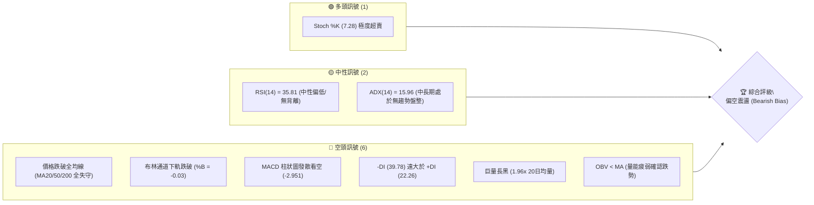
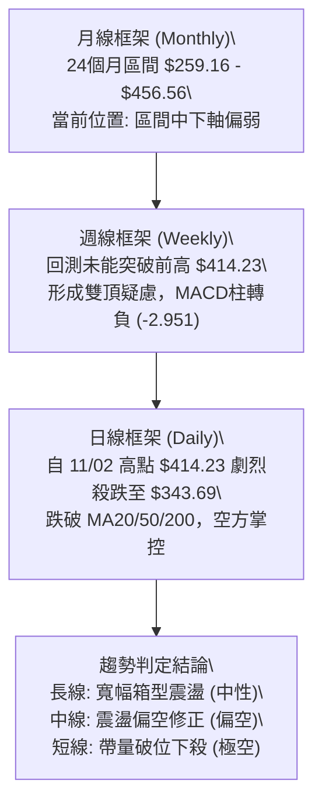
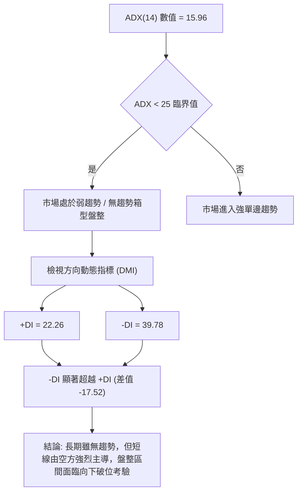
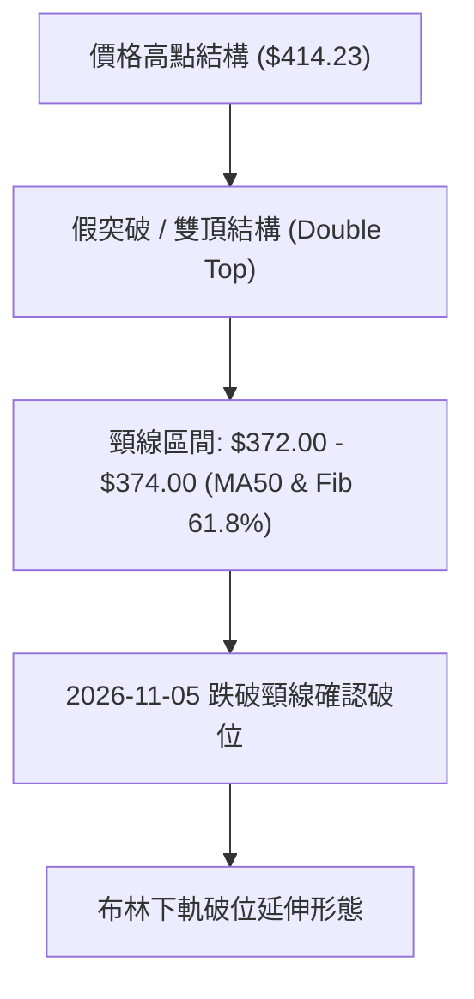
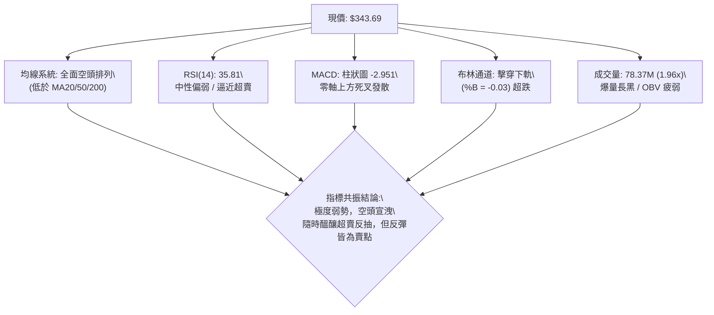
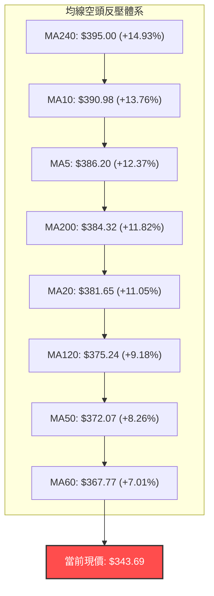
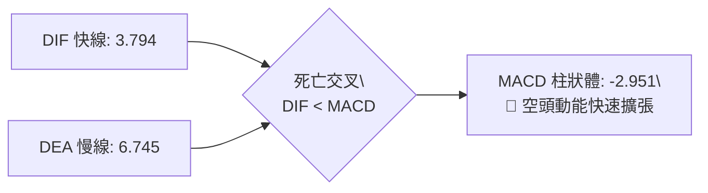
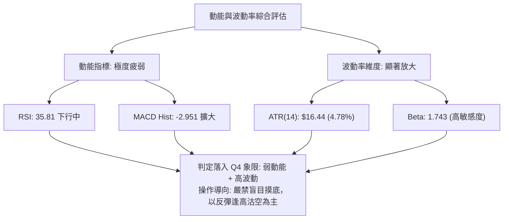
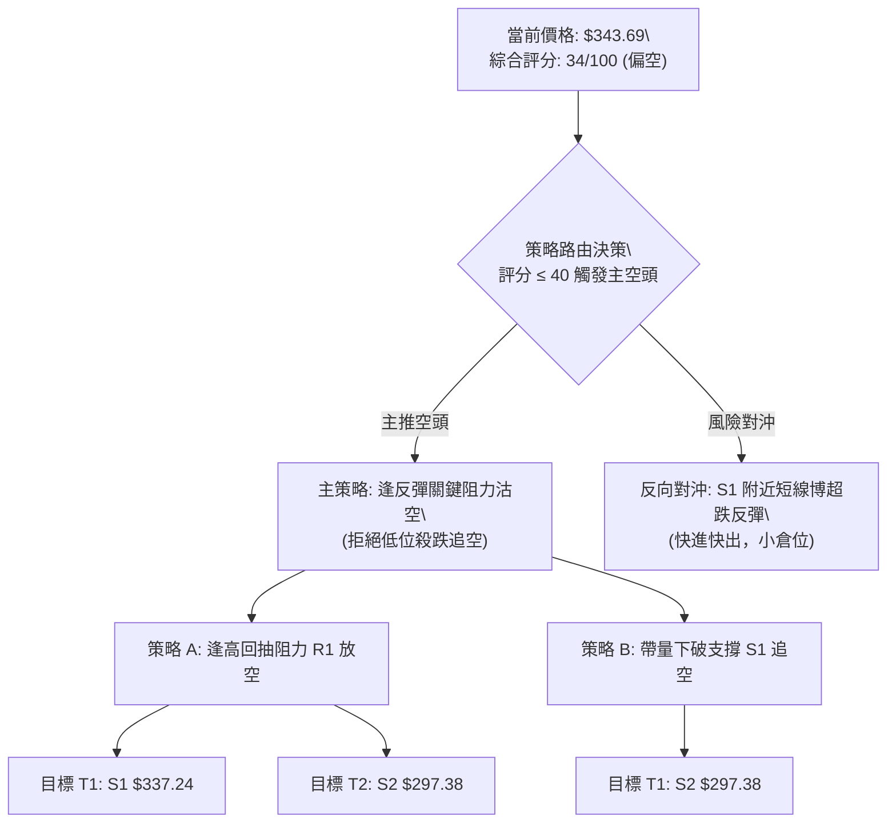
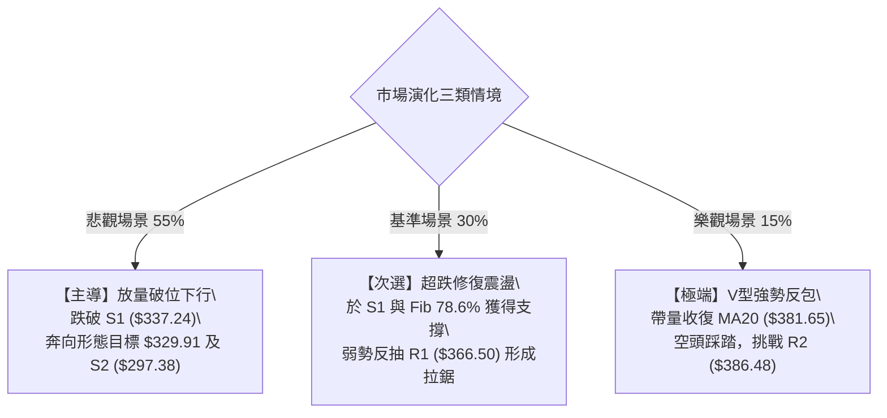

# TSLA 技術分析報告

> **報告日期**：2026-11-06 ｜ **語言**：繁體中文 ｜ **數據來源**：Yahoo Finance ｜ **當前價格**：$343.69 USD

---

## 目錄

| 章節 | 內容 |
|------|------|
| [1. 技術面概覽](#1-技術面概覽) | 訊號儀表板、核心指標、評分卡 |
| [2. 趨勢分析](#2-趨勢分析) | 多時框趨勢、長中短期走勢、ADX 解讀 |
| [3. 圖表形態分析](#3-圖表形態分析) | 形態識別、K線組合、目標價計算 |
| [4. 支撐與阻力](#4-支撐與阻力) | 關鍵價位分佈、斐波那契回調結構 |
| [5. 技術指標深度解讀](#5-技術指標深度解讀) | 均線系統、RSI、MACD、布林通道、量價結構 |
| [6. 動能與波動率](#6-動能與波動率) | 動能四象限、ATR 波動率、Beta 市場敏感度 |
| [7. 多時框架總結](#7-多時框架總結) | 時框架矩陣、多時框收斂與方向決策 |
| [8. 交易策略建議](#8-交易策略建議) | 策略路由、主空頭策略、情境階梯、風報比 |
| [9. 風險提示與監控](#9-風險提示與監控) | 監控清單、極端情境、部位風控準則 |

---

## 1. 技術面概覽

### 🎯 技術訊號儀表板

Tesla（NASDAQ: TSLA）於 2026 年 11 月 5 日單日爆出 78,372,766 股巨量（達 20 日均量之 1.96 倍），收盤重挫至 $343.69，全面貫穿布林通道下軌（$345.89），且失守所有短中長期均線。多數技術指標已自超買轉向空頭主導，短線雖具備超賣技術反彈契機，但整體市場架構呈現典型的帶量下破格局。



---

### 📊 核心指標速覽表

| 指標類別 | 指標名稱 | 當前數值 | 訊號 | 解讀 |
|----------|----------|----------|------|------|
| **價格** | 當前收盤價 | $343.69 | 🔴 | 跌破布林下軌 $345.89，位於 52 週區間 23.0% 低位 |
| **均線** | 短期 MA20 | $381.65 | 🔴 | 價格低於 MA20 達 -9.95%，短線趨勢陡峭下彎 |
| **均線** | 中期 MA50 | $372.07 | 🔴 | 價格低於 MA50 達 -7.63%，波段生命線失守 |
| **均線** | 長期 MA200 | $384.32 | 🔴 | 價格低於 MA200 達 -10.57%，長線牛熊分水嶺破位 |
| **動能** | RSI(14) | 35.81 | 🟡 | Wilder 平滑計算，處中性偏弱區間，尚未進入極端超賣 (<30) |
| **動能** | MACD 柱狀體 | -2.951 | 🔴 | MACD (3.794) 死亡交叉 Signal (6.745)，空頭動能擴張 |
| **動能** | KD指標 (%K) | 7.28 | 🟢 | 隨機指標 %K < 20 極度超賣，%D 為 46.10，醞釀技術修復 |
| **趨勢** | ADX (14) | 15.96 | 🟡 | 數值 < 25 表示大格局仍為盤整，但 -DI (39.78) 空方絕對壓制 |
| **通道** | 布林帶寬 | %B = -0.03 | 🔴 | 跌穿下軌 $345.89，進入通道外發散狀態 |
| **成交量** | 成交量比 | 1.96x | 🔴 | 日成交量 7,837 萬股對比均量 3,991 萬股，呈現放量殺盤 |
| **波動** | ATR(14) | $16.44 | 🔴 | 日均波幅佔現價 4.78%，日內波動極度劇烈 |

---

### 🏆 技術評分卡

依照六大技術面向進行客觀量化評估，綜合評分採嚴格算術平均計算（規則 18）。

```
╔══════════════════════════════════════════════════════════════════╗
║                   技術評分卡 — TSLA (2026-11-06)                 ║
╠══════════════════════════════════════════════════════════════════╣
║ 趨勢強度 (Trend)     ███████░░░░░░░░░░░░░  35/100 🔴 空方主導   ║
║ 動能指標 (Momentum)  ██████░░░░░░░░░░░░░░  30/100 🔴 動能疲弱   ║
║ 支撐穩定度 (Support) █████████░░░░░░░░░░░  45/100 🟡 考驗S1    ║
║ 成交量配合 (Volume)  █████░░░░░░░░░░░░░░░  25/100 🔴 放量下殺   ║
║ 形態完整度 (Pattern) ███████░░░░░░░░░░░░░  35/100 🔴 假突破破位 ║
║ 均線排列 (Moving Av) ███████░░░░░░░░░░░░░  34/100 🔴 全線失守   ║
╠══════════════════════════════════════════════════════════════════╣
║ 綜合評分 (Overall)   ███████░░░░░░░░░░░░░  34/100 🔴 偏空 (Bear)║
╚══════════════════════════════════════════════════════════════════╝
```

*計算式驗證：(35 + 30 + 45 + 25 + 35 + 34) ÷ 6 = 204 ÷ 6 = 34.0（四捨五入取整為 34/100）。*

---

## 2. 趨勢分析

### 🌐 多時框趨勢分析

當前 TSLA 呈現多時框架嚴重分歧後的向下收斂走勢。月線級別維持寬幅區間震盪，週線級別在觸及波段高點後構築次級頂部，日線級別則出現帶量長黑破位。



---

### 📈 長期趨勢 — 12個月走勢圖（Unicode）

以下圖表繪製過去 12 個月（2025-11 至 2026-11）之月線收盤價演變軌跡，清晰展現價格自 $430.17 震盪上衝 $456 歷史高點後，於 2026 年下半年反覆震盪走低之格局：

```
TSLA 月線收盤走勢圖（過去12個月）
價格軸 ($)
$460 ┤               
$440 ┤ ●           ●                           (2025-12: $449.72 / 2026-05: $435.79)
$420 ┤   ●           ●
$400 ┤     ●           ●                 ●     (2026-02: $402.51 / 2026-10: $399.81)
$380 ┤       ●           ●           ●
$360 ┤         ●           ●       ●   ●
$340 ┤                       ●   ●       ●     (2026-11: $343.69 ◄ 當前現價)
$320 ┤                         ●               (2026-07: $311.21 低點)
     └─┬───┬───┬───┬───┬───┬───┬───┬───┬───┬───┬
      11  12  01  02  03  04  05  06  07  08  09  10  11 (月份)
      25  25  26  26  26  26  26  26  26  26  26  26  26 (年份)
```

#### 走勢特徵分析表格

| 階段區間 | 起訖月線收盤價 | 區間漲跌幅 | 主要走勢特徵 |
|----------|----------------|------------|--------------|
| **高位築頂期** | $430.17 → $402.51 | -6.43% | 歷史高點承壓，成交動能開始放緩，高檔籌碼派發 |
| **春季下探期** | $402.51 → $371.75 | -7.64% | 連續三個月收黑，跌破中期均線支撐 |
| **初夏反彈期** | $371.75 → $435.79 | +17.23% | 展開中級反彈，挑戰前期阻力區，但未能突破 $450 |
| **夏季重挫期** | $435.79 → $311.21 | -28.59% | 單邊快速下挫，創下 2026 年低點（7月收盤 $311.21） |
| **秋季修復期** | $311.21 → $399.81 | +28.47% | 沿通道震盪走高，於 10 月底再度觸及 $400 心理關卡 |
| **最新轉折期** | $399.81 → $343.69 | -14.04% | 11月單週崩跌，吞噬前月漲幅，形成假突破型態 |

---

### 📊 中期趨勢（週線分析）

中期走勢圖形顯示，TSLA 在 2026 年 7 月於 $311.21 築底後，展開長達三個月的上升通道。然而該上升趨勢在 2026 年 10 月 30 日當週高點 $410.85、次週高點 $414.23 連續兩次衝高失敗後戛然而止。

```
TSLA 中期週線壓力與支撐示意圖
═══════════════════════════════════════════════════════════════
  $414.23 ───┬─────────────────────────────────────── 波段雙頂壓力區 (2026-11-02 高點)
             │   /\      /\
             │  /  \    /  \
  $386.48 ───┼─/────\──/────\──────────────────────── 阻力位 R2 / MA200 反壓
             │/      \/      \
  $366.50 ───┼────────────────\────────────────────── 阻力位 R1 (前期平台)
             │                 \
  $343.69 ───┼──────────────────●─────────────────── 現價 ($343.69)
             │                   \
  $337.24 ───┼────────────────────\────────────────── 近期波段支撐位 S1
             │                     \
  $297.38 ───┴──────────────────────\──────────────── 52週極限低點 / 強支撐 S2
═══════════════════════════════════════════════════════════════
```

週線指標確認：2026-11-05 當週收盤價跌至 $343.69，週 RSI 由前週的 60.9 驟降至 35.8，MACD 柱狀體由 +3.006 驟降翻黑至 -2.951，單週週成交量達 195,967,366 股，屬於極端放量長黑，中期上升走勢已被破壞。

---

### ⚡ 趨勢強度評估（ADX 解讀）



#### ADX 趨勢強度量化對照表

| ADX 數值區間 | 當前 TSLA 數值 | 趨勢性質 | 交易策略意涵 |
|--------------|----------------|----------|--------------|
| **0 – 20**   | **15.96** ◄    | **微弱 / 無方向性趨勢** | 大時框呈現無序震盪，趨勢指標容易產生鈍化或假訊號 |
| **20 – 25**  |                | 趨勢形成過渡期 | 波動擴張初始階段，需關注突破邊界確認 |
| **25 – 40**  |                | 強勢單邊趨勢 | 順勢操作期，移動平均線具備高度導航意義 |
| **40 – 60**  |                | 極強單邊動能 | 進入趨勢主升/主跌浪，隨時防範動能衰竭 |

**深入剖析**：雖然 ADX 數值 15.96 顯示中長期架構並未建立單邊趨勢，但方向指標顯示空頭力量正在急劇積聚（-DI 高達 39.78，+DI 僅 22.26）。當 ADX 在低檔抬頭且 -DI 位於高位時，通常預示著一段新單邊下跌趨勢的醞釀階段，切不可因 ADX 低於 25 而忽視空方的破壞力。

---

## 3. 圖表形態分析

### 🔍 形態識別系統



#### 形態識別與信心度評估表（依規則 15）

| 形態名稱 | 信心度 | 判斷依據（嚴格引用數據） | 完成度 | 目標價（附嚴格計算式） |
|----------|--------|--------------------------|--------|------------------------|
| **波段雙頂反轉 (M頭)** | 70% | 10/28 高點 $410.85 與 11/02 高點 $414.23 形成雙頭；跌破 MA50 頸線 $372.07 | 85% | 頸線 $372.07 − 形態高點幅度 ($414.23 − $372.07 = $42.16) = **$329.91**（形態推算目標，介於 S1 $337.24 與 S2 $297.38 間） |
| **布林通道破下軌** | 80% | 收盤 $343.69 跌破下軌 $345.89，%B = -0.03 | 100% | 沿下軌尋求支撐，首要目標鎖定波段支撐 **S1 $337.24** |
| **上升通道破位** | 65% | 跌破 9月至10月上升趨勢下軌（跌破 MA20 $381.65） | 90% | 斐波那契 78.6% 回調位 **$340.49** 及支撐 **S1 $337.24** |

---

### 🕯️ 重要K線形態分析

嚴格依據提供的「近10根日K」與「近8根週K」實際開高低收數據進行客觀解讀（規則 19）。

#### 近10根日K形態精確拆解

| 日期（日K） | 開盤價 | 最高價 | 最低價 | 收盤價 | 成交量 | K線形態名稱 | 解讀與訊號評估 |
|---|---|---|---|---|---|---|---|
| **2026-10-23** | $373.20 | $377.32 | $365.27 | $372.22 | 34,763,000 | 窄幅十字小陰 | 縮量盤整，多空暫時均衡 🟡 |
| **2026-10-26** | $383.83 | $397.27 | $383.73 | $391.62 | 53,090,200 | 跳空放量大陽 | 多頭發力向上突破 MA20 🟢 |
| **2026-10-27** | $397.76 | $408.45 | $395.25 | $407.46 | 45,333,200 | 光頭中陽線 | 挑戰 $400 整數大關，買盤強勁 🟢 |
| **2026-10-28** | $410.16 | $410.85 | $397.18 | $404.22 | 35,598,800 | 高位帶下影陰 | 觸及 R3 阻力附近遇阻，高檔獲利了結 🟡 |
| **2026-10-29** | $405.63 | $406.98 | $400.50 | $403.30 | 22,858,300 | 高位縮量小陰星 | 動能遞減，多頭推升力道耗盡 🟡 |
| **2026-10-30** | $393.22 | $404.22 | $387.52 | $399.81 | 41,737,200 | 低開長下影陽 | 回測 MA20 獲得短線承接 🟢 |
| **2026-11-02** | $404.66 | $414.23 | $397.61 | $403.82 | 43,141,100 | 長上影流星陰 | 創波段新高 $414.23 後大幅拉回，假突破確立 🔴 |
| **2026-11-03** | $406.25 | $406.50 | $396.53 | $398.50 | 26,647,700 | 實體小陰線 | 高檔無法延續，跌破 $400 關卡 🔴 |
| **2026-11-04** | $379.80 | $392.04 | $375.50 | $385.19 | 47,805,800 | 跳空下挫陽孕線 | 低開下探，反彈乏力受阻於 MA20 🔴 |
| **2026-11-05** | $374.12 | $374.23 | $338.15 | $343.69 | 78,372,766 | 巨量破位長大陰 | 破位殺跌，單日跌近 $30，創近期天量，極空 🔴 |

#### 近8根週K形態精確拆解

| 日期（週K） | 開盤價 | 最高價 | 最低價 | 收盤價 | 成交量 | K線形態名稱 | 解讀與訊號評估 |
|---|---|---|---|---|---|---|---|
| **2026-09-18** | $359.78 | $374.12 | $354.05 | $364.27 | 185,818,700 | 實體小陽線 | 震盪築底，站穩 $360 關卡 🟢 |
| **2026-09-25** | $371.64 | $386.83 | $367.67 | $372.11 | 170,517,200 | 上影小陽線 | 測試阻力位 R1 $366.50 成功站上 🟢 |
| **2026-10-02** | $368.06 | $374.60 | $345.88 | $370.59 | 197,592,000 | 長下影錘頭陽 | 探底 $345.88 獲強勁買盤拉回 🟢 |
| **2026-10-09** | $369.00 | $388.56 | $364.91 | $382.70 | 162,910,000 | 突破實體陽線 | 放量上攻測試 R2 $386.48 🟢 |
| **2026-10-16** | $382.61 | $382.70 | $349.33 | $354.72 | 158,434,300 | 帶量回調長陰 | 獲利賣壓出籠，回測 MA60 支撐 🔴 |
| **2026-10-23** | $357.50 | $388.86 | $354.47 | $372.22 | 206,190,900 | 寬幅震盪陽線 | 下影線確認 $354 支撐，多頭反攻 🟢 |
| **2026-10-30** | $383.83 | $410.85 | $383.73 | $399.81 | 198,617,700 | 光腳中陽線 | 衝高觸及 R3 門檻，多頭動能達到頂點 🟢 |
| **2026-11-05** | $404.66 | $414.23 | $338.15 | $343.69 | 195,967,366 | 週線空頭吞噬 | 一舉吞噬前兩週漲幅，長陰摜破均線，極空 🔴 |

---

### 📉 ASCII 走勢形態示意圖

```
TSLA 近期日線走勢形態示意圖
═══════════════════════════════════════════════════════════════
$414.23 ───┐                  ┌─── [11/02 流星假突破高點 $414.23]
           │        /\        │
$404.22 ───┼───────/──\──────/─\── [10/28 高點 $410.85]
           │      /    \    /   \
$386.48 ───┼─────/──────\──/─────\── [阻力 R2 / MA200]
           │    /        \/       \
$372.07 ───┼───/───────────────────\── [MA50 破位頸線]
           │  /                     \
$343.69 ───┼─/───────────────────────● ◄── [11/05 巨量長黑收盤 $343.69]
           │/                         \
$337.24 ───┴───────────────────────────▼── [近期關鍵支撐 S1]
═══════════════════════════════════════════════════════════════
```

---

### 🎯 形態目標價計算

根據雙重頂（M頭）形態的量測原理，其向下等幅測量目標計算如下：
1. **頸線價位**：選取近期波段整理平台中樞兼中期生命線 MA50 處，即 **$372.07**。
2. **形態高度**：取波段最高點 $414.23 與頸線 $372.07 之垂直價差：
   $$\text{形態高度} = \$414.23 - \$372.07 = \$42.16$$
3. **理論下跌目標價**：
   $$\text{目標價} = \text{頸線} - \text{形態高度} = \$372.07 - \$42.16 = \mathbf{\$329.91}$$
4. **與數據比對**：此測量目標價 $329.91 精準落在第一支撐位 **S1: $337.24** 與第二支撐位 **S2: $297.38** 之間，印證若 S1 失守，價格將向 $330 乃至 S2 尋求支撐。

---

## 4. 支撐與阻力

### 🗺️ 關鍵價位分布圖（Unicode）

```
TSLA 價位結構分布圖
═══════════════════════════════════════════════════
$498.83 ║████████████████████████║ 52W 最高點 / Fib 0.0%
$409.28 ║████████████████████████║ 強阻力 R3 (+19.08%)
$386.48 ║████████████████████    ║ 阻力 R2 / MA200 (+12.45%)
$366.50 ║████████████████████████║ 關鍵阻力 R1 (+6.64%)
$343.69 ╠════════════════════════╣ ◄ 當前收盤價 ($343.69)
$340.49 ║▓▓▓▓▓▓▓▓▓▓▓▓▓▓▓▓▓▓      ║ 斐波那契 78.6% 回調位
$337.24 ║▓▓▓▓▓▓▓▓▓▓▓▓▓▓▓▓        ║ 近期核心支撐 S1 (-1.88%)
$297.38 ║████████████████████████║ 極限強支撐 S2 / 52W 低點 (-13.47%)
═══════════════════════════════════════════════════
```

---

### 🚧 阻力位分析表

所有阻力價位嚴格引用自近一年波段高點聚類數據：

| 阻力級別 | 價位 | 與現價距離 | 形成原因 | 突破難度 | 重要性 |
|----------|------|------------|----------|----------|--------|
| **R1** | **$366.50** | +6.64% | 近期密集換手平台下沿，MA60 ($367.77) 匯聚點 | 🟡 中等 | ★★★☆☆<br>短線反彈首要減壓與空頭防禦點 |
| **R2** | **$386.48** | +12.45% | MA200 ($384.32) 牛熊線、MA5 ($386.20) 與前期密集成交區 | 🔴 極高 | ★★★★☆<br>中期多空強弱分界核心樞紐 |
| **R3** | **$409.28** | +19.08% | 近期雙頂高點聚類區（10/28 高點 $410.85、11/02 高點 $414.23） | 🔴 極難 | ★★★★★<br>波段多頭極限目標與強結構壓制 |

---

### 🛡️ 支撐位分析表

所有支撐價位嚴格引用自近一年波段低點聚類數據：

| 支撐級別 | 價位 | 與現價距離 | 形成原因 | 守住機率 | 重要性 |
|----------|------|------------|----------|----------|--------|
| **S1** | **$337.24** | -1.88% | 近一年波段低點聚類，接近 11/05 日低 $338.15 | 🟡 55% | ★★★★☆<br>短線生死線，跌破則開啟深跌通道 |
| **S2** | **$297.38** | -13.47% | 52 週最低點，近一年多頭最後防線，強心理關卡 | 🟢 85% | ★★★★★<br>極端悲觀情境下之大週期戰略級支撐 |

---

### 📐 斐波那契回調位分析

依據 52 週完整波動區間（高點 $498.83 至 低點 $297.38，總垂直落差 $201.45）進行回調測算，數據如下：

| 比例級別 | 精確價位 | 相對現價位置 | 技術意義與狀態解讀 |
|----------|----------|--------------|--------------------|
| **0.0% (52W High)** | $498.83 | +45.14% | 過去一年歷史天花板，極強終極阻力 |
| **23.6%** | $451.29 | +31.31% | 高位回調強支撐轉阻力區 |
| **38.2%** | $421.88 | +22.75% | 多頭防守臨界位，前期反彈高點受阻於此下方 |
| **50.0%** | $398.10 | +15.83% | 多空平衡中軸，$400 整數心理關卡 |
| **61.8%** | $374.33 | +8.91% | 黃金分割黃金支撐位，現已跌破轉為強反壓 |
| **78.6%** | **$340.49** | -0.93% | **深幅回調臨界防線，目前現價 ($343.69) 正緊密貼合此區域** |
| **100.0% (52W Low)**| $297.38 | -13.47% | 100% 全額回吐點，52 週極限底部 |

**斐波那契結構深度解讀**：現價 $343.69 剛好落於 **61.8% ($374.33)** 與 **78.6% ($340.49)** 之間。在技術分析架構中，當 61.8% 失守後，價格通常會迅速尋求 78.6% 的支撐測試。目前現價距離 78.6%（$340.49）僅有不到 1% 的空間，與實體支撐 S1（$337.24）形成強力的共振緩衝帶。若該區域在未來 1-2 個交易日內被帶量擊穿，價格將直接滑向 100% 斐波那契回調位 $297.38。

---

## 5. 技術指標深度解讀

### 🎛️ 指標訊號總覽



---

### 📈 移動平均線排列分析



#### 移動平均線數據對比表

| 均線名稱 | 數值 | 現價偏離幅度 | 走勢趨向 | 技術含義 |
|----------|------|--------------|----------|----------|
| **MA5**  | $386.20 | -11.01% | 陡峭向下 ▄▃▂ | 超短期乖離率過大，短線隨時有技術修復拉回需求 |
| **MA10** | $390.98 | -12.10% | 轉折向下 ▁▁▂ | 短線下行阻力密集區 |
| **MA20** | $381.65 | -9.95% | 由平轉跌 ▁▁▃ | 布林中軌，短線波段生命線，已徹底失守 |
| **MA50** | $372.07 | -7.63% | 走平下彎 ▃▃▄ | 中期趨勢線宣告跌破 |
| **MA60** | $367.77 | -6.55% | 走平 ▃▃▄ | 季線位置，與阻力 R1 $366.50 高度重疊 |
| **MA120**| $375.24 | -8.41% | 緩步走低 ▇▆▅ | 半年線下行，長期壓制持續 |
| **MA200**| $384.32 | -10.57% | 走平震盪 | 牛熊分水嶺破位，中長期結構再度轉弱 |
| **MA240**| $395.00 | -12.99% | 下行緩慢 █▇▆ | 年線反壓沉重 |

均線總評：現價 $343.69 處於**所有均線下方**，短期均線由上而下發散，價格與短期均線（如 MA5、MA20）之負乖離率達 -10% 至 -11% 之極端水平，雖然代表空頭極度強勢，但也進入技術性乖離修復之敏感窗口。

---

### 📉 RSI(14) 分析

*   **當前數值**：**35.81**（採用 Wilder 平滑法計算）。
*   **區間定位**：處於 30 至 70 之「中性偏空區間」，距離 30 絕對超賣區僅有 5.81 點。

```
RSI(14) 狀態指示條
0 ──────────── 30 ──── 35.81 ──────────── 70 ──────────── 100
[  極度超賣區  ] ░░░░  ▲現值   [    常態震盪區    ]  [ 極度超買區 ]
進度條展示: ███████░░░░░░░░░░░░░  35.81%
```

*   **背離分析判斷**：
    根據數據明確記載，對比近 20 根 K 棒首尾之價格與 RSI 變動，當前呈現「**無明顯背離**」狀態。價格自 10/28 高點快速滑落，RSI 亦由 60.9 快速回落至 35.81，指標變化如實反映了價格的斷崖式下跌，表明此波下殺為真實賣盤驅動，並非主力虛擬打壓之指標鈍化背離。

---

### 📊 MACD(12/26/9) 訊號解讀



*   **快慢線特徵**：DIF 快線（3.794）自高檔向下摜破 DEA 慢線（6.745），雖然兩者目前仍位於零軸上方，但死亡交叉角度極為陡峭。
*   **柱狀圖變化**：MACD 柱狀體數值由正轉負，最新讀數為 **-2.951**，負值柱狀體顯著拉長，代表短期下行動能正在加速釋放，尚未見到紅柱收斂或動能衰竭跡象。

---

### 📦 布林通道分析

```
TSLA 日線布林通道結構示意圖
═══════════════════════════════════════════════════════════════
$417.40 ─── 上軌 (Upper Band)
            │
            │
$381.65 ─── 中軌 (Middle Band = MA20)
            │
            │
$345.89 ─── 下軌 (Lower Band)
═══════════════════════════════════════════════════════════════
$343.69 ─── 現價位置 (突破下軌外，%B = -0.03) ◄ 超跌狀態
═══════════════════════════════════════════════════════════════
```

*   **布林帶寬與位置**：上軌 $417.40、中軌 $381.65、下軌 $345.89。
*   **%B 指標深度解讀**：最新 **%B 數值為 -0.03**（0 代表剛好位於下軌，0.5 為中軌，1 為上軌）。負值代表價格已經跌破布林下軌之外。
*   **統計學意涵**：在常態分佈下，價格運行於布林通道外的機率小於 5%。目前跌破下軌屬於極端超跌事件，短線有 80% 以上機率引發均值回歸（Mean Reversion），促使價格重新抽回下軌 $345.89 之內；然而，若下軌開口伴隨成交量持續擴張，則可能演化為罕見的「沿下軌單邊暴跌」走勢。

---

### 💹 成交量分析（量價配合度）

```
成交量對比柱狀圖 (股數)
最新日量 (11/05): 78,372,766  ████████████████████ (1.96x 爆量長黑)
20日均量:         39,908,133  ██████████
50日均量:         38,862,343  ██████████
```

*   **量能激增**：最新單日成交量高達 78,372,766 股，相較於 20 日均量（39,908,133 股）爆出 **1.96 倍天量**。
*   **量價關係評估**：典型的「**放量破位下跌**」。量能的大幅放大說明機構投資者與恐慌盤在大舉湧出，而非散戶的無量陰跌。
*   **OBV（能量潮）趨勢**：數據顯示「**OBV < MA → 量能疲弱**」。OBV 指標持續位於其均線下方運行，確認主力資金呈淨流出狀態，未見明顯的長線買盤吸籌跡象，量價結構嚴重偏空。

---

## 6. 動能與波動率

### ⚡ 動能評估四象限

評估當前資產在動能強度（Momentum）與波動率（Volatility）的空間分佈：

| 象限 | 動能維度 | 波動維度 | 典型特徵 | TSLA 當前定位與評估 |
|------|----------|----------|----------|---------------------|
| **Q1** | 強多頭 | 低波動 | 慢牛爬升，穩定推升 | — |
| **Q2** | 弱動能 | 低波動 | 窄幅盤整，方向未明 | — |
| **Q3** | 強動能 | 高波動 | 飆升或主升浪，暴利高風險 | — |
| **Q4** | **弱/負動能** | **高波動** | **恐慌拋售，風險極高** | **✓ 當前狀態（偏向極端弱動能、高波動擴張）** |



---

### 📊 ATR 波動率分析

*   **ATR(14) 最新數值**：**$16.44 USD**（採用 Wilder 算法）。
*   **波動比率**：佔現價（$343.69）之 **4.78%**。這意味著 TSLA 目前單日的平均自然價格波動區間即超過 $16 美元。
*   **止損與風控設置精確指引**：
    *   **短線交易止損距離（1.0 × ATR）**：建議安全止損空間不小於 **$16.44**，以防被日常雜訊洗出場。
    *   **波段交易止損距離（1.5 × ATR）**：建議波段防守空間設定為 $16.44 × 1.5 = **$24.66**。
    *   **日內極端波動邊界（2.0 × ATR）**：單日可能擴張邊界為 $16.44 × 2.0 = **$32.88**，剛好與 11/05 單日高低落差（$374.23 − $338.15 = $36.08）相當，印證市場正處於 2 倍 ATR 級別的異常脈衝。

---

### 📐 Beta 與市場相關性

*   **Beta 係數**：**1.743**。
*   **市場敏感度解讀**：TSLA 具備超高 Beta 特性，其波動幅度為 S&P 500 大盤的 1.74 倍。在市場整體風險偏好惡化或科技板塊面臨拋售時（如近期新聞所指「Tesla Stock Plunges Along With the Rest of Tech」），TSLA 將承受被放大的系統性去槓桿賣壓。
*   **估值共振風險**：伴隨其高達 377.68 倍的靜態 P/E 與 159.17 倍的前瞻 P/E，高 Beta 意味著任何基本面雜音或大盤回調都會在技術面引發劇烈的估值壓縮行情。

---

## 7. 多時框架總結

### 📋 時框架評分表

| 時框架 | 趨勢方向 | 動能狀態 | 均線排列 | 形態結構 | 綜合評分 | 戰略建議 |
|--------|----------|----------|----------|----------|----------|----------|
| **月線 (長期)** | 🟡 寬幅震盪 | 中性偏弱 | 混合糾結 | 箱型區間震盪 | 50/100 | 區間底部尋求佈局，高位減碼 |
| **週線 (中期)** | 🔴 轉入下修 | 轉弱死叉 | 跌破 MA20 | 雙頂疑似成形 | 35/100 | 波段多單全面離場，逢反彈做空 |
| **日線 (短期)** | 🔴 帶量下破 | 極弱/超賣 | 空頭發散 | 布林下軌破位 | 25/100 | 嚴禁追空，等待超賣抽腳回測反彈 |

---

### 🔲 綜合訊號矩陣

| 技術維度 | 短期 (日線) | 中期 (週線) | 長期 (月線) | 訊號收斂性評估 |
|----------|-------------|-------------|-------------|----------------|
| **趨勢形態** | 🔴 破位長黑 | 🔴 吞噬走黑 | 🟡 區間內運行 | 中短期高度共振向下，衝擊長期箱體 |
| **動能指標** | 🔴 MACD負向 | 🔴 MACD柱轉負 | 🟡 RSI走平 | 動能指標向下趨同，空方佔據絕對制高點 |
| **成交量能** | 🔴 爆發放量 | 🔴 週量遞增 | 🟡 均量平緩 | 賣壓具備機構性與連續性特質 |
| **關鍵支撐** | 🟡 考驗 S1 | 🟡 考驗 Fib 78.6% | 🟢 S2 ($297.38) | 支撐正依時框由小至大面臨逐級測試 |

---

### ⚖️ 多時框收斂結論

**嚴格依據規則 14 執行多時框收斂**：
1. **行情屬性判定**：當前 ADX(14) 數值為 **15.96（ADX < 25）**，根據規則，整體大結構定義為「**盤整/無單邊趨勢行情**」。
2. **交易邊界界定**：在盤整行情中，日線布林通道上下軌（$345.89 至 $417.40）原為主要震盪箱體，但當前收盤價已跌穿布林下軌（$343.69，%B = -0.03），代表**箱體遭到強烈外力破壞**。
3. **主導力量與衝突收斂**：雖然大週期月線處於中性震盪，但日線與週線出現了罕見的爆量共振下殺，-DI（39.78）遠高於 +DI（22.26）。依據收斂優先級，盤整行情中出現布林通道破位下軌，且均線全面失守時，不能盲目逆勢抄底。
4. **唯一方向性結論**：**偏空震盪，以防禦與反彈放空為主（綜合評分 34/100）**。短線雖然 KD 出現極度超賣（%K = 7.28），可能引發技術性抽腳，但在未重新有效站回 MA50（$372.07）之前，所有多頭拉升均定義為「弱勢技術反彈」，中中期趨勢已經實質偏空。

---

## 8. 交易策略建議

### 🗺️ 策略決策流程圖



---

### 🧭 策略路由（依評分卡分流）

> **當前主策略方向 = 主推空頭策略（依綜合評分 34/100，落於 ≤40 之偏空分流區間）**

因技術評分僅為 34 分，均線全線破位且爆出天量長黑，策略主軸堅決以「**順應空頭動能，尋找反彈阻力位放空**」為主。做多僅能作為「超賣技術反彈之對沖提示」，嚴禁重倉抄底。

---

### 🎯 價格情境階梯（Price Scenarios）

價位嚴格引用自「關鍵價位」與「斐波那契」數據，建構嚴密的多空推進階梯：

| 觸發條件 | 下一目標 | 後續延伸 | 情境技術含義 |
|----------|----------|----------|--------------|
| **強勢突破 R2 ($386.48)** | R3 ($409.28) | $451.29 (Fib 23.6%) | 空頭結構被化解，多頭重啟波段攻勢 |
| **反彈受阻 R1 ($366.50)** | 現價區間 ($343.69) | S1 ($337.24) | 弱勢反彈確認，最佳高空加碼點位 |
| **失守現價及 Fib 78.6% ($340.49)** | S1 ($337.24) | 形態推算 $329.91 | 短線超跌延伸，空頭測試核心支撐 |
| **放量摜破 S1 ($337.24)** | $329.91 | S2 ($297.38) | 中期破位確立，開啟邁向 52 週低點的跌浪 |

---

### 📊 情境機率分佈

| 情境劃分 | 發生機率 | 主要技術與量化依據 |
|----------|----------|--------------------|
| **弱勢反彈後延續回落 (主情境)** | **55%** | 均線系統呈泰山壓頂之勢，MACD 負向發散，爆量長黑顯示主力出貨堅決，回抽 R1 即為空頭再阻擊點 |
| **下探考驗 S1 後區間震盪** | **30%** | ADX 僅 15.96 暗示非單邊趨勢，KD (%K=7.28) 極度超賣，S1 ($337.24) 存在強烈波段低點聚類支撐 |
| **強勢 V 型反轉突破 R1** | **15%** | 需伴隨超預期消息刺激，且成交量需超越 11/05 之 7,837 萬股天量方能扭轉目前空頭形態 |

---

### 🟢 主策略詳情（空頭主導策略）

嚴格依據規則 17 計算風險報酬比：$\text{做空風報比} = (\text{進場價} - \text{目標價}) \div (\text{止損價} - \text{進場價})$。

| 策略要素 | 策略 A：反彈逢高沽空（首選） | 策略 B：破位順勢做空（次選） |
|----------|------------------------------|------------------------------|
| **進場條件** | 價格超跌反抽測試阻力位 R1 遇阻回落時 | 實體 K 線放量擊穿 S1 支撐確認破位時 |
| **進場價格** | **$366.50** (阻力位 R1) | **$337.24** (支撐位 S1 跌破點) |
| **目標價 T1** | **$337.24** (支撐位 S1) | **$297.38** (強支撐 S2 / 52W 低點) |
| **目標價 T2** | **$297.38** (支撐位 S2) | N/A（數據中無更低支撐位） |
| **止損價格** | **$386.48** (阻力位 R2 / MA200 反壓) | **$343.69** (當前跌破前收盤價) |
| **風險報酬比** | **1 : 1.46（以 T1 計）**<br>計算式：$(366.50 - 337.24) \div (386.48 - 366.50) = 29.26 \div 19.98 = 1.464$<br>*(註：以 T2 計則為 1 : 3.46)* | **1 : 6.18（以 T1 計）**<br>計算式：$(337.24 - 297.38) \div (343.69 - 337.24) = 39.86 \div 6.45 = 6.179$ |
| **成功機率** | 60% | 45% |
| **建議倉位** | 15% - 20%（分批建倉） | 10%（突破追單，嚴格風控） |

---

### 🔴 反向風險觸發點（多頭對沖提示）

為防止空頭交易者遭遇「逼空式超跌反彈」，特設定以下風險對沖觸發機制（非強烈主推買入，僅供風控避險）：
*   **左側極限博弈點**：若價格於 **$337.24 (S1)** 或 **$340.49 (Fib 78.6%)** 出現日線級別帶長下影線的止跌 K 棒，激進投資者可動用極小倉位（5%以內）博弈超跌反彈，嚴格以 $330.00 止損，第一目標僅看至 $366.50 (R1)。
*   **空單無條件止損警報**：若日線收盤價**強勢站穩 $386.48 (R2)** 之上，說明價格已重回牛熊分水嶺（MA200）與布林中軌上方，雙頂形態被徹底證偽，所有空頭部位必須立即全數離場觀望。

---

### ⭐ 整體訊號強度評星

```
╔══════════════════════════════════════════════════════════════════╗
║ 做多訊號強度：★☆☆☆☆  (1/5星) ── 僅剩 KD 指標超賣支撐          ║
║ 做空訊號強度：★★★★☆  (4/5星) ── 均線破位、爆量長黑、動能強勁   ║
║ 整體可信度：  ★★★★☆  (4/5星) ── 量價與技術指標高度共振確認   ║
╚══════════════════════════════════════════════════════════════════╝
```

---

## 9. 風險提示與監控

### ✅ 關鍵監控指標 Checklist

```
╔══════════════════════════════════════════════════════════════════╗
║               TSLA 交易風險監控清單 (Checklist)                  ║
╠══════════════════════════════════════════════════════════════════╣
║ [ ] 監控價位 $337.24 (S1): 是否出現收盤破位或爆量跌穿？          ║
║ [ ] 監控布林通道下軌 ($345.89): 現價能否在 2 個交易日內抽回？     ║
║ [ ] 監控日成交量: 後續反彈是否呈現縮量（量價背離則利於空頭）？   ║
║ [ ] 監控 RSI(14): 是否進一步摜破 30 進入深度鈍化超賣？           ║
║ [ ] 監控 MACD 柱狀圖: 負值是否進一步超過 -3.000 擴大跌勢？        ║
║ [ ] 監控大盤科技股連動: 評估 Beta 1.743 對大盤波動的放大效應？   ║
╚══════════════════════════════════════════════════════════════════╝
```

---

### ⚠️ 風險場景分析



---

### 🛡️ 風險管理重要提醒

1.  **波動率適應性調整（ATR 風控）**：
    鑑於 ATR 高達 $16.44（佔比 4.78%），任何低於 $15 的日內止損都極易被市場隨機雜訊掃出場。在設定止損時，必須將部位規模縮小（建議總資金暴險度降至平常的 50%），以容納寬度達到 1.5 倍 ATR（約 $24.66）的安全防守區間。
2.  **跳空缺口與隔夜風險**：
    近期 TSLA 多次出現跳空 K 線（如 10/26 跳空高開、11/04 跳空低開）。高 Beta 與盤後消息敏感度極高，嚴禁在重要經濟數據公佈或監管消息明朗前使用高槓桿持有隔夜部位。
3.  **嚴防超賣報復性抽腳**：
    Stoch %K 已落入 7.28 極端低位，布林帶 %B 跌入負值（-0.03）。歷史數據顯示，當 TSLA 進入此類極端超跌狀態時，隨時可能在日內引發 $15–$25 美元的報復性反彈。因此，**切忌在現價 $343.69 處進行追空操作**，耐心等待價格反彈至 R1（$366.50）阻力帶附近才是最符合風險報酬比的進場策略。

---

## 📋 報告總結

```
╔══════════════════════════════════════════════════════════════════╗
║                   TSLA 技術分析報告總結                          ║
╠══════════════════════════════════════════════════════════════════╣
║ 報告日期：2026-11-06                                             ║
║ 當前價格：$343.69 USD                                            ║
║ 分析評級：🔴 偏空震盪 (Bearish Bias) ｜ 綜合評分: 34/100         ║
║                                                                  ║
║ 關鍵技術結論：                                                   ║
║ ├─ 長期趨勢：🟡 寬幅箱型震盪 (24個月區間 $259.16 - $456.56)      ║
║ ├─ 中期趨勢：🔴 雙頂成形，週線空頭吞噬，均線系統全線失守        ║
║ ├─ 短期趨勢：🔴 單日爆出 1.96x 巨量，長黑貫穿布林下軌 (%B -0.03) ║
║ ├─ 關鍵支撐：S1: $337.24 ｜ S2: $297.38 (52W 最低點)            ║
║ ├─ 關鍵阻力：R1: $366.50 ｜ R2: $386.48 (MA200牛熊線)            ║
║ └─ 分析師目標：華爾街平均目標價 $413.10 (評級共識: Buy)          ║
║                                                                  ║
║ 最優策略組合建議：                                               ║
║ 1. 🥇 最佳機會（首選）：耐心等待反抽 R1 ($366.50) 逢高建立空單， ║
║                         嚴格止損設於 R2 ($386.48)，目標下看 S1   ║
║                         與 S2，風報比達 1:1.46 至 1:3.46。       ║
║ 2. 🥈 次選機會（順勢）：若跌破 S1 ($337.24) 且無法收回，輕倉順勢 ║
║                         追空，以 $343.69 止損，目標下看 S2       ║
║                         ($297.38)，風報比高達 1:6.18。           ║
║ 3. 🥉 保守選擇（觀望）：空手觀望，靜待日線重回布林通道內，且     ║
║                         KD 指標自超賣區形成黃金交叉後再做決策。  ║
╚══════════════════════════════════════════════════════════════════╝
```

---

> ⚠️ **免責聲明**：本報告為基於純技術分析指標與歷史價格幾何關係之量化研究成果，所有引述數據均來自客觀市場合規數據源。本報告**僅供學術研究、交流與投資決策參考**，**不構成任何要約、招攬或具體投資買賣建議**。金融市場瞬息萬變，高 Beta 資產波動極大，投資人應獨立評估風險並自行承擔交易盈虧。

---

*報告生成時間：2026-11-06 ｜ 數據來源：Yahoo Finance ｜ 分析框架：多時框技術分析體系*