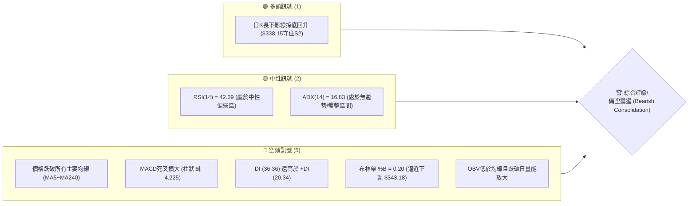
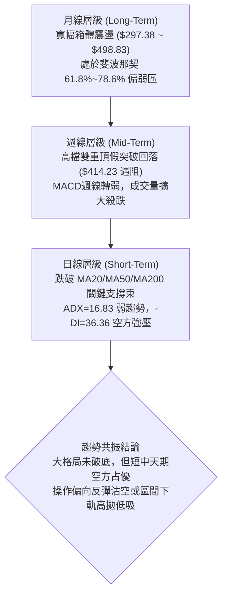
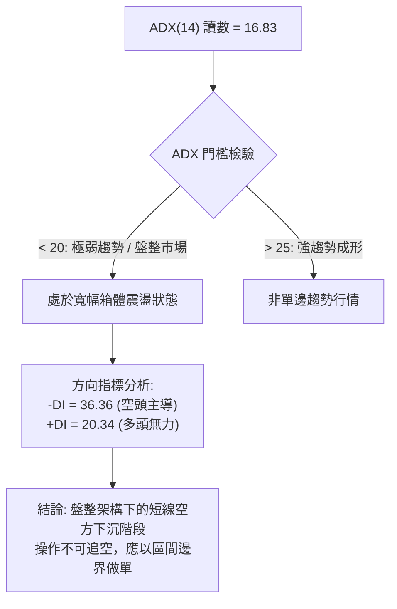
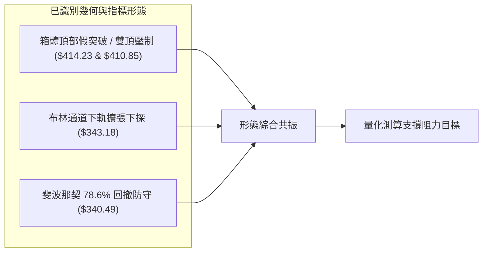
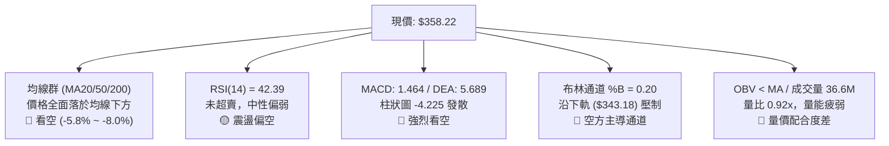
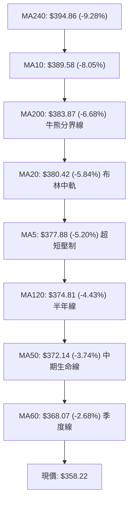
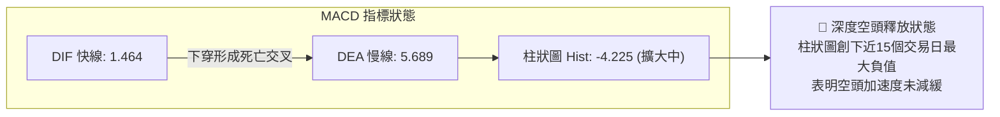
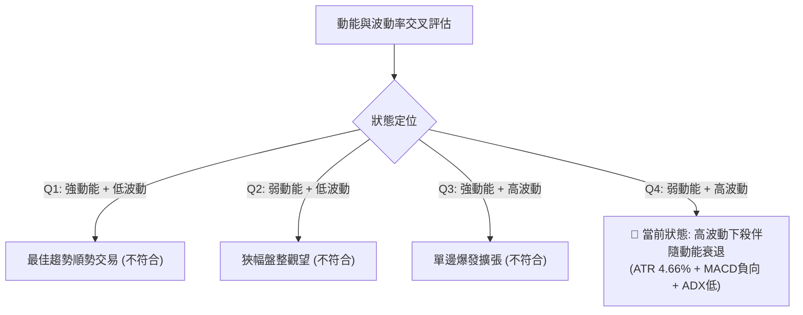
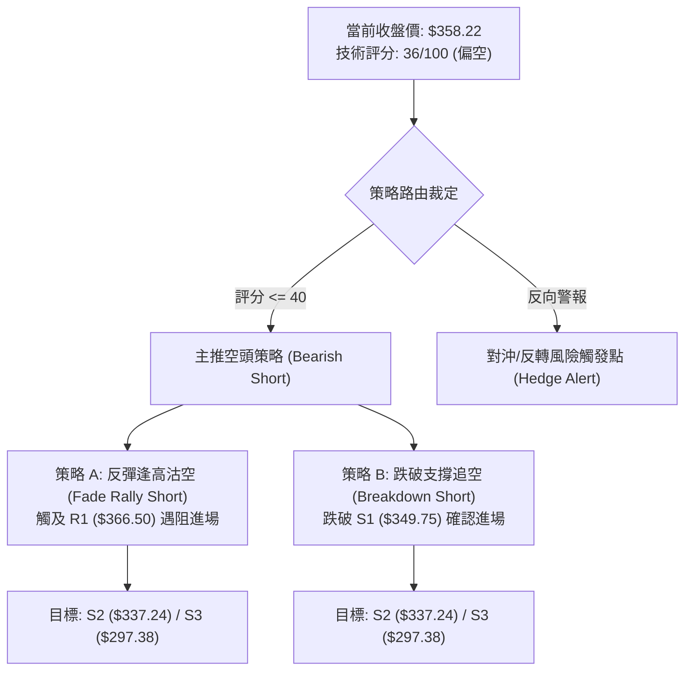
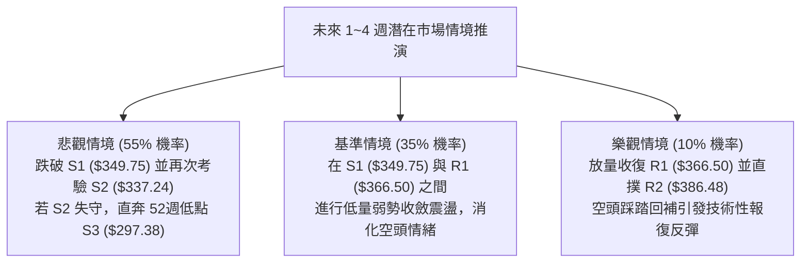

# TSLA 技術分析報告

> **報告日期**：2026-11-08 ｜ **語言**：繁體中文 ｜ **數據來源**：Yahoo Finance ｜ **當前價格**：$358.22

---

## 目錄

| 章節 | 內容 |
|------|------|
| [1. 技術面概覽](#1-技術面概覽) | 訊號儀表板、核心指標、評分卡 |
| [2. 趨勢分析](#2-趨勢分析) | 多時框趨勢、長中短期走勢、ADX 解讀 |
| [3. 圖表形態分析](#3-圖表形態分析) | 形態識別、K線組合、目標價推算 |
| [4. 支撐與阻力](#4-支撐與阻力) | 關鍵價位結構、斐波那契回調區間 |
| [5. 技術指標深度解讀](#5-技術指標深度解讀) | 均線系統、RSI、MACD、布林通道、成交量 |
| [6. 動能與波動率](#6-動能與波動率) | 動能四象限、ATR 波動率、Beta 分析 |
| [7. 多時框架總結](#7-多時框架總結) | 時框架矩陣、訊號一致性、多時框收斂 |
| [8. 交易策略建議](#8-交易策略建議) | 策略路由、價格情境、主策略詳情、風報比 |
| [9. 風險提示與監控](#9-風險提示與監控) | 監控清單、情境推演、風控規則 |
| [📋 報告總結](#-報告總結) | 總體評級、關鍵點位、最佳執行路徑 |

---

## 1. 技術面概覽

### 🎯 技術訊號儀表板

Tesla (TSLA) 當前收盤價為 **$358.22**。整體技術架構呈現「中長期區間盤整、短線承壓破位」之疲弱格局。短天期與中長天期均線全面失守，MACD 柱狀圖急速翻負並擴大，空方動能佔據主導優勢。



---

### 📊 核心指標速覽表

| 指標類別 | 指標名稱 | 當前數值 | 訊號 | 解讀 |
|----------|----------|----------|:----:|------|
| **價格** | 當前收盤價 | $358.22 | 🔴 | 位於 52 週區間 30.2% 分位，短線自 $414.23 高點急墜 |
| **均線** | 短期 MA20 | $380.42 | 🔴 | 現價低於 MA20 達 -5.84%，短線呈空頭排列壓力 |
| **均線** | 中期 MA50 | $372.14 | 🔴 | 現價低於 MA50 達 -3.74%，中期波段多頭支撐遭跌破 |
| **均線** | 長期 MA200| $383.87 | 🔴 | 現價低於牛熊分水嶺 MA200 達 -6.68%，長期趨勢偏弱 |
| **動能** | RSI(14)  | 42.39   | 🟡 | 位於中性偏弱區域，尚未進入超賣區（<30），下行仍有空間 |
| **動能** | MACD(12,26,9) | DIF: 1.464 / DEA: 5.689 | 🔴 | 死亡交叉發散，Hist 擴大至 -4.225，空頭加速釋放 |
| **動能** | 隨機指標 %K/%D| 26.38 / 29.64 | 🟡 | 逼近超賣門檻（20），短線具備技術性弱反彈動能 |
| **趨勢** | ADX / DMI| ADX: 16.83 (-DI: 36.36) | 🔴 | 弱趨勢/大箱體盤整，但方向指標顯示空方佔據絕對控制 |
| **通道** | 布林通道 | 下軌: $343.18 / %B: 0.20 | 🔴 | 價格貼近下軌運行，通道開口微擴，下行壓力未消 |
| **量能** | 最新日成交量 | 36,642,300 (0.92x) | 🔴 | 反彈量縮（量比 0.92），前日下跌爆量 7,967 萬股，量價背離 |
| **波動** | ATR(14)  | $16.71 (4.66%) | 🟡 | 日內平均波幅較大，操作需設定充足止損防禦空間 |

---

### 🏆 技術評分卡

各維度評分採用 1-100 評分體系，綜合評分嚴格按照六大維度之算術平均值計算：
$$(32 + 36 + 44 + 34 + 42 + 28) \div 6 = 216 \div 6 = 36$$

```
╔══════════════════════════════════════════════════════════════╗
║              技術評分卡 — TSLA (2026-11-08)                  ║
╠══════════════════════════════════════════════════════════════╣
║ 趨勢強度      ██████░░░░░░░░░░░░░░  32/100  🔴 空頭壓制/ADX低 ║
║ 動能指標      ███████░░░░░░░░░░░░░  36/100  🔴 MACD負向擴大   ║
║ 支撐穩定度    █████████░░░░░░░░░░░  44/100  🟡 S1/S2初步獲守  ║
║ 成交量配合    ███████░░░░░░░░░░░░░  34/100  🔴 跌時放量漲時量縮║
║ 形態完整度    ████████░░░░░░░░░░░░  42/100  🟡 箱型頂部假突破 ║
║ 均線排列      ██████░░░░░░░░░░░░░░  28/100  🔴 全天期均線失守 ║
╠══════════════════════════════════════════════════════════════╣
║ 綜合評分      ███████░░░░░░░░░░░░░  36/100  🔴 偏空弱勢 (Sell)║
╚══════════════════════════════════════════════════════════════╝
```

---

## 2. 趨勢分析

### 🌐 多時框趨勢分析

多時框架（月線、週線、日線）呈現出由中長期的寬幅區間震盪，向短線急劇轉弱、下探區間下沿演變的態勢。



---

### 📈 長期趨勢 — 過去 12 個月走勢圖（ASCII）

以下展示 2025 年 11 月至 2026 年 11 月 TSLA 每月收盤價走勢，完整呈現股價自 2025 年末高點回落、年中探底後反彈，並在近期再次遭遇強烈拋壓的過程：

```
TSLA 月線走勢圖（2025-11 至 2026-11）
價格 ($)
$460 ┤
$440 ┤    ●(12月:449.72)
$420 ┤●(11月:430.17)  ●(1月:430.41)             ●(5月:435.79)
$400 ┤                     ●(2月:402.51)               ●(6月:420.60)           ●(10月:399.81)
$380 ┤                                  ●(4月:381.63)
$360 ┤                             ●(3月:371.75)             ●(8月:367.95)   ●(11月:358.22)←現價
$340 ┤                                                             ●(9月:354.81)
$320 ┤                                                ●(7月:311.21 低點)
$300 ┤
     └─┬────┬────┬────┬────┬────┬────┬────┬────┬────┬────┬────┬────
     11/25 12   01/26 02   03   04   05   06   07   08   09   10   11/26 (月)
```

#### 走勢特徵分析表格

| 階段區間 | 起止月份 | 價格變動 | 區間漲跌幅 | 走勢特徵與量價行為 |
|----------|----------|----------|:----------:|--------------------|
| **高位築頂** | 2025-11 ~ 2026-01 | $430.17 → $430.41 | +0.06% | 價格在 $430~$450 區間反覆震盪，未能有效突破 52W 高點 $498.83 |
| **首輪回撤** | 2026-01 ~ 2026-03 | $430.41 → $371.75 | -13.63% | 連續 2 個月實體陰線回調，跌破 $400 整數大關，獲利盤出逃 |
| **次級反彈** | 2026-03 ~ 2026-05 | $371.75 → $435.79 | +17.23% | 多頭展開抵抗，5 月摸高 $435.79 形成次高點，動能未能延續 |
| **恐慌探底** | 2026-05 ~ 2026-07 | $435.79 → $311.21 | -28.59% | 出現單月暴跌（7 月暴跌至 $311.21），逼近 52W 低點 $297.38 |
| **震盪回升** | 2026-07 ~ 2026-10 | $311.21 → $399.81 | +28.47% | 連續 3 個月震盪修復，10 月收復 $399.81，形成對 $400 的假突破 |
| **再度下挫** | 2026-10 ~ 2026-11 | $399.81 → $358.22 | -10.40% | 11 月開局遭遇強烈空頭反撲，週線爆量重挫失守所有均線 |

---

### 📊 中期趨勢（週線分析）

中期走勢（近 20 週）清晰反映出一個以 **$340.00 ~ $410.00** 為核心邊界的震盪大箱體。

```
TSLA 週線關鍵走勢示意圖（近8週高低點分布）
$420 ┤                      ╭─ 2026-11-02 觸及高點 $414.23 (遇阻R3)
$410 ┤            ╭─ $410.85 (10-30週高點)
$400 ┤            │         │
$390 ┤     ╭─ $388.86       ╰───────────╮ 11-05 單日重挫放量
$380 ┤     │                            │
$370 ┤  ──┼────────────────────────────┼── 中樞軸心線 ($372.00)
$360 ┤     │                            ╰─ 現價 $358.22 (破位後低檔)
$350 ┤     ╰─ $354.47 (10-23週低)        │
$340 ┤                                   ╰─ 11-05 測試低點 $338.15 (S2上方)
$330 ┤
```

週線數據顯示，在 2026-10-30 當週收盤達 $399.81（RSI 升至 60.9，MACD 柱狀圖為 +3.006），市場一度看似準備挑戰箱頂；然而 2026-11-06 當週，伴隨 2.339 億股的爆量拋售，週K自開盤 $404.66 暴跌至最低 $338.15，單週振幅達 76.08 美元，週線收盤為 $358.22，週 MACD 柱狀圖由正轉為 **-4.225**。這表明中期的向上突破宣告失敗，轉為向箱體下沿尋求支撐。

---

### ⚡ 趨勢強度評估（ADX 解讀）



#### ADX 趨勢強度對照表

| 指標 | 數值 | 參考標準 | 狀態評估 | 實戰交易意涵 |
|------|:----:|----------|:--------:|--------------|
| **ADX(14)** | **16.83** | < 20：盤整 / 無趨勢<br>20-25：趨勢醞釀<br>> 25：單邊趨勢強勁 | 🟡 弱趨勢 / 盤整行情 | 依「多時框收斂規則」，ADX < 25 時禁止使用趨勢突破追單策略，必須以日線布林通道 ($343.18 ~ $417.67) 與關鍵 S/R 區間操作為主。 |
| **+DI** | **20.34** | 數值越高多頭動能越強 | 🔴 多方乏力 | 多方動能由 10 月底的高位急劇萎縮，無力發起向上反攻。 |
| **-DI** | **36.36** | 數值越高空頭動能越強 | 🔴 空方控盤 | -DI 顯著高於 +DI 達 16.02 個點位，表明短線拋盤力量處於絕對主導。 |
| **DI 差值** | **-16.02** | 負值擴大表示空頭佔優 | 🔴 空頭排列 | 空頭壓制極強，任何短線反彈在未縮小差值前均屬弱勢反抽。 |

---

## 3. 圖表形態分析

### 🔍 形態識別系統



#### 形態識別與信心度評估表（依規則 15）

| 形態名稱 | 信心度 | 判斷依據（嚴格引用數據） | 完成度 | 目標價（附嚴謹計算式） |
|----------|:------:|--------------------------|:------:|------------------------|
| **雙頂假突破形態** | **72%** | 2026-10-28 高點 $410.85 與 2026-11-02 高點 $414.23 形成雙重阻力，受阻於 R3 ($409.28)，隨後以放量陰線跌破頸線。 | 85% | 頸線以 MA20 ($380.42) 計算：<br>形態高度 = 頂部均值 $412.54 − 頸線 $380.42 = $32.12<br>**量度下行目標價** = $380.42 − $32.12 = **$348.30**<br>（精確落於 S1: $349.75 支撐帶） |
| **寬幅箱體區間震盪** | **80%** | ADX=16.83 確認無趨勢，價格在 52W 區間 30.2% 位置，波動範圍受制於下軌 $343.18 與上軌 $417.67。 | 90% | 下邊界目標價直接鎖定於 **S2 ($337.24)** 與布林下軌 **$343.18**；上邊界為 **R3 ($409.28)**。 |
| **下降通道/楔形** | **35%** | 僅 4 個交易日急速下跌，缺乏足夠高低點連線驗證。 | 20% | **訊號不足，僅做指標型解讀**（依規則 15 不強行構建複雜形態）。 |

---

### 🕯️ 重要 K 線形態分析（依規則 19 嚴格引用真實 OHLCV）

#### 1. 近 10 根日 K 線形態深度解析

| 日期 (日K) | 開盤價 | 最高價 | 最低價 | 收盤價 | 成交量 | K線形態名稱 | 技術解讀 | 訊號 |
|:----------:|:------:|:------:|:------:|:------:|:------:|:-----------:|----------|:----:|
| **2026-10-26** | 383.83 | 397.27 | 383.73 | 391.62 | 53,090,200 | 中陽線 | 向上跳空開出並實體收高，多頭展開對 $390 的上攻 | 🟢 |
| **2026-10-27** | 397.76 | 408.45 | 395.25 | 407.46 | 45,333,200 | 大陽線 | 突破 $400 大關，收盤逼近高點，多頭強勢上衝 | 🟢 |
| **2026-10-28** | 410.16 | 410.85 | 397.18 | 404.22 | 35,598,800 | 衝高長上影陰線 | 盤中觸及 $410.85 遇阻 R3，獲利拋壓初現，量能萎縮 | 🔴 |
| **2026-10-29** | 405.63 | 406.98 | 400.50 | 403.30 | 22,858,300 | 窄幅縮量小陰星 | 守住 $400，但日成交量銳減至 22.8M，追高意願嚴重不足 | 🟡 |
| **2026-10-30** | 393.22 | 404.22 | 387.52 | 399.81 | 41,737,200 | 下探回升陽線 | 開盤下殺至 $387.52 獲買盤承接，重回 $399.81，形成拉鋸 | 🟡 |
| **2026-11-02** | 404.66 | 414.23 | 397.61 | 403.82 | 43,141,100 | 假突破長上影陽線 | 盤中創 $414.23 近期極值後遭遇強大阻力壓回，形成空頭陷阱 | 🔴 |
| **2026-11-03** | 406.25 | 406.50 | 396.53 | 398.50 | 26,647,700 | 陰吞噬變盤線 | 開高走低跌破 $400，確立 $414.23 為頂部結構 | 🔴 |
| **2026-11-04** | 379.80 | 392.04 | 375.50 | 385.19 | 47,805,800 | 跳空放量中陰線 | 向下跳空跌破 MA20 ($380.42)，確立破位，賣壓湧現 | 🔴 |
| **2026-11-05** | 374.12 | 374.30 | 338.15 | 343.69 | 79,675,500 | 爆量長下影恐慌大陰 | 單日暴跌破所有均線，爆量 7,967 萬股打至 $338.15，逼近 S2 | 🔴 |
| **2026-11-06** | 348.92 | 363.84 | 347.60 | 358.22 | 36,642,300 | 縮量修復陽線 | 低開反彈收在 $358.22，留有下影線，量能萎縮至 36.6M 弱反抽 | 🟡 |

#### 2. 近 8 根週 K 線形態解析

| 日期 (週末) | 週開盤 | 週最高 | 週最低 | 週收盤 | 週成交量 | K線形態名稱 | 技術解讀 | 訊號 |
|:-----------:|:------:|:------:|:------:|:------:|:--------:|:-----------:|----------|:----:|
| **2026-09-18** | 359.78 | 374.12 | 354.05 | 364.27 | 185,818,700 | 震盪小陽線 | 站穩 $360 上方，在均線密集區盤整 | 🟡 |
| **2026-09-25** | 371.64 | 386.83 | 367.67 | 372.11 | 170,517,200 | 衝高小陽線 | 測試 R2 ($386.48) 阻力未果，回落至 MA50 處 | 🟡 |
| **2026-10-02** | 368.06 | 374.60 | 345.88 | 370.59 | 197,592,000 | 下影錘頭陽線 | 最低殺至 $345.88 獲支撐拉回，顯示 $345 附近買盤堅挺 | 🟢 |
| **2026-10-09** | 369.00 | 388.56 | 364.91 | 382.70 | 162,910,000 | 突破中陽線 | 實體穿透 MA20 與 MA200，週 MACD 轉正 (+1.070) | 🟢 |
| **2026-10-16** | 382.61 | 382.70 | 349.33 | 354.72 | 158,434,300 | 長陰反包線 | 開盤即最高，單週大跌 28 美元回吐前週漲幅，測試 S1 ($349.75) | 🔴 |
| **2026-10-23** | 357.50 | 388.86 | 354.47 | 372.22 | 206,190,900 | 大振幅陽十字星 | 多空劇烈爭奪，高低跨度達 34 美元，量能放大 | 🟡 |
| **2026-10-30** | 383.83 | 410.85 | 383.73 | 399.81 | 198,617,700 | 光腳大陽線 | 強勢突破 $400，RSI 升至 60.9，構築短期頂部之多頭衝刺 | 🟢 |
| **2026-11-06** | 404.66 | 414.23 | 338.15 | 358.22 | 233,912,400 | 放量斷頭長陰 | 開盤 $404.66 創高後暴挫至 $338.15，吞噬前兩週實體，空方極盛 | 🔴 |

---

### 📉 ASCII 走勢形態示意圖

下圖呈現 2026-10-26 至 2026-11-06 日線「雙頂假突破後放量貫穿跳水」形態結構：

```
TSLA 日線雙頂破位形態圖 (2026-10-26 ~ 2026-11-06)
$415 ┤                 ● 頂2: $414.23 (11-02 假突破)
$410 ┤      ● 頂1: $410.85 (10-28)   │
$405 ┤    ╭─╯╰─────────╮             │
$400 ┤───┼─────────────┼─────────────┼─── 頸線關鍵阻力帶 ($398.50 ~ $400.00)
$390 ┤  ╭╯             ╰─ 10-30      │
$380 ┤──┼─────────────────────────────┼─── 頸線/MA20 ($380.42)
$370 ┤                                ╰─╮ 11-04 跳空破位 ($385.19)
$360 ┤                                  ╰─► 現價 $358.22 (11-06 弱反抽)
$350 ┤                                    │
$340 ┤                                    ╰─● 11-05 恐慌低點 $338.15 (測試 S2)
     └────┬──────┬──────┬──────┬──────┬──────┬──────┬──────
        10-27  10-28  10-29  10-30  11-02  11-04  11-05  11-06
```

---

## 4. 支撐與阻力

### 🗺️ 關鍵價位分布圖（ASCII）

依據 OHLCV 歷史數據聚類計算與斐波那契回調體系，TSLA 價位空間結構嚴格定義如下：

```
TSLA 價位結構分布圖 (當前收盤價: $358.22)
═════════════════════════════════════════════════════════════════
$498.83  ║████████████████████████████████║ 52週高點 (Fib 0.0%)
$451.29  ║▓▓▓▓▓▓▓▓▓▓▓▓▓▓▓▓▓▓▓▓▓▓▓▓        ║ 斐波那契 23.6% 回調位
$421.88  ║▓▓▓▓▓▓▓▓▓▓▓▓▓▓▓▓▓▓              ║ 斐波那契 38.2% 回調位
$409.28  ║████████████████████████████████║ 強阻力 R3 (雙頂高點聚類)
$398.10  ║▓▓▓▓▓▓▓▓▓▓▓▓▓▓▓▓▓▓▓▓            ║ 斐波那契 50.0% 中樞平衡位
$386.48  ║████████████████████████        ║ 阻力 R2 (MA200 與波段平台聚類)
$374.33  ║▓▓▓▓▓▓▓▓▓▓▓▓▓▓▓▓▓▓              ║ 斐波那契 61.8% 黃金分割位
$366.50  ║████████████████                ║ 關鍵阻力 R1 (短線修復第1阻力)
─────────╫────────────────────────────────╫────────────────────────────
$358.22  ╠════════════════════════════════╣ ◄◄◄ 當前收盤價 (Current Price)
─────────╫────────────────────────────────╫────────────────────────────
$349.75  ║▓▓▓▓▓▓▓▓▓▓▓▓▓▓▓▓                ║ 近期關鍵支撐 S1 (短波段低點聚類)
$340.49  ║▓▓▓▓▓▓▓▓▓▓▓▓▓▓▓▓▓▓▓▓            ║ 斐波那契 78.6% 回調防線
$337.24  ║████████████████████████        ║ 強支撐 S2 (波段多頭極限防守位)
$297.38  ║████████████████████████████████║ 52週低點 S3 (Fib 100.0%)
═════════════════════════════════════════════════════════════════
```

---

### 🚧 阻力位分析表

阻力價位嚴格引用數據包中「關鍵價位」區塊之數值：

| 阻力級別 | 價位 | 與現價距離 | 形成原因與量價結構 | 突破難度 | 重要性 |
|:--------:|:----:|:----------:|-------------------|:--------:|:------:|
| **R1** | **$366.50** | +2.31% | 近一年波段高點聚類位，同時為 11-06 反彈高點 ($363.84) 上方直接阻力區。 | 🟡 中等 | 短線轉強閥值 |
| **R2** | **$386.48** | +7.89% | MA20 ($380.42)、MA200 ($383.87) 均線密集交會處，11-04 跳空缺口下沿。 | 🔴 極高 | 中期空頭生命線 |
| **R3** | **$409.28** | +14.25%| 雙重頂部核心阻力區（10-28 高點 $410.85、11-02 高點 $414.23），整數關卡。 | 🔴 堅不可摧 | 波段牛熊轉換樞軸 |

---

### 🛡️ 支撐位分析表

支撐價位嚴格引用數據包中「關鍵價位」區塊之數值：

| 支撐級別 | 價位 | 與現價距離 | 形成原因與量價結構 | 守住機率 | 重要性 |
|:--------:|:----:|:----------:|-------------------|:--------:|:------:|
| **S1** | **$349.75** | -2.36% | 近一年波段低點聚類，11-06 日K開盤 ($348.92) 與最低點 ($347.60) 支撐區間。| 🟡 55% | 短線防守第一道關卡 |
| **S2** | **$337.24** | -5.86% | 11-05 恐慌砸盤低點 $338.15 所在之強支撐帶，亦為布林通道下軌極限擴張位。 | 🟢 70% | 中期箱底核心底線 |
| **S3** | **$297.38** | -16.98%| 52 週最低點 (52W Low)，長線多頭絕對停損防線，跌破將引發流動性崩潰。 | 🟢 90% | 年度終極防守基石 |

---

### 📐 斐波那契回調位分析

依據 52 週波動區間（高點 **$498.83** → 低點 **$297.38**，總波幅 $201.45）測算：

| 回調比率 | 斐波那契價位 | 當前相對位置 | 技術意義與多空心理分析 |
|:--------:|:------------:|:------------:|------------------------|
| **0.0%** | **$498.83** | +39.25% | 52 週最高點，歷史強阻力極值。 |
| **23.6%**| **$451.29** | +25.98% | 強勢多頭防守位，當前處於其下方極遠處。 |
| **38.2%**| **$421.88** | +17.77% | 中期反彈關鍵阻力位，11-02 假突破高點 $414.23 未能觸及此處即崩落。 |
| **50.0%**| **$398.10** | +11.13% | 心理平衡分水嶺，與 $400 整數關卡重合，10 月末曾在此拉鋸。 |
| **61.8%**| **$374.33** | +4.50%  | **黃金分割關鍵位**。跌破此處代表自 $297.38 以來的反彈動能被嚴重削弱。 |
| **78.6%**| **$340.49** | -4.95%  | **深幅回撤臨界防線**。現價落於 61.8% ($374.33) 與 78.6% ($340.49) 之間。 |
| **100.0%**| **$297.38**| -16.98% | 52 週最低點，全波段起漲點。 |

> **深入解讀**：當前收盤價 **$358.22** 位於斐波那契 **61.8% ($374.33)** 與 **78.6% ($340.49)** 之間的弱勢運行區間。61.8% 點位已由前期的強支撐轉變為當前反彈的沉重阻力；下方的 78.6% 回調位 ($340.49) 與數據包中給定的波段支撐 **S2 ($337.24)** 構成高度重合的強防禦緩衝區，11-05 探底 $338.15 正好打入此黃金支撐帶內獲得微弱反彈。

---

## 5. 技術指標深度解讀

### 🎛️ 指標訊號總覽



---

### 📈 移動平均線排列分析

數據顯示，當前所有天期的移動平均線均高於當前收盤價 $358.22，呈現出全面壓制之態：



#### 均線數據明細與走勢形態解讀

| 均線天期 | 均線數值 | 現價偏離幅度 | 歷史走勢微圖 | 均線斜率與技術意義 |
|:--------:|:--------:|:------------:|:------------:|-------------------|
| **MA 5** | $377.88 | -5.20% | ▃▂▁▁▁▁▂▃▄▄▄▄▄▃▂▂▂▂▃▃▄▅▆▇████▅▄ | 極速拐頭向下，短線超短空頭壓制線。 |
| **MA 10**| $389.58 | -8.05% | ▁▁▁▁▁▁▁▁▁▁▂▂▃▃▂▂▂▂▂▂▂▃▄▅▇████▇ | 高位快速下穿，短天期多殺多引信。 |
| **MA 20**| $380.42 | -5.84% | ▁▁▁▁▁▁▁▂▂▂▃▃▃▃▃▃▃▃▃▃▃▅▆▇▇████▇ | 由升轉平並下彎，布林中軌阻力重重。 |
| **MA 50**| $372.14 | -3.74% | （中期基線） | 失守中天期多頭防線，確認回調級別放大。|
| **MA 60**| $368.07 | -2.68% | ▃▂▂▂▁▁▁▁▁▁▁▁▁▁▁▁▂▂▃▃▄▅▅▆▇▇████ | 距現價最近的均線阻力，緊扣 R1 ($366.50)。 |
| **MA120**| $374.81 | -4.43% | ██████████▇▇▇▇▇▆▆▆▆▆▆▆▆▆▅▄▄▃▁▁ | 半年線走平偏弱，壓制反彈空間。 |
| **MA200**| $383.87 | -6.68% | （牛熊分水嶺） | 跌破 200 日牛熊分界線，長線資金趨於防禦。|
| **MA240**| $394.86 | -9.28% | ███▇▇▇▆▆▆▆▅▅▄▄▃▃▃▂▂▂▁▁▁▁▁▁▁▁▁▁ | 年線高懸上方，構成上方極限天花板。 |

---

### 📉 RSI(14) 分析

*   **當前數值**：**42.39**（Wilder 計算方法）
*   **區間分佈進度條**：
    $$\text{超賣 (0~30)} \quad \underbrace{\text{████████░░░░░░░░░░░░}}_{42.39\%} \quad \text{超買 (70~100)}$$
*   **區間特徵解讀**：RSI 處於 40~50 的中性偏空弱勢區。值得注意的是，價格雖然在近 4 日自 $414.23 急殺至 $338.15，但日線 RSI 並未跌破 30 進入極度超賣區（目前仍在 42.39），這意味著市場拋售尚未達到情緒出清的超賣反轉條件，後續若遭遇利空，依然存在慣性下殺引發指標鈍化的風險。
*   **背離分析結論**：嚴格比對近 20 根 K 棒的首尾走勢：
    *   20 根 K 棒前價格約在 $350~$370 震盪，RSI 約在 45~55。
    *   當前價格 $358.22 處於中低位，RSI 42.39 同步處於中低位。
    *   **背離判斷結論**：**無明顯背離（Neither Bullish nor Bearish Divergence）**。價格下行與動能指標回落維持同向確認，未出現底背離衰竭訊號。

---

### 📊 MACD(12,26,9) 訊號解讀

*   **DIF 快線**：**1.464**
*   **DEA 慢線 (Signal)**：**5.689**
*   **MACD 柱狀圖 (Histogram)**：**-4.225**



週線層面，MACD 柱狀圖在 10-30 當週尚為 **+3.006**，11-06 當週驟降至 **-4.225**，出現高位死叉崩落現象，顯示中期波段動能遭遇空方全面逆轉。

---

### 📦 布林通道分析

當前布林帶參數（20, 2）：
*   **布林上軌**：**$417.67**
*   **布林中軌 (MA20)**：**$380.42**
*   **布林下軌**：**$343.18**
*   **帶寬 (Bandwidth)**：$(417.67 - 343.18) \div 380.42 = 19.58\%$
*   **百分比指標 (%B)**：**0.20**

```
TSLA 布林通道位置示意圖 (ASCII)
$420 ┤══════════════════════════════════════ 上軌: $417.67
$410 ┤
$400 ┤
$390 ┤
$380 ┤-------------------------------------- 中軌(MA20): $380.42
$370 ┤
$360 ┤               ◄◄◄ 現價: $358.22 (%B = 0.20)
$350 ┤
$340 ┤══════════════════════════════════════ 下軌: $343.18 (11-05曾刺穿至$338.15)
```

**通道形態解讀**：
%B 值為 0.20，表明現價極度貼近下軌運行。11-05 股價最低下探至 $338.15，一度實體刺穿布林下軌 ($343.18) 呈現極度開口擴張；11-06 雖然收回通道內部 ($358.22)，但中軌 MA20 快速下彎，表明通道已由早先的橫向收口轉入向下傾斜擴張軌道。若不能快速收復 $366.50 (R1)，下軌將持續被空頭向下引導。

---

### 💹 成交量分析（量價配合度）

*   **最新日成交量**：**36,642,300 股**
*   **20 日均量**：**39,857,765 股**（量比：**0.92x**）
*   **50 日均量**：**39,018,520 股**
*   **OBV 能量潮狀態**：**OBV < MA → 量能顯著疲弱**

```
成交量異動對比柱狀圖 (ASCII)
11-04 陰線: [47.8M]  ████████████████
11-05 暴跌: [79.7M]  ██████████████████████████████ (2.0x 巨量拋售)
11-06 反彈: [36.6M]  ████████████ (0.92x 縮量無力反抽)
```

**量價解讀**：
1.  **量價背離極度明顯**：11-05 跌破支撐時伴隨 7,967 萬股之天量，顯示機構或恐慌資金踩踏離場；而 11-06 股價微幅反彈 14.53 美元（從開盤 $348.92 至收盤 $358.22），成交量卻大幅萎縮至 3,664 萬股，量比僅為 0.92。
2.  典型「**跌時放量、漲時量縮**」之弱勢空頭格局，量能並未確認反彈具備持續性。
3.  OBV 運行於其均線下方，且方向傾斜向下，印證資金處於淨流出週期。

---

## 6. 動能與波動率

### ⚡ 動能評估四象限

評估市場處於動能強度與波動率交叉之所屬象限：



#### 動能四象限分析表格

| 象限 | 動能維度 | 波動維度 | 當前狀態標記 | 策略應對方針 |
|:----:|:--------:|:--------:|:------------:|--------------|
| **Q1** | 強多頭 | 低波動 | — | 趨勢初升段，持股續抱。 |
| **Q2** | 弱動能 | 低波動 | — | 窄幅縮量蓄勢，減少交易。 |
| **Q3** | 強多頭 | 高波動 | — | 主升浪擴張，嚴格上移移動停利。 |
| **Q4** | **弱動能 (負向)** | **高波動** | **✓ (TSLA 現狀)** | **避險觀望，逢反彈佈局空單，嚴防假反彈。** |

---

### 📊 ATR 波動率分析

*   **ATR(14)**：**$16.71**（採用 Wilder 平滑演算法）
*   **價格百分比**：**4.66%** of price
*   **波動性級別評定**：**極高波動（High Volatility）**

#### 基於 ATR 之風控與止損距離精算表

| 乘數倍數 | 止損緩衝距離 | 建議空頭止損點（以現價 $358.22 測算） | 建議多頭防禦點（以現價 $358.22 測算） | 適用交易週期 |
|:--------:|:------------:|:------------------------------------:|:------------------------------------:|:------------:|
| **1.0x ATR** | **$16.71** | $374.93（接近 Fib 61.8% $374.33） | $341.51（接近 Fib 78.6% $340.49） | 日內超短線 |
| **1.5x ATR** | **$25.07** | $383.29（接近 MA200 $383.87） | $333.15（跌破 S2 $337.24） | 2~5日短線波段 |
| **2.0x ATR** | **$33.42** | $391.64（接近 10-26 收盤價） | $324.80（下破中線安全墊） | 週線級別波段 |

---

### 📐 Beta 與市場相關性

*   **Beta 係數**：**1.743**
*   **市場敏感度解讀**：TSLA 具備極強的高彈性成長股屬性，其波動幅度為標普 500 指數的 **1.74 倍**。
*   **宏觀聯動風險**：在大盤（如大科技板塊或納斯達克 100）回調時，TSLA 面臨顯著的放大下行風險。新聞面顯示當前科技股出現巨額市值蒸發及晶片投資回報疑慮，高 Beta 特性導致 TSLA 極易引發單日超過 1.5x ATR（>$25）之極端殺跌行情。

---

## 7. 多時框架總結

### 📋 時框架評分表

嚴格整合日線、週線與月線之各維度表現：

| 時框架 | 趨勢方向 | 動能狀態 | 均線排列 | 圖表形態 | 綜合評分 | 操作建議方向 |
|:------:|:--------:|:--------:|:--------:|:--------:|:--------:|:------------:|
| **短期 (日線)** | 🔴 強烈空頭 | 🔴 疲弱 (RSI 42.4 / MACD -4.2) | 🔴 價格低於全部均線 | 🔴 頂部假突破放量下挫 | **30/100** | 逢反彈沽空為主 |
| **中期 (週線)** | 🔴 轉入下修 | 🔴 動能驟降 (MACD轉負) | 🟡 均線交織糾纏 | 🟡 箱體頂部落入中下部 | **38/100** | 區間下緣減倉觀望 |
| **長期 (月線)** | 🟡 寬幅震盪 | 🟡 震盪偏中性 (處52W 30%) | 🟡 均線無單邊發散 | 🟡 大箱體 ($297~$498) | **40/100** | 長線防守位未破 |

---

### 🔲 綜合訊號矩陣

```
時框與指標訊號共振檢查陣列
指標維度          短期 (日線)       中期 (週線)       長期 (月線)       跨時框共振度
─────────────────────────────────────────────────────────────────────────────
趨勢方向 (Trend)     🔴 空頭破位       🔴 轉向回踩       🟡 區間無趨勢     66.7% 偏空
均線系統 (MA)        🔴 跌破全部均線   🟡 MA20/50糾纏    🟡 均線簇震盪     66.7% 偏空
動能指標 (MACD)      🔴 負向柱擴大     🔴 柱狀轉為負值   🟡 零軸上方走平   66.7% 偏空
超買超賣 (RSI)       🟡 42.39 中性偏弱 🟡 42.4 中性偏弱  🟡 50 中性平衡   100.0% 中性偏弱
量能系統 (Volume)    🔴 爆量跌縮量漲   🔴 殺跌週爆巨量   🟡 量能維持均值   66.7% 偏空
─────────────────────────────────────────────────────────────────────────────
```

---

### ⚖️ 多時框收斂結論（依規則 14）

1.  **市場屬性裁定**：
    日線 **ADX(14) 讀數為 16.83**，嚴格小於 25 臨界值。依據「多時框收斂規則第 14 條」：**當前被量化定義為盤整行情（Consolidation / Range-Bound Market）**。
2.  **交易邊界收斂**：
    在盤整行情下，**以日線布林通道 ($343.18 ~ $417.67) 與關鍵 S/R 區間為主要交易結構**。
3.  **時框矛盾取捨與唯一方向性結論**：
    雖然月線長週期仍處於大箱體內（未破 $297.38），但日線與週線在中短期出現強烈空方共振，所有均線（MA5 至 MA240）全面反轉失守，形成重重天花板阻力。
    因此，多時框最終收斂為唯一的方向性結論：**【偏空震盪（Bearish Consolidation）】**。
    操作邏輯全面以「**逢反彈至關鍵阻力區沽空**」為主導，絕不可盲目看多做多；第 8 章之主策略將完全依此偏空結論展開。

---

## 8. 交易策略建議

### 🗺️ 策略決策流程圖



---

### 🧭 策略路由（依規則 18 評分卡分流）

> **當前主策略方向 = 【做空 / 偏空防禦】（依評分卡綜合評分 36/100，嚴格屬於 ≤ 40 區間）**

本報告依嚴格規則，**主推空頭策略**，絕不兩頭下注；多頭僅列為關鍵反轉風控提示點。

---

### 🎯 價格情境階梯（Price Scenarios，嚴格引用第 4 章點位）

| 觸發條件 | 下一目標 | 後續延伸 | 情境技術含義 |
|:--------:|:--------:|:--------:|--------------|
| **強勢突破 R1 ($366.50)** | **R2 ($386.48)** | **R3 ($409.28)** | 短線超跌反抽轉強，挑戰 MA20/MA200 核心阻力區。 |
| **受阻於 R1 / 運行於現價** | **S1 ($349.75)** | **S2 ($337.24)** | 弱勢反彈夭折，空頭重掌主動，重回探底軌道。 |
| **有效跌破 S1 ($349.75)** | **S2 ($337.24)** | **S3 ($297.38)** | 中期破位加劇，向下考驗 52 週最低點終極防線。 |

---

### 📊 情境機率分佈

| 情境劇本 | 發生機率 | 主要技術與指標依據 |
|----------|:--------:|--------------------|
| **回落再探底 / 順勢下行** | **55%** | 均線全空頭排列壓制，MACD 負柱狀圖發散 (-4.225)，-DI (36.36) 碾壓 +DI，反彈量縮顯著。 |
| **弱勢區間震盪整理** | **35%** | ADX 僅 16.83 處於弱趨勢，S1 ($349.75) 與 S2 ($337.24) 存在買盤抵抗，11-06 具下影線。 |
| **強勢反轉向上突破** | **10%** | 上方遭遇 MA20 ($380.42)、MA200 ($383.87) 重重重壓，缺乏基本面與巨量買盤配合難以成行。 |

---

### 🟢 主策略詳情（方向：做空為主）

所有進場點、止損點、目標價**嚴格引用數據包關鍵價位（R1, R2, S1, S2, S3）**，風報比嚴格依規則 17 計算：
$$\text{做空風報比} = \frac{\text{進場價} - \text{目標價 T1}}{\text{止損價} - \text{進場價}}$$

| 策略要素 | 策略 A：反彈逢高沽空（主要策略） | 策略 B：破位順勢追空（次要策略） |
|----------|:---------------------------------:|:---------------------------------:|
| **策略邏輯** | 股價弱勢反抽至 R1 遇阻回落時進場 | 跌破近期密集支撐 S1 確認下行時進場 |
| **進場條件** | 日線反彈至 R1 附近出現受阻陰線 | 實體跌破 S1 且 30 分鐘線收其下方 |
| **進場價格** | **$366.50**（精確引用 R1） | **$349.75**（精確引用 S1） |
| **止損價格** | **$386.48**（精確引用 R2） | **$366.50**（精確引用 R1） |
| **目標價 T1** | **$337.24**（精確引用 S2） | **$337.24**（精確引用 S2） |
| **目標價 T2** | **$297.38**（精確引用 S3 / 52W Low） | **$297.38**（精確引用 S3 / 52W Low） |
| **風險報酬比** | **1 : 1.46（以 T1 計）**<br>計算式：$(366.50 - 337.24) \div (386.48 - 366.50)$<br>$= 29.26 \div 19.98 = 1.464$<br>*(註：以 T2 計則為 1 : 3.46)* | **1 : 0.75（以 T1 計）**<br>計算式：$(349.75 - 337.24) \div (366.50 - 349.75)$<br>$= 12.51 \div 16.75 = 0.746$<br>*(註：以 T2 計則為 1 : 3.13)* |
| **成功機率** | **65%** | **55%** |
| **建議倉位** | **總資金之 10% ~ 15%** | **總資金之 5% ~ 8%** |

---

### 🔴 反向風險觸發點（對沖提示）

若出現以下情況，主空頭策略宣告失效，應嚴格執行對沖或止損平倉：
1.  **價格強勢突破並站穩 R1 ($366.50)**：若伴隨日成交量超過 5,000 萬股，表明空頭抵抗被破壞，空單應先行減倉。
2.  **收盤價突破 R2 ($386.48)**：徹底推翻當前偏空結構，行情重返 MA200 牛熊分界線上方，所有空頭策略必須**無條件離場觀望**。

---

### ⭐ 整體訊號強度評星

```
做多訊號強度：★☆☆☆☆  (1/5星 - 缺乏支撐基礎與動能確認)
做空訊號強度：★★★★☆  (4/5星 - 均線破位、動能發散、高位假突破)
整體可信度：  ★★★★☆  (4/5星 - 多時框量價結構高度吻合)
```

---

## 9. 風險提示與監控

### ✅ 關鍵監控指標 Checklist

```
╔══════════════════════════════════════════════════════════════╗
║              TSLA 核心技術風控監控清單 (Checklist)           ║
╠══════════════════════════════════════════════════════════════╣
║ [ ] 關鍵支撐 S1 ($349.75) 是否在未來 2 個交易日內再次受測？  ║
║ [ ] 恐慌極限 S2 ($337.24) / Fib 78.6% ($340.49) 是否破位？   ║
║ [ ] 短線反抽是否在 R1 ($366.50) 出現量縮滯漲？ (空頭加碼點) ║
║ [ ] 日線 RSI(14) 是否跌破 30 形成短線極度超賣鈍化？          ║
║ [ ] 日成交量是否連續低於 20日均量 (39.8M)？ (反彈無力特徵)   ║
║ [ ] MACD 柱狀圖是否持續擴大於 -4.225 之下？                 ║
╚══════════════════════════════════════════════════════════════╝
```

---

### ⚠️ 風險場景推演



---

### 🛡️ 風險管理重要提醒

1.  **高波動度防禦**：TSLA 之 ATR 高達 **$16.71 (4.66%)**，且 Beta 係數為 **1.743**。盤中常規波動極為劇烈，單筆交易之最大止損額度絕不可超過總帳戶權益之 **1.5%**。
2.  **倉位嚴格控制**：鑑於當前 ADX 為 16.83 處於震盪環境，任何突破追單策略極易遭遇「巴掌行情」（雙向洗盤）。建議總持倉比例控制在 **20% 以下**，留存充裕現金。
3.  **衍生品對沖思維**：若持有長期 TSLA 現貨多頭頭寸，鑑於短期評分僅 36 分且空頭主導，強烈建議在 R1 ($366.50) ~ R2 ($386.48) 阻力帶買入看跌期權（Put）進行 Delta 對沖，防範可能向 S2 ($337.24) 乃至 S3 ($297.38) 下探之極端風險。

---

## 📋 報告總結

```
╔══════════════════════════════════════════════════════════════╗
║                   TSLA 技術分析報告總結                      ║
╠══════════════════════════════════════════════════════════════╣
║ 報告日期：2026-11-08                                         ║
║ 當前價格：$358.22                                            ║
║ 綜合評分：36 / 100                                           ║
║ 分析評級：🔴 偏空弱勢 (Bearish / Fade on Rallies)            ║
╠══════════════════════════════════════════════════════════════╣
║ 關鍵結論：                                                   ║
║ ├─ 長期趨勢：🟡 寬幅箱體震盪 ($297.38 ~ $498.83)，處中下部  ║
║ ├─ 中期趨勢：🔴 週線自 $414.23 高位假突破暴挫，MACD翻負     ║
║ ├─ 短期趨勢：🔴 跌破所有日天期均線，量價背離，空方主導      ║
║ ├─ 關鍵支撐：S1: $349.75 ｜ S2: $337.24 ｜ S3: $297.38        ║
║ ├─ 關鍵阻力：R1: $366.50 ｜ R2: $386.48 ｜ R3: $409.28        ║
║ └─ 華爾街分析師目標價：$413.10 (當前技術面與基本面共識背離)  ║
╠══════════════════════════════════════════════════════════════╣
║ 最優策略組合：                                               ║
║ 1. 🥇 最佳機會 (策略A)：反彈至 R1 ($366.50) 沽空，止損 R2    ║
║    目標 T1: $337.24，風報比 1 : 1.46 (以 T1 計)              ║
║ 2. 🥈 次選機會 (策略B)：破位 S1 ($349.75) 追空，止損 R1      ║
║    目標 T1: $337.24，目標 T2: $297.38 (以 T2 計風報比 1:3.13)║
║ 3. 🥉 保守選擇：空倉觀望，耐心等待價格回踩 S2 ($337.24) 或   ║
║    S3 ($297.38) 出現放量日線底背離形態後再行左側佈局。      ║
╚══════════════════════════════════════════════════════════════╝
```

---

> ⚠️ **免責聲明**：本報告為依據標準技術分析理論自動生成之量化研究報告，所有數據、點位計算與形態識別均嚴格源自真實歷史與即時價格資訊。本報告**僅供研究、教學與專業學術參考**，**絕對不構成任何實質性投資邀約或買賣操作建議**。金融市場瞬息萬變，技術指標存在滯後性與失真風險，投資人應獨立判斷並自負投資風險與盈虧。

---
*報告生成時間：2026-11-08 ｜ 數據來源：Yahoo Finance ｜ 分析框架：多時框量化技術分析*