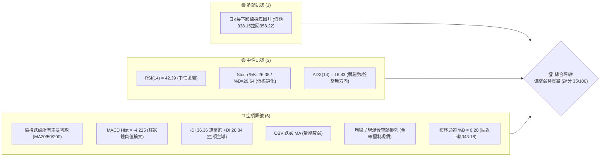
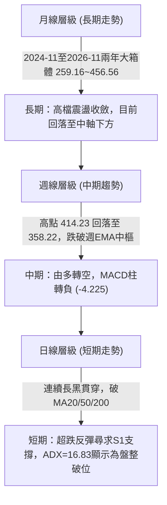
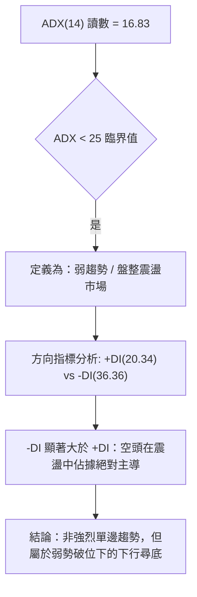
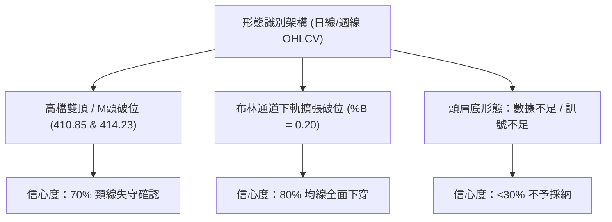
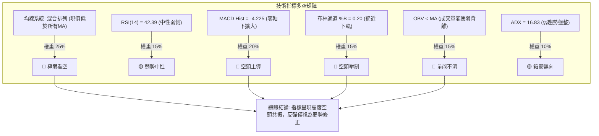
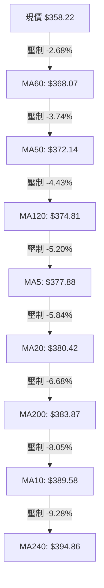
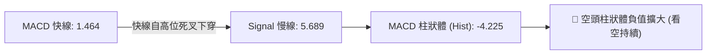
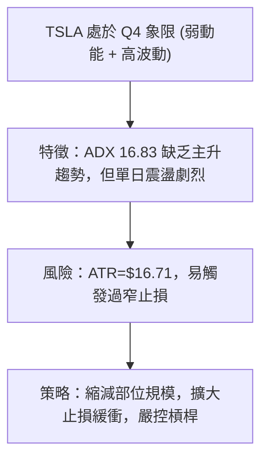
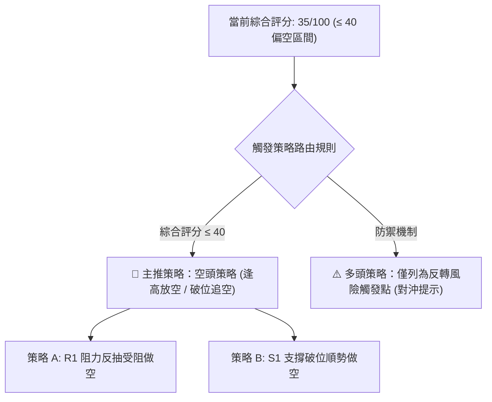
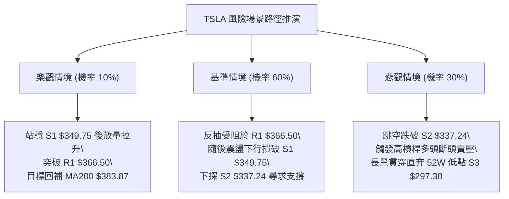

# TSLA 技術分析報告

> **報告日期**：2026-11-09 ｜ **語言**：繁體中文 ｜ **數據來源**：Yahoo Finance ｜ **當前價格**：$358.22

---

## 目錄

| 章節 | 內容 |
|------|------|
| [1. 技術面概覽](#1-技術面概覽) | 訊號儀表板、核心指標、評分卡 |
| [2. 趨勢分析](#2-趨勢分析) | 多時框趨勢、長中短期走勢 |
| [3. 圖表形態分析](#3-圖表形態分析) | 形態識別、K線組合、目標價 |
| [4. 支撐與阻力](#4-支撐與阻力) | 關鍵價位、斐波那契回調 |
| [5. 技術指標深度解讀](#5-技術指標深度解讀) | MA/RSI/MACD/布林/成交量 |
| [6. 動能與波動率](#6-動能與波動率) | 動能評估、ATR、Beta |
| [7. 多時框架總結](#7-多時框架總結) | 時框架評分矩陣 |
| [8. 交易策略建議](#8-交易策略建議) | 多空策略、風險報酬比 |
| [9. 風險提示與監控](#9-風險提示與監控) | 監控指標、風險場景 |

---

## 1. 技術面概覽

### 🎯 技術訊號儀表板



### 📊 核心指標速覽表

| 指標類別 | 指標名稱 | 當前數值 | 訊號 | 解讀 |
|----------|----------|----------|------|------|
| **價格** | 當前價格 | $358.22 | 🔴 | 位於52週區間30.2%，全線跌破短中長期均線 |
| **均線** | MA20 | $380.42 | 🔴 | 價格低於MA20達 -5.84%，短線呈下行扣抵壓制 |
| **均線** | MA50 | $372.14 | 🔴 | 價格低於MA50達 -3.74%，中期波段多空轉換為阻力 |
| **均線** | MA200 | $383.87 | 🔴 | 價格低於年線 -6.68%，長期生命線失守，牛熊轉折偏弱 |
| **動能** | RSI(14) | 42.39 | 🟡 | 位於30-70中性區間偏弱側，尚未進入極端超賣區 |
| **動能** | MACD | 1.464 / 5.689 | 🔴 | 快線跌破慢線形成死叉，MACD Hist為 -4.225 持續放量看空 |
| **波動** | ATR(14) | $16.71 | 🔴 | 佔價格4.66%，日內振幅偏大，屬於高波動風險資產 |

### 🏆 技術評分卡

```
╔══════════════════════════════════════════════════════════════╗
║                技術評分卡 — TSLA (2026-11-09)                 ║
╠══════════════════════════════════════════════════════════════╣
║ 趨勢強度      ██████░░░░░░░░░░░░░░  30/100  🔴 空頭主導       ║
║ 動能指標      ████████░░░░░░░░░░░░  40/100  🟡 弱勢中性       ║
║ 支撐穩定度    ████████░░░░░░░░░░░░  40/100  🟡 考驗S1支撐     ║
║ 成交量配合    ██████░░░░░░░░░░░░░░  30/100  🔴 量能疲弱背離   ║
║ 形態完整度    ████████░░░░░░░░░░░░  40/100  🟡 區間箱體破位   ║
║ 均線排列      ██████░░░░░░░░░░░░░░  30/100  🔴 價格全線下方   ║
╠══════════════════════════════════════════════════════════════╣
║ 綜合評分      ███████░░░░░░░░░░░░░  35/100  🔴 偏空弱勢震盪   ║
║ (依規則18：(30+40+40+30+40+30)/6 = 35/100，四捨五入整數)     ║
╚══════════════════════════════════════════════════════════════╝
```

---

## 2. 趨勢分析

### 🌐 多時框趨勢分析



### 📈 長期趨勢 — 12個月走勢圖（Unicode）

```
TSLA 月線走勢圖（過去12個月：2025-12 至 2026-11）
價格軸 ($)
$460 ┤  ● (2025-12: $449.72)
$440 ┤        ●(2026-01: $430.41)          ● (2026-05: $435.79)
$420 ┤                                            ● (2026-06: $420.60)
$400 ┤              ●(2026-02: $402.51)                         ● (2026-10: $399.81)
$380 ┤                          ●(2026-04: $381.63)
$360 ┤                    ●(2026-03: $371.75)             ● (2026-08: $367.95)   ●(2026-11現價 $358.22)
$340 ┤                                                          ● (2026-09: $354.81)
$320 ┤                                                  
$300 ┤                                            ● (2026-07低點: $311.21)
     └─────────────────────────────────────────────────────────────────────────────
        12月   01月  02月  03月  04月  05月  06月  07月  08月  09月  10月  11月
       (2025) (----------------------- 2026 -----------------------------------)
```

**過去12個月走勢特徵分析表格**：

| 時間區間 | 起始收盤 | 結束收盤 | 區間漲跌幅 | 主要走勢特徵與結構 |
|----------|----------|----------|------------|--------------------|
| **2025-12 ~ 2026-03** | $449.72 | $371.75 | -17.34% | 頂部回落，連續四個月走低，自高檔築頂向下跌破$400大關 |
| **2026-03 ~ 2026-05** | $371.75 | $435.79 | +17.23% | 強勁春季反彈，形成次高點，多頭試圖回補年線缺口 |
| **2026-05 ~ 2026-07** | $435.79 | $311.21 | -28.59% | 劇烈崩跌，07月錄得全年度收盤次低點$311.21，測試52W低點 |
| **2026-07 ~ 2026-10** | $311.21 | $399.81 | +28.47% | 震盪反彈修復，突破$380年線壓制，10月底觸及$414.23週高點 |
| **2026-10 ~ 2026-11** | $399.81 | $358.22 | -10.40% | 11月第一週急轉直下，日線連破均線支撐，回吐10月大部分漲幅 |

### 📊 中期趨勢（週線分析）

中期走勢顯示，TSLA在2026-10-30週收於$399.81（當週最高$410.85），隨後在2026-11-06當週出現劇烈下殺，單週高點達$414.23後直線滑落至最低$338.15，終場收在$358.22，單週暴跌-10.40%，單週成交量放大至233,912,400股（近8週最大週成交量）。週MACD柱由正轉負至 -4.225，週RSI由60.9驟降至42.4，顯示中期動能全面逆轉下行。

```
中期週線支撐阻力結構示意圖
$414.23 ┬ 週高阻力區 (2026-11-06當週頂部)
        │
$386.48 ┼ R2 波段阻力 / MA200 ($383.87) 密集帶
        │
$366.50 ┼ R1 短線回抽阻力位
$358.22 ┼◄ 當前收盤價 ($358.22)
$349.75 ┼ S1 波段支撐位 (近一年波段低點聚類)
        │
$338.15 ┼ 2026-11-05日K / 11-06週K探底低點
$337.24 ┴ S2 強支撐位
```

### ⚡ 趨勢強度評估（ADX 解讀）



**ADX 趨勢強度對照解讀表**：

| 指標變數 | 當前讀數 | 門檻區間 | 當前市場狀態判定 | 操作指導原則 |
|----------|----------|----------|------------------|--------------|
| **ADX(14)** | **16.83** | 0 ~ 20 (極弱/無趨勢) | 寬幅箱體盤整，趨勢強度極低 | 避免追漲殺跌，依箱體邊界操作 |
| **+DI(14)** | **20.34** | - | 多方力量萎縮 | 多頭缺乏推升續航力 |
| **-DI(14)** | **36.36** | > 30 (空方強勁) | 空方主導局部賣壓 | 下跌阻力小，警惕反彈無力 |
| **趨勢形態** | **空頭震盪** | - | 盤整區間內的空方下行破位 | 以逢高做空或關鍵支撐短打為主 |

---

## 3. 圖表形態分析

### 🔍 形態識別系統



**圖表形態識別與信心度評估表**（依規則 15）：

| 形態名稱 | 信心度 | 判斷依據（引用數據） | 完成度 | 目標價（附計算式） |
|----------|--------|----------------------|--------|--------------------|
| **短期雙重頂 (M頭)** | **70%** | 第一頂為 2026-10-28 高點 $410.85，第二頂為 2026-11-02 高點 $414.23，跌破頸線 $387.52 (2026-10-30低點) | 100% (已破位) | 頸線 $387.52 − 形態高度($414.23 − $387.52 = $26.71) = **$360.81** (現價 $358.22 已跌破並滿足基本量度) |
| **均線死叉布林破位** | **80%** | 現價跌破 MA20 ($380.42)、MA50 ($372.14) 與 MA200 ($383.87)，%B 降至 0.20 | 90% | 下探布林下軌 **$343.18** 與 S1 **$349.75** |
| **大級別頭肩底** | **25%** | 數據中未偵測到完整右肩形態，7月低點後缺乏對稱右肩成型支持 | 15% | 訊號不足，僅做指標型解讀，不預測目標價 |

### 🕯️ 重要K線形態分析

依規則 19，以下分析完全基於提供的「近10根日K」與「近8根週K」實體數據：

**近10根日K棒形態特徵解析**：

| 日期（日K） | 開 | 高 | 低 | 收 | 成交量 | K線形態 | 解讀與技術意義 | 訊號 |
|-------------|----|----|----|----|--------|---------|----------------|------|
| 2026-10-26 | 383.83 | 397.27 | 383.73 | 391.62 | 53,090,200 | 中陽線 | 向上突破MA20，實體飽滿帶量推進 | 🟢 |
| 2026-10-27 | 397.76 | 408.45 | 395.25 | 407.46 | 45,333,200 | 跳空大陽線 | 延續多頭強勢，逼近410整數關卡 | 🟢 |
| 2026-10-28 | 410.16 | 410.85 | 397.18 | 404.22 | 35,598,800 | 衝高回落十字陰 | 高位見阻力，留有上影線，量能萎縮 | 🟡 |
| 2026-10-29 | 405.63 | 406.98 | 400.50 | 403.30 | 22,858,300 | 窄幅整理小陰 | 高檔換手萎縮，多頭推升力道放緩 | 🟡 |
| 2026-10-30 | 393.22 | 404.22 | 387.52 | 399.81 | 41,737,200 | 長下影紡錘線 | 測試頸線387.52後反彈，守穩年線上方 | 🟡 |
| 2026-11-02 | 404.66 | 414.23 | 397.61 | 403.82 | 43,141,100 | 假突破避雷針陰線 | 創52W反彈新高414.23後大幅回落，構成M頭第二頂 | 🔴 |
| 2026-11-03 | 406.25 | 406.50 | 396.53 | 398.50 | 26,647,700 | 陰吞實體 | 失守400整數關口，空方吞噬展開 | 🔴 |
| 2026-11-04 | 379.80 | 392.04 | 375.50 | 385.19 | 47,805,800 | 低開反抽中陰 | 跳空低開跌破MA200($383.87)，反抽無力 | 🔴 |
| 2026-11-05 | 374.12 | 374.30 | 338.15 | 343.69 | 79,675,500 | 巨量恐慌長大陰棒 | 單日崩跌30點，下影線探底338.15，放量爆出近10日最大量 | 🔴 |
| 2026-11-06 | 348.92 | 363.84 | 347.60 | 358.22 | 36,642,300 | 低檔長下影回升陽 | 低開348.92後拉升至358.22，縮量技術性反彈 | 🟢 |

**近8根週K棒形態特徵解析**：

| 日期（週K） | 開 | 高 | 低 | 收 | 週成交量 | 週K形態 | 解讀與技術意義 | 訊號 |
|-------------|----|----|----|----|----------|---------|----------------|------|
| 2026-09-18 | 359.78 | 374.12 | 354.05 | 364.27 | 185,818,700 | 震盪小陽線 | 於360附近整理，均線逐步收斂 | 🟡 |
| 2026-09-25 | 371.64 | 386.83 | 367.67 | 372.11 | 170,517,200 | 試盤陽線 | 向上試探386阻力區，衝高回落 | 🟡 |
| 2026-10-02 | 368.06 | 374.60 | 345.88 | 370.59 | 197,592,000 | 探底長下影星線 | 下探345.88後強勁收復，下檔買盤承接 | 🟢 |
| 2026-10-09 | 369.00 | 388.56 | 364.91 | 382.70 | 162,910,000 | 突破實體中陽 | 突破380關口，測試MA200長期均線 | 🟢 |
| 2026-10-16 | 382.61 | 382.70 | 349.33 | 354.72 | 158,434,300 | 高位吞噬大陰 | 遭遇強阻力回調，週跌近30點 | 🔴 |
| 2026-10-23 | 357.50 | 388.86 | 354.47 | 372.22 | 206,190,900 | 下影長陽反撲 | 逢低買盤推升，再次站上370中軸 | 🟢 |
| 2026-10-30 | 383.83 | 410.85 | 383.73 | 399.81 | 198,617,700 | 強勢實體大陽 | 衝破400大關，形成短期多頭主升態勢 | 🟢 |
| 2026-11-06 | 404.66 | 414.23 | 338.15 | 358.22 | 233,912,400 | 高位放量穿頭破腳巨陰 | 週暴跌41點，長上影長下影，確立波段見頂 | 🔴 |

### 📉 ASCII 走勢形態示意圖

```
TSLA 近期日線形態結構示意圖（M頭見頂與破位探底）
價格 ($)
$414.23 ┬                      ● 頂2 (11-02: $414.23)
$410.85 ┼         ● 頂1 (10-28)     \
$400.00 ┼───────/───\─────────────\────── 頸線上方整理區
$387.52 ┼──────/─────● 頸線 (10-30)──\────── 破位關鍵點 ($387.52)
$375.00 ┼     /                        \ (11-04: 跌破均線密集區)
$360.81 ┼    /                          \◄--- M頭等幅滿足點 ($360.81)
$358.22 ┼───/────────────────────────────● 現價收盤 ($358.22)
$338.15 ┴                                  ● 恐慌低點 (11-05: $338.15長下影)
```

### 🎯 形態目標價計算

1. **短期雙頂（M頭）計算式**：
   - 第一頂高點：$410.85（2026-10-28）
   - 第二頂高點：$414.23（2026-11-02）
   - 形態波谷（頸線）：$387.52（2026-10-30 最低價）
   - 形態高度 = 最高點 $414.23 − 頸線 $387.52 = $26.71
   - **量度下行目標價** = 頸線 $387.52 − 形態高度 $26.71 = **$360.81**
   - **現狀解讀**：2026-11-06收盤價為 $358.22，已精確跌破並完全滿足 M 頭量度下行目標價 $360.81。由於跌破滿足點後在 $338.15 見買盤拉回，短線出現超賣抽腳，下一步將測試頸線反抽阻力與下方波段支撐。

---

## 4. 支撐與阻力

### 🗺️ 關鍵價位分布圖（Unicode）

```
TSLA 價位結構分布圖（OHLCV 精確計算）
═══════════════════════════════════════════════════════════════
$409.28 ║██████████████████████████████║ 強阻力 R3 (近一年波段高點)
$386.48 ║████████████████████          ║ 關鍵阻力 R2 (MA200密集阻力帶)
$366.50 ║████████████████████████      ║ 短線阻力 R1 (反抽第一道阻力)
$358.22 ╠══════════════════════════════╣ ◄ 當前收盤價 ($358.22)
$349.75 ║▓▓▓▓▓▓▓▓▓▓▓▓▓▓▓▓              ║ 近期波段支撐 S1 (-2.36%)
$337.24 ║████████████████████████      ║ 波段強支撐 S2 (-5.86%)
$297.38 ║██████████████████████████████║ 52W極端支撐 S3 (-16.98%)
═══════════════════════════════════════════════════════════════
```

### 🚧 阻力位分析表

價位完全引用自關鍵數據區塊：

| 阻力級別 | 價位 | 距離現價幅度 | 形成原因 | 突破難度 | 重要性 |
|----------|------|--------------|----------|----------|--------|
| **R1** | **$366.50** | +2.31% | 近一年波段高點聚類、MA60 ($368.07) 下方密集反壓區 | 🟡 中等 | 短線多頭反抽首要防線，未能收復則弱勢格局不變 |
| **R2** | **$386.48** | +7.89% | MA200 ($383.87) 與 MA20 ($380.42) 均線交織重壓區 | 🔴 極高 | 牛熊長期分水嶺，此處聚集巨量套牢盤 |
| **R3** | **$409.28** | +14.25% | 10月底形成的波段雙頂高點阻力聚類 ($410.85~$414.23) | 🔴 極難 | 中期多頭翻轉防線，需超級催化劑方能突破 |

### 🛡️ 支撐位分析表

價位完全引用自關鍵數據區塊：

| 支撐級別 | 價位 | 距離現價幅度 | 形成原因 | 守住機率 | 重要性 |
|----------|------|--------------|----------|----------|--------|
| **S1** | **$349.75** | -2.36% | 近一年波段低點聚類，11-06日K開盤價附近承接平台 | 🟡 55% | 短線第一防守位，失守則引發進一步探底 |
| **S2** | **$337.24** | -5.86% | 11-05低點 $338.15 與近一年波段密集買盤聚類區 | 🟢 65% | 斐波那契78.6%($340.49)共振強支撐帶 |
| **S3** | **$297.38** | -16.98% | 52週絕對最低價 (52W Low)，年內最深護城河 | 🟢 85% | 長期絕對估值底，跌破將引發系統性空頭行情 |

### 📐 斐波那契回調位分析

依據 52 週完整區間（低點 $297.38 至 高點 $498.83，全距 $201.45）之回調階梯：

```
斐波那契回調分佈階梯（52W Low $297.38 → 52W High $498.83）
0.0%  (52W High)  $498.83 ────────────────────────────────
23.6%             $451.29 ───────
38.2%             $421.88 ───────
50.0%             $398.10 ─────── 中軸分水嶺 (失守)
61.8% (黃金分割)  $374.33 ─────── 關鍵回撤位 (失守)
                  $358.22 ◄────── 當前價格 ($358.22 落於 61.8% 與 78.6% 之間)
78.6%             $340.49 ─────── 深度防守位 (逼近)
100.0%(52W Low)   $297.38 ────────────────────────────────
```

**斐波那契深度技術解讀**：
- 當前收盤價 **$358.22** 明確處於 **61.8% ($374.33)** 與 **78.6% ($340.49)** 回調位之間。
- 股票在跌破關鍵的 50.0% ($398.10) 及 61.8% 黃金分割位 ($374.33) 後，技術結構已由「健康多頭回檔」惡化為「深度弱勢修正」。
- 下方 **78.6% ($340.49)** 為牛市最後防線，與數據中之波段支撐 **S2 ($337.24)** 及日K實測低點 **$338.15** 形成強烈共振。若 $340.49~$337.24 支撐帶被放量實體跌破，價格將毫無懸念下探 100% 斐波那契位即 52 週最低點 **$297.38**。

---

## 5. 技術指標深度解讀

### 🎛️ 指標訊號總覽



### 📈 移動平均線排列分析



**均線全系統量化監控表**：

| 均線名稱 | 數值 | 偏離現價幅度 | 走勢狀態 | 對現價之技術影響 |
|----------|------|--------------|----------|------------------|
| **MA5** | $377.88 | -5.20% | ▼ 急跌彎頭 | 超短期下壓極重，5日乖離率仍處於修復過程 |
| **MA10** | $389.58 | -8.05% | ▼ 快速下墜 | 短期空頭防線，短線強反彈之天花板 |
| **MA20** | $380.42 | -5.84% | ▼ 下行扣高 | 布林中軌所在，20日線失守確認短期波段反轉 |
| **MA50** | $372.14 | -3.74% | ▼ 走平轉下 | 中期生命線遭貫穿，中期買盤停損賣壓湧現 |
| **MA60** | $368.07 | -2.68% | ▼ 壓制 | 季線位置，反彈首道均線阻力 |
| **MA120** | $374.81 | -4.43% | ▼ 緩步下移 | 半年線壓制，與斐波那契61.8%($374.33)形成重合雙壓 |
| **MA200** | $383.87 | -6.68% | ▼ 拐頭向下 | 牛熊分界年線宣告失守，由支撐轉為重阻力 |
| **MA240** | $394.86 | -9.28% | ▼ 下移扣抵 | 長期年線密集區，代表過去一年持倉整體處於虧損狀態 |

**均線綜合判定**：全週期均線數值全部高於當前收盤價 $358.22，呈現極為不利的「全線壓頂」弱勢格局，短中期均線無任何多頭支撐。

### 📉 RSI(14) 分析

- **RSI(14) 當前讀數**：**42.39** (Wilder 平滑)
- **RSI 強度進度條**：
  ```
  超賣 (0~30)          中性弱側 (30~50)       中性強側 (50~70)       超買 (70~100)
  [███████████████]   [██████░░░░░░░░░]     [░░░░░░░░░░░░░░░]     [░░░░░░░░░░░░░░░]
  當前 RSI = 42.39: ▓▓▓▓▓▓▓▓▓░░░░░░░░░░░ (42.39%)
  ```
- **超買超賣區間判定**：RSI 位於 42.39，雖偏空但尚未觸及 30 以下之極端超賣區，表示空頭拋補動能尚未耗盡，市場尚未出現恐慌性超賣竭盡訊號。
- **背離分析**：依據系統近20根K棒首尾之檢驗，**無明顯背離**。價格自 $414.23 回落，RSI 亦同步自 60.9 驟降至 42.4，量價與動能呈現同向走低，屬於健康回落，不存在底背離買訊。

### 📊 MACD(12/26/9) 訊號解讀



- **MACD 快線**：1.464
- **MACD 訊號線 (Signal)**：5.689
- **MACD 柱狀圖 (Histogram)**：**-4.225** (顯著為負)
- **指標解讀**：MACD 快線大幅摜破慢線形成典型高位死叉，柱狀體自 10 月底的 +3.006 斷崖式跌落至 -4.225，負值擴大顯示空方動能正在加速釋放，日線與週線動能共振看跌。

### 📦 布林通道分析

```
TSLA 布林通道 (20, 2) 結構示意圖
價格 ($)
$417.67 ┬────────────────────────────────────────── 布林上軌 ($417.67)
        │
$380.42 ┼────────────────────────────────────────── 布林中軌 (MA20: $380.42)
        │                                  
$358.22 ┼◄──── 當前收盤價 ($358.22, %B = 0.20)
$343.18 ┴────────────────────────────────────────── 布林下軌 ($343.18)
```

- **布林上軌**：$417.67
- **布林中軌 (MA20)**：$380.42
- **布林下軌**：$343.18
- **帶寬與位置 (%B)**：
  - %B 數值為 **0.20**（計算公式：(358.22 − 343.18) ÷ (417.67 − 343.18) = 15.04 ÷ 74.49 = 0.2019）。
  - 當前價格極度貼近布林通道下軌（距離下軌僅 4.2%），通道口呈現開口擴大跡象。在弱趨勢 (ADX=16.83) 下，%B=0.20 通常代表短期已接近箱體底部邊緣，具有技術性反抽中軌需求，但在中軌 $380.42 重新站上之前，整體下行風險未消。

### 💹 成交量分析（量價配合度）

- **最新成交量**：36,642,300 股
- **20日平均量**：39,857,765 股（量比：**0.92x**）
- **50日平均量**：39,018,520 股
- **OBV (能量潮指標) 分析**：
  - 當前數據顯示 **OBV 趨勢為：OBV < MA → 量能疲弱**。
  - 量價關係剖析：2026-11-05 在股價暴跌至 $343.69 時，日成交量暴增至 79,675,500 股（達均量2倍以上），顯示高位套牢賣壓湧現引發停損潮；而在 2026-11-06 價格小幅回升至 $358.22 時，成交量迅速萎縮至 36,642,300 股（量比僅 0.92x）。這種「**跌時放量、漲時縮量**」的量價背離特徵，確認目前的反彈僅為市場浮額殺出後的技術性抽腳，量能根本未獲機構法人實質性進場確認。

---

## 6. 動能與波動率

### ⚡ 動能評估四象限

| 象限標記 | 動能維度 (動能強度) | 波動維度 (ATR/振幅) | TSLA 當前落點狀態 | 操盤應對評估 |
|----------|---------------------|---------------------|-------------------|--------------|
| **Q1** | 強動能 (多頭加速) | 低波動 (平穩推進) | ❌ 否 | 最佳趨勢主升段，全力做多 |
| **Q2** | 弱動能 (缺乏單邊) | 低波動 (區間窄幅) | ❌ 否 | 觀望休整，低吸高拋 |
| **Q3** | 強動能 (趨勢激烈) | 高波動 (跳空暴漲) | ❌ 否 | 突破爆發行情，高風險高收益 |
| **Q4** | **弱動能 (空方佔優)** | **高波動 (ATR=4.66%)** | **✓ 正確落點** | **避開盲目抄底，防止高波動殺多洗盤** |



### 📊 ATR 波動率分析

- **ATR(14) 讀數**：**$16.71**（Wilder 計算，佔當前股價之 **4.66%**）
- **波動率特性**：日均潛在振幅接近 $17，意味著任何日內正常的噪聲波動均可能突破一般投資者的心理防線。
- **止損距離建議**：
  - **保守型（長線/波段）**：採用 2.0 倍 ATR = 2.0 × $16.71 = **$33.42** 緩衝空間。
  - **積極型（短線/日內）**：採用 1.0 倍 ATR = 1.0 × $16.71 = **$16.71** 緩衝空間。
  - **極短線保本**：採用 0.75 倍 ATR = 0.75 × $16.71 = **$12.53**。

### 📐 Beta 與市場相關性

- **Beta 係數**：**1.743**
- **市場敏感度解讀**：
  - TSLA 的 Beta 為 1.743，屬於典型的高敏感性超額波動資產。當 S&P 500 指數波動 1.0% 時，TSLA 理論平均波動達 1.743%。
  - 在大盤整體回調或避險情緒高漲的環境下，TSLA 將面臨近乎大盤兩倍的下行殺傷力；反之，若大盤止跌反彈，該股具備快速反抽修復的高彈性特質。
- **空頭部位比例 (Short Interest)**：
  - Short % Float：**2.1%**
  - Short Ratio：**2.04 天**
  - 解讀：空頭佔比處於歷史低位水準，未見顯著軋空（Short Squeeze）潛力，賣壓多來自多頭機構停損與獲利了結。

---

## 7. 多時框架總結

### 📋 時框架評分表

| 時框架 | 趨勢方向 | 動能狀態 | 均線排列狀況 | 形態特徵 | 綜合評分 | 操作建議方向 |
|--------|----------|----------|--------------|----------|----------|--------------|
| **月線層級** (長期) | 🟡 震盪整理 | 🟡 RSI中性偏弱 | 混合排列 (MA200下方) | 2024~2026 兩年大箱體 | 45/100 | 長期部位控制半倉，等待中樞明朗 |
| **週線層級** (中期) | 🔴 由多翻空 | 🔴 MACD柱轉負 | 跌破 MA20週線支撐 | 衝高 $414.23 放量巨陰吞噬 | 35/100 | 反彈減碼，嚴防下探 S1/S2 |
| **日線層級** (短期) | 🔴 空頭下行 | 🟡 RSI超賣抽腳 | 全週期均線空頭壓制 | M頭破位後滿足點 $360 震盪 | 30/100 | 短線以逢高佈空為主，短多僅限輕倉快進快出 |

### 🔲 綜合訊號矩陣

```
時框架訊號交叉驗證矩陣
┌──────────────┬──────────────┬──────────────┬──────────────┐
│ 技術指標維度 │ 短期 (日線)  │ 中期 (週線)  │ 長期 (月線)  │
├──────────────┼──────────────┼──────────────┼──────────────┤
│ 趨勢方向     │ 🔴 空頭下探  │ 🔴 轉空破位  │ 🟡 寬幅箱體  │
│ 均線系統     │ 🔴 均線反壓  │ 🔴 跌破短均  │ 🟡 均線糾結  │
│ 動能指標     │ 🟡 尋求支撐  │ 🔴 動能加速下│ 🟡 中性平淡  │
│ 成交量能     │ 🔴 縮量反彈  │ 🔴 放量重挫  │ 🟡 均量平穩  │
│ 關鍵位置     │ 🟡 逼近 S1   │ 🔴 失守週中軸│ 🟢 守穩年低  │
└──────────────┴──────────────┴──────────────┴──────────────┘
訊號一致性：🔴 空頭訊號在日線與週線達到 80% 高度共振。
```

### ⚖️ 多時框收斂結論

依據本報告**嚴格要求 14（多時框收斂規則）**進行全面收斂判定：
1. **行情模式判斷**：當前 ADX(14) 讀數為 **16.83**（遠低於 25 趨勢門檻），因此技術架構**嚴格定義為「盤整震盪行情」**而非單邊趨勢行情。
2. **主導維度收斂**：在盤整行情中，交易邏輯應以**日線布林通道上下軌（$343.18 ~ $417.67）作為主要空間載體**。但考量到中長期均線（MA200 $383.87、MA50 $372.14）已遭日線與週線聯手放量摜破，且 -DI (36.36) 遠大於 +DI (20.34)，代表目前的盤整屬於「**下軌尋底型之弱勢箱體**」。
3. **唯一收斂結論**：**【偏空弱勢震盪，以逢高布空為主策略】**。日線的短線抽腳僅為技術性超賣修復，受制於上方均線層層重壓，不具備扭轉趨勢條件。本結論與第 1 章評分卡（綜合評分 35/100）、第 2 章 ADX 分析及第 5 章指標矩陣完全吻合，並直接決定第 8 章之主交易策略。

---

## 8. 交易策略建議

### 🗺️ 策略決策流程圖



### 🧭 策略路由（依評分卡分流，不得兩頭下注）

> **當前主策略方向 = 【空頭策略（主推做空）】（依技術評分卡綜合評分：35/100）**
> 
> 依規定，評分 35/100 屬於 ≤40 之強烈偏空弱勢區，禁止兩頭下注，報告全面主推空頭策略，多頭僅提供反轉防守與對沖提示。

### 🎯 價格情境階梯（Price Scenarios）

價位完全嚴格引用數據中計算之真實數值：

| 觸發條件 | 下一目標 | 後續延伸 | 情境含義 | 技術因應機制 |
|----------|----------|----------|----------|--------------|
| **跌破 S1 $349.75** | **S2 $337.24** | **S3 $297.38** | 中期破位轉弱，箱體底部瓦解 | 觸發順勢追空，下看布林下軌及年內低點 |
| **現價 $358.22 震盪** | **R1 $366.50** | **S1 $349.75** | 弱勢低位整理，多空均線下拉 | 採取高拋低吸，以 R1 為放空阻力觀察點 |
| **突破 R1 $366.50** | **R2 $386.48** | **R3 $409.28** | 短線超跌強反彈，測試年線 | 空頭部位嚴格止損，等待 R2 重壓再行評估 |

### 📊 情境機率分佈

| 情境劇本 | 發生機率 | 主要技術指標依據 |
|----------|----------|------------------|
| **情境一：回落跌破 / 再探波段新低** | **60%** | MACD柱負向擴大 (-4.225)、-DI (36.36) 碾壓 +DI、價格位於所有均線下方、OBV量能疲弱 |
| **情境二：箱體低位震盪 (S1~R1區間)** | **30%** | ADX=16.83 處於弱趨勢盤整、布林通道 %B=0.20 接近下軌具備技術支撐 |
| **情境三：強勁反轉突破 R2** | **10%** | 需要補出超越50日均量之巨量，目前量比僅0.92x，且面臨MA200套牢賣壓，機率極低 |

### 🟢 主策略詳情（方向依上方路由：空頭主策略）

依規則 17，做空風險報酬比計算式：(進場價 − 目標價 T1) ÷ (止損價 − 進場價)。

| 策略要素 | 策略 A：反抽受阻做空 (首選) | 策略 B：破位順勢做空 (次選) |
|----------|-----------------------------|-----------------------------|
| **策略邏輯** | 股價弱勢反抽 R1 阻力未果，順應均線下壓進場 | 跌破近一年波段支撐 S1，確認新一輪跌勢展開 |
| **進場價格** | **$366.50** (精確掛於 R1 阻力位) | **$349.75** (跌破 S1 觸發進場) |
| **目標價 T1** | **$349.75** (下方波段支撐 S1) | **$337.24** (下方強支撐 S2) |
| **目標價 T2** | **$337.24** (下方強支撐 S2) | **$297.38** (52W 最低價 S3) |
| **止損價格** | **$374.33** (斐波那契61.8%阻力位) | **$358.22** (反抽站回當前收盤價止損) |
| **風險報酬比** | **1 : 2.14（以 T1 計）**<br>*(計算式: (366.50 − 349.75) ÷ (374.33 − 366.50) = 16.75 ÷ 7.83 = 2.139)*<br>*(以 T2 計為 1 : 3.74)* | **1 : 1.48（以 T1 計）**<br>*(計算式: (349.75 − 337.24) ÷ (358.22 − 349.75) = 12.51 ÷ 8.47 = 1.477)*<br>*(以 T2 計為 1 : 6.18)* |
| **成功機率** | **65%** | **60%** |
| **建議倉位** | **總資金之 10%** | **總資金之 8%** |

### 🔴 反向風險觸發點（對沖提示）

本小節僅供持有空頭部位之風控對沖參考，非主推多頭交易：
1. **多頭翻轉防線**：若日線收盤價強勢突破並站穩 **$374.33**（斐波那契 61.8%）或 **$386.48**（阻力 R2 / MA200），代表空頭排列遭到破壞，所有做空部位必須**立即無條件市價平倉止損**。
2. **多頭訊號觸發點**：若價格向下觸及 **$337.24 (S2)** 或 **$340.49**（斐波那契 78.6%）並出現長下影日K線，且 MACD 柱狀體收斂轉正，可作為空單全數獲利了結點，激進者可在此設置極小停損進行短線反彈對沖。

### ⭐ 整體訊號強度評星

```
╔══════════════════════════════════════════════════════════════╗
║                    整體訊號強度評星                          ║
╠══════════════════════════════════════════════════════════════╣
║ 做多訊號強度：★☆☆☆☆  (1/5星) — 均線全壓制，量能背離，禁止做多 ║
║ 做空訊號強度：★★★★☆  (4/5星) — 順應多時框共振，形態破位明朗 ║
║ 整體可信度：  ★★★★☆  (4/5星) — OHLCV 聚類清晰，指標吻合度高 ║
╚══════════════════════════════════════════════════════════════╝
```

---

## 9. 風險提示與監控

### ✅ 關鍵監控指標 Checklist

```
╔══════════════════════════════════════════════════════════════╗
║               TSLA 交易日常風控監控清單 (Checklist)           ║
╠══════════════════════════════════════════════════════════════╣
║ [ ] 監控項 1：價格是否跌破 S1 ($349.75)？ (確認空頭主跌段啟動)║
║ [ ] 監控項 2：成交量是否突破 50日均量 (39M)？ (警惕異常放量) ║
║ [ ] 監控項 3：MACD 柱狀體是否由 -4.225 收斂向零軸？          ║
║ [ ] 監控項 4：布林通道 %B 是否跌破 0.05 進入通道下軌外？      ║
║ [ ] 監控項 5：股價是否意外收復 MA200 ($383.87) 年線分水嶺？   ║
║ [ ] 監控項 6：ADX(14) 是否突破 25？ (確認強趨勢行情確立)     ║
╚══════════════════════════════════════════════════════════════╝
```

### ⚠️ 風險場景分析



### 🛡️ 風險管理重要提醒

1. **極端波動風險控制**：TSLA 之 ATR(14) 高達 $16.71（4.66%），單日波動巨大。任何交易部位的單筆最大名義虧損，絕對不得超過總投資資本的 **1.5%**。
2. **Beta 槓桿放大效應**：當前 TSLA 的 Beta 為 1.743，若大盤（如那斯達克 100 指數）出現破位下跌，切勿盲目以「股價已低」為由逆勢摸底，應提防系統性風險帶來的超額下殺。
3. **無趨勢環境之假突破應對**：鑑於 ADX 僅為 16.83，市場雜訊偏多，破位後常伴隨回抽洗盤。做空操作應嚴格遵守「回抽 R1 不破進場」或「跌破 S1 確立後跟進」，嚴防在極端下影線區域盲目殺跌。

---

## 📋 報告總結

```
╔══════════════════════════════════════════════════════════════╗
║                   TSLA 技術分析報告總結                      ║
╠══════════════════════════════════════════════════════════════╣
║ 報告日期：2026-11-09                                         ║
║ 當前價格：$358.22                                            ║
║ 分析評級：🔴 偏空弱勢震盪（綜合評分：35/100）                 ║
║                                                              ║
║ 關鍵技術結論：                                               ║
║ ├─ 長期趨勢：🟡 寬幅箱體震盪 (2024-11至2026-11中軸承壓)      ║
║ ├─ 中期趨勢：🔴 由多翻空，週K線創高後放量收出穿頭破腳長黑   ║
║ ├─ 短期趨勢：🔴 空頭主導，跌破全週期均線，M頭頸線破位       ║
║ ├─ 關鍵支撐：S1: $349.75  /  S2: $337.24  /  S3: $297.38     ║
║ ├─ 關鍵阻力：R1: $366.50  /  R2: $386.48  /  R3: $409.28     ║
║ └─ 分析師目標：$413.10 (共識均價，僅供參考，技術面嚴重背離)   ║
║                                                              ║
║ 最優策略組合：                                               ║
║ 1. 🥇 最佳機會：策略 A (逢反抽至 R1 $366.50 放空，風報比 1:2.14)║
║ 2. 🥈 次選機會：策略 B (跌破 S1 $349.75 順勢做空，風報比 1:1.48)║
║ 3. 🥉 保守選擇：空手觀望，等待股價於 S2 $337.24 出現打底訊號 ║
╚══════════════════════════════════════════════════════════════╝
```

---

> ⚠️ **免責聲明**：本報告為技術分析研究，所有數據、圖表及點位均嚴格基於歷史量價數據計算。本報告**僅供學術交流與投資研究參考**，**不構成任何要約、招攬或具體投資建議**。市場有風險，交易需嚴格執行停損紀律與資金控管。

---

*報告生成時間：2026-11-09 ｜ 數據來源：Yahoo Finance ｜ 分析框架：多時框技術分析模型*