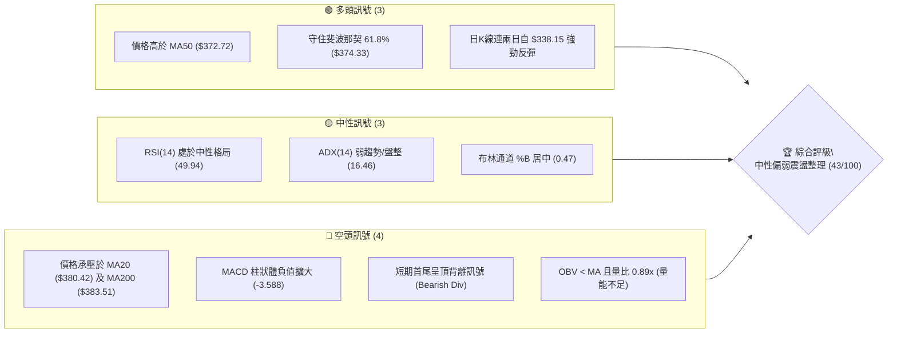
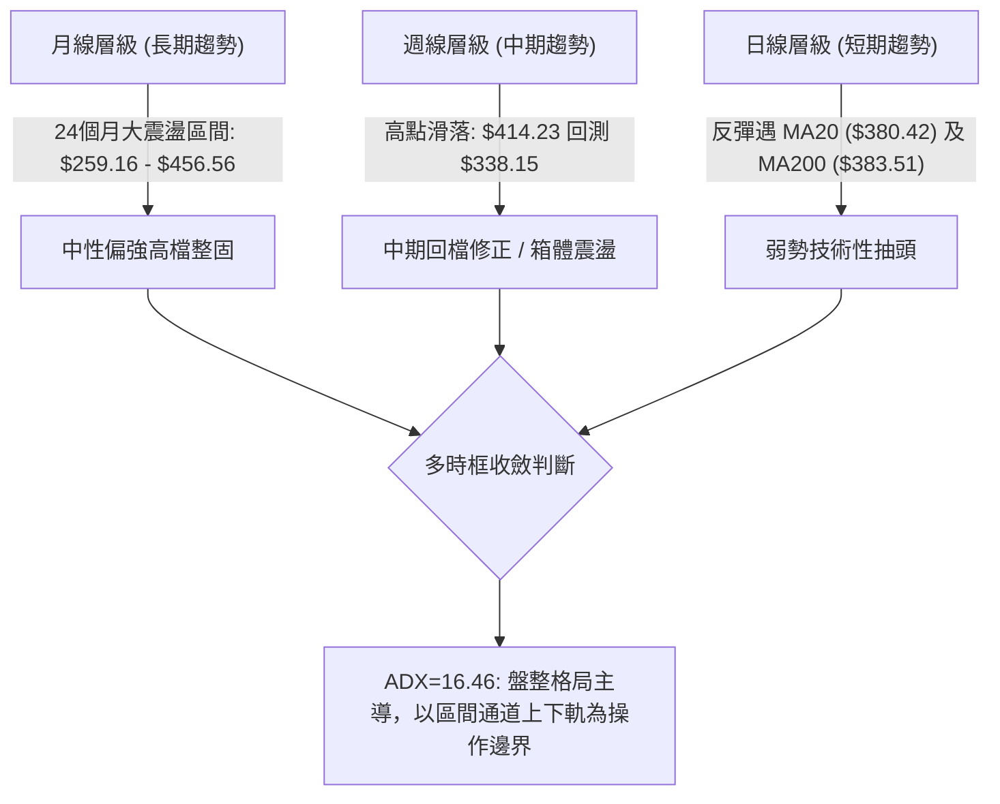
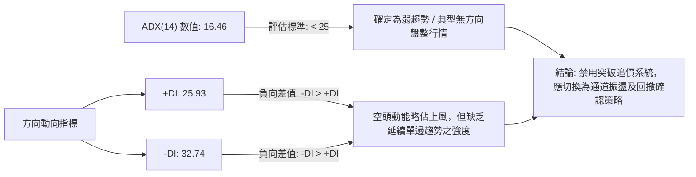
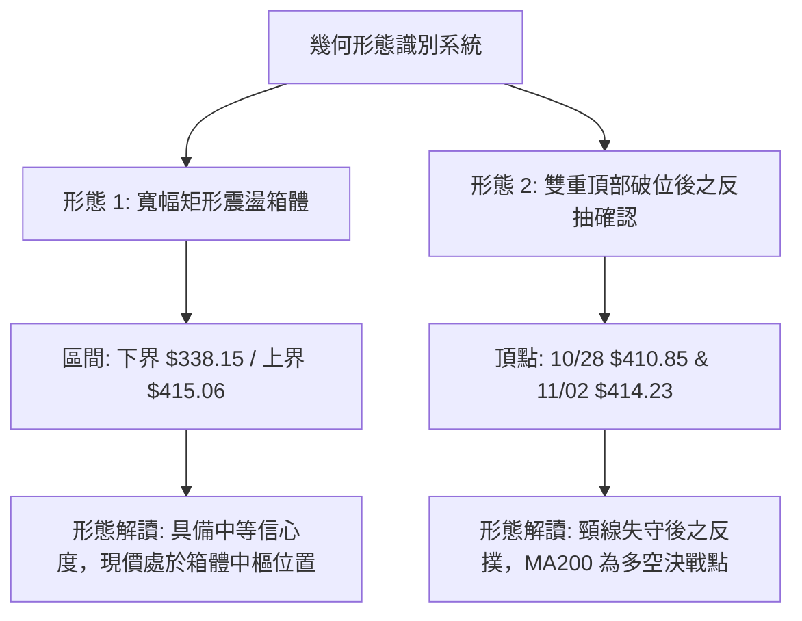
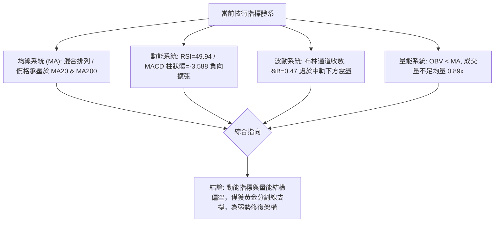
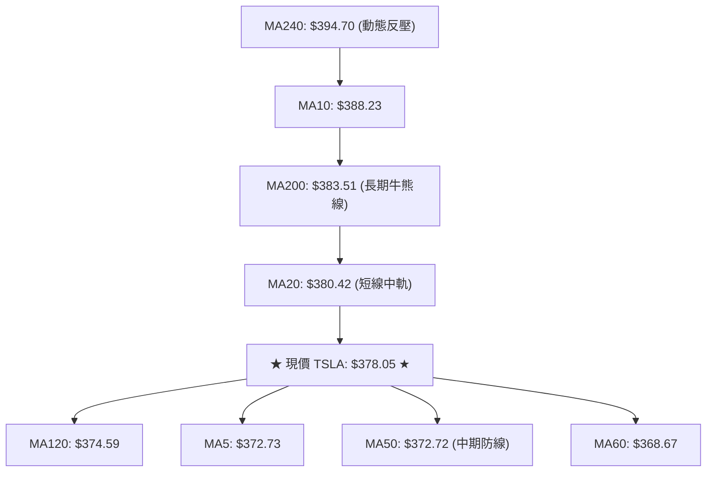
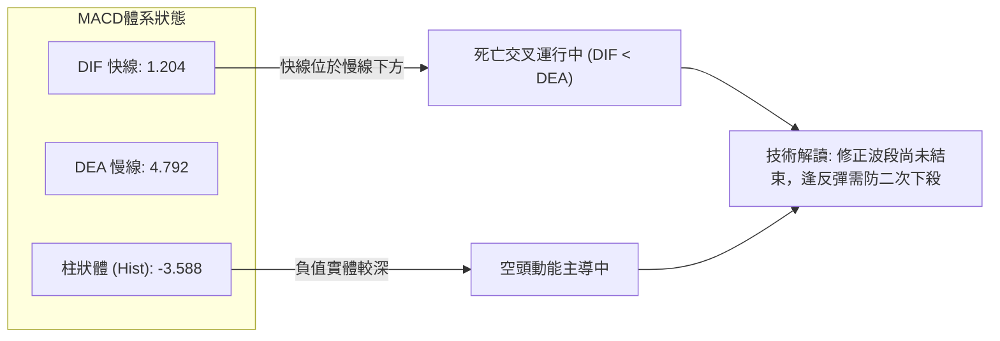
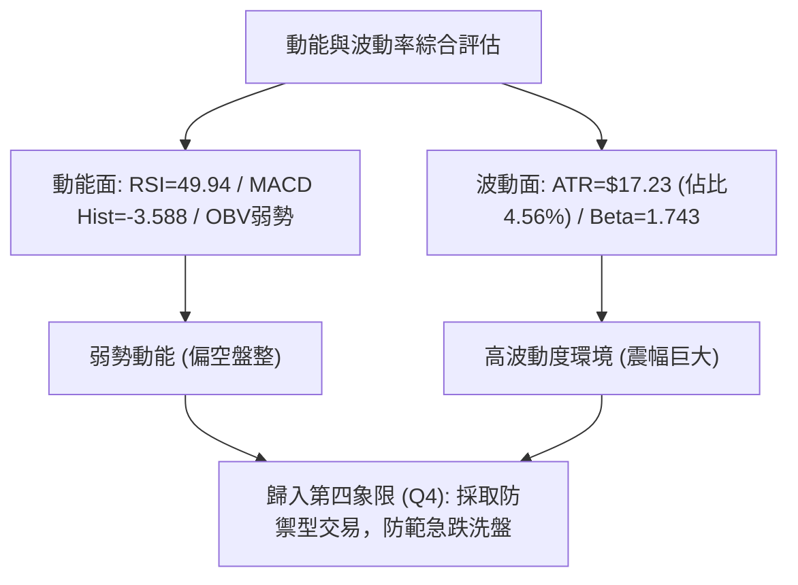
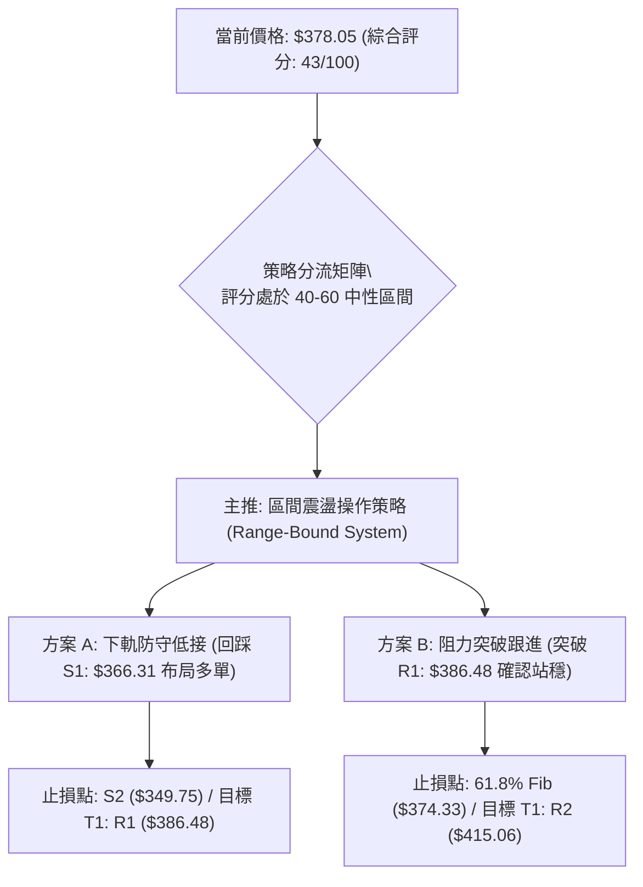
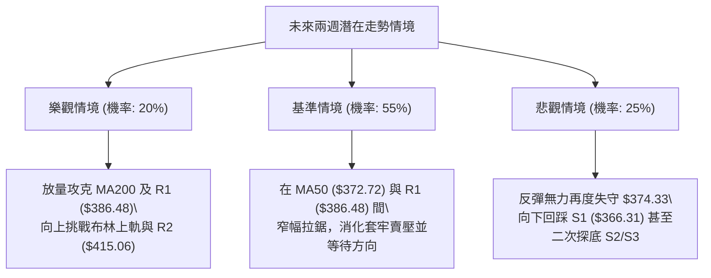

# TSLA 技術分析報告

> **報告日期**：2026-11-10 ｜ **語言**：繁體中文 ｜ **數據來源**：Yahoo Finance ｜ **當前價格**：$378.05

---

## 目錄

| 章節 | 內容 |
|------|------|
| [1. 技術面概覽](#1-技術面概覽) | 訊號儀表板、核心指標、評分卡 |
| [2. 趨勢分析](#2-趨勢分析) | 多時框趨勢、長中短期走勢 |
| [3. 圖表形態分析](#3-圖表形態分析) | 形態識別、K線組合、目標價 |
| [4. 支撐與阻力](#4-支撐與阻力) | 關鍵價位、斐波那契回調 |
| [5. 技術指標深度解讀](#5-技術指標深度解讀) | MA/RSI/MACD/布林/成交量 |
| [6. 動能與波動率](#6-動能與波動率) | 動能評估、ATR、Beta |
| [7. 多時框架總結](#7-多時框架總結) | 時框架評分矩陣 |
| [8. 交易策略建議](#8-交易策略建議) | 多空策略、風險報酬比 |
| [9. 風險提示與監控](#9-風險提示與監控) | 監控指標、風險場景 |

---

## 1. 技術面概覽

### 🎯 技術訊號儀表板



---

### 📊 核心指標速覽表

| 指標類別 | 指標名稱 | 當前數值 | 訊號 | 解讀 |
|:---|:---|:---|:---:|:---|
| **價格** | 當前價格 | $378.05 | 🟡 | 位於52週區間40.0%分位，處於波段回洗後的弱反彈階段 |
| **均線** | MA20 | $380.42 | 🔴 | 價格在MA20下方（-0.62%），短線面臨中軌動態反壓 |
| **均線** | MA50 | $372.72 | 🟢 | 價格在MA50上方（+1.43%），中期趨勢支撐尚未失守 |
| **均線** | MA200 | $383.51 | 🔴 | 價格在MA200下方（-1.42%），長期牛熊分界線構成上檔實質重壓 |
| **動能** | RSI(14) | 49.94 | 🟡 | 處於多空平衡分水嶺50下方，近20根K棒首尾呈現頂背離隱憂 |
| **動能** | MACD(12,26,9) | Hist: -3.588 | 🔴 | 快線 1.204 低於慢線 4.792，死亡交叉後柱狀體維持負值擴張 |
| **動能** | KD(9,3,3) | %K: 52.44 / %D: 28.70 | 🟢 | %K自超賣區向上穿越%D金叉，短線低檔具備反彈動能 |
| **趨勢** | ADX(14) | 16.46 | 🟡 | ADX < 25 表明處於無單邊方向之盤整行情；-DI(32.74) > +DI(25.93) 空頭佔優 |
| **通道** | 布林通道 | 中軌: $380.42 | 🟡 | %B 為 0.47，自下軌 $343.18 反彈逼近中軌，面臨軌道收縮壓制 |
| **波動** | ATR(14) | $17.23 | 🔴 | 佔股價 4.56%，處於高波動特質，日內價格震幅巨大 |
| **成交量**| 量比 / OBV | 0.89x / OBV<MA | 🔴 | 最新量 3,626.6 萬股低於 20 日均量，價漲量縮呈現量價疲弱 |

---

### 🏆 技術評分卡

```
╔══════════════════════════════════════════════════════════════╗
║                技術評分卡 — TSLA (2026-11-10)                 ║
╠══════════════════════════════════════════════════════════════╣
║ 趨勢強度 (ADX=16.46, -DI主導)   ███████░░░░░░░░░░░░░  35/100 🔴 ║
║ 動能指標 (MACD翻空, RSI頂背離)   ████████░░░░░░░░░░░░  40/100 🔴 ║
║ 支撐穩定度 (61.8%斐波, S1承接)   ███████████░░░░░░░░░  55/100 🟡 ║
║ 成交量配合 (OBV疲弱, 縮量反彈)   ████████░░░░░░░░░░░░  40/100 🔴 ║
║ 形態完整度 (寬幅箱體區間築底)   █████████░░░░░░░░░░░  45/100 🟡 ║
║ 均線排列 (混合排列, 承壓雙重均線) ████████░░░░░░░░░░░░  43/100 🟡 ║
╠══════════════════════════════════════════════════════════════╣
║ 綜合評分 (六項算術平均)          ████████░░░░░░░░░░░░  43/100 🟡 ║
║ 評級結論：中性偏空區間盤整 (Neutral Range-Bound)             ║
╚══════════════════════════════════════════════════════════════╝
```

---

## 2. 趨勢分析

### 🌐 多時框趨勢分析



---

### 📈 長期趨勢 — 12個月走勢圖（Unicode）

依據月度收盤價序列繪製過去 12 個月（2025-12 至 2026-11）的價格軌跡：

```
TSLA 月線走勢圖（過去12個月收盤價變動）
價格軸 ($)
$460 ┤                
$440 ┤●(12月:449.72)               ●(05月:435.79)
$420 ┤      ●(01月:430.41)               ●(06月:420.60)
$400 ┤            ●(02月:402.51)                       ●(10月:399.81)
$380 ┤                               ●(04月:381.63)
$360 ┤                  ●(03月:371.75)             ●(08月:367.95)
$340 ┤                                         ●(09月:354.81)
$320 ┤                                                    
$300 ┤                                   ●(07月低點:311.21)
     └─────────────────────────────────────────────────────────────►
       12   01   02   03   04   05   06   07   08   09   10   11(現價$378.05)
      '25  '26  '26  '26  '26  '26  '26  '26  '26  '26  '26  '26
```

#### 走勢特徵分析表格

| 階段區間 | 起止月份 | 價格變動 ($) | 漲跌幅 (%) | 核心走勢特徵解讀 |
|:---|:---:|:---:|:---:|:---|
| **高位築頂回調** | 2025-12 → 2026-03 | $449.72 → $371.75 | -17.34% | 獲利了結賣壓湧現，自 2025 年高點逐級下移 |
| **春季反彈浪** | 2026-03 → 2026-05 | $371.75 → $435.79 | +17.23% | 多頭二度上攻挑戰前高無功而返，形成複合頂部 |
| **夏季深度修正** | 2026-05 → 2026-07 | $435.79 → $311.21 | -28.59% | 遭遇急速空頭宣洩，最低逼近 52 週低點區 ($297.38) |
| **波段修復回升** | 2026-07 → 2026-10 | $311.21 → $399.81 | +28.47% | 震盪反彈觸及 $400 整數關卡，但量能未能持續有效放大 |
| **當前最新震盪** | 2026-10 → 2026-11 | $399.81 → $378.05 | -5.44% | 衝高 $414.23 後回踩 $338.15，現價收於 $378.05 |

---

### 📊 中期趨勢（週線分析）

```
TSLA 週線關鍵架構示意圖（近期波段）
  $415.06 ────┬─────────────────── [週線阻力位 R2]
              │     ╭──╮ (2026-11-06 週高 $414.23)
  $386.48 ────┼─────╯  ╰─────╮   [近期阻力位 R1]
  $378.05 ────┼──────────────●─── [當前價格 / 均線糾結處]
  $366.31 ────┼──────────╭──╯    [波段支撐位 S1]
              │          │  
  $338.15 ────┴──────────┴─────── [2026-11-06 週低下影線尖端]
```

中期週線在 2026-10-30 來到收盤 $399.81 後，上週（2026-11-06 週）出現了極度激烈的震盪，單週高點達 $414.23，低點重挫至 $338.15，最終收於 $358.22，留下了長達 $20.07 的下影線與爆量（2.34 億股）洗盤痕跡。本週（2026-11-09）股價反彈至 $378.05，中期趨勢呈現「寬幅箱體內部的劇烈洗盤」特徵，多空雙方在 $340 - $415 之間形成僵持。

---

### ⚡ 趨勢強度評估（ADX 解讀）



#### ADX 指標強度對照分析

| 指標名稱 | 實際數值 | 門檻區間 | 趨勢狀態評判 | 交易意義 |
|:---|:---:|:---:|:---:|:---|
| **ADX (14)** | 16.46 | 0 ~ 20 (極弱/盤整) | 🟢 確立盤整 | 趨勢跟隨模型（Trend Following）失效，假突破機率極高 |
| **+DI (14)** | 25.93 | 多方動向 | 🟡 中性動能 | 買盤力道僅由超跌技術性買盤支撐，無結構性推動 |
| **-DI (14)** | 32.74 | 空方動向 | 🔴 空方主導 | 賣方在 $380 以上擁有主控權，反彈易引發拋售 |

---

## 3. 圖表形態分析

### 🔍 形態識別系統



#### 形態識別信心度評估表（依規則 15）

| 形態名稱 | 信心度 | 判斷依據（嚴格引用數據） | 完成度 | 目標價（附嚴謹計算式） |
|:---|:---:|:---|:---:|:---|
| **寬幅箱體震盪** | 75% | 價格在 2026-11-05 探底 $338.15 後獲得強勁支撐（貼近 S3 $337.24），並受阻於波段高點聚類 R2 $415.06（11-02 高點達 $414.23）。 | 70% | **下軌目標**：$349.75 (S2)<br>**上軌目標**：$415.06 (R2)<br>*計算式*：箱體邊界由 S2 與 R2 定位。 |
| **短期雙頂壓制** | 60% | 10-28 高點 $410.85 與 11-02 高點 $414.23 形成近距雙峰，頸線位於 10-30 低點 $387.52。11-04 帶量下破頸線。 | 85% | **向下量度目標**：$360.81<br>*計算式*：頸線 $387.52 − (形態高點 $414.23 − 頸線 $387.52) = $387.52 − $26.71 = $360.81。（11-06 最低跌至 $338.15 已超額滿足） |
| **頭肩底結構** | 25% | 數據中左肩與頭部結構模糊，成交量未呈現典型右肩縮量上揚特徵。 | 20% | *訊號不足，僅做指標型解讀，不進行目標價推算。* |

---

### 🕯️ 重要K線形態分析

依據提供的近 10 根日 K 與近 8 根週 K 之實際開高低收數據進行嚴格型態解構：

#### 近 10 根日 K 線形態解讀表

| 日期 | 開 | 高 | 低 | 收 | 成交量 | K線形態 | 技術解讀與多空隱義 | 訊號 |
|:---:|:---:|:---:|:---:|:---:|:---:|:---:|:---|:---:|
| 10-27 | 397.76 | 408.45 | 395.25 | 407.46 | 45,333,200 | 中陽線 | 向上推進挑戰 $408，實體飽滿，多頭維持強勢 | 🟢 |
| 10-28 | 410.16 | 410.85 | 397.18 | 404.22 | 35,598,800 | 衝高回落小陰線 | 開高走低，上影線觸及 $410.85，遭遇第一道波段解套阻力 | 🔴 |
| 10-29 | 405.63 | 406.98 | 400.50 | 403.30 | 22,858,300 | 窄幅縮量紡錘線 | 成交量急凍至 2,285 萬股，市場觀望氣氛極度濃厚 | 🟡 |
| 10-30 | 393.22 | 404.22 | 387.52 | 399.81 | 41,737,200 | 下影小陽線 | 開低後下探 $387.52 有守，多頭拉回 $400 整數關卡下方 | 🟡 |
| 11-02 | 404.66 | 414.23 | 397.61 | 403.82 | 43,141,100 | 長上影倒狀錘頭 | 衝刺波段最高 $414.23 遭遇龐大壓盤，收盤回落至開盤附近 | 🔴 |
| 11-03 | 406.25 | 406.50 | 396.53 | 398.50 | 26,647,700 | 跌破小陰線 | 高點無力過前高，收盤失守 $400，動能開始轉弱 | 🔴 |
| 11-04 | 379.80 | 392.04 | 375.50 | 385.19 | 47,805,800 | 跳空放量大陰線 | 跳空低開，盤中彈至 $392.04 隨即被摜壓，帶量破位 | 🔴 |
| 11-05 | 374.12 | 374.30 | 338.15 | 343.69 | 79,675,500 | 恐慌長黑破位線 | 成交量激增至近 8,000 萬股，長黑重挫至 $338.15 宣洩恐慌盤 | 🔴 |
| 11-06 | 348.92 | 363.84 | 347.60 | 358.22 | 36,730,400 | 低檔回升中陽線 | 縮量築底反彈，未再破新低，空頭下殺動能暫竭 | 🟢 |
| 11-09 | 360.25 | 382.20 | 360.02 | 378.05 | 36,266,000 | 實體大陽線 | 連續第二日反彈，收盤來到 $378.05，挑戰 MA20/MA200 密集成交區 | 🟢 |

#### 近 8 根週 K 線特徵分析

| 日期 | 開 | 高 | 低 | 收 | 週成交量 | K線形態 | 技術解讀 | 訊號 |
|:---:|:---:|:---:|:---:|:---:|:---:|:---:|:---|:---:|
| 09-25 | 371.64 | 386.83 | 367.67 | 372.11 | 170,517,200 | 陀螺線 | 均線區間拉鋸，多空相持 | 🟡 |
| 10-02 | 368.06 | 374.60 | 345.88 | 370.59 | 197,592,000 | 下影長錘頭 | 探底 $345.88 獲買盤強拉收紅 | 🟢 |
| 10-09 | 369.00 | 388.56 | 364.91 | 382.70 | 162,910,000 | 中陽線 | 穩步推升突破 $380 阻力 | 🟢 |
| 10-16 | 382.61 | 382.70 | 349.33 | 354.72 | 158,434,300 | 光頭中陰線 | 遭遇獲利了結賣壓回吐上週漲幅 | 🔴 |
| 10-23 | 357.50 | 388.86 | 354.47 | 372.22 | 206,190,900 | 下影陽線 | 再次下探獲得承接，重心微升 | 🟢 |
| 10-30 | 383.83 | 410.85 | 383.73 | 399.81 | 198,617,700 | 突破長陽線 | 強勢挑戰 $410，收盤逼近 $400 大關 | 🟢 |
| 11-06 | 404.66 | 414.23 | 338.15 | 358.22 | 234,000,500 | 極長下影大陰線 | 歷史級巨大波幅，放巨量測試 $338.15 支撐 | 🔴 |
| 11-09 | 360.25 | 382.20 | 360.02 | 378.05 | 36,266,000 | 週初反彈陽棒 | 延續上週下影線反彈力道，回測上方均線 | 🟡 |

---

### 📉 ASCII 走勢形態示意圖

```
TSLA 近 10 日走勢與局部雙頂/反彈示意圖
$415 ┤         ●(11-02: $414.23 高點)
$410 ┤    ●(10-28: $410.85)
$405 ┤    │   │      │
$400 ┤────┼───┼──────┼───────────────────── [重要心理整數關卡]
$395 ┤    │   │      │
$390 ┤    │   ╰──●──╯ (頸線區域: 10-30 低點 $387.52)
$385 ┤    │          │          
$380 ┤────┼──────────┼──────────────●────── [現價 $378.05 逼近 MA20/MA200]
$375 ┤    │          │             │
$370 ┤    │          │             │
$365 ┤    │          │        ●────╯ (11-06: $358.22)
$360 ┤    │          │        │
$355 ┤    │          │        │
$350 ┤    │          │        │
$345 ┤    │          │        │
$340 ┤    │          ╰────────● (11-05: 跌至 $338.15 恐慌低點)
     └────┴───┴──────┴────────┴──────┴─────► 日期進程
```

---

### 🎯 形態目標價計算

1. **短期反彈目標價推算**：
   - 形態基礎：由 2026-11-05 低點 $338.15 至 2026-11-09 高點 $382.20 之 V 型反抽。
   - 上行首要阻力測幅：直接對應波段高點聚類 **R1: $386.48**。
   - 若能有效帶量突破 R1，則延伸目標為前波密集阻力帶 **R2: $415.06**。
2. **下行破位量度推算**：
   - 形態基礎：若股價於 MA20 ($380.42) / MA200 ($383.51) 處反彈遇阻再回落。
   - 下方防守首要測試：近期波段低點聚類 **S1: $366.31**。
   - 跌破 S1 之後的延伸弱勢目標：前波低點聚類 **S2: $349.75** 及恐慌針尖 **S3: $337.24**。

---

## 4. 支撐與阻力

### 🗺️ 關鍵價位分布圖（Unicode）

```
TSLA 價位結構分布圖（嚴格依據 OHLCV 計算聚類與斐波那契點位）
═════════════════════════════════════════════════════════════════════
$498.83 ║████████████████████████████████████████║ 52週高點 (0.0% Fib)
$451.29 ║██████████████████████████              ║ 23.6% 斐波那契回調位
$434.60 ║████████████████████████████████        ║ 強阻力 R3 (波段高點聚類)
$421.88 ║████████████████████                    ║ 38.2% 斐波那契回調位
$415.06 ║██████████████████████████████████      ║ 重點阻力 R2 (近期高點 $414.23 聚類)
$398.10 ║████████████████████                    ║ 50.0% 斐波那契分水嶺
$386.48 ║██████████████████████████████████████  ║ 近端關鍵阻力 R1 (上檔密集套牢區)
$383.51 ║────────────────────────────────────────║ MA200 牛熊動態阻力線
$380.42 ║────────────────────────────────────────║ MA20 動態中軌阻力線
$378.05 ╠════════════════════════════════════════╣ ◄ 當前價格 (收盤價)
$374.33 ║▓▓▓▓▓▓▓▓▓▓▓▓▓▓▓▓▓▓▓▓▓▓▓▓▓▓▓▓▓▓▓▓▓▓▓▓▓▓  ║ 61.8% 斐波那契黃金分割支撐
$366.31 ║▓▓▓▓▓▓▓▓▓▓▓▓▓▓▓▓▓▓▓▓                    ║ 近期關鍵支撐 S1 (波段低點聚類)
$349.75 ║▓▓▓▓▓▓▓▓▓▓▓▓▓▓▓▓▓▓▓▓▓▓▓▓▓▓▓▓▓▓          ║ 強支撐 S2 (波段密集防守帶)
$340.49 ║▓▓▓▓▓▓▓▓▓▓▓▓▓▓▓▓                        ║ 78.6% 斐波那契回調位
$337.24 ║▓▓▓▓▓▓▓▓▓▓▓▓▓▓▓▓▓▓▓▓▓▓▓▓▓▓▓▓▓▓▓▓▓▓▓▓    ║ 極限波段強支撐 S3 (上週插針低點聚類)
$297.38 ║████████████████████████████████████████║ 52週低點 (100.0% Fib)
═════════════════════════════════════════════════════════════════════
```

---

### 🚧 阻力位分析表

依據提供的波段高點聚類計算，嚴禁捏造數據：

| 阻力級別 | 價位 ($) | 距現價幅離 | 形成原因與籌碼特徵 | 突破難度 | 重要性 |
|:---|:---:|:---:|:---|:---:|:---:|
| **關鍵阻力 R1** | $386.48 | +2.23% | 歷史成交密集重疊區，與 MA200 ($383.51)、MA20 ($380.42) 形成共振反壓帶。 | 🟡 中等 | ★★★★☆ |
| **強阻力 R2** | $415.06 | +9.79% | 2026-11-02 留下的波段天花板高點 ($414.23) 聚類，亦為布林通道上軌 ($417.67) 警戒區。 | 🔴 極高 | ★★★★★ |
| **波段高阻 R3** | $434.60 | +14.96% | 2026 年 5 月高點形成的次級結構頭部壓力區，解套賣壓龐大。 | 🔴 極高 | ★★★☆☆ |

---

### 🛡️ 支撐位分析表

依據提供的波段低點聚類計算：

| 支撐級別 | 價位 ($) | 距現價幅離 | 形成原因與籌碼特徵 | 守住機率 | 重要性 |
|:---|:---:|:---:|:---|:---:|:---:|
| **近期支撐 S1** | $366.31 | -3.11% | 近期多次回踩確認的密集成交底線，且緊貼 MA60 ($368.67) 均線支撐。 | 🟢 65% | ★★★★☆ |
| **關鍵強支撐 S2** | $349.75 | -7.48% | 10月中旬及11月初恐慌殺跌過程中的多頭承接中繼站，籌碼具較高黏性。 | 🟢 75% | ★★★★★ |
| **波段底線 S3** | $337.24 | -10.79% | 2026-11-05 盤中砸出的恐慌極值低點 ($338.15) 聚類，為多頭最後堡壘。 | 🟢 85% | ★★★★★ |

---

### 📐 斐波那契回調位分析

基準區間取自 52 週最高價 **$498.83** 下跌至 52 週最低價 **$297.38**：

| 回調比率 | 價位 ($) | 當前價格相對位置與技術意義解讀 |
|:---:|:---:|:---|
| **0.0% (52W High)** | $498.83 | 過去 52 週絕對高點，中期多頭大牛市目標。 |
| **23.6%** | $451.29 | 強勢多頭防守位，當前處於其下方深處。 |
| **38.2%** | $421.88 | 中度阻力區，若能站上象徵整體跌勢被逆轉。 |
| **50.0%** | $398.10 | 多空心理平衡線，緊貼 $400 整數心理關卡。 |
| **61.8%** | $374.33 | **◄ 現價 ($378.05) 位於此關鍵黃金分割點上方 +0.99%**。此處為典型「黃金分割支撐」，若能有效守住，多頭具備展開反彈的技術依託；一旦實體下破，回調幅度將擴大。 |
| **78.6%** | $340.49 | 深度回調防守位，2026-11-05 最低跌至 $338.15 恰於此處完成針尖築底。 |
| **100.0% (52W Low)**| $297.38 | 過去 52 週絕對低點，中期空頭終極殺跌目標。 |

---

## 5. 技術指標深度解讀

### 🎛️ 指標訊號總覽



---

### 📈 移動平均線排列分析



#### 移動平均線數據對比表

| 均線名稱 | 數值 ($) | 偏離率 (%) | 排列狀態與趨勢解讀 | 多空判定 |
|:---|:---:|:---:|:---|:---:|
| **MA 5** | $372.73 | +1.43% | 連兩日反彈帶動短天期均線拐頭向上，提供極短線支撐 | 🟢 看多 |
| **MA 10** | $388.23 | -2.62% | 快速下行壓制，與 R1 ($386.48) 形成重疊壓力區 | 🔴 看空 |
| **MA 20** | $380.42 | -0.62% | 股價位於月線下方，短線尚未脫離空頭壓制路徑 | 🔴 看空 |
| **MA 50** | $372.72 | +1.43% | 股價成功站上季線，季線維持平緩向上，中期多頭防線尚存 | 🟢 看多 |
| **MA 60** | $368.67 | +2.55% | 走勢向上，為下檔回踩提供動態緩衝 | 🟢 看多 |
| **MA 120**| $374.59 | +0.92% | 半年線微幅走揚，與 61.8% 斐波那契點 ($374.33) 形成密集群聚支撐 | 🟢 看多 |
| **MA 200**| $383.51 | -1.42% | **年線（長期牛熊分界線）扣高壓制，價格在其下方震盪，定性為偏弱** | 🔴 看空 |
| **MA 240**| $394.70 | -4.22% | 長天期均線下彎，顯示過去一年套牢籌碼沉重 | 🔴 看空 |

*均線排列總結*：短天期與中長天期交織，呈現典型的「**混合排列**」。價格被夾在下方支撐密集帶（MA5/MA50/MA120: $372.72 - $374.59）與上方重壓區（MA20/MA200: $380.42 - $383.51）之間，震盪空間高度壓縮。

---

### 📉 RSI(14) 分析

- **RSI(14) 當前數值**：**49.94**（Wilder 計算法）
- **RSI 強度進度條**：
  ```
  超賣 (0) ─────── (30) ──────── (50) ──────── (70) ─────── 超買 (100)
  [████████████████████████░░░░░░░░░░░░░░░░░░░░░░░░] 49.94% (中性平衡區)
  ```
- **超買超賣與背離判斷**：
  1. 數值 49.94 緊貼 50 多空中軸，技術上屬於多空動能完全拉平的平衡狀態。
  2. **背離分析**：技術數據明確提示 **⚠️ 頂背離 (Bearish Divergence)**。在近 20 根 K 棒的首尾比對中，股價自前期高點推升至 11-02 的 $414.23 高位時，RSI 峰值未能同步創出波段新高，動能提前衰竭，隨後引發了 11-04 至 11-05 的放量崩跌。當前 RSI 剛自 40 附近的弱勢區修復至 49.94，尚未形成底背離架構，顯示當前上漲僅為超跌後的均值回歸，非反轉推動浪。

---

### 📊 MACD(12,26,9) 訊號解讀



- **DIF 線**：1.204
- **DEA 線 (Signal)**：4.792
- **MACD 柱狀體 (Histogram)**：**-3.588**
- **解讀**：DIF 遠落後於 DEA，且兩者差距形成高達 -3.588 的負柱狀體。雖然價格連續兩天反彈，但 MACD 負柱狀體收縮幅度有限，表明整體中期動能依然由空方控盤，短期缺乏足夠的多頭量能發起持續性單邊攻擊。

---

### 📦 布林通道分析

```
TSLA 布林通道 (Bollinger Bands, 20, 2) 結構圖
$417.67 ┤═══════════════════════════════════════════════ 上軌 (Upper Band)
$410.00 ┤        ╭──╮ (11-02 觸及上軌附近承壓回落)
$400.00 ┤        │  │
$380.42 ┤────────┼──┼───────────────●────────────────── 中軌 / MA20 (Middle Band)
$378.05 ┤        │  │               ▲(現價處於中軌下方，%B = 0.47)
$360.00 ┤        │  ╰──────╮        │
$350.00 ┤        │         ╰──╮ ╭──╯
$343.18 ┤════════╧════════════╧═╧══════════════════════ 下軌 (Lower Band)
```

- **布林上軌**：$417.67
- **布林中軌 (MA20)**：$380.42
- **布林下軌**：$343.18
- **通道指標 %B**：**0.47**
- **解讀**：%B 數值 0.47 表明當前價格剛好位於布林中下軌之間的中庸偏低位置。11-05 股價下探 $338.15 時曾短暫跌破布林下軌（當時下軌在 $343 附近），引發了標準的「跌破下軌極端乖離回抽」。當前反彈已逼近中軌 $380.42。若無法伴隨放量突破中軌，布林通道中軌將由過去的支撐轉變為強大的動態阻力牆。

---

### 💹 成交量分析（量價配合度）

1. **量能對比**：
   - 最新單日成交量：**36,266,000 股**
   - 20 日平均成交量：**40,663,255 股**
   - 50 日平均成交量：**39,086,158 股**
   - **量比**：**0.89x**（量能處於萎縮狀態）
2. **OBV 能量潮判研**：
   - 技術數據明確標註：**OBV 趨勢為 OBV < MA → 量能疲弱**。
   - 11-05 在下跌過程中爆出 **79,675,500 股** 的巨量，而隨後兩日反彈時的成交量分別僅為 3,673 萬股與 3,626 萬股。呈現典型的「**跌有量、彈無量**」量價背離現象，顯示機構主力在低檔承接後並未採取大舉推升策略，市場追高意願薄弱。

---

## 6. 動能與波動率

### ⚡ 動能評估四象限

| 象限 | 動能狀態 | 波動率狀態 | 當前市場歸屬 | 技術評估與操作導向 |
|:---:|:---:|:---:|:---:|:---|
| **第一象限 (Q1)** | 強動能 (Bullish) | 低波動 (Low Vol) | — | 最佳單邊做多行情，穩步走升 |
| **第二象限 (Q2)** | 弱動能 (Bearish/Neutral) | 低波動 (Low Vol) | — | 縮量築底沉悶期，適合觀望 |
| **第三象限 (Q3)** | 強動能 (Bullish) | 高波動 (High Vol) | — | 爆發性多頭突破，高風險高收益 |
| **第四象限 (Q4)** | **弱動能 (動能偏空)** | **高波動 (ATR=4.56%)** | **✓ TSLA 當前狀態** | **高風險震盪期：動能指標偏弱 (MACD死叉、RSI頂背離) 疊加高波動特質，極易引發雙向洗盤，操作必須收緊停損並嚴格控管部位。** |



---

### 📊 ATR 波動率分析

- **ATR(14)**：**$17.23**（佔股價比例高達 **4.56%**，Wilder 演算法）
- **日內震盪幅度解析**：
  - 過去 10 個交易日內，TSLA 單日震幅動輒超過 $20（例如 11-05 單日高低差達 $36.15，11-06 高低差達 $16.24，11-09 高低差達 $22.18）。
- **止損距離建議**：
  - **保守型波段交易**：建議止損距離設為 **1.5 × ATR = 1.5 × $17.23 = $25.85**。
  - **進取型短線交易**：建議止損距離設為 **1.0 × ATR = 1.0 × $17.23 = $17.23**。
  - 實務操作上，任何小於 $10.00 的過度緊湊停損在 TSLA 當前的波動環境中極易被日常隨機雜訊掃出場。

---

### 📐 Beta 與市場相關性

- **Beta 係數**：**1.743**
- **市場特徵分析**：
  - Beta 為 1.743 表明 TSLA 的波動彈性為大盤（S&P 500 / Nasdaq）的 **1.74 倍**。
  - 當大盤處於上漲趨勢時具備更強的進攻槓桿；然而在盤整或下行背景下，其下修風險亦同步放大。
  - 短期空頭總體環境下，高 Beta 特質將使股價對上方阻力位（如 R1: $386.48 與 R2: $415.06）的突破具備較大假突破風險。

---

## 7. 多時框架總結

### 📋 時框架評分表

| 時框架 | 趨勢方向 | 動能指標 | 均線排列 | 圖表形態 | 綜合評分 | 戰術建議 |
|:---|:---:|:---:|:---:|:---:|:---:|:---|
| **日線層級 (短期)** | 🟡 弱勢反彈 | 🔴 MACD柱狀負值 / RSI平淡 | 🔴 承壓 MA20 及 MA200 | 🟡 V型抽頭遭逢均線蓋頭 | 40/100 | 不宜追高，中軌反壓區獲利了結 |
| **週線層級 (中期)** | 🟡 寬幅箱體 | 🔴 週MACD翻負 (-3.588) | 🟡 均線糾結於 $370-$380 | 🟢 週線下影長針收盤回升 | 45/100 | 於 $340-$415 箱體內高拋低吸 |
| **月線層級 (長期)** | 🟢 震盪走多 | 🟡 中性平穩 | 🟢 股價遠高於 52 週低點 | 🟢 守住 61.8% 斐波那契位 | 55/100 | 長期牛市結構未破，但需時間整固 |

---

### 🔲 綜合訊號矩陣

| 評估維度 | 短期 (日線) | 中期 (週線) | 長期 (月線) | 訊號收斂一致性分析 |
|:---|:---:|:---:|:---:|:---|
| **趨勢方向** | 弱勢反彈 🟡 | 區間震盪 🟡 | 寬幅偏多 🟢 | 中長期未崩，短期受壓於下彎均線，呈現衝突後的降速盤整 |
| **量能狀態** | 縮量反彈 🔴 | 巨量下影 🟢 | 量能常態 🟡 | 週線下影放量具承接力，但日線反彈縮量顯示追價意願不足 |
| **支撐阻力** | 逼近 R1 🔴 | 夾於 S1-R2 🟡 | 遠在 S3 之上 🟢 | 上方短線阻力密集，需消化空頭套牢賣壓 |

---

### ⚖️ 多時框收斂結論（依規則 14）

1. **市場結構定性**：
   - 當前 **ADX(14) 數值為 16.46**，遠低於趨勢臨界線 25。
   - 依嚴格收斂規則，本行情**明確判定為「盤整行情（ADX < 25）」**，單邊趨勢跟隨模型失效，必須以「**日線布林通道（$343.18 - $417.67）與核心支撐阻力群作為主要震盪交易區間**」。
2. **多時框權重取捨**：
   - 雖然長期月線未失守 52 週低點區，但短期日線同時受制於 MA20 ($380.42) 與 MA200 ($383.51)，且 MACD 處於空頭發散狀態。
3. **最終唯一收斂方向**：
   - **中性偏空區間震盪（Neutral to Bearish Range-Bound）**。短線策略拒絕追高，核心操作應圍繞在震盪箱體內部，嚴守下軌買進、上軌高拋的震盪紀律。

---

## 8. 交易策略建議

### 🗺️ 策略決策流程圖



---

### 🧭 策略路由（依規則 18 綜合評分分流）

> **當前主策略方向 = 區間震盪操作策略（依綜合評分 43/100，落在 40–60 中性區間，以高拋低吸與通道邊界確認為核心）**

---

### 🎯 價格情境階梯（Price Scenarios）

價位嚴格引用技術數據計算之真實數值：

| 觸發條件 | 下一目標 | 後續延伸 | 情境技術含義 |
|:---|:---:|:---:|:---|
| **強勢向上突破 R1 ($386.48)** | R2: $415.06 | R3: $434.60 | 帶量突破 MA200 牛熊線與前波頸線，空頭排列逆轉，短線轉強進攻上軌 |
| **受阻於現價至 R1 區間** | S1: $366.31 | S2: $349.75 | 均線反壓有效，多頭追價動能熄火，價格回測通道下半部進行築底考驗 |
| **有效實體跌破 S1 ($366.31)** | S2: $349.75 | S3: $337.24 | 斐波那契 61.8% 失守，中期回檔浪深化，再次下探 11-05 恐慌低點針尖 |

---

### 📊 情境機率分佈

| 情境類別 | 預估機率 | 主要判定依據 |
|:---|:---:|:---|
| **區間震盪整理 (主情境)** | **55%** | ADX=16.46 確立弱趨勢盤整；布林帶上下軌收縮；RSI 居中 (49.94) 多空僵持。 |
| **遇阻回落探底 (次情境)** | **25%** | MACD 負柱狀擴大 (-3.588)；首尾頂背離壓制；OBV 疲軟，上方遭遇 MA20/MA200 雙重蓋頂。 |
| **放量突破走高 (小機率)** | **20%** | 週線極長下影線展現機構買盤；但日線量能萎縮 (0.89x) 難以立即發動連續單邊攻勢。 |

---

### 🟢 主策略詳情（區間操作架構）

以下兩套交易計劃之價位與止損完全基於提供的關鍵價位計算，風報比嚴格依規則 17 計算：

| 策略要素 | 策略 A（下軌支撐低吸策略） | 策略 B（突破追隨策略） |
|:---|:---|:---|
| **策略類型** | 支撐位回踩確認做多 | 關鍵阻力突破追多 |
| **進場條件** | 價格回調測試 S1 不破且出現 15分/日K 底背離訊號 | 日K收盤價實體帶量突破關鍵阻力 R1 |
| **進場價格** | **$366.31** (S1 關鍵支撐位) | **$386.48** (R1 關鍵阻力位) |
| **止損價格** | **$349.75** (S2 關鍵強支撐下方) | **$374.33** (61.8% 斐波那契支撐位) |
| **目標價 T1** | **$386.48** (R1 關鍵阻力位) | **$415.06** (R2 重點阻力位) |
| **目標價 T2** | **$415.06** (R2 重點阻力位) | **$434.60** (R3 波段高阻位) |
| **風險報酬比 (T1)** | **1 : 1.22（以 T1 計）**<br>*計算*：($386.48 − $366.31) ÷ ($366.31 − $349.75) = $20.17 ÷ $16.56 | **1 : 2.35（以 T1 計）**<br>*計算*：($415.06 − $386.48) ÷ ($386.48 − $374.33) = $28.58 ÷ $12.15 |
| **風險報酬比 (T2)** | **1 : 2.94（以 T2 計）**<br>*計算*：($415.06 − $366.31) ÷ ($366.31 − $349.75) = $48.75 ÷ $16.56 | **1 : 3.96（以 T2 計）**<br>*計算*：($434.60 − $386.48) ÷ ($386.48 − $374.33) = $48.12 ÷ $12.15 |
| **成功機率預估** | 60% | 45% |
| **建議倉位** | 10% ~ 15% 總資金（分批建倉） | 5% ~ 10% 總資金（突破加碼） |

---

### 🔴 反向風險觸發點（對沖與風控提示）

1. **多頭策略全面失效線**：
   - 若日 K 線收盤價**實體跌破 S2 ($349.75)**，代表 11-05 的下影線反彈完全被吞噬，弱勢震盪直接轉化為新一輪破位殺跌。此時所有多頭部位必須嚴格止損離場，並啟動反向空頭對沖防護。
2. **空頭被軋空停損線**：
   - 若股價放量長陽**實體突破 R2 ($415.06)**，代表近兩週的寬幅洗盤正式完成雙重底或箱體向上突圍，空方結構被徹底破壞，任何試探性空單均須立刻平倉。

---

### ⭐ 整體訊號強度評星

```
做多訊號強度：★★☆☆☆  (2.5/5星 — 受制於均線壓制與動能頂背離)
做空訊號強度：★★★☆☆  (3.0/5星 — -DI主導且量能不濟，但下檔有斐波那契承接)
整體可信度：  ★★★★☆  (4.0/5星 — 關鍵點位與通道邊界定義極其清晰)
```

---

## 9. 風險提示與監控

### ✅ 關鍵監控指標 Checklist

```
╔══════════════════════════════════════════════════════════════╗
║              TSLA 技術面日常風控監控清單 (Checklist)           ║
╠══════════════════════════════════════════════════════════════╣
║ [ ] 價格能否有效收復 MA20 ($380.42) 及 MA200 ($383.51)         ║
║ [ ] RSI(14) 能否放量突破 55 脫離頂背離陰霾                     ║
║ [ ] MACD 柱狀體 (-3.588) 是否出現連續兩日收斂翻紅               ║
║ [ ] 單日成交量能否放大超越 20日均量 (40,663,255 股)            ║
║ [ ] 下檔 61.8% 斐波那契支撐 ($374.33) 與 S1 ($366.31) 是否失守 ║
║ [ ] ADX(14) 數值是否由 16.46 向上突破 25 (引爆單邊大行情)      ║
╚══════════════════════════════════════════════════════════════╝
```

---

### ⚠️ 風險場景分析



---

### 🛡️ 風險管理重要提醒

1. **極端波動風險管控**：
   - 當前 TSLA 的 ATR 高達 **$17.23 (4.56%)**，單日波動極其劇烈。在建立任何部位前，部位規模（Position Sizing）必須根據帳戶最大允許回撤進行逆向推算：
     $$\text{單筆最大買入股數} = \frac{\text{帳戶總資金} \times 1\%}{\text{進場點} - \text{止損點}}$$
2. **事件與隔夜跳空風險**：
   - 近期新聞顯示 Cybertruck 訂金退還問題、中國銷量結構轉變以及 Robotaxi 商業化進程等多空交織，極易在美股盤前/盤後引發巨大跳空（如 11-04 跳空低開）。嚴禁過度槓桿與滿倉操作。

---

## 📋 報告總結

```
╔══════════════════════════════════════════════════════════════╗
║                   TSLA 技術分析報告總結                      ║
╠══════════════════════════════════════════════════════════════╣
║ 報告日期：2026-11-10                                         ║
║ 當前價格：$378.05                                            ║
║ 分析評級：⚖️ 43/100 (中性偏弱震盪整理，盤整行情主導)           ║
╠══════════════════════════════════════════════════════════════╣
║ 關鍵結論：                                                    ║
║ ├─ 長期趨勢：🟢 守住 52週低點以來的上升結構，但年線下彎壓制    ║
║ ├─ 中期趨勢：🟡 $338 - $415 寬幅箱體巨幅震盪，週線出下影長針   ║
║ ├─ 短期趨勢：🔴 弱反彈逼近 MA20 ($380.42) / MA200 ($383.51) ║
║ ├─ 關鍵支撐：S1: $366.31 ｜ S2: $349.75 ｜ 61.8% Fib: $374.33 ║
║ ├─ 關鍵阻力：R1: $386.48 ｜ R2: $415.06 ｜ 布林上軌: $417.67 ║
║ └─ 分析師目標：華爾街平均共識目標價為 $413.10                ║
╠══════════════════════════════════════════════════════════════╣
║ 最優策略組合：                                                ║
║ 1. 🥇 最佳機會：回踩 S1 ($366.31) 附近分批低接，以 S2 作為風控 ║
║ 2. 🥈 次選機會：帶量突破 R1 ($386.48) 後順勢追多至 R2 ($415.06) ║
║ 3. 🥉 保守選擇：在 ADX < 25 期間維持空倉觀望，等待突破布林通道  ║
╚══════════════════════════════════════════════════════════════╝
```

---

> ⚠️ **免責聲明**：本報告為依據客觀量化與圖表技術分析所撰寫之研究報告，所有數據及估算均嚴格基於所提供之歷史價格與指標資訊。本報告**僅供研究與學術參考**，**不構成任何要約、招攬或投資建議**。美股交易具有極高之資本虧損風險，投資人應依個人財務狀況與風險承受度審慎評估。

---

*報告生成時間：2026-11-10 ｜ 數據來源：Yahoo Finance ｜ 分析框架：多時框技術分析體系*