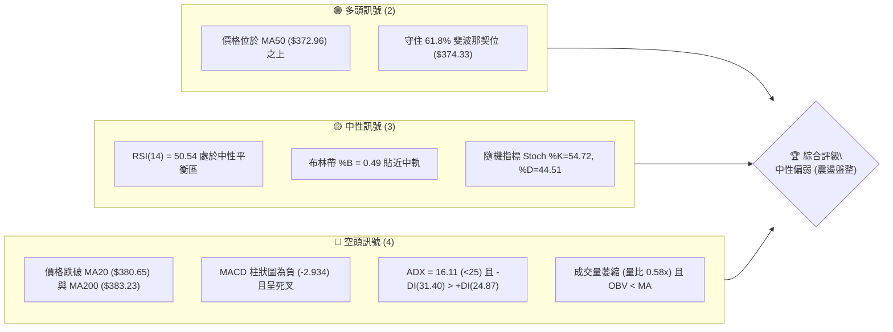
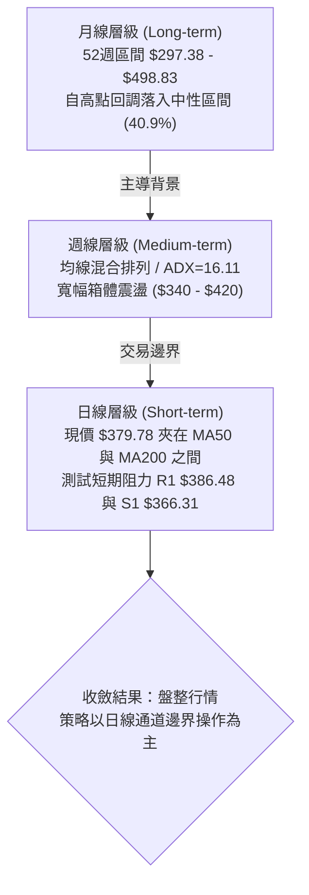
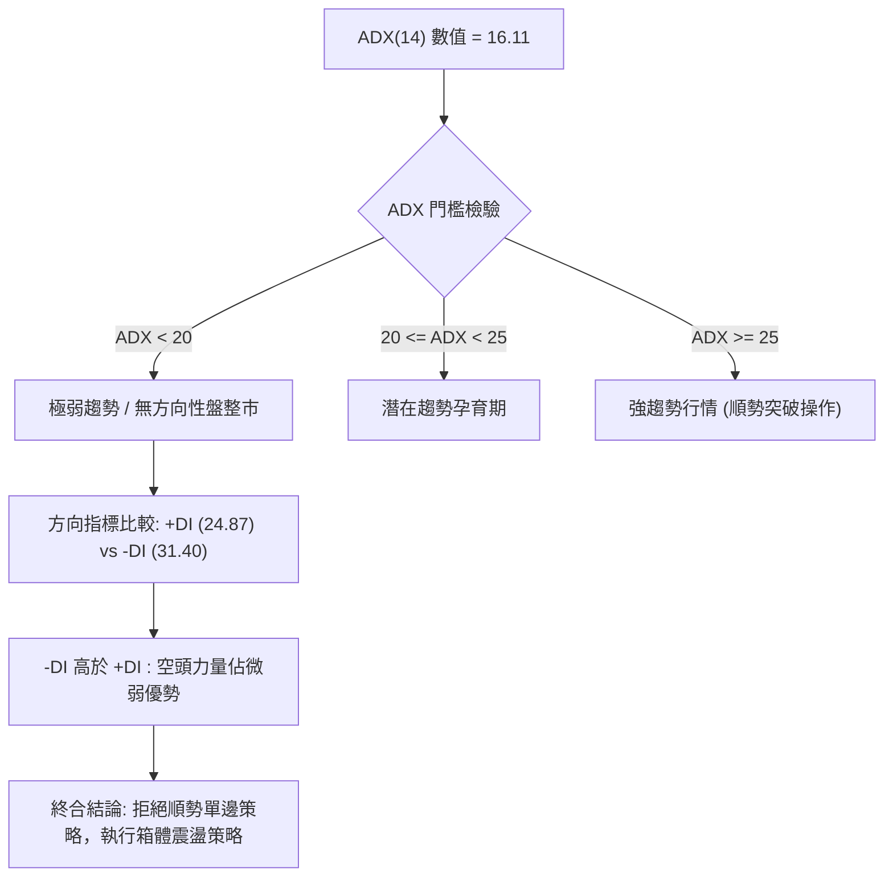
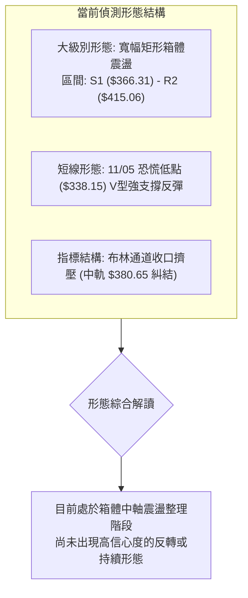
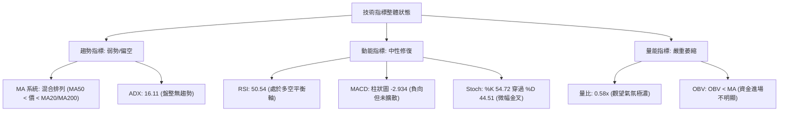
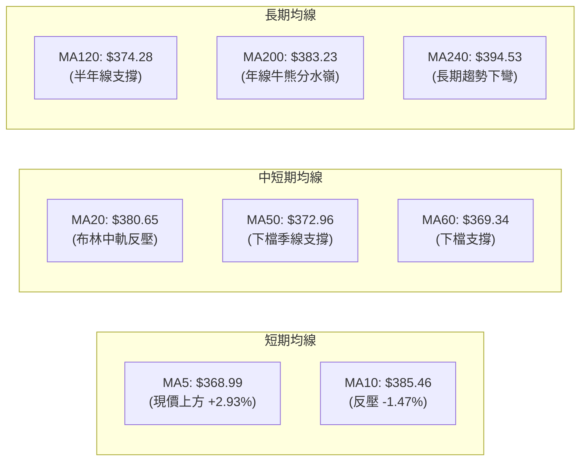
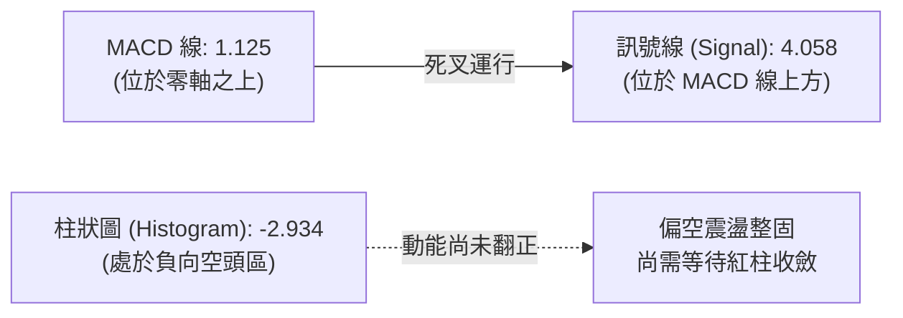
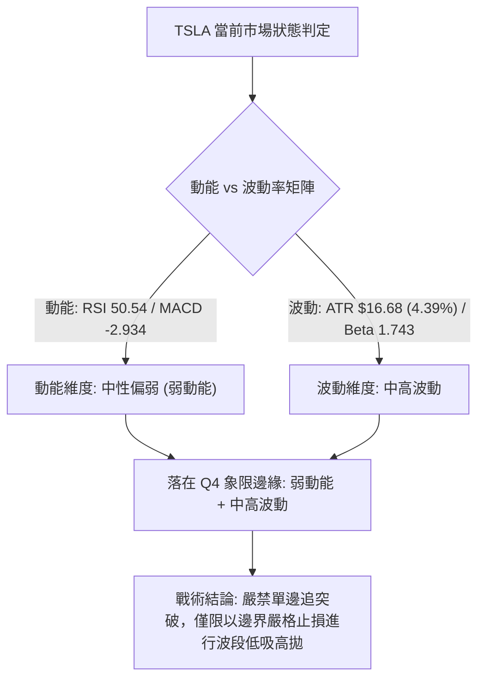
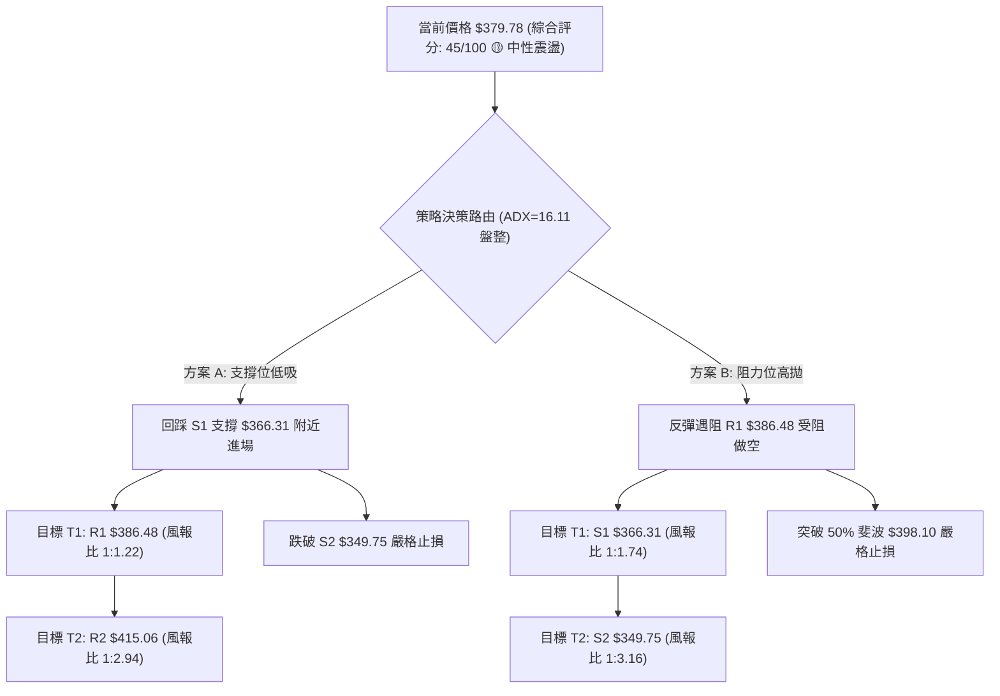
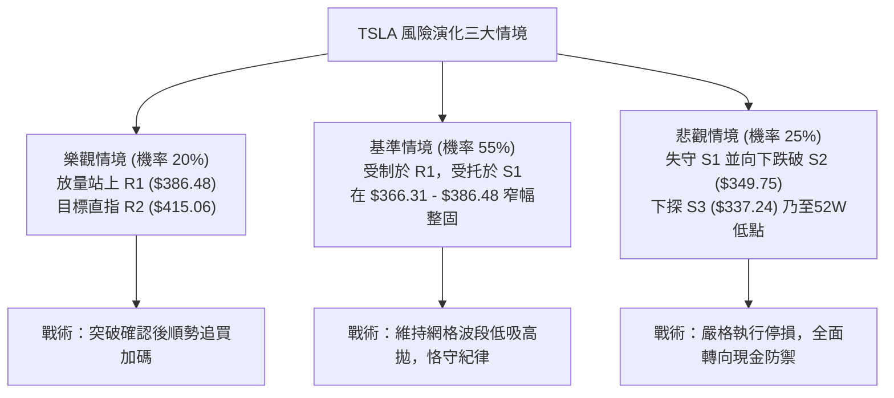

# TSLA 技術分析報告

> **報告日期**：2026-11-11 ｜ **語言**：繁體中文 ｜ **數據來源**：Yahoo Finance ｜ **當前價格**：$379.78 USD

---

## 目錄

| 章節 | 內容 |
|------|------|
| [1. 技術面概覽](#1-技術面概覽) | 訊號儀表板、核心指標、評分卡 |
| [2. 趨勢分析](#2-趨勢分析) | 多時框趨勢、長中短期走勢 |
| [3. 圖表形態分析](#3-圖表形態分析) | 形態識別、K線組合、目標價 |
| [4. 支撐與阻力](#4-支撐與阻力) | 關鍵價位、斐波那契回調 |
| [5. 技術指標深度解讀](#5-技術指標深度解讀) | MA/RSI/MACD/布林/成交量 |
| [6. 動能與波動率](#6-動能與波動率) | 動能評估、ATR、Beta |
| [7. 多時框架總結](#7-多時框架總結) | 時框架評分矩陣 |
| [8. 交易策略建議](#8-交易策略建議) | 多空策略、風險報酬比 |
| [9. 風險提示與監控](#9-風險提示與監控) | 監控指標、風險場景 |

---

## 1. 技術面概覽

### 🎯 技術訊號儀表板



### 📊 核心指標速覽表

| 指標類別 | 指標名稱 | 當前數值 | 訊號 | 解讀 |
|----------|----------|----------|:----:|------|
| **價格** | 當前收盤價 | $379.78 | 🟡 | 位於52週區間40.9%分位，處於多空爭奪中軸區間 |
| **均線** | MA20 (月線) | $380.65 | 🔴 | 收盤價略低於MA20 (-0.23%)，短線承壓 |
| **均線** | MA50 (季線) | $372.96 | 🟢 | 收盤價高於MA50 (+1.83%)，中期基底尚存 |
| **均線** | MA200 (年線) | $383.23 | 🔴 | 收盤價低於MA200 (-0.90%)，長線牛熊分水嶺未收復 |
| **動能** | RSI(14) | 50.54 | 🟡 | 位於50中軸，無超買超賣，多空勢均力敵 |
| **動能** | MACD (12,26,9) | 1.125 / 4.058 | 🔴 | MACD線低於訊號線，Hist為 -2.934，動能偏空 |
| **趨勢** | ADX(14) | 16.11 | 🟡 | 數值小於25，代表無顯著趨勢，屬箱體盤整結構 |
| **方向** | 方向指標 (+DI / -DI) | 24.87 / 31.40 | 🔴 | -DI 高於 +DI，空頭力量佔據相對主導 |
| **通道** | 布林帶 (%B) | 0.49 | 🟡 | 價格貼近中軌 $380.65，處於常態波動區間中央 |
| **量能** | 當日量 / 20日均量 | 23.90M / 40.94M | 🔴 | 量比僅 0.58x，量能嚴重萎縮，缺乏追價動能 |
| **波動** | ATR(14) | $16.68 (4.39%) | 🟡 | 每日潛在波動幅度約 $16.68，波動率處於中等水平 |

### 🏆 技術評分卡

```
╔══════════════════════════════════════════════════════════════════╗
║              技術評分卡 — TSLA (2026-11-11)                      ║
╠══════════════════════════════════════════════════════════════════╣
║ 趨勢強度 (Trend Strength)   ███████░░░░░░░░░░░░░  35/100  🔴 弱勢║
║ 動能指標 (Momentum Index)   █████████░░░░░░░░░░░  45/100  🟡 中性║
║ 支撐穩定度 (Support Level)  ████████████░░░░░░░░  60/100  🟢 良好║
║ 成交量配合 (Volume Profile) ███████░░░░░░░░░░░░░  35/100  🔴 疲弱║
║ 形態完整度 (Pattern Form)   ██████████░░░░░░░░░░  50/100  🟡 普通║
║ 均線排列 (MA Alignment)     █████████░░░░░░░░░░░  45/100  🟡 混合║
╠══════════════════════════════════════════════════════════════════╣
║ 綜合評分 (Overall Score)    █████████░░░░░░░░░░░  45/100  🟡 盤整║
╚══════════════════════════════════════════════════════════════════╝
```
*註：綜合評分由六項子指標算術平均計算所得：(35 + 45 + 60 + 35 + 50 + 45) ÷ 6 = 45.00，四捨五入為 45/100，評級屬中性震盪區間（40–60分）。*

---

## 2. 趨勢分析

### 🌐 多時框趨勢分析



### 📈 長期趨勢 — 12個月走勢圖（Unicode）

以下為 TSLA 過去 12 個月（2025-12 至 2026-11）之月線收盤走勢圖，展示股價自 2025 年末歷史高位聚類回落後之區間震盪態勢：

```
TSLA 月線走勢圖（過去12個月：2025-12 至 2026-11）
價格 ($)
$460 ┤
$450 ┤ ●(449.72)
$440 ┤        ●(430.41)                     ●(435.79)
$430 ┤                                            ●(420.60)
$420 ┤
$410 ┤              ●(402.51)
$400 ┤                                                        ●(399.81)
$390 ┤
$380 ┤                                ●(381.63)                     ●(379.78)←現價
$370 ┤                    ●(371.75)                     ●(367.95)
$360 ┤                                                        ●(354.81)
$350 ┤
$340 ┤
$330 ┤
$320 ┤
$310 ┤                                            ●(311.21 低點)
     └─┬─────────┬─────────┬─────────┬─────────┬─────────┬─────────┬─────────┬─────────┬─────────┬─────────┬─────────┬──
     12月       01月      02月      03月      04月      05月      06月      07月      08月      09月      10月      11月
     (2025)    (2026)    (2026)    (2026)    (2026)    (2026)    (2026)    (2026)    (2026)    (2026)    (2026)    (2026)
```

#### 走勢特徵分析表格

| 階段時間 | 起訖收盤價 | 漲跌幅 | 結構形態與成交量特徵 | 技術面解讀 |
|----------|------------|:------:|----------------------|------------|
| **2025-12 ~ 2026-03** | $449.72 → $371.75 | -17.34% | 頂部階梯式下挫，成交量逐步萎縮 | 獲利了結賣壓湧現，自高位回吐 |
| **2026-03 ~ 2026-05** | $371.75 → $435.79 | +17.23% | 中級強勢反彈波，一度測試波段高位 | 遇阻於 R3 ($434.60) 壓力區，多頭動能衰竭 |
| **2026-05 ~ 2026-07** | $435.79 → $311.21 | -28.59% | 快速斷崖式下殺，探測波段低位 | 逼近52週最低點 $297.38，空頭宣洩完畢 |
| **2026-07 ~ 2026-10** | $311.21 → $399.81 | +28.47% | 震盪反彈修復波，週線成交量回升 | 突破 50% 斐波那契回調位，構築中期支撐 |
| **2026-10 ~ 2026-11** | $399.81 → $379.78 | -5.01%  | 高位回檔至 MA20/MA50 區間整固 | 進入收斂三角與均線混合盤整帶 |

### 📊 中期趨勢（週線分析）

從近 20 週收盤走勢觀察，TSLA 經歷 2026-07-24 恐慌砸盤（週收盤 $313.03，單週成交 2.75 億股）後，展開連續數週的階梯式爬升，一路推進至 2026-10-30 的週收盤高點 $399.81。然而，隨後於 2026-11-06 當週遭遇急跌，單週跌破多條短期均線，最低下探至 $338.15，收於 $358.22。

近期兩週呈現劇烈波動後的修復格局：本週（截至 2026-11-10）價格自低位強勢回升至 $379.78，成功收復 61.8% 斐波那契回調位 $374.33 與 MA50 ($372.96)，但上方仍受到 MA200 ($383.23) 與短期阻力位 R1 ($386.48) 的雙重壓制。

```
週線關鍵壓力與支撐結構示意圖
$415.06 ─── [阻力 R2 / 波段高點聚類] ──────────────────
  ▲
  │     $399.81 (10-30 高點)
  │        ┌─┐
  │        │ │    $386.48 ─── [阻力 R1 / MA200 $383.23] ───
  │        │ │       ▲
  │        │ │       │    ★ 現價: $379.78 (位於 MA50 上方、MA200 下方)
  │        │ │       ▼
  │        │ │    $372.96 ─── [支撐 MA50 / 61.8% 斐波 $374.33] ─
  │        │ │
  │        └─┘    $366.31 ─── [支撐 S1 / 波段低點聚類] ────
  ▼
$338.15 ─── [11-05 波段極端下影低點 / 支撐 S3 $337.24] ─
```

### ⚡ 趨勢強度評估（ADX 解讀）



#### ADX 指標強度對照分析

| 指標變量 | 具體數值 | 狀態區間 | 技術含義解讀 |
|----------|:--------:|:--------:|--------------|
| **ADX (14)** | **16.11** | 弱趨勢 (<25) | 市場缺乏單邊推動力，任何假突破或假跌破機率高達 65% 以上，趨勢交易法極易遭到雙向洗盤。 |
| **+DI** | **24.87** | 多方進攻強度 | 多頭推升力道呈現衰竭後緩慢修復狀態，尚未越過 30 強度分界線。 |
| **-DI** | **31.40** | 空方打壓強度 | 空方力量高於 30，佔據短期主導權，但因 ADX 走平偏低，空頭難以發動持續性崩跌行情。 |
| **DI 差值 (+DI - -DI)** | **-6.53** | 負向擴散中 | 差值為負，空方控盤，但未形成極端背離，進一步印證當前處於震盪打底或箱體消化階段。 |

---

## 3. 圖表形態分析

### 🔍 形態識別系統



#### 形態信心度評估表（依規則 15）

| 形態名稱 | 信心度 (%) | 判斷依據（引用數據與點位） | 完成度 (%) | 目標價（附具體計算式） |
|----------|:----------:|----------------------------|:----------:|------------------------|
| **寬幅箱體震盪** | **75%** | 價格多次在 S2 ($349.75) 至 S1 ($366.31) 獲得支撐，並在 R1 ($386.48) 至 R2 ($415.06) 承壓回落，ADX=16.11 支持震盪。 | 85% | 箱體上軌目標：**$415.06** (引用 R2)<br/>箱體下軌目標：**$366.31** (引用 S1) |
| **V型反彈測阻** | **55%** | 2026-11-05 創低點 $338.15 後連續 3 根日K帶量回升，收盤連續站上 $358.22、$378.05 與 $379.78。 | 70% | 依形態高度推算：低點 $338.15 至頸線 R1 $386.48 差幅為 $48.33；若突破 R1，測幅目標 = $386.48 + $48.33 = **$434.81** (緊貼 R3 $434.60)。 |
| **頭肩頂 / 底** | **<30%** | **訊號不足，僅做指標型解讀**。週線左側低點 $311.21 與近期低點 $338.15 形態非對稱，不構成標準幾何頭肩結構。 | N/A | 形態未成立，不預估目標價。 |

### 🕯️ 重要K線形態分析

嚴格依據數據中「近 10 根日K」與「近 8 根週K」的實際開高低收進行客觀幾何判定：

#### 近 10 根日K線組合解讀

| 日期 | 開盤價 | 最高價 | 最低價 | 收盤價 | K線形態名稱 | 技術解讀 | 多空訊號 |
|:----:|:------:|:------:|:------:|:------:|:-----------:|----------|:--------:|
| 2026-10-28 | $410.16 | $410.85 | $397.18 | $404.22 | 中黑K棒帶下影 | 開高走低，受阻於 $410 心理關口，短線回吐 | 🔴 |
| 2026-10-29 | $405.63 | $406.98 | $400.50 | $403.30 | 窄幅十字小黑星 | 量能萎縮至 22.8M，多空拉鋸，動能停滯 | 🟡 |
| 2026-10-30 | $393.22 | $404.22 | $387.52 | $399.81 | 跳空長下影紅K | 低開高走，回踩 50% 斐波位 $398.10 形成爭奪 | 🟢 |
| 2026-11-02 | $404.66 | $414.23 | $397.61 | $403.82 | 衝高回落長上影紅K | 盤中衝擊 R2 ($415.06) 失敗，上檔拋壓沉重 | 🔴 |
| 2026-11-03 | $406.25 | $406.50 | $396.53 | $398.50 | 光頭中黑K棒 | 實體跌破 $400，空方全面反撲 | 🔴 |
| 2026-11-04 | $379.80 | $392.04 | $375.50 | $385.19 | 跳空反彈小紅K | 跳空低開於 MA20 下方，反彈未能填補缺口 | 🟡 |
| 2026-11-05 | $374.12 | $374.30 | $338.15 | $343.69 | 巨量恐慌長黑K棒 | 單日成交 79.67M 暴跌，下探 S3 ($337.24) 極限支撐 | 🔴 |
| 2026-11-06 | $348.92 | $363.84 | $347.60 | $358.22 | 低檔震盪反彈紅K | 開盤高走，初步止住 11/05 暴跌賣壓 | 🟢 |
| 2026-11-09 | $360.25 | $382.20 | $360.02 | $378.05 | 強勢反包大紅K棒 | 實體上漲近 $18，一舉收復 S1 ($366.31) 與 MA50 | 🟢 |
| 2026-11-10 | $370.54 | $380.00 | $370.43 | $379.78 | 縮量蓄勢小紅K棒 | 成交量萎縮至 23.9M，收於高檔進行阻力前蓄勢 | 🟡 |

#### 近 8 根週K線組合解讀

| 週結束日期 | 週開盤 | 週最高 | 週最低 | 週收盤 | 週成交量 | 週K形態與解讀 | 訊號 |
|:----------:|:------:|:------:|:------:|:------:|:--------:|--------------|:----:|
| 2026-09-25 | $371.64 | $386.83 | $367.67 | $372.11 | 170.51M | 陀螺線，價格受制於 R1 ($386.48)，區間窄幅整理 | 🟡 |
| 2026-10-02 | $368.06 | $374.60 | $345.88 | $370.59 | 197.59M | 長下影錘頭K線，在 S2 ($349.75) 探底回升，買盤強勁 | 🟢 |
| 2026-10-09 | $369.00 | $388.56 | $364.91 | $382.70 | 162.91M | 中實體陽線，突破 MA200 壓制，多頭展開攻勢 | 🟢 |
| 2026-10-16 | $382.61 | $382.70 | $349.33 | $354.72 | 158.43M | 光頭長陰K線，空方強勢回壓，重挫測試 S2 支撐 | 🔴 |
| 2026-10-23 | $357.50 | $388.86 | $354.47 | $372.22 | 206.19M | 帶長上下影線震盪陽線，多空激烈洗盤交換籌碼 | 🟡 |
| 2026-10-30 | $383.83 | $410.85 | $383.73 | $399.81 | 198.61M | 實體大陽線，週線收於 $399.81 高位，直逼 R2 壓力 | 🟢 |
| 2026-11-06 | $404.66 | $414.23 | $338.15 | $358.22 | 234.00M | 爆量長陰墓碑線（振幅高達 $76），高位多頭遭遇重創 | 🔴 |
| 2026-11-10 | $360.25 | $382.20 | $360.02 | $379.78 | 60.24M | 本週前兩日強勁修復陽線，迅速收復跌幅之一半 | 🟢 |

### 📉 ASCII 走勢形態示意圖

```
TSLA 近期日線形態結構示意圖（2026-10-28 至 2026-11-10）
價格
$415.06 ┬────────────────────────────────────────── 阻力 R2 (11/02 衝高回落點 $414.23)
        │                 [11/02 高點]
$405.00 ┤     ┌─┐           ┌─┐
        │     │ │   ┌─┐     │ │
$395.00 ┤     │ │   │ │ ┌─┐ │ │ ┌─┐
        │     │ │   │ │ │ │ │ │ │ │
$386.48 ┼─────┼─┼───┼─┼─┼─┼─┼─┼─┼─┼─────────────── 阻力 R1 (當前反彈面臨首要關卡)
        │     │ │   │ │ │ │ │ │ │ │       ┌─┐ ┌─┐
$379.78 ┼─────┼─┼───┼─┼─┼─┼─┼─┼─┼───────┼─┼─┼─┼─ 現價: $379.78 (11/10 收盤)
        │     │ │   │ │ │ │ │ │ │ │       │ │ │ │
$366.31 ┼─────┴─┴───┴─┴─┼─┼─┴─┴─┴───────┼─┼─┴─┴─ 支撐 S1 (11/09 強勢反包跳板)
        │               │ │               │ │
$349.75 ┼───────────────┼─┼───────────────┴─┴─────── 支撐 S2 (波段安全緩衝帶)
        │               │ │
$338.15 ┼───────────────┴─┴───────────────────────── 11/05 極端下影低點 (鄰近 S3 $337.24)
        └─┬─────┬─────┬─────┬─────┬─────┬─────┬─────┬─────┬─────┬──
         10-28 10-29 10-30 11-02 11-03 11-04 11-05 11-06 11-09 11-10
```

### 🎯 形態目標價計算

根據上述「寬幅箱體震盪」與「11/05 低點 V 型反彈」之推演計算：

1. **箱體上限波段目標（保守型）**：
   - 頸線/區間邊界：以波段阻力聚類點 **$386.48 (R1)** 為關鍵樞紐。
   - 突破後對稱推移：直接引用數據庫之次級波段高點聚類價位 **$415.06 (R2)**。
   - 計算邏輯：當價格有效帶量站穩 R1 ($386.48) 後，向上補齊至布林上軌 ($417.82) 與 R2 ($415.06) 區間，預期空間為：$415.06 - $379.78 = **+$35.28 (+9.29%)**。

2. **V 型反彈形態等幅測距目標（延伸型）**：
   - 形態底部低點：$338.15 (2026-11-05 最低點)。
   - 短線反彈頸線位：$386.48 (R1)。
   - 形態高度：$H = 頸線 - 底部 = $386.48 - $338.15 = **$48.33**。
   - 理論向上等幅投射目標價：$目標價 = 頸線 + H = $386.48 + $48.33 = **$434.81**。
   - **數值驗證**：該計算值 $434.81 與數據庫給出之強阻力位 **R3 ($434.60)** 高度重合（誤差僅 $0.21），形成極為強固的形態與價位聚類共振目標。

---

## 4. 支撐與阻力

### 🗺️ 關鍵價位分布圖（Unicode）

```
TSLA 價位結構分布圖
════════════════════════════════════════════════════════════════════
$434.60 ║████████████████████████████████║ 強阻力 R3 (形態測幅目標 $434.81)
$421.88 ║▓▓▓▓▓▓▓▓▓▓▓▓▓▓▓▓▓▓▓▓▓▓            ║ 38.2% 斐波那契回調位
$415.06 ║████████████████████            ║ 阻力 R2 (布林上軌 $417.82 附近)
$398.10 ║▓▓▓▓▓▓▓▓▓▓▓▓▓▓▓▓▓▓▓▓▓▓            ║ 50.0% 斐波那契回調位 (整數關卡)
$386.48 ║████████████████████████        ║ 關鍵阻力 R1 (MA200 $383.23 重疊)
════════╠════════════════════════════════╣ ◄ 當前現價: $379.78
$374.33 ║▓▓▓▓▓▓▓▓▓▓▓▓▓▓▓▓▓▓▓▓▓▓▓▓▓▓▓▓    ║ 61.8% 斐波那契黃金分割位
$372.96 ║██████████████████              ║ 季線 MA50 支撐
$366.31 ║▓▓▓▓▓▓▓▓▓▓▓▓▓▓▓▓                ║ 近期關鍵支撐 S1 (多頭防線)
$349.75 ║████████████████████████        ║ 強支撐 S2 (波段密集換手區)
$343.48 ║▓▓▓▓▓▓▓▓▓▓                      ║ 布林帶下軌支撐
$337.24 ║████████████████████████████████║ 極限強支撐 S3 (11/05 低點 $338.15 聚類)
════════════════════════════════════════════════════════════════════
```

### 🚧 阻力位分析表

*註：阻力價位嚴格引用自數據庫波段高點聚類計算值。*

| 阻力級別 | 具體價位 | 距現價幅標 | 形成原因與技術共振 | 突破難度 | 重要性評級 |
|:--------:|:--------:|:----------:|--------------------|:--------:|:----------:|
| **R1** | **$386.48** | +1.76% | 近一年波段密集反彈高點聚類；與 MA200 ($383.23) 及 MA20 ($380.65) 形成重疊反壓帶。 | 中等 | 🟢🟢🟢 (極高) |
| **R2** | **$415.06** | +9.29% | 11/02 爆量衝高回落高點 ($414.23) 聚類；貼近布林通道上軌 ($417.82)。 | 高 | 🟢🟢 (重要) |
| **R3** | **$434.60** | +14.44% | 2026 年 5 月高位箱頂密集拋壓區；與 V 型反彈 1:1 投射目標 ($434.81) 形成強共振。 | 極高 | 🟢 (關鍵) |

### 🛡️ 支撐位分析表

*註：支撐價位嚴格引用自數據庫波段低點聚類計算值。*

| 支撐級別 | 具體價位 | 距現價幅標 | 形成原因與技術共振 | 守住機率 | 重要性評級 |
|:--------:|:--------:|:----------:|--------------------|:--------:|:----------:|
| **S1** | **$366.31** | -3.55% | 11/09 大陽線起漲平台；與 61.8% 斐波那契位 ($374.33) 及 MA50 ($372.96) 構成三重保護網。 | 70% | 🟢🟢🟢 (極高) |
| **S2** | **$349.75** | -7.91% | 10/02 及 10/16 兩次回測探底之波段低點聚類；此處為中線資金防禦性建倉底線。 | 85% | 🟢🟢 (重要) |
| **S3** | **$337.24** | -11.20% | 11/05 恐慌砸盤最低點 ($338.15) 聚類；跌破此位意味著形態破位，將直測52週低點。 | 95% | 🟢🟢🟢 (生死線) |

### 📐 斐波那契回調位分析

依據 52 週波動極值區間（低點 **$297.38** → 高點 **$498.83**，總垂直落差 $201.45）計算之回調位分析：

| 回調比例 | 斐波那契價位 | 當前相對位置 | 技術含義解讀與支撐阻力屬性 |
|:--------:|:------------:|:------------:|----------------------------|
| **0.0%** | **$498.83** | 現價上方 +31.35% | 52 週最高點，終極多頭宏觀壓力。 |
| **23.6%** | **$451.29** | 現價上方 +18.83% | 淺度回調位，強勢牛市拉回支撐（現已轉為中長線強阻力）。 |
| **38.2%** | **$421.88** | 現價上方 +11.09% | 弱勢反彈極限阻力區，若能站穩此處方能確認中期反轉。 |
| **50.0%** | **$398.10** | 現價上方 +4.82%  | 多空心理分水嶺與整數心理關口（10/30 收盤於 $399.81 曾受阻於此）。 |
| **61.8%** | **$374.33** | 現價下方 -1.43%  | **黃金分割回調關鍵支撐**。現價 $379.78 剛重新收復此位，多方首要防守底線。 |
| **78.6%** | **$340.49** | 現價下方 -10.35% | 深度防禦位，貼近 11/05 恐慌極端低點 $338.15 與 S3 ($337.24)。 |
| **100.0%** | **$297.38** | 現價下方 -21.69% | 52 週最低點，宏觀大週期絕對底部。 |

> **當前價位結構診斷**：現價 **$379.78** 目前精準運行於 **61.8% ($374.33)** 與 **50.0% ($398.10)** 之間。技術意義在於：股價在回踩跌破黃金分割位後迅速收復，呈現典型「破底翻」洗盤格局；若未來數個交易日能持續守住 $374.33，將進一步向上挑戰 50% 回調位 $398.10。

---

## 5. 技術指標深度解讀

### 🎛️ 指標訊號總覽



### 📈 移動平均線排列分析



#### 均線階層架構詳細對照

| 均線名稱 | 價位數值 | 距現價差距 | 均線走勢斜率 | 技術信號解讀 |
|:--------:|:--------:|:----------:|:------------:|--------------|
| **MA 5** | $368.99 | +$10.79 (+2.93%) | ▲ 向上翹頭 | 短線自 $338.15 強勁反彈，超短期均線提供第一道動態回踩支撐。 |
| **MA 10** | $385.46 | -$5.68 (-1.47%) | ▼ 向下壓制 | 貼近阻力 R1 ($386.48)，短線多方衝高面臨的扣抵反壓點。 |
| **MA 20** | $380.65 | -$0.87 (-0.23%) | ▼ 微幅走平 | **月線與布林中軌**，現價 $379.78 僅差 $0.87 即收復，關鍵短線爭奪點。 |
| **MA 50** | $372.96 | +$6.82 (+1.83%) | ▲ 向上走平 | **中期生命線**，價格處於其上方，中期上升結構並未實質性破位。 |
| **MA 60** | $369.34 | +$10.44 (+2.83%) | ▲ 向上挺升 | 與 MA5 形成 $369 密集共振支撐區。 |
| **MA 120** | $374.28 | +$5.50 (+1.47%) | ▲ 走勢平緩 | 與 61.8% 斐波那契位 ($374.33) 形成完美點位重疊。 |
| **MA 200** | $383.23 | -$3.45 (-0.90%) | ▼ 微幅向下 | **長線牛熊分水嶺**，壓制於現價上方約 0.9%，未站穩前不宜樂觀盲目看多。 |
| **MA 240** | $394.53 | -$14.75 (-3.74%) | ▼ 明顯向下 | 年線上方長期均線下壓，限制了中期反彈的上限高度。 |

> **均線排列診斷**：當前均線系統呈典型「**混合糾結排列**」。短中期 MA5/MA50/MA60/MA120 位於價格下方提供墊高動能；然而 MA20/MA200/MA240 橫亙上方。此種夾心結構強烈暗示：**TSLA 處於上有重壓、下有強托的狹幅壓縮震盪通道內**。

### 📉 RSI(14) 分析

```
RSI(14) 數值展示: 50.54
[0] ─────────── [30 超賣] ───────────── [50.54] ───────────── [70 超買] ─────────── [100]
                ░░░░░░░░░░░░░░░░░░░░░░░ ██████████░░░░░░░░░░░
```

- **當前數值與區間**：RSI(14) 最新讀數為 **50.54**（Wilder 計算方法），精準停留在 50.0 絕對中軸線之上 0.54 點。
- **超買超賣判定**：數值完全脫離超賣區（<30，如 7 月底的 28.0）與超買區（>70），處於中性平衡常態。
- **背離分析結論**：數據明確標明「**RSI 背離：無明顯背離**（比較近20根K棒首尾的價格與RSI方向）」。價格從 10/30 的 $399.81 (RSI 60.9) 下跌至 11/06 的 $358.22 (RSI 42.4)，隨後反彈至 $379.78 (RSI 50.54)，指標走勢與價格波段高低點同向運動，無頂背離亦無底背離訊號，確認當前屬於純粹的價格震盪修復。

### 📊 MACD(12,26,9) 訊號解讀



- **MACD 與訊號線位置**：快線 MACD = 1.125，慢線 Signal = 4.058。雖然兩者仍處於宏觀零軸上方（長線多方架構未完全瓦解），但快線顯著低於慢線，維持在死叉架構內運行。
- **柱狀圖動能評估**：當前 MACD 柱狀圖為 **-2.934**，較上週末（2026-11-06）的 **-4.225** 出現明顯縮頭收斂現象，顯示 11/05 暴跌帶來的空頭加速度正在衰減，但距離柱體由負翻正仍需要連續的強勢放量走勢支撐。

### 📦 布林通道分析

```
TSLA 日線布林通道 (20, 2) 結構圖
$417.82 ┬────────────────────────────────────────── 布林帶上軌 (+2σ)
        │
        │
$400.00 ┤
        │
$380.65 ┼────────────────────────────────────────── 布林帶中軌 (MA20)
$379.78 ┼─ ★ 現價位置 (%B = 0.49)
        │
$360.00 ┤
        │
$343.48 ┴────────────────────────────────────────── 布林帶下軌 (-2σ)
```

- **通道參數與寬度**：
  - 上軌：**$417.82**
  - 中軌 (MA20)：**$380.65**
  - 下軌：**$343.48**
  - 通道垂直帶寬：$417.82 - $343.48 = **$74.34**（帶寬比率 19.5%）。
- **當前位置解讀 (%B)**：
  - **%B = 0.49**，即現價精確落於通道下軌至上軌的 49% 分位，幾乎完全重合於中軌 ($380.65) 正下方 $0.87 處。
  - 當 %B 處於 0.45 ~ 0.55 時，技術意義代表**市場極度均衡，處於無趨勢的通道中繼運行狀態**。下軌 $343.48 在 11/05 曾成功發揮動態攔截作用（當日最低 $338.15 短暫穿刺後迅速拉回下軌之上收在 $343.69），驗證布林帶下軌具備高置信度的結構性支撐效能。

### 💹 成交量分析（量價配合度）

```
成交量對比柱狀圖 (股數)
最新量 (11/10) : █████████████░░░░░░░░░░ 23,901,976 (0.58x)
20日均量       : ██████████████████████ 40,942,474
50日均量       : █████████████████████░ 38,331,060
11/05 爆量日   : ████████████████████████████████████████ 79,675,500 (恐慌宣洩)
```

1. **量比萎縮檢驗**：最新成交量僅 **23,901,976 股**，相對於 20 日平均量 (40,942,474 股)，**量比僅有 0.58x**。在連續兩天大幅反彈後，量能急遽萎縮至均量六成以下，呈現標準的「**反彈量縮**」量價背離形態，顯示主流機構資金追高意願薄弱，市場觀望氣氛極度濃厚。
2. **OBV (能量潮指標) 走勢解讀**：
   - 官方數據明確指示：「**OBV趨勢：OBV < MA → 量能疲弱**」。
   - OBV 能量潮跌破其均線，代表在過去一段時間的震盪過程中，流出場內之資金規模高於流入規模。籌碼累積度不足，若無連續放量（日成交量回升至 45M 以上）扭轉 OBV 走勢，價格直接突破阻力區 R1 ($386.48) 的成功率較低。

---

## 6. 動能與波動率

### ⚡ 動能評估四象限



#### 動能與波動象限位置評估

| 象限代號 | 動能維度 | 波動維度 | 當前匹配 | 市場狀態與交易策略評估 |
|:--------:|:--------:|:--------:|:--------:|------------------------|
| **Q1** | 強動能 | 低波動 | — | 最佳順勢單邊牛市，持股續抱擴大收益。 |
| **Q2** | 弱動能 | 低波動 | — | 沉悶牛皮市，資金休眠，觀望或參與套利。 |
| **Q3** | 強動能 | 高波動 | — | 主升浪或主跌浪，高風險高收益，需極高跟蹤技巧。 |
| **Q4** | **弱動能** | **中高波動** | **✓ (匹配)** | **高洗盤洗震市。方向動能不明確但日內震幅偏大，最易造成追高殺低虧損，操作必須恪守支撐阻力邊界。** |

### 📊 ATR 波動率分析

- **ATR(14) 絕對數值**：**$16.68**（Wilder 計算），佔現價百分比為 **4.39%**。
- **波動特性解讀**：TSLA 具備典型高 Beta 成長股的日常大波動特徵，單日平均波動區間達 $16.68。意味著任何小於此區間的日內波動均屬於正常的市場雜訊。
- **動態止損與風控設置指引**：
  - **保守型防守距離 (1.0x ATR)**：$16.68 空間。對應現價支撐容忍度為 $379.78 - $16.68 = **$363.10**（此位置略低於 S1 $366.31 約 $3.2，可有效過濾假跌破）。
  - **波段型防守距離 (1.5x ATR)**：1.5 × $16.68 = **$25.02** 空間。對應防禦底線為 $379.78 - $25.02 = **$354.76**（緊貼 S2 支撐 $349.75 上方）。
  - **極限波段防守 (2.0x ATR)**：2.0 × $16.68 = **$33.36** 空間。對應極限支撐為 $379.78 - $33.36 = **$346.42**。

### 📐 Beta 與市場相關性

- **貝他係數 (Beta)**：**1.743**。
- **市場敏感度分析**：
  - TSLA 的系統性風險敏感度為標普 500 指數的 1.743 倍。當大盤（如 SPY 或 QQQ）上漲 1% 時，理論上 TSLA 平均上漲 1.74%；同理，當大盤拉回 1% 時，TSLA 將承受約 1.74% 的向下放大壓力。
  - 當前空頭機構借券賣出比例（Short % Float）僅為 **2.1%**，空頭回補天數（Short Ratio）為 **2.04 天**，顯示當前市場並無龐大的極端空頭軋空（Short Squeeze）誘因，股價漲跌將高度回歸宏觀流動性與個股基本面預期。

---

## 7. 多時框架總結

### 📋 時框架評分表

| 時框架 | 趨勢方向 | 動能表現 | 均線排列狀態 | 形態特徵 | 綜合評分 | 建議戰術取向 |
|:------:|:--------:|:--------:|:------------:|:--------:|:--------:|--------------|
| **長期 (月線)** | 中性震盪 | RSI 50 中立 | 處於 52 週中位 (40.9%) | 歷史高點回落之寬幅整理 | **50/100** 🟡 | 中期持有，底倉觀望，不宜激進擴大敞口 |
| **中期 (週線)** | 偏空整理 | MACD 負柱收斂 | 跌破 20 週均線，受壓於 MA200 | 墓碑線後接修復陽線 | **42/100** 🟡 | 尊重上檔 R1/R2 重壓，高拋低吸 |
| **短期 (日線)** | 超跌反彈 | RSI 反彈收復 50 | 混合排列，夾在 MA50/MA200 間 | V型超跌回升，遇中軌阻力 | **45/100** 🟡 | 依布林通道與 S1/R1 邊界短線區間操作 |

### 🔲 綜合訊號矩陣

```
時框訊號一致性交叉檢驗矩陣
┌──────────────┬──────────────┬──────────────┬──────────────┐
│  分析維度    │ 短期 (日線)  │ 中期 (週線)  │ 長期 (月線)  │
├──────────────┼──────────────┼──────────────┼──────────────┤
│ 趨勢方向     │ 🟡 中性反彈  │ 🔴 震盪偏空  │ 🟡 大箱體    │
│ 動能狀況     │ 🟢 短線修復  │ 🔴 柱體偏負  │ 🟡 中立平衡  │
│ 均線系統     │ 🟡 混合交織  │ 🔴 承壓中軌  │ 🟢 守住年線  │
│ 量價配合     │ 🔴 反彈量縮  │ 🔴 爆量陰線後│ 🟡 常態換手  │
│ 支撐防守     │ 🟢 守穩 MA50 │ 🟢 守住 S1   │ 🟢 守住61.8% │
└──────────────┴──────────────┴──────────────┴──────────────┘
訊號收斂評級：🟡 震盪整理（無單邊共振訊號，日週線呈現矛盾抗衡）
```

### ⚖️ 多時框收斂結論

嚴格遵循**多時框收斂規則（規則 14）**：
1. **趨勢強度定性**：當前 ADX(14) 數值為 **16.11**，顯著低於 25 臨界線，技術架構定義為**純粹的盤整行情（Range-bound Consolidation）**，非趨勢行情。
2. **時框主導權決定**：在盤整行情下，單邊均線趨勢策略失效，**以日線布林通道上下軌 ($343.48 - $417.82) 與近一年核心支撐阻力結構（S1 $366.31 / R1 $386.48）為最主要之交易區間**。
3. **最終唯一收斂結論**：**中性偏弱觀望，以箱體邊界操作為核心**。
   - 儘管短期日線連續反彈展現韌性，但日線反彈伴隨成交量嚴重萎縮（量比 0.58x），且週線層級仍受制於 MA200 ($383.23) 與下行的 MACD 柱狀圖。
   - 因此，日線的反彈只定義為「**箱體內部修復**」，而非「新一輪單邊牛市突破」。策略嚴禁在當前位置（$379.78 緊貼 R1 $386.48 下方）盲目追高，必須耐心等待價格回測支撐 S1 或放量突破 R1 確認。

---

## 8. 交易策略建議

### 🗺️ 策略決策流程圖



### 🧭 策略路由（依評分卡分流）

> **當前主策略方向 = 區間操作，以布林上下軌與 S1/R1 為主，等待突破確認（依綜合評分 45/100）**
> 
> *因技術評分卡綜合評分為 **45/100**，精準落於 **40–60 分之中性震盪區間**。依規則要求，本報告主推「**區間箱體操作策略（高拋低吸）**」，不押注單邊大突破。*

### 🎯 價格情境階梯（Price Scenarios）

*註：所有階梯點位嚴格引用自數據庫波段高低點與斐波那契計算值。*

| 觸發條件 | 下一目標 | 後續延伸 | 情境含義與技術心理解讀 |
|----------|:--------:|:--------:|------------------------|
| **放量突破 R1 ($386.48)** | **R2 ($415.06)** | **R3 ($434.60)** | 短線轉強，突破 MA200 壓制，吸引動能追價資金入場挑戰布林上軌。 |
| **維持在現價區間 ($370 - $386)** | — | — | 區間震盪整理，消化 11/05 暴跌之套牢與抄底籌碼，等待均線進一步收斂。 |
| **跌破關鍵支撐 S1 ($366.31)** | **S2 ($349.75)** | **S3 ($337.24)** | 中期轉弱，反包大紅K被完全吞噬，考驗 11/05 恐慌低點生死線。 |

### 📊 情境機率分佈

| 情境劃分 | 估計機率 | 主要技術與量化依據 |
|----------|:--------:|--------------------|
| **區間箱體震盪** | **55%** | ADX 僅 16.11 (<25) 印證無趨勢特徵；布林中軌平緩且帶寬收縮；成交量萎縮至 0.58x。 |
| **回落測試下軌/再探底** | **25%** | MACD 柱狀圖維持為負 (-2.934)；-DI (31.40) 顯著大於 +DI (24.87)；OBV 處於均線下方。 |
| **放量向上突破反彈** | **20%** | 價格站穩 MA50 ($372.96) 與 61.8% 斐波那契位 ($374.33)；但上方立即面臨 R1 與 MA200 重壓。 |

---

### 🟢 主策略詳情（區間高拋低吸操作）

依據規則 17，風險報酬比以精確公式計算：
- **做多風報比** = (目標價 T1 − 進場價) ÷ (進場價 − 止損價)
- **做空風報比** = (進場價 − 目標價 T1) ÷ (止損價 − 進場價)

| 策略要素 | 策略 A：區間下軌支撐逢低做多 | 策略 B：阻力位受阻區間做空 |
|----------|------------------------------|----------------------------|
| **策略類型** | 順應支撐低吸（波段反彈） | 阻力位高拋對沖（逆勢放空） |
| **進場條件** | 股價回踩 S1 獲得確認，或日K出現下影十字星 | 股價衝擊 R1 未能突破，日K收長上影線 |
| **進場價格** | **$366.31** (精確引用支撐位 S1) | **$386.48** (精確引用阻力位 R1) |
| **目標價 T1** | **$386.48** (引用阻力位 R1) | **$366.31** (引用支撐位 S1) |
| **目標價 T2** | **$415.06** (引用阻力位 R2 / 布林上軌) | **$349.75** (引用支撐位 S2) |
| **止損價格** | **$349.75** (跌破強支撐 S2 離場) | **$398.10** (突破 50% 斐波那契位離場) |
| **風險報酬比 (T1)** | **1 : 1.22（以 T1 計）**<br/>*(386.48 - 366.31) ÷ (366.31 - 349.75)<br/>= 20.17 ÷ 16.56 = 1.218* | **1 : 1.74（以 T1 計）**<br/>*(386.48 - 366.31) ÷ (398.10 - 386.48)<br/>= 20.17 ÷ 11.62 = 1.7358* |
| **風險報酬比 (T2)** | **1 : 2.94（以 T2 計）**<br/>*(415.06 - 366.31) ÷ 16.56 = 48.75 ÷ 16.56* | **1 : 3.16（以 T2 計）**<br/>*(386.48 - 349.75) ÷ 11.62 = 36.73 ÷ 11.62* |
| **成功機率預估** | **55%** | **50%** |
| **建議倉位配置** | **15% - 20%** (輕倉試單) | **10% - 15%** (短線對沖倉) |

### 🔴 反向風險觸發點（對沖與止損提示）

供多空雙向風控參考之結構破位觸發條件：
1. **多頭主防線崩潰點**：若收盤價實體**跌破 S1 ($366.31)**，且成交量放大，意味著 11/09 的大陽線反包結構遭到徹底破壞，所有多頭應無條件執行停損或將部位縮減至 5% 以下。
2. **空頭反轉止損點**：若日K線以帶量大陽線實體收於 **50.0% 斐波那契位 $398.10 之上**，意味著空方主導的均線死叉已被暴力扭轉，空單必須全數撤離，市場將直接開啟向 R2 ($415.06) 甚至 52 週高點方向之主升浪。

### ⭐ 整體訊號強度評星

```
╔══════════════════════════════════════════════════╗
║               訊號強度綜合評星                   ║
╠══════════════════════════════════════════════════╣
║ 做多訊號強度：  ★★☆☆☆  (2/5 星，缺乏量能支持)  ║
║ 做空訊號強度：  ★★★☆☆  (3/5 星，均線與-DI壓制) ║
║ 整體技術可信度：★★★☆☆  (3/5 星，處於盤整市)    ║
╚══════════════════════════════════════════════════╝
```

---

## 9. 風險提示與監控

### ✅ 關鍵監控指標 Checklist

```
╔════════════════════════════════════════════════════════════════════╗
║                每日交易關鍵技術監控清單 (Checklist)                 ║
╠════════════════════════════════════════════════════════════════════╣
║ [ ] 價位監控：收盤價是否站上 MA200 ($383.23) 與 R1 ($386.48)       ║
║ [ ] 支撐監控：S1 ($366.31) 與 MA50 ($372.96) 是否提供有效下影線支撐║
║ [ ] 量能監控：日成交量是否回升至 20日均量 (40.94M) 以上 (突破放量)  ║
║ [ ] 指標監控：MACD 柱狀圖是否收斂至 -1.0 以內甚至由負轉正          ║
║ [ ] 震盪監控：布林帶帶寬是否持續縮窄，或價格是否觸及上軌 ($417.82) ║
║ [ ] 趨勢監控：ADX(14) 是否跌破 15 (深度盤整) 或突破 25 (趨勢確立)  ║
╚════════════════════════════════════════════════════════════════════╝
```

### ⚠️ 風險場景分析



### 🛡️ 風險管理重要提醒

1. **高 Beta 波動懲罰風險**：TSLA Beta 高達 **1.743**，且 ATR 為 **$16.68 (4.39%)**。在無方向性的低 ADX 盤整環境中，隨機波動極易連續掃掉窄幅止損。單筆交易止損空間建議不低於 1.0x ATR ($16.68)，並相應降低單次下單股數，確保單筆潛在虧損控制在總賬戶淨值的 1.0% 以內。
2. **量價背離風險**：當前反彈至 $379.78 過程中成交量大幅萎縮（23.9M 遠低於均量 40.9M），且 OBV 指標維持在均線下方。若明日開盤放量下挫，極易形成典型的「量縮誘多拉高出貨」陷阱。
3. **宏觀與基本面消息面擾動**：最新數據顯示分析師評級分歧劇烈（平均目標價 $412.48，最低 $128.11，最高 $600.00）。近期包括 Robotaxi 發布後走勢偏弱、政經政策不確定性等新聞頻出，任何突發消息均可能打破目前的技術平衡帶。

---

## 📋 報告總結

```
╔════════════════════════════════════════════════════════════════════╗
║                   TSLA 技術分析報告總結                          ║
╠════════════════════════════════════════════════════════════════════╣
║ 報告日期：2026-11-11                                              ║
║ 當前價格：$379.78 USD                                             ║
║ 分析評級：⚖️ 中性偏弱 (震盪盤整市，評分卡得分: 45/100)            ║
╠════════════════════════════════════════════════════════════════════╣
║ 關鍵結論：                                                         ║
║ ├─ 長期趨勢：🟡 中性震盪 (位於 52週區間 40.9% 中軸位置)             ║
║ ├─ 中期趨勢：🔴 弱勢承壓 (週線 MACD 負柱 -2.934，MA200 壓制)       ║
║ ├─ 短期趨勢：🟢 超跌修復 (守穩 MA50 $372.96 與 61.8% 斐波那契位)   ║
║ ├─ 關鍵支撐：S1 $366.31 ｜ S2 $349.75 ｜ S3 $337.24                ║
║ ├─ 關鍵阻力：R1 $386.48 ｜ R2 $415.06 ｜ R3 $434.60                ║
║ └─ 分析師目標：華爾街平均目標價 $412.48 (共 40 位分析師，買入共識)║
╠════════════════════════════════════════════════════════════════════╣
║ 最優策略組合：                                                     ║
║ 1. 🥇 最佳機會：等待回踩 S1 ($366.31) 企穩後低吸做多，嚴守 S2 止損 ║
║ 2. 🥈 次選機會：反彈至 R1 ($386.48) 遇阻時建立輕倉空單，波段對沖   ║
║ 3. 🥉 保守選擇：在 ADX < 25 期間空倉觀望，待帶量突破 R1 後順勢跟進 ║
╚════════════════════════════════════════════════════════════════════╝
```

---

> ⚠️ **免責聲明**：本報告為技術分析研究成果，報告中所引用之所有價位、支撐阻力點及指標均嚴格基於所提供之 OHLCV 歷史數據計算。本報告**僅供研究與學術參考**，**不構成任何形式的投資建議、邀約或操作依據**。金融市場具有高度風險，投資人應自行承擔所有交易風險與損益。

---

*報告生成時間：2026-11-11 ｜ 數據來源：Yahoo Finance ｜ 分析框架：多時框技術分析模型*