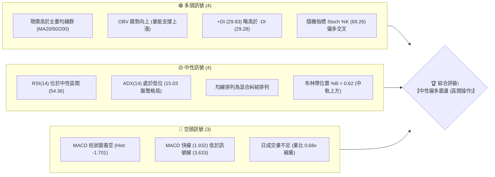
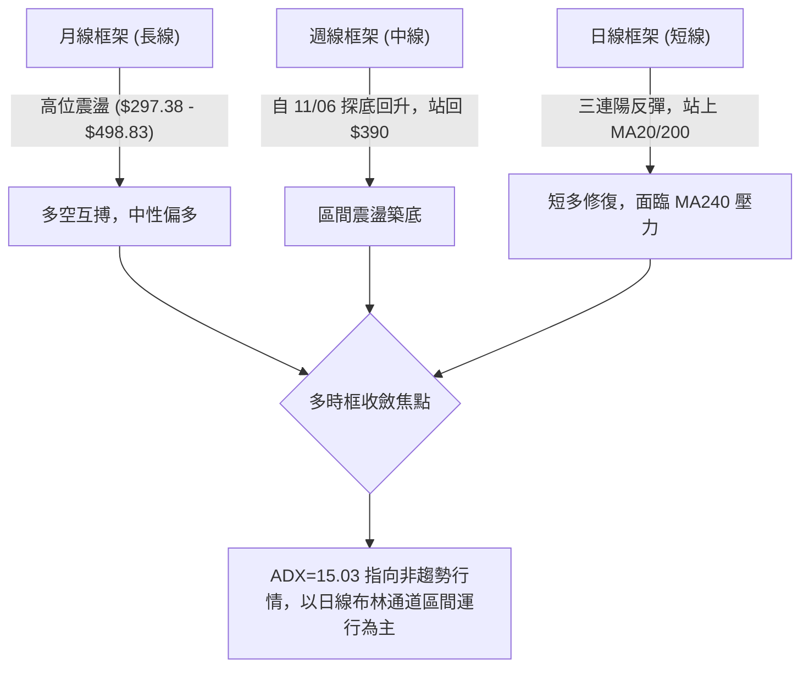
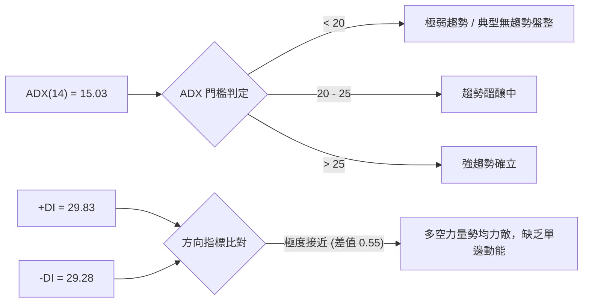
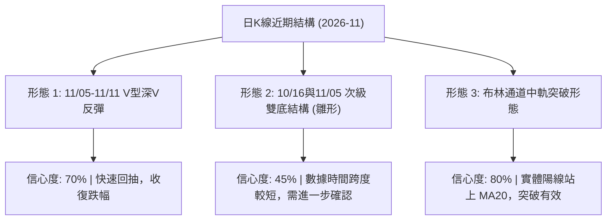
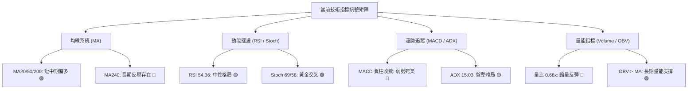
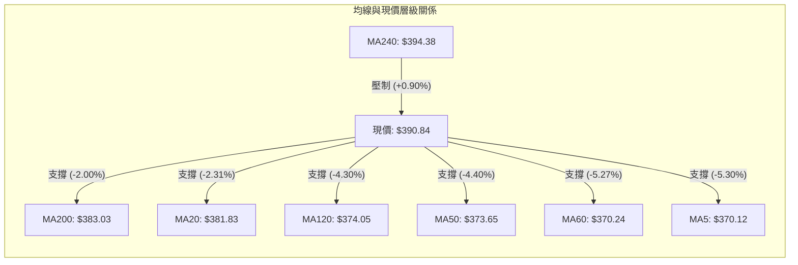
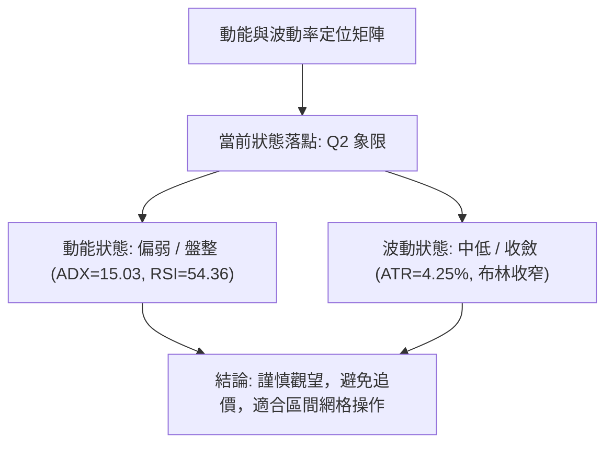
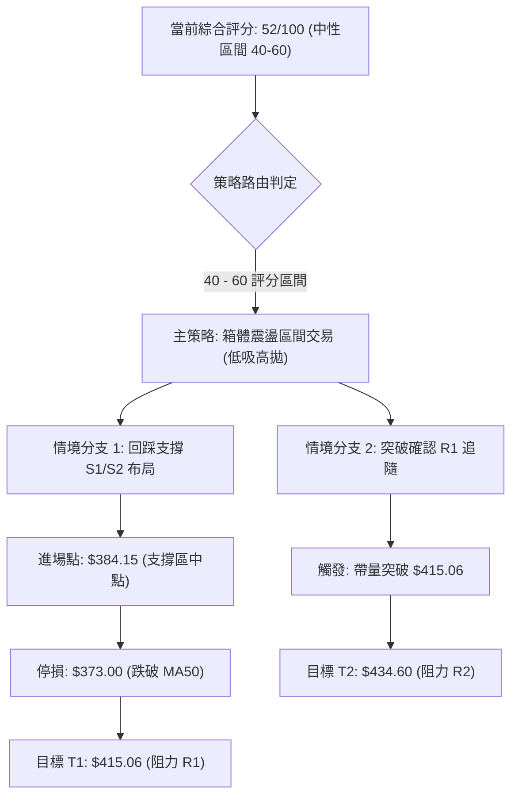
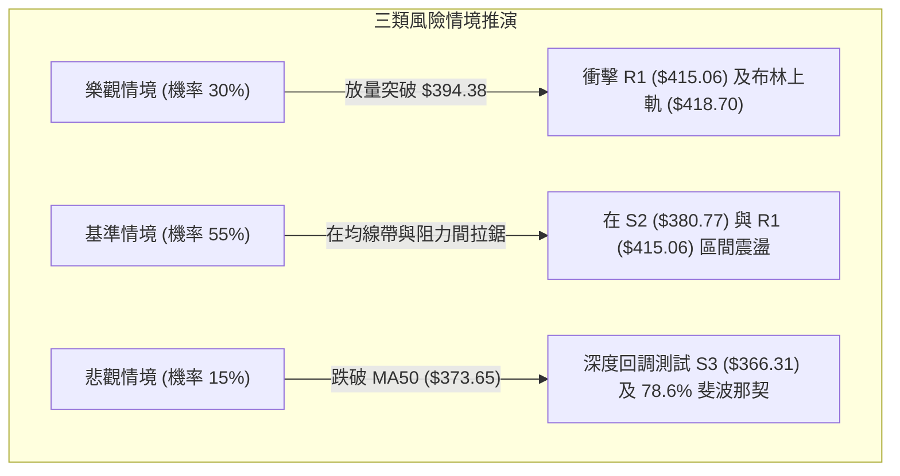

# TSLA 技術分析報告

> **報告日期**：2026-11-12 ｜ **語言**：繁體中文 ｜ **數據來源**：Yahoo Finance ｜ **當前價格**：$390.84

---

## 目錄

| 章節 | 內容 |
|------|------|
| [1. 技術面概覽](#1-技術面概覽) | 訊號儀表板、核心指標、評分卡 |
| [2. 趨勢分析](#2-趨勢分析) | 多時框趨勢、長中短期走勢、ADX強度 |
| [3. 圖表形態分析](#3-圖表形態分析) | 形態識別、K線組合、目標價推算 |
| [4. 支撐與阻力](#4-支撐與阻力) | 關鍵價位、斐波那契回調結構 |
| [5. 技術指標深度解讀](#5-技術指標深度解讀) | 均線系統、RSI、MACD、布林通道、OBV |
| [6. 動能與波動率](#6-動能與波動率) | 動能四象限、ATR波幅、Beta係數解讀 |
| [7. 多時框架總結](#7-多時框架總結) | 時框評分、訊號矩陣、多時框收斂 |
| [8. 交易策略建議](#8-交易策略建議) | 策略路由、價格情境、主策略詳情、風報比 |
| [9. 風險提示與監控](#9-風險提示與監控) | 監控清單、情境推演、風控紀律 |
| [10. 報告總結](#-報告總結) | 全文核心結論與最優策略組合 |

---

## 1. 技術面概覽

### 🎯 技術訊號儀表板



### 📊 核心指標速覽表

| 指標類別 | 指標名稱 | 當前數值 | 訊號 | 專業解讀 |
|:---|:---|:---|:---:|:---|
| **價格基準** | 當前收盤價 | $390.84 | 🟢 | 站上多條關鍵均線，自11/05低點$338.15強力反彈 |
| **短期均線** | MA20 | $381.83 | 🟢 | 現價高於 MA20，短期多頭掌握發球權 |
| **中期均線** | MA50 | $373.65 | 🟢 | 現價高於 MA50，中期波段支撐確立 |
| **長期均線** | MA200 | $383.03 | 🟢 | 現價突破牛熊分界線 MA200，結構顯著改善 |
| **超長均線** | MA240 | $394.38 | 🔴 | 現價低於 MA240（-0.90%），上方形成實質動態壓制 |
| **動能震盪** | RSI(14) | 54.36 | 🟡 | 位於 50 分水嶺上方，無超買超賣，多空動能均衡 |
| **趨勢動能** | MACD(12,26,9) | 1.932 / 3.633 | 🔴 | MACD 處於死叉狀態，柱狀圖為 -1.701，動能尚在修復 |
| **趨勢強度** | ADX(14) | 15.03 | 🟡 | 數值遠低於 25，顯示當前處於無方向的盤整震盪期 |
| **通道位置** | Bollinger %B | 0.62 | 🟢 | 位於中軌（$381.83）與上軌（$418.70）之間的多頭區 |
| **波動風險** | ATR(14) | $16.61 | 🟡 | 日波動率 4.25%，波幅適中，提供足夠交易震幅 |
| **成交量能** | 20日量比 | 0.68x | 🔴 | 最新量 27.59M 低於均量 40.78M，反彈動能呈現量縮 |

### 🏆 技術評分卡

```
╔══════════════════════════════════════════════════════════════╗
║               技術評分卡 — TSLA (2026-11-12)                ║
╠══════════════════════════════════════════════════════════════╣
║ 趨勢強度 (ADX=15.03 盤整)     ████████░░░░░░░░░░░░  40/100 🟡 ║
║ 動能指標 (RSI=54 / MACD死叉)  ██████████░░░░░░░░░░  52/100 🟡 ║
║ 支撐穩定度 (站回多條均線)     █████████████░░░░░░░  65/100 🟢 ║
║ 成交量配合 (OBV偏多/日量偏低) ██████████░░░░░░░░░░  50/100 🟡 ║
║ 形態完整度 (V型修復/缺大形態) ███████████░░░░░░░░░  55/100 🟡 ║
║ 均線排列 (混合糾結/上方壓制)  ██████████░░░░░░░░░░  50/100 🟡 ║
╠══════════════════════════════════════════════════════════════╣
║ 綜合評分 (六項算術平均)       ██████████░░░░░░░░░░  52/100 🟡 ║
║ 最終評級：中性震盪 (Neutral Consolidation)                   ║
╚══════════════════════════════════════════════════════════════╝
```

---

## 2. 趨勢分析

### 🌐 多時框趨勢分析



### 📈 長期趨勢 — 12個月走勢圖（Unicode）

以下圖表繪製 TSLA 過去 12 個月（2025-12 至 2026-11）之月線收盤走勢與關鍵高低點結構：

```
TSLA 月線走勢圖（過去12個月）
價格軸 ($)
$460 ┤                    ●(2025-12: $449.72)
$440 ┤              ●(2026-01: $430.41)       ●(2026-05: $435.79)
$420 ┤                                              ●(2026-06: $420.60)
$400 ┤        ●(2026-02: $402.51)                         ●(2026-10: $399.81)
$380 ┤                                      ●(2026-04: $381.63)    ●←現價 $390.84
$360 ┤                    ●(2026-03: $371.75)             ●(2026-08: $367.95)
$340 ┤                                                          ●(2026-09: $354.81)
$320 ┤                                              ●(2026-07: $311.21 低點)
     └─────────────────────────────────────────────────────────────────────────►
        12M   01M   02M   03M   04M   05M   06M   07M   08M   09M   10M   11M
       '25   '26   '26   '26   '26   '26   '26   '26   '26   '26   '26   '26
```

**12個月走勢階段特徵分析表**：

| 階段時間區間 | 起始價 → 終止價 | 漲跌幅 | 走勢特徵與結構意涵 |
|:---|:---|:---:|:---|
| **2025-12 ~ 2026-03** | $449.72 → $371.75 | -17.34% | 自歷史相對高位逐步滑落，形成第一波中級回調 |
| **2026-03 ~ 2026-05** | $371.75 → $435.79 | +17.23% | 築底反彈，多頭再次挑戰 $430-$440 高位阻力區 |
| **2026-05 ~ 2026-07** | $435.79 → $311.21 | -28.59% | 快速下殺探測 52 週低點附近（波段低點收盤 $311.21） |
| **2026-07 ~ 2026-10** | $311.21 → $399.81 | +28.47% | 震盪攀升，多頭修復失地重返 $400 大關邊緣 |
| **2026-10 ~ 2026-11** | $399.81 → $390.84 | -2.24% | 11月初劇烈下影線洗盤後反彈，現處於寬幅震盪中軸 |

### 📊 中期趨勢（週線分析）

中期走勢呈現「寬幅箱體震盪」格局。自 2026 年 7 月低點 $311.21 確立後，週線低點逐步墊高（$348.75 → $354.72 → 近期低點 $338.15），多頭抵抗力道顯著。然而，上方於 $400.00 - $415.00 區域形成厚重套牢籌碼。

```
週線級別價格壓力與支撐結構
══════════════════════════════════════════════════════════════
$415.06 ─────────────────────────────────── 週線近期波段高點阻力 R1
                     ▲ 
                     │ 震盪回升區間
                     ▼ 
$390.84 ═══════════════════════════════════ 當前現價位置 (突破週線均線帶)
                     ▲ 
                     │ 下檔防守緩衝區
                     ▼ 
$380.77 ─────────────────────────────────── 週線防守支撐 S2 / 50日均線
$366.31 ─────────────────────────────────── 週線強支撐 S3
══════════════════════════════════════════════════════════════
```

### ⚡ 趨勢強度評估（ADX 解讀）



**ADX 趨勢強度量化對照表**：

| 指標名稱 | 實際數值 | 參考標準 | 當前市場狀態判定 |
|:---|:---:|:---:|:---|
| **ADX (14)** | **15.03** | < 20 極弱 / 25 趨勢分界 | 🔴 **非趨勢市場（無單邊方向）** |
| **+DI (多方)** | **29.83** | > -DI 為多方主導 | 🟢 略微佔優，多方具備主動發起權 |
| **-DI (空方)** | **29.28** | > +DI 為空方主導 | 🟡 緊咬不放，空方拋壓並未徹底消退 |
| **操作指引** | 盤整市操作 | 嚴禁追漲殺跌 | **以布林通道與關鍵支撐阻力做高拋低吸** |

---

## 3. 圖表形態分析

### 🔍 形態識別系統



**圖表形態識別與信心度評估表**（依規則 15）：

| 形態名稱 | 信心度 | 判斷依據（嚴格引用歷史數據） | 形態完成度 | 目標價（附嚴謹計算式） |
|:---|:---:|:---|:---:|:---|
| **布林中軌突破形態** | **80%** | 11/11 收盤 $390.84 明確穿透中軌 MA20 ($381.83) | 100% | 布林上軌壓制價位：**$418.70** |
| **短期 V 型修復反轉** | **70%** | 11/05 創 $338.15 低點後連收三陽，收復 $390 | 85% | 頸線 $385.19 + (頸線 $385.19 - 低點 $338.15) = **$432.23**（接近 R2 $434.60） |
| **雙底形態 (次級雛形)** | **45%** | 10/16 低點 $349.33 與 11/05 低點 $338.15 構成雙低 | 60% | 訊號不足，信心度 <50%，僅作次級參考，不作主力交易依據 |

### 🕯️ 重要 K 線形態分析

嚴格依據近 10 根日 K 與近 8 根週 K 之實際 OHLCV 數據進行專業解讀：

#### 近 10 根日 K 線形態解讀表

| 日期 (日K) | 開盤價 | 最高價 | 最低價 | 收盤價 | K線形態名稱 | 專業技術解讀 | 訊號 |
|:---|:---:|:---:|:---:|:---:|:---|:---|:---:|
| 2026-10-29 | 405.63 | 406.98 | 400.50 | 403.30 | 窄幅小陰線 | 高位整理，多頭推進動能初顯疲態 | 🟡 |
| 2026-10-30 | 393.22 | 404.22 | 387.52 | 399.81 | 下影陽線 | 回踩 S1 附近獲買盤支撐，低位承接強 | 🟢 |
| 2026-11-02 | 404.66 | 414.23 | 397.61 | 403.82 | 長上影十字陽 | 衝擊 R1 ($415.06) 失敗，高位獲利了結壓盤 | 🔴 |
| 2026-11-03 | 406.25 | 406.50 | 396.53 | 398.50 | 實體回調陰線 | 跌破 $400 整數關卡，短期回調展開 | 🔴 |
| 2026-11-04 | 379.80 | 392.04 | 375.50 | 385.19 | 破位跳空長陰 | 跳空跌破 MA20，引發恐慌性停損 | 🔴 |
| 2026-11-05 | 374.12 | 374.30 | 338.15 | 343.69 | 放量恐慌大長陰 | 成交量激增至 79.67M，下影探底爆量換手 | 🔴 |
| 2026-11-06 | 348.92 | 363.84 | 347.60 | 358.22 | 底部包容陽線 | 低開高走，確認 11/05 爆量低點有效 | 🟢 |
| 2026-11-09 | 360.25 | 382.20 | 360.02 | 378.05 | 強勢反彈長大陽 | 實體漲幅達 +5.5%，直接吃掉前兩日跌幅 | 🟢 |
| 2026-11-10 | 370.85 | 380.00 | 370.40 | 379.78 | 高位窄幅小陽星 | 量縮整理（23.99M），多方積蓄上攻動能 | 🟡 |
| 2026-11-11 | 386.58 | 395.43 | 386.35 | 390.84 | 跳空高開光腳陽 | 跳空突破 MA20 及 MA200，多頭全面反撲 | 🟢 |

#### 近 8 根週 K 線形態解讀表

| 日期 (週K結算) | 開盤價 | 最高價 | 最低價 | 收盤價 | K線形態名稱 | 專業技術解讀 | 訊號 |
|:---|:---:|:---:|:---:|:---:|:---|:---|:---:|
| 2026-09-25 | 371.64 | 386.83 | 367.67 | 372.11 | 衝高回落紡錘線 | 測試 $388 未果，均線交織 | 🟡 |
| 2026-10-02 | 368.06 | 374.60 | 345.88 | 370.59 | 長下影錘頭陰星 | 探底 $345 後強烈反抽，下檔支撐顯現 | 🟢 |
| 2026-10-09 | 369.00 | 388.56 | 364.91 | 382.70 | 溫和放量週陽線 | 多頭推進，週線收高至 $382.70 | 🟢 |
| 2026-10-16 | 382.61 | 382.70 | 349.33 | 354.72 | 烏雲蓋頂大週陰 | 吞噬前週漲幅，中線回調風險驟增 | 🔴 |
| 2026-10-23 | 357.50 | 388.86 | 354.47 | 372.22 | 下影震盪反彈陽 | 低位獲買盤承接，週線拉回整理中軸 | 🟢 |
| 2026-10-30 | 383.83 | 410.85 | 383.73 | 399.81 | 光頭突破大長陽 | 站上 $399，多頭蓄勢挑戰 $415 | 🟢 |
| 2026-11-06 | 404.66 | 414.23 | 338.15 | 358.22 | 巨幅震盪長下影陰 | 單週振幅高達 $76，爆出 234M 巨量洗盤 | 🟡 |
| 2026-11-11 | 360.25 | 395.43 | 360.02 | 390.84 | 週中強力修復長陽 | 僅 3 個交易日即收復前週失地半數以上 | 🟢 |

### 📉 ASCII 走勢形態示意圖

```
TSLA 近期日線 V 型反彈與均線穿越結構
價格
$415.06 ┤                     ● (11/02 高點 $414.23 - 遭遇 R1 壓制)
        │                    / \
$400.00 ┤        ●----------●   \
        │       /                 \
$381.83 ┤──────/───────────────────●────── (MA20 / MA200 穿越點 $381-$383)
        │     /                     \    / ▲ (現價 $390.84 突破向上)
$360.00 ┤    /                       \  /
        │   /                         ● (11/06 回升陽線 $358.22)
$338.15 ┤  /                           ● (11/05 恐慌低點 $338.15 爆量築底)
        └──────────────────────────────────────────────────────────► 時間
           10/29 10/30 11/02 11/03 11/04 11/05 11/06 11/09 11/10 11/11
```

### 🎯 形態目標價計算

根據日線自 11/05 恐慌低點至 11/11 反彈所構建之「V型深幅對稱反轉」形態高度推算：
- **形態低點**：$338.15 (2026-11-05 盤中最低價)
- **形態頸線**：$385.19 (2026-11-04 跳空破位前實體收盤價)
- **形態垂直高度**：$385.19 - $338.15 = **$47.04**
- **推算第一目標價 (T1)**：頸線 $385.19 + (0.618 × $47.04) = $385.19 + $29.07 = **$414.26**（完全對應至高點阻力聚類 R1: **$415.06**）
- **推算第二目標價 (T2)**：頸線 $385.19 + (1.000 × $47.04) = $385.19 + $47.04 = **$432.23**（對應至上方波段阻力 R2: **$434.60**）

---

## 4. 支撐與阻力

### 🗺️ 關鍵價位分布圖（Unicode）

```
TSLA 價位結構分布圖（嚴格依據 OHLCV 歷史聚類數據）
═══════════════════════════════════════════════════════════════
$445.60 ║██████████████████████████████║ 強阻力 R3 (年內極限壓力區間)
$434.60 ║████████████████████          ║ 重阻力 R2 (中期反彈波段頂部)
$418.70 ║░░░░░░░░░░░░░░░░░░░░          ║ 布林通道上軌
$415.06 ║████████████████████████      ║ 關鍵阻力 R1 (11/02波段高點/斐波那契疊合)
$398.10 ║──────────────────────────────║ 52週斐波那契 50.0% 回調位
$394.38 ║······························║ MA240 年線反壓位
$390.84 ╠══════════════════════════════╣ ◄ 當前收盤價 (現價)
$387.53 ║▓▓▓▓▓▓▓▓▓▓▓▓▓▓▓▓▓▓▓▓          ║ 近期第一支撐 S1 (10/30低點支撐聚類)
$381.83 ║------------------------------║ 布林通道中軌 (MA20)
$380.77 ║████████████████████████      ║ 核心波段支撐 S2 (MA20/MA50共振支撐帶)
$366.31 ║██████████████████████████████║ 極強防守支撐 S3 (中線牛熊防線)
$344.97 ║░░░░░░░░░░░░░░░░░░░░          ║ 布林通道下軌
═══════════════════════════════════════════════════════════════
```

### 🚧 阻力位分析表

阻力位嚴格引用 OHLCV 計算之聚類數值，嚴禁捏造：

| 阻力級別 | 準確價位 | 距現價幅動 | 形成原因與籌碼結構 | 突破難度 | 重要性 |
|:---|:---:|:---:|:---|:---:|:---:|
| **R1** | **$415.06** | +6.20% | 11/02 高點聚類與近期多次衝高回落成交密集區 | 🟡 中等 | ★★★★☆ |
| **R2** | **$434.60** | +11.20% | 2026年5月及10月多次反彈波段頂部套牢籌碼峰 | 🔴 極高 | ★★★★☆ |
| **R3** | **$445.60** | +14.01% | 近一年長期大型頭部頸線壓力位，賣壓沉重 | 🔴 極高 | ★★★★★ |

### 🛡️ 支撐位分析表

支撐位嚴格引用 OHLCV 計算之聚類數值：

| 支撐級別 | 準確價位 | 距現價幅動 | 形成原因與買盤基礎 | 守住機率 | 重要性 |
|:---|:---:|:---:|:---|:---:|:---:|
| **S1** | **$387.53** | -0.85% | 10/30 波段回踩低點，日K實體密集交織支撐點 | 🟢 75% | ★★★☆☆ |
| **S2** | **$380.77** | -2.58% | MA20 ($381.83) 與 MA200 ($383.03) 均線共振支撐帶 | 🟢 85% | ★★★★★ |
| **S3** | **$366.31** | -6.28% | 9月中旬與10月多次回撤低點聚類，中期防守底線 | 🟢 90% | ★★★★☆ |

### 📐 斐波那契回調位分析

依據 52 週完整波動區間（低點 **$297.38** → 高點 **$498.83**，總垂直落差 **$201.45**）精確計算之黃金分割水準：

```
斐波那契回調位階分布 (52W: $297.38 → $498.83)
0.0%  (52W High) ───────────────────────── $498.83
23.6% 回調位    ───────────────────────── $451.29  (強阻力區間上方)
38.2% 回調位    ───────────────────────── $421.88  (介於 R1 與 R2 之間)
50.0% 回調位    ───────────────────────── $398.10  (多空強弱分水嶺)
[當前現價位置]  ═════════════════════════ $390.84  (介於 50% 與 61.8% 之間)
61.8% 黃金分割  ───────────────────────── $374.33  (黃金分割核心支撐，緊貼 MA50 $373.65)
78.6% 回調位    ───────────────────────── $340.49  (11/05 恐慌低點 $338.15 精準落於此處)
100.0%(52W Low)  ───────────────────────── $297.38
```

**斐波那契結構深度解讀**：
1. **現價位置意涵**：現價 **$390.84** 處於 61.8% 回調位（$374.33）與 50.0% 回調位（$398.10）之間。此區間屬於典型的「空頭回補修復區間」。
2. **多空分水嶺**：**$398.10**（50.0% 回調位）是短線由弱轉強的關鍵門檻。若能實體陽線站穩 $398.10，代表自 $498.83 以來的回調已被多頭收復半數，行情將轉為測試 38.2%（$421.88）及 R1（$415.06）。
3. **支撐重疊確認**：61.8% 黃金分割位 **$374.33** 與 MA50（$373.65）形成極高精度的「技術共振」，此處已構成中線多頭絕對不可失守的核心防線。

---

## 5. 技術指標深度解讀

### 🎛️ 指標訊號總覽



### 📈 移動平均線排列分析



**移動平均線系統詳細量化表**：

| 均線名稱 | 當前價格 | 與現價偏離度 | 歷史走勢特徵 | 訊號評級 | 技術面意涵 |
|:---|:---:|:---:|:---|:---:|:---|
| **MA 5** | $370.12 | +5.60% | ▁▁▁▂▃▄▄▄▄▄▃▂▂▂▂▃▃▄▅▆▇████▅▄▃▂▃ | 🟢 多頭 | 超短線自低點快速拉起，斜率急劇轉正 |
| **MA 10** | $384.12 | +1.75% | ▁▁▁▁▁▁▁▂▂▃▃▂▂▂▂▂▂▂▃▄▅▇████▇▇▆▆ | 🟢 多頭 | 穿越 MA200，提供短線回踩第一緩衝 |
| **MA 20** | $381.83 | +2.36% | ▁▁▁▁▂▂▂▃▃▃▃▃▃▃▃▃▃▃▅▆▇▇████▇▇▇█ | 🟢 多頭 | 月線級別支撐，現價已成功站上中軌 |
| **MA 50** | $373.65 | +4.60% | — (中線生命線) | 🟢 多頭 | 季線平緩向上，中期多頭架構完好 |
| **MA 60** | $370.24 | +5.56% | ▂▁▁▁▁▁▁▁▁▁▁▁▁▂▂▃▃▄▄▅▅▆▆▇▇▇████ | 🟢 多頭 | 與 MA5 形成共振支撐 |
| **MA120** | $374.05 | +4.49% | ████████▇▇▇▇▇▇▇▇▆▆▆▆▆▅▅▄▄▂▂▁▁▁ | 🟢 多頭 | 半年線走平，中長線趨於平衡 |
| **MA200** | $383.03 | +2.04% | — (年線/牛熊分界線) | 🟢 多頭 | 多頭收復牛熊分水嶺，意義重大 |
| **MA240** | $394.38 | -0.90% | ███▇▇▇▆▆▆▅▅▄▄▃▃▃▂▂▂▂▂▂▂▂▂▁▁▁▁▁ | 🔴 空頭 | 超長天期壓制，現價正遭遇此線考驗 |

**均線綜合結論**：目前均線系統呈現「**短中期均線向上穿越長期均線，但遭遇超長期 MA240 壓制**」的混合糾結排列。下檔在 $380-$383 區間（MA20 與 MA200）凝聚強大的均線支撐帶，而上檔 $394.38 的 MA240 若不能帶量突破，短線易出現均線回踩確認走勢。

### 📉 RSI(14) 分析

```
RSI(14) 當前狀態: 54.36 (Wilder 算法)
超賣區 (0-30)          中性分水嶺 (50)          超買區 (70-100)
├───────────────┼───────────────●───────────────┤
0              30              54.36           70             100
[░░░░░░░░░░░░░░░░░░░░░░░░░░░░░░░██████████░░░░░░░░░░░░░░░░░░░░] 54.36%
```

- **區間評估**：RSI 讀數 **54.36** 位於 30-70 的標準常態區間，並已站上 50 中性格局分水嶺，表明多頭在擺盪動能上略微掌握主動權，尚未進入超買過熱區。
- **背離判斷**：數據明確提示「**RSI 背離：無明顯背離**」（比對近 20 根 K 棒價格與 RSI 方向並未出現底背離或頂背離），這意味著當前價格的反彈是純粹的技術性修復，未出現動能衰竭或背離反轉跡象。

### 📊 MACD(12,26,9) 訊號解讀

```mermaid
graph TD
    subgraph MACD_STATUS ["MACD("12,26,9") 動能狀態"]
        DIF["DIF (快線): 1.932"]
        DEA["DEA (訊號線): 3.633"]
        HIST["MACD 柱狀圖: -1.701"]
        
        DIF -->|"快線低於慢線 (死叉)"| DEAD_CROSS["死叉格局 🔴"]
        HIST -->|"負柱處於修復階段"| RECOVERY["動能處於空頭衰退期 🟡"]
    end
```

- **數值分析**：快線 DIF 為 **1.932**，慢線 DEA 為 **3.633**，柱狀圖 Hist 為 **-1.701**。
- **動能解讀**：雖然 MACD 仍處於死叉看空狀態，但快線與慢線均維持在零軸之上（正值區），顯示大級別趨勢仍屬多頭範疇。當前負柱狀圖縮減至 -1.701（此前 11/06 週結算為 -4.225），說明空頭動能正在急劇消耗，短期內有形成低位金叉的潛力。

### 📦 布林通道分析

```
布林通道結構與現價相對位置 (帶寬通道分析)
══════════════════════════════════════════════════════════════
$418.70 ─────────────────────────────────── 布林上軌 (Upper Band)
                     ▲
                     │ 剩餘上行空間 +$27.86 (+7.13%)
                     ▼
$390.84 ═══════════════════════════════════ 當前現價 (Bollinger %B = 0.62)
                     ▲
                     │ 回調緩衝空間 -$9.01 (-2.31%)
                     ▼
$381.83 ─────────────────────────────────── 布林中軌 (Middle Band = MA20)
                     ▲
                     │
$344.97 ─────────────────────────────────── 布林下軌 (Lower Band)
══════════════════════════════════════════════════════════════
```

- **位置判定**：當前 **%B 數值為 0.62**，精確座落於中軌（0.50）與上軌（1.00）之間的多頭掌控區。
- **軌道狀態**：布林帶未出現喇叭口極端擴張，上下軌呈收斂後的平緩狀態，再次佐證市場正處於「以中軌為支撐、以上軌為目標」的箱體區間震盪行情。

### 💹 成交量分析（量價配合度）

1. **量能對比**：最新單日成交量為 **27,590,811 股**，較 20 日均量（**40,776,836 股**）顯著萎縮，量比僅 **0.68x**。
2. **量價關係解讀**：價格在連續反彈突破均線的過程中成交量反而縮減，呈現典型的「**量價背離（價漲量縮）**」。這代表此波反彈主要動力來自於空頭停損回補，而非場外新進主力資金的強勢搶盤。
3. **OBV 能量潮解讀**：長期指標顯示「**OBV > MA → 量能支撐上漲**」。雖然短期日成交量偏低，但中期能量潮累計水準並未破位，維持高於其移動平均線的姿態，意味著長線機構籌碼鎖定度依然良好，未見主力棄莊出逃跡象。

---

## 6. 動能與波動率

### ⚡ 動能評估四象限



**動能與波動率四象限對照表**：

| 象限 | 動能強度 | 波動率水準 | 特徵描述 | TSLA 當前狀態符合性 | 交易指導原則 |
|:---:|:---:|:---:|:---|:---:|:---|
| **Q1** | 強動能 | 低波動 | 穩定單邊趨勢，最佳進場點 | — | 持股順勢加碼 |
| **Q2** | **弱動能** | **低波動** | **區間震盪整理，動能收斂** | **✓ (高度吻合)** | **高拋低吸，嚴設止損** |
| **Q3** | 強動能 | 高波動 | 極端突破或主升浪行情 | — | 突破追隨策略 |
| **Q4** | 弱動能 | 高波動 | 恐慌崩跌或多空劇烈絞殺 | — | 離場觀望避險 |

### 📊 ATR 波動率分析

- **ATR(14) 實際讀數**：**$16.61**（Wilder 計算，佔當前價格之 **4.25%**）。
- **日內波動特徵**：TSLA 每日正常隱含價格波動範圍達 ±$16.61 美元，屬於典型的高彈性資產。
- **止損距離建議**：
  - **超短線/日內止損**：1.0 × ATR = **$16.61**（以現價計對應約 $374.23）。
  - **波段交易止損**：1.5 × ATR = **$24.92**（以現價計對應約 $365.92）。
  - **核心防守邊界**：結合關鍵支撐 S2（$380.77），進場時止損距離應不小於 $10.07（約 0.6 × ATR），以防止被隨機市場雜訊掃出場。

### 📐 Beta 與市場相關性

- **Beta 係數**：**1.743**。
- **市場敏感度**：TSLA 波動率約為標普 500 指數的 1.74 倍，具備強烈的高 Beta 成長股屬性。
- **避險警示**：在當前大盤指數（如 Nasdaq 100 期貨）出現地緣或權重股波動新聞干擾下，TSLA 將放大市場整體的系統性風險，波段操作必須嚴格控制整體部位敞口。

---

## 7. 多時框架總結

### 📋 時框架評分表

| 時框架 | 趨勢方向 | 動能狀態 | 均線排列 | 形態特徵 | 綜合評分 | 戰略建議 |
|:---|:---:|:---:|:---:|:---|:---:|:---|
| **月線 (長期)** | 震盪偏多 | 中性偏強 (RSI 55+) | 股價位於長均上方 | 寬幅箱體高位震盪 ($297-$498) | **60/100** | 長線持股，中性配置 |
| **週線 (中期)** | 築底反彈 | 死叉但負柱收斂 | 均線相互糾結 | 11/06 探底巨幅下影線修復 | **55/100** | 區間震盪操作，勿盲目追多 |
| **日線 (短期)** | 短多修復 | 中性略多 (RSI 54) | 站上 MA20/50/200，遇 MA240 | 三連陽 V 型反彈，面臨阻力聚類 | **52/100** | 逢低布局，遇阻力分批停利 |

### 🔲 綜合訊號矩陣

```
時框訊號一致性矩陣
維度          短期 (日線)       中期 (週線)       長期 (月線)       整體一致性判定
────────────────────────────────────────────────────────────────────────────
趨勢方向      🟢 短多修復      🟡 區間震盪      🟢 長期向上      🟡 中度共振 (缺乏單邊趨勢)
動能狀態      🟡 中性擺盪      🔴 MACD修復中    🟢 處於強勢區    🟡 多空抵消
均線排列      🟡 混合糾結      🟡 纏繞未發散    🟢 多頭架構      🟡 均線糾結待方向突破
成交量能      🔴 縮量反彈      🟢 週洗盤換手    🟢 OBV長線偏多   🟡 量價配合尚需觀察
────────────────────────────────────────────────────────────────────────────
收斂總結：短期偏強反彈，中期區間受限，長期牛市基調未毀，整體處於收斂三角形末端。
```

### ⚖️ 多時框收斂結論

**依規則 14 嚴格收斂判定**：
1. **行情屬性判定**：當前 ADX(14) 讀數僅為 **15.03**（遠低於 25），嚴格定義為「**典型非趨勢 / 盤整行情**」。
2. **主導時框裁決**：在盤整行情中，不可採用中長線單邊趨勢突破策略，必須以**日線布林通道（下軌 $344.97 — 中軌 $381.83 — 上軌 $418.70）作為核心交易區間**。
3. **最終方向性結論**：**中性偏多震盪（區間操作）**。日線雖強勢修復，但上方遭受 MA240（$394.38）及波段阻力 R1（$415.06）強力壓制；下檔則有 S1（$387.53）與 S2（$380.77）築成的均線護城河。多空雙方均無力走出單邊行情，主策略必須聚焦於「**回踩支撐低吸、逼近阻力高拋**」的箱體震盪策略。

---

## 8. 交易策略建議

### 🗺️ 策略決策流程圖



### 🧭 策略路由（依評分卡分流）

> **當前主策略方向 = 【中性偏多震盪區間操作】（嚴格依據技術評分卡 52/100 路由）**

- **戰略基調**：綜合評分 52 分座落於 40–60 區間，ADX 低於 25。技術面不支持大倉位追漲，主推「**回踩強支撐低吸（策略 A）**」與「**突破確認阻力順勢操作（策略 B）**」。

### 🎯 價格情境階梯（Price Scenarios）

價位嚴格引用第 4 章聚類數據，無自行捏造數值：

| 觸發條件 | 下一目標 | 後續延伸 | 技術情境含義與操作要點 |
|:---|:---:|:---:|:---|
| **強勢突破 R1 ($415.06)** | **R2 ($434.60)** | **R3 ($445.60)** | 短線全面轉強，宣告走出盤整箱體，開啟波段上攻 |
| **站穩現價區間 ($387-$394)** | **$400.00** | **R1 ($415.06)** | 區間震盪整理，消化 MA240 浮動賣壓，等待量能放大 |
| **跌破 S1 ($387.53)** | **S2 ($380.77)** | **S3 ($366.31)** | 短期修復中斷，回踩測試 MA20/MA200 關鍵共振支撐帶 |

### 📊 情境機率分佈

| 情境類別 | 機率估計 | 主要技術依據（嚴格引用指標現狀） |
|:---|:---:|:---|
| **區間震盪蓄勢** | **55%** | ADX=15.03 處於極低位；布林通道寬度收窄；量比 0.68x 顯示買賣雙方量能均受限 |
| **延續反彈上攻** | **30%** | 現價突破 MA20/MA50/MA200；OBV 持續高於均線；日K連收三陽帶動技術買盤 |
| **再度下探再探底** | **15%** | MACD 仍處於負柱死叉；MA240 ($394.38) 反壓沉重；外部高 Beta 波動外溢風險 |

### 🟢 主策略詳情

進場價格如為區間，嚴格以區間中點計算風報比（依規則 17）：

| 策略要素 | 策略 A（核心主推：支撐低吸策略） | 策略 B（輔助備選：突破追隨策略） |
|:---|:---|:---|
| **交易邏輯** | 回踩 MA20/MA200 均線支撐帶企穩低吸 | 帶量突破前期反彈波段高點 R1 追隨 |
| **進場條件** | 股價回踩 $380.77-$387.53 區間且收下影線 | 日K實體收盤價突破 R1 ($415.06) 且日量>40M |
| **進場價格** | **$384.15**（取 S1 與 S2 之中點計算） | **$415.06**（嚴格引用 R1 關鍵價位） |
| **第一目標價 T1** | **$415.06**（引用 R1 關鍵阻力位） | **$434.60**（引用 R2 關鍵阻力位） |
| **第二目標價 T2** | **$434.60**（引用 R2 關鍵阻力位） | **$445.60**（引用 R3 關鍵阻力位） |
| **止損價格** | **$373.00**（跌破 MA50 $373.65 及 61.8% 斐波那契） | **$403.82**（跌破 11/02 突破發起點日K收盤） |
| **風險報酬比 (T1)** | **1 : 2.77（以 T1 計）**<br>計算式: ($415.06 - $384.15) ÷ ($384.15 - $373.00) = $30.91 ÷ $11.15 | **1 : 1.74（以 T1 計）**<br>計算式: ($434.60 - $415.06) ÷ ($415.06 - $403.82) = $19.54 ÷ $11.24 |
| **風險報酬比 (T2)** | **1 : 4.52（以 T2 計）**<br>計算式: ($434.60 - $384.15) ÷ $11.15 = $50.45 ÷ $11.15 | **1 : 2.72（以 T2 計）**<br>計算式: ($445.60 - $415.06) ÷ $11.24 = $30.54 ÷ $11.24 |
| **勝率預估** | **65%** | **50%** |
| **建議倉位** | **15% - 20%**（控制單筆風險上限） | **10%**（突破確認後加碼） |

### 🔴 反向風險觸發點（對沖與風控提示）

以下關鍵價位為**推翻上述中性偏多策略之反轉觸發點**，一旦觸發應立即終止多頭思維：
1. **短線轉弱預警**：若日 K 實體跌破 **S1 ($387.53)**，意味著短線突破宣告失敗，應將多頭倉位減半。
2. **多頭止損出局點**：若價格帶量跌破 **S2 ($380.77)** 及 MA50（**$373.65**），代表近期的 V 型反彈全數被空頭吞噬，形態轉為二次探底，所有多單必須果斷止損離場，並可建立空頭避險倉位，下看 S3（$366.31）甚至恐慌低點 $338.15。

### ⭐ 整體訊號強度評星

```
╔══════════════════════════════════════════════════════════════╗
║ 做多訊號強度：★★★☆☆  (3/5星 — 短期修復具備空間，唯量能不足)   ║
║ 做空訊號強度：★★☆☆☆  (2/5星 — 均線提供短支撐，空頭動能減退)   ║
║ 整體技術可信度：★★★☆☆  (3/5星 — 盤整期震盪劇烈，信號易鈍化) ║
╚══════════════════════════════════════════════════════════════╝
```

---

## 9. 風險提示與監控

### ✅ 關鍵監控指標 Checklist

```
╔══════════════════════════════════════════════════════════════╗
║               TSLA 交易日常監控清單 (Checklist)              ║
╠══════════════════════════════════════════════════════════════╣
║ [ ] 價格是否成功實體站穩 MA240 ($394.38)？                   ║
║ [ ] RSI(14) 能否持續維持在 50 中性線上，或上衝突破 60？      ║
║ [ ] MACD 柱狀圖 (當前 -1.701) 是否如期向上穿過零軸翻紅？    ║
║ [ ] 單日成交量能否放大跨越 20 日均量 (40.77M 股) 達到量價共振？║
║ [ ] ADX(14) 是否脫離 15 盤整區，向上突破 25 迎來趨勢行情？   ║
║ [ ] 下檔關鍵防線 S2 ($380.77) 在回踩時是否具備強烈買盤支撐？  ║
╚══════════════════════════════════════════════════════════════╝
```

### ⚠️ 風險場景分析



### 🛡️ 風險管理重要提醒

1. **高 Beta 波動控管**：TSLA Beta 高達 **1.743**，日 ATR 達 **$16.61**（4.25%）。在盤整市中極易出現日內假突破與假跌破，切忌單日內進行情緒化追單，進場點必須緊靠關鍵價位邊界。
2. **倉位限制紀律**：在 ADX < 20 的非趨勢盤整市場中，總部位曝險建議不超過總投資資金之 **20%**，單筆交易虧損風險必須嚴格控制在總資金的 **1%** 以內。
3. **重大外部事件與基本面干擾**：最新財報顯示營收微幅下滑（-0.2%），淨利潤衰退（-42.7%），本益比高達 400 倍以上。技術面一旦遭遇基本面負面雜音或大盤回檔，極易跌破技術支撐，嚴格執行防守點止損為第一鐵律。

---

## 📋 報告總結

```
TSLA 技術分析報告總結
════════════════════════════════════════════════════════════════
報告日期：2026-11-12
當前收盤價格：$390.84
綜合技術評級：⚖️ 52/100 🟡 中性震盪 (Neutral Consolidation)

關鍵結論：
├─ 長期趨勢：🟢 月線處於寬幅箱體高位 ($297.38 - $498.83)，長線多頭基調完好
├─ 中期趨勢：🟡 週線經歷巨震探底回升，重返均線密集區，呈現無方向震盪
├─ 短期趨勢：🟢 日線三連陽突破 MA20 與 MA200，短多修復但量能背離
├─ 關鍵支撐：S1: $387.53 ｜ S2: $380.77 ｜ S3: $366.31
├─ 關鍵阻力：R1: $415.06 ｜ R2: $434.60 ｜ R3: $445.60
└─ 分析師目標價：均價 $412.48（最高 $600.00 / 最低 $128.11）

最優策略組合：
1. 🥇 最佳機會（策略 A - 支撐低吸）：
   等待股價良性回踩 S1-S2 支撐區間中點 $384.15 介入，止損設於 $373.00，
   第一目標看向 R1 $415.06，風報比高達 1 : 2.77（以 T1 計）。
2. 🥈 次選機會（策略 B - 突破追隨）：
   若多方強勢帶量突破 R1 $415.06，則順勢進場，目標上看 R2 $434.60，
   止損嚴設於 $403.82，風報比為 1 : 1.74（以 T1 計）。
3. 🥉 保守選擇（觀望等待）：
   鑑於 ADX=15.03 處於極度盤整期，保守型投資人可保持空倉觀望，
   靜待 MACD 柱狀圖翻正且日量能放大突破均量後再行進場。
════════════════════════════════════════════════════════════════
```

---

> ⚠️ **免責聲明**：本報告為 AI 自動生成之技術分析，所有數據及估算均基於提供的歷史價格資訊。本報告**僅供研究與學術參考**，**不構成任何投資建議**。投資有風險，入市需謹慎。

---

*報告生成時間：2026-11-12 ｜ 數據來源：Yahoo Finance ｜ 分析框架：多時框技術分析*