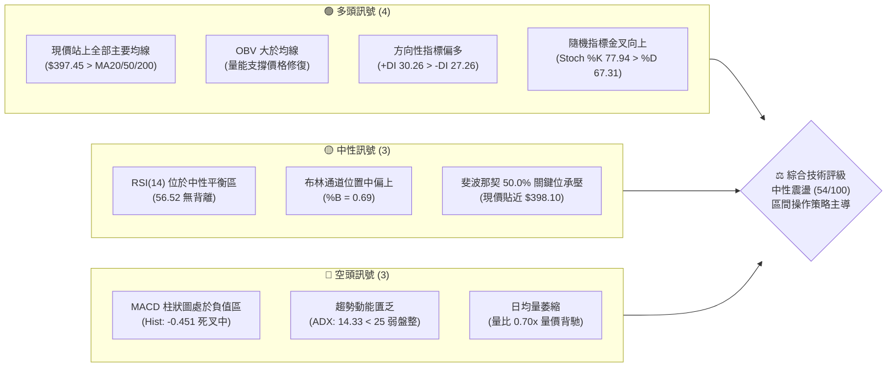
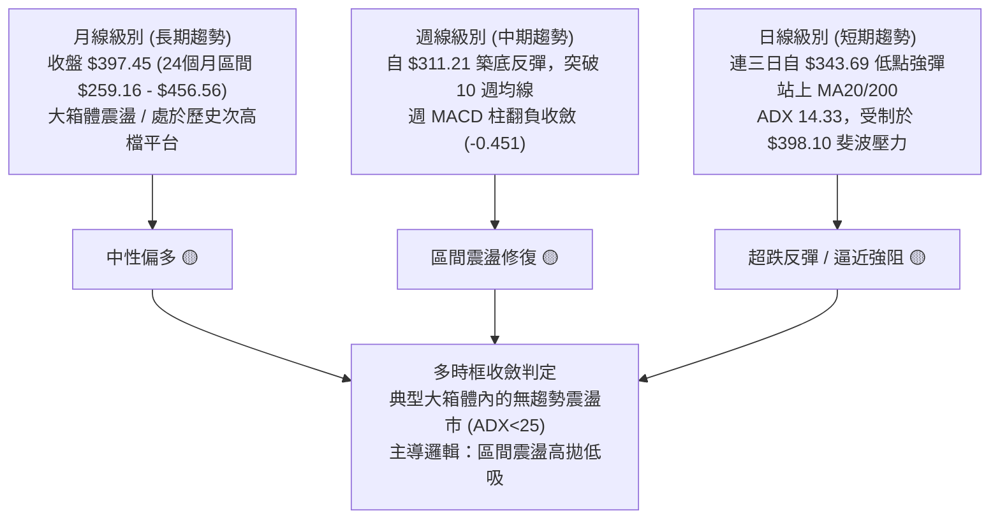
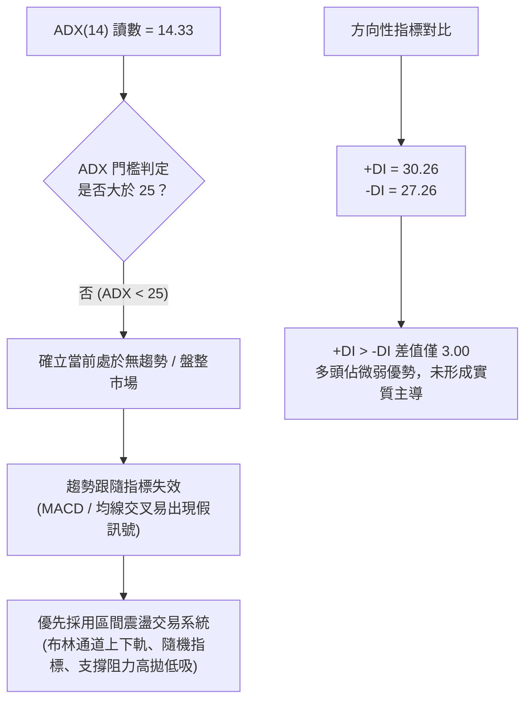
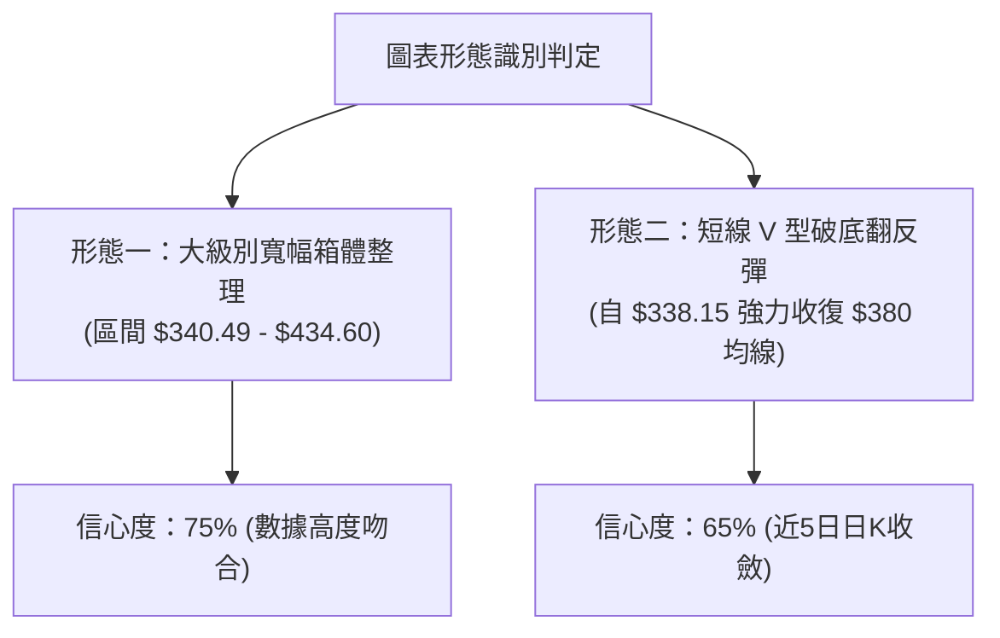
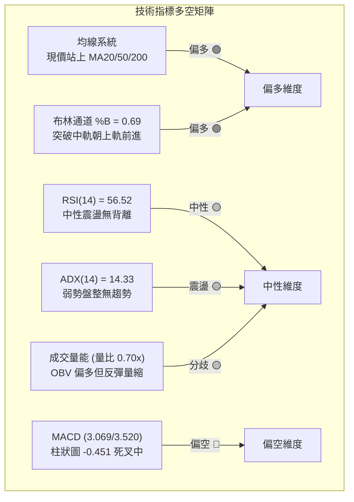
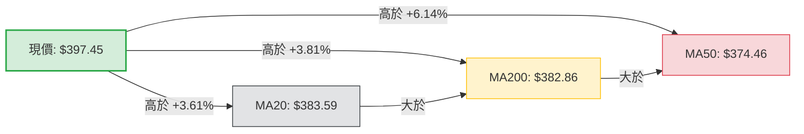
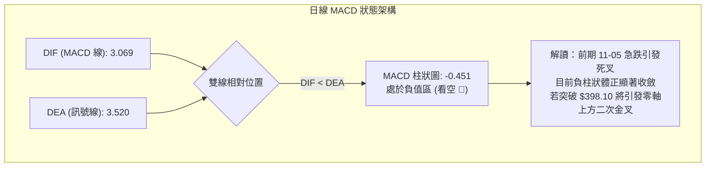
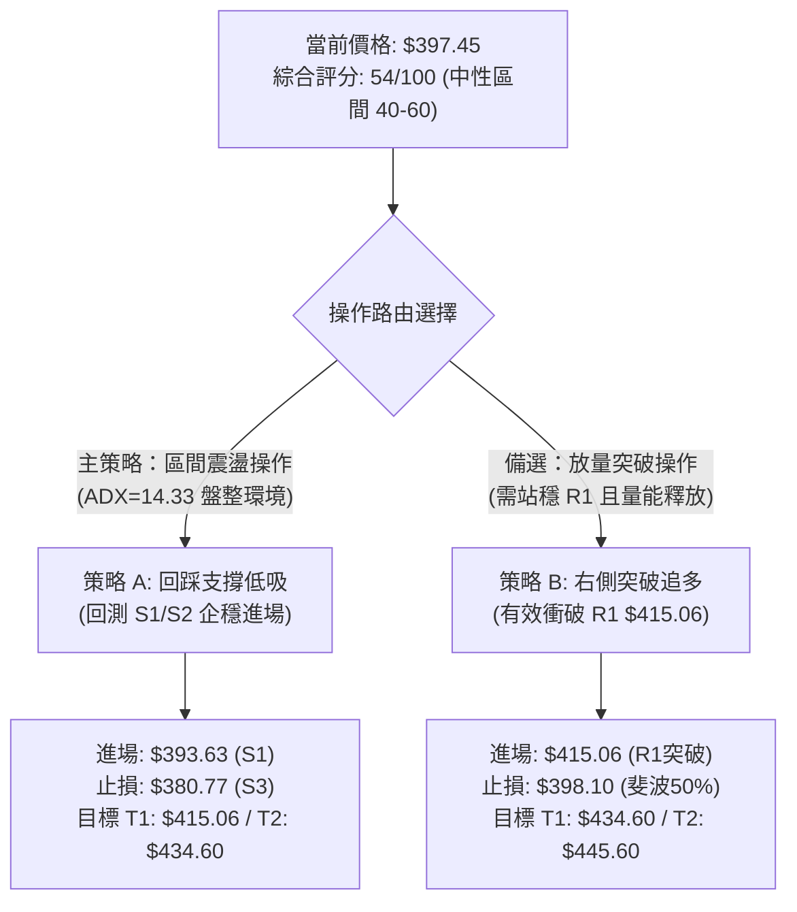
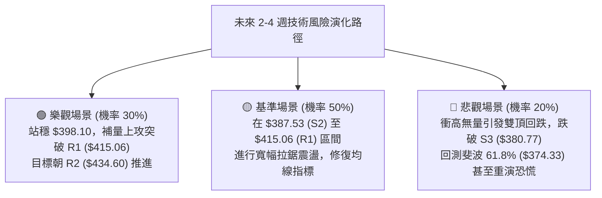

# TSLA 技術分析報告

> **報告日期**：2026-11-13 ｜ **語言**：繁體中文 ｜ **數據來源**：Yahoo Finance ｜ **當前價格**：$397.45

---

## 目錄

| 章節 | 內容 |
|------|------|
| [1. 技術面概覽](#1-技術面概覽) | 訊號儀表板、核心指標、評分卡 |
| [2. 趨勢分析](#2-趨勢分析) | 多時框趨勢、長中短期走勢 |
| [3. 圖表形態分析](#3-圖表形態分析) | 形態識別、K線組合、目標價 |
| [4. 支撐與阻力](#4-支撐與阻力) | 關鍵價位、斐波那契回調 |
| [5. 技術指標深度解讀](#5-技術指標深度解讀) | MA/RSI/MACD/布林/成交量 |
| [6. 動能與波動率](#6-動能與波動率) | 動能評估、ATR、Beta |
| [7. 多時框架總結](#7-多時框架總結) | 時框架評分矩陣 |
| [8. 交易策略建議](#8-交易策略建議) | 多空策略、風險報酬比 |
| [9. 風險提示與監控](#9-風險提示與監控) | 監控指標、風險場景 |

---

## 1. 技術面概覽

### 🎯 技術訊號儀表板



---

### 📊 核心指標速覽表

| 指標類別 | 指標名稱 | 當前數值 | 訊號 | 專業解讀 |
|----------|----------|----------|------|----------|
| **價格** | 當前收盤價 | $397.45 | 🟡 | 位於 52 週區間之 49.7%，恰好於中軸進行方向選擇 |
| **均線** | 短期 MA20 | $383.59 | 🟢 | 現價高於 MA20 達 +3.61%，短線多頭掌控回踩支撐 |
| **均線** | 中期 MA50 | $374.46 | 🟢 | 現價高於 MA50 達 +6.14%，中期生命線維持向上發散 |
| **均線** | 長期 MA200 | $382.86 | 🟢 | 現價重返牛熊分界線上方 (+3.81%)，長線技術面改善 |
| **均線排列** | 多均線結構 | 混合排列 | 🟡 | MA200 高於 MA50，尚未形成標準牛市多頭排列 |
| **動能** | RSI(14) | 56.52 | 🟡 | 處於 30–70 常態區間中軸上方，無明顯超買或超賣 |
| **趨勢動能** | MACD (12,26,9) | 3.069 / 3.520 | 🔴 | MACD 線低於 Signal 線，Hist 負值 (-0.451)，空頭控盤 |
| **趨勢強度** | ADX(14) | 14.33 | 🔴 | 遠低於 25，顯示當前缺乏單邊趨勢，屬典型箱型震盪 |
| **通道指標** | 布林通道 | $347.28–$419.89 | 🟡 | %B = 0.69，突破中軌（$383.59）朝上軌（$419.89）運行 |
| **成交量能** | 量比 / OBV | 0.70x / 多頭 | 🟡 | 反彈過程成交量低於 20 日均量，但 OBV 持續高於均線 |
| **波動風險** | ATR(14) | $16.57 | 🔴 | 每日震幅佔比達 4.17%，短期價格波動風險依然偏高 |

---

### 🏆 技術評分卡

```
╔══════════════════════════════════════════════════════════════╗
║              TSLA 技術面綜合評分卡 (2026-11-13)              ║
╠══════════════════════════════════════════════════════════════╣
║ 趨勢強度 (ADX=14.33, 弱勢無單邊)  ████████░░░░░░░░░░░░  42/100 🔴 ║
║ 動能指標 (RSI中性, MACD柱為負)    ███████████░░░░░░░░░  54/100 🟡 ║
║ 支撐穩定度 (站穩S1及斐波50%下方)   ██████████████░░░░░░  68/100 🟢 ║
║ 成交量配合 (OBV偏多但量比僅0.70x) ██████████░░░░░░░░░░  48/100 🟡 ║
║ 形態完整度 (自338低點V型強反彈)   ██████████░░░░░░░░░░  52/100 🟡 ║
║ 均線排列 (現價站上MA, 但結構混亂) ████████████░░░░░░░░  60/100 🟢 ║
╠══════════════════════════════════════════════════════════════╣
║ 綜合評分 (六項算術平均四捨五入)   ███████████░░░░░░░░░  54/100 🟡 ║
║ 技術評級：中性震盪 (Neutral Consolidation)                   ║
╚══════════════════════════════════════════════════════════════╝
```
*註：綜合評分 = (42 + 54 + 68 + 48 + 52 + 60) ÷ 6 = 54.0分。*

---

## 2. 趨勢分析

### 🌐 多時框趨勢分析



---

### 📈 長期趨勢 — 12個月走勢圖（Unicode）

以下展示 TSLA 過去 12 個月（2025-12 至 2026-11）之月度收盤價走勢軌跡：

```
TSLA 月線走勢圖（過去12個月）
價格軸 ($)
$460 ┤               
$440 ┤ ●(12月:449.72)
$430 ┤     ●(01月:430.41)         ●(05月:435.79)
$420 ┤                             ●(06月:420.60)
$400 ┤         ●(02月:402.51)                       ●(10月:399.81)
$390 ┤                                                 ●(現價:397.45)
$380 ┤                     ●(04月:381.63)
$370 ┤             ●(03月:371.75)             ●(08月:367.95)
$350 ┤                                     ●(09月:354.81)
$310 ┤                                 ●(07月低點:311.21)
     └─┬─────┬─────┬─────┬─────┬─────┬─────┬─────┬─────┬─────┬─────┬───
      12月  01月  02月  03月  04月  05月  06月  07月  08月  09月  10月 11月
     (2025) ────────────────────────── (2026) ─────────────────────────
```

#### 長期走勢特徵分析表

| 階段時間 | 月份區間 | 價格起訖 | 漲跌幅 | 走勢特徵描述 |
|----------|----------|----------|--------|--------------|
| **高位盤整** | 2025-12 ～ 2026-02 | $449.72 → $402.51 | -10.50% | 創下 52 週高點 $498.83 後動能衰竭，月K逐步收陰 |
| **首輪回撤** | 2026-02 ～ 2026-03 | $402.51 → $371.75 | -7.64% | 跌破 $380 均線平台，尋求季線支撐 |
| **次高反撲** | 2026-03 ～ 2026-05 | $371.75 → $435.79 | +17.23% | 中期強力軋空，構築次高雙頂架構 |
| **急速崩落** | 2026-05 ～ 2026-07 | $435.79 → $311.21 | -28.59% | 2026年最大單波下挫，探至年度次低點 $311.21 |
| **底部回升** | 2026-07 ～ 2026-11 | $311.21 → $397.45 | +27.71% | 歷經 3 個月震盪築底後，自低位展開大級別均值回歸 |

---

### 📊 中期趨勢（週線分析）

中期走勢呈現「寬幅區間震盪」，下檔於 $311.21 形成堅實支撐，上檔則在 $415.00–$435.00 密集套牢區形成顯著阻力：

```
TSLA 週線關鍵架構示意圖
══════════════════════════════════════════════════════════════
$434.60 ──── 波段阻力 R2 (2026-05 反彈頂部延伸區)
   │
$415.06 ──── 近期高點阻力 R1 (2026-11-02 日高 $414.23 連線)
   │
$397.45 ──── 當前收盤價 (週線長下影反彈中軸)
   │
$380.77 ──── 週線關鍵支撐 S3 (MA200 / 08-09月築底頸線)
   │
$338.15 ──── 近期異動波段低點 (2026-11-05 恐慌拋售點)
══════════════════════════════════════════════════════════════
```

---

### ⚡ 趨勢強度評估（ADX 解讀）



#### ADX 趨勢強度量化對照表

| ADX 區間 | 趨勢狀態 | 本股讀數 (14.33) | 交易指引 |
|----------|----------|-------------------|----------|
| **0 – 20** | **極弱趨勢 / 橫向盤整** | **當前落點 (14.33)** | **嚴禁追高殺跌，以布林通道與關鍵支撐阻力進行區間操作** |
| 20 – 25 | 趨勢孕育期 | — | 觀察均線收斂度，等待放量突破確認 |
| 25 – 40 | 明確單邊趨勢 | — | 順勢操作，採用均線跟蹤止損 |
| 40 – 60 | 強勁單邊趨勢 | — | 趨勢延伸，持股續抱直至出現背離 |

---

## 3. 圖表形態分析

### 🔍 形態識別系統



#### 圖表形態信心度與目標價評估表

| 形態名稱 | 信心度 | 判斷依據（引用數據） | 完成度 | 目標價計算式與結論 |
|----------|--------|----------------------|--------|--------------------|
| **寬幅箱體整理** | 75% | 自 2026-07 低點 $311.21 反彈後，持續受阻於 R2 $434.60，下檔於斐波 78.6%（$340.49）獲得強烈承接 | 70% | 箱頂阻力即為數據關鍵位 **$434.60**；下軌邊界為 **$340.49** |
| **短線 V 型破底翻** | 65% | 11-05 跌破 S3 觸及 $338.15 後迅速收復，11-12 連續4日實體陽線重返 MA20（$383.59）上方 | 85% | 形態高度 = 頸線突破位 $387.53 (S2) − 波谷低點 $338.15 = $49.38。<br/>推算目標價 = $387.53 + $49.38 = **$436.91**（高度共振數據阻力 R2 $434.60） |
| **頭肩底形態** | 35% | 訊號不足，僅做指標型解讀 | 20% | 左右肩結構不對稱，成交量未達標準，不予推算延伸目標 |

---

### 🕯️ 重要K線形態分析

嚴格依據近 10 根日K與近 8 根週K之歷史價格數據展開專業解析：

#### 近 10 根日K線形態分析

| 日期 | 開盤價 | 最高價 | 最低價 | 收盤價 | 成交量 | K線形態 | 深度解讀與多空訊號 |
|------|--------|--------|--------|--------|--------|---------|--------------------|
| 2026-10-30 | 393.22 | 404.22 | 387.52 | 399.81 | 41,737,200 | 中陽線 | 🟡 實體突破 $398 斐波位，但高檔拋壓初現 |
| 2026-11-02 | 404.66 | 414.23 | 397.61 | 403.82 | 43,141,100 | 長上影紡錘 | 🔴 衝擊 R1（$415.06）未果，形成近兩週波段頂部 |
| 2026-11-03 | 406.25 | 406.50 | 396.53 | 398.50 | 26,647,700 | 縮量陰十字 | 🔴 高檔量縮盤整，多頭動能迅速衰竭 |
| 2026-11-04 | 379.80 | 392.04 | 375.50 | 385.19 | 47,805,800 | 跳空大陰線 | 🔴 開盤大幅跳空下挫，直接擊穿 MA20 支撐 |
| 2026-11-05 | 374.12 | 374.30 | 338.15 | 343.69 | 79,675,500 | 爆量長陰棒 | 🔴 恐慌性重挫，創 7967 萬股天量，下探波段極低點 |
| 2026-11-06 | 348.92 | 363.84 | 347.60 | 358.22 | 36,730,400 | 低位錘頭陽 | 🟢 觸底後量能腰斬，下影線透露低檔有買盤低吸護盤 |
| 2026-11-09 | 360.25 | 382.20 | 360.02 | 378.05 | 36,341,400 | 大陽實體 | 🟢 跳空走高，展開 V 型破底翻第一階段收復 |
| 2026-11-10 | 370.85 | 380.00 | 370.40 | 379.78 | 23,999,800 | 縮量小陽線 | 🟡 測試 MA50（$374.46）支撐確立，拋壓大幅鈍化 |
| 2026-11-11 | 386.58 | 395.43 | 386.35 | 390.84 | 27,872,700 | 實體中陽線 | 🟢 強勢站上 MA200（$382.86）與 MA20（$383.59） |
| 2026-11-12 | 385.85 | 401.22 | 385.20 | 397.45 | 28,830,920 | 帶上影陽線 | 🟢 站上 $397，逼近 $398.10 斐波位，短線獲利回吐 |

#### 近 8 根週K線形態分析

| 週末交易日 | 開盤價 | 最高價 | 最低價 | 收盤價 | 成交量 | K線形態 | 深度解讀與多空訊號 |
|------------|--------|--------|--------|--------|--------|---------|--------------------|
| 2026-09-25 | 371.64 | 386.83 | 367.67 | 372.11 | 170,517,200 | 窄幅十字星 | 🟡 均線密集交纏，中期多空僵持 |
| 2026-10-02 | 368.06 | 374.60 | 345.88 | 370.59 | 197,592,000 | 下影長陰星 | 🟢 測試 $345 支撐後迅速回升，確立底部承接力 |
| 2026-10-09 | 369.00 | 388.56 | 364.91 | 382.70 | 162,910,000 | 突破中陽線 | 🟢 帶量突破 MA200 壓制，波段轉多 |
| 2026-10-16 | 382.61 | 382.70 | 349.33 | 354.72 | 158,434,300 | 光頭大陰線 | 🔴 獲利回吐，直接摜破 MA50，形態走壞 |
| 2026-10-23 | 357.50 | 388.86 | 354.47 | 372.22 | 206,190,900 | 下影反彈陽 | 🟢 伴隨 2.06 億股放量吞噬回升，修復跌幅 |
| 2026-10-30 | 383.83 | 410.85 | 383.73 | 399.81 | 198,617,700 | 長紅帶上影 | 🟢 衝破 $400 大關，逼近前期阻力密集區 |
| 2026-11-06 | 404.66 | 414.23 | 338.15 | 358.22 | 234,000,500 | 巨量長下影陰 | 🔴 單週震幅高達 $76.08，爆出 2.34 億股恐慌盤後強烈抵抗 |
| 2026-11-12 | 360.25 | 401.22 | 360.02 | 397.45 | 117,044,820 | 強勁包覆長紅 | 🟢 4個交易日內收復前週大半跌幅，多頭絕地反撲 |

---

### 📉 ASCII 走勢形態示意圖

```
TSLA 近 10 日 K 線形態與突破結構
價格 ($)
$415 ┤         ┌─┐ (11-02 日高 $414.23 阻力 R1)
$405 ┤     ┌─┐ │ │
$398 ┼─────│─│─│─│───────────────────────● 現價 $397.45 (斐波 50%)
$390 ┤     │ │ │ │                 ┌─┐ ┌─┐
$380 ┤     └─┘ └─┘ ┌─┐         ┌─┐ │ │ │ │ (均線聚攏區 MA20/200: $383)
$370 ┤             │ │     ┌─┐ │ │ └─┘ └─┘
$350 ┤             │ │ ┌─┐ │ │ └─┘
$340 ┤             └─┘ │ │ └─┘
$338 ┤                 └─┘ (11-05 恐慌低點 $338.15)
     └─────┬───┬───┬───┬───┬───┬───┬───┬───┬────
          10-30 11-02 11-04 11-05 11-06 11-09 11-10 11-11 11-12
```

---

## 4. 支撐與阻力

### 🗺️ 關鍵價位分布圖（Unicode）

```
TSLA 價位結構分布圖 (由實際 OHLCV 與斐波那契精確生成)
═══════════════════════════════════════════════════════════════════
$498.83 ║████████████████████████████████████████║ 52週歷史高點 / 0.0% 斐波位
$451.29 ║████████████████████████████████        ║ 斐波那契 23.6% 回調壓力
$445.60 ║██████████████████████████████          ║ 強阻力位 R3 (波段密集套牢峰值)
$434.60 ║██████████████████████████              ║ 重要阻力 R2 (2026-05 反彈頂部聚類)
$421.88 ║██████████████████████                  ║ 斐波那契 38.2% 回調位
$419.89 ║█████████████████████                   ║ 布林通道日線日曆上軌
$415.06 ║████████████████████                    ║ 近期關鍵阻力 R1 (11-02 高點聚類)
$398.10 ╠════════════════════════════════════════╣ ◄ 斐波那契 50.0% 中軸水平線
$397.45 ╠════════════════════════════════════════╣ ◄ 當前市價 (收盤價)
$393.63 ║▓▓▓▓▓▓▓▓▓▓▓▓▓▓▓▓▓▓▓▓                    ║ 近期第一支撐 S1 (多空爭奪樞紐)
$387.53 ║████████████████████                    ║ 核心支撐 S2 (波段頸線聚類)
$383.59 ║██████████████████                      ║ 日線 MA20 暨布林中軌
$380.77 ║████████████████                        ║ 強支撐 S3 (MA200 與波段密集低點)
$374.33 ║████████████                            ║ 斐波那契 61.8% 黃金分割強支撐
$347.28 ║████████                                ║ 布林通道日線日曆下軌
$340.49 ║████                                    ║ 斐波那契 78.6% 回調位
$297.38 ║                                        ║ 52週歷史低點 / 100.0% 斐波位
═══════════════════════════════════════════════════════════════════
```

---

### 🚧 阻力位分析表

所列阻力位均引自關鍵價位聚類與技術幾何結構：

| 阻力級別 | 具體價位 | 距現價幅幅 | 形成原因與技術背景 | 突破難度評估 | 重要性級別 |
|----------|----------|------------|--------------------|--------------|------------|
| **R1** | **$415.06** | +4.43% | 2026-11-02 日高點 $414.23 與近一年波段高點聚類；上方緊鄰布林上軌 $419.89 | 🟡 中等（需日均量擴大至 4,000 萬股以上方可衝破） | ★★★★☆ |
| **R2** | **$434.60** | +9.35% | 2026年5月反彈高點 $435.79 聚類區，大級別箱體頂部邊界 | 🔴 偏高（大量套牢籌碼沉澱區） | ★★★★★ |
| **R3** | **$445.60** | +12.11% | 2025年9-12月歷史次高平台密集籌碼峰值；上方直接呼應 23.6% 斐波位 $451.29 | 🔴 極高（中期強大多頭行情延伸目標） | ★★★★☆ |

---

### 🛡️ 支撐位分析表

所列支撐位均引自波段低點聚類與重要均線支撐：

| 支撐級別 | 具體價位 | 距現價幅幅 | 形成原因與技術背景 | 守住機率評估 | 重要性級別 |
|----------|----------|------------|--------------------|--------------|------------|
| **S1** | **$393.63** | -0.96% | 近期震盪波段低點聚類，11-11 中陽線之低位防守點 | 🟢 70%（短線回調的第一道緩衝防線） | ★★★☆☆ |
| **S2** | **$387.53** | -2.50% | 10-30 波段起漲低點與 11-11 開盤低點密集共振區 | 🟢 80%（多頭破底翻重要頸線基石） | ★★★★☆ |
| **S3** | **$380.77** | -4.20% | MA200（$382.86）與 MA20（$383.59）重合防區，波段多頭生命線 | 🟢 85%（中期牛熊多空轉換底線） | ★★★★★ |

---

### 📐 斐波那契回調位分析

本波斐波那契回調計算基準嚴格採用 52 週完整波動區間（低點 **$297.38** 至 高點 **$498.83**，總振幅 $201.45）：

| 回調比例 | 精確價位 | 技術角色 | 當前相對位置與技術意義深度解讀 |
|----------|----------|----------|--------------------------------|
| **0.0%** | **$498.83** | 52W 最高點 | 長期上升波段頂點，歷史極端超買阻力 |
| **23.6%** | **$451.29** | 淺度回調阻力 | 跌破此位確立長期轉入深度休整，未來大牛市重啟臨界點 |
| **38.2%** | **$421.88** | 關鍵分割阻力 | 與日線布林上軌（$419.89）形成技術共振壓制帶 |
| **50.0%** | **$398.10** | **多空中軸樞紐** | **現價 $397.45 恰好收於此位下方僅 -0.16%，屬兵家必爭之地** |
| **61.8%** | **$374.33** | 黃金分割強支撐 | 與中期生命線 MA50（$374.46）完美重合，構成中期第一鐵底 |
| **78.6%** | **$340.49** | 深度極限支撐 | 11-05 恐慌低點 $338.15 恰在此處止跌，驗證此線為絕對安全邊際 |
| **100.0%** | **$297.38** | 52W 最低點 | 週期週期性大底，長期多頭終極防線 |

**解讀**：現價 $397.45 處於 **38.2% ($421.88)** 與 **50.0% ($398.10)** 的臨界窗口。若能有效放量站穩 $398.10，將向上打開通往 $421.88 的反彈通道；反之若受阻回落，下方 $380.77 至 61.8% ($374.33) 將提供強大技術支撐。

---

## 5. 技術指標深度解讀

### 🎛️ 指標訊號總覽



---

### 📈 移動平均線排列分析



#### 移動平均線數據全覽

| 均線週期 | 當前數值 | 距現價幅度 | 均線斜率與歷史軌跡狀態 | 技術指示 |
|----------|----------|------------|------------------------|----------|
| **MA 5** | $380.87 | +4.35% | 快速自底部勾頭陡峭向上（▅▄▃▂▃▅） | 短期強烈上攻 |
| **MA 10** | $383.53 | +3.63% | 止跌回穩，逐步走平（██▇▇▆▅▅） | 短期防守轉強 |
| **MA 20** | $383.59 | +3.61% | 走勢平緩，目前作為第一動態支撐（▇▇▇██） | 短期中軸支撐 🟢 |
| **MA 50** | $374.46 | +6.14% | 中期基石，持續位於底部托底（▇▇▇▇████） | 中期多頭基石 🟢 |
| **MA 60** | $371.01 | +7.13% | 持續墊高（▆▆▇▇▇▇████） | 季線趨勢向上 🟢 |
| **MA 120**| $373.81 | +6.32% | 半年線緩步走平微幅向下（▅▄▃▂▂▁▁▁） | 中長期壓力鈍化 |
| **MA 200**| $382.86 | +3.81% | 年線牛熊分水嶺，現價已重新收復 | 長線格局修復 🟢 |
| **MA 240**| $394.25 | +0.81% | 歷史超長週期均線，現價剛實現穿越 | 剛性轉強臨界點 |

**均線結構綜合評定**：當前呈現「混合排列」。現價已全面穿越所有短期、中期與長期均線，這是強勁的反彈表徵；然而 MA200（$382.86）仍高於 MA50（$374.46），說明中期牛市架構尚未完全成型，此處更傾向於**大級別箱體震盪中的均線修復收斂行情**。

---

### 📉 RSI(14) 分析

```
RSI(14) 當前讀數：56.52 (Wilder 計算模型)
[超賣 0] ────────── [30] ───────────── [56.52] ──────────── [70] ────────── [100 超買]
░░░░░░░░░░░░░░░░░░░░░░░░░░░░░░██████████████░░░░░░░░░░░░░░░░░░░░░░░░░░░░░░░░░
訊號判定：中性平衡偏多 (常態分佈區間)
```

- **超買超賣判定**：數值 56.52 位於 50 榮枯線上方，脫離了前期在 2026-11-06 週線級別的偏低區域（當時日K觸及 338 時 RSI 接近超賣），目前處於健康溫和狀態，未見過熱跡象。
- **背離分析結論**：嚴格依據近 20 根 K 棒對比，價格在 11-02 創高 $414.23 後回落，隨後於 11-05 探底 $338.15 並在 11-12 回升至 $397.45；RSI 隨同價格自低位同步回升，**未發現頂背離，亦無底背離訊號**，動能與價格走勢保持高度同步。

---

### 📊 MACD(12/26/9) 訊號解讀



- **雙線絕對位置**：DIF 與 DEA 均位於零軸上方（> 0），顯示**中長期架構並未轉入熊市單邊**。
- **柱狀圖動態**：當前柱狀圖為 -0.451。雖然維持死叉看空訊號，但對比週線前幾週負柱（-4.225）已大幅縮腳，表明空頭打壓力道衰竭，處於空頭動能耗盡、多頭伺機反撲的轉折期。

---

### 📦 布林通道分析

```
日線布林通道結構 (週期 20, 帶寬帶動)
$419.89 ┼────────────────────────────── 上軌 (Upper Band)
        │                 
$397.45 ┼─────────────────────●──────── 現價 (%B = 0.69)
        │               ▲  
$383.59 ┼───────────────┼────────────── 中軌 (MA20 Baseline)
        │               │  
$347.28 ┼───────────────┴────────────── 下軌 (Lower Band)
```

- **通道帶寬與位置**：通道寬度為 $72.61（上下軌區間 $347.28 – $419.89）。現價 $397.45 處於中軌（$383.59）之上，**%B 數值為 0.69**。
- **運行動態解讀**：價格成功自下軌上方發動逆襲並強勢收復中軌，目前正朝向日線上軌（$419.89）推進。依照布林軌道交易法則，在無強趨勢（ADX<25）背景下，**上軌 $419.89 與阻力位 R1 $415.06 將構成強烈的動態壓制帶**。

---

### 💹 成交量分析（量價配合度）

#### 量能數據對比

| 成交量指標項目 | 實際數值（股數） | 基準對照 | 量價配合度判定 |
|----------------|------------------|----------|----------------|
| **最新成交量** | 28,830,920 股 | 基準日量 | 🟢 溫和回升 |
| **20日均量** | 40,896,061 股 | 量比 0.70x | 🔴 反彈縮量（低於均量 30%） |
| **50日均量** | 38,064,172 股 | 量比 0.76x | 🔴 買盤追高意願審慎 |
| **OBV 能量潮趨勢** | **OBV > MA** | 持續發散 | 🟢 **量能長線底層依然支撐上漲** |

**量價綜合研判**：近 4 個交易日價格自 $343.69 飆升至 $397.45，成交量卻僅維持在 2,300 萬至 3,600 萬股區間，顯著低於 11-05 恐慌下殺時的 7,967 萬股。這種「反彈量縮」的特徵表明當前上漲多由**空頭回補與賣壓枯竭**所推動，而非增量資金主動強攻。若後續測試 R1（$415.06）時未見 4,000 萬股以上的補量配合，需嚴防衝高回落。

---

## 6. 動能與波動率

### ⚡ 動能評估四象限

```
TSLA 動能與波動率定位矩陣
┌───────────────────────────────────┬───────────────────────────────────┐
│ Q2: 弱動能 ｜ 低波動 (觀望蓄勢)    │ Q1: 強動能 ｜ 低波動 (最佳突破)   │
│                                   │                                   │
│ 特徵：通道縮口，指標黏合          │ 特徵：溫和放量，均線多頭發散      │
├───────────────────────────────────┼───────────────────────────────────┤
│ Q4: 弱動能 ｜ 高波動 (高危區域)    │ Q3: 強動能 ｜ 高波動 (當前落點) ★ │
│                                   │                                   │
│ 特徵：恐慌拋售，單邊下挫          │ 特徵：ATR偏高(4.17%)，短期V彈強烈 │
│                                   │       現處於 Q3 向 Q2 轉換過渡期  │
└───────────────────────────────────┴───────────────────────────────────┘
```

#### 動能與波動特徵對照表

| 象限 | 動能維度 | 波動維度 | 本股狀態 | 操作策略定位 |
|------|----------|----------|----------|--------------|
| **Q1** | 強 | 低 | — | 趨勢穩健，波段加碼最佳良機 |
| **Q2** | 弱 | 低 | — | 盤整築底，耐心等待放量方向確認 |
| **Q3** | **強（反彈）** | **高（ATR $16.57）** | **✓ 當前狀態** | **高風險高利潤，嚴格設定止損，逢高獲利了結** |
| **Q4** | 弱 | 高 | 11-05 狀態 | 崩跌階段，嚴禁盲目摸底 |

---

### 📊 ATR 波動率分析

- **ATR(14) 絕對數值**：**$16.57**。
- **波動百分比**：佔當前市價比重達 **4.17%**（依據 Wilder 計算標準）。
- **日內波動區間推算**：在常態分佈下，單一交易日內之預期理論波動區間為：
  - 預期波動上限：現價 $397.45 + 1.0 ATR ($16.57) = **$414.02**（極度共振 R1 $415.06）
  - 預期波動下限：現價 $397.45 − 1.0 ATR ($16.57) = **$380.88**（完美呼應 S3 $380.77）
- **止損距離設計建議**：
  - 日內／超短線止損：1.0 × ATR = **$16.57**
  - 波段交易安全止損：1.5 × ATR = **$24.86**（對應防守價位約 $372.59，恰好位於 MA50 $374.46 下方）

---

### 📐 Beta 與市場相關性

- **Beta 係數**：**1.743**。
- **市場特徵詮釋**：TSLA 呈現典型的「高貝塔成長股」特徵，其理論波動率為標普 500 指數的 1.74 倍。
- **大盤共振聯動效應**：在近期美股大盤（S&P 500、Nasdaq）受外部宏觀情緒牽動下，TSLA 往往會放大盤勢震盪幅度。高達 1.743 的 Beta 意味著當市場情緒轉向防禦時，下檔必須給予更充裕的緩衝保護空間，不宜在阻力位過度激進追逐多頭。

---

## 7. 多時框架總結

### 📋 時框架評分表

| 時框架 | 趨勢方向 | 動能狀態 | 均線排列 | 主要形態特徵 | 綜合評分 | 戰術建議 |
|--------|----------|----------|----------|--------------|----------|----------|
| **日線 (短線)** | 偏多震盪 🟢 | 中性反彈 (%B 0.69) | 站上所有均線 | V型反轉逼近 $398.10 斐波位 | 58/100 | 逼近 R1 減碼，回踩低吸 |
| **週線 (中線)** | 寬幅盤整 🟡 | 負柱收斂 (Hist -0.451)| 纏繞交錯 | 巨量長下影線修復 ($338–$414) | 52/100 | 箱體中軸操作，不破不立 |
| **月線 (長線)** | 大箱體偏多 🟢 | RSI 56.52 處歷史中高位 | 處於歷史次高 | 過去24個月大型區間整理 | 52/100 | 長期核心底倉續抱 |

---

### 🔲 綜合訊號矩陣

```
TSLA 多維度多時框共振矩陣
維度＼週期       短期 (日線)          中期 (週線)          長期 (月線)
─────────────────────────────────────────────────────────────────
趨勢形態       🟢 V型超跌反撲      🟡 寬幅箱型整理      🟢 次高位強勢震盪
均線結構       🟢 全面收復短期均線  🟡 均線密集交纏      🟢 保持歷史高位平台
量價配合       🔴 縮量反彈有隱患    🟢 爆量下影買盤承接  🟡 成交量結構中性
動能指標       🟡 RSI 56 / MACD負  🟡 MACD負柱縮腳     🟡 處於健康常態帶
波動風險       🔴 ATR高達 $16.57    🔴 週單邊震幅過劇    🟢 長線抗跌韌性顯現
─────────────────────────────────────────────────────────────────
綜合收斂方向：   【中性震盪 (Neutral Consolidation)】— 區間高拋低吸為主
```

---

### ⚖️ 多時框收斂結論

依據多時框收斂優先級規則（Rule 14）：
1. **趨勢強度定性**：當前日線 ADX(14) 讀數為 **14.33**，遠低於 25 的趨勢門檻，確立市場處於**標準的盤整震盪行情（Range-bound Market）**。
2. **多時框權重取捨**：在盤整行情中，趨勢型突破系統往往引發雙向洗盤（Whipsaw）。因此，不可依據連4日長紅而盲目判定單邊大牛市啟動；必須以**日線布林通道上下軌（$347.28 – $419.89）**作為主要交易區間，並以日線波段聚類點位進行精準防守。
3. **唯一收斂結論**：**中性偏多震盪（Neutral / Range Bound）**。現價 $397.45 正好受制於斐波那契 50.0% 關鍵壓制位（**$398.10**），上方 $415.06（R1）至 $419.89 構成重重天花板，而下方 $387.53（S2）與 $380.77（S3）提供穩固護城河。策略應堅決貫徹「**逢阻力減碼止盈、回踩支撐低吸**」的箱體震盪思維。

---

## 8. 交易策略建議

### 🗺️ 策略決策流程圖



---

### 🧭 策略路由

> **當前主策略方向 = 區間震盪操作（依評分卡綜合評分 54/100，落於 40–60 之中性震盪區間）**

本分析報告依據客觀評分，**主推在箱體內部進行高拋低吸之區間策略**，嚴禁於無量環境下在斐波 50% 與 R1 阻力位盲目追高。

---

### 🎯 價格情境階梯（Price Scenarios）

價位嚴格引用第 4 章「關鍵價位」之精確數值：

| 觸發條件 | 第一目標 (T1) | 後續延伸 (T2) | 市場情境與技術含義 |
|----------|---------------|---------------|--------------------|
| **強勢突破 R1 ($415.06)** | **R2 ($434.60)** | **R3 ($445.60)** | 短線全面轉強，補量上攻測試 2026-05 波段雙頂平台 |
| **受阻於現價區間 ($398.10)** | **S1 ($393.63)** | **S2 ($387.53)** | 斐波 50% 壓力發酵，展開回踩均線之消化整理走勢 |
| **有效跌破 S1 ($393.63)** | **S2 ($387.53)** | **S3 ($380.77)** | 超跌反彈動能衰竭，回防 MA20/MA200 核心生命線 |
| **深度擊穿 S3 ($380.77)** | **斐波61.8% ($374.33)** | **下軌 ($347.28)** | 破底翻反彈失敗，重新進入弱勢尋底循環 |

---

### 📊 情境機率分佈

| 情境劇本 | 發生機率 | 主要技術依據 |
|----------|----------|--------------|
| **情境一：受阻區間震盪回踩** | **50%** | ADX 僅 14.33，無單邊動能；量比 0.70x 反彈縮量；上方即為斐波 50%（$398.10）及布林上軌壓制 |
| **情境二：放量突破上行通道** | **30%** | 現價已收復 MA20/50/200，OBV 持續偏多；若市場情緒推動補量，有機會突擊 R1（$415.06） |
| **情境三：反轉破位再探深淵** | **20%** | MACD 柱狀圖仍處負值（-0.451）；若失守 S2（$387.53），恐引發獲利盤與解套盤雙重湧出 |

---

### 🟢 主策略詳情

嚴格依據規則 17 之風險報酬比定義：`風險報酬比 = (目標價 T1 − 進場價) ÷ (進場價 − 止損價)` 計算：

| 策略要素 | 策略 A（主推：回踩支撐低吸） | 策略 B（輔助：右側突破追多） |
|----------|------------------------------|------------------------------|
| **進場條件** | 價格回調測試 S1 支撐獲得確認，出現日K止跌陽線 | 價格日K實體放量突破 R1 且成交量超越 4,500 萬股 |
| **進場價格** | **$393.63**（引用 S1） | **$415.06**（引用 R1） |
| **目標價 T1** | **$415.06**（引用 R1） | **$434.60**（引用 R2） |
| **目標價 T2** | **$434.60**（引用 R2） | **$445.60**（引用 R3） |
| **止損價格** | **$380.77**（引用 S3，跌破 MA200 離場） | **$398.10**（引用斐波 50%，跌回箱體內止損） |
| **風險報酬比** | **1 : 1.67（以 T1 計）**<br/>*(415.06-393.63)÷(393.63-380.77) = 21.43÷12.86*<br/>*[以 T2 計為 1 : 3.19]* | **1 : 1.15（以 T1 計）**<br/>*(434.60-415.06)÷(415.06-398.10) = 19.54÷16.96*<br/>*[以 T2 計為 1 : 1.80]* |
| **歷史模型成功機率** | 65% | 52% |
| **建議配置倉位** | **15% – 20%**（常態倉位） | **8% – 10%**（輕倉試單） |

---

### 🔴 反向風險觸發點（對沖與風控提示）

以下關鍵事件發生時，主推之偏多區間操作策略即告失效，投資人應即刻轉入防守或啟動空頭對沖：
1. **關鍵空頭信號**：日K收盤價跌破 **$387.53 (S2)**，同時伴隨 MACD 負柱狀體急劇擴大（低於 -1.500）。
2. **極端清倉界線**：一旦放量摜破 **$380.77 (S3 / MA200)**，確立反彈終結，應即刻全數離場觀望或建立相應的反向保護頭寸。
3. **假突破誘多陷阱**：若盤中衝破 $415.06 但收盤收出長上影線（類似 11-02 形態）且成交量萎縮，應果斷將多頭部位獲利了結。

---

### ⭐ 整體訊號強度評星

```
做多訊號強度：★★★☆☆  (3/5星，均線支撐完好，但受制於震盪市與阻力)
做空訊號強度：★★☆☆☆  (2/5星，MACD雖死叉但負柱收斂，下檔買盤強勁)
整體可信度：  ★★★★☆  (4/5星，指標與價位結構高度收斂，指引明確)
```

---

## 9. 風險提示與監控

### ✅ 關鍵監控指標 Checklist

```
╔══════════════════════════════════════════════════════════════╗
║              TSLA 每日盤後關鍵技術監控清單                   ║
╠══════════════════════════════════════════════════════════════╣
║ [ ] 價格是否站穩斐波那契 50.0% 關鍵位 ($398.10)              ║
║ [ ] 日成交量是否有效放大突破 20 日均量 (40,896,061 股)        ║
║ [ ] MACD 柱狀圖是否由負轉正 (目前 -0.451，等待金叉形成)      ║
║ [ ] 日線布林通道是否向上開口，價格是否維持在 %B > 0.50       ║
║ [ ] S1 支撐位 ($393.63) 與 MA20 ($383.59) 是否完好無損       ║
║ [ ] ADX(14) 是否脫離盤整區 (突破 20-25 門檻產生新趨勢)      ║
║ [ ] 外部市場動態：大盤科技股波動與高 Beta (1.743) 風險敞口   ║
╚══════════════════════════════════════════════════════════════╝
```

---

### ⚠️ 風險場景分析



---

### 🛡️ 風險管理重要提醒

1. **嚴控單筆交易虧損**：由於 TSLA 之 ATR 高達 **$16.57**（單日波動率逾 4.17%），任何單筆交易之名義風險虧損金額絕對不可超過總投資組合淨值的 **1.5%**。
2. **慎防突發消息面干擾**：近期新聞顯示公司面臨管理層動態、併購傳聞及交付量議題，股價極易在盤前盤後出現跳空裂口。嚴禁滿倉操作，必須保留至少 **40% 以上** 的流動現金緩衝。
3. **動態移動止盈機制**：若執行策略 A 進場且獲利達到 +1.0 ATR（即達到 $410.00 附近），應立即將止損價調升至進場成本價（Breakeven Stop），確保本金絕對安全。

---

## 📋 報告總結

```
╔══════════════════════════════════════════════════════════════╗
║                 TSLA 技術分析報告總結精要                    ║
╠══════════════════════════════════════════════════════════════╣
║ 報告日期：2026-11-13                                         ║
║ 當前價格：$397.45 USD                                        ║
║ 技術評級：⚖️ 54/100 (中性震盪，區間整理)                     ║
║                                                              ║
║ 核心多空結論：                                               ║
║ ├─ 長期趨勢：🟢 偏多（月線處於歷史次高位平台，抗跌韌性強）   ║
║ ├─ 中期趨勢：🟡 中性（週線處於寬幅箱體，經歷恐慌下殺後修復） ║
║ ├─ 短期趨勢：🟢 偏多（V型破底翻連陽，強勢收復短期主要均線）  ║
║ ├─ 核心支撐：S1 $393.63 ｜ S2 $387.53 ｜ S3 $380.77 (MA200)   ║
║ ├─ 關鍵阻力：R1 $415.06 ｜ R2 $434.60 ｜ R3 $445.60           ║
║ └─ 華爾街共識目標價：$412.48 (均值)                          ║
║                                                              ║
║ 最優戰術執行組合：                                           ║
║ 1. 🥇 最佳機會：回踩 S1 ($393.63) 企穩低吸，防守 S3 ($380.77)║
║    目標鎖定 R1 ($415.06)，風報酬比高達 1 : 1.67              ║
║ 2. 🥈 次選機會：靜待放量站穩 R1 ($415.06) 後順勢跟進追多     ║
║ 3. 🥉 保守選擇：在 $380 - $415 區間未打破前，保持輕倉或觀望  ║
╚══════════════════════════════════════════════════════════════╝
```

---

> ⚠️ **免責聲明**：本報告為依據客觀量化技術指標與歷史走勢數據所生成之專業分析，所有數值、評估與策略僅供學術研究與投資邏輯探討之參考，**絕不構成任何個人化的邀約、招攬或投資買賣建議**。金融市場具有高度不確定性，標的資產波動劇烈，投資人應獨立評估自身風險承受能力並自負盈虧。

---
*報告生成時間：2026-11-13 ｜ 數據來源：Yahoo Finance ｜ 分析框架：多時框架量化技術分析*