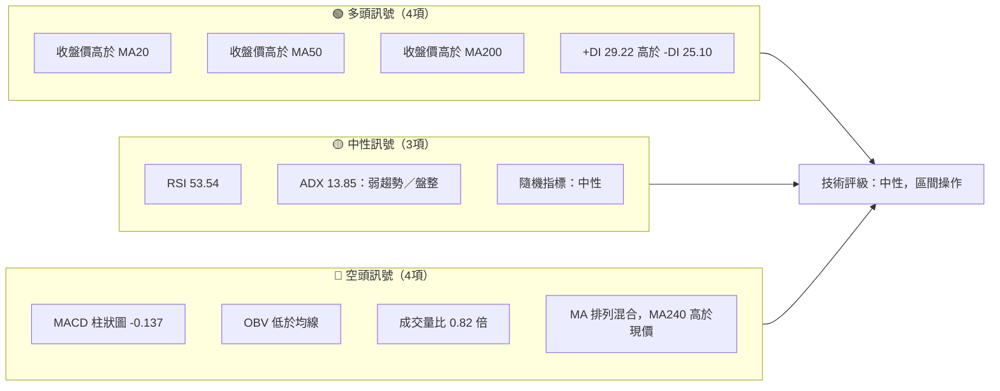
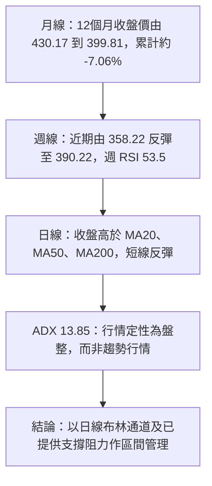
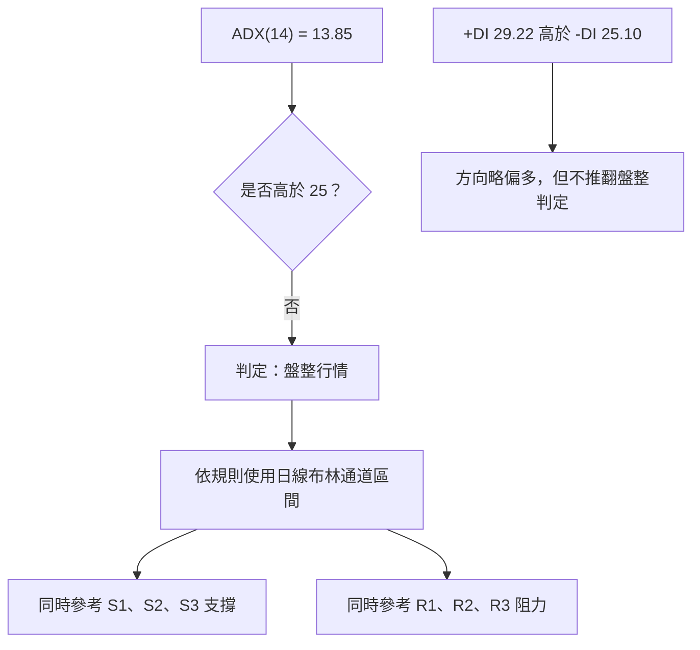
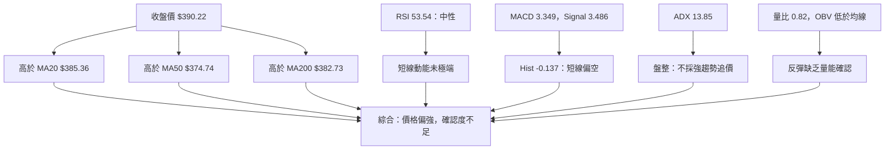
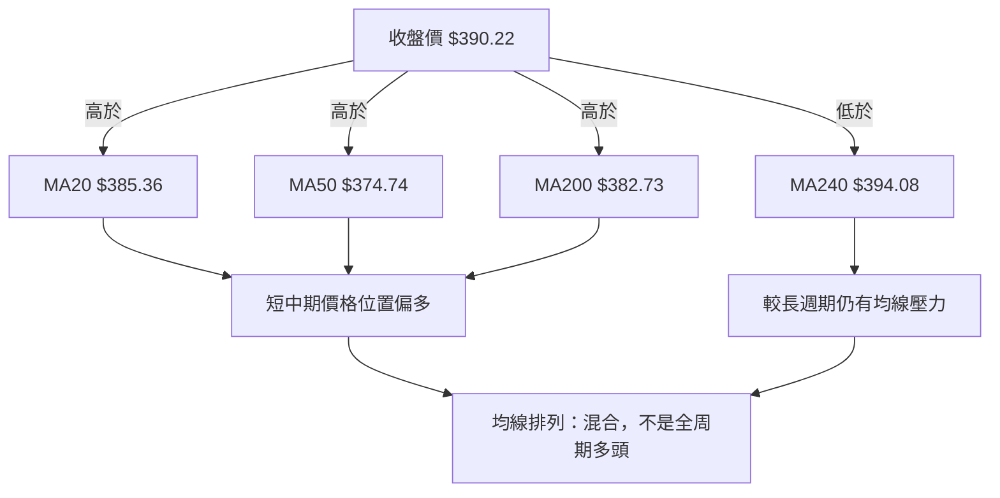
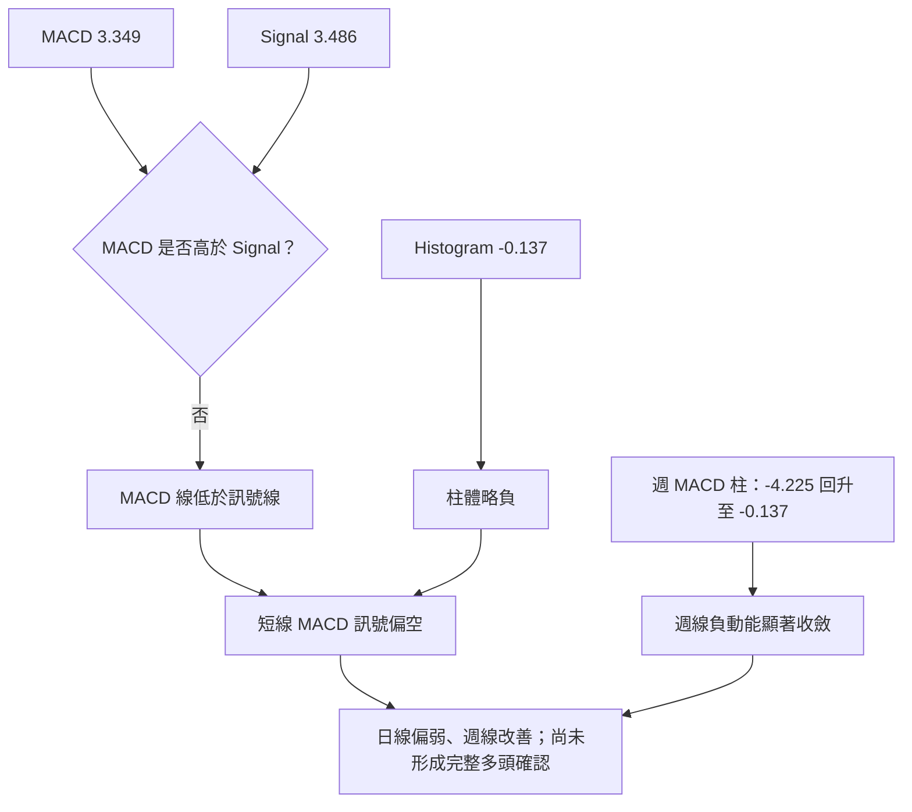
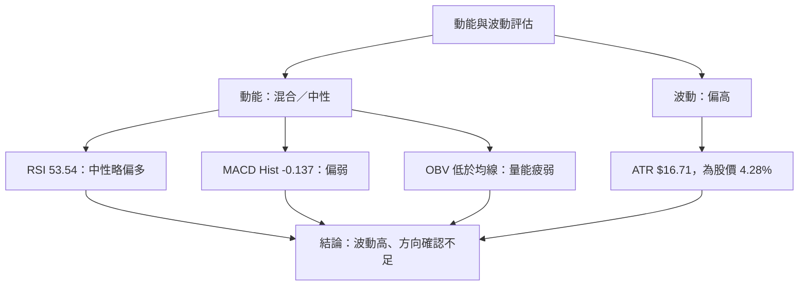
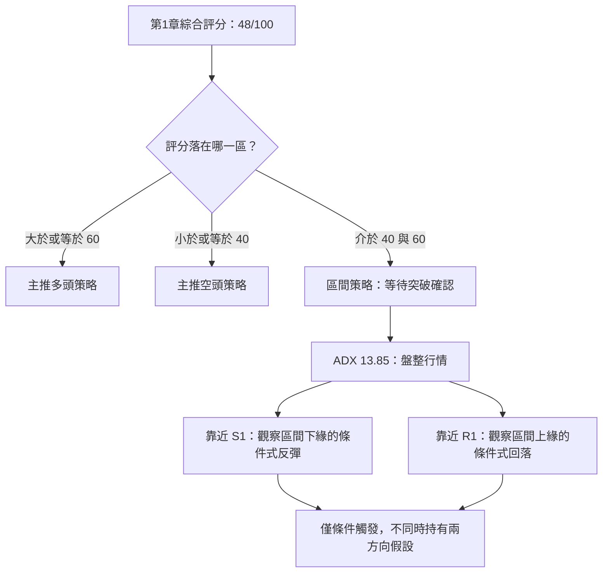
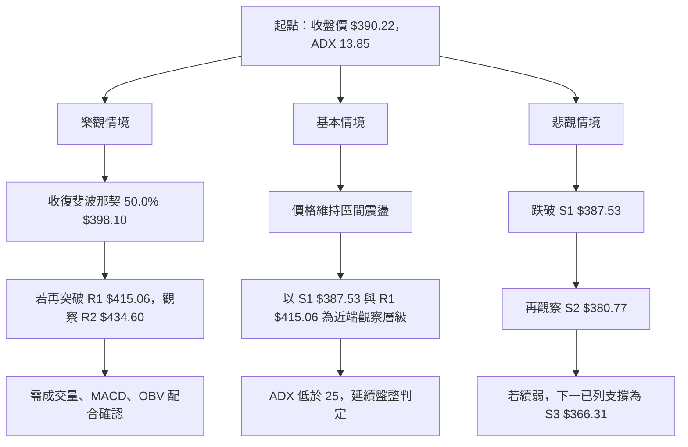

# TSLA 技術分析報告

> **報告日期**：2026-11-14 ｜ **語言**：繁體中文 ｜ **數據來源**：題示 Yahoo Finance 數據 ｜ **當前價格**：**$390.22**（2026-11-13 收盤）

---

## 目錄

| 章節 | 內容 |
|------|------|
| [1. 技術面概覽](#1-技術面概覽) | 訊號儀表板、核心指標、評分卡 |
| [2. 趨勢分析](#2-趨勢分析) | 多時框趨勢、長中短期走勢 |
| [3. 圖表形態分析](#3-圖表形態分析) | 形態識別、K 線組合、形態目標 |
| [4. 支撐與阻力](#4-支撐與阻力) | 關鍵價位、斐波那契回調 |
| [5. 技術指標深度解讀](#5-技術指標深度解讀) | MA、RSI、MACD、布林、成交量 |
| [6. 動能與波動率](#6-動能與波動率) | 動能評估、ATR、Beta |
| [7. 多時框架總結](#7-多時框架總結) | 時框架評分矩陣、訊號收斂 |
| [8. 交易策略建議](#8-交易策略建議) | 區間策略、風險報酬比 |
| [9. 風險提示與監控](#9-風險提示與監控) | 監控指標、風險情境 |

---

## 1. 技術面概覽

### 🎯 技術訊號儀表板

目前 TSLA 價格在 MA20、MA50、MA200 上方，且 +DI 高於 -DI，短線偏多訊號存在；但 ADX 僅 13.85，顯示趨勢力量不足。MACD 柱狀圖為負、OBV 低於均線、當日成交量低於 20 日均量，反映反彈尚未得到量能確認。整體訊號是「區間盤整中略偏多」，而非明確趨勢多頭。



### 📊 核心指標速覽表

| 指標類別 | 指標名稱 | 當前數值 | 訊號 | 解讀 |
|----------|----------|----------:|------|------|
| 價格 | 收盤價 | **$390.22** | 🟡 | 位於 52 週區間 46.1% 位置，非區間極端 |
| 均線 | MA20 | $385.36 | 🟢 | 收盤價高於 MA20，短線價格偏強 |
| 均線 | MA50 | $374.74 | 🟢 | 收盤價高於 MA50，近期反彈站在中期均線上方 |
| 均線 | MA200 | $382.73 | 🟢 | 收盤價高於 MA200，但均線整體排列仍為混合 |
| 動能 | RSI(14) | 53.54 | 🟡 | 30–70 中性區間，未超買或超賣 |
| 動能 | MACD | 3.349 | 🟡 | MACD 線略低於 Signal 線；柱狀圖為負 |
| 波動 | ATR(14) | $16.71 | 🟡 | 約為股價 4.28%，單日波動幅度偏大 |
| 趨勢 | ADX(14) | 13.85 | 🟡 | 低於 25，較符合盤整行情 |
| 量能 | 量比 | 0.82 倍 | 🔴 | 最新成交量低於 20 日均量 |
| 量能 | OBV | 低於均線 | 🔴 | 量能趨勢未確認近期反彈 |

### 🏆 技術評分卡

子評分依提供數據做相對評估，分數以 100 分制表達。綜合評分依六項子評分算術平均並四捨五入：

\[
(50+50+60+40+40+50) \div 6 = 48.33 \Rightarrow \mathbf{48/100}
\]

```text
╔══════════════════════════════════════════════════════════════╗
║              技術評分卡 — TSLA（2026-11-14）                ║
╠══════════════════════════════════════════════════════════════╣
║ 趨勢強度      █████░░░░░░░░░░░░░░░  50/100  🟡              ║
║ 動能指標      █████░░░░░░░░░░░░░░░  50/100  🟡              ║
║ 支撐穩定度    ██████░░░░░░░░░░░░░░  60/100  🟡              ║
║ 成交量配合    ████░░░░░░░░░░░░░░░░  40/100  🔴              ║
║ 形態完整度    ████░░░░░░░░░░░░░░░░  40/100  🔴              ║
║ 均線排列      █████░░░░░░░░░░░░░░░  50/100  🟡              ║
╠══════════════════════════════════════════════════════════════╣
║ 綜合評分      █████░░░░░░░░░░░░░░░  48/100  🟡 中性         ║
╚══════════════════════════════════════════════════════════════╝
```

- **趨勢強度 50/100**：ADX 低於 25，盤整特徵明顯；+DI 略高於 -DI，但不足以將其判定為強勢趨勢。
- **動能指標 50/100**：RSI 中性，但 MACD 柱狀圖為負，短線多空動能互相抵銷。
- **支撐穩定度 60/100**：現價附近有多個已提供支撐位，但 S1 距離收盤價僅 0.69%，仍需觀察能否守穩。
- **成交量配合 40/100**：最新成交量低於 20 日均量，OBV 低於均線。
- **形態完整度 40/100**：目前資料較支持區間與指標型判讀，不足以確認高信心度的典型反轉形態。
- **均線排列 50/100**：收盤價高於 MA20、MA50、MA200，但均線排列被標記為混合，且 MA240 高於現價。

---

## 2. 趨勢分析

### 🌐 多時框趨勢分析



#### 長期趨勢（月線）

長期走勢並非單邊上升。月線收盤序列在 2025 年末至 2026 年初處於相對高位，之後回落；2026 年 7 月明顯下挫，8 月與 10 月反彈，但截至 2026 年 10 月的月收盤仍低於 2025 年 11 月。2026 年 11 月收盤價 $390.22 為當月截至 11 月 13 日的資料，不應視為完整月線收盤。

**12 個月月收盤走勢圖**  
以下以提供的 2025-11 至 2026-10 月收盤價作圖；圖形為視覺化示意，點位數值以表格為準。

```text
TSLA 月線走勢圖（2025-11 至 2026-10）
月收盤價（美元）

450 ┤   ●Dec25
    │  ╱    ╲                         ●May26
430 ┤●Nov25      ●Jan26                    ╲ ●Jun26
    │                  ╲                 ╱      ╲
410 ┤                     ●Feb26       ╱          ╲
    │                        ╲        ╱             ╲
390 ┤                          ╲  ●Apr26               ●Oct26
    │                           ●Mar26                   ╲
370 ┤                                                    ╲
    │                                                      ╲
350 ┤                                                        ●Sep26
    │                                                        ╱
330 ┤                                                      ╱
    │                                                    ╱
310 ┤                                                   ●Jul26
    │                                                      ╲
    └──────────────────────────────────────────────────────────
     Nov25 Dec25 Jan26 Feb26 Mar26 Apr26 May26 Jun26 Jul26 Aug26 Sep26 Oct26
```

| 月份 | 月收盤價 | 月度變化（相對前月） | 趨勢特徵 |
|------|---------:|----------------------:|----------|
| 2025-11 | $430.17 | — | 12 個月觀察起點 |
| 2025-12 | $449.72 | +4.55% | 月收盤上升 |
| 2026-01 | $430.41 | -4.29% | 回落 |
| 2026-02 | $402.51 | -6.48% | 延續下行 |
| 2026-03 | $371.75 | -7.64% | 續跌至階段低檔 |
| 2026-04 | $381.63 | +2.66% | 初步反彈 |
| 2026-05 | $435.79 | +14.19% | 明顯反彈 |
| 2026-06 | $420.60 | -3.49% | 高位回落 |
| 2026-07 | $311.21 | -26.01% | 12 個月區間中最明顯的月收盤跌幅 |
| 2026-08 | $367.95 | +18.23% | 強力反彈 |
| 2026-09 | $354.81 | -3.57% | 回吐部分漲幅 |
| 2026-10 | $399.81 | +12.68% | 再度反彈 |

- 2025-11 至 2026-10 月收盤累計變化約 **-7.06%**。
- 2026-07 月收盤 $311.21 是所列 12 個月月收盤中的低點；它不等同 52 週最低價，52 週低點另為 **$297.38**。
- 2026-10 月收盤 $399.81 高於 2026-09 月收盤，但 2026-11-13 收盤 $390.22 又低於 10 月收盤，故短期反彈仍需確認。

#### 中期趨勢（週線）

近 20 週收盤資料顯示，7 月下旬收盤下探至 $313.03、7 月 31 日收於 $311.21，之後一路回升至 10 月 30 日的 $399.81。11 月 6 日週收盤回落至 $358.22，11 月 13 日週收盤回升至 $390.22。

```text
近期週線支撐／阻力示意（價位均取自提供數據）

$445.60  ─────────────────────  R3：主要上方阻力
$434.60  ─────────────────────  R2：上方阻力
$421.88  ─────────────────────  斐波那契 38.2%
$415.06  ─────────────────────  R1：第一阻力
$398.10  ─────────────────────  斐波那契 50.0%
$390.22  ═════════════════════  現價
$387.53  ─────────────────────  S1：第一支撐
$380.77  ─────────────────────  S2：第二支撐
$374.33  ─────────────────────  斐波那契 61.8%
$366.31  ─────────────────────  S3：第三支撐
$351.61  ─────────────────────  布林下軌（指標值，非 OHLCV 聚類支撐）
```

中期訊號的關鍵在於：週線反彈已收復 11 月 6 日跌幅的一部分，週 RSI 由 42.4 回升至 53.5；但最新週成交量為 149,668,600，低於前一週的 234,000,500。價格修復快於成交量回復，反彈的確認度有限。

### ⚡ 趨勢強度評估（ADX 解讀）

ADX(14) 為 **13.85**，低於常用趨勢判別門檻 25，依本報告規則應將行情定性為**盤整行情**。+DI 為 29.22，高於 -DI 的 25.10，表示方向性指標短線偏多，但 ADX 低代表這種多方優勢尚未發展成強趨勢。

| ADX 區間 | 常見解讀 | TSLA 當前狀態 |
|----------|----------|---------------|
| 低於 20 | 趨勢力量低、常見盤整 | **13.85，符合** |
| 20–25 | 趨勢可能正在形成 | 不適用 |
| 高於 25 | 趨勢行情較明確 | 不適用 |
| 高於 40 | 強趨勢 | 不適用 |



---

## 3. 圖表形態分析

### 🔍 形態識別系統

可用資料包括月收盤序列、近 20 週收盤及近 10 根日 K、近 8 根週 K。這些資料足以辨認近期反彈與回落的過程，但缺少完整逐日、逐週波段細節，並且 ADX 低、均線排列混合，因此不宜強行宣稱已完成頭肩、雙底、旗形或三角形等幾何形態。

| 形態／訊號 | 信心度 | 判斷依據（引用數據） | 完成度 | 目標價 |
|------------|-------:|----------------------|--------|--------|
| 典型頭肩頂／底 | 低於 50% | 可見資料不足以確認左右肩、頭部與頸線幾何結構 | 未確認 | 數據中未偵測到 |
| 典型雙頂／雙底 | 低於 50% | 有階段性低點與反彈，但不能僅憑收盤序列證明兩個低點具有可確認的幾何對稱性 | 未確認 | 數據中未偵測到 |
| 三角形／旗形 | 低於 50% | 缺乏足夠連續波段高低點與收斂邊界資料 | 未確認 | 數據中未偵測到 |
| 區間盤整／均線混合 | **70%** | ADX 13.85；MA 排列混合；價格位於布林中軌與上軌之間；多空指標互有矛盾 | 進行中 | 不以幾何形態推算 |
| 短線反彈 | **65%** | 週收盤由 2026-11-06 的 $358.22 回升至 2026-11-13 的 $390.22；週 RSI 回升至 53.5 | 已發生，但量能未確認 | 不以形態推算 |

> 由於未能確認具有足夠信心度的典型幾何形態，本報告不提供形態高度推算的目標價。交易目標僅使用已提供的 R1–R3、S1–S3 與斐波那契價位。

### 🕯️ 重要 K 線形態分析

以下 K 線判斷僅使用題示近 10 根日 K 與近 8 根週 K 的開、高、低、收。形態分類以這些 OHLC 數據為依據，不延伸到區塊以外日期。

#### 近 10 根日 K

| 日期 | 開 | 高 | 低 | 收 | K 線形態與 OHLC 依據 | 解讀 | 訊號 |
|------|---:|---:|---:|---:|----------------------|------|------|
| 2026-11-02 | 404.66 | 414.23 | 397.61 | 403.82 | 小實體、上下影線均存在 | 高位未延續至收盤，方向確認度有限 | 🟡 |
| 2026-11-03 | 406.25 | 406.50 | 396.53 | 398.50 | 收跌，開收區間相對有限 | 延續前一日回落 | 🔴 |
| 2026-11-04 | 379.80 | 392.04 | 375.50 | 385.19 | 收漲且上下影線均存在 | 日內低位回升，但未形成有力趨勢確認 | 🟡 |
| 2026-11-05 | 374.12 | 374.30 | 338.15 | 343.69 | 大幅收跌，低點接近區間下緣 | 賣壓顯著；非典型錘頭，因實體偏大且收盤接近低位 | 🔴 |
| 2026-11-06 | 348.92 | 363.84 | 347.60 | 358.22 | 收漲，實體較大；上下影線均短於實體 | 下跌後出現反彈，但單根 K 棒不足以確認反轉 | 🟢 |
| 2026-11-09 | 360.25 | 382.20 | 360.02 | 378.05 | 收漲，低點靠近開盤價，上影線存在 | 買方推升收盤，但上方仍有賣壓 | 🟢 |
| 2026-11-10 | 370.85 | 380.00 | 370.40 | 379.78 | 收漲，實體明顯、上下影線短 | 買方延續前一交易日反彈 | 🟢 |
| 2026-11-11 | 386.58 | 395.43 | 386.35 | 390.84 | 收漲，上影線較下影線長 | 收盤偏強，但高位有一定賣壓 | 🟢 |
| 2026-11-12 | 386.36 | 401.22 | 385.20 | 397.45 | 收漲，實體明顯、上下影線存在 | 買方延續反彈，收盤接近當日高位 | 🟢 |
| 2026-11-13 | 401.68 | 404.40 | 385.83 | 390.22 | 收跌，上下影線均存在，收盤低於開盤 | 連續反彈後出現獲利回吐；仍收在 S1 之上 | 🟡 |

#### 近 8 根週 K

| 日期（週末） | 開 | 高 | 低 | 收 | K 線形態與 OHLC 依據 | 解讀 | 訊號 |
|------|---:|---:|---:|---:|----------------------|------|------|
| 2026-09-25 | 371.64 | 386.83 | 367.67 | 372.11 | 小實體、上下影線較長 | 一週多空拉鋸 | 🟡 |
| 2026-10-02 | 368.06 | 374.60 | 345.88 | 370.59 | 週內大幅下探後收回，收盤接近開盤 | 下方有承接，但週線方向未明確 | 🟡 |
| 2026-10-09 | 369.00 | 388.56 | 364.91 | 382.70 | 收漲，實體明顯 | 週線買方占優 | 🟢 |
| 2026-10-16 | 382.61 | 382.70 | 349.33 | 354.72 | 大幅收跌，上影線極短 | 賣方主導該週走勢 | 🔴 |
| 2026-10-23 | 357.50 | 388.86 | 354.47 | 372.22 | 收漲，日內振幅較大 | 反彈，但週內波動也擴大 | 🟡 |
| 2026-10-30 | 383.83 | 410.85 | 383.73 | 399.81 | 收漲，低點接近開盤，上影線較長 | 週線走強，但高位有回吐 | 🟢 |
| 2026-11-06 | 404.66 | 414.23 | 338.15 | 358.22 | 大幅收跌，長下影線但實體仍大 | 高波動賣壓週；下影線顯示低位有回收，但不能單獨視為反轉確認 | 🔴 |
| 2026-11-13 | 360.25 | 404.40 | 360.02 | 390.22 | 收漲，開盤接近週低，收盤高於開盤 | 週線反彈明確，但上影線顯示高位仍有賣壓 | 🟢 |

### 📉 ASCII 走勢形態示意圖

此圖只示意近週收盤的反彈與回落順序，**不代表已確認的雙底或反轉形態**。

```text
週收盤價（美元；數值為提供的近 20 週資料）

$408 ┤       ● 407.76
     │      ╱ ╲
$394 ┤ ●393.45   ╲                                      ●399.81
     │             ╲                                    ╱ ╲
$381 ┤               ●380.84                  ●382.70   ╱   ╲
     │                 ╲                   ╱╲        ╱     ╲
$367 ┤                   ╲               ●362.86  ●372.22  ●365.44
     │                    ╲          ●354.08╲   ●372.11   ●364.27
$350 ┤                     ╲      ●342.27    ╲●348.75       ╲
     │                      ╲  ●328.58                       ●354.72
$313 ┤                        ●313.03●311.21                     ●358.22
     └───────────────────────────────────────────────────────────────
       7月初       7月底       8月       9月       10月       11月
```

### 🎯 形態目標價計算

- **典型頭肩、雙底、三角形、旗形目標價**：數據中未偵測到可可靠確認的形態結構，因此沒有可用的頸線或形態高度。
- **不進行自行推算**：不以圖形目測價位補造頸線、波段高度或目標價。
- **策略價位來源**：第 8 章只使用已提供的 R1–R3、S1–S3 及斐波那契回調價位，避免將未確認形態誤當成精確目標。

---

## 4. 支撐與阻力

### 🗺️ 關鍵價位分布圖

下圖中的支撐與阻力均引用提供的「關鍵價位（由 OHLCV 計算）」區塊；斐波那契價位也直接引用原始數據。

```text
TSLA 價位結構分布圖（美元）

$445.60 ║████████████████████████║ R3：波段高點聚類
$434.60 ║████████████████████    ║ R2：波段高點聚類
$421.88 ║▓▓▓▓▓▓▓▓▓▓▓▓▓▓▓▓▓▓▓▓    ║ 斐波那契 38.2%
$415.06 ║████████████████████████║ R1：波段高點聚類
$398.10 ║▓▓▓▓▓▓▓▓▓▓▓▓▓▓▓▓        ║ 斐波那契 50.0%
$390.22 ╠════════════════════════╣ ◄ 現價：2026-11-13 收盤
$387.53 ║▓▓▓▓▓▓▓▓▓▓▓▓▓▓▓▓▓▓      ║ S1：波段低點聚類
$380.77 ║████████████████████    ║ S2：波段低點聚類
$374.33 ║▓▓▓▓▓▓▓▓▓▓▓▓▓▓▓▓        ║ 斐波那契 61.8%
$366.31 ║████████████████████████║ S3：波段低點聚類
$351.61 ║························║ 布林下軌（指標參考值）
$340.49 ║▓▓▓▓▓▓▓▓▓▓▓▓▓▓▓▓        ║ 斐波那契 78.6%
$297.38 ║████████████████████████║ 52 週低點／斐波那契 100.0%
```

### 🚧 阻力位分析表

| 阻力級別 | 價位 | 相對現價 | 形成原因 | 突破難度 | 重要性 |
|----------|------:|---------:|----------|----------|--------|
| R1 | **$415.06** | +6.36% | 近一年波段高點聚類 | 中等 | 第一個主要上檔測試位 |
| R2 | **$434.60** | +11.37% | 近一年波段高點聚類 | 中高 | 若突破 R1，觀察後續延續性 |
| R3 | **$445.60** | +14.19% | 近一年波段高點聚類 | 高 | 更高層級的波段阻力 |
| 斐波那契 38.2% | **$421.88** | — | 52 週區間回調位 | — | 位於 R1 與 R2 之間，作額外技術參考 |
| 斐波那契 23.6% | **$451.29** | — | 52 週區間回調位 | — | 高於 R3 的額外參考層級 |

突破難度是根據目前 ADX、成交量與多空指標綜合評估，不代表價位必然有效。當前 MACD 柱狀圖為負、OBV 低於均線、量比只有 0.82 倍，意味著即使價格接近 R1，也需要成交量配合才能提高有效突破的確認度。

### 🛡️ 支撐位分析表

| 支撐級別 | 價位 | 相對現價 | 形成原因 | 守住條件 | 重要性 |
|----------|------:|---------:|----------|----------|--------|
| S1 | **$387.53** | -0.69% | 近一年波段低點聚類 | 觀察收盤是否能維持在其上方 | 短線首要支撐 |
| S2 | **$380.77** | -2.42% | 近一年波段低點聚類 | 若 S1 失守，S2 是下一觀察位 | 重要區間支撐 |
| S3 | **$366.31** | -6.13% | 近一年波段低點聚類 | 失守 S2 後的下一個已列支撐 | 中期支撐層級 |
| 斐波那契 61.8% | **$374.33** | — | 52 週區間回調位 | 位於 S2 與 S3 之間 | 與波段支撐重疊區的補充參考 |
| 斐波那契 78.6% | **$340.49** | — | 52 週區間回調位 | 更深回撤參考 | 非近端支撐 |

目前收盤價 $390.22 僅比 S1 $387.53 高 **$2.69**，約為收盤價的 0.69%。因此 S1 雖是最近的支撐參考，但緩衝幅度有限；若價格快速回落，需關注 S2，而非只以 S1 判斷支撐有效。

### 📐 斐波那契回調位分析

| 回調比例 | 價位 | 與現價關係 |
|----------|------:|------------|
| 0.0%（52 週高點） | $498.83 | 高於現價 |
| 23.6% | $451.29 | 高於現價 |
| 38.2% | $421.88 | 高於現價 |
| 50.0% | $398.10 | 高於現價 |
| 61.8% | $374.33 | 低於現價 |
| 78.6% | $340.49 | 低於現價 |
| 100.0%（52 週低點） | $297.38 | 低於現價 |

現價 **$390.22 位於 50.0% 回調位 $398.10 與 61.8% 回調位 $374.33 之間**。這表示現價仍在該 52 週區間的中段偏下位置。上方 $398.10 是最近的斐波那契參考位，接著是 $421.88；下方則需觀察 $387.53、$380.77、$374.33 與 $366.31 的支撐層次。

---

## 5. 技術指標深度解讀

### 🎛️ 指標訊號總覽



### 📈 移動平均線排列分析

| 均線 | 數值 | 收盤價相對位置 | 方向／補充 |
|------|-----:|----------------|------------|
| MA20 | $385.36 | 收盤在上方 | MA20 近期向上 |
| MA50 | $374.74 | 收盤在上方 | 價格較 MA50 高 $15.48 |
| MA200 | $382.73 | 收盤在上方 | 價格較 MA200 高 $7.49 |
| MA240 | $394.08 | 收盤在下方 | 長週期均線仍在現價上方 |
| MA5 | $387.27 | 收盤在上方 | 短期均線略低於收盤 |
| MA10 | $382.58 | 收盤在上方 | 短期均線向上 |

MA20 高於 MA200，MA200 高於 MA50；這並非典型的整齊多頭排列。較有利的一面是收盤價高於 MA20、MA50、MA200，且多條短中期均線近期向上；不利的一面是 MA240 為 $394.08，高於收盤價 $390.22，且整體均線狀態被數據標示為混合排列。



### 📉 RSI(14) 分析

- RSI(14) 為 **53.54**，處於 30–70 的中性區間。
- RSI 尚未進入超買區，也未進入超賣區，單獨來看並未提供明確的逆勢訊號。
- 週線 RSI 從 2026-11-06 的 **42.4** 回升至 2026-11-13 的 **53.5**，與週收盤反彈方向相符。
- 資料明確指出「無明顯背離」，且該判讀僅比較近 20 根 K 棒首尾價格與 RSI 方向。因此本報告結論為：**未見明顯 RSI 頂背離或底背離**。由於沒有逐根 RSI 數據，不進一步宣稱局部背離。

```text
RSI(14) 強度條

0          30              50       70          100
|----------|---------------|--------|------------|
             █████████████████████
                         ▲
                      53.54

區間判讀：30 以下偏超賣｜30–70 中性｜70 以上偏超買
當前狀態：🟡 中性，略高於 50
```

### 📊 MACD(12/26/9) 訊號解讀

| 指標 | 數值 | 方向解讀 |
|------|-----:|----------|
| MACD 線 | 3.349 | 數值為正，但低於 Signal 線 |
| Signal 線 | 3.486 | 高於 MACD 線 |
| MACD Hist | **-0.137** | 柱狀圖為負，短線動能略偏空 |

MACD 數值為正，不等於當下仍具上升動能；由於 MACD 線低於訊號線、柱狀圖為 -0.137，較合理的判讀是**上行動能正在放緩或處於偏弱狀態**。週線 MACD 柱狀圖近期由 11 月 6 日的 -4.225 收斂至 11 月 13 日的 -0.137，代表週線負動能大幅減弱，但仍略為負值。



**MACD 背離判斷：**  
資料提供的 RSI 背離欄位明確標註「無明顯背離」。MACD 沒有提供近 20 根逐根高低點與逐根 MACD 值，因此無法從資料中獨立確認頂背離或底背離。結論為：**MACD 背離數據不足，未確認；不可視為已出現背離。**

### 📦 布林通道分析

- 上軌：**$419.11**
- 中軌／MA20：**$385.36**
- 下軌：**$351.61**
- %B：**0.57**
- 收盤價：**$390.22**

現價高於中軌、低於上軌，%B 為 0.57，表示價格位於通道中段略偏上，並未觸及上軌或下軌。依 ADX 13.85 的盤整判定，布林通道比趨勢追蹤訊號更適合作為區間觀察工具，但上下軌是指標參考，不應與 OHLCV 聚類支撐阻力混為一談。

```text
布林通道示意（美元）

$419.11  ╔════════════════════════════════════╗  上軌
         ║                                    ║
         ║                ● 收盤 $390.22      ║
$385.36  ╠════════════════════════════════════╣  中軌／MA20
         ║                                    ║
         ║                                    ║
$351.61  ╚════════════════════════════════════╝  下軌

%B = 0.57：介於中軌與上軌之間，位置略偏上
```

通道總寬度為 **$67.50**（$419.11 − $351.61）；以中軌 $385.36 為基準，通道寬約為中軌的 **17.52%**。此比例顯示通道並不狹窄，價格波動幅度仍大；由於未提供過往布林帶寬序列，不能判定帶寬目前相對歷史是收縮或擴張。

### 💹 成交量分析（量價配合度）

| 量能指標 | 數值 | 訊號 |
|----------|-----:|------|
| 最新成交量 | 32,268,400 | 低於 20 日及 50 日均量 |
| 20 日均量 | 39,423,885 | 最新量約為均量的 0.82 倍 |
| 50 日均量 | 37,444,628 | 最新量亦低於 50 日均量 |
| 最新日量比 | 0.82 倍 | 反彈量能確認不足 |
| 最新週成交量 | 149,668,600 | 低於前一週 234,000,500 |
| OBV 趨勢 | OBV < MA | 量能趨勢疲弱 |

價格從 11 月 6 日週收盤 $358.22 回升至 11 月 13 日 $390.22，但最新週成交量低於前一週，且最新日成交量低於 20 日均量。這構成「價升、量能未同步增強」的情況，較適合評為**反彈尚未獲量能確認**，而非直接定義為強烈量價背離。OBV 低於均線進一步支持量能確認不足的判斷。

---

## 6. 動能與波動率

### ⚡ 動能評估四象限

ADX 13.85 表示趨勢力量低；RSI 53.54 屬中性偏上，但 MACD 柱狀圖為負、OBV 低於均線。ATR 為股價的 4.28%，顯示波動仍偏高。因此 TSLA 的狀態最接近「**動能未充分確認、波動較高**」，操作需避免把普通反彈等同於趨勢反轉。

| 象限 | 動能 | 波動 | 當前狀態 | 評估 |
|------|------|------|----------|------|
| Q1 | 強 | 低 | — | 理想的穩定趨勢，但目前不符合 |
| Q2 | 弱 | 低 | — | 低波動盤整，但目前波動不低 |
| Q3 | 強 | 高 | 部分符合 | RSI 與 +DI 略偏多，但 MACD、OBV 未確認 |
| Q4 | 弱／不一致 | 高 | **最接近** | 指標分歧且 ATR 相對股價高，應採較保守風控 |



### 📊 ATR 波動率分析

ATR(14) 為 **$16.71**，相當於收盤價 $390.22 的 **4.28%**。這表示在近期平均波動尺度下，單日價格變動可能相當可觀；ATR 不是方向預測，也不代表價格每日必然波動 $16.71。

- 風險管理上，ATR 可作為評估交易距離是否過窄的參考。
- 若止損距離遠小於 ATR，可能較容易受到一般日內波動影響。
- 若止損距離過大，則應相應降低部位，而非單純擴大可承受風險。
- 本報告交易策略的實際止損採用已提供的 S2 或 R2，不以 ATR 加減自行創造新的精確價位。

### 📐 Beta 與市場相關性

Beta 為 **1.743**。在歷史估計口徑下，該數值通常表示 TSLA 對廣泛市場波動的敏感度高於 Beta 為 1 的資產；它是波動敏感度指標，不等同於相關係數，也不能直接解讀為 TSLA 與大盤有 1.743 的相關性。

- 市場整體下行時，Beta 偏高的股票可能面臨較大的價格振幅風險。
- 市場上行時，Beta 也可能放大上行波動，但不保證一定跑贏市場。
- 本數據未提供特定基準指數的相關係數、Beta 估計期間或回歸標準誤，因此無法補充這些統計值。
- 結合 ATR 4.28%、Beta 1.743 及 1.743 的高波動敏感度，TSLA 不適合只依單一價位而忽略倉位風險。

---

## 7. 多時框架總結

### 📋 時框架評分表

下表評分為依據提供的月線、週線、日線指標作出的技術判讀。**整體綜合評分採第 1 章六項子評分平均值，固定為 48/100**；各時框架評分是該時框的方向性輔助判斷，不取代第 1 章綜合評分。

| 時框架 | 趨勢方向 | 動能 | 均線排列 | 形態 | 時框架判讀 | 建議 |
|--------|----------|------|----------|------|------------|------|
| 月線／長期 | 🟡 偏弱至中性 | 🟡 | N/A（未提供月線均線） | 尚未確認趨勢反轉 | 12 個月至 2026-10 收盤變化約 -7.06%；走勢有反彈但波動大 | 不將短期反彈視為長期趨勢反轉 |
| 週線／中期 | 🟡 反彈中 | 🟡 | N/A（未提供週線均線） | 反彈已發生，量能較弱 | 週收盤由 $358.22 回升至 $390.22；週 MACD 負柱大幅收斂 | 觀察支撐能否守住、反彈是否有量 |
| 日線／短期 | 🟡 中性略偏多 | 🟡 | 收盤高於 MA20／MA50／MA200，整體排列混合 | 無高信心度典型形態 | RSI 中性，MACD 柱負、量比 0.82 | 以區間策略及確認條件交易 |
| 全局收斂 | **中性觀望** | **盤整** | **混合排列** | **指標型解讀為主** | **綜合評分 48/100** | **等待突破確認，不追價** |

### 🔲 綜合訊號矩陣

| 維度 | 短期（日線） | 中期（週線） | 長期（月線） | 一致性 |
|------|-------------|-------------|-------------|--------|
| 價格方向 | 收盤高於 MA20、MA50、MA200 | 11 月 13 日週線反彈 | 12 個月方向仍有回撤 | 不完全一致 |
| 動能 | RSI 中性，MACD 柱略負 | RSI 回升，MACD 負柱收斂 | 未提供月線動能指標 | 部分改善 |
| 趨勢強度 | ADX 13.85，低趨勢強度 | 反彈但尚未確認趨勢 | 月線波動大 | 盤整主導 |
| 量能 | 日量比 0.82，OBV 低於均線 | 最新週量低於前週 | N/A（未提供月量趨勢） | 未確認 |
| 最終解讀 | 區間中略偏多 | 反彈修復 | 長期仍需確認 | **中性觀望** |

### ⚖️ 多時框收斂結論

1. **行情類型：盤整行情。** ADX(14) = 13.85，低於 25。
2. **主導交易框架：日線布林通道與已提供支撐／阻力。** 依盤整規則，不以週線反彈作為追價依據。
3. **方向性結論：中性觀望。** 目前價格高於 MA20、MA50、MA200，且 +DI 高於 -DI，提供短線偏多訊號；但 MACD 柱為負、OBV 低於均線、成交量不足，無法形成一致多頭確認。
4. **與第 1 章一致：** 綜合評分 **48/100**，屬 40–60 的中性區間。
5. **與第 8 章一致：** 主策略採區間操作，明確等待突破確認，不同時強推趨勢多單或趨勢空單。

---

## 8. 交易策略建議

### 🗺️ 策略決策流程圖



> **當前主策略方向 = 區間操作、等待突破確認（依綜合評分 48/100）。**

策略 A 與策略 B 是兩個**互斥的條件式區間方案**，不是同時推薦建立多空部位。若兩個條件均未觸發，維持觀望。策略中的進場、止損及目標價均引用本報告第 4 章已列出的支撐、阻力或斐波那契價位。

### 🎯 價格情境階梯

| 觸發條件 | 下一目標 | 後續延伸 | 情境含義 |
|----------|----------|----------|----------|
| 突破 R1 **$415.06**，並有量能確認 | R2 **$434.60** | R3 **$445.60** | 短線轉強，但 MACD 與 OBV 仍須改善 |
| 價格在現價與 S1／R1 區域內震盪 | — | — | 盤整延續，依布林通道與支撐阻力管理 |
| 跌破 S1 **$387.53** | S2 **$380.77** | S3 **$366.31** | 區間下緣失守，短中期轉弱風險升高 |
| 收復斐波那契 50.0% **$398.10** | R1 **$415.06** | R2 **$434.60** | 反彈修復改善，但需觀察能否進一步突破 R1 |

### 📊 情境機率分佈

以下為依目前技術指標作出的**主觀情境評估**，並非統計模型輸出；三項機率合計為 100%。

| 情境 | 機率 | 主要依據 |
|------|-----:|----------|
| 繼續上行／反彈 | **30%** | 收盤高於 MA20、MA50、MA200；+DI 高於 -DI；週 RSI 回升；週 MACD 負柱收斂 |
| 區間震盪 | **45%** | ADX 13.85 低於 25；RSI 53.54 中性；布林 %B 0.57；均線排列混合 |
| 回落／再探底 | **25%** | MACD 柱 -0.137；OBV 低於均線；最新量比 0.82；S1 距離現價很近且需確認 |

### 🟡 主策略詳情：區間操作

| 策略要素 | 策略 A：支撐位條件式反彈 | 策略 B：阻力位條件式回落 |
|----------|--------------------------|--------------------------|
| 進場條件 | 價格回測 S1，並呈現支撐守穩跡象；若 S1 失守則取消 | 價格測試 R1，但無法有效站穩；若突破 R1 並有量確認則取消 |
| 進場價格 | **$387.53** | **$415.06** |
| 止損價格 | **$380.77（S2）** | **$434.60（R2）** |
| 目標價 T1 | **$398.10（斐波那契 50.0%）** | **$387.53（S1）** |
| 目標價 T2 | **$415.06（R1）** | **$380.77（S2）** |
| 風險報酬比（T1） | **1 : 1.56** | **1 : 1.41** |
| 風險報酬比（T2） | **1 : 4.07** | **1 : 1.76** |
| 成功機率 | 主觀估計 **50%** | 主觀估計 **45%** |
| 建議倉位 | 以個人風險承受度限制，宜較小 | 以個人風險承受度限制，宜較小 |

**風險報酬比計算核對**

- 策略 A：進場 $387.53；止損 $380.77；風險 $6.76。  
  - T1 報酬：$398.10 − $387.53 = $10.57；$10.57 ÷ $6.76 = **1.56**。  
  - T2 報酬：$415.06 − $387.53 = $27.53；$27.53 ÷ $6.76 = **4.07**。
- 策略 B：進場 $415.06；止損 $434.60；風險 $19.54。  
  - 做空 T1 報酬：$415.06 − $387.53 = $27.53；$27.53 ÷ $19.54 = **1.41**。  
  - 做空 T2 報酬：$415.06 − $380.77 = $34.29；$34.29 ÷ $19.54 = **1.76**。

以上是依價位計算的理論比值，不包含交易成本、滑價與跳空風險；成功機率為主觀估計，不代表歷史回測結果。

### 🔴 反向風險觸發點（對沖提示）

- **反彈方案風險：** 收盤有效跌破 S1 **$387.53**，尤其進一步跌破 S2 **$380.77**，代表短線區間下緣轉弱。
- **區間上緣空方風險：** 若價格突破 R1 **$415.06**，並伴隨成交量高於均量且 MACD 柱轉正，則策略 B 的回落假設應重新評估。
- **中期轉弱觀察：** 若 S2 失守，下一層已提供支撐為 S3 **$366.31**；不應以未提供價位擴張支撐序列。
- **中期轉強觀察：** 若價格突破 R1，後續觀察 R2 **$434.60** 及 R3 **$445.60**；僅觸及價位不等於完成有效突破。

### ⭐ 整體訊號強度評星

```text
做多訊號強度：★★★☆☆  (3/5星)
做空訊號強度：★★☆☆☆  (2/5星)
整體可信度：  ★★★☆☆  (3/5星)
```

做多評為 3 星，理由是價格高於 MA20、MA50、MA200，且週線有所反彈；但 MACD、OBV 與量能尚未確認。做空只有 MACD 柱狀圖及 OBV 等局部偏弱訊號，ADX 低且 +DI 高於 -DI，因此並非明確趨勢空頭。

---

## 9. 風險提示與監控

### ✅ 關鍵監控指標 Checklist

```text
╔══════════════════════════════════════════════════════════════╗
║                  TSLA 技術面監控清單                         ║
╠══════════════════════════════════════════════════════════════╣
║ □ 價格是否守住 S1 $387.53？                                 ║
║ □ 若 S1 失守，是否進一步測試 S2 $380.77？                   ║
║ □ 支撐失守時，S3 $366.31 是否成為下一觀察位？               ║
║ □ 價格是否收復斐波那契 50.0% $398.10？                      ║
║ □ 突破 R1 $415.06 時，成交量是否同步放大？                  ║
║ □ MACD Histogram 是否由 -0.137 轉為正值？                  ║
║ □ RSI 是否維持 30–70 中性區間，或出現明確方向突破？         ║
║ □ OBV 是否重新站上其均線？                                  ║
║ □ ADX 是否升越 25，改變盤整行情定性？                       ║
║ □ ATR 是否相對現價持續高於目前 4.28% 的波動尺度？           ║
╠══════════════════════════════════════════════════════════════╣
║ 核心原則：價格突破須由成交量及動能確認；否則仍按盤整管理。  ║
╚══════════════════════════════════════════════════════════════╝
```

#### 監控優先順序

1. **第一順位：價格是否守住 S1 $387.53。** 現價高於 S1 僅 0.69%，這是近期最直接的支撐觀察位。
2. **第二順位：量能與 OBV。** 目前最新量比 0.82、OBV 低於均線；若價格反彈而量能仍未改善，需降低對突破的信心。
3. **第三順位：MACD 與 ADX。** MACD 柱狀圖目前 -0.137，ADX 13.85；若 MACD 轉強且 ADX 上升至趨勢區，盤整策略才需要重新評估。
4. **第四順位：上方價位是否有效突破。** R1 $415.06 是第一層主要阻力；應關注價格是否能帶量站上，而非單純盤中觸及。

### ⚠️ 風險場景分析



- **樂觀情境：** 價格收復 $398.10 後，若能進一步突破 R1 $415.06，則市場結構改善；但需看到成交量和 OBV 同步增強，否則仍可能是假突破。
- **基本情境：** ADX 仍低於 25，股價在支撐與阻力之間反覆震盪。此時區間策略比追逐單向趨勢更符合指標狀態。
- **悲觀情境：** S1 $387.53 失守後，市場需觀察 S2 $380.77；若 S2 再失守，S3 $366.31 是數據中下一個已列的支撐位。此路徑不代表價格必然到達該價位。

### 🛡️ 風險管理重要提醒

- **盤整行情容易出現假突破。** ADX 13.85 表示趨勢力量弱；突破價位應與量能、MACD、OBV 一併確認。
- **波動風險較高。** ATR 為 $16.71、約占收盤價 4.28%，即使方向判斷正確，短線波動也可能造成較大資金變動。
- **避免把止損設在與策略無關的位置。** 本報告的兩個區間方案分別使用已提供的 S2 $380.77 與 R2 $434.60 作為條件性止損參考；實際下單仍須考慮滑價與跳空。
- **依風險額度反推部位大小。** 不應因策略 A 的理論 T2 風險報酬比高，就忽略觸及 T2 的機率較低或市場條件可能改變。
- **不以分析師共識目標取代技術價位。** 分析師平均目標 $412.48 是市場研究機構的共識資料，不是本報告根據 OHLCV 推算出的技術目標；不應與 R1–R3 混為一談。
- **技術形態尚未確認。** 目前無足夠資料認定雙底、頭肩底等反轉型態完成；若以未確認形態建立倉位，容易高估訊號可靠性。

---

## 📋 報告總結

```text
╔══════════════════════════════════════════════════════════════╗
║                 TSLA 技術分析報告總結                       ║
╠══════════════════════════════════════════════════════════════╣
║ 報告日期：2026-11-14                                        ║
║ 當前價格：$390.22（2026-11-13 收盤）                        ║
║ 分析評級：🟡 中性觀望；盤整中略偏多                         ║
║ 綜合評分：48/100（六項評分算術平均後四捨五入）             ║
╠══════════════════════════════════════════════════════════════╣
║ 長期趨勢：🟡 12個月方向仍有回撤，尚未確認長期反轉           ║
║ 中期趨勢：🟡 週線反彈修復，但量能確認不足                   ║
║ 短期趨勢：🟡 價格高於 MA20／MA50／MA200，動能訊號分歧       ║
║ 行情類型：🟡 ADX 13.85，依規則判定為盤整                   ║
║ 關鍵支撐：S1 $387.53；其次 S2 $380.77、S3 $366.31           ║
║ 關鍵阻力：R1 $415.06；其次 R2 $434.60、R3 $445.60           ║
║ 分析師目標：平均 $412.48（非本報告技術推算目標）            ║
╠══════════════════════════════════════════════════════════════╣
║ 最優策略組合：                                               ║
║ 1. 🥇 最佳機會：盤整區間內等待確認，不追逐未確認突破         ║
║ 2. 🥈 次選機會：S1 $387.53 守穩時，條件式區間反彈策略        ║
║ 3. 🥉 保守選擇：等待帶量突破 R1 $415.06 或確認跌破 S1        ║
╚══════════════════════════════════════════════════════════════╝
```

> ⚠️ **免責聲明**：本報告為依據題示歷史價格與技術指標資料所作的技術分析，僅供研究與學術參考，不構成投資建議、買賣邀約或報酬保證。本文中的情境機率與技術評分為分析判斷，並非保證結果。投資有風險，入市需謹慎。

*報告生成時間：2026-11-14 ｜ 數據來源：題示 Yahoo Finance 資料 ｜ 分析框架：多時框技術分析*