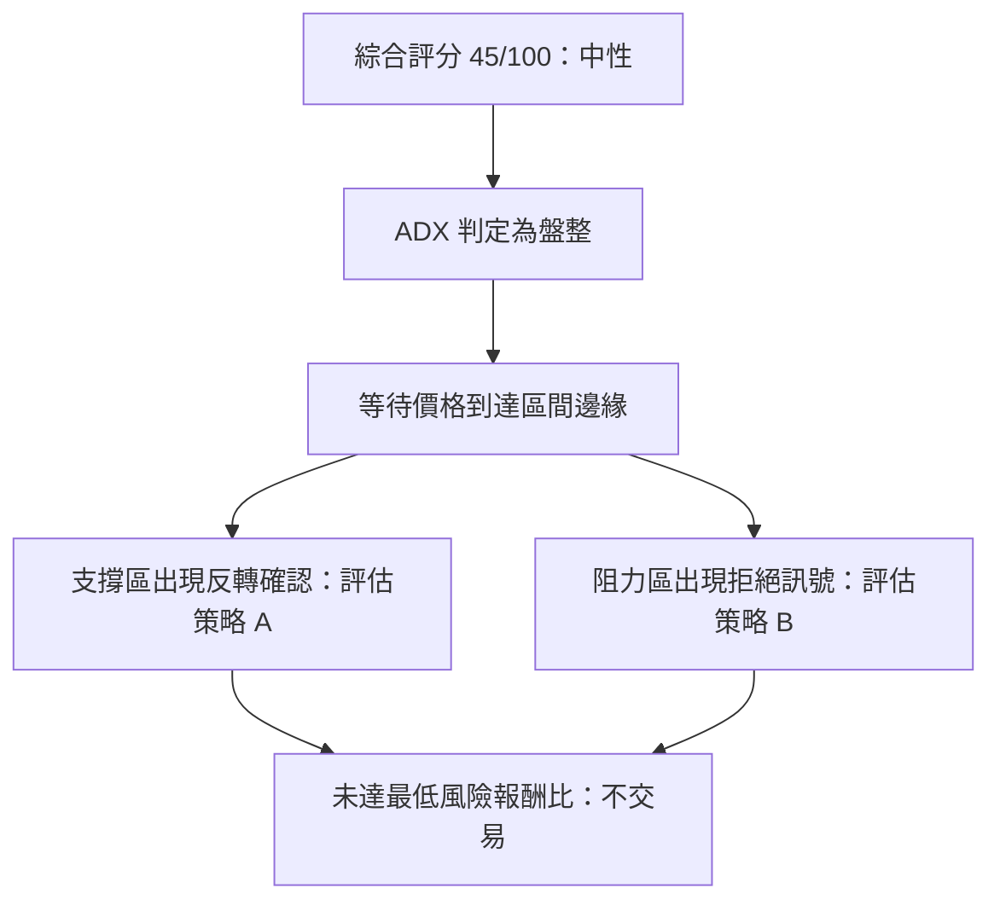

# TSLA 技術分析報告

> **報告日期**：2026-11-27 ｜ **語言**：繁體中文 ｜ **數據來源**：Yahoo Finance ｜ **當前價格**：$380.14 USD（收盤日期：2026-11-25）

---

## 目錄

| 章節 | 內容 |
|------|------|
| [1. 技術面概覽](#1-技術面概覽) | 核心指標速覽、評分卡 |
| [2. 趨勢分析](#2-趨勢分析) | 長中短期走勢、ADX |
| [3. 圖表形態分析](#3-圖表形態分析) | 形態、K線、缺口 |
| [4. 支撐與阻力](#4-支撐與阻力) | 關鍵價位、斐波那契 |
| [5. 技術指標深度解讀](#5-技術指標深度解讀) | MA／RSI／MACD／布林／成交量／進階指標 |
| [6. 動能與波動率](#6-動能與波動率) | ATR、Beta、相對強度 |
| [7. 多時框架總結](#7-多時框架總結) | 時框架方向矩陣 |
| [8. 交易策略建議](#8-交易策略建議) | 歷史基準、策略、風險報酬比 |
| [9. 風險提示與監控](#9-風險提示與監控) | 監控指標、風險場景 |

---

## 1. 技術面概覽

短線訊號偏中性：價格接近多條均線，日線動能沒有形成明確多頭確認。週線方向偏多，但月線方向中性；ADX 顯示目前更符合盤整行情，因此不宜把短期反彈直接視為趨勢反轉。主要反向風險是量能疲弱、空頭方向指標占優，以及價格在多條中長期均線附近反覆。

### 📊 核心指標速覽表

| 指標類別 | 指標名稱 | 當前數值 | 訊號 | 解讀 |
|----------|----------|----------|------|------|
| **價格** | 當前價格 | $380.14 USD | 🟡 | 收盤位於多條均線密集區，方向尚未確認 |
| **均線** | MA20／MA50／MA200 | 見第 5 章 | 🟡 | 收盤相對位置分歧，均線排列混合 |
| **動能** | RSI(14)（日線） | 見第 5 章 | 🟡 | 中性，尚未構成超買或超賣 |
| **動能** | MACD 柱（日線） | 見第 5 章 | 🔴 | 負值，日線動能偏弱 |
| **趨勢** | ADX(14) | 見第 2 章 | 🟡 | 趨勢強度不足，採盤整框架分析 |
| **波動** | ATR(14) | 見第 6 章 | 🔴 | 單日波動幅度相對價格偏大，部位須控制 |
| **多時框** | 一致性 | 見第 7 章 | 🟡 | 多時框偏多，但並非三個時框一致 |

### 🏆 技術評分卡

綜合評分採六項子評分的算術平均，四捨五入至整數。本卡為全報告唯一評分卡。

| 維度 | 評分（0–100） | 訊號 | 主要依據（引用數值所在章節） |
|------|---------------|------|------------------------------|
| 趨勢強度 | 45 | 🟡 | 趨勢強度偏弱，ADX 判讀見第 2 章 |
| 動能指標 | 48 | 🟡 | RSI 中性、MACD 柱偏空，詳見第 5 章 |
| 支撐穩定度 | 55 | 🟡 | 波段支撐與部分進階價位重疊，詳見第 4、5 章 |
| 成交量配合 | 35 | 🔴 | OBV 偏弱，A/D 與近期價格回落同向，詳見第 5 章 |
| 形態完整度 | 40 | 🟡 | 未見可確認的完整反轉或延續形態，詳見第 3 章 |
| 均線排列 | 45 | 🟡 | 均線混合，價格與中長期均線關係未形成一致方向，詳見第 5 章 |
| **綜合評分** | **45** | **中性** | 六項平均為 44.67，四捨五入為 45 |

---

## 2. 趨勢分析

長期走勢呈現大幅往返：先下跌、反彈、再度急跌，之後反彈但近期回吐。週線結構仍偏多，主要依據是週線方向指標為偏多且週 MACD 柱仍為正；日線則較混合。ADX 判斷目前屬盤整行情，後續以日線布林通道區間作為交易框架，週線作為方向背景。

### 📈 長期趨勢（近 12 個月）

下表以月收盤資料分段整理，漲跌幅按各階段起訖收盤計算；資料來源為價格資料庫。

| 階段 | 起訖月收盤 | 階段漲跌幅 | 特徵 |
|------|------------|------------|------|
| 2025-12 至 2026-03 | $449.72 → $371.75 | -17.34% | 月收盤連續回落，長期上行動能降溫 |
| 2026-03 至 2026-06 | $371.75 → $420.60 | +13.14% | 出現修復性反彈，但未延續至後續月份 |
| 2026-06 至 2026-07 | $420.60 → $311.21 | -26.01% | 急跌階段，期間波動顯著擴大 |
| 2026-07 至 2026-10 | $311.21 → $399.81 | +28.46% | 自階段低位反彈，月收盤逐步回升 |
| 2026-10 至 2026-11 | $399.81 → $380.14 | -4.92% | 反彈後回落，短期延續性轉弱 |

**長期判讀：**以近一年月收盤變化衡量，走勢並非單向趨勢，而是高波動的區間往返。近期月線 RSI 仍在中性偏強區間，但月線方向判定為中性；因此長期背景不支持把短期上漲直接解讀成已確認的新一輪趨勢。

### 📊 中期趨勢（週線）

| 觀察項目 | 週線訊號 | 解讀 |
|----------|----------|------|
| 週線方向 | 偏多 | 收盤高於週線趨勢均線，週 RSI 高於中性門檻 |
| 近 20 週週收盤 | 從 2026-07-17 的 $380.84 下探，至 2026-07-31 的 $311.21，之後反彈；最新列示收盤為 $380.14 | 先跌後彈，週線回升仍伴隨較大波動 |
| 週 RSI | 最新週線值為 51.2 | 位於中性區域，沒有明顯過熱 |
| 週 MACD 柱 | 最新週線值為 +2.408 | 正值與週線偏多方向一致，但近期週柱由較高水準回落，動能有降溫跡象 |
| 週成交量 | 最新列示週成交量低於前數週多個觀察值 | 反彈方向尚未獲得強勁量能確認 |

**中期判讀：**週線偏多提供背景支撐，但週成交量與週 MACD 柱變化顯示動能仍需確認。週線偏多不等於短線可在區間中段追價。

### ⚡ 趨勢強度（ADX）

| 指標 | 數值 | 判讀 |
|------|------:|------|
| ADX(14) | 11.33 | 弱趨勢，低於趨勢行情判定門檻 |
| +DI | 21.68 | 多方方向力量弱於空方方向力量 |
| −DI | 30.70 | 空方方向力量占優 |

ADX 顯示目前屬**盤整行情**，而非已確認的強趨勢。依多時框收斂規則，盤整時以日線布林通道上下軌作為主要交易區間；週線偏多只作為背景，不覆蓋短線區間訊號。方向指標目前空方占優，與週線偏多存在分歧，因此整體仍採中性觀望框架。

---

## 3. 圖表形態分析

現有價格資料不足以確認頭肩、雙底、旗形或其他幾何形態；不以局部高低點臆測形態目標。可確認的只有指標型訊號：價格處於布林中軌附近、ADX 偏低，符合盤整解讀。近端 K 棒呈現高波動與長影線，但單根 K 棒不足以確認反轉。

### 🔍 形態識別

| 形態 | 信心度 | 判斷依據 | 完成度 | 目標價 |
|------|--------|----------|--------|--------|
| 幾何形態（頭肩、雙底、旗形等） | 低 | 可用資料未提供足以確認頸線、形態高度及完整轉折序列的條件 | 訊號不足，僅做指標型解讀 | N/A（數據未提供） |
| 布林通道中軌附近震盪 | 中 | 日線 %B 位於通道中段，且 ADX 顯示弱趨勢 | 盤整訊號成立，但突破方向未確認 | 不推算形態目標 |
| 均線排列混合 | 中 | 短中長期均線方向不一致，未構成明確多頭或空頭排列 | 延續性未確認 | 不推算形態目標 |

### 🕯️ 重要 K 線形態與缺口

以下 K 棒形態只依 Yahoo Finance 列示的近端日 K、週 K 開高低收判斷。形態描述是單根 K 棒觀察，不代表已確認趨勢反轉。

| 日期（日 K／週 K） | 開 | 高 | 低 | 收 | K 線形態 | 解讀 | 訊號 |
|------|----:|----:|----:|----:|---------|------|------|
| 2026-11-20（日 K） | $370.43 | $373.88 | $344.33 | $345.82 | 長實體收低 | 收盤接近當日低位，空方控制明顯；單根 K 棒不能單獨確認趨勢延續 | 🔴 |
| 2026-11-23（日 K） | $374.74 | $393.83 | $371.95 | $385.46 | 收高、上影線較長 | 買盤推升後遇到上方賣壓，尚非明確突破訊號 | 🟡 |
| 2026-11-25（日 K） | $370.52 | $383.73 | $357.64 | $380.14 | 長下影線的收復型 K 棒 | 低位有承接，但收盤仍需後續交易確認 | 🟡 |
| 2026-11-06（週 K） | $404.66 | $414.23 | $338.15 | $358.22 | 大幅收低的長實體週 K | 當週波動寬、收盤偏弱，顯示週線賣壓曾明顯擴大 | 🔴 |
| 2026-11-13（週 K） | $360.25 | $404.40 | $360.02 | $390.22 | 收高、上影線較長 | 週內反彈明顯，但上方出現供給，未能據此確認突破 | 🟡 |
| 2026-11-20（週 K） | $387.00 | $393.60 | $344.33 | $345.82 | 大幅收低的長實體週 K | 週線再度轉弱，與週線中期偏多背景形成短期拉扯 | 🔴 |

#### 跳空缺口

下表依市場脈絡列示近端達門檻的缺口；所有缺口均已回補，不作為未回補缺口支撐或阻力使用。

| 日期 | 方向 | 缺口區間 | 回補狀態 | 技術解讀 |
|------|------|----------|----------|----------|
| 2026-11-11 | 向上跳空 | $380.00–$386.35 | 已回補 | 缺口已失去未回補缺口的技術參考意義 |
| 2026-11-04 | 向下跳空 | $392.04–$396.53 | 已回補 | 曾形成短線壓力區，但已回補 |
| 2026-10-26 | 向上跳空 | $377.32–$383.73 | 已回補 | 不宜再視為未回補支撐 |
| 2026-10-09 | 向上跳空 | $375.96–$379.71 | 已回補 | 缺口已回補，無未回補缺口訊號 |
| 2026-09-03 | 向上跳空 | $360.62–$365.82 | 已回補 | 缺口已回補，不列作有效缺口支撐 |

---

## 4. 支撐與阻力

波段價位以程式由 OHLCV 計算的近一年波段高低點聚類為主。現價所在區域接近第一層阻力，同時也位於部分中長期均線密集區；在盤整環境下，支撐與阻力應視為風險管理參考，而非保證價格反轉的位置。

### 🚧 阻力位分析表

阻力位來源為「近一年波段高點聚類」。

| 阻力級別 | 價位 | 形成原因 | 突破難度 | 重要性 |
|----------|------:|----------|----------|--------|
| R1 | $386.48 | 近一年波段高點聚類的第一層阻力 | 中 | 短線反彈首先需要面對的供給區 |
| R2 | $412.93 | 近一年波段高點聚類的第二層阻力 | 中 | 若 R1 突破並站穩，下一個重要測試區 |
| R3 | $434.60 | 近一年波段高點聚類的第三層阻力 | 高 | 位於更高價格區，突破需有持續買盤配合 |

### 🛡️ 支撐位分析表

支撐位來源為「近一年波段低點聚類」。

| 支撐級別 | 價位 | 形成原因 | 守住可能性 | 重要性 |
|----------|------:|----------|------------|--------|
| S1 | $366.31 | 近一年波段低點聚類的第一層支撐 | 中 | 近期回檔的首要觀察區 |
| S2 | $349.75 | 近一年波段低點聚類的第二層支撐 | 中 | 若第一層支撐失守，需觀察此處反應 |
| S3 | $337.69 | 近一年波段低點聚類的第三層支撐 | 低 | 跌至此區代表短線支撐結構進一步轉弱 |

波段支撐與阻力均有至少兩個層級可用，因此本章不以樞軸點補充標示支撐或阻力。

### 📐 斐波那契回調位分析

斐波那契回調位依 52 週區間，由程式計算並列於下表。價格位於 **61.8% 與 50.0% 回調位之間**，代表價格已回到區間中段偏下的位置；該區域本身不構成反轉確認，需要搭配價格對波段支撐的反應及日線動能判斷。

| 回調比例 | 價位 | 技術意義 |
|----------|------:|----------|
| 23.6% | $451.29 | 較淺回調參考位 |
| 38.2% | $421.88 | 中淺回調參考位 |
| 50.0% | $398.10 | 區間中點參考位 |
| 61.8% | $374.33 | 常用的深回調參考位 |
| 78.6% | $340.49 | 深回調參考位 |

---

## 5. 技術指標深度解讀

日線指標呈現「動能中性偏弱、趨勢不明、均線分歧」的組合。RSI 沒有進入極端區域，但 MACD 柱為負；布林位置接近中軌，支持盤整判讀。均線與動能訊號並未形成全面確認，因此不宜單靠週線偏多訊號追價。

### 📈 均線、RSI、MACD、布林通道

| 指標 | 數值 | 訊號 | 解讀 |
|------|------|------|------|
| MA20／MA50／MA200 與排列 | MA20 $382.15；MA50 $377.17；MA200 $381.15；均線排列：混合 | 🟡 | 收盤低於 MA20、MA200，但高於 MA50。均線彼此接近，排列不具方向一致性 |
| RSI(14)（日線）與背離 | RSI 50.31；近 20 根 K 棒首尾比較：無明顯 RSI 背離 | 🟡 | 位於中性區。未見明顯頂背離或底背離，不能以背離作為反轉依據 |
| MACD 線／Signal／柱（日線） | MACD -0.232；Signal 0.628；Hist -0.860 | 🔴 | MACD 線低於 Signal，柱值為負，日線動能偏空。可用資料未提供足以核驗 MACD 峰谷背離的完整序列，MACD 背離判定為 N/A（數據未提供） |
| 布林上軌／中軌／下軌／%B（日線） | 上軌 $415.76；中軌 $382.15；下軌 $348.53；%B 0.47 | 🟡 | 收盤位於通道中段、接近中軌，沒有明確觸及上下軌的極端訊號 |

**指標整合：**均線排列混合、RSI 中性、MACD 柱偏空、布林位置在中軌附近。RSI 沒有超賣，故不能把價格回落簡化成「超賣反彈」；MACD 偏空與量能疲弱共同限制短線多方確認。ADX 盤整訊號則支持以布林區間，而非趨勢追價方式處理。

### 💹 成交量（量價配合度）

| 指標 | 數值／訊號 | 解讀 |
|------|------------|------|
| 最新成交量 | 34,915,800 股 | 與 20 日均量接近，但未顯示明顯放量突破 |
| 20 日均量與量比 | 20 日均量 35,570,150 股；量比 0.98x | 近期成交量略低於均量，量能確認度有限 |
| 50 日均量 | 36,638,320 股 | 高於最新成交量，顯示當日量能未達中期均量 |
| OBV | OBV 低於其均線 | 量能偏疲弱，未確認價格反彈走勢 |
| A/D 線 | 近 20 根 A/D 不高於其 20 日均值；A/D 下降、價格下跌，同向 | 近期資金流向指標與價格回落同向，確認賣壓存在 |

**量價結論：**成交量沒有支持明確向上突破；OBV 偏弱，A/D 與價格下跌同向，量能目前較支持「反彈需確認」而非「多頭已重新掌控」。

### 🧭 進階指標

以下進階指標由程式以日線計算。數值照列並以收盤相對位置解讀；此處不把公式樞軸另行改標成波段支撐或阻力。

| 指標 | 數值 | 收盤相對位置 | 解讀 |
|------|------|--------------|------|
| 一目均衡表（轉換線／基準線／雲層） | 轉換線 $374.36；基準線 $376.19；先行帶 A $368.08；先行帶 B $354.90；前方先行帶 A $375.28、B $376.19 | 收盤位於現行雲層上方；轉換線低於基準線；前方雲層 A 低於 B | 現行雲層上方偏多，但轉換線與基準線關係、前方雲層結構偏空，訊號互相矛盾 |
| 成交量分布（POC／價值區） | POC $377.12；價值區 $364.53–$448.47，含 71% 成交量 | 收盤位於價值區內 | 價格仍在主要成交密集區內，偏向均衡交易而非明確趨勢脫離 |
| 錨定 VWAP（自 52 週高點／低點） | 自 2025-12-22 高點起 $393.35；自 2026-07-29 低點起 $363.61 | 收盤低於高點錨定 VWAP；高於低點錨定 VWAP | 高點起算的持倉成本仍形成上方壓力；低點起算則價格仍在其上，兩者共同指向區間拉鋸 |
| A/D 線 | 近 20 根 A/D 不高於其 20 日均值；A/D 下降、價格下跌 | — | 與價格回落同向，資金流向尚未確認反彈 |

**進階指標與主要指標的對照：**收盤在雲層上方及低點錨定 VWAP 上方，對多方略有支持；但前方雲層偏空、轉換線低於基準線，且價格低於高點錨定 VWAP，與日線 MACD 偏弱及均線混合一致。成交量分布顯示價格仍在價值區內，進一步支持盤整判讀。

---

## 6. 動能與波動率

波動度偏高，停損若過近容易受到日常價格波動干擾；不過，擴大停損也必須同步縮小部位，不能只為避免觸發而承受過大單筆風險。相對強度對不同基準呈現分歧：中期相對 VTI、QQQ 走強，但六個月相對 VTI 落後。

### 📊 ATR 波動率分析

| 指標 | 數值 | 解讀 |
|------|------:|------|
| ATR(14) | $19.58 | 日線平均真實波幅的估計，顯示單日波動不可忽略 |
| ATR 佔價格比例 | 5.15% | 相對價格的波動幅度偏高，應降低倉位或放寬策略停損 |
| 1.5 倍 ATR 參考距離 | $29.37 | 以 ATR 乘以 1.5 計算，作為波動風險參考，不是替代第 8 章策略停損 |
| 2 倍 ATR 參考距離 | $39.16 | 以 ATR 乘以 2 計算，較寬的波動容忍參考，同樣不能取代策略失效價位 |

以上 ATR 金額依日線指標計算。策略實際停損仍應以第 8 章列出的已知技術價位為準；若技術停損距離大於可承受風險，應降低倉位或不交易。

### 📐 Beta 與相對強度

Beta 反映相對大盤的歷史敏感度，並非方向預測。相對強度數據為市場脈絡區塊列示的價格報酬，不含股息。

| 基準 | 期間 | TSLA 報酬 | 基準報酬 | 超額報酬 | 比值趨勢 |
|------|------|----------:|---------:|---------:|----------|
| VTI（美國整體市場） | 1 個月 | -6.7% | -6.5% | -0.2% | 相對走強（比值高於其 50 日均值） |
| VTI（美國整體市場） | 3 個月 | +7.1% | -7.2% | +14.3% | 相對走強（比值高於其 50 日均值） |
| VTI（美國整體市場） | 6 個月 | -14.0% | -5.0% | -9.0% | 相對走強（比值高於其 50 日均值） |
| QQQ（Nasdaq-100） | 1 個月 | -6.7% | -12.1% | +5.4% | 相對走強（比值高於其 50 日均值） |
| QQQ（Nasdaq-100） | 3 個月 | +7.1% | -12.1% | +19.2% | 相對走強（比值高於其 50 日均值） |
| QQQ（Nasdaq-100） | 6 個月 | -14.0% | -13.8% | -0.2% | 相對走強（比值高於其 50 日均值） |

| 風險指標 | 數值 | 解讀 |
|----------|------:|------|
| Beta | 1.743 | 對市場波動的敏感度偏高；波動風險大於低 Beta 股票 |
| 相對強度對主策略的影響 | 對 VTI 的 3 個月、對 QQQ 的 1 與 3 個月相對強勢；六個月相對 VTI 明顯落後 | 支持「不宜單純看空追跌」，但相對強勢並未消除日線量價偏弱訊號；對中性區間策略屬部分支持、非全面確認 |

---

## 7. 多時框架總結

多時框架方向與來源區塊一致：日線偏多、週線偏多、月線中性，多時框架一致性為 2/3 偏多。這種一致性代表方向偏多但仍有分歧，不能視為三個時框全面共振。

### 📋 時框架評分表

| 時框架 | 趨勢方向 | RSI(14) | MACD 柱 | 收盤 vs 趨勢均線 | 形態 | 建議 |
|--------|----------|---------|---------|------------------|------|------|
| 日線 | 偏多 | 50.31 | -0.860 | 收盤 380.14；MA50 377.17；收盤在 MA50 上方 | 日線 MACD 柱偏空，布林位置中性 | 不追價，等待區間邊緣與價格確認 |
| 週線 | 偏多 | 51.24 | +2.408 | 收盤 380.14；MA20 359.89；收盤在 MA20 上方 | 週 MACD 柱為正，但近期動能有所回落 | 週線作為偏多背景，仍須留意日線盤整風險 |
| 月線 | 中性 | 62.50 | N/A（數據未提供） | 收盤 380.14；MA10 382.62；收盤在 MA10 下方 | 月線方向中性，MACD 柱資料不足 | 不以月線作為單獨進場依據 |

**多時框一致性：2/3 偏多。**

### ⚖️ 多時框收斂結論

當前屬盤整行情，故依規則以日線布林通道區間為主要交易依據。週線偏多與日線的弱勢動能並存，日線負向 MACD、成交量偏弱與月線中性共同限制多方追價的合理性。

**唯一方向性結論：中性觀望。**偏多的週線背景不構成現在追買的充分條件；策略上等待價格到達區間邊緣，再依反應執行，而非同時持有相反方向部位。

---

## 8. 交易策略建議

**當前主策略方向 = 中性區間操作（依評分 45/100）。**現價處於區間中段時，不具備足夠的風險報酬條件；以下策略只在指定技術價位觸發後考慮，不代表同時建立多空部位。

### 📊 歷史基準機率

今日狀態定義為「RSI(14) 介於 50–70，且收盤低於 MA200」。歷史期間為 2016-11-25 至 2026-11-25，共 2,514 個交易日；價格報酬不含股息。數據來源：價格資料庫。

| 持有期 | 相同狀態樣本（段數） | 上漲比例 | 中位數報酬 | 25%–75% 分位 | 全部交易日上漲比例／中位數 |
|--------|----------------------|----------|------------|--------------|---------------------------|
| 5 日 | 268 個交易日（63 段） | 56% | +1.4% | -3.5% 至 +6.5% | 52%／+0.4% |
| 20 日 | 267 個交易日（62 段） | 65% | +4.3% | -2.7% 至 +14.3% | 54%／+1.3% |
| 60 日 | 237 個交易日（60 段） | 66% | +9.4% | -7.5% 至 +24.5% | 56%／+4.0% |

**歷史基準解讀：**相同狀態的各持有期歷史上漲比例均高於全部交易日基準；中位數報酬也較高，對等待支撐確認後的多方策略有一定歷史支持。不過，交易日彼此重疊，獨立段數低於交易日樣本數；歷史頻率不是預測，不能解讀成未來策略成功機率。

### 🎯 價格情境階梯（Price Scenarios）

下表可能性使用高／中／低定性評估，不代表機率百分比。價位只採用第 4 章列出的波段價位；情境仍須由實際價格反應確認。

| 觸發條件 | 下一目標 | 後續延伸 | 可能性 | 依據 |
|----------|----------|----------|--------|------|
| 突破並守住 R1 | R2 | R3 | 中 | 週線偏多提供背景支持，但日線 MACD 與成交量仍未全面確認 |
| 在現價區間維持震盪 | — | — | 中 | ADX 顯示盤整，布林位置居中，價格方向仍未選擇 |
| 跌破 S1 | S2 | S3 | 中 | 日線動能與量能偏弱；但若未見收盤確認，不能預設支撐必然失守 |

### 🟢 主策略詳情

兩項策略皆為條件式區間策略，不得同時持倉；若價位未觸發，維持觀望。進場價格、停損與目標均使用已列示的波段價位。風險報酬比依公式計算，均以 T1 計且符合最低要求。

| 策略要素 | 策略 A：支撐區反轉做多 | 策略 B：上方阻力拒絕做空 |
|----------|----------------------|--------------------------|
| 進場條件 | 價格回落至 S2，且出現止跌或收復支撐的確認；未確認不進場 | 價格反彈至 R2，且出現拒絕上攻或轉弱訊號；未確認不進場 |
| 進場價格 | $349.75 | $412.93 |
| 目標價 T1 | $386.48 | $366.31 |
| 目標價 T2 | $412.93 | $349.75 |
| 止損價格 | $337.69 | $434.60 |
| 風險報酬比 | 1 : 3.05（以 T1 計；計算：($386.48−$349.75)÷($349.75−$337.69)） | 1 : 2.15（以 T1 計；計算：($412.93−$366.31)÷($434.60−$412.93)） |
| 把握度 | 中；歷史基準對相同狀態的中期結果有支持，但量能仍弱且需先確認支撐反應 | 低；進場需等待較大幅度反彈，且日線動能偏弱可能造成訊號反覆 |
| 建議倉位 | 單筆風險先限定為帳戶資金的 0.25%–0.50%；按停損距離反推股數 | 單筆風險先限定為帳戶資金的 0.25%–0.50%；按停損距離反推股數 |
| 執行規則 | 若未在觸發區出現確認，不提前買入；達到 T1 後評估是否減碼或移動停損 | 若未在觸發區出現拒絕訊號，不提前放空；達到 T1 後評估是否減碼或移動停損 |

**最佳機會：**策略 A 的風險報酬比高於最低門檻，但須等支撐區出現確認。若價格未到達該進場條件，或未出現確認訊號，最佳選擇是觀望；不得因歷史基準較佳而提前進場。

### 🔴 反向風險觸發點（對沖提示）

| 風險觸發 | 對主策略的影響 | 風控提示 |
|----------|----------------|----------|
| 價格有效跌破 S1，且後續無法收復 | 支撐反轉做多的前提削弱 | 暫停策略 A，重新評估下一層支撐及量能 |
| 價格跌破 S2 並向 S3 延伸 | 區間下緣承接假設失效風險上升 | 不以攤平方式處理，按事先停損執行 |
| 價格突破 R1 並延續至 R2 方向 | 區間上方壓力假設減弱 | 不在突破後盲目做空，等待阻力是否轉為支撐 |
| 週線偏多結構轉弱且日線量能放大下跌 | 多方背景遭到削弱 | 重新檢視多時框方向，不預設歷史基準仍適用 |

---

## 9. 風險提示與監控

主要監控重點是支撐／阻力是否被有效突破、突破時成交量是否配合，以及週線偏多背景能否延續。財報事件可能造成跳空，使一般停損價格不保證成交；若策略持有期跨越財報日，應相應降低部位或避免持倉穿越事件。

### ✅ 關鍵監控指標

| 監控項目 | 觀察條件 | 觸發後動作 |
|----------|----------|------------|
| R1 | 價格突破並維持在阻力之上 | 評估向下一層阻力延伸；若突破缺乏成交量確認，避免追價 |
| S1 | 價格跌破後無法收復 | 暫停支撐反轉多方策略，檢查下一層支撐 |
| S2 | 價格測試後出現承接與止跌確認 | 才考慮執行策略 A；確認不足則不進場 |
| R2 | 價格測試後出現拒絕訊號 | 才考慮執行策略 B；若帶量突破則撤銷做空構想 |
| 日線 MACD、RSI 與成交量 | 觀察日線動能是否改善，以及上漲時是否有量能配合 | 若動能改善但量能未確認，仍以中性區間處理 |
| 多時框一致性 | 留意週線偏多是否延續、月線是否由中性轉向 | 若時框分歧擴大，降低部位並避免方向性追價 |
| 下次財報日 | 2027-01-27；距最新收盤日 63 個日曆天 | 財報日期可能調整；若持有期跨越財報，降低部位或避免事件持倉，並注意跳空風險 |

### ⚠️ 風險場景

| 情境 | 觸發條件 | 價位參考 | 可能性 | 應對 |
|------|----------|----------|--------|------|
| 樂觀 | 支撐區守住，日線動能改善，價格突破第一層阻力且量能配合 | S1、R1、R2 | 中 | 等確認後才評估多方策略；不因週線偏多而提前追價 |
| 基本 | 價格維持區間震盪，量能未明顯擴張，日線動能反覆 | S1、R1 | 中 | 維持中性；僅在區間邊緣評估已達風險報酬門檻的策略 |
| 悲觀 | 支撐失守且賣壓延續，日線與週線訊號同步轉弱 | S1、S2、S3 | 中 | 停止支撐接多，按預定停損執行，避免逆勢加碼 |

### 🛡️ 風險管理提醒

- **先定單筆風險，再決定股數：**依進場至停損的距離反推倉位；若倉位過小仍不符合風險承受度，直接放棄交易。
- **避免區間中段追價：**盤整環境下，中段往往缺乏清楚的停損位置與足夠風險報酬比。
- **停損不得任意放寬：**若策略失效價位被觸及，依原計畫處理；不得以「等待反彈」為由擴大虧損。
- **量能未確認時降低信心：**突破或反轉若缺乏成交量支持，視為較弱訊號，避免使用滿額倉位。
- **注意財報跳空：**事件期間止損不保證按指定價格成交；若無法承受跳空風險，避免持倉跨越財報。

---

## 📋 報告總結

| 項目 | 結論 |
|------|------|
| 報告日期 | 2026-11-27 |
| 當前價格 | 見標題與第 1 章速覽表（收盤日期：2026-11-25） |
| 綜合評分／方向 | 45/100，中性 |
| 長期／中期／短期趨勢 | 🟡 長期高波動往返；🟢 週線偏多；🟡 日線盤整且動能偏弱 |
| 關鍵支撐／關鍵阻力 | 支撐 S1 $366.31；阻力 R1 $386.48 |
| 🥇 最佳機會 | 等待策略 A 的支撐確認；未觸發前觀望 |
| 最大風險 | 日線動能及量能偏弱，若支撐失守，週線偏多背景可能迅速轉弱；財報事件亦可能造成跳空 |

> ⚠️ **免責聲明**：本報告為 AI 自動生成之技術分析，所有數據及估算均基於歷史價格資訊。本報告僅供研究與學術參考，不構成任何投資建議。投資有風險，入市需謹慎。

---

## 資料與來源

| 項目 | 內容 |
|------|------|
| 價格 | 380.14 USD，2026-11-25 收盤（Yahoo Finance 日線） |
| K 棒 | 501 根日線，2024-11-26 至 2026-11-25（Yahoo Finance）；較長期間的價位與基準機率取自價格資料庫 |
| 關鍵價位回溯期間 | 阻力 近一年、支撐 近一年 |
| 下次財報日 | 2027-01-27（Yahoo Finance，日期可能調整） |
| 有回應的資料來源 | Yahoo Finance、Finviz、StockAnalysis、Roic.ai |
| 由程式計算 | 所有指標、R1–S3 與斐波那契價位、多時框方向、相對強度、缺口、歷史基準機率、綜合評分 |
| 撰寫模型 | openai / gpt-6-luna |

> 本區塊由產生報告的程式依實際取得的資料填寫，非模型撰寫。「由程式計算」的數字不是模型的估計；其餘判斷（評分、情境、策略）是模型的分析。
