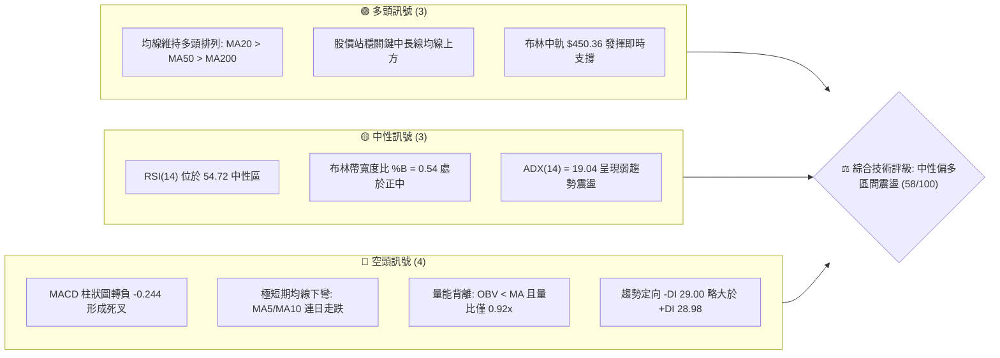
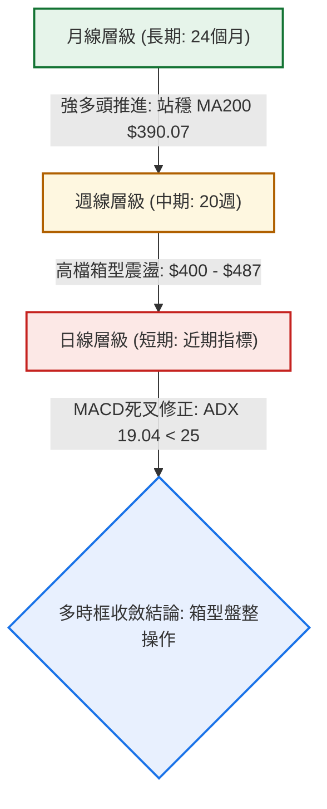
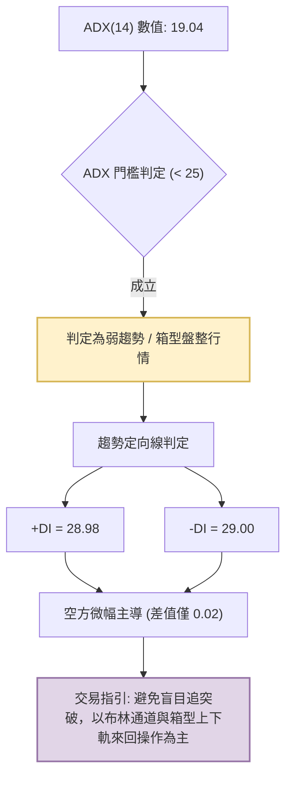
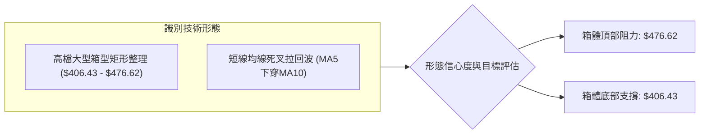
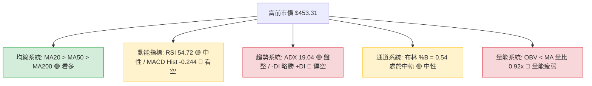
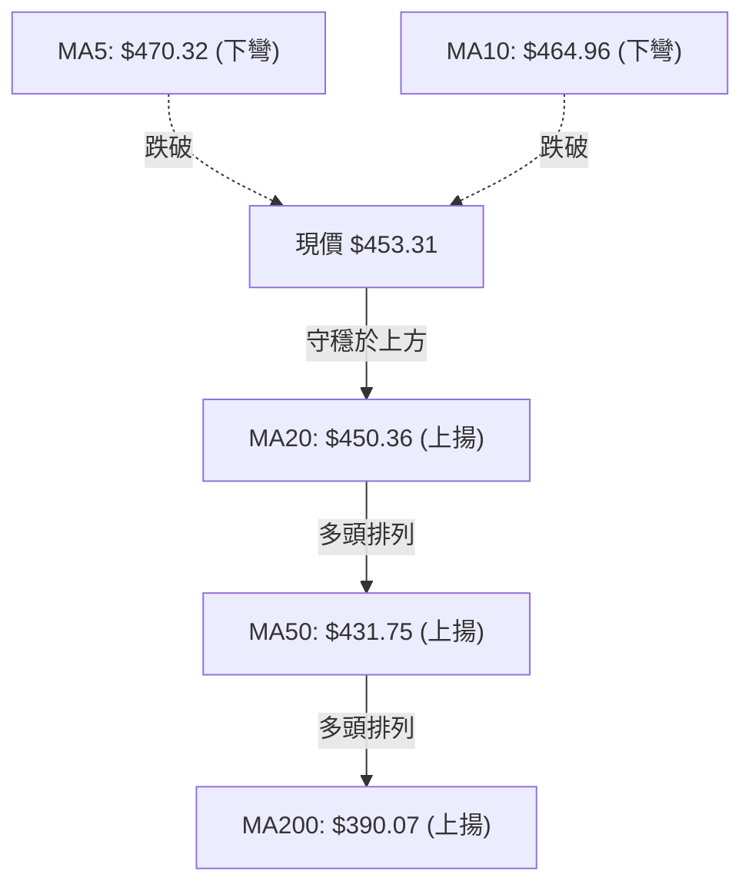
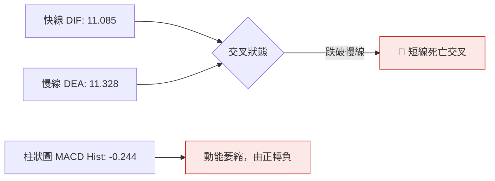
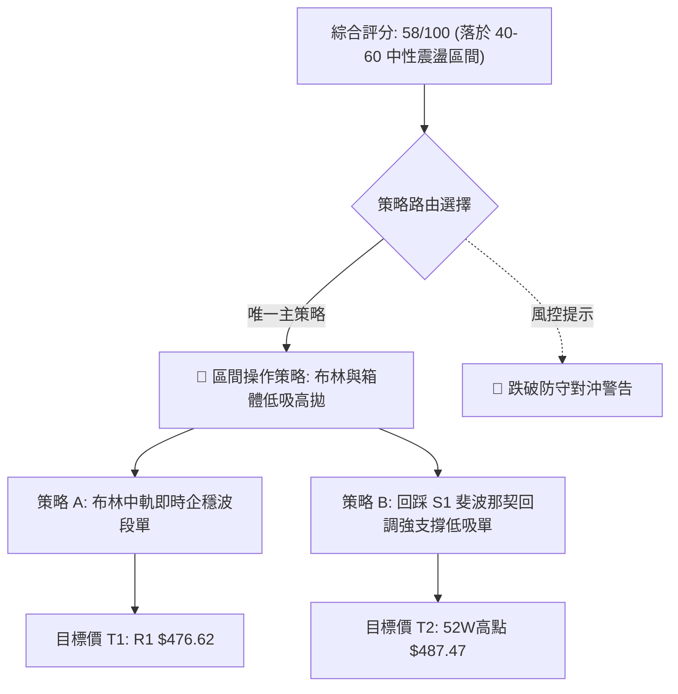
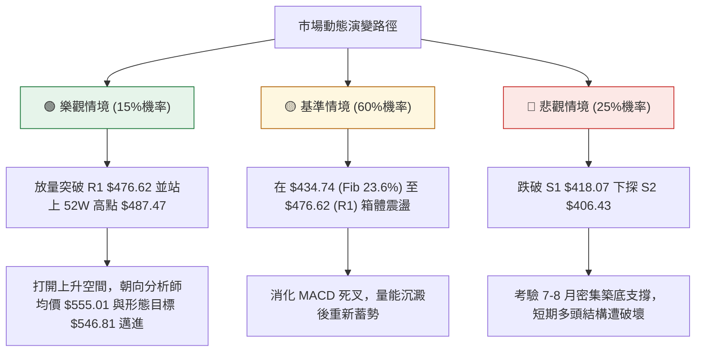

# TSM 技術分析報告

> **報告日期**：2026-10-11 ｜ **語言**：繁體中文 ｜ **數據來源**：Yahoo Finance ｜ **當前價格**：$453.31

---

## 目錄

| 章節 | 內容 |
|------|------|
| [1. 技術面概覽](#1-技術面概覽) | 訊號儀表板、核心指標、評分卡 |
| [2. 趨勢分析](#2-趨勢分析) | 多時框趨勢、長中短期走勢、ADX解讀 |
| [3. 圖表形態分析](#3-圖表形態分析) | 形態識別信心度、K線組合、目標價計算 |
| [4. 支撐與阻力](#4-支撐與阻力) | 關鍵價位結構、斐波那契回調深度分析 |
| [5. 技術指標深度解讀](#5-技術指標深度解讀) | 均線、RSI、MACD、布林通道、成交量 |
| [6. 動能與波動率](#6-動能與波動率) | 動能四象限、ATR止損管理、Beta分析 |
| [7. 多時框架總結](#7-多時框架總結) | 時框架評分矩陣、多時框收斂定調 |
| [8. 交易策略建議](#8-交易策略建議) | 策略路由、價格情境階梯、執行參數 |
| [9. 風險提示與監控](#9-風險提示與監控) | 關鍵監控Checklist、三場景應對、倉位控管 |
| [10. 報告總結](#10-報告總結) | 核心結論與執行決策摘要 |

---

## 1. 技術面概覽

### 🎯 技術訊號儀表板



### 📊 核心指標速覽表

| 指標類別 | 指標名稱 | 當前數值 | 訊號 | 解讀 |
|----------|----------|----------|------|------|
| **價格** | 當前收盤價 | $453.31 | 🟡 | 位於52週區間 84.7%，自高點 $487.47 回檔整理 |
| **均線** | 短期 MA20 | $450.36 | 🟢 | 現價高於 MA20（+0.65%），布林中軌發揮關鍵支撐 |
| **均線** | 中期 MA50 | $431.75 | 🟢 | 現價高於 MA50（+5.0%），中期多頭格局未破 |
| **均線** | 長期 MA200| $390.07 | 🟢 | 顯著高於牛熊分水嶺（+16.21%），長期牛市基調明確 |
| **動能** | RSI(14) | 54.72 | 🟡 | 脫離前週 85.9 之極端超買區，回到 50-60 中性格局 |
| **動能** | MACD (12,26,9) | 柱狀圖 -0.244 | 🔴 | 快線 11.085 跌破慢線 11.328，日線層級發出死叉修正訊號 |
| **波動** | ATR(14) | $11.25 | 🟡 | 佔股價 2.48%，波動處於中等常態，提供合理止損依據 |
| **趨勢** | ADX(14) | 19.04 | 🟡 | 低於 25 臨界值，代表當前非單邊趨勢，屬箱型盤整行情 |
| **量能** | OBV 與量比 | 0.92x / 疲弱 | 🔴 | 成交量 9.22M 低於 20 日均量 10.03M，OBV < MA 量能不足 |

### 🏆 技術評分卡

```
╔══════════════════════════════════════════════════════════════════╗
║              技術評分卡 — TSM (2026-10-11)                       ║
╠══════════════════════════════════════════════════════════════════╣
║ 趨勢強度 (ADX/方向)   ████████░░░░░░░░░░░░  40/100  🟡 弱趨勢盤整 ║
║ 動能指標 (RSI/MACD)   ██████████░░░░░░░░░░  50/100  🟡 短線轉弱   ║
║ 支撐穩定度 (S1/Fib)   ██████████████░░░░░░  70/100  🟢 結構堅實   ║
║ 成交量配合 (OBV/Vol)  ████████░░░░░░░░░░░░  40/100  🔴 量能萎縮   ║
║ 形態完整度 (通道/箱體)██████████████░░░░░░  70/100  🟢 箱型成形   ║
║ 均線排列 (多頭排列)   ████████████████░░░░  80/100  🟢 完美多頭   ║
╠══════════════════════════════════════════════════════════════════╣
║ 綜合評分              ███████████░░░░░░░░░  58/100  中性整理偏多  ║
╚══════════════════════════════════════════════════════════════════╝
```

---

## 2. 趨勢分析

### 🌐 多時框趨勢分析



### 📈 長期趨勢 — 12個月走勢圖（Unicode）

以下為 TSM 自 2025 年 11 月至 2026 年 10 月之月線收盤價走勢圖（縱軸標注關鍵波段高低點與現價）：

```
TSM 月線走勢圖（2025-11 至 2026-10）
價格軸 ($)
$476.29 ┤                                     ●(26-06 歷史次高)
$453.31 ┤                                           ●←(26-10 現價)
$416.36 ┤                             ●       ●
$371.66 ┤                 ●           │       │
$336.26 ┤                 │   ●       │   ●   │
$301.52 ┤         ●       │   │   ●   │   │   │
$288.46 ┤ ●   ●   │   ●   │   │   │   │   │   │
        └─┬───┬───┬───┬───┬───┬───┬───┬───┬───┬───┬───
        11/25 12 01/26 02  03  04  05  06  07  08  09  10
```

#### 走勢特徵分析表格

| 階段 | 時間跨度 | 起訖價位 ($) | 漲跌幅 (%) | 走勢特徵解讀 |
|------|----------|--------------|------------|--------------|
| **主升一浪** | 2025-11 → 2026-02 | $288.46 → $371.66 | +28.84% | 強勢單邊推升，突破 $300 整數關卡，各期均線發散向上 |
| **回踩整理** | 2026-02 → 2026-03 | $371.66 → $336.26 | -9.52% | 獲利回吐引發技術性回踩，回撤守穩原突破阻力 |
| **主升二浪** | 2026-03 → 2026-06 | $336.26 → $476.29 | +41.64% | 伴隨業績爆發的暴力拉升，創下月線收盤新高 $476.29 |
| **高檔回撤** | 2026-06 → 2026-07 | $476.29 → $403.17 | -15.35% | 碰觸52週高點 $487.47 後快速拉回，於支撐 S2 $406.43 附近止跌 |
| **收斂震盪** | 2026-07 → 2026-10 | $403.17 → $453.31 | +12.44% | 價格重新收復 $450，但量能無法持續放大，形成大型收斂區間 |

### 📊 中期趨勢（週線分析）

從近 20 週歷史數據可見，TSM 在 2026-07-19 至 2026-08-02 期間於 $397.30 - $403.17 築底完成，其後展開週線級別反彈。然而，在 2026-10-04 觸及 $472.78 高點後，週線 RSI 飆升至 85.9 極端超買，隨即在 2026-10-11 當週出現拉回收在 $453.31，週線 MACD 柱狀圖由 +2.837 迅速翻負至 -0.244，顯示中期動能正經歷急遽降溫。

```
TSM 近期壓力與支撐結構示意圖
阻力區間 ──► $487.47 (52W高點) ── $476.62 (R1阻力/月收高點 $476.29)
                  ▲
現價水準 ──►  $453.31 ── (正測試 MA20: $450.36)
                  ▼
支撐區間 ──► $434.74 (Fib 23.6%) ── $418.07 (S1支撐) ── $406.43 (S2支撐)
```

### ⚡ 趨勢強度評估（ADX 解讀）



#### ADX 強度對照與解讀表

| ADX 區間 | 趨勢狀態 | TSM 當前數值 | 交易意涵 |
|----------|----------|--------------|----------|
| **0 – 20** | **極弱趨勢 / 盤整** | **19.04** 🟢 本區間 | **波段動能停滯，均線趨於糾結，價格傾向在均值周圍擺盪** |
| **20 – 25** | 趨勢萌芽 / 方向未明 | — | 需等待成交量放大與定向線開口擴大 |
| **25 – 40** | 強趨勢行情 | — | 順勢操作，採用均線追蹤法 |
| **40 – 60** | 極強單邊行情 | — | 需提防趨勢末端過熱竭盡反轉 |

---

## 3. 圖表形態分析

### 🔍 形態識別系統

依據多時框收斂與幾何精準度規則，本報告嚴格基於歷史數據聚類識別形態：



#### 圖表形態信心度分析表

| 形態名稱 | 信心度 | 判斷依據（引用數據） | 完成度 | 目標價（附計算式） |
|----------|--------|----------------------|--------|--------------------|
| **高檔矩形箱型整理** | **85%** | 上軌由 R1 $476.62 與 2026-06 月收 $476.29 壓制；下軌由 S2 $406.43 與 2026-07/08 低點 $403.17 支撐 | 75% | 箱頂目標：$476.62；箱底回踩目標：$418.07 (S1) 至 $406.43 (S2) |
| **布林中軌回踩測試** | **70%** | 現價 $453.31 正在回踩布林中軌/MA20 $450.36，%B 自高位降至 0.54 | 90% | 守穩目標：回測 R1 $476.62；跌破目標：回調位 Fib 23.6% $434.74 |
| **頭肩頂形態** | **20%** | **訊號不足，僅做指標型解讀**。數據未偵測到明確右肩結構，不可強行推論 | 0% | 不適用（無效形態） |

### 🕯️ 重要K線形態分析

| 週/月份 | 收盤價 ($) | K線形態特徵 | 技術意涵解讀 | 多空訊號 |
|---------|------------|-------------|--------------|----------|
| **2026-06 (月線)** | 476.29 | 長上影大陽線（高點 $487.47） | 買盤在高檔遇強勁解套與獲利了結賣壓，留長上影線 | 🟡 獲利了結 |
| **2026-07 (週線)** | 397.30 | 帶量長黑下殺（成交量 91.5M） | 恐慌盤湧出，單週暴跌測試波段低點，形成短線超賣 | 🔴 空方釋放 |
| **2026-08 (週線)** | 403.17 | 低檔長下影十字星（成交量 87.3M） | 空頭力道竭盡，低檔買盤大舉進駐承接，確立波段底 | 🟢 止跌築底 |
| **2026-10-04 (週線)**| 472.78 | 高檔長陽爆量（RSI 85.9） | 衝刺前高未過，指標進入嚴重超買極限區 | 🟡 竭盡疑慮 |
| **2026-10-11 (週線)**| 453.31 | 中黑回跌吞噬（MACD柱翻負） | 獲利賣壓出籠，短線強轉弱，價格回歸均值尋求支撐 | 🔴 短線回檔 |

### 📉 ASCII 走勢形態示意圖

```
TSM 高檔箱型整理與布林帶通道示意圖
      阻力線 (R1 / 52W區間高點): $476.62 - $487.47
══════╦═══════════════════════════════════════════════════════════╦═════
      ║                  [高點 487.47]                            ║
      ║                     ╭─╮             [次高 472.78]         ║
      ║            ╭───────╯   ╰───╮           ╭─╮                ║
      ║            │               ╰───────────╯ ╰───────╮        ║
$453  ╠════════════╪═════════════════════════════════════● 現價═══╣
$450  ╟┈┈┈┈┈┈┈┈┈┈┈┈┼┈┈┈┈┈┈┈┈┈┈┈┈┈┈┈┈┈┈┈┈┈┈┈┈┈┈┈┈┈┈┈┈┈┈┈┈┈┴┈┈┈┈┈┈┈╢ 布林中軌 (MA20)
      ║            │                                             ║
      ║            │                       ╭─────────╮           ║
      ║            ╰───────╮       ╭───────╯         │           ║
      ║                    ╰───────╯                             ║
      ║                [低點 397.30 - 403.17]                    ║
══════╩═══════════════════════════════════════════════════════════╩═════
      支撐線 (S1 / S2 支撐聚類): $418.07 - $406.43
```

### 🎯 形態目標價計算

根據已確認之高檔矩形箱型整理形態計算技術測幅目標：
1. **箱體上限頸線**：$476.62
2. **箱體下限底線**：$406.43
3. **箱體垂直高度**：$476.62 - $406.43 = $70.19
4. **若向上突破箱頂測幅目標**：
   $$\text{目標價} = \text{箱頂} + \text{形態高度} = 476.62 + 70.19 = \$546.81$$
   *(該目標與分析師平均目標價 $555.01 極為接近)*
5. **若向下跌破箱底測幅目標**：
   $$\text{防守回撤目標} = \text{箱底} - \text{形態高度} = 406.43 - 70.19 = \$336.24$$
   *(精準對應 2026-03 波段收盤低點 $336.26)*

---

## 4. 支撐與阻力

### 🗺️ 關鍵價位分布圖（Unicode）

```
TSM 價位結構分布圖（OHLCV 聚類計算）
══════════════════════════════════════════════════════════════════════
$487.47 ║████████████████████████████████║ 52週歷史高點 / Fib 0.0%
$476.62 ║████████████████████████████    ║ 關鍵波段阻力 R1 (+5.14%)
        ║                                ║
$453.31 ╠════════════════════════════════╣ ◄ 當前市價 (位於52W區間 84.7%)
        ║                                ║
$450.36 ║────────────────────────────────║ 布林中軌 / MA20 支撐 (-0.65%)
$434.74 ║▓▓▓▓▓▓▓▓▓▓▓▓▓▓▓▓▓▓▓▓            ║ 斐波那契 23.6% 回調位 (-4.10%)
$418.07 ║▓▓▓▓▓▓▓▓▓▓▓▓▓▓▓▓▓▓▓▓▓▓▓▓        ║ 強支撐 S1 (-7.77%)
$406.43 ║████████████████████████████    ║ 關鍵箱底支撐 S2 (-10.34%)
$384.06 ║████████████████████████████████║ 極限防守支撐 S3 (-15.28%)
══════════════════════════════════════════════════════════════════════
```

### 🚧 阻力位分析表

| 阻力級別 | 價位 ($) | 形成原因 | 突破難度 | 重要性 |
|----------|----------|----------|----------|--------|
| **R1** | **$476.62** | 歷史波段高點聚類、2026-06 月線收盤價 $476.29 及布林上軌 $490.85 之前哨 | 🔴 極高（量能不足下難以一次突破） | ★★★★★ |
| **52W High** | **$487.47** | 52 週最高極值點，解套盤與期權防守集結區 | 🔴 極高（需巨量催化） | ★★★★☆ |

### 🛡️ 支撐位分析表

| 支撐級別 | 價位 ($) | 形成原因 | 守住機率 | 重要性 |
|----------|----------|----------|----------|--------|
| **即時支撐** | **$450.36** | 日線 MA20 均線暨布林通道中軌所在處 | 🟡 60%（短線正反覆回踩測試） | ★★★☆☆ |
| **S1** | **$418.07** | 近一年波段低點聚類、接近 MA60 ($426.86) 與 MA50 ($431.75) 緩衝區 | 🟢 75% | ★★★★☆ |
| **S2** | **$406.43** | 箱體實體底部聚類、2026-07/08 密集築底區 ($402.33-$403.17) | 🟢 85% | ★★★★★ |
| **S3** | **$384.06** | 波段防守深水區，接近 MA200 ($390.07) 牛熊線支撐 | 🟢 95% | ★★★★★ |

### 📐 斐波那契回調位分析

依據 52 週低點 **$264.03** 至 52 週高點 **$487.47** 計算之斐波那契結構：

| 回調比例 | 價位 ($) | 距現價差距 | 技術意涵與結構解讀 |
|----------|----------|------------|--------------------|
| **0.0% (高點)** | **$487.47** | +7.54% | 52 週最高點，強大多頭終極目標 |
| **23.6%** | **$434.74** | -4.10% | **第一道健康回撤位**。現價落於 0.0% 至 23.6% 之間的高檔強勢區 |
| **38.2%** | **$402.11** | -11.29% | **關鍵防守位**。與 S2 ($406.43) 及 8月低點 ($403.17) 重合度極高 |
| **50.0%** | **$375.75** | -17.11% | 中期多空平衡點，接近 MA240 ($373.16) 長期均線 |
| **61.8%** | **$349.38** | -22.93% | 黃金分割防守極限，破此位長期牛市架構破壞 |
| **78.6%** | **$311.84** | -31.21% | 深幅回撤位 |
| **100.0% (低點)**| **$264.03** | -41.76% | 52 週基底起漲點 |

---

## 5. 技術指標深度解讀

### 🎛️ 指標訊號總覽



### 📈 移動平均線排列分析



#### 均線階層狀態分析表

| 均線名稱 | 數值 ($) | 與現價關係 | 方向斜率 | 技術意涵解讀 |
|----------|----------|------------|----------|--------------|
| **MA5** | $470.32 | 現價在下方 (-3.62%) | 急劇下彎 | 短線獲利回吐賣壓沉重，構成第一道反彈壓力 |
| **MA10** | $464.96 | 現價在下方 (-2.51%) | 下彎 | 短期空頭防守線，需站上才可確認短底 |
| **MA20** | $450.36 | 現價在上方 (+0.65%) | 緩步上揚 | **生命線/布林中軌**，多空兵家必爭之地，正接受回踩測試 |
| **MA50** | $431.75 | 現價在上方 (+5.00%) | 穩步上揚 | 中期上升趨勢基準線，強烈支撐 |
| **MA200**| $390.07 | 現價在上方 (+16.21%) | 長期向上 | 牛熊分水嶺，長期多頭護城河依然極為穩固 |

### 📉 RSI(14) 分析

當前 RSI(14) 數值為 **54.72**。

```
RSI(14) 指標狀態儀表
0 ──────────── 30 ────────────────────── 54.72 ────────── 70 ────────── 100
[  超賣區間  ]    [         中性健康區間  ▲       ]   [  超買警戒區間  ]
當前讀數: ███████████░░░░░░░░░ 54.72 (中性平穩)
```

- **區間評估**：RSI 從 2026-10-04 當週的極度超買值 **85.9** 迅速修正至目前的 **54.72**，成功釋放過熱壓力，目前回到 50 之上的多頭偏強中性區。
- **背離檢驗**：
  - 前次回調低點（2026-07-26 收盤 $402.33，RSI 為 27.9）至（2026-08-02 收盤 $403.17，RSI 回升至 43.3），形成明確的**底部背離**，隨後帶動一波大漲。
  - 近期價格創波段反彈高點 $472.78 時 RSI 達 85.9，並未高於 52 週高點時之動能，但考量回檔速度極快，目前**無明確日線級別頂背離**，屬於超買引發的均值回歸。

### 📊 MACD(12/26/9) 訊號解讀



- **數值解析**：MACD 快線為 11.085，慢線為 11.328，MACD 柱狀圖為 **-0.244**。
- **訊號評估**：儘管快慢線皆大幅處於零軸上方（長線多頭領域），但柱狀圖由正轉負並形成死叉，顯示中短期動能正在衰退，價格短線仍有向下尋找均線支撐的技術需求。

### 📦 布林通道分析

布林參數：期間 20，標準差 2。

```
布林通道結構示意圖
$490.85 ──────────────────────────────── 上軌 (Resistance)
                   │
                   │ (通道帶寬 $80.98)
$453.31 ───────● 現價 (%B = 0.54)
$450.36 ──────────────────────────────── 中軌 (MA20 Support)
                   │
                   │
$409.87 ──────────────────────────────── 下軌 (Support)
```

- **通道位置**：%B 數值為 **0.54**，表示現價極度貼近中軌（0.50 即為中軌）。
- **帶寬特徵**：通道上下軌呈現平行微擴張狀態，並非急劇開口的單邊噴出，確認市場正處於布林帶內的震盪循環。中軌 $450.36 為短期最關鍵的定海神針。

### 💹 成交量分析（量價配合度）

- **量比檢視**：最新成交量為 9,225,100 股，相較於 20 日均量 10,029,805 股，量比僅為 **0.92x**；週線成交量亦呈現逐週萎縮態勢（自7月中旬的 91.5M 縮至本週的 49.2M）。
- **OBV 趨勢**：數據明確顯示 **OBV < MA**，代表能量潮指標已跌破均量線。
- **量價診斷**：價格位於 52 週高檔區間（84.7%），但量能未能配合放大，呈現典型的「**量價背離與追價意願不足**」，顯示機構主力在此價位傾向觀望，未見積極進攻買盤。

---

## 6. 動能與波動率

### ⚡ 動能評估四象限

| 象限 | 動能強度 | 波動率水準 | 股票狀態 | 戰略解讀 |
|------|----------|------------|----------|----------|
| **Q1 (最佳機會)** | 強 (RSI>60, MACD金叉) | 低 (ATR<2.0%) | 穩定單邊趨勢 | 大舉加碼順勢持有 |
| **Q2 (謹慎觀望)** | **弱 (RSI 54, MACD死叉)** | **中/低 (ATR 2.48%)**| **TSM 當前落點** 👈 | **以區間震盪低吸高拋為主，降低交易頻率** |
| **Q3 (風險投機)** | 強 (突破噴出) | 高 (ATR>3.5%) | 激烈博弈洗盤 | 嚴格緊縮止損追隨 |
| **Q4 (避免進場)** | 弱 (空頭主導) | 高 (長黑下殺) | 崩跌破位重挫 | 空手觀望不盲目抄底 |

### 📊 ATR 波動率分析

- **ATR(14) 數值**：**$11.25**（佔股價比例約 **2.48%**）。
- **止損與操作空間測算**：
  - 1.0 倍 ATR（短線波動緩衝）：$11.25
  - 1.5 倍 ATR（波段止損標準距離）：$16.88
  - 2.0 倍 ATR（寬鬆趨勢防守距離）：$22.50
- **實務應用**：若在當前市價 $453.31 進場，標準多頭波段止損點應設於 $453.31 - $16.88 = $436.43，該價位恰好位於斐波那契 23.6% 回調位 $434.74 之上方，具備優異的技術緩衝邏輯。

### 📐 Beta 與市場相關性

- **Beta 係數**：**1.239**。
- **市場意涵**：TSM 具有高於標普 500 指數約 24% 的彈性波動特徵。當大盤半導體板塊走升時具備超額阿爾法（Alpha）潛力，但在市場避險情緒升溫時，回檔幅度亦相對劇烈。

---

## 7. 多時框架總結

### 📋 時框架評分表

| 時框架 | 趨勢方向 | 動能狀態 | 均線排列 | 圖表形態 | 綜合評分 | 戰略建議 |
|--------|----------|----------|----------|----------|----------|----------|
| **短期 (日線)** | 震盪偏弱 🔴 | MACD死叉 / RSI降溫 | 跌破MA5/10 測試MA20 | 中軌爭奪戰 | 48/100 | 等待回踩確認，不急於追價 |
| **中期 (週線)** | 區間震盪 🟡 | 超買快速修復中 | MA20之上震盪 | 矩形箱型整理 | 62/100 | 箱底支撐分批佈局 |
| **長期 (月線)** | 強勢多頭 🟢 | 長線向上 | 完美多頭排列 (MA200向上) | 階梯式長牛通道 | 85/100 | 長期持有，無視短線雜音 |

### 🔲 綜合訊號矩陣

```
訊號一致性交叉檢定矩陣
┌──────────────┬──────────────┬──────────────┬──────────────┐
│  維度        │ 短期 (日線)  │ 中期 (週線)  │ 長期 (月線)  │
├──────────────┼──────────────┼──────────────┼──────────────┤
│ 均線系統     │  🟡 測試MA20 │  🟢 穩健上揚 │  🟢 強力多頭 │
│ 動能指標     │  🔴 死叉修正 │  🟡 脫離超買 │  🟢 多頭領域 │
│ 成交量能     │  🔴 OBV轉弱  │  🟡 縮量整理 │  🟢 沉澱良好 │
│ 結構狀態     │  🟡 考驗中軌 │  🟢 箱型未破 │  🟢 歷史高檔 │
└──────────────┴──────────────┴──────────────┴──────────────┘
```

### ⚖️ 多時框收斂結論

> **依多時框收斂規則嚴格定調**：
> 1. 當前趨勢強度 **ADX(14) 為 19.04 (< 25)**，系統明確判定當前盤面屬於**典型盤整行情**。
> 2. 依規則優先級，盤整行情中應**以日線布林通道上下軌及箱體結構（$406.43 - $476.62）作為核心交易依據**。
> 3. 長期牛市格局（MA200 $390.07 之上）雖極為穩固，但短期日線動能轉弱（MACD 死叉、MA5/10下彎、OBV疲弱），故不得以單邊趨勢策略追高。
> 4. **唯一方向性結論**：**中性偏多，定位為高檔箱型區間操作（震盪整理）**。本結論與評分卡 58/100 及第 8 章主策略完全收斂一致。

---

## 8. 交易策略建議

### 🗺️ 策略決策流程圖



### 🧭 策略路由

**當前主策略方向 = 區間震盪低吸高拋策略（依綜合評分 58/100，定位於 40–60 之中性格局）**。  
*本策略以守穩布林中軌 $450.36 或回踩 S1 $418.07 之支撐點低接為主，上望箱頂阻力 R1 $476.62。*

### 🎯 價格情境階梯（Price Scenarios）

價位嚴格引用關鍵價位與斐波那契計算值：

| 觸發條件 | 下一目標 | 後續延伸 | 情境含義 |
|----------|----------|----------|----------|
| **強勢突破 R1 $476.62** | 52W高點 $487.47 | 箱體突破目標 $546.81 | 短線結束盤整，重啟單邊主升浪 |
| **站穩布林中軌 $450.36** | 阻力 R1 $476.62 | 52W高點 $487.47 | 維持箱型上半區高位震盪，蓄勢待發 |
| **跌破 Fib 23.6% $434.74** | 支撐 S1 $418.07 | 支撐 S2 $406.43 | 短期修正擴大，回測箱體下軌尋求強支撐 |
| **跌破箱底 S2 $406.43** | 支撐 S3 $384.06 | MA200 $390.07 | 中期結構破位轉弱，箱型整理失敗 |

### 📊 情境機率分佈

| 情境劇本 | 機率估算 | 主要依據與指標佐證 |
|----------|----------|--------------------|
| **區間震盪（維持箱型擺盪）** | **60%** | **ADX 19.04 確立無單邊趨勢；布林帶 %B = 0.54 收斂於中軌；量能 0.92x 疲弱** |
| **向下回調尋求強支撐** | **25%** | **日線 MACD 死叉柱狀圖轉負 (-0.244)；MA5/10 下彎壓制；OBV < MA** |
| **直接強勢向上突破** | **15%** | **長線均線完整多頭排列，但缺乏足夠成交量催化，短期直接破頂難度極高** |

### 🟢 主策略詳情

```
╔══════════════════════════════════════════════════════════════════╗
║                    主策略執行參數一覽表                          ║
╠══════════════════════════════════════════════════════════════════╣
║ 項目           策略 A (激進: 中軌企穩單)  策略 B (穩健: 回踩支撐單) ║
╠══════════════════════════════════════════════════════════════════╣
║ 進場條件       日線確認收穩 MA20 $450.36  回踩接近 S1 $418.07 止跌 ║
║ 進場價格 ($)   $453.31 (市價)             $420.00 (限價低吸)       ║
║ 目標價 T1 ($)  $476.62 (R1阻力)           $450.36 (回測中軌)       ║
║ 目標價 T2 ($)  $487.47 (52W高點)          $476.62 (R1阻力)         ║
║ 止損價格 ($)   $434.74 (Fib 23.6%破位)    $406.43 (S2支撐破位)     ║
║ 風險空間 ($)   $18.57                     $13.57                   ║
║ 第一獲利空間   +$23.31                    +$30.36                  ║
║ 風險報酬比 (RR) 1 : 1.26 (至T2為 1:1.84)   1 : 2.24 (至T2為 1:4.17) ║
║ 預估成功機率   55%                        70%                      ║
║ 建議倉位上限   10% - 15%                  20% - 25%                ║
╚══════════════════════════════════════════════════════════════════╝
```

### 🔴 反向風險觸發點（對沖提示）

- **多頭防守底線**：若日線實體陰線收盤**跌破 S1 $418.07**，且成交量暴增放大，代表回調加深，應將多頭部位全數減半或出場觀望。
- **空頭避險警報**：若股價放量長陽突破 **R1 $476.62**，則所有區間避險或做空對沖部位必須無條件立即止損，順應主升趨勢。

### ⭐ 整體訊號強度評星

```
做多訊號強度：★★★☆☆  (3.0/5星 — 長線偏多，但短線動能需沉澱)
做空訊號強度：★★☆☆☆  (2.0/5星 — 僅屬技術性回檔，逆大勢做空風險高)
整體可信度：  ★★★★☆  (4.0/5星 — 關鍵點位聚類清晰，邊界明確)
```

---

## 9. 風險提示與監控

### ✅ 關鍵監控指標 Checklist

```
╔══════════════════════════════════════════════════════════════════╗
║               TSM 每日交易風控監控清單 (Checklist)               ║
╠══════════════════════════════════════════════════════════════════╣
║ [ ] 1. MA20 / 布林中軌 ($450.36) 是否收盤守穩？                   ║
║ [ ] 2. MACD 柱狀圖是否持續擴大負值（低於 -0.244 則警告動能惡化）？ ║
║ [ ] 3. 成交量能否回升至 10M 股（20日均量）以上化解量價背離？       ║
║ [ ] 4. RSI(14) 能否守住 50 多空分界線？                           ║
║ [ ] 5. 價格是否逼近 R1 $476.62 關鍵反轉壓力區？                   ║
║ [ ] 6. 半導體大盤環境是否引發 Beta (1.239) 放大震盪？            ║
╚══════════════════════════════════════════════════════════════════╝
```

### ⚠️ 風險場景分析



### 🛡️ 風險管理重要提醒

1. **ATR 動態止損紀律**：每日監控 ATR($11.25)。若單日出現超過 1.5 倍 ATR（約 $16.88）之長黑摜破，不得向下加碼攤平。
2. **資金管理配置**：當前處於 ADX 19.04 盤整期，總投資組合持倉曝險不宜超過 25%，保留充足現金應對回踩 S1/S2 時的優質低吸機會。
3. **重大基本面覆蓋**：TSM 具備極強盈利成長（EPS 成長 77.4% YoY、毛利率 64.2%），下檔有強大基本面安全邊際支撐，技術性回檔應視為建倉良機而非恐慌拋售。

---

## 10. 報告總結

```
╔══════════════════════════════════════════════════════════════════╗
║                   TSM 技術分析報告總結                           ║
╠══════════════════════════════════════════════════════════════════╣
║ 報告日期：2026-10-11                                             ║
║ 當前價格：$453.31                                                ║
║ 綜合評級：⚖️ 58/100 — 中性整理偏多 (高檔箱型盤整)                 ║
╠══════════════════════════════════════════════════════════════════╣
║ 關鍵結論：                                                       ║
║ ├─ 長期趨勢：🟢 強勁多頭 (MA200 $390.07 向上，牛市架構完好)      ║
║ ├─ 中期趨勢：🟡 區間震盪 (箱體範圍 $406.43 至 $476.62)           ║
║ ├─ 短期趨勢：🔴 偏弱修正 (MACD死叉 -0.244，MA5/10 下彎壓制)      ║
║ ├─ 關鍵支撐：S1 $418.07 ｜ S2 $406.43 ｜ 即時中軌 $450.36       ║
║ ├─ 關鍵阻力：R1 $476.62 ｜ 52W 高點 $487.47                     ║
║ └─ 分析師目標：均價 $555.01 (隱含 +22.4% 空間，給予長線信心)     ║
╠══════════════════════════════════════════════════════════════════╣
║ 最優策略組合：                                                   ║
║ 1. 🥇 最佳機會：等待回踩 S1 $418.07 - $420 區間分批佈局 (策略 B) ║
║ 2. 🥈 次選機會：現價 $453.31 依托 MA20 $450.36 輕倉博反彈 (策略 A)║
║ 3. 🥉 保守選擇：維持空手，等待帶量突破 R1 $476.62 順勢進場追多  ║
╚══════════════════════════════════════════════════════════════════╝
```

---

> ⚠️ **免責聲明**：本報告為技術分析研究，所有數據、圖表及價位推算均基於歷史量價資訊。本報告**僅供研究與學術參考**，**不構成任何要約、招攬或投資建議**。市場具有波動風險，投資人應獨立評估自身風險承受能力並自負盈虧。

---

*報告生成時間：2026-10-11 ｜ 數據來源：Yahoo Finance ｜ 分析框架：多時框架收斂與量化技術指標*