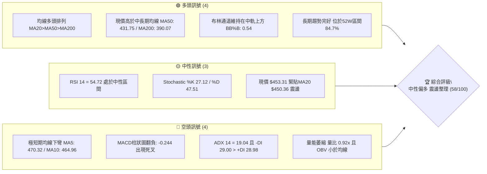
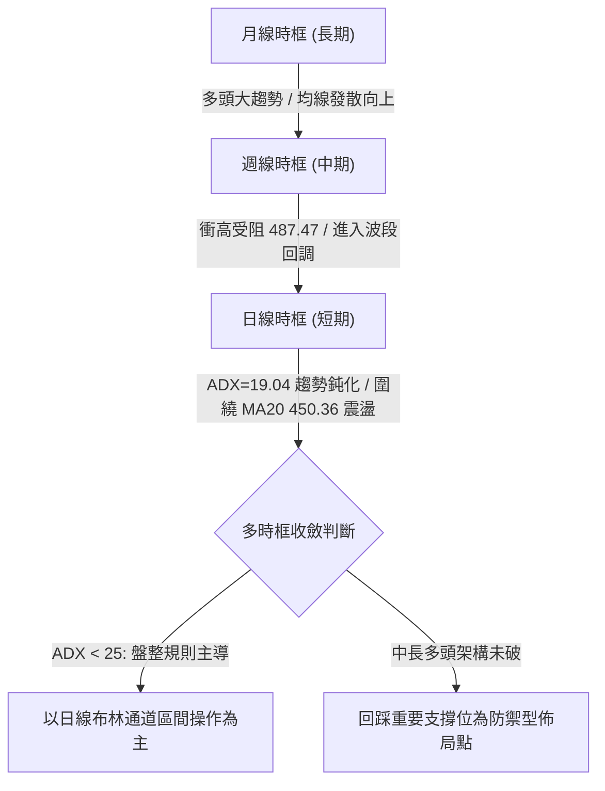
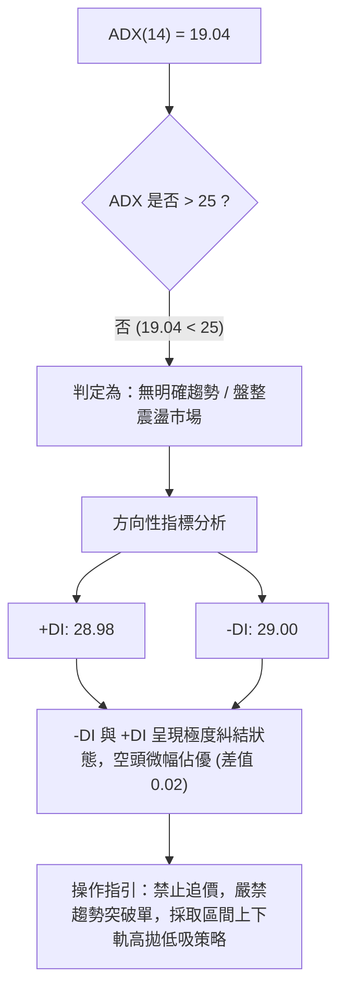
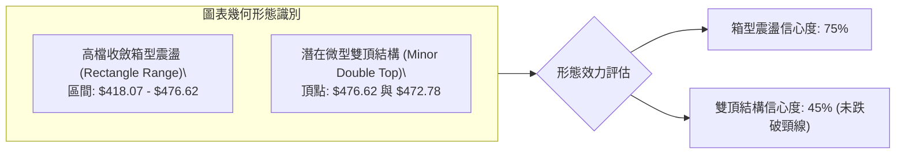
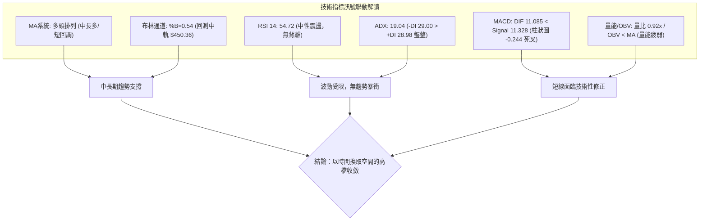
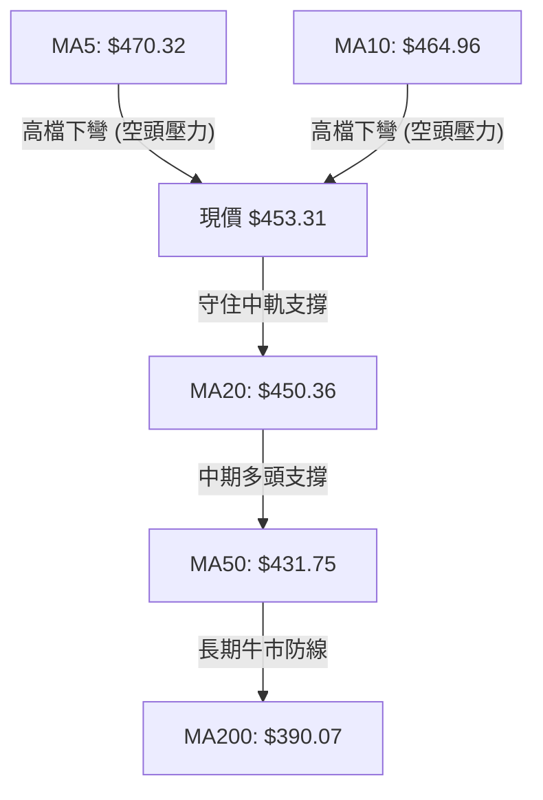
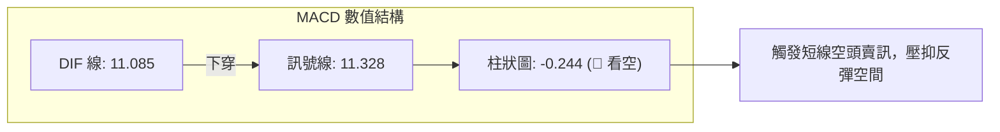
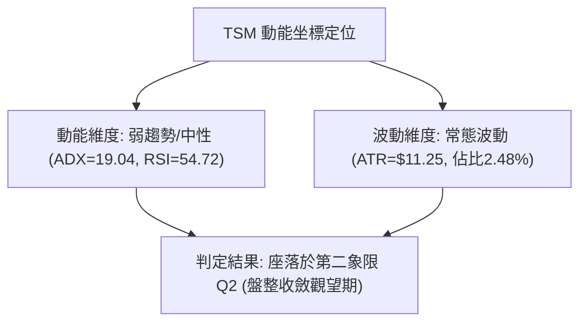
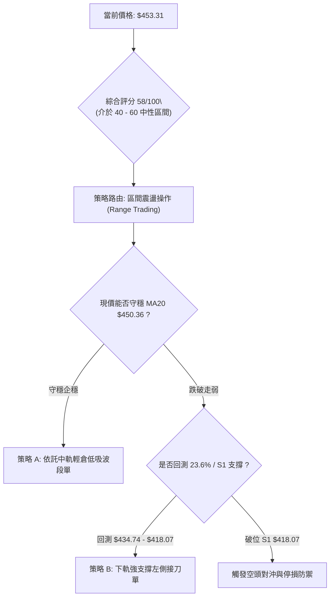
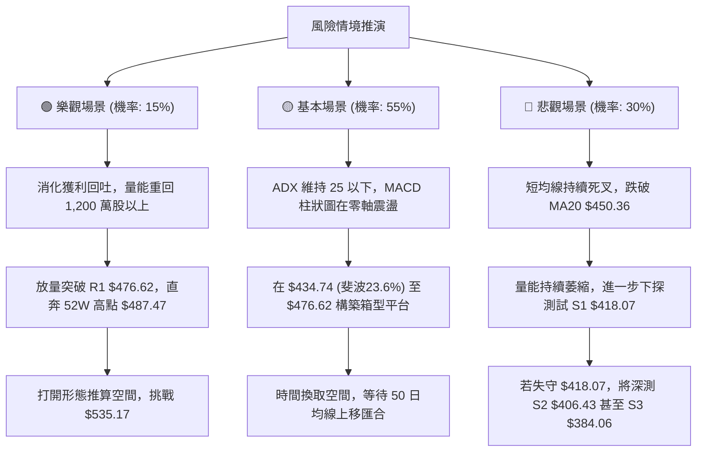

# TSM 基本面深度分析報告

> **報告日期**：2026-10-12 ｜ **語言**：繁體中文 ｜ **數據來源**：Yahoo Finance ｜ **當前價格**：$453.31

---

## 目錄

| 章節 | 內容 |
|------|------|
| [1. 技術面概覽](#1-技術面概覽) | 訊號儀表板、核心指標、評分卡 |
| [2. 趨勢分析](#2-趨勢分析) | 多時框趨勢、長中短期走勢 |
| [3. 圖表形態分析](#3-圖表形態分析) | 形態識別、K線組合、目標價 |
| [4. 支撐與阻力](#4-支撐與阻力) | 關鍵價位、斐波那契回調 |
| [5. 技術指標深度解讀](#5-技術指標深度解讀) | MA/RSI/MACD/布林/成交量 |
| [6. 動能與波動率](#6-動能與波動率) | 動能評估、ATR、Beta |
| [7. 多時框架總結](#7-多時框架總結) | 時框架評分矩陣 |
| [8. 交易策略建議](#8-交易策略建議) | 多空策略、風險報酬比 |
| [9. 風險提示與監控](#9-風險提示與監控) | 監控指標、風險場景 |

---

## 1. 技術面概覽

### 🎯 技術訊號儀表板



### 📊 核心指標速覽表

| 指標類別 | 指標名稱 | 當前數值 | 訊號 | 解讀 |
|----------|----------|----------|------|------|
| **價格** | 當前價格 | $453.31 | 🟢 | 位於 52 週高低點區間（$264.03 - $487.47）之 84.7% 高位，處於強勢格局中之拉回階段 |
| **均線** | MA20 | $450.36 | 🟢 | 現價高於 MA20（溢價 +0.65%），短線多空分水嶺暫時守住 |
| **均線** | MA50 | $431.75 | 🟢 | 現價高於 MA50（溢價 +5.00%），中期多頭防守底線穩固 |
| **均線** | MA200 | $390.07 | 🟢 | 現價高於 MA200（溢價 +16.21%），長期牛市基礎未被破壞 |
| **均線** | MA5 / MA10 | $470.32 / $464.96 | 🔴 | 極短期均線高檔反轉下彎，短線承受獲利了結回調壓力 |
| **動能** | RSI(14) | 54.72 | 🟡 | 脫離前週 85.9 之極度超買區，降溫回歸 50 中軸附近，動能中性化 |
| **動能** | MACD (12,26,9) | 11.085 / 11.328 | 🔴 | DIF 下穿 Signal，柱狀圖落入負值（-0.244），短線動能出現空頭修正訊號 |
| **趨勢** | ADX(14) / DMI | 19.04 (+DI: 28.98 / -DI: 29.00) | 🟡 | ADX < 25 表明趨勢降溫轉為盤整；-DI 與 +DI 糾結且空頭微幅主導 |
| **通道** | 布林通道 | 上軌 $490.85 / 下軌 $409.87 | 🟡 | %B 為 0.54，價格自上軌拉回至中軌（$450.36）處尋求支撐 |
| **量能** | 成交量 / OBV | 9,225,100 (量比 0.92x) | 🔴 | 成交量低於 20MA 均量（10,029,805），OBV 低於均線，買盤追價意願不足 |
| **波動** | ATR(14) | $11.25 (2.48%) | 🟡 | 波動率適中，未出現恐慌性放大，短線以常態震盪消化賣壓為主 |

### 🏆 技術評分卡

```
╔══════════════════════════════════════════════════════════════╗
║                技術評分卡 — TSM (2026-10-12)                 ║
╠══════════════════════════════════════════════════════════════╣
║ 趨勢強度      ████████░░░░░░░░░░░░  42/100  🟡 盤整弱趨勢    ║
║ 動能指標      ██████████░░░░░░░░░░  50/100  🟡 短線死叉降溫  ║
║ 支撐穩定度    ██████████████░░░░░░  72/100  🟢 密集支撐在下  ║
║ 成交量配合    ████████░░░░░░░░░░░░  40/100  🔴 量能萎縮疲弱  ║
║ 形態完整度    ████████████░░░░░░░░  60/100  🟡 高檔收斂箱型  ║
║ 均線排列      ████████████████░░░░  82/100  🟢 中長多頭排列  ║
╠══════════════════════════════════════════════════════════════╣
║ 綜合評分      ███████████░░░░░░░░░  58/100  ⚖️ 中性偏多區間  ║
╚══════════════════════════════════════════════════════════════╝
```

---

## 2. 趨勢分析

### 🌐 多時框趨勢分析



### 📈 長期趨勢 — 12個月走勢圖（Unicode）

```
TSM 月線走勢圖（過去12個月：2025-11 至 2026-10）
價格軸 ($)
$480 ┤                                                 ●(06月 476.29)
$460 ┤                                                       ●(09月 456.19)
$440 ┤                                                             ●(10月 453.31 現價)
$420 ┤                                           ●(05月 416.36)  ●(08月 414.21)
$400 ┤                                 ●(04月 394.08)  ●(07月 403.17)
$380 ┤                       ●(02月 371.66)
$360 ┤
$340 ┤                             ●(03月 336.26)
$320 ┤                 ●(01月 327.98)
$300 ┤     ●(11月 288.46)●(12月 301.52)
$280 ┤
     └─────────────────────────────────────────────────────────────────
        11    12    01    02    03    04    05    06    07    08    09    10  (月份)
```

**走勢特徵分析表格**：

| 階段區間 | 時間跨度 | 起訖收盤價 | 漲跌幅 | 走勢特徵解讀 |
|----------|----------|------------|--------|--------------|
| **底層突破段** | 2025-11 ~ 2026-02 | $288.46 → $371.66 | +28.84% | 階梯式推升，均線黃金交叉，多頭主升段首波發動 |
| **中途洗盤段** | 2026-02 ~ 2026-03 | $371.66 → $336.26 | -9.52% | 快速洗盤回測 MA50 支撐，獲利籌碼換手 |
| **主升加速段** | 2026-03 ~ 2026-06 | $336.26 → $476.29 | +41.64% | 連續三個月收長陽線，創下波段歷史高點 $487.47，動能極度釋放 |
| **高位箱型整理** | 2026-06 ~ 2026-10 | $476.29 → $453.31 | -4.82% | 於 $403.17 至 $476.62 區間劇烈寬幅震盪，構建多頭高檔換手平台 |

### 📊 中期趨勢（週線分析）

中期走勢近 20 週呈現典型的「雙波段推升與平台整理」架構：
1. **第一波修正底部**：2026-07-19 至 2026-08-02，股價於 $397.30 - $403.17 築底，週 RSI 一度降至 27.9 極度超賣區，隨後迎來強力反彈。
2. **第二波衝高遇阻**：2026-09-27 至 2026-10-04，股價連續放量推升至 $472.78，週 RSI 衝破 85.9 嚴重超買。
3. **當前高檔回調**：最新一週（2026-10-11）回落至 $453.31，週 MACD 柱狀圖由正轉負（-0.244），短線修正超買壓力，回測日線 MA20 之 $450.36 支撐。

```
中期壓力與支撐結構示意圖（週線視角）：
$487.47 ─────────────────────────────── [52W歷史天花板]
$476.62 ═══════════════════════════════ [波段高點阻力 R1]
            ▲ 衝高受阻回調
$453.31 ┈┈┈┈┈┈┈┈┈┈┈┈┈┈┈┈┈┈┈┈┈┈┈┈┈┈┈┈┈┈─ [當前現價位置]
            ▼ 尋求短期中軌支撐
$450.36 ┄┄┄┄┄┄┄┄┄┄┄┄┄┄┄┄┄┄┄┄┄┄┄┄┄┄┄┄┄┄─ [布林中軌 / MA20]
$434.74 ─────────────────────────────── [斐波那契 23.6% 回調位]
$418.07 ═══════════════════════════════ [波段密集低點支撐 S1]
$402.11 ─────────────────────────────── [斐波那契 38.2% 回調位 / S2群聚]
```

### ⚡ 趨勢強度評估（ADX 解讀）



**ADX 趨勢強度對照解讀表**：

| ADX 數值區間 | 當前數值 | 行情特徵 | 對應策略規範 |
|--------------|----------|----------|--------------|
| 0 ~ 20 | **19.04** | **極弱趨勢 / 典型箱型盤整** | **指標鈍化，擺盪指標（RSI、布林帶）優先於均線趨勢策略** |
| 20 ~ 25 | - | 盤整向上/向下醞釀期 | 密切監控通道收窄後的突破方向 |
| 25 ~ 40 | - | 強趨勢形成 | 順應均線方向單向操作 |
| 40 以上 | - | 極強趨勢 / 超買超賣加速 | 獲利了結與緊縮移動止損 |

---

## 3. 圖表形態分析

### 🔍 形態識別系統



**圖表形態信心度與目標價評估表**：

| 形態名稱 | 信心度 | 判斷依據（嚴格引用數據） | 完成度 | 目標價（附嚴謹計算式） |
|----------|--------|--------------------------|--------|------------------------|
| **高檔收斂箱型區間** | **75%** | 價格在近 4 個月受限於阻力位 R1（$476.62）與支撐位 S1（$418.07），多空來回拉鋸 | 70% | 若向下破位：$418.07 - ($476.62 - $418.07) = **$359.52**<br>若向上突破：$476.62 + ($476.62 - $418.07) = **$535.17** |
| **日線級別微型雙頂** | **45%** | 2026-06 波段高點群聚阻力 R1 $476.62，與 2026-10-04 週收盤高點 $472.78 形成雙峰；但未跌破頸線 S1 $418.07 | 40% | 頸線為 S1 $418.07；形態高度 = $476.62 - $418.07 = $58.55。<br>跌破頸線等幅跌幅目標 = $418.07 - $58.55 = **$359.52**（信心度不足50%，僅供防守參考） |
| **長期上升通道** | **80%** | 低點逐級墊高：2025-03 $163.15 → 2025-08 $227.73 → 2026-03 $336.26 → 2026-07 $403.17 | 85% | 依通道上軌推進，中長期多頭目標上看分析師平均價 **$555.01** |

### 🕯️ 重要K線形態分析

| 觀測週期 | 關鍵收盤價 | K線形態名稱 | 形態特徵與技術解讀 | 訊號意涵 |
|----------|------------|-------------|--------------------|----------|
| **2026-06** | $476.29 | 帶長上影線大陽線 | 月線單月自 $416.36 衝刺至 $476.29，最高觸及 52W 高點 $487.47，但引發獲利結套，衝高回落 | 🟡 獲利盤湧現 |
| **2026-07** | $403.17 | 長黑下殺吞噬線 | 連續回落至 $397.30 低位，週成交量暴增至 91,498,900 股，恐慌洗盤釋放浮額 | 🔴 短期殺多 |
| **2026-08** | $414.21 | 下影線鎚頭回升線 | 探底 $403.17 後企穩，連兩週成交量維持在 8,700 萬股高位，低檔買盤介入明顯 | 🟢 支撐確認 |
| **2026-10-04** | $472.78 | 衝高力竭陽線 | 週線衝高逼近 R1 $476.62，週 RSI 飆高至 85.9 超買警訊，量能（4,492 萬股）背離 | 🔴 頂部力竭 |
| **2026-10-11** | $453.31 | 中黑回調線 | 週跌幅回吞前週漲幅，MACD 柱狀圖轉負（-0.244），確認 R1 壓力沉重進入回測 | 🔴 短線修正 |

### 📉 ASCII 走勢形態示意圖

```
TSM 高檔箱型收斂與雙頂防守示意圖：

$487.47 ┬────────────────────────────────────────── 52W 最高點 (2026-06)
        │            峰1: $476.62         峰2: $472.78
$476.62 ┼───────────────╭───╮───────────────╭───╮────── R1 關鍵壓力線
        │              │   │               │   │
$453.31 ┼──────────────┼───┼───────────────┼───● (現價 $453.31，拉回中軌)
        │              │   │   谷底:       │
$434.74 ┼──────────────┼───┼─── $416.40 ──┼────────── 斐波那契 23.6% 回調位
        │              │   ╰───────┬───────╯
$418.07 ┼──────────────┴───────────┴────────────────── S1 頸線/箱型下緣支撐
        │                        波段急殺低點: $397.30
$390.07 ┴────────────────────────────────────────── MA200 牛熊分界線
```

### 🎯 形態目標價計算

1. **高檔箱型整理上下軌測算**：
   - 箱型上軌：$476.62（波段高點阻力 R1）
   - 箱型下軌：$418.07（波段低點支撐 S1）
   - 箱型垂直高度 $H = 476.62 - 418.07 = \$58.55$
2. **突破情境目標價（由形態高度推算）**：
   - **向上等幅突破目標價**：$476.62 + 58.55 = \mathbf{\$535.17}$（若放量越過 R1，下一站為中長期多頭擴展目標）
   - **向下破位等幅回撤價**：$418.07 - 58.55 = \mathbf{\$359.52}$（若跌破頸線 S1，將深測下方支撐群）
3. **斐波那契回調防守價位**：
   - 第一道防守：23.6% 回調位 **$434.74**
   - 第二道防守：38.2% 回調位 **$402.11**

---

## 4. 支撐與阻力

### 🗺️ 關鍵價位分布圖（Unicode）

```
TSM 價位結構分布圖（嚴格依據 OHLCV 聚類數據）
═════════════════════════════════════════════════════════════════════
$487.47 ║████████████████████████████████████████║ 52W 歷史最高點 (阻力極限)
$476.62 ║████████████████████████████████        ║ 關鍵阻力位 R1 (+5.14%)
$453.31 ╠════════════════════════════════════════╣ ◄ 現價 $453.31 (位於MA20上方)
$450.36 ║▓▓▓▓▓▓▓▓▓▓▓▓▓▓▓▓▓▓▓▓▓▓                  ║ 布林中軌 / MA20 短線支撐
$434.74 ║▓▓▓▓▓▓▓▓▓▓▓▓▓▓▓▓▓▓▓▓▓▓▓▓▓▓              ║ 斐波那契 23.6% 回調支撐
$418.07 ║████████████████████████████            ║ 關鍵波段支撐 S1 (-7.77%)
$409.87 ║▓▓▓▓▓▓▓▓▓▓▓▓▓▓▓▓▓▓▓▓▓▓▓▓▓▓              ║ 布林通道下軌動態支撐
$406.43 ║████████████████████████████████        ║ 結構性強支撐 S2 (-10.34%)
$390.07 ║▓▓▓▓▓▓▓▓▓▓▓▓▓▓▓▓▓▓▓▓▓▓▓▓▓▓▓▓▓▓▓▓        ║ 長期生命線 MA200
$384.06 ║████████████████████████████████████    ║ 終極波段支撐 S3 (-15.28%)
═════════════════════════════════════════════════════════════════════
```

### 🚧 阻力位分析表

| 阻力級別 | 價位 | 形成原因 | 突破難度 | 重要性 |
|----------|------|----------|----------|--------|
| **阻力 R1** | **$476.62** | 近一年波段高點聚類；2026-06 收盤價 $476.29 及 2026-10-04 波段頂點形成雙重壓制，歷史成交密集區套牢籌碼重 | 🔴 極高 | ★★★★★<br>多頭能否重啟歷史主升浪的關鍵閘門 |
| **天花板** | **$487.47** | 52 週歷史最高價；波段極限超買點 | 🔴 極高 | ★★★★☆<br>空頭最後防線 |

### 🛡️ 支撐位分析表

| 支撐級別 | 價位 | 形成原因 | 守住機率 | 重要性 |
|----------|------|----------|----------|--------|
| **支撐 S1** | **$418.07** | 近一年波段低點聚類；2026-08-09 週低點與 2026-08-30（$416.40）密集換手區 | 🟢 70% | ★★★★★<br>當前箱型下緣防線，失守則雙頂形態確立 |
| **支撐 S2** | **$406.43** | 波段低點聚類；緊鄰 2026-07-26 收盤 $402.33 及 2026-08-02 收盤 $403.17 | 🟢 80% | ★★★★☆<br>中期強力防守平台 |
| **支撐 S3** | **$384.06** | 波段次低點聚類；鄰近 MA200（$390.07）與斐波那契 50%（$375.75）之強烈技術緩衝帶 | 🟢 90% | ★★★★★<br>長期牛熊轉換終極底線 |

### 📐 斐波那契回調位分析

> **計算基準**：52 週低點 **$264.03** 至 52 週高點 **$487.47**，總波幅為 **$223.44**。

| 斐波那契回調位 | 對應精確價位 | 現價相對距離 | 結構解讀與技術涵義 |
|----------------|--------------|--------------|--------------------|
| **0.0% (52W High)** | **$487.47** | +7.54% | 歷史多頭極限，頂部強阻力 |
| **23.6%** | **$434.74** | -4.10% | **第一回調支撐位**。現價 $453.31 運行於 0.0% 至 23.6% 之間的高檔強勢區；若拉回未跌破此位，仍屬強勢整理 |
| **38.2%** | **$402.11** | -11.29% | **關鍵多空防守位**。高度吻合波段支撐 S2（$406.43），為多頭回撤的健康極限 |
| **50.0%** | **$375.75** | -17.11% | 多空中間分水嶺，鄰近 MA240（$373.16） |
| **61.8%** | **$349.38** | -22.93% | 黃金分割強防守位，2026-03 洗盤低點（$336.26）上方 |
| **78.6%** | **$311.84** | -31.21% | 深幅回調位，失守代表波段趨勢徹底瓦解 |
| **100.0% (52W Low)**| **$264.03** | -41.76% | 52 週最低點，原始多頭起漲基石 |

---

## 5. 技術指標深度解讀

### 🎛️ 指標訊號總覽



### 📈 移動平均線排列分析



均線系統呈現**「長多中穩、短線承壓」**的矛盾結構：
- **中長期均線（MA20 > MA50 > MA60 > MA120 > MA200 > MA240）**：
  - MA20（$450.36）、MA50（$431.75）、MA200（$390.07）皆順暢向上發散，且 MA240 高達 +21.48% 溢價，構築堅不可摧的中長多基石。
- **短期均線（MA5、MA10）**：
  - MA5（$470.32，跌幅 -3.62%）與 MA10（$464.96，跌幅 -2.51%）出現快速反轉死叉下彎，價格遭其壓制，表明短線獲利回吐力道沉重。

### 📉 RSI(14) 分析

- **當前 RSI(14) 數值**：**54.72**
- **進度條展示**：
  `RSI(14): 54.72 [███████████░░░░░░░░░] 54.7% (中性平衡區)`
- **超買超賣評估**：
  - 兩週前（2026-10-04）週 RSI 高達 85.9，處於嚴重過熱狀態；當前日線 RSI 急速冷卻至 54.72，成功化解超買指標鈍化風險。
- **背離判斷**：
  - 檢視數據：「RSI 背離：無明顯背離」。
  - 價格自 $472.78 回檔至 $453.31，RSI 同步自超買區平滑下移至 54.72，未出現價格創新高而 RSI 創低之頂背離，亦無底背離跡象，走勢屬健康回調。

### 📊 MACD(12, 26, 9) 訊號解讀



- **絕對數值解析**：DIF（11.085）與 Signal（11.328）均處於零軸上方遠處，顯示長期動能仍居多方主導；但 DIF 已經自高位下穿 Signal 形成高檔死叉。
- **MACD Histogram（柱狀圖）**：為 **-0.244**，由正翻負，顯示短線空頭動能正在釋放，預告股價短線將維持數日的震盪整理或向下尋求支撐。

### 📦 布林通道分析

```
TSM 布林通道現況剖面圖：
$490.85 ┬────────────────────────────────────────── BB 上軌 (阻力)
        │
        │
$453.31 ┼───────────────────────● 現價 ($453.31, %B = 0.54)
$450.36 ┼┄┄┄┄┄┄┄┄┄┄┄┄┄┄┄┄┄┄┄┄┄┄┄┄┄┄┄┄┄┄┄┄┄┄┄┄┄┄┄┄┄┄┄ BB 中軌 (MA20支撐)
        │
        │
$409.87 ┴────────────────────────────────────────── BB 下軌 (極限支撐)
```

- **通道帶寬與位置**：BB 上軌為 $490.85，下軌為 $409.87，中軌（MA20）為 $450.36。
- **指標位置 %B**：**0.54**，表示價格精確座落於通道正中上方少許，緊貼中軌。布林通道未出現極限開口收縮（Squeeze），走勢由上軌拉回測試中軌，若能守穩中軌 $450.36，布林中軌將提供強力反彈支撐。

### 💹 成交量分析（量價配合度）

- **量能規模**：
  - 最新成交量：9,225,100 股
  - 20 日均量：10,029,805 股（量比：**0.92x**）
  - 50 日均量：9,920,816 股
- **OBV 能量潮解讀**：
  - 數據明確顯示：「OBV趨勢：OBV < MA → 量能疲弱」。
  - 成交量低於 20 日及 50 日均線，且在回調過程中量能縮減至 922 萬股。雖然量縮回調屬於良性洗盤，但量能無法放量越過 20 日均量，反映市場資金追價動能匱乏，短線難以直接突破 R1（$476.62）。

---

## 6. 動能與波動率

### ⚡ 動能評估四象限

| 象限 | 動能強度 (Momentum) | 波動率水準 (Volatility) | 當前標的狀態 | 交易策略意涵 |
|------|----------------------|--------------------------|--------------|--------------|
| **Q1 (最佳擴張)** | 強 (RSI>60, ADX>25) | 低 (ATR% < 2%) | 否 | 強烈順勢加碼，趨勢爆發 |
| **Q2 (盤整沉澱)** | **弱 (RSI: 54.7, ADX: 19)** | **適中/偏低 (ATR%: 2.48%)** | **✓ TSM 當前座落於此** | **趨勢停滯，觀望或區間高拋低吸** |
| **Q3 (極度博弈)** | 強 (極端突破) | 高 (ATR% > 4%) | 否 | 高風險高收益，需寬止損 |
| **Q4 (非理性釋放)** | 弱 (快速破位下殺) | 高 (恐慌放量) | 否 | 避開下跌飛刀，嚴禁接刀 |



### 📊 ATR 波動率分析

- **ATR(14) 絕對數值**：**$11.25**
- **ATR 佔價格比率**：$11.25 / 453.31 = \mathbf{2.48\%}$
- **止損距離建議**：
  - **保守型（1.0 × ATR）**：$11.25，適用於日內超短線或緊湊跟蹤止損。
  - **波段型（1.5 × ATR）**：$16.88，適用於箱型區間操作，可有效避免市場隨機噪音打穿止損。
  - **趨勢型（2.0 × ATR）**：$22.50，適用於中長線底倉防守。

### 📐 Beta 與市場相關性

- **Beta 係數**：**1.239**
- **市場特徵分析**：
  - TSM 相對大盤具備 **1.24 倍** 的放大彈性，具備顯著成長型科技權值股特徵。
  - 當大盤回調時，其調整幅度往往超過標普 500 指數；然而在半導體產業多頭環境中，亦具備超額 Alpha 動能。目前 1.239 的 Beta 配合 2.48% 的 ATR，顯示其短線回撤屬於常態波動，並未出現 Beta 失控崩跌跡象。

---

## 7. 多時框架總結

### 📋 時框架評分表

| 時框架 | 趨勢方向 | 動能狀態 | 均線排列 | 圖表形態 | 綜合評分 | 建議方針 |
|--------|----------|----------|----------|----------|----------|----------|
| **短期 (日線)** | 🟡 橫向盤整 | 🔴 MACD柱狀圖翻負/死叉 | 🟡 跌破MA5/10，回測MA20 | 高檔微型雙頂壓制 | 48/100 | 區間操作，嚴控追高 |
| **中期 (週線)** | 🟢 多頭拉回 | 🟡 超買降溫 (RSI: 54.7) | 🟢 完好呈多頭向上發散 | 箱型 $418.07-$476.62 | 68/100 | 逢低回測分批佈局 |
| **長期 (月線)** | 🟢 強烈牛市 | 🟢 位於歷史高位區間 (84.7%) | 🟢 MA200($390.07)強勢上揚 | 階梯式長期上升通道 | 85/100 | 堅定底倉波段持有 |

### 🔲 綜合訊號矩陣

```
╔══════════════════════════════════════════════════════════════╗
║                   TSM 跨時框架訊號矩陣                       ║
╠══════════════════════════════════════════════════════════════╣
║ 維度         短期 (日線)        中期 (週線)        長期 (月線)║
╠══════════════════════════════════════════════════════════════╣
║ 趨勢方向     🟡 震盪整理        🟢 波段多頭        🟢 穩固牛市 ║
║ 均線系統     🔴 短均線下彎      🟢 中期均線發散    🟢 長期均線 ║
║ 動能指標     🔴 MACD 死叉       🟡 動能中性降溫    🟢 高檔鈍化 ║
║ 成交量配合   🔴 量能萎縮        🟡 量能持平        🟢 長期遞增 ║
║ 關鍵通道     🟡 貼近布林中軌    🟢 位於通道上部    🟢 貼近上軌 ║
╚══════════════════════════════════════════════════════════════╝
```

### ⚖️ 多時框收斂結論

> **依「嚴格要求 14」之多時框收斂法則執行**：
> 1. **趨勢強度檢驗**：當前日線 ADX(14) 為 **19.04**（遠小於 25），且 +DI（28.98）與 -DI（29.00）呈現無方向糾結，因此市場**明確處於盤整行情**。
> 2. **優先級收斂裁決**：在盤整行情中，**以日線布林通道（$409.87 - $490.85）與波段支撐/阻力為主要交易依據**。日線的短線下彎（MA5、MACD死叉）屬於高檔震盪過程中的次級回撤，並未撼動週線與月線的多頭架構。
> 3. **唯一方向性結論**：**【中性觀望偏多 / 區間震盪整理】**。評分定於 **58/100**，操作上禁止任何突破追買行為，策略收斂為「圍繞 MA20 支撐低吸、接近阻力位 R1 高拋」的區間震盪策略。

---

## 8. 交易策略建議

### 🗺️ 策略決策流程圖



### 🧭 策略路由（依評分卡分流）

- **當前主策略方向**：**【區間操作 / 等待回踩確認】（依技術評分 58/100，處於 40–60 之中性盤整區間）**
- **方針定位**：短線受制於 MACD 死叉與 MA5 下彎，不宜追高；但中長多頭排列完好，不可盲目做空。應以布林通道上下軌及斐波那契回調位構建**「低吸高拋、防守明確」**的震盪交易計畫。

### 🎯 價格情境階梯（Price Scenarios）

| 觸發條件 | 下一目標 | 後續延伸 | 情境含義 |
|----------|----------|----------|----------|
| **放量突破阻力 R1 $476.62** | 52W 高點 **$487.47** | 形態推算目標 **$535.17** | 短線轉強，重啟歷史級主升浪突破 |
| **站穩現價區間 ($450.36 - $453.31)** | 阻力 R1 **$476.62** | 52W 高點 **$487.47** | 區間震盪，消化短線 MACD 死叉賣壓 |
| **跌破中軌並回測斐波 23.6% $434.74** | 支撐 S1 **$418.07** | 布林下軌 **$409.87** | 短線弱勢回調，尋求中期重要支撐 |
| **跌破關鍵支撐 S1 $418.07** | 支撐 S2 **$406.43** | 終極支撐 S3 **$384.06** | 中期轉弱，高檔微型雙頂形態確立 |

### 📊 情境機率分佈

| 情境分類 | 機率預估 | 主要依據（指標狀態） |
|----------|----------|----------------------|
| **情境一：高檔區間震盪換手** | **55%** | ADX 僅 19.04（盤整特徵）、布林通道帶寬保持、均線在中期提供緩衝 |
| **情境二：回測支撐 S1/S2 深幅洗盤** | **30%** | MACD 柱狀圖轉負（-0.244）、MA5/10 下彎、OBV < MA 顯示量能疲弱 |
| **情境三：直接向上放量突破 R1** | **15%** | 最新成交量比僅 0.92x，無足夠成交量支撐即刻發動攻擊 |

### 🟢 主策略詳情（方向依上方路由）

| 策略要素 | 策略 A（現價中軌防守型低吸） | 策略 B（箱型下緣左側回測低吸） |
|----------|------------------------------|--------------------------------|
| **適用情境** | 股價於 MA20（$450.36）縮量企穩 | 股價進一步回踩斐波 23.6% 至 S1 支撐 |
| **進場條件** | 盤中回測守穩 MA20，日K收下影線 | 回測至 $418.07 附近出現止跌訊號 |
| **進場價格** | **$450.36** | **$418.07** |
| **目標價 T1** | **$476.62** (波段阻力 R1) | **$450.36** (布林中軌 MA20) |
| **目標價 T2** | **$487.47** (52W 歷史最高點) | **$476.62** (波段阻力 R1) |
| **止損價格** | **$434.74** (斐波那契 23.6% 回調位) | **$406.43** (波段支撐 S2) |
| **風險空間** | $450.36 - $434.74 = $15.62 | $418.07 - $406.43 = $11.64 |
| **潛在報酬(T1)**| $476.62 - $450.36 = $26.26 | $450.36 - $418.07 = $32.29 |
| **風險報酬比** | **1 : 1.68** (至T2為 1:2.38) | **1 : 2.77** (至T2為 1:5.03) |
| **成功機率** | 55% | 65% |
| **建議倉位** | **15% 輕倉** | **25% 標配** |

### 🔴 反向風險觸發點（對沖提示）

當市場出現以下關鍵訊號時，判定多頭結構破壞，主策略失效，應立即啟動防守對沖或減倉：
1. **關鍵價位跌破**：若日K線以實體長黑跌破 **$418.07 (支撐 S1)**，代表高檔雙頂成型，形態等幅回測目標指向 **$359.52**。
2. **動能破位確認**：日線 RSI(14) 跌破 40，且 -DI 向上突破 35 同時 ADX 急速飆升超過 25，顯示轉為「空頭強趨勢」。
3. **風控應對動作**：全面將剩餘多頭倉位降至 10% 以下，或利用反向衍生品於 $418.07 破位時進行 1:1 Delta 對沖。

### ⭐ 整體訊號強度評星

```
做多訊號強度：★★★☆☆  (3/5星 — 長期均線強固，但短線指標死叉壓制)
做空訊號強度：★★☆☆☆  (2/5星 — 僅屬次級回調，下方多重支撐護航)
整體可信度：  ★★★★☆  (4/5星 — 多時框指標一致指向高檔收斂盤整)
```

---

## 9. 風險提示與監控

### ✅ 關鍵監控指標 Checklist

```
╔══════════════════════════════════════════════════════════════╗
║               TSM 每日交易監控清單 (Checklist)               ║
╠══════════════════════════════════════════════════════════════╣
║ [ ] 價位檢驗: 收盤價是否持續站穩布林中軌 MA20 $450.36 ?      ║
║ [ ] 阻力檢驗: 盤中挑戰阻力 R1 $476.62 時，成交量是否 > 1,000萬?║
║ [ ] 動能檢驗: MACD 柱狀圖是否收斂並由 -0.244 回升翻正 ?      ║
║ [ ] 超買警戒: 若反彈至阻力區，RSI(14) 是否再度衝破 75 ?      ║
║ [ ] 破位防線: 是否跌破第一回調防線 $434.74 與頸線 $418.07 ?  ║
║ [ ] 趨勢檢驗: ADX 是否突破 25 (確認行情由盤整轉為突破趨勢) ? ║
║ [ ] 量能監控: OBV 是否重新穿越均線，扭轉資金流出態勢 ?       ║
╚══════════════════════════════════════════════════════════════╝
```

### ⚠️ 風險場景分析



### 🛡️ 風險管理重要提醒

1. **拒絕追高，嚴格執行箱型策略**：
   - 目前 ADX 處於 19.04 的低位，顯示市場處於**無趨勢盤整期**。在盤整結構中，追買「突破點」極易遭遇「假突破」而買在箱型天花板（如前週衝高 $472.78 後迅速回吐至 $453.31）。
2. **波動率與止損空間設置**：
   - TSM 目前的 ATR(14) 為 $11.25。這意味著單日股價常態波動即達 2.48%。任何少於 1.5 倍 ATR（約 $16.88）的止損點極易被盤中噪音觸發。若採取策略 A（$450.36 入場），必須給予足夠的防守容差至斐波那契 23.6% 回調位 **$434.74**。
3. **倉位管理與資金分配**：
   - 由於現階段綜合技術評分為 **58/100**，未達 60 分以上的強烈做多標準，總部位曝險建議控制在投資組合的 **15% - 25%** 以內。在未見到「放量突破 R1」或「回測 S1 確立止跌」前，切忌全倉博弈。

---

## 📋 報告總結

```
╔══════════════════════════════════════════════════════════════╗
║                   TSM 技術分析報告總結                       ║
╠══════════════════════════════════════════════════════════════╣
║ 報告日期：2026-10-12                                         ║
║ 當前價格：$453.31                                            ║
║ 分析評級：⚖️ 中性偏多 / 區間震盪整理 (評分: 58/100)           ║
║                                                              ║
║ 關鍵結論：                                                   ║
║ ├─ 長期趨勢：🟢 完好牛市格局，MA200 ($390.07) 發散向上      ║
║ ├─ 中期趨勢：🟢 處於 $418.07 - $476.62 高檔大箱型換手整理    ║
║ ├─ 短期趨勢：🔴 MACD柱狀圖翻負(-0.244)，短均線下彎壓制回測  ║
║ ├─ 關鍵支撐：S1: $418.07 ｜ S2: $406.43 ｜ S3: $384.06       ║
║ ├─ 關鍵阻力：R1: $476.62 ｜ 52W高點: $487.47                ║
║ └─ 分析師目標：平均 $555.01 ｜ 最低 $440.00 ｜ 最高 $700.00   ║
║                                                              ║
║ 最優策略組合：                                               ║
║ 1. 🥇 最佳機會：策略 B（耐性等待回踩 S1 $418.07 支撐低吸，   ║
║                 止損設於 S2 $406.43，風報比高達 1:2.77）     ║
║ 2. 🥈 次選機會：策略 A（依託布林中軌 MA20 $450.36 輕倉試單， ║
║                 止損設於斐波 23.6% $434.74，搏阻力 R1）      ║
║ 3. 🥉 保守選擇：空倉觀望，等待日線 ADX 向上突破 25，且帶量越  ║
║                 過阻力 R1 $476.62 後再行順勢跟進             ║
╚══════════════════════════════════════════════════════════════╝
```

---

> ⚠️ **免責聲明**：本報告為 AI 自動生成之技術分析，所有數據及估算均基於提供的歷史價格資訊。本報告**僅供研究與學術參考**，**不構成任何投資建議**。投資有風險，入市需謹慎。

---

*報告生成時間：2026-10-12 ｜ 數據來源：Yahoo Finance ｜ 分析框架：多時框技術分析*