# TSM 技術分析報告

> **報告日期**：2026-10-13 ｜ **語言**：繁體中文 ｜ **數據來源**：Yahoo Finance ｜ **當前價格**：$444.35

---

## 目錄

| 章節 | 內容 |
|------|------|
| [1. 技術面概覽](#1-技術面概覽) | 訊號儀表板、核心指標、評分卡 |
| [2. 趨勢分析](#2-趨勢分析) | 多時框趨勢、長中短期走勢 |
| [3. 圖表形態分析](#3-圖表形態分析) | 形態識別、K線組合、目標價 |
| [4. 支撐與阻力](#4-支撐與阻力) | 關鍵價位、斐波那契回調 |
| [5. 技術指標深度解讀](#5-技術指標深度解讀) | MA/RSI/MACD/布林/成交量 |
| [6. 動能與波動率](#6-動能與波動率) | 動能評估、ATR、Beta |
| [7. 多時框架總結](#7-多時框架總結) | 時框架評分矩陣 |
| [8. 交易策略建議](#8-交易策略建議) | 多空策略、風險報酬比 |
| [9. 風險提示與監控](#9-風險提示與監控) | 監控指標、風險場景 |

---

## 1. 技術面概覽

### 🎯 技術訊號儀表板

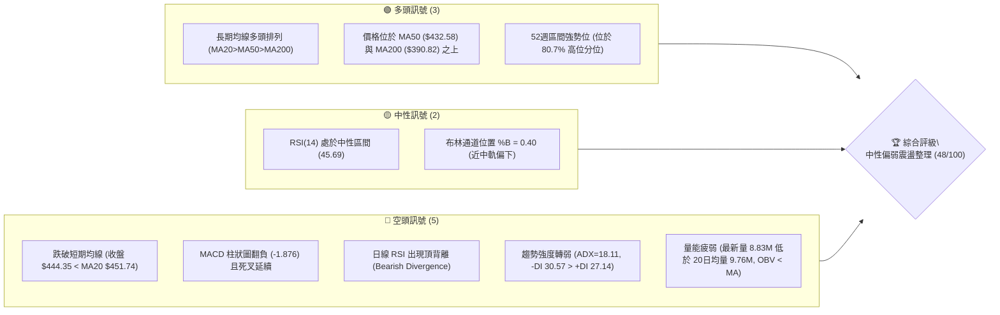

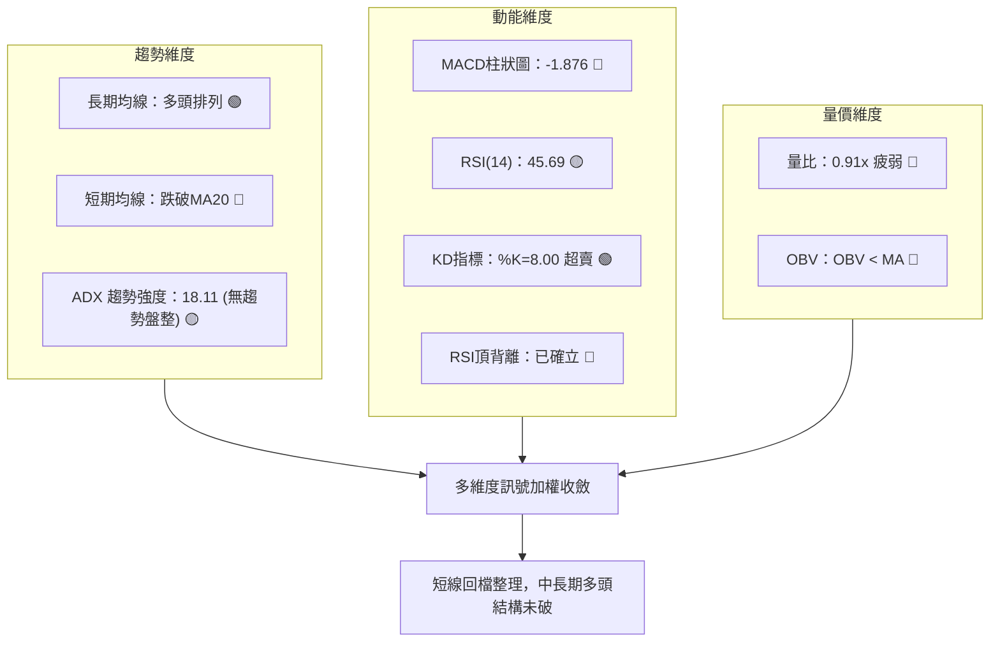

### 📊 核心指標速覽表

| 指標類別 | 指標名稱 | 當前數值 | 訊號 | 解讀 |
|----------|----------|----------|------|------|
| **價格** | 當前收盤價 | $444.35 | 🟡 | 位於52週區間 80.7% 位置，短線自高點 $487.47 回檔 8.85% |
| **均線** | MA20 (月線) | $451.74 | 🔴 | 價格低於 MA20 達 -1.63%，短線趨勢轉弱且失守月均線 |
| **均線** | MA50 (季線) | $432.58 | 🟢 | 價格高於 MA50 達 +2.72%，中期多頭防守底線依然穩固 |
| **均線** | MA200 (年線) | $390.82 | 🟢 | 價格遠高於 MA200 達 +13.70%，長期牛市基石未受動搖 |
| **動能** | RSI(14) | 45.69 | 🟡 | 脫離超買區回落至中性偏弱區間，存在明確頂背離警訊 |
| **動能** | MACD (12,26,9) | 8.983 / 10.859 | 🔴 | DIF 線跌破 MACD 訊號線，柱狀圖為 -1.876，空頭動能釋放中 |
| **動能** | KD (Stochastics) | %K: 8.00 / %D: 25.55 | 🟢 | 進入極度超賣區（%K < 10），具備技術性短線抽頭反彈條件 |
| **趨勢強度** | ADX(14) / DMI | ADX: 18.11 / -DI: 30.57 | 🔴 | ADX < 25 判定為盤整格局，-DI 高於 +DI(27.14) 顯示空方佔優 |
| **通道** | 布林通道 | 上: $489.20 / 下: $414.27 | 🟡 | %B = 0.40，價格跌破中軌 ($451.74)，朝向布林下軌尋求支撐 |
| **波動** | ATR(14) | $11.13 (2.50%) | 🟡 | 每日波動幅度適中，為交易止損與風險管理提供標準基底 |
| **成交量** | 20日均量比較 | 8.83M / 9.76M (0.91x) | 🔴 | 成交量能低於均量，OBV 跌破均線，回檔過程買盤追價乏力 |

### 🏆 技術評分卡

```
╔══════════════════════════════════════════════════════════════════╗
║                   技術評分卡 — TSM (2026-10-13)                  ║
╠══════════════════════════════════════════════════════════════════╣
║ 趨勢強度 (Trend)     ████████░░░░░░░░░░░░  40/100  🔴 弱勢盤整   ║
║ 動能指標 (Momentum)  ███████░░░░░░░░░░░░░  35/100  🔴 動能衰退   ║
║ 支撐穩定度 (Support) █████████████░░░░░░░  65/100  🟢 季線有撐   ║
║ 成交量配合 (Volume)  ████████░░░░░░░░░░░░  40/100  🔴 量能萎縮   ║
║ 形態完整度 (Pattern) ██████████░░░░░░░░░░  50/100  🟡 區間震盪   ║
║ 均線排列 (MAs)       ████████████░░░░░░░░  60/100  🟢 長多短空   ║
╠══════════════════════════════════════════════════════════════════╣
║ 綜合評分 (Overall)   █████████░░░░░░░░░░░  48/100  🟡 中性觀望   ║
╚══════════════════════════════════════════════════════════════════╝
```

---

## 2. 趨勢分析

### 🌐 多時框趨勢分析

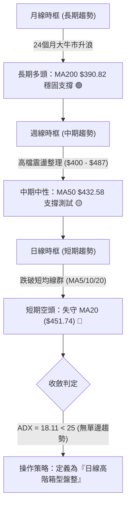

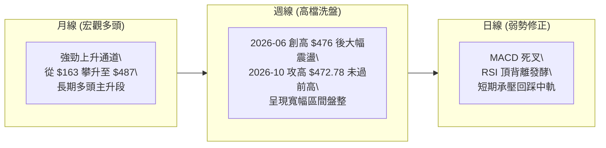

### 📈 長期趨勢 — 12個月走勢圖（Unicode）

```
TSM 月線走勢圖（過去12個月：2025-11 至 2026-10）
價格軸 ($)
$480 ┤                                        ● 2026-06 ($476.29)
$450 ┤                                                    ● 2026-09 ($456.19)
$440 ┤                                                        ● 2026-10 ($444.35) ◄ 現價
$410 ┤                                    ● 2026-05 ($416.36)
$400 ┤                                ● 2026-04 ($394.08)  ● 2026-07 ($403.17)
$370 ┤                        ● 2026-02 ($371.66)      ● 2026-08 ($414.21)
$330 ┤                ● 2026-01 ($327.98)  ● 2026-03 ($336.26)
$300 ┤        ● 2025-12 ($301.52)
$280 ┤● 2025-11 ($288.46)
     └─────────────────────────────────────────────────────────────
       11    12    01    02    03    04    05    06    07    08    09    10 (月份)
      2025  2025  2026  2026  2026  2026  2026  2026  2026  2026  2026  2026
```

#### 走勢特徵分析表格

| 階段區間 | 時間段 | 起訖價格 ($) | 區間漲跌幅 | 主要走勢特徵與結構解讀 |
|:---|:---|:---|:---|:---|
| **第一階段：初級主升浪** | 2025-11 ~ 2026-02 | $288.46 → $371.66 | +28.84% | 單邊噴出走勢，連破整數關卡，各期均線發散，多頭動能極強。 |
| **第二階段：首度深幅洗盤** | 2026-02 ~ 2026-03 | $371.66 → $336.26 | -9.52% | 獲利了結賣壓湧現，單月重挫回測 MA50 支撐，形成中期上升中繼底。 |
| **第三階段：二度攻頂主升** | 2026-03 ~ 2026-06 | $336.26 → $476.29 | +41.64% | 加速趕頂行情，創下月線收盤新高 $476.29 及盤中歷史高點 $487.47。 |
| **第四階段：次級回檔整理** | 2026-06 ~ 2026-07 | $476.29 → $403.17 | -15.35% | 高檔爆量長黑，迅速回落至 S2 ($406.43) 與斐波 38.2% ($402.11) 獲得支撐。 |
| **第五階段：二次衝頂回落** | 2026-07 ~ 2026-10 | $403.17 → $444.35 | +10.21% | 反彈至 $472.78 後動能不足，未能挑戰歷史高點 $487.47，展開次級盤整。 |

### 📊 中期趨勢（週線分析）

中期走勢呈現「高檔寬幅震盪結構」，近 20 週收盤價高點為 2026-10-04 之 $472.78，低點為 2026-07-19 之 $397.30。目前價格已連續兩週拉回（$472.78 → $453.31 → $444.35），顯示上方 $470-$487 區間形成厚重供給壓力帶。

```
中期關鍵壓力與支撐示意圖（週線結構）
$487.47 ─── 全年歷史高點 (52W High / R3 強阻力) ════════════════════════════
           ↑
$476.62 ─── 2026-06 收盤次高點 / 2026-10 衝頂受阻區 (R2 阻力) ──────────────
           ↑
$451.74 ─── 布林中軌 / MA20 (短線轉折點，目前已跌破) ┄┄┄┄┄┄┄┄┄┄┄┄┄┄┄┄┄┄┄
  $444.35 ─ ★ 當前現價 (弱勢震盪區間)
           ↓
$434.74 ─── 斐波那契 23.6% 回調位 / 鄰近 MA50 ($432.58) ────────────────────
           ↓
$418.07 ─── 近一年波段低點聚類 (S1 支撐) / 布林下軌 ($414.27) ═════════════
```

### ⚡ 趨勢強度評估（ADX 解讀）

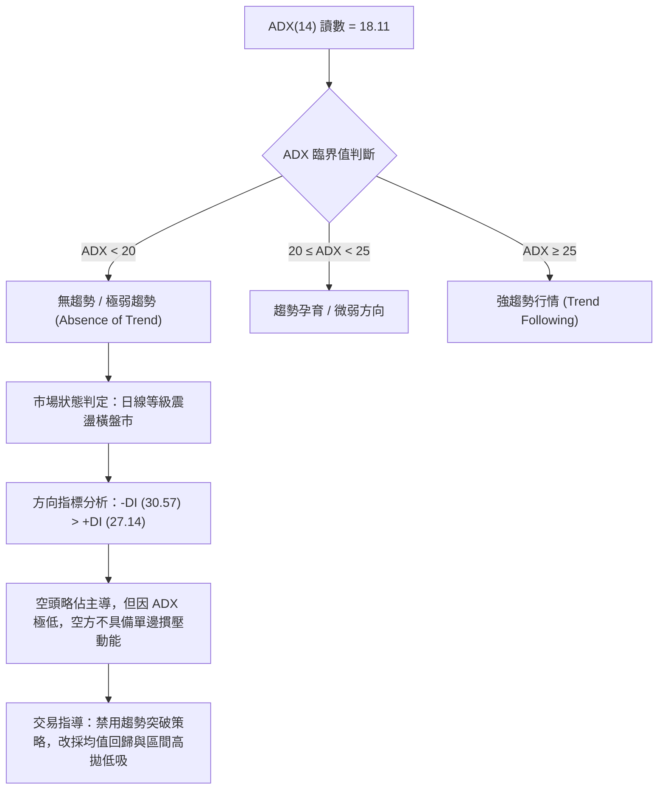

#### ADX 強度對照與解讀表

| 指標變數 | 當前數值 | 參考閥值 | 市場結構與操作含義解讀 |
|:---|:---|:---|:---|
| **ADX (14)** | **18.11** | < 25.00 | **無明確單邊趨勢**。市場動能渙散，均線呈現糾結盤整，追價極易受套。 |
| **+DI (14)** | **27.14** | — | 多頭方向指標自 10 月初高位顯著滑落，多方攻擊動能中斷。 |
| **-DI (14)** | **30.57** | — | 空頭方向指標高於 +DI，空方短期佔有主導權，引發均線回踩。 |
| **DMI 差值** | **-3.43** | — | 負向差值小幅擴大，確認短線回檔偏弱，但未達恐慌單邊跌勢標準。 |

---

## 3. 圖表形態分析

### 🔍 形態識別系統

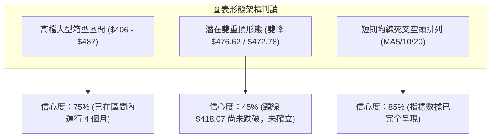

#### 形態識別與信心度評估表

| 形態名稱 | 信心度 | 判斷依據（引用精確數據） | 完成度 | 目標價（附計算式） |
|:---|:---|:---|:---|:---|
| **大型箱型震盪** | **75%** | 價格在 2026-06 觸及高點 $487.47，後於 2026-07 回測 S2 $406.43，隨後於 2026-10 再次回測 R2 $476.62 未破，形成明確上下界。 | 80% | 箱型下軌支撐目標：**$418.07 (S1)**；箱型上軌目標：**$476.62 (R2)**。 |
| **潛在雙重頂 (M頭)** | **45%** | 第一頂為 2026-06 歷史高點聚類 R2 $476.62，第二頂為 2026-10-04 週收盤 $472.78。**但頸線 S1 $418.07 尚未失守**，依規則15信心度低於50%，僅視為風險警訊。 | 40% | *形態未破頸線暫不成立*。若跌破頸線 $418.07：推算目標 = 頸線 $418.07 - (峰值 $476.62 - 頸線 $418.07) = $418.07 - $58.55 = **$359.52**。 |
| **短期均線空頭交叉** | **85%** | MA5 ($462.03) < MA10 ($464.11)，且現價 ($444.35) 全面跌破 MA5、MA10、MA20 ($451.74)。 | 100% | 指標型解讀：短線均值回歸目標指向 MA50 **$432.58**。 |

### 🕯️ 重要K線形態分析

| 月份 / 週別 | 收盤價 | K線形態特徵 | 結構解讀 | 訊號強度 |
|:---|:---|:---|:---|:---|
| **2026-06 (月線)** | $476.29 | 長上影線大陽線 (高點 $487.47) | 創歷史新高後遭遇強大解套與獲利平倉賣壓，多空高檔劇烈換手。 | 🟡 中性偏空警訊 |
| **2026-07 (月線)** | $403.17 | 長黑實體吞噬線 (最低逼近 $397.30) | 空方完全收復前月漲幅，確立 $487.47 為中長期重大阻力。 | 🔴 強烈空頭訊號 |
| **2026-09 (月線)** | $456.19 | 中實體紅K線 | 多頭反撲回擊，收復過半跌幅，展現 $400 整數關卡強大買盤承接力。 | 🟢 多頭抵抗反彈 |
| **2026-10-04 (週線)**| $472.78 | 衝高受阻流星線 (RSI 高達 85.9) | 週線 RSI 出現嚴重超買鈍化，高檔動能衰竭，形成次級波段高點。 | 🔴 強烈波段頂部 |
| **2026-10-18 (週線)**| $444.35 | 連續兩週收黑實體K (跌破月均線) | 實體跌破 MA20 ($451.74)，成交量萎縮，顯示多頭棄守短線防線。 | 🔴 短線空頭確認 |

### 📉 ASCII 走勢形態示意圖

```
TSM 關鍵圖表形態解構：高檔箱型盤整與次級波段雙峰結構
════════════════════════════════════════════════════════════════════════
$487.47 ─── [峰1: 52W High $487.47] 
            ╭─────╮                     [峰2: 次高受阻 $472.78]
$470.00 ─── │     │                     ╭─────╮
            │     ╰────────╮            │     ╰────────╮
$451.74 ─── │  跌破 MA20   ╰────────────┼─────── 跌破中軌 ╰───► $444.35 (現價)
            │                           │                      │
$432.58 ─── │                           │                      ▼ (尋求季線支撐)
            │      箱體回測             │                  [MA50 $432.58]
$418.07 ─── │     ╭─────────────────────╯                  [頸線/S1 $418.07]
            ╰─────╯ 
$406.43 ─── [谷底: 2026-07 探底 $397.30 / S2 支撐聚類 $406.43]
════════════════════════════════════════════════════════════════════════
```

### 🎯 形態目標價計算

根據純粹幾何與指標回測推算，當前有效運行架構為 **箱型震盪中軌回測模式**：
1. **箱體上限 (Resistance Ceiling)**：引用 R2 **$476.62** 與 R3 **$487.47**。
2. **箱體下限 (Support Floor)**：引用 S1 **$418.07** 與 S2 **$406.43**。
3. **箱體中軸 (Mid-point)**：($487.47 + $406.43) / 2 = **$446.95**。
   - *現價解讀*：當前價格 $444.35 正好跌破箱體中軸 ($446.95) 與 MA20 ($451.74)，依技術幾何原理，中軸失守後將回測箱體下軌尋求支撐。
4. **回調目標推算**：
   - 第一目標：MA50 季線支撐位 **$432.58**（同時接近斐波那契 23.6% 回調位 $434.74）。
   - 第二目標：箱體下軌波段低點聚類 S1 **$418.07**。

---

## 4. 支撐與阻力

### 🗺️ 關鍵價位分布圖（Unicode）

```
TSM 價位結構分布圖（嚴格依據 OHLCV 關鍵聚類數據）
═══════════════════════════════════════════════════════════════════════
$487.47 ║████████████████████████████████████████║ 歷史天花板 R3 (52W High)
$476.62 ║████████████████████████████████        ║ 強波段阻力 R2 (前波密集高點)
$445.50 ║████████████████████                    ║ 立即阻力 R1 (反彈頸線短壓)
$444.35 ╠════════════════════════════════════════╣ ◄ 當前市價 ($444.35)
$434.74 ║▒▒▒▒▒▒▒▒▒▒▒▒▒▒▒▒▒▒▒▒▒▒▒▒▒▒▒▒            ║ 斐波那契 23.6% (交會 MA50 $432.58)
$418.07 ║▓▓▓▓▓▓▓▓▓▓▓▓▓▓▓▓▓▓▓▓▓▓▓▓▓▓▓▓▓▓▓▓        ║ 關鍵波段支撐 S1 (箱體防線)
$406.43 ║████████████████████████████████████    ║ 強共振支撐 S2 (7月探底密集區)
$384.06 ║████████████████████████████████████████║ 長期牛市防線 S3 (鄰近 MA200)
═══════════════════════════════════════════════════════════════════════
```

### 🚧 阻力位分析表

| 阻力級別 | 精確價位 | 形成原因與技術背景 | 突破難度 | 重要性評級 |
|:---|:---|:---|:---|:---|
| **R1 (立即阻力)** | **$445.50** | 近一年波段高點聚類最低位，同時為當前跌破後的短線回抽反壓，距現價僅 +0.26%。 | 🟡 中等 | ★★★☆☆ (短線多空分水嶺) |
| **R2 (波段阻力)** | **$476.62** | 2026-06 月線收盤頂點聚類，10月初衝高 $472.78 即在此位前動能耗竭，距現價 +7.26%。 | 🔴 極高 | ★★★★☆ (中期箱型頂部) |
| **R3 (強阻力)** | **$487.47** | 52週歷史最高點 (52W High)，包含鉅額獲利套牢盤與機構減持壓力，距現價 +9.70%。 | 🔴 堅不可摧 | ★★★★★ (歷史天花板) |

### 🛡️ 支撐位分析表

| 支撐級別 | 精確價位 | 形成原因與技術背景 | 守住機率 | 重要性評級 |
|:---|:---|:---|:---|:---|
| **S1 (關鍵支撐)** | **$418.07** | 近一年波段低點聚類，與布林下軌 ($414.27) 形成強烈支撐共振帶，距現價 -5.91%。 | 🟢 70% | ★★★★☆ (箱型多頭防守底線) |
| **S2 (強支撐)** | **$406.43** | 2026-07 探底低點聚類位，逼近 $400 整數心理心理防線與斐波 38.2% ($402.11)。 | 🟢 85% | ★★★★★ (中期波段多空生命線) |
| **S3 (極限支撐)** | **$384.06** | 波段極限低點聚類，長期年線 MA200 ($390.82) 所在區域，距現價 -13.57%。 | 🟢 95% | ★★★★★ (長期牛市最終防線) |

### 📐 斐波那契回調位分析

依據 52 週完整極端區間（起點低點 **$264.03** → 終點高點 **$487.47**，總垂直價差幅寬為 **$223.44**）嚴格測算：

```
斐波那契回調位階梯圖（區間 $264.03 → $487.47）
  0.0% ─── $487.47 (52W High)
           │
 23.6% ─── $434.74 ──────┬─── [當前價位區間：$434.74 ~ $487.47]
           │             └─── ★ 當前現價 $444.35 (位於 23.6% 回調線上方 +2.21%)
 38.2% ─── $402.11 ────────── 深度防禦位 (共振 S2 $406.43)
           │
 50.0% ─── $375.75 ────────── 牛熊多空分水嶺 (共振 MA240 $373.78)
           │
 61.8% ─── $349.38 ────────── 黃金分割強支撐
           │
 78.6% ─── $311.84 ────────── 極限回撤防線
           │
100.0% ─── $264.03 (52W Low)
```

#### 斐波那契回調位解讀
- **現價位階定位**：現價 **$444.35** 落在 **0.0% ($487.47)** 與 **23.6% ($434.74)** 回調位之間。
- **支撐防禦解讀**：強勢牛市拉回通常守於 23.6% 回調位。現價距離 23.6% ($434.74) 僅有 **$9.61 (-2.16%)** 緩衝空間，且該點位與 50 日均線 **MA50 ($432.58)** 高度共振。若能於 $432.58 - $434.74 止跌，整體長線強勢架構完全不受破壞。
- **破位風險解讀**：一旦實體黑K收破 $434.74，回調幅度將擴大至 38.2% 回調位 **$402.11**，屆時將考驗 S2 **$406.43** 的支撐有效性。

---

## 5. 技術指標深度解讀

### 🎛️ 指標訊號總覽

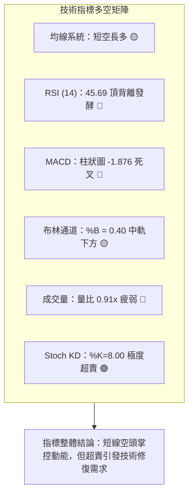

### 📈 移動平均線排列分析

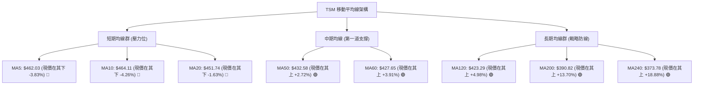

#### 均線排列狀態評估
- **均線排列架構**：大週期均線呈現標準的多頭排列（MA20 $451.74 > MA50 $432.58 > MA200 $390.82）。
- **短週期均線警訊**：短期均線呈現「空頭排列」反轉，MA5 ($462.03) 下穿 MA10 ($464.11)，且現價連續跌破 MA5、MA10、MA20。短線月線反轉為靜態上壓，對多頭形成沉重蓋頭反壓。

### 📉 RSI(14) 分析

#### RSI 數值強度展示
```
超賣區 (0-30)        中性區間 (30-70)                超買區 (70-100)
├──────────────┼──────────────────────────────┼──────────────┤
░░░░░░░░░░░░░░ ▓▓▓▓▓▓▓▓▓▓▓▓▓░░░░░░░░░░░░░░░░░░ ░░░░░░░░░░░░░░
0             30            45.69            70            100
                    ▲ 當前 RSI(14) = 45.69 (中性偏空)
```

#### RSI 背離判斷（頂背離確立 ⚠️）
- **頂背離詳細比對**：
  - 價格峰值 1：2026-10-04 當週價格收在 **$472.78**，週線 RSI 衝至 **85.9** 極端超買區。
  - 價格峰值 2：歷史高點為 **$487.47**，但日線近期在向上挑戰阻力區時，日線 RSI 僅回升至 60 附近便無力推升，隨後最新收盤價 **$444.35** 對應之日線 RSI 急墜至 **45.69**。
  - **結論**：日線等級出現標準「熊市頂背離（Bearish Divergence）」，價格維持在高檔 80% 區域，但動能指標已率先跌破 50 中軸，預告多頭推升力道耗竭，短線面臨持續去化浮額之修正壓力。

### 📊 MACD(12/26/9) 訊號解讀

```mermaid
graph LR
    subgraph MACD_STATUS ["MACD("12,26,9") 即時狀態"]
        DIF["DIF 快線: 8.983"]
        DEA["DEA 慢線: 10.859"]
        HIST["柱狀圖 Histogram: -1.876"]
    end
    DIF -->|"下穿慢線"| DEA
    DEA --> HIST
    HIST --> JUDGE["🔴 死叉擴大狀態：空方動能主導短線走勢"]
```

- **MACD 指標拆解**：
  - 快線（DIF = 8.983）持續低於慢線（Signal = 10.859），柱狀圖為 **-1.876**。
  - 週線歷史數據顯示，2026-10-04 柱狀圖尚為正向 +2.837，但 10-11 迅速轉為 -0.244，10-18 擴大至 -1.876。MACD 柱狀圖由正轉負且柱體迅速伸長，顯示多頭動能全面熄火，空頭波段回跌訊號確立。

### 📦 布林通道分析

```
TSM 布林通道架構圖（20日參數，2倍標準差）
═══════════════════════════════════════════════════════════════════════
$489.20 ────────────────────────────────────────── 布林上軌 (通道頂部壓力)
        │
        │
$451.74 ┄┄┄┄┄┄┄┄┄┄┄┄┄┄┄┄┄┄┄┄┄┄┄┄┄┄┄┄┄┄┄┄┄┄┄┄┄┄┄┄ 布林中軌 (MA20 短線分水嶺)
        │  ▲ 現價跌破中軌 (-1.63%)
$444.35 ───★ 現價 (通道指標 %B = 0.40)
        │  ▼ 下探軌道中
        │
$414.27 ══════════════════════════════════════════ 布林下軌 (共振 S1 $418.07)
═══════════════════════════════════════════════════════════════════════
```

- **布林指標解讀**：
  - **帶寬與位置**：通道上軌為 $489.20，中軌為 $451.74，下軌為 $414.27。通道帶寬達 $74.93。
  - **%B 指標**：當前數值為 **0.40**（低於 0.50 中軌基準），確認短線價格已被壓制在弱勢半區。
  - **軌道動態**：現價在跌破中軌後，尚未觸及下軌 $414.27，技術上存在朝下軌運行的空間吸引力，下軌 $414.27 與 S1 關鍵支撐 $418.07 構成強固的下檔支撐帶。

### 💹 成交量分析（量價配合度）

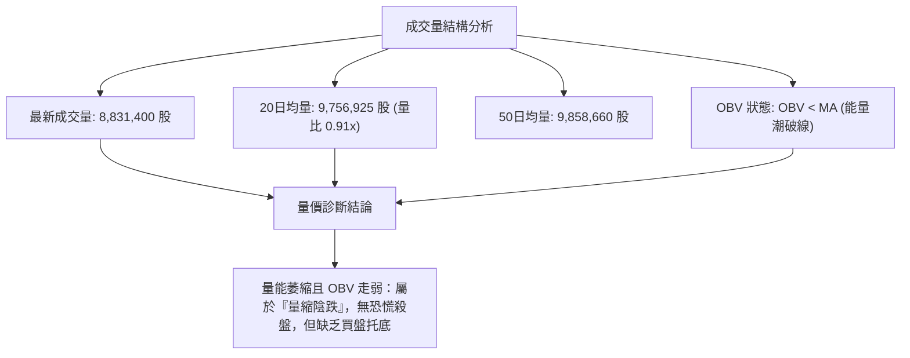

- **量價配合診斷**：
  - **成交量衰退**：最新單日成交量為 8.83M，相較 20 日均量 9.76M 萎縮約 9.5%（量比 0.91）。週量能亦從 7-8 月的 80M-90M 大幅縮減至 10 月中旬的低水平。
  - **OBV 趨勢解讀**：OBV 指標持續位於其均線下方（OBV < MA），代表資金呈現淨流出狀態。雖然並非帶量暴跌，但「量縮無承接」代表機構大戶暫時退場觀望，短線不易出現強勢反轉噴出行情。

---

## 6. 動能與波動率

### ⚡ 動能評估四象限

| 象限分區 | 動能強度 (Momentum) | 波動率狀態 (Volatility) | 當前判定 | 技術特徵與交易指引 |
|:---|:---:|:---:|:---:|:---|
| **第一象限 (Q1)** | 強 (Strong) | 低 (Low) | — | 最佳趨勢主升段，穩健推升。 |
| **第二象限 (Q2)** | **弱 (Weak)** | **低 (Low)** | **✓ (TSM 當前)** | **低波動陰跌 / 窄幅盤整**。動能趨緩 (MACD 翻負, RSI 45.69)，波動率維持平穩 (ATR 2.5%)。策略應以觀望或低吸高拋為主。 |
| **第三象限 (Q3)** | 強 (Strong) | 高 (High) | — | 狂熱噴出或暴跌，高風險高收益。 |
| **第四象限 (Q4)** | 弱 (Weak) | 高 (High) | — | 震盪洗盤激烈，多空雙巴，極易觸發止損。 |

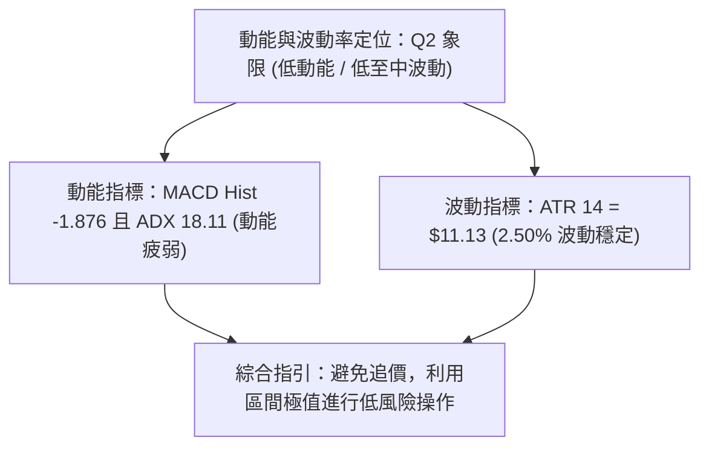

### 📊 ATR 波動率分析

- **ATR(14) 絕對數值**：**$11.13**。
- **波動率佔比 (ATR% of Price)**：**2.50%**（$11.13 / $444.35）。
- **交易止損設定標準**：
  - **短線交易止損距離 (1.0x ATR)**：$11.13。
  - **波段交易安全止損距離 (1.5x ATR)**：1.5 × $11.13 = **$16.70**。
  - **波段極限防守止損距離 (2.0x ATR)**：2.0 × $11.13 = **$22.26**。
- **實務應用**：若在當前市價 $444.35 建立多頭部位，合理的技術止損應設於現價扣除 1.0x ATR 處，即 $444.35 - $11.13 = **$433.22**，此價位恰好完美貼合季線 MA50 ($432.58) 與斐波 23.6% ($434.74)，具備極高的結構防禦合理性。

### 📐 Beta 與市場相關性

- **Beta 係數**：**1.239**。
- **特性分析**：TSM 具有高於美股大盤（S&P 500）23.9% 的波動敏感度。當半導體板塊或大盤指數出現拉回時，TSM 修正幅度將放大；反之，一旦大盤企穩，其反彈彈性亦優於平均水準。
- **做空與避險考量**：Short % Float 僅為 **0.6%**，Short Ratio 為 **3.14**，市場並不存在龐大作空部位，因此「軋空（Short Squeeze）」機率偏低，回檔純屬機構獲利了結與內生估值調整。

---

## 7. 多時框架總結

### 📋 時框架評分表

| 時框架 | 趨勢方向 | 動能指標 | 均線排列結構 | 圖表形態特徵 | 綜合評分 | 操作指引 |
|:---|:---:|:---:|:---|:---|:---:|:---|
| **長期 (月線)** | 🟢 多頭 | 🟡 中性回落 | 🟢 多頭排列 (MA200 $390.82 仰角向上) | 大型上升通道主升段 | **78/100** | 長線多單持股續抱，無須恐慌 |
| **中期 (週線)** | 🟡 震盪 | 🔴 轉弱死叉 | 🟢 MA50 ($432.58) 良好支撐 | 高檔箱型洗盤 ($406-$487) | **52/100** | 區間操作，回測下軌再行低接 |
| **短期 (日線)** | 🔴 偏空 | 🔴 頂背離 | 🔴 跌破短期均線 (跌破 MA20) | 短線雙峰受阻，回踩中軌 | **38/100** | 嚴禁盲目追高，等待止跌訊號 |

### 🔲 綜合訊號矩陣

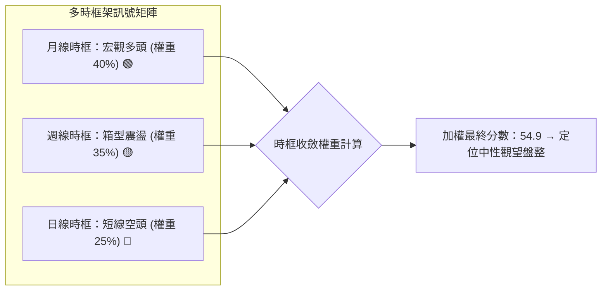

### ⚖️ 多時框收斂結論

依據多時框收斂優先級規則（嚴格要求 14）：
1. **趨勢強度定性**：當前 ADX(14) 讀數為 **18.11 (< 25)**，嚴格判定為 **「盤整行情」**。
2. **主導維度確立**：在無單邊趨勢之盤整行情中，**以日線布林通道上下軌 ($414.27 ~ $489.20) 與波段支撐阻力為核心交易區間**。中長期多頭趨勢（月線/MA200）僅作為下檔極限防護罩，不應據此在短線盲目追多。
3. **唯一方向性結論**：**【中性觀望，偏向逢低承接之區間操作】**。
   - 短線日線跌破 MA20，動能處於空方主導，故短線操作禁止做多追價。
   - 但中期 MA50 ($432.58) 與斐波 23.6% ($434.74) 距離現價僅 2% 左右，下檔空間受限，亦不宜在此位置大舉追空。
   - 結論與第 8 章之「中性區間策略」完全收斂。

---

## 8. 交易策略建議

### 🗺️ 策略決策流程圖

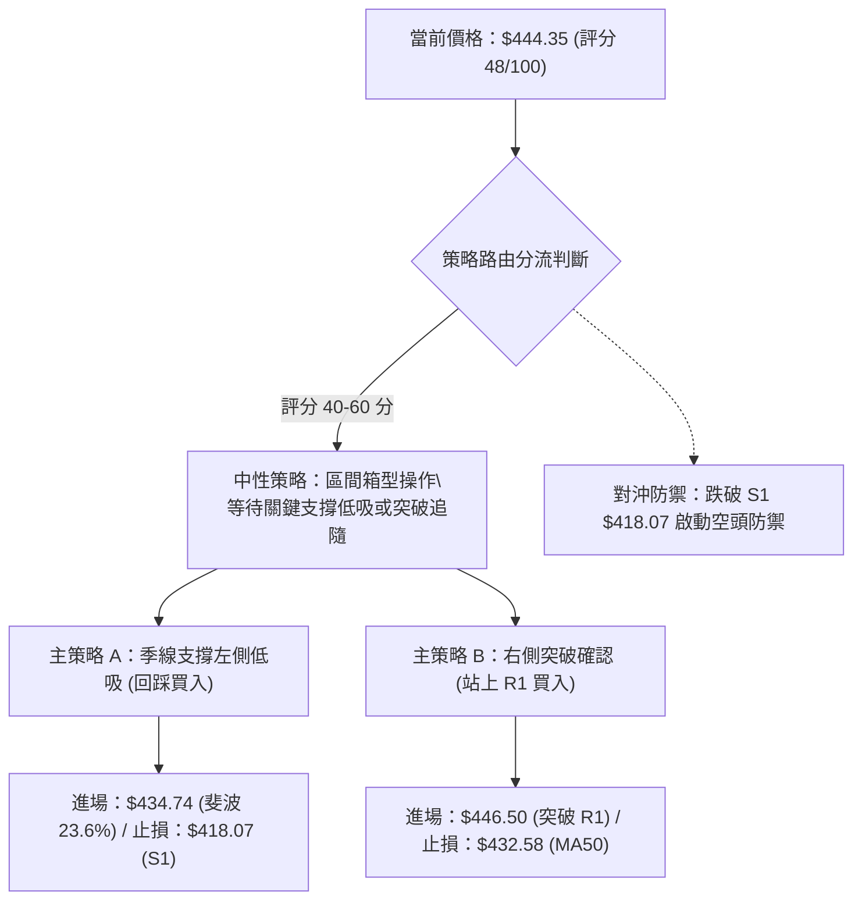

### 🧭 策略路由

**當前主策略方向 = 【中性區間操作，以回調低吸為主】（依技術評分卡 48/100 分準則）**

當前評分處於 40–60 分的中性震盪區間，ADX 僅 18.11，市場缺乏單邊推升力道。禁止進行單邊追多或追空，主推**「區間下緣低吸」**與**「阻力突破右側進場」**兩套主策略；空頭部分僅列為反轉跌破之風控對沖觸發提示。

### 🎯 價格情境階梯（Price Scenarios）

價位嚴格引用第 4 章及關鍵數據：

| 觸發條件 | 下一目標 | 後續延伸 | 情境含義與技術心理 |
|:---|:---|:---|:---|
| **向上突破 R1 $445.50** | **R2 $476.62** | **R3 $487.47** | **短線轉強**。收復 MA20 月線反壓，KD 超賣黃金交叉發酵，多頭重啟箱體頂部測試。 |
| **站穩現價區間 ($434.74 ~ $451.74)** | — | — | **區間震盪**。在布林中軌與季線之間進行籌碼沉澱，消化 RSI 頂背離浮額。 |
| **有效跌破 S1 $418.07** | **S2 $406.43** | **S3 $384.06** | **中期轉弱**。箱型結構正式下破，雙頂形態浮現，向斐波 38.2% 及 MA200 尋求支撐。 |

### 📊 情境機率分佈

| 情境劇本 | 發生機率 | 主要技術依據與指標支撐 |
|:---|:---:|:---|
| **情境一：下探季線後震盪反彈** | **55%** | KD 極度超賣 (%K=8.00)，MA50 ($432.58) 與斐波 23.6% ($434.74) 支撐強固，多頭均線結構未破。 |
| **情境二：窄幅區間橫盤拉鋸** | **30%** | ADX 僅 18.11，市場成交量能萎縮至 0.91x，多空雙方均不具備發動單邊大行情的籌碼動能。 |
| **情境三：摜破箱底展開深幅回調** | **15%** | 日線 RSI 頂背離，MACD 柱狀圖 -1.876 死叉擴大，若失守 S1 $418.07 則引發停損賣壓。 |

### 🟢 主策略詳情

本報告提供兩組嚴格依據關鍵價位推算之交易策略：**策略 A（左側回踩低吸）** 與 **策略 B（右側突破確認）**。

| 策略要素 | 策略 A (左側季線低吸策略) | 策略 B (右側突破月線追隨策略) |
|:---|:---|:---|
| **策略類型** | 支撐低吸（逆勢偏多） | 動能突破（順勢偏多） |
| **進場條件** | 價格回踩斐波 23.6% 與 MA50 支撐區間不破 | 實體日K線收盤放量突破 R1 阻力位 |
| **進場價格** | **$434.74** (斐波 23.6% 回調位) | **$446.00** (突破 R1 $445.50 後回踩確認) |
| **目標價 T1** | **$476.62** (波段阻力 R2) | **$476.62** (波段阻力 R2) |
| **目標價 T2** | **$487.47** (歷史高點阻力 R3) | **$487.47** (歷史高點阻力 R3) |
| **止損價格** | **$418.07** (跌破關鍵波段支撐 S1) | **$432.58** (跌破 50 日均線 MA50) |
| **風險空間** | $434.74 - $418.07 = **$16.67** (約 1.5x ATR) | $446.00 - $432.58 = **$13.42** (約 1.2x ATR) |
| **報酬空間 (T1)** | $476.62 - $434.74 = **$41.88** | $476.62 - $446.00 = **$30.62** |
| **風險報酬比 (R:R)** | **1 : 2.51** (超額盈虧比) | **1 : 2.28** (良好盈虧比) |
| **勝率預估** | 60% | 55% |
| **建議倉位** | **15% 總資金** (分批低吸) | **10% 總資金** (突破加碼) |

### 🔴 反向風險觸發點（對沖提示）

- **全面停損與轉空觸發價**：**實體日K跌破 $418.07 (S1)**。
- **對沖處置動作**：
  1. 一旦 S1 $418.07 帶量跌破，原多頭部位必須無條件全數停損出場。
  2. 此時「大型雙頂」與「箱底破位」確立，可建立總資產 5%-10% 之反向避險空單，向下對沖目標直指 S2 **$406.43** 及 S3 **$384.06**。

### ⭐ 整體訊號強度評星

```
做多訊號強度：★★★☆☆  (3.0/5星 — 短線受壓，但具備強固中長線支撐)
做空訊號強度：★★☆☆☆  (2.0/5星 — 僅屬短線技術回調，缺乏深跌動能)
整體可信度：  ★★★★☆  (4.0/5星 — 多時框指標共振，價位邊界極為清晰)
```

---

## 9. 風險提示與監控

### ✅ 關鍵監控指標 Checklist

```
╔══════════════════════════════════════════════════════════════════╗
║               TSM 技術交易監控清單 (Monitoring Checklist)         ║
╠══════════════════════════════════════════════════════════════════╣
║ [ ] 價位維度：現價能否在 23.6% 斐波那契位 $434.74 築底止跌        ║
║ [ ] 均線維度：季線 MA50 ($432.58) 扣抵支撐是否遭受帶量灌破       ║
║ [ ] 阻力維度：價格回抽 R1 ($445.50) 是否遇阻回落 (確認中軌反壓)    ║
║ [ ] 動能維度：日線 MACD 柱狀圖是否收斂 (-1.876 縮小轉正)         ║
║ [ ] 超賣修復：Stoch KD %K (8.00) 是否自極度超賣區形成金叉反彈     ║
║ [ ] 成交量能：成交量是否放大突破 20日均量 (9.76M 股) 帶量反攻     ║
║ [ ] 能量潮汐：OBV 能否重新穿越其均線上方，扭轉資金流出劣勢       ║
║ [ ] 破位防禦：嚴格監控波段低點聚類 S1 ($418.07) 之最終多頭防線    ║
╚══════════════════════════════════════════════════════════════════╝
```

### ⚠️ 風險場景分析

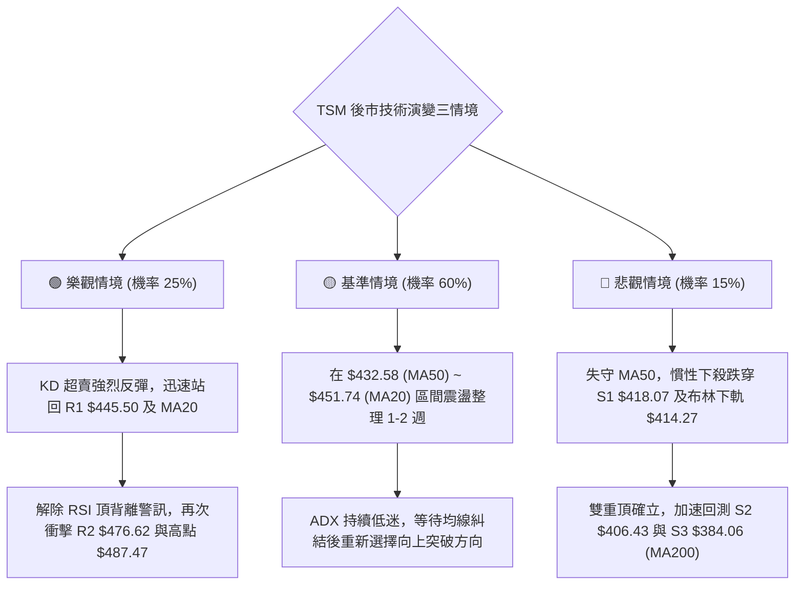

### 🛡️ 風險管理重要提醒

1. **嚴守 ATR 止損紀律**：目前 ATR(14) 為 $11.13，日內波動幅度達 2.50%。嚴格禁止無止損交易，部位進場前必須預先設定條件單，單筆虧損金額不得超過整體投資組合淨值的 1.5%。
2. **防範假突破與假跌破**：由於 ADX 僅 18.11，處於典型盤整市場特徵，盤中極易出現對重要均線（如 MA20、MA50）的「毛刺破位」現象。確認有效跌破或突破應以**「收盤價連續 2 日站穩」**或**「實體K線穿越幅度達 1.0x ATR ($11)」**為準。
3. **倉位管理原則**：在技術綜合評分未回升至 60 分前，總持倉部位建議控制在 30%-50% 之防禦性水位，保留充足現金，待回測箱底 S1/S2 或帶量突破 R1 後方可加碼。

---

## 📋 報告總結

```
╔══════════════════════════════════════════════════════════════════╗
║                     TSM 技術分析報告總結                         ║
╠══════════════════════════════════════════════════════════════════╣
║ 報告日期：2026-10-13                                             ║
║ 當前價格：$444.35                                                ║
║ 技術評級：⚖️ 中性觀望 / 區間偏多待變 (評分: 48/100)               ║
╠══════════════════════════════════════════════════════════════════╣
║ 關鍵結論：                                                       ║
║ ├─ 長期趨勢：🟢 強力多頭 (MA200 $390.82 仰角向上，長多無虞)      ║
║ ├─ 中期趨勢：🟡 箱型整理 ($406.43 ~ $487.47 寬幅拉鋸)            ║
║ ├─ 短期趨勢：🔴 弱勢修正 (跌破 MA20 $451.74，MACD 柱狀 -1.876)   ║
║ ├─ 關鍵支撐：S1: $418.07 ｜ MA50: $432.58 ｜ 斐波23.6%: $434.74  ║
║ ├─ 關鍵阻力：R1: $445.50 ｜ MA20: $451.74 ｜ R2: $476.62         ║
║ └─ 分析師共識目標：$578.22 (隱含 +30.12% 空間，長多基本面穩固)    ║
╠══════════════════════════════════════════════════════════════════╣
║ 最優策略組合：                                                   ║
║ 1. 🥇 最佳機會：策略 A — 斐波 23.6% ($434.74) 季線低吸           ║
║    (止損 $418.07，目標 $476.62，盈虧比 1:2.51)                   ║
║ 2. 🥈 次選機會：策略 B — 帶量突破 R1 ($446.00) 右側追隨          ║
║    (止損 $432.58，目標 $476.62，盈虧比 1:2.28)                   ║
║ 3. 🥉 保守選擇：場外觀望，靜待日線 MACD 翻正且站回 MA20 再行進場  ║
╚══════════════════════════════════════════════════════════════════╝
```

---

> ⚠️ **免責聲明**：本報告為技術分析專用模型生成之客觀走勢剖析，所有關鍵價位均基於歷史 OHLCV 幾何算法推導。本報告**僅供研究與學術參考**，**不構成任何形式的投資要約或下單建議**。金融市場瞬息萬變，投資人應獨立評估市場風險並自負盈虧。

---

*報告生成時間：2026-10-13 ｜ 數據來源：Yahoo Finance ｜ 分析框架：多時框架圖表形態與量化指標系統*