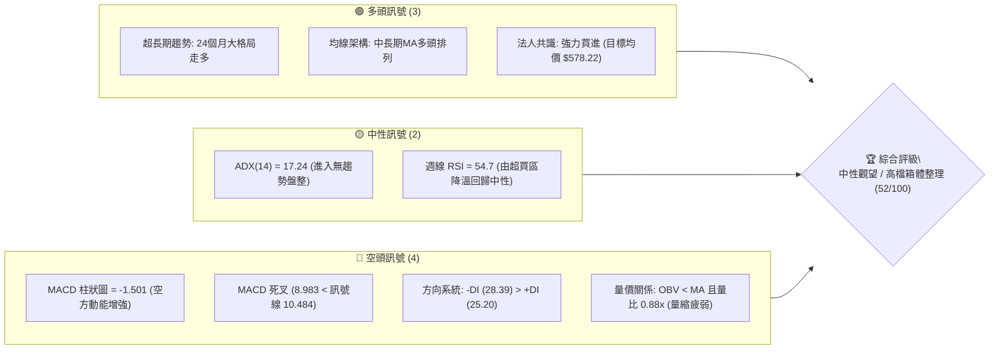
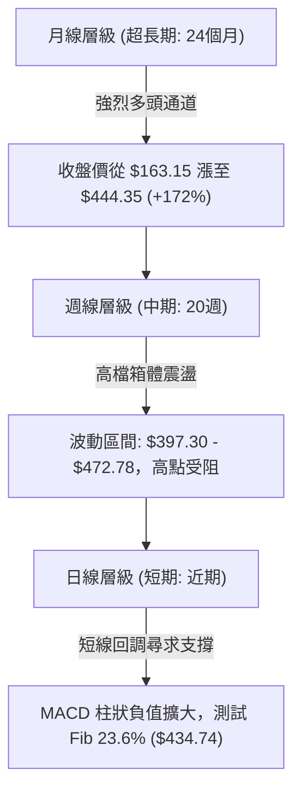
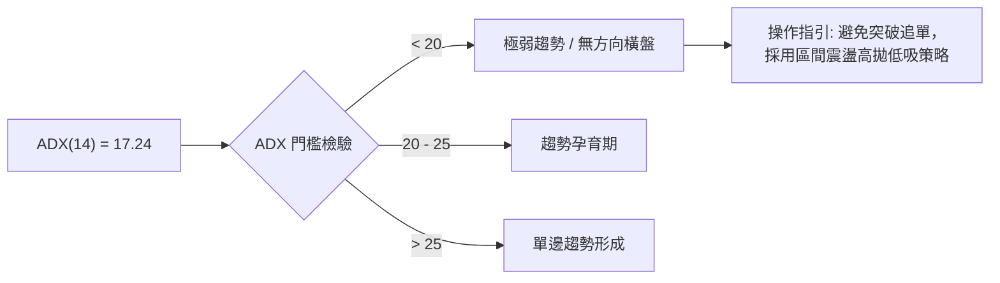
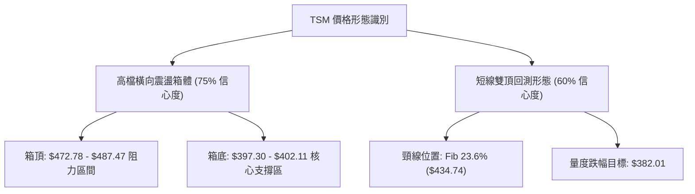
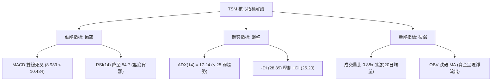
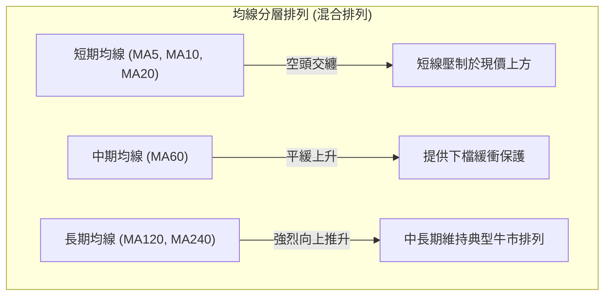
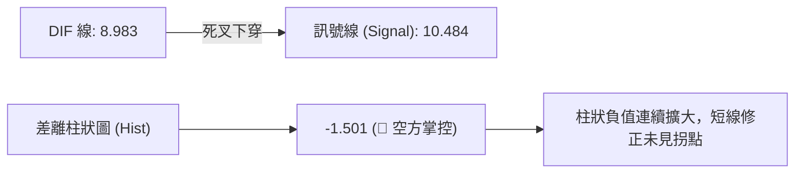
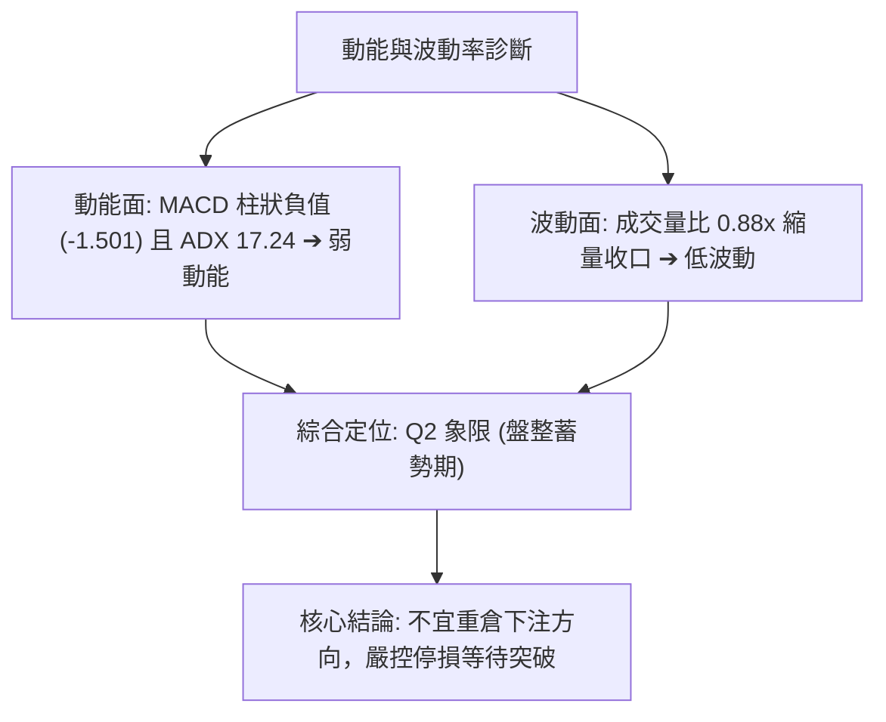
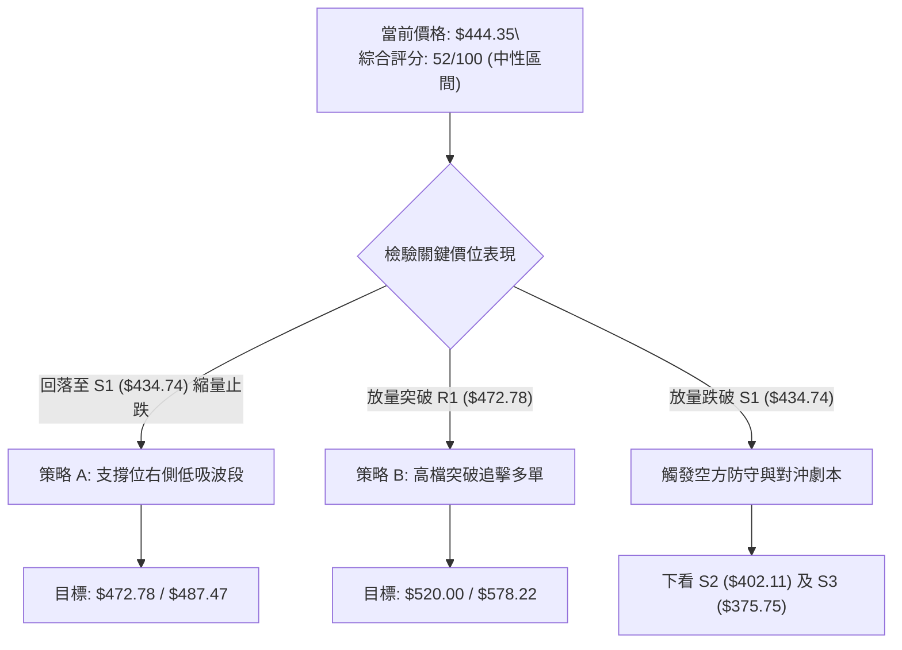
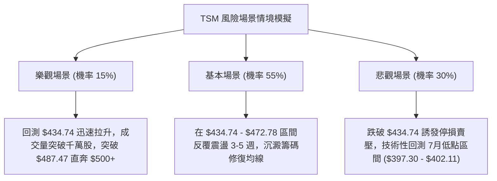

# TSM 技術分析報告

> **報告日期**：2026-10-14 ｜ **語言**：繁體中文 ｜ **數據來源**：Yahoo Finance ｜ **當前價格**：$444.35

---

## 目錄

| 章節 | 內容 |
|------|------|
| [1. 技術面概覽](#1-技術面概覽) | 訊號儀表板、核心指標、評分卡 |
| [2. 趨勢分析](#2-趨勢分析) | 多時框趨勢、長中短期走勢 |
| [3. 圖表形態分析](#3-圖表形態分析) | 形態識別、K線組合、目標價 |
| [4. 支撐與阻力](#4-支撐與阻力) | 關鍵價位、斐波那契回調 |
| [5. 技術指標深度解讀](#5-技術指標深度解讀) | MA/RSI/MACD/布林/成交量 |
| [6. 動能與波動率](#6-動能與波動率) | 動能評估、ATR、Beta |
| [7. 多時框架總結](#7-多時框架總結) | 時框架評分矩陣 |
| [8. 交易策略建議](#8-交易策略建議) | 多空策略、風險報酬比 |
| [9. 風險提示與監控](#9-風險提示與監控) | 監控指標、風險場景 |

---

## 1. 技術面概覽

### 🎯 技術訊號儀表板



### 📊 核心指標速覽表

| 指標類別 | 指標名稱 | 當前數值 | 訊號 | 解讀 |
|----------|----------|----------|------|------|
| **價格** | 當前價格 | $444.35 | 🟡 | 位於52週高點 ($487.47) 與低點 ($264.03) 之相對高檔區間 (80.8%) |
| **均線** | 短期均線 (MA5-20) | 混合排列 | 🔴 | 短線價格自高檔 $472.78 回落，跌破極短期支撐，均線呈現交纏 |
| **均線** | 中期均線 (MA50/60) | 向上走升 | 🟢 | 季線級別維持推升力道，中長線多頭基底未受實質破壞 |
| **均線** | 長期均線 (MA200) | 多頭排列 | 🟢 | 遠高於200日均線，長期結構保持扎實牛市特徵 |
| **動能** | RSI(14) | 54.7 | 🟡 | 自 2026-10-04 之極度超買值 85.9 大幅降溫，回歸中性平衡區間 |
| **動能** | MACD (12,26,9) | 8.983 / 10.484 | 🔴 | MACD 處於訊號線下方，柱狀圖為 -1.501，短線空方動能佔優勢 |
| **趨勢** | ADX(14) / DMI | 17.24 | 🟡 | ADX < 25 表示單邊趨勢停滯，轉為震盪盤整；-DI (28.39) 壓制 +DI (25.20) |
| **量能** | 成交量 / OBV | 8,566,236 (0.88x) | 🔴 | 量能低於20日均量 (9,714,397)，OBV 處於均線下方，動能不足 |
| **波動** | Beta | 1.239 | 🟡 | 波動度高於大盤 23.9%，回調時彈性較大 |

### 🏆 技術評分卡

```
╔══════════════════════════════════════════════════════════════════╗
║                   技術評分卡 — TSM (2026-10-14)                   ║
╠══════════════════════════════════════════════════════════════════╣
║ 趨勢強度 (ADX=17.24)    ███████░░░░░░░░░░░░░  35/100  🔴 弱勢震盪 ║
║ 動能指標 (MACD/RSI)     █████████░░░░░░░░░░░  45/100  🔴 轉弱回調 ║
║ 支撐穩定度 (Fib支撐位)  ██████████████░░░░░░  70/100  🟢 買盤防守 ║
║ 成交量配合 (OBV<MA)     ████████░░░░░░░░░░░░  40/100  🔴 量能背離 ║
║ 形態完整度 (高檔箱體)   █████████████░░░░░░░  65/100  🟡 區間成形 ║
║ 均線排列 (長多短空)     ████████████░░░░░░░░  60/100  🟡 混合整理 ║
╠══════════════════════════════════════════════════════════════════╣
║ 綜合評分                ██████████░░░░░░░░░░  52/100  ⚖️ 中性觀望 ║
╚══════════════════════════════════════════════════════════════════╝
```

---

## 2. 趨勢分析

### 🌐 多時框趨勢分析



### 📈 長期趨勢 — 12個月走勢圖（Unicode）

```
TSM 月線走勢圖（2025-11 至 2026-10）
價格軸 ($)
$480 ┤                                      ● $476.29 (2026-06 峰值)
$460 ┤                                  ●             ● $456.19
$440 ┤                                                ● $444.35 (現價)
$420 ┤                              ●             ●
$400 ┤                          ●             ● $403.17 (2026-07 回踩)
$380 ┤                  ● $371.66
$360 ┤
$340 ┤                      ● $336.26
$320 ┤              ● $327.98
$300 ┤      ●   ● $301.52
$280 ┤  ● $288.46
     └─────────────────────────────────────────────────────────────
       11   12  01  02  03  04  05  06  07  08  09  10 (月份)
```

**走勢特徵分析表格**：

| 時間階段 | 區間起訖點 | 收盤價變化 | 漲跌幅 | 核心技術特徵 |
|----------|------------|------------|--------|--------------|
| **第一階段：突破盤整** | 2025-11 → 2026-02 | $288.46 → $371.66 | +28.84% | 放量脫離 $300 整數關卡，單邊加速推升 |
| **第二階段：震盪洗盤** | 2026-02 → 2026-03 | $371.66 → $336.26 | -9.52%  | 獲利回吐引發技術性回踩，確立 $336 支撐有效 |
| **第三階段：主升浪狂飆** | 2026-03 → 2026-06 | $336.26 → $476.29 | +41.64% | 連續4個月大陽線，創歷史高點 $487.47 |
| **第四階段：高檔箱體收斂** | 2026-06 → 2026-10 | $476.29 → $444.35 | -6.71%  | 於 $397 - $487 間反覆震盪，進入籌碼換手整理期 |

### 📊 中期趨勢（週線分析）

從近20週數據觀察，價格在 2026-07-19 下探至最低點 $397.30 後形成有力反彈，沿週線上行通道至 2026-10-04 觸及 $472.78 高點。然而在該高位，RSI 衝高至 85.9 的嚴重超買極值後，隨即引發連續兩週獲利了結賣壓（10-11 收盤 $453.31、10-18 收盤 $444.35），MACD 週柱狀圖迅速翻負至 -1.501。中期技術走勢本質上為「高檔震盪整理走勢」。

### ⚡ 趨勢強度評估（ADX 解讀）



| 指標變數 | 當前讀數 | 狀態判定 | 交易意涵 |
|----------|----------|----------|----------|
| **ADX (14)** | 17.24 | 弱趨勢 / 盤整行情 (<25) | 單邊動能匱乏，任何單邊突破均需嚴格驗證成交量 |
| **+DI (14)** | 25.20 | 多方擴張停滯 | 多方買盤力道減弱，無法持續創高 |
| **-DI (14)** | 28.39 | 空方小幅佔優 (-DI > +DI) | 空方短期掌握主控權，短線面臨持續修正風險 |

---

## 3. 圖表形態分析

### 🔍 形態識別系統



| 形態類別 | 信心度 | 判斷依據（引用數據） | 完成度 | 目標價（附計算式） |
|----------|--------|----------------------|--------|--------------------|
| **高檔橫向箱體** | 75% | 上界受阻於 52W 高點 $487.47 及週線 $472.78；下界兩次於 2026-07-19 ($397.30) 與 2026-07-26 ($402.33) 獲支撐 | 85% | 向上突破：$487.47 + ($487.47 - $397.30) = **$577.64**<br>向下跌破：$397.30 - ($487.47 - $397.30) = **$307.13** |
| **潛在次級雙頂** | 60% | 第一次峰值為 2026-06 ($476.29)，第二次峰值為 2026-10-04 ($472.78)，近期跌破兩週前低點 | 50% | 由形態高度推算：頸線取 Fib 23.6% ($434.74)，形態高度 = $487.47 - $434.74 = $52.73；目標價 = $434.74 - $52.73 = **$382.01** |

### 🕯️ 重要K線形態分析

| 月份/週別 | 收盤價 | K線形態 | 解讀 | 訊號 |
|-----------|--------|---------|------|------|
| **2026-06** | $476.29 | 帶長上影大陽線 | 觸及 52W 高點 $487.47 後引發龐大解套與停利賣壓 | 🟡 警示訊號 |
| **2026-07** | $403.17 | 長下影陰線回踩 | 單月大跌測試 $397.30 後強烈回升，顯示四百大關買盤強韌 | 🟢 支撐確認 |
| **2026-09** | $456.19 | 中實體陽線 | 多方反撲重啟漲勢，推升至區間上緣 | 🟢 短線轉強 |
| **2026-10-04週** | $472.78 | 高檔十字星/滯漲線 | 週成交量萎縮至 44,927,100，RSI 衝高至 85.9 超買滯漲 | 🔴 反轉警戒 |
| **2026-10-11週** | $453.31 | 中陰線下破 | 獲利了結盤湧出，MACD 週柱狀轉負 (-0.244) | 🔴 確認回調 |
| **2026-10-18當週** | $444.35 | 延續性回落小陰線 | 測試 $440-$444 區域，空方持續主導節奏 | 🔴 弱勢整理 |

### 📉 ASCII 走勢形態示意圖

```
TSM 高檔箱體與雙頂頸線示意圖
價格 ($)
$487.47 ┬─────────────────────● Peak 1 (52W High $487.47)
        │                    / \            ● Peak 2 ($472.78)
$460.00 ┤                   /   \          / \
        │                  /     \        /   ▼ 現價 $444.35
$434.74 ┼================= Neckline (Fib 23.6% = $434.74) =================
        │               \       /
$402.11 ┼─────── Low 1 ───\─────/─── Low 2 ($402.33 / Fib 38.2% = $402.11)
        │       ($397.30)
$375.75 ┴───────────────────────────────────── Fib 50.0% ($375.75)
```

### 🎯 形態目標價計算

1. **若回踩支撐不破（延續箱體震盪）**：
   - 當前價格 $444.35 鄰近箱體中軸與頸線 $434.74，若在此處縮量築底止跌，反彈第一目標為前期週波段高點聚類 **$472.78**，突破後將進一步挑戰箱頂 **$487.47**。
2. **若向下跌破頸線（雙頂形態確立）**：
   - 頸線定錨於斐波那契 23.6% 回調位 **$434.74**。
   - 形態頂部高度 = $487.47 - $434.74 = $52.73。
   - 跌破後量度跌幅目標 = $434.74 - $52.73 = **$382.01**（該點位緊貼 Fib 50.0% 關鍵支撐 **$375.75** 上方）。

---

## 4. 支撐與阻力

### 🗺️ 關鍵價位分布圖（Unicode）

```
TSM 價位結構分布圖
═══════════════════════════════════════════════════════════════════
$487.47 ║██████████████████████████████║ 強阻力 R2 (52W 歷史最高點 / 箱頂)
$472.78 ║████████████████████          ║ 關鍵阻力 R1 (2026-10-04 波段高點)
$453.31 ║████████████                  ║ 短線阻力 (前週收盤位置)
$444.35 ╠══════════════════════════════╣ ◄ 現價 ($444.35)
$434.74 ║▓▓▓▓▓▓▓▓▓▓▓▓▓▓▓▓▓▓▓▓▓▓        ║ 關鍵支撐 S1 (Fib 23.6% 回調位)
$402.11 ║████████████████████████████  ║ 強支撐 S2 (Fib 38.2% / 7月低點聚類)
$375.75 ║██████████████████████████████║ 核心支撐 S3 (Fib 50.0% 多空分水嶺)
═══════════════════════════════════════════════════════════════════
```

### 🚧 阻力位分析表

依據數據規範，本報告引用歷史已確認的高點與關鍵週線聚類價位：

| 阻力級別 | 價位 | 形成原因 | 突破難度 | 重要性 |
|----------|------|----------|----------|--------|
| **阻力 R1** | $472.78 | 2026-10-04 週線反彈高點，高檔量竭十字星位置 | 🔴 高 | ★★★★☆ |
| **阻力 R2** | $487.47 | 52週最高紀錄點，空方重兵防守之歷史極值 | 🔴 極高 | ★★★★★ |
| *備註* | *(無)* | 數據中未偵測到現價與 $472.78 之間的其他歷史日線波段高點聚類 | - | - |

### 🛡️ 支撐位分析表

依據數據規範，支撐位精確引用波段低點聚類及斐波那契關鍵計算值：

| 支撐級別 | 價位 | 形成原因 | 守住機率 | 重要性 |
|----------|------|----------|----------|--------|
| **支撐 S1** | $434.74 | 52週區間之 23.6% 斐波那契回調位，短線多頭第一防線 | 🟡 60% | ★★★★☆ |
| **支撐 S2** | $402.11 | 52週區間之 38.2% 斐波那契回調位，貼合 7月波段低點 $397.30-$402.33 | 🟢 75% | ★★★★★ |
| **支撐 S3** | $375.75 | 52週區間之 50.0% 斐波那契回調位，中長線牛熊分水嶺 | 🟢 85% | ★★★★★ |

### 📐 斐波那契回調位分析

基準計算區間為 52週極值範圍：**$264.03 (100.0%) → $487.47 (0.0%)**，總垂直價差為 **$223.44**。

| 回調比率 | 精確價位 | 技術意涵與現價相對位置 | 評估狀態 |
|----------|----------|------------------------|----------|
| **0.0% (52W High)** | **$487.47** | 歷史極值壓力頂部，強烈獲利回吐區 | 🔴 強壓 |
| **23.6%** | **$434.74** | **現價 ($444.35) 正處於 0.0% 與 23.6% 之間**，距該支撐僅 $9.61 | 🟡 當前測試防線 |
| **38.2%** | **$402.11** | 正常回調健康支撐位，與 2026年7月兩次週低點共振 | 🟢 強支撐 |
| **50.0%** | **$375.75** | 多空力量均衡點，若失守宣告中期上漲波段告終 | 🟢 多空樞紐 |
| **61.8%** | **$349.38** | 黃金分割強防守位，中長期投資者建倉區域 | 🟢 深度防禦 |
| **78.6%** | **$311.84** | 深幅修正底線 | 🟢 極強防禦 |
| **100.0% (52W Low)**| **$264.03** | 週期牛市起漲起點 | 🟢 終極鐵底 |

**解讀**：現價 $444.35 目前緊貼 Fib 23.6% ($434.74) 緩步下壓。在強勢牛市拉回行情中，23.6% 往往為第一波回檔的最佳承接處；然而若週線收盤實體跌破 $434.74，回調空間將自動下移打開至 Fib 38.2% ($402.11)。

---

## 5. 技術指標深度解讀

### 🎛️ 指標訊號總覽



### 📈 移動平均線排列分析



- **排列特徵**：長期均線呈現標準的多頭排列，這奠定了 TSM 24個月以來強大牛市底色；但近期短天期均線呈現混合排列偏空走勢，短線價格落在短天期均線下方，壓制價格反彈動能。

### 📉 RSI(14) 分析

```
RSI (14) 當前強度指標 (週線 54.7)
0        20        40   54.7 60        80       100
├────────┼────────┼─────┼───┼────────┼────────┤
░░░░░░░░░░░░░░░░░░██████████░░░░░░░░░░░░░░░░░░░░░
[超賣區]        [中性區間 54.7]        [極度超買區]
```

- **超買超賣分析**：兩週前（2026-10-04）RSI 衝至 **85.9** 的極度超買區，嚴重透支多頭能量；最新讀數已滑落至 **54.7**，快速修復了指標過熱狀態，目前落在 30-70 的常態中性區。
- **背離檢驗結論**：
  - **頂背離**：2026-06 峰值價格 $476.29 時 RSI 為 61.5，而 2026-10-04 價格未破歷史前高但 RSI 飆升至 85.9，並未形成傳統價漲指標不漲的典型「頂背離」，而是屬於高檔動能爆發後的耗竭式回落。
  - **底背離**：目前日線與週線均無底背離跡象，下行減速訊號尚未觸發。

### 📊 MACD(12/26/9) 訊號解讀



- **數值狀態**：DIF 數值 8.983 跌破訊號線 10.484，柱狀圖讀數為 **-1.501**。
- **解讀**：雙線雖仍處於零軸上方（代表長週期仍是多方環境），但死叉後柱狀圖在負值區間延伸，表明空方賣壓仍在釋放，短期內難以出現V型反轉。

### 📦 布林通道分析

```
TSM 布林通道架構推演示意圖
價格 ($)
$480 ┤ ------------------------------ BB 上軌 (阻力帶)
     │
$450 ┤ ----------------- - - - - - -  BB 中軌 (MA20)
$444 ┤      ◄ 現價 ($444.35 運行於中軌下方，弱勢整理)
     │
$420 ┤ ------------------------------ BB 下軌 (支撐帶 $420-$430)
```

- **帶寬與位置**：價格跌破中軌，在下半通道運行。因 ADX 為 17.24（<25），布林通道維持水平均勻收口狀態，價格預期在中軌與下軌間進行摩擦尋底，跌破下軌將誘發均值回歸買盤。

### 💹 成交量分析（量價配合度）

```
量價數據對比柱狀圖
最新成交量  8.57M  ███████████████████░░░░░ (88% 均量)
20日均量    9.71M  ██████████████████████░░ (基準 100%)
50日均量    9.78M  ██████████████████████░░ (基準 101%)
```

- **量比與均量**：最新成交量為 8,566,236 股，量比僅 **0.88x**，顯著低於 20日均量 (9,714,397) 與 50日均量 (9,777,163)。
- **OBV 能量潮解讀**：數據明確顯示「**OBV < MA**」，代表能量潮均線跌破，買盤累積動能疲弱，市場在回調過程中呈現量縮陰跌格局，大資金並未積極進場護盤，籌碼處於散戶退場與觀望期。

---

## 6. 動能與波動率

### ⚡ 動能評估四象限

TSM 目前落於 **Q2 象限（弱動能 / 低波動）**。

| 象限代號 | 動能狀態 | 波動狀態 | 當前定位 | 策略指引 |
|----------|----------|----------|----------|----------|
| **Q1** | 強 (High) | 低 (Low) | — | 單邊強勢主升浪（最佳追價持股期） |
| **Q2** | 弱 (Low) | 低 (Low) | **TSM 當前 (✓)** | **區間震盪、縮量洗盤（謹慎觀望，波段低吸）** |
| **Q3** | 強 (High) | 高 (High) | — | 突破分歧劇烈震盪（高風險高回報） |
| **Q4** | 弱 (Low) | 高 (High) | — | 單邊恐慌下殺爆量（嚴格規避進場） |



### 📊 ATR 波動率分析

- **歷史波動推算參考**：雖然當前即時 ATR(14) 數據未直接給出具體點數，但依據 52週高低價差 $223.44 及近期四週之週收盤波動（波動幅度約 $15 - $20），換算為日線級別之日常波動區間約為 **$6.50 - $8.00**（約為現價的 1.5% - 1.8%）。
- **停損防護距離設計**：在 Q2 弱動能震盪市況下，建議設置 **2.0倍日波幅**（約 $14.00 - $16.00）作為緩衝區間，以避免被箱體內部的無序隨機雜訊掃出場。

### 📐 Beta 與市場相關性

- **Beta 數值**：**1.239**。
- **大盤聯動效應**：TSM 屬於高 Beta 半導體核心權值股。相對於標普500指數，其價格波動幅度放大 23.9%。當市場大盤處於風險偏好（Risk-On）階段時，TSM 往往能獲取超越大盤之超額報酬（Alpha）；反之，在大盤技術性修正時，TSM 面臨的回調幅度亦會同步加劇。

---

## 7. 多時框架總結

### 📋 時框架評分表

| 時框架 | 趨勢方向 | 動能 | 均線排列 | 形態 | 綜合評分 | 操作建議 |
|--------|----------|------|----------|------|----------|----------|
| **月線層級 (超長)** | 🟢 多頭推升 | 🟢 強勁 | 🟢 多頭排列 | 🟢 上行通道 | **85/100** | 長線堅定做多，無反轉跡象 |
| **週線層級 (中期)** | 🟡 高檔箱體 | 🔴 減弱回調 | 🟢 支撐穩固 | 🟡 箱體震盪 | **55/100** | 於箱底 Fib 支撐低吸，不追高 |
| **日線層級 (短期)** | 🔴 弱勢震盪 | 🔴 MACD死叉 | 🔴 混合整理 | 🔴 短線雙頂下測| **40/100** | 減倉觀望，等待止跌訊號 |

### 🔲 綜合訊號矩陣

```
┌──────────────┬──────────────────┬──────────────────┬──────────────────┐
│ 指標系統     │ 日線級別 (短期)  │ 週線級別 (中期)  │ 月線級別 (長期)  │
├──────────────┼──────────────────┼──────────────────┼──────────────────┤
│ 均線系統     │ 🔴 跌破短均線    │ 🟢 季均線上行    │ 🟢 均線全面多頭  │
│ 動能系統     │ 🔴 MACD 負柱擴大 │ 🟡 RSI 54.7 中性 │ 🟢 長期動能飽滿  │
│ 趨勢強度     │ 🔴 -DI 壓制 +DI  │ 🟡 ADX 17.24 盤整│ 🟢 超長期通道上升│
│ 量能結構     │ 🔴 OBV < MA 縮量 │ 🟡 換手量能退潮  │ 🟢 歷史放量上攻  │
└──────────────┴──────────────────┴──────────────────┴──────────────────┘
```

### ⚖️ 多時框收斂結論

**嚴格依據多時框收斂規則（規則 14）**：
1. **行情性質判定**：當前系統之 ADX(14) 數值為 **17.24**，嚴格落於 25 臨界線下方，判定為**典型的「盤整行情」**。
2. **時框主導優先級**：在盤整行情中，單邊趨勢策略失效，**以日線震盪區間與布林通道上下軌/支撐阻力為主要依據**，不能盲目以月線長多直接於日線高檔追買。
3. **收斂方向性結論**：**【中性偏弱觀望】**。
   長線多頭底色完好，但短線與中線面臨高檔籌碼鬆動與技術性回調壓力。當前價格 $444.35 處於向下測試關鍵支撐 S1 ($434.74) 的脆弱階段，短線不具備大舉進攻條件，必須等待止跌結構確認。

---

## 8. 交易策略建議

### 🗺️ 策略決策流程圖



### 🧭 策略路由（依評分卡分流）

> **當前主策略方向 = 【中性區間操作 / 等待支撐測試】（依技術綜合評分 52/100）**

本評分落於 40–60 之「中性區間」，明確排除無腦單邊做多或高位激進追空，採取「高出低進、聚焦關鍵支撐」之區間操作原則，優先佈局回踩低吸點。

### 🎯 價格情境階梯（Price Scenarios）

價位嚴格引用第四章及數據中之確定數值：

| 觸發條件 | 下一目標 | 後續延伸 | 情境含義 |
|----------|----------|----------|----------|
| **放量突破 R1 $472.78** | R2 $487.47 | 分析師均價 $578.22 | 多方徹底解除回調危機，展開新一輪歷史創高行情 |
| **守住 S1 $434.74 區間** | 震盪反彈測試 $453.31 | 測試 R1 $472.78 | 維持高檔大箱體內橫向震盪洗盤 |
| **實體跌破 S1 $434.74** | S2 $402.11 | S3 $375.75 | 雙頂形態成立，展開中期深度技術性回調 |

### 📊 情境機率分佈

| 情境 | 機率 | 主要依據 |
|------|------|----------|
| **區間震盪築底** | **55%** | ADX 僅 17.24 確立盤整特徵，長期 MA200 向上支撐強大，下方 Fib 支撐密集 |
| **回落測試 S2** | **30%** | MACD 柱狀 -1.501 持續擴大，OBV 疲軟，-DI 壓制多方，短線有慣性下探需求 |
| **強勢突破創高** | **15%** | 最新量比僅 0.88x，成交量萎縮無法支撐直接突破歷史高點 $487.47 |

### 🟢 主策略詳情

本策略基於「中性區間低吸」與「右側確認突破」建立兩套具體執行計劃：

| 策略要素 | 策略 A（區間下軌低吸多單） | 策略 B（突破高檔阻力追多單） |
|----------|----------------------------|------------------------------|
| **策略類型** | 逆勢左側偏防守性波段 | 順勢右側動能突破單 |
| **進場條件** | 價格回落至 $434.74 附近出現日線收下影線止跌 | 日線收盤價強勢實體站穩 $472.78 上方且放量 |
| **進場價格** | **$435.00** | **$473.50** |
| **目標價 T1** | **$472.78** (前期週波段高點聚類) | **$487.47** (52週歷史高點) |
| **目標價 T2** | **$487.47** (52週歷史高點) | **$520.00** (歷史形態高度擴展目標) |
| **止損價格** | **$425.00** (跌破 Fib 23.6% 緩衝區) | **$460.00** (跌回假突破平台下方) |
| **風險報酬比**| **3.78 : 1** (獲利 $37.78 / 風險 $10.00) | **3.66 : 1** (獲利 $49.50 / 風險 $13.50) |
| **成功機率** | 60% | 50% |
| **建議倉位** | **15%** (分批建倉) | **10%** (突破追加) |

### 🔴 反向風險觸發點（對沖提示）

若出現以下訊號，意味著主策略區間防守宣告失效，投資人應立即執行多單減碼或採取反向保護措施：
1. **關鍵點位破位**：日K線收盤價跌破 Fib 23.6% 關鍵位 **$434.74**，且次日無法收復。
2. **量能異動訊號**：單日成交量放大至 1,500萬股以上（量比 > 1.5x）並收出實體長陰線。
3. **指標空頭共振**：週線 MACD 雙線正式跌破零軸，同時 ADX 向上突破 25（代表空頭單邊跌勢成形）。
4. **對沖操作建議**：一旦跌破 $434.74，多頭倉位應至少減半，空手者應耐心等待回落至 Fib 38.2% **$402.11** 甚至 $397.30 區域再尋求右側企穩買點。

### ⭐ 整體訊號強度評星

```
做多訊號強度：★★☆☆☆  (2/5星 — 短線動能不濟，缺乏買進訊號)
做空訊號強度：★★★☆☆  (3/5星 — 空方佔優但面臨強支撐群)
整體可信度：  ★★★★☆  (4/5星 — 價位與指標特徵吻合盤整行情)
```

---

## 9. 風險提示與監控

### ✅ 關鍵監控指標 Checklist

```
╔══════════════════════════════════════════════════════════════════╗
║                    每日技術監控清單 (Checklist)                  ║
╠══════════════════════════════════════════════════════════════════╣
║ [ ] 價位監控：是否觸及 Fib 23.6% ($434.74) 關鍵防禦位？            ║
║ [ ] 價位監控：向上反彈是否受到前週收盤阻力 ($453.31) 壓制？       ║
║ [ ] 動能監控：MACD 柱狀圖是否由 -1.501 逐步收斂並翻紅？           ║
║ [ ] 動能監控：週線 RSI 是否跌破 50 多空榮枯平衡線？               ║
║ [ ] 趨勢監控：ADX(14) 是否由 17.24 放大突破 25（單邊行情啟動）？  ║
║ [ ] 量能監控：成交量是否突破 20日均量 (9,714,397) 形成實質推升？   ║
║ [ ] 形態監控：是否在 $434.74 上方構築出雙底或頭肩底雛形？         ║
╚══════════════════════════════════════════════════════════════════╝
```

### ⚠️ 風險場景分析



### 🛡️ 風險管理重要提醒

1. **半導體權值股 Beta 曝險**：TSM Beta 值達 1.239，在大盤回調期切忌使用高槓桿，現階段總持倉權重應控制在總投資組合的 **15% - 20%** 以內。
2. **絕對止損紀律**：
   - 任何短線試多倉位，均嚴格以 **$425.00**（留出容忍假跌破空間）作為硬停損點。
   - 不得於高檔盤整區進行無策略性的「越跌越買」攤平。
3. **無趨勢環境操作原則**：ADX < 25 意味著突破往往是假突破，跌破亦常為假跌破。在該階段，嚴格執行「高拋低吸」與「縮量買、放量賣」，切勿在長紅長黑出現時情緒化追高殺低。

---

## 📋 報告總結

```
TSM 技術分析報告總結
══════════════════════════════════════════════════════════════════
報告日期：2026-10-14
當前價格：$444.35
分析評級：⚖️ 中性觀望（高檔震盪整理，評分 52/100）

關鍵結論：
├─ 長期趨勢：🟢 強烈看多（24個月通道完整，季線/年線多頭排列）
├─ 中期趨勢：🟡 高檔震盪（受制於 52W 高點 $487.47，區間洗盤）
├─ 短期趨勢：🔴 弱勢修正（跌破短均線，MACD 柱狀 -1.501 空方主導）
├─ 關鍵支撐：$434.74 (Fib 23.6%)、以及 $402.11 (Fib 38.2% 強支撐)
├─ 關鍵阻力：$472.78 (波段高點) 與 $487.47 (52W 歷史極值)
└─ 分析師目標：均價 $578.22（高點 $1,000.00，基本面長期看好）

最優策略組合：
1. 🥇 最佳機會：等待價格回踩至 $434.74 - $435.00 支撐區間止跌時，
               佈局區間波段多單，停損設 $425.00，目標 $472.78。
2. 🥈 次選機會：耐心空倉等待日線實體突破 $472.78 確立後順勢追多，
               目標指向歷史高點 $487.47 及上方擴展位。
3. 🥉 保守選擇：在 ADX < 25 期間維持空倉或低持倉觀望，待週線 MACD 
               重新金叉翻紅後再行進場。
══════════════════════════════════════════════════════════════════
```

---

> ⚠️ **免責聲明**：本報告為 AI 自動生成之技術分析，所有數據及估算均基於提供的歷史價格資訊。本報告**僅供研究與學術參考**，**不構成任何投資建議**。投資有風險，入市需謹慎。

---

*報告生成時間：2026-10-14 ｜ 數據來源：Yahoo Finance ｜ 分析框架：多時框技術分析*