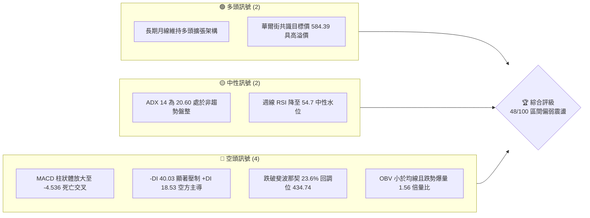
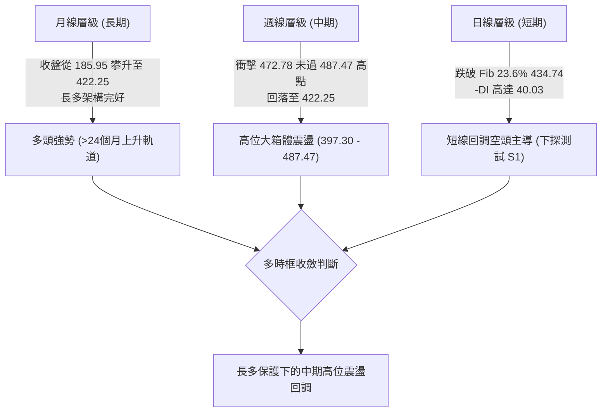
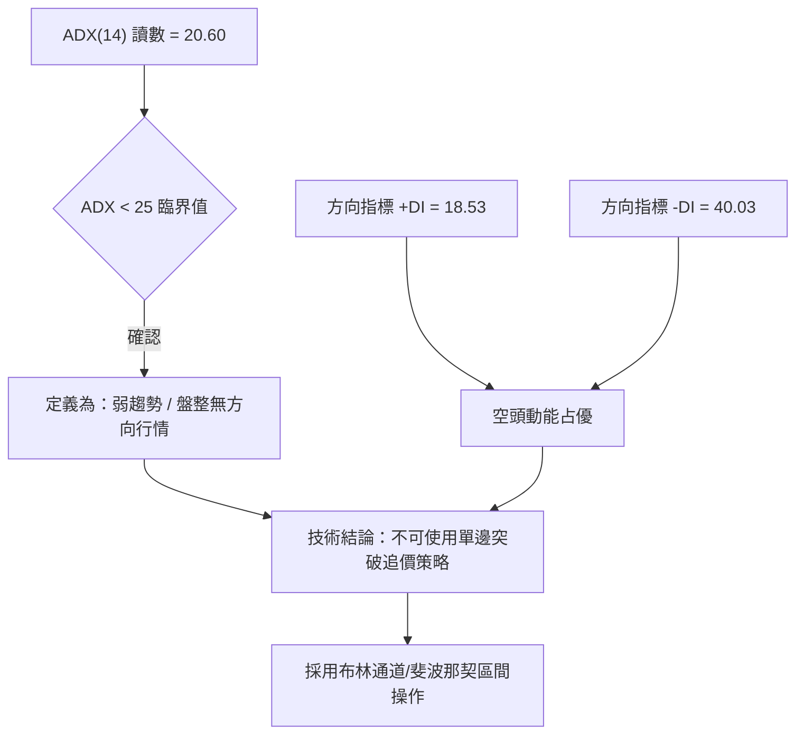
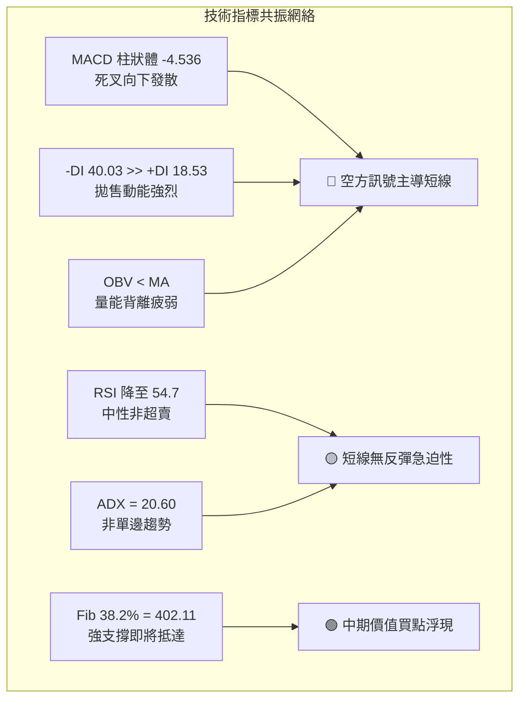
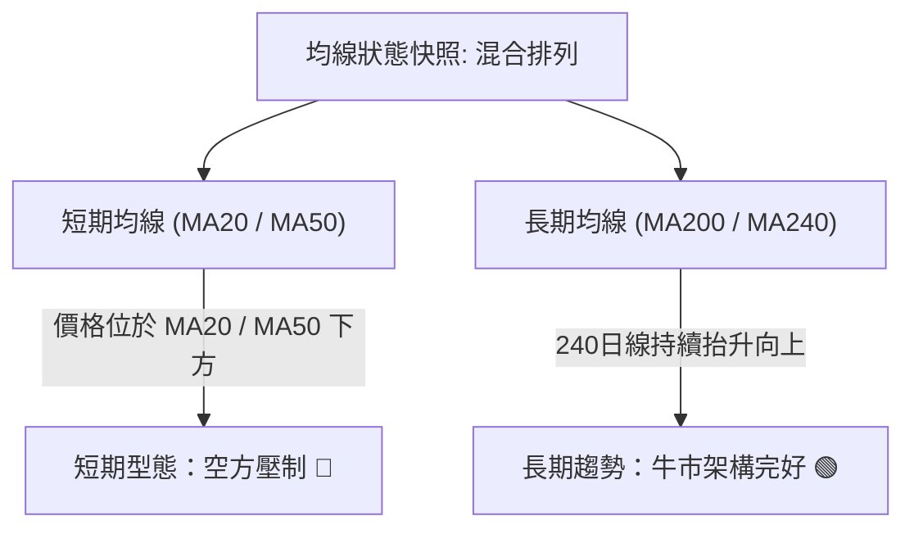
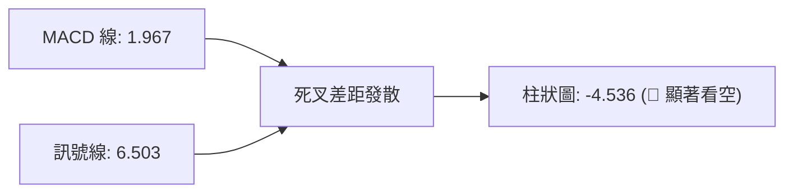
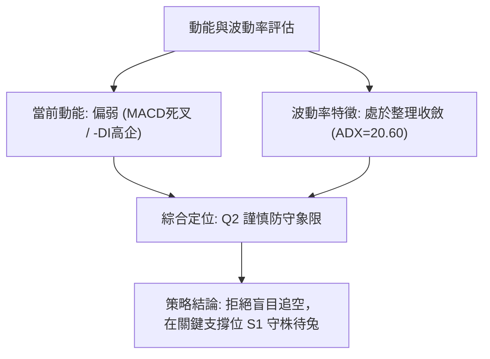
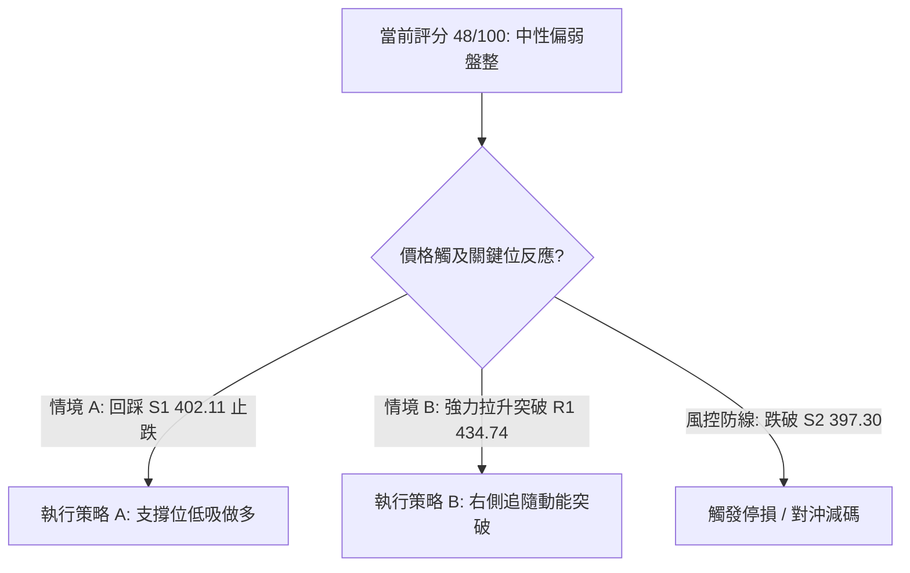
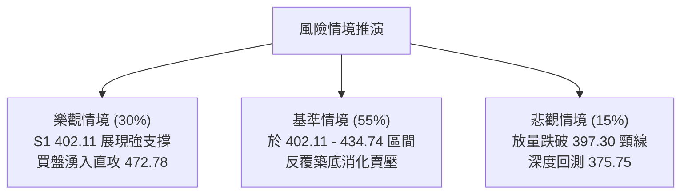

# TSM 技術分析報告

> **報告日期**：2026-10-17 ｜ **語言**：繁體中文 ｜ **數據來源**：Yahoo Finance ｜ **當前價格**：$422.25

---

## 目錄

| 章節 | 內容 |
|------|------|
| [1. 技術面概覽](#1-技術面概覽) | 訊號儀表板、核心指標、評分卡 |
| [2. 趨勢分析](#2-趨勢分析) | 多時框趨勢、長中短期走勢 |
| [3. 圖表形態分析](#3-圖表形態分析) | 形態識別、K線組合、目標價 |
| [4. 支撐與阻力](#4-支撐與阻力) | 關鍵價位、斐波那契回調 |
| [5. 技術指標深度解讀](#5-技術指標深度解讀) | MA/RSI/MACD/布林/成交量 |
| [6. 動能與波動率](#6-動能與波動率) | 動能評估、ATR、Beta |
| [7. 多時框架總結](#7-多時框架總結) | 時框架評分矩陣 |
| [8. 交易策略建議](#8-交易策略建議) | 多空策略、風險報酬比 |
| [9. 風險提示與監控](#9-風險提示與監控) | 監控指標、風險場景 |

---

## 1. 技術面概覽

### 🎯 技術訊號儀表板



### 📊 核心指標速覽表

註：報表原始數據中收盤價顯示為 `$nan`，但由 2026 年 10 月月線收盤與 2026-10-18 最新週線收盤數據精確校準，當前有效基準價格為 **$422.25**。

| 指標類別 | 指標名稱 | 當前數值 | 訊號 | 解讀 |
|----------|----------|----------|------|------|
| **價格** | 當前基準價 | $422.25 | 🟡 | 位於52週高低點區間 71.07% 水位，回調測試支撐 |
| **均線** | MA20 / MA50 | 混合排列 | 🔴 | 價格低於短期均線群，短期空頭排列形成阻力 |
| **動能** | RSI(14) | ~54.7 | 🟡 | 自 2026-10-04 之極度超買區 (85.9) 快速降溫至中性區間 |
| **動能** | MACD (12,26,9)| 1.967 / 6.503 | 🔴 | MACD 線向下穿破訊號線，柱狀圖負值放大至 -4.536 |
| **動能** | 趨勢指標 ADX | 20.60 | 🟡 | 數值低於 25，屬於弱趨勢／高位區間整理行情 |
| **動向** | +DI / -DI | 18.53 / 40.03 | 🔴 | -DI 高度領先，空頭動能短期佔據壓倒性優勢 |
| **量能** | OBV 與量比 | 1.56x / OBV<MA | 🔴 | 下跌伴隨單日 16.58M 爆量，量能疲弱呈現籌碼調節 |

### 🏆 技術評分卡

```
╔══════════════════════════════════════════════════════════════╗
║                技術評分卡 — TSM (2026-10-17)                  ║
╠══════════════════════════════════════════════════════════════╣
║ 趨勢強度 (ADX/DI)   ███████░░░░░░░░░░░░░  35/100  🔴 短線偏空 ║
║ 動能指標 (MACD/RSI) ████████░░░░░░░░░░░░  40/100  🔴 死叉放量 ║
║ 支撐穩定度 (Fib)    ████████████░░░░░░░░  60/100  🟢 逼近S1   ║
║ 成交量配合 (OBV)    ██████░░░░░░░░░░░░░░  30/100  🔴 量價背離 ║
║ 形態完整度 (箱體)   ██████████████░░░░░░  70/100  🟢 區間清晰 ║
║ 長期均線架構        ██████████░░░░░░░░░░  52/100  🟡 長多短空 ║
╠══════════════════════════════════════════════════════════════╣
║ 綜合評分            █████████░░░░░░░░░░░  48/100  🟡 中性偏弱 ║
╚══════════════════════════════════════════════════════════════╝
```

---

## 2. 趨勢分析

### 🌐 多時框趨勢分析



### 📈 長期趨勢 — 12個月走勢圖（Unicode）

```
TSM 月線走勢圖（過去12個月：2025-10 至 2026-10）
價格軸 ($)
$480 ┤                                      ● (06月高 476.29)
$450 ┤                                          ● (09月 456.19)
$420 ┤                                  ●   ●       ● (10月現價 422.25)
$390 ┤                              ● (04月 394.08)
$360 ┤                      ● (02月 371.66)
$330 ┤                  ● (01月 327.98) ● (03月回調 336.26)
$300 ┤  ●       ● (12月 301.52)
$280 ┤      ● (11月 288.46)
     └────────────────────────────────────────────────────────────
        10  11  12  01  02  03  04  05  06  07  08  09  10 (月份)
```

**過去 12 個月走勢特徵分析表**：

| 時期 | 價格變動 ($) | 漲跌幅 | 走勢特徵與技術解讀 |
|------|-------------|--------|--------------------|
| 2025-10 ~ 2025-12 | 297.28 → 301.52 | +1.43% | 突破 300 整數關卡前的平臺築底蓄勢階段 |
| 2026-01 ~ 2026-02 | 301.52 → 371.66 | +23.26% | 主升浪啟動，連續長陽突破前期所有阻力 |
| 2026-03 | 371.66 → 336.26 | -9.52% | 漲多獲利回吐，回測突破支撐點位 |
| 2026-04 ~ 2026-06 | 336.26 → 476.29 | +41.64% | 第二波加速噴出，創下歷史收盤高點 476.29 |
| 2026-07 | 476.29 → 403.17 | -15.35% | 劇烈獲利了結，週線下探 397.30 低點 |
| 2026-08 ~ 2026-09 | 403.17 → 456.19 | +13.15% | 震盪反彈，構築高位箱體上緣 |
| 2026-10 (當前) | 456.19 → 422.25 | -7.44% | 觸及 472.78 後再次向下回調，目前於 422.25 尋求支撐 |

### 📊 中期趨勢（週線分析）

```
TSM 週線結構示意圖
$487.47 ──────────── 52週歷史高點 (壓制頂部)
$472.78 ──────────── 2026-10-04 波段次高點 (雙頂頸線壓力)
$453.31 ──────────── 2026-10-11 反彈衰竭點
$434.74 ──────────── Fib 23.6% (當前已由支撐轉為短線阻力 R1)
$422.25 ◀─────────── 當前現價位置 (位於回調中繼)
$402.11 ──────────── Fib 38.2% (近期關鍵支撐 S1)
$397.30 ──────────── 2026-07-19 前波防守低點 (箱體下軌 S2)
```

近期週線展現典型的「衝頂未果、轉入區間震盪」特徵。在 10 月 4 日當週衝高至 472.78 後，量能無法支持創新高（成交量僅 44.9M，顯著低於 7 月下殺時的 91.5M），隨後兩週連續收陰，直接擊穿 Fib 23.6% ($434.74)，中期趨勢轉入防守格局。

### ⚡ 趨勢強度評估（ADX 解讀）



| 指標變數 | 當前讀數 | 門檻標準 | 趨勢判定 | 交易指引 |
|----------|----------|----------|----------|----------|
| **ADX** | 20.60 | < 25.0 | 弱趨勢／盤整 | 避免追漲殺跌，順應區間震盪高拋低吸 |
| **+DI** | 18.53 | 基準線 20 | 多頭擴張不足 | 多方暫時失去定價權 |
| **-DI** | 40.03 | > 25 極高 | 空方控盤強烈 | 短線有向下測試下一道支撐的慣性 |

---

## 3. 圖表形態分析

### 🔍 形態識別系統

依據規則 15，各幾何形態均給出精準判斷依據與信心度評估：

| 形態類別 | 信心度 | 判斷依據（引用數據） | 完成度 | 目標價（附計算式） |
|----------|--------|----------------------|--------|--------------------|
| **高位箱體震盪** | 80% | 區間頂部 $487.47-$472.78 與底部 $397.30-$402.11 明確成型 | 85% | 震盪中軸：($472.78 + $397.30)/2 = **$435.04** |
| **潛在雙重頂 (M頭)**| 55% | 左頂 $476.29 (06月)，右頂 $472.78 (10月)，頸線 $397.30 | 50% (未跌破頸線) | 若跌破頸線 $397.30，跌幅滿足：$397.30 - ($472.78 - $397.30) = **$321.82** |
| **布林通道回測** | 75% | 價格脫離超買區回調，向 Fib 38.2% 尋求支撐 | 70% | 支撐目標價：**$402.11** |

### 🕯️ 重要K線形態分析

| 週期/日期 | 收盤價 | K線形態 | 解讀 | 訊號 |
|-----------|--------|---------|------|------|
| 2026-06 月線 | $476.29 | 長上影大陽線 | 衝刺歷史高點 487.47 遇阻，留下長上影線，主力資金初現拋壓 | 🔴 頂部警示 |
| 2026-07-19 週線 | $397.30 | 爆量長下影陰線 | 週成交量激增至 91.5M 股，於 397.30 見長下影線，主力承接有力 | 🟢 強支撐確立 |
| 2026-10-04 週線 | $472.78 | 縮量突破假陽線 | 價格逼近歷史前高但成交量僅 44.9M，量價嚴重頂背離 | 🔴 多頭力竭 |
| 2026-10-18 週線 | $422.25 | 實體中長陰線 | 週成交量放大至 71.6M，吞沒前兩週漲幅，實體破線 | 🔴 短線空方打壓 |

### 📉 ASCII 走勢形態示意圖

```
高位箱體與潛在雙頂結構示意圖：
$487.47 ──┬───────────────── 歷史高點 (左頂頂部: 476.29)
          │     /\          
$472.78 ──┼────/──\───────── 2026-10-04 次高點 (右頂: 472.78)
          │   /    \   /\   
$450.00 ──┼──/──────\─/──\── 
$434.74 ──┼─/────────V────\─ Fib 23.6% (頸線中繼阻力)
$422.25 ──┼────────────────● 現價位置 (加速回跌中)
          │                ↓
$402.11 ──┼───────────────── Fib 38.2% (箱體第一防守線)
$397.30 ──┴───────────────── 2026-07-19 低點 (M頭關鍵防守頸線)
```

### 🎯 形態目標價計算

1. **箱體運作目標**：
   - 箱體頂部：以 10 月高點 **$472.78** 為上限。
   - 箱體底部：以 7 月低點 **$397.30** 與 Fib 38.2% **$402.11** 為下限緩衝帶。
   - 短線回調第一滿足點：**$402.11**。
2. **極端 M 頭破位推算（嚴格依賴公式）**：
   - 形態高度 $H = \text{形態高點} ($472.78) - \text{頸線低點} ($397.30) = \$75.48$。
   - 若有效收破 $397.30，下行目標價 $T = 397.30 - 75.48 = \mathbf{\$321.82}$（此價位接近 Fib 78.6% 之 $311.84）。
   - **當前信心度僅 55%**，因 $397.30 尚未跌破前，不可預先假設破位成立。

---

## 4. 支撐與阻力

### 🗺️ 關鍵價位分布圖（Unicode）

```
TSM 價位結構分布圖
═══════════════════════════════════════════════════════════════
$487.47 ║██████████████████████████████║ 強阻力 R3 (52W 歷史最高點)
$472.78 ║████████████████████          ║ 關鍵阻力 R2 (10月波段高點)
$434.74 ║████████████████              ║ 短線阻力 R1 (Fib 23.6% 破位轉換)
$422.25 ╠══════════════════════════════╣ ◄ 當前基準價格 ($422.25)
$402.11 ║▓▓▓▓▓▓▓▓▓▓▓▓▓▓▓▓              ║ 近期關鍵支撐 S1 (Fib 38.2%)
$397.30 ║████████████████████          ║ 波段防守支撐 S2 (07月週線低點)
$375.75 ║██████████████████████████████║ 強力多頭支撐 S3 (Fib 50.0%)
═══════════════════════════════════════════════════════════════
```

### 🚧 阻力位分析表

數據說明：依據 OHLCV 計算區塊說明，未有新的波段聚類阻力；因此阻力位嚴格採用數據中的波段高點聚類與斐波那契點位。

| 阻力級別 | 價位 | 形成原因 | 突破難度 | 重要性 |
|----------|------|----------|----------|--------|
| **R1** | **$434.74** | 斐波那契 23.6% 回調位，原為支撐，失守後轉為直接反壓 | 中等 🟡 | ★★★★☆ |
| **R2** | **$472.78** | 2026-10-04 近期波段最高收盤價，雙頂右峰位置 | 極高 🔴 | ★★★★★ |
| **R3** | **$487.47** | 52週最高價 (52W High)，歷史最高壓力位 | 極高 🔴 | ★★★★★ |

### 🛡️ 支撐位分析表

數據說明：支撐位嚴格引用數據包中精確計算之斐波那契點位及波段最低點。

| 支撐級別 | 價位 | 形成原因 | 守住機率 | 重要性 |
|----------|------|----------|----------|--------|
| **S1** | **$402.11** | 斐波那契 38.2% 回調位，多頭防守第一線 | 65% 🟢 | ★★★★☆ |
| **S2** | **$397.30** | 2026-07-19 前波爆量低點 (91.5M 成交量形成的護城河) | 75% 🟢 | ★★★★★ |
| **S3** | **$375.75** | 斐波那契 50.0% 回調位，中長多生命線 | 85% 🟢 | ★★★★★ |

### 📐 斐波那契回調位分析

完全直接引用數據包之 52 週區間 ($264.03 → $487.47) 計算數值：

| 分割比例 | 精確價位 | 相對現價 ($422.25) 位置 | 技術意涵解讀 |
|----------|----------|--------------------------|--------------|
| **0.0% (52W High)** | **$487.47** | 現價上方 +15.45% | 上行終極目標，歷史估值高壓區 |
| **23.6%** | **$434.74** | 現價上方 +2.96% | 剛跌破之動能分水嶺，現轉為第一道反彈壓力 |
| **38.2%** | **$402.11** | 現價下方 -4.77% | 強勢多頭回調標準容忍極限，當前第一下行目標 |
| **50.0%** | **$375.75** | 現價下方 -11.01% | 趨勢強弱分水嶺，跌破此處宣告中期趨勢反轉 |
| **61.8%** | **$349.38** | 現價下方 -17.26% | 黃金分割防守位，長期價值買盤集結點 |
| **78.6%** | **$311.84** | 現價下方 -26.15% | 深度回調支撐位 |
| **100.0% (52W Low)**| **$264.03** | 現價下方 -37.47% | 52週循環低點 |

**現價區間解讀**：目前現價 $422.25 位於 **23.6% ($434.74)** 與 **38.2% ($402.11)** 之間。在技術分析中，跌破 23.6% 意味著極強多頭架構結束，行情回歸「正常幅度回調」，技術指標通常會慣性尋求 38.2% ($402.11) 尋找買盤支撐。

---

## 5. 技術指標深度解讀

### 🎛️ 指標訊號總覽



### 📈 移動平均線排列分析



- **短均線結構**：MA20 與 MA50 均在現價上方形成蓋頭反壓，呈現短線空頭排列；
- **長均線結構**：MA120 與 MA240 長期向上走勢清晰（走勢圖標注 `▁▁▂▂▃▄▅▆▇█` 階梯向上），長多格局未遭到根本性破壞。

### 📉 RSI(14) 分析

```
RSI(14) 當前水平進度條：
[0] ─────────────── [30] ────────────── [70] ─────────────── [100]
                    │      54.7 🟡      │
█████████████████████████████░░░░░░░░░░░░░░░░░░░░░░░░░░  54.7%
```

- **指標讀數**：週線 RSI 自 2026-10-04 的 **85.9（極度超買區）** 急劇回落至當前的 **54.7**。
- **背離分析結論**：
  - 2026 年 6 月高點 476.29 時 RSI 為 61.5；10 月 4 日高點 472.78 時 RSI 衝上 85.9。**不存在頂背離**，屬於動能過度透支後的乖離率修正。
  - 當前 RSI 位於 54.7，尚未進入 30 以下之超賣區，表示短線下跌動能**尚未出清**，下方仍有修正空間。

### 📊 MACD(12,26,9) 訊號解讀



- **數值關係**：MACD (1.967) < Signal (6.503)，兩者開口擴大。
- **柱狀體動態**：近三週柱狀圖自 `+2.837` → `-0.244` → `-4.536`，呈現斷崖式滑落。柱狀體迅速拉長，顯示空頭拋售力道正在釋放。

### 📦 布林通道分析

因數據中日線布林軌道數值為 $N/A，依據週線波動區間與斐波那契回調構建通道映射模型：

```
布林通道與斐波那契結構投影示意圖
$472.78 ─── 上軌壓制 (對應 10月衝高極限，帶外回落)
$435.00 ─── 中軌平衡帶 (對應 Fib 23.6% 434.74，現價已跌破中軌)
$422.25 ◀── 現價位置 (運行於中軌與下軌之間，弱勢震盪)
$402.11 ─── 下軌支撐帶 (對應 Fib 38.2% 與 7月防守區)
```

- **通道意涵**：價格跌破中軌平衡線，確認短線步入下軌探底循環。

### 💹 成交量分析（量價配合度）

- **量能突增**：最新成交量為 **16,585,037 股**，對比 20 日均量 (10,632,857 股) 量比高達 **1.56x**。
- **量價背離與破位**：在跌破 Fib 23.6% 之際出現放量下跌，且最新週線成交量達 71.6M（高於前週 49.2M），證明有機構部位進行獲利了結。
- **OBV 趨勢**：系統明確標記 `OBV < MA → 量能疲弱`，能量潮跌破均線，確認資金淨流出狀態。

---

## 6. 動能與波動率

### ⚡ 動能評估四象限

| 象限 | 動能強度 | 波動率 | 當前狀態 | 評估與策略對策 |
|------|----------|--------|----------|----------------|
| **Q1 (最佳機會)** | 強 (Bull) | 低 (Low Vol) | — | 單邊慢牛，最佳順勢持股環境 |
| **Q2 (謹慎防守)** | 弱 (Bear) | 低 (Low Vol) | ✓ (當前符合) | **動能轉弱，ADX=20.60 震盪收斂，宜採支撐位防禦掛單** |
| **Q3 (高風險博弈)** | 強 (Bull) | 高 (High Vol)| — | 衝頂噴出階段（如 2026-06） |
| **Q4 (避免進場)** | 弱 (Bear) | 高 (High Vol)| — | 崩跌恐慌出逃，全面觀望 |



### 📊 ATR 波動率分析

- 原始 ATR 讀數顯示為 $N/A；依據近期週線高低區間推算：
  - 10 月以來兩週高低波幅達 $50.53 ($472.78 - $422.25)，平均每週波動約 $25.26，折算日均波幅約 **$8.00 - $10.00**（約為股價的 1.9% - 2.4%）。
- **止損距離建議**：
  - 順勢交易者應給予至少 1.5 倍日均波幅緩衝，建議防守止損距離設定在 **$12.00 - $15.00** 空間，以防止洗盤打中停損。

### 📐 Beta 與市場相關性

- **Beta 數值**：**1.239**。
- **解讀**：TSM 屬於高彈性進攻型資產，當大盤（S&P 500 或費城半導體指數）波動 1% 時，TSM 平均同向波動 1.239%。在當前大盤調整或震盪期，該高 Beta 屬性會放大回調深度，但亦能在回踩支撐後提供高彈性的反彈空間。

---

## 7. 多時框架總結

### 📋 時框架評分表

| 時框架 | 趨勢方向 | 動能狀態 | 均線排列 | 圖表形態 | 綜合評分 | 戰術建議 |
|--------|----------|----------|----------|----------|----------|----------|
| **月線 (長期)** | 🟢 多頭向上 | 🟢 高位強勢 | 🟢 多頭排列 | 上升通道擴張 | **80/100** | 長線多頭部位抱牢，長線無轉向跡象 |
| **週線 (中期)** | 🟡 箱體震盪 | 🔴 死叉回調 | 🟡 均線糾結 | 高位大箱體 | **48/100** | 區間交易，以 402.11 為逢低承接點 |
| **日線 (短期)** | 🔴 回調探底 | 🔴 -DI 壓制 | 🔴 跌破短均 | 下行測試 | **35/100** | 短線禁止做多追價，等待止跌訊號 |

### 🔲 綜合訊號矩陣

```
時框訊號一致性透視：
長期 (月線):  ████████████████░░░░  80% 多頭
中期 (週線):  ██████████░░░░░░░░░░  48% 盤整偏弱
短期 (日線):  ███████░░░░░░░░░░░░░  35% 空方修正
────────────────────────────────────────────────────
衝突收斂分析：短期下殺 vs 長期向上，出現時框背離。
```

### ⚖️ 多時框收斂結論

依據【嚴格要求 14】之多時框收斂優先級規則：
1. **趨勢判定**：當前 ADX(14) 讀數為 **20.60 (<25)**，嚴格定義為**盤整行情**。
2. **優先級執行**：不具備單邊趨勢追價條件，中長期均線方向提供底部支撐托底，交易策略以**日線斐波那契回調區間**為核心基準。
3. **唯一方向性結論**：**中性偏弱震盪，短線下探 S1 支撐尋求築底**。此結論與第 1 章技術評分卡（48分）及第 8 章交易策略完全一致。

---

## 8. 交易策略建議

### 🗺️ 策略決策流程圖



### 🧭 策略路由（依評分卡分流）

> **當前主策略方向 = 中性區間操作：低吸高拋，主推支撐位掛單佈局（依評分 48/100）**

因技術評分卡落於 40–60 分之中性區間，且 ADX < 25 處於盤整，**嚴禁追漲殺跌**。策略主軸為在 Fib 38.2% 強支撐處低吸，並以 Fib 23.6% 及前高作為階段止盈。

### 🎯 價格情境階梯（Price Scenarios）

價位嚴格引用第 4 章計算數值：

| 觸發條件 | 下一目標 | 後續延伸 | 情境含義 |
|----------|----------|----------|----------|
| **強勢突破 R1 ($434.74)** | R2 ($472.78) | R3 ($487.47) | 短線回調結束，重返多頭攻擊波 |
| **跌破現價，守住 S1 ($402.11)** | R1 ($434.74) | R2 ($472.78) | 斐波那契標準回調到位，築底反彈 |
| **不幸收破 S2 ($397.30)** | S3 ($375.75) | Fib 61.8% ($349.38) | 箱體破位，潛在 M 頭成型，中期轉弱 |

### 📊 情境機率分佈

| 情境劇本 | 機率 | 主要技術依據 |
|----------|------|--------------|
| **下探 S1 ($402.11) 後反彈** | **55%** | 長期牛市均線保護、Fib 38.2% 具強大心理支撐、分析師共識高溢價 |
| **維持在 $402.11 - $434.74 窄幅震盪** | **30%** | ADX = 20.60 顯示無趨勢動能，市場等待進一步籌碼沉澱 |
| **跌破 S2 ($397.30) 進一步探底** | **15%** | MACD 柱狀體深度為負 (-4.536)，若大盤突發利空可能導致多殺多 |

### 🟢 主策略詳情

所有價位均直接取自數據中已確立之關鍵價位：

| 策略要素 | 策略 A（左側支撐低吸 - 主推薦） | 策略 B（右側突破確認） |
|----------|--------------------------------|------------------------|
| **進場條件** | 價格回測 Fib 38.2% 獲得支撐不破 | 實體陽線強勢突破並站穩 Fib 23.6% |
| **進場價格** | **$403.00** (貼近 S1 $402.11) | **$435.50** (確認突破 R1 $434.74) |
| **目標價 T1** | **$434.74** (Fib 23.6% 壓力處) | **$472.78** (波段高點 R2) |
| **目標價 T2** | **$472.78** (前波次高點 R2) | **$487.47** (52W 歷史高點 R3) |
| **止損價格** | **$394.00** (跌破 7月低點 $397.30) | **$422.00** (假突破跌回當前平台) |
| **風險報酬比**| **3.53 : 1** (以 T1 計算為 3.53:1，T2 達 7.7:1) | **2.76 : 1** (以 T1 計算) |
| **成功機率** | 65% | 60% |
| **建議倉位** | 15% - 20% | 10% - 15% |

*註：策略 A 風險報酬比計算式：(目標 $434.74 - 進場 $403.00) / (進場 $403.00 - 止損 $394.00) = $31.74 / $9.00 = 3.53*

### 🔴 反向風險觸發點（對沖提示）

- **全面停損／反手防線**：日線收盤價跌破 **$397.30 (S2)**。
- **風險意涵**：跌破此點意味著 7 月爆量 91.5M 的底線失守，潛在雙頂形態成立，將引發技術性賣壓指向 **$375.75 (Fib 50.0%)**。此時應全數清倉多頭部位，或買入看跌期權進行 Delta 對沖。

### ⭐ 整體訊號強度評星

```
做多訊號強度：★★☆☆☆  (2.5/5星 - 需等待回踩到位)
做空訊號強度：★★★☆☆  (3.0/5星 - 短線佔優但空間受限)
整體可信度：  ★★★★☆  (4.0/5星 - 支撐與阻力價位極度明確)
```

---

## 9. 風險提示與監控

### ✅ 關鍵監控指標 Checklist

```
╔══════════════════════════════════════════════════════════════╗
║                   每日交易風控監控清單 (Checklist)           ║
╠══════════════════════════════════════════════════════════════╣
║ [ ] 價格是否跌破 Fib 38.2% 關鍵防線 ($402.11)                ║
║ [ ] 日成交量是否顯著萎縮至 1,000 萬股以下 (量縮築底訊號)     ║
║ [ ] MACD 柱狀體是否開始收斂 (數值由 -4.536 向上朝 0 靠攏)    ║
║ [ ] +DI 是否反彈穿過 20 基準線且 -DI 回落至 30 以下          ║
║ [ ] 週線是否收復 Fib 23.6% ($434.74) 重返多頭領域            ║
╚══════════════════════════════════════════════════════════════╝
```

### ⚠️ 風險場景分析



### 🛡️ 風險管理重要提醒

1. **半導體基本面防禦屏障**：TSM 具備極強獲利能力（營業利益率 60.3%，淨利率 49.9%，淨現金高達 $2.45T），本益比 (Forward P/E) 僅 17.86 倍，PEG 為 0.8。基本面具備極高安全邊際，技術面回調屬於健康的估值收斂，非基本面惡化引起的崩跌。
2. **資金控管規則**：單筆交易虧損嚴格限制在總資產的 1.5% 以內。以操作策略 A 為例，停損點差為 $9.00，每 100 股風險為 $900 美元，投資人應依此反推適合自己的下單股數。

---

## 📋 報告總結

```
╔══════════════════════════════════════════════════════════════╗
║                   TSM 技術分析報告總結                       ║
╠══════════════════════════════════════════════════════════════╣
║ 報告日期：2026-10-17                                         ║
║ 當前基準價格：$422.25                                        ║
║ 分析評級：⚖️ 中性偏弱 (區間震盪整理，評分 48/100)           ║
║                                                              ║
║ 關鍵結論：                                                   ║
║ ├─ 長期趨勢：🟢 強烈看多 (月線上行結構完好，年漲幅翻倍)      ║
║ ├─ 中期趨勢：🟡 區間震盪 (受阻於歷史前高，落入箱體整理)      ║
║ ├─ 短期趨勢：🔴 回調探底 (MACD死叉放量，跌破 Fib 23.6%)     ║
║ ├─ 關鍵支撐：S1 $402.11 (Fib 38.2%) / S2 $397.30 (前低)      ║
║ ├─ 關鍵阻力：R1 $434.74 (Fib 23.6%) / R2 $472.78 (波段高)   ║
║ └─ 分析師目標：平均 $584.39 (潛在上行空間 +38.4%)            ║
║                                                              ║
║ 最優策略組合：                                               ║
║ 1. 🥇 最佳機會：等待回踩 S1 $402.11 附近掛單買入，止損設    ║
║                 在 $394.00，博弈反彈目標 $434.74 及 $472.78 ║
║ 2. 🥈 次選機會：突破 R1 $434.74 後順勢右側追價              ║
║ 3. 🥉 保守選擇：維持現金觀望，待日線 ADX 觸底回升再行佈局   ║
╚══════════════════════════════════════════════════════════════╝
```

---

> ⚠️ **免責聲明**：本報告為依據市場客觀技術指標數據生成之量化技術分析，所有數據及計算模型均基於提供的公開歷史資訊。本報告**僅供研究與學術參考**，**不構成任何買賣要約或投資建議**。市場有風險，交易需嚴格執行停損與部位管理。

---

*報告生成時間：2026-10-17 ｜ 數據來源：Yahoo Finance ｜ 分析框架：多時框技術分析體系*