# TSM 技術分析報告

> **報告日期**：2026-10-18 ｜ **語言**：繁體中文 ｜ **數據來源**：Yahoo Finance ｜ **當前價格**：$412.61

---

## 目錄

| 章節 | 內容 |
|------|------|
| [1. 技術面概覽](#1-技術面概覽) | 訊號儀表板、核心指標、評分卡 |
| [2. 趨勢分析](#2-趨勢分析) | 多時框趨勢、長中短期走勢 |
| [3. 圖表形態分析](#3-圖表形態分析) | 形態識別、K線組合、目標價 |
| [4. 支撐與阻力](#4-支撐與阻力) | 關鍵價位、斐波那契回調 |
| [5. 技術指標深度解讀](#5-技術指標深度解讀) | MA/RSI/MACD/布林/成交量 |
| [6. 動能與波動率](#6-動能與波動率) | 動能評估、ATR、Beta |
| [7. 多時框架總結](#7-多時框架總結) | 時框架評分矩陣 |
| [8. 交易策略建議](#8-交易策略建議) | 多空策略、風險報酬比 |
| [9. 風險提示與監控](#9-風險提示與監控) | 監控指標、風險場景 |

---

## 1. 技術面概覽

### 🎯 技術訊號儀表板

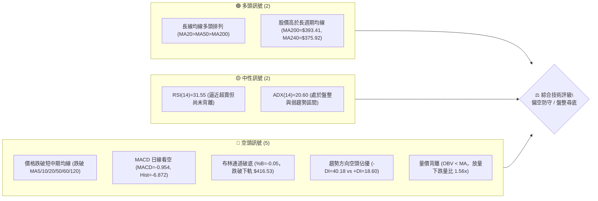

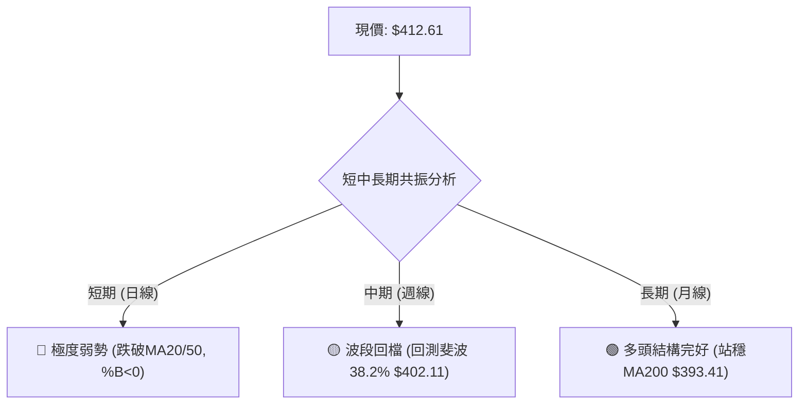

### 📊 核心指標速覽表

| 指標類別 | 指標名稱 | 當前數值 | 訊號 | 解讀 |
|----------|----------|----------|------|------|
| **價格** | 當前價格 | $412.61 | 🔴 | 位於 52 週區間 66.5%，較近期高點 $472.78 回檔 -12.73% |
| **均線** | MA20 | $452.47 | 🔴 | 價格低於 MA20 達 -8.81%，短期趨勢受制於下彎中軌 |
| **均線** | MA50 | $433.75 | 🔴 | 價格低於 MA50 達 -4.87%，中期支撐轉化為上方壓制區 |
| **均線** | MA200 | $393.41 | 🟢 | 價格高於長期生命線 +4.88%，牛市長期底線未失守 |
| **動能** | RSI(14) | 31.55 | 🟡 | 逼近 30 超賣臨界點，空頭動能衰竭前兆，無明顯背離 |
| **動能** | MACD | -0.954 | 🔴 | 跌破零軸，Signal=5.918，Hist=-6.872，綠柱持續擴散 |
| **擺動** | KD (%K/%D)| 6.82 / 9.64 | 🟢 | 進入個位數深度超賣區，短線隨時孕育超跌技術反彈 |
| **趨勢** | ADX(14) | 20.60 | 🟡 | 弱趨勢/盤整格局（<25），空方主導（-DI 40.18 > +DI 18.60）|
| **通道** | 布林通道 | %B = -0.05 | 🔴 | 突破下軌 $416.53，處於超賣超跌擴張態勢 |
| **量能** | OBV / 量比 | 1.56x / 疲弱| 🔴 | 成交量 16.64M 高於均量，放量殺跌，OBV 跌破均線驗證弱勢 |
| **波動** | ATR(14) | $12.59 | 🟡 | 佔現價 3.05%，日均震盪幅度顯著放大，波幅偏高 |

### 🏆 技術評分卡

```
╔══════════════════════════════════════════════════════════════════╗
║                    技術評分卡 — TSM (2026-10-18)                ║
╠══════════════════════════════════════════════════════════════════╣
║ 趨勢強度 (ADX/DI)   ██████░░░░░░░░░░░░░░  30/100  🔴 空頭控盤    ║
║ 動能指標 (RSI/MACD) ████░░░░░░░░░░░░░░░░  20/100  🔴 強烈看空    ║
║ 支撐穩定度 (S1/S2)  ████████████░░░░░░░░  60/100  🟡 臨近S1考驗  ║
║ 成交量配合 (OBV/VOL)██████░░░░░░░░░░░░░░  30/100  🔴 帶量破位    ║
║ 形態完整度 (波段架構)██████████░░░░░░░░░░  50/100  🟡 區間震盪跌破║
║ 均線排列 (多空結構) ████████░░░░░░░░░░░░  40/100  🔴 短均全面倒掛║
╠══════════════════════════════════════════════════════════════════╣
║ 綜合技術評分        ███████░░░░░░░░░░░░░  38/100  🔴 偏空防守    ║
╚══════════════════════════════════════════════════════════════════╝
```

---

## 2. 趨勢分析

### 🌐 多時框趨勢分析

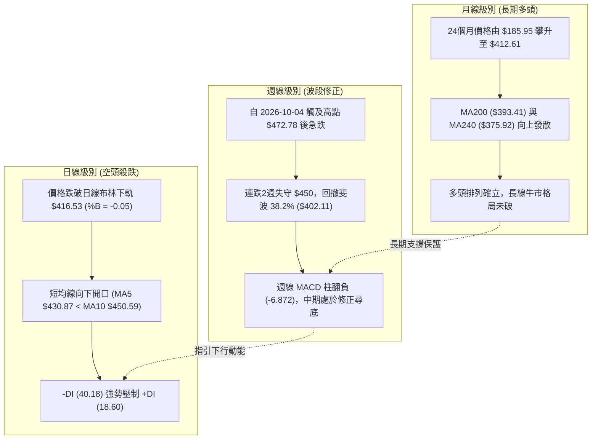

### 📈 長期趨勢 — 12個月走勢圖（Unicode）

```
TSM 月線走勢圖（過去12個月：2025-11 至 2026-10）
價格軸 ($)
$480 ┤                                              ● (06月高點 $476.29)
$450 ┤                                        ●           ● (09月 $456.19)
$420 ┤                                  ●           ●           ●←當前現價 $412.61
$390 ┤                            ●           ●
$360 ┤                      ●
$330 ┤                ●           ●
$300 ┤          ●
$270 ┤    ●
     └────┬─────┬─────┬─────┬─────┬─────┬─────┬─────┬─────┬─────┬─────┬─────
         11月  12月  01月  02月  03月  04月  05月  06月  07月  08月  09月  10月
        '25   '25   '26   '26   '26   '26   '26   '26   '26   '26   '26   '26
```

#### 走勢特徵分析表格

| 階段 | 時間區間 | 起始價 → 結束價 | 區間漲跌幅 | 主要走勢特徵 |
|------|----------|-----------------|------------|--------------|
| **第1階段：主升推升** | 2025-11 → 2026-02 | $288.46 → $371.66 | +28.84% | 單邊主升浪，成交量平穩放大，均線呈標準多頭發散 |
| **第2階段：高位洗盤** | 2026-02 → 2026-03 | $371.66 → $336.26 | -9.52%  | 急速下探回測季線支撐，隨後快速收復失地 |
| **第3階段：二次衝頂** | 2026-03 → 2026-06 | $336.26 → $476.29 | +41.64% | 創下歷史波段天價，多頭動能達到極致，隨後見頂回落 |
| **第4階段：高檔箱體** | 2026-06 → 2026-09 | $476.29 → $456.19 | -4.22%  | 於 $400 - $470 展開大級別箱體震盪，波動加劇 |
| **第5階段：破位回調** | 2026-09 → 2026-10 | $456.19 → $412.61 | -9.55%  | 自 10 月初 $472.78 急速下殺，現正考驗 $406.43 支撐 |

### 📊 中期趨勢（週線分析）

```
TSM 近20週核心波段壓力與支撐圖解
══════════════════════════════════════════════════════════════════
$487.47 ────────────────────────────────────── 52週歷史高點 (波段頂部)
$472.78 ───────────────●────────────────────── 2026-10-04 局部高點 (R3區間延伸)
$452.47 ───────────────────────[MA20/BB中軌]── 短期下行反彈第一強阻力
$431.68 ───────────────────────[阻力 R2]────── 20週均線聚集處
$419.86 ───────────────────────[阻力 R1]────── 前週跳空跌破點 / BB下軌附近
$412.61 ◄───[當前價格] (週線帶長陰線下探)
$406.43 ───────────────────────[支撐 S1]────── 7-8月波段密集底部區間
$402.11 ───────────────────────[斐波 38.2%]─── 52週多頭黃金防守位
$393.41 ───────────────────────[MA200 長期線]─ 終極多空分水嶺
══════════════════════════════════════════════════════════════════
```

### ⚡ 趨勢強度評估（ADX 解讀）

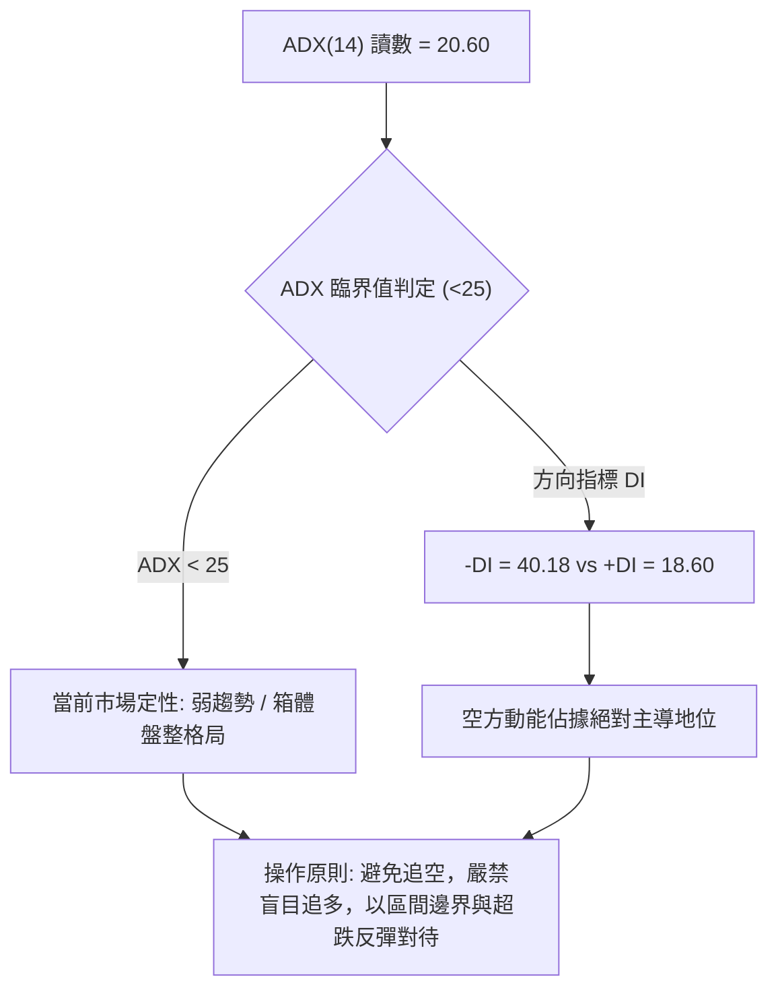

#### ADX 趨勢強度對照解讀

| 指標 | 數值 | 區間分類 | 技術解讀 |
|------|------|----------|----------|
| **ADX(14)** | 20.60 | 弱趨勢 / 盤整 (<25) | 趨勢動能不具備單邊持續爆發力，市場處於大級別震盪整理帶，波段下殺逼近極限區 |
| **+DI** | 18.60 | 多方衰退 (<20) | 多頭買盤力道潰退，短線缺乏主動推升動能 |
| **-DI** | 40.18 | 空方主導 (>40) | 空頭主導單邊下挫，空方賣壓達到波段過熱閾值，需提防短線空頭力竭反抽 |

---

## 3. 圖表形態分析

### 🔍 形態識別系統

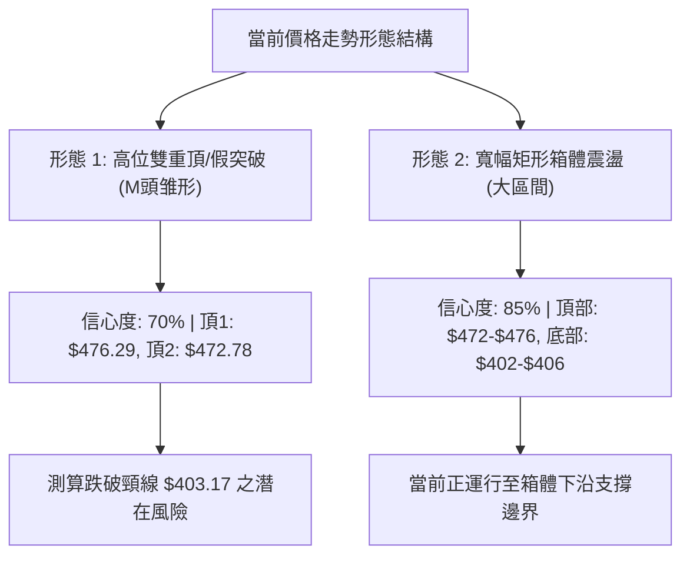

#### 圖表形態信心度與目標價評估表

| 形態 | 信心度 | 判斷依據（引用數據） | 完成度 | 目標價（附計算式） |
|------|--------|----------------------|--------|--------------------|
| **雙重頂 (M頭雏形)** | 70% | 左頂 $476.29 (2026-06)，右頂 $472.78 (2026-10-04)；頸線位於 2026-08-02 週收盤低點 $403.17 | 75% | 若有效跌破頸線 $403.17：<br>形態高度 = $472.78 - $403.17 = $69.61<br>理論測幅低點 = $403.17 - $69.61 = $333.56（中期強防守則看斐波 50% $375.75 與 S3 $371.72） |
| **高位矩形箱體** | 85% | 箱頂聚類於 $472.78 - $476.29；箱底聚類於 7-8 月波段低點 $397.30 - $403.17，現價逼近箱體下沿 | 90% | 區間震盪反彈目標：<br>第一步回測箱體中軸 MA20 $452.47 或 R2 $431.68 |
| **下降通道（短線）** | 60% | 10月自高點快速滑落，日線連續下挫，跌破布林下軌 $416.53 | 80% | 由通道下軌超賣反彈，目標為回抽回通道上軌阻力 R1 $419.86 |

### 🕯️ 重要K線形態分析

| 日期/月份 | 收盤價 | K線形態 | 解讀 | 訊號 |
|-----------|--------|---------|------|------|
| **2026-06** | $476.29 | 頂部長上影大陽線 | 多頭竭盡全力衝高至 $487.47 後遭空頭伏擊回落，構成歷史頭部阻力 | 🔴 見頂訊號 |
| **2026-07** | $403.17 | 長黑實體大陰線 | 單月重挫 -15.35%，下探尋求 MA120/MA200 支撐，確立波段箱體下沿 | 🔴 破位重挫 |
| **2026-08** | $414.21 | 縮量十字星陀螺頂 | 於 $400 整數大關獲買盤抵抗，多空在此達成短暫弱平衡 | 🟡 止跌企穩 |
| **2026-09** | $456.19 | 反彈中陽線 | 自底部展開強勁反彈，但未能越過 6 月高點，形成次高點 | 🟢 多頭反撲 |
| **2026-10-04 週**| $472.78 | 衝高受阻流星線 | RSI 飆至 85.9 極度超買，週線衝高回落，構成實質右肩/右頂 | 🔴 動能衰竭 |
| **2026-10-18 週**| $412.61 | 放量大陰線收最低 | 週線大跌 -8.98%，長黑下灌摜破 MA5/MA20/MA50，空頭全線摜壓 | 🔴 空方控盤 |

### 📉 ASCII 走勢形態示意圖

```
TSM 高檔雙頂與箱體結構示意圖
價格軸
$487.47 ┬───● 52W High (06月高點 $476.29)
        │    │                                    ● 右頂 ($472.78)
$450.00 ┼────┼──────────── 頸線阻力 R3 $445.50 ────╱───────
        │    │                                  ╱  ╲
$430.00 ┼────┼──────────── 箱體中軸阻力 R2 $431.68 ─╱────╲──
        │     ╲                                ╱      ╲
$412.61 ┼──────╲──────────────────────────────╱────────●◄ 現價 $412.61 (逼近下軌)
$406.43 ┼───────╲─────── 波段低點聚類 S1 $406.43 ─────── (考驗支撐)
$403.17 ┴────────● 箱體頸線支撐 (07-08月低點 $397.30 - $403.17)
```

### 🎯 形態目標價計算

根據雙重頂雛形之測算：
- **頂部基準價**：$472.78（2026-10-04 高點）
- **頸線基準價**：$403.17（2026-08-02 低點）
- **形態垂直幅度**：$472.78 - $403.17 = $69.61
- **下行第一滿足目標 (S1)**：$406.43（直接引用關鍵支撐 S1）
- **若頸線失守之下行第二測幅目標**：$403.17 - $69.61 = $333.56
  - *路徑關鍵節點*：中途將依序接受 斐波那契 50.0% 回調位 **$375.75** 以及關鍵支撐 **S3 $371.72** 的強烈支撐驗證。

---

## 4. 支撐與阻力

### 🗺️ 關鍵價位分布圖（Unicode）

```
TSM 價位結構分布圖
═══════════════════════════════════════════════════════════════
$487.47 ║████████████████████████████████║ 52W 歷史極值高點
$452.47 ║████████████████████████        ║ MA20 下彎動態反壓
$445.50 ║████████████████████            ║ 強阻力 R3 (密集解套套牢區)
$434.74 ║████████████████                ║ 斐波那契 23.6% 回調位
$431.68 ║██████████████                  ║ 中級阻力 R2 (反彈第一目標)
$419.86 ║████████                        ║ 短線反抽阻力 R1 (布林下軌/前跳空)
$412.61 ╠════════════════════════════════╣ ◄ 當前市價 ($412.61)
$406.43 ║▓▓▓▓▓▓▓▓▓▓▓▓                    ║ 近期關鍵支撐 S1 (近一年波段低點聚類)
$402.11 ║▓▓▓▓▓▓▓▓▓▓▓▓▓▓▓▓                ║ 斐波那契 38.2% 黃金防守位
$393.41 ║▓▓▓▓▓▓▓▓▓▓▓▓▓▓▓▓▓▓▓▓            ║ MA200 牛熊分水嶺
$384.06 ║████████████████████████        ║ 強支撐 S2 (波段深度回測低點)
$375.75 ║██████████████████████████      ║ 斐波那契 50.0% 回調位
$371.72 ║████████████████████████████    ║ 極強支撐 S3 (MA240/密集換手區)
═══════════════════════════════════════════════════════════════
```

### 🚧 阻力位分析表

所有價位均直接引用自關鍵價位聚類與均線計算數值：

| 阻力級別 | 價位 | 形成原因 | 突破難度 | 重要性 |
|----------|------|----------|----------|--------|
| **阻力 R1** | **$419.86** | 近一年波段高點聚類下緣、布林帶下軌突破後的動態反壓區 | 🟡 中等 | 短線止跌轉強第一觀察點，收復則意味超賣修復展開 |
| **阻力 R2** | **$431.68** | 近一年波段高點聚類中軌、緊鄰 MA5 ($430.87) 與 MA50 ($433.75) | 🔴 高 | 中期多空平衡點，空頭波段防守的第一道重兵陣地 |
| **阻力 R3** | **$445.50** | 波段高點聚類上緣、緊鄰 MA20 ($452.47)，為 10 月初套牢籌碼峰 | 🔴 極高 | 波段強弱分水嶺，未放量站穩前中期弱勢格局不變 |

### 🛡️ 支撐位分析表

所有價位均直接引用自關鍵價位聚類數值：

| 支撐級別 | 價位 | 形成原因 | 守住機率 | 重要性 |
|----------|------|----------|----------|--------|
| **支撐 S1** | **$406.43** | 近一年波段低點聚類核心、緊鄰 2026-07 至 08 月多次打底低點 | 🟢 65% | 短線生命線，距現價僅 -1.50%，若跌破將觸發停損賣壓 |
| **支撐 S2** | **$384.06** | 波段深度下探低點聚類，接近 MA200 ($393.41) 緩衝保護區 | 🟢 75% | 中期牛市防守陣線，具備極強的長線價值買盤承接力道 |
| **支撐 S3** | **$371.72** | 近一年波段極限低點聚類、斐波那契 50% ($375.75) 疊加 MA240 ($375.92) | 🟢 90% | 長期多頭終極底線，跌破則宣告長期牛市上升趨勢終結 |

### 📐 斐波那契回調位分析

基準區間：52週波段低點 **$264.03** → 52週歷史高點 **$487.47**，總波幅 $223.44。

| 斐波那契比例 | 價位 | 技術意涵與現價位置解讀 |
|--------------|------|------------------------|
| **0.0% (52W High)** | **$487.47** | 歷史絕對高點，波段牛市極限頂部 |
| **23.6%** | **$434.74** | 強勢回檔位。現已失守，轉化為上方中期沉重壓力 |
| **38.2%** | **$402.11** | **【目前關鍵防守區】**現價 $412.61 正位於 23.6% ($434.74) 與 38.2% ($402.11) 之間。此處為經典弱回檔支撐，若在 $402.11 - $406.43 (S1) 企穩，仍屬健康中級回檔 |
| **50.0%** | **$375.75** | 多空中性均衡位，與 MA240 ($375.92) 及支撐 S3 ($371.72) 形成三合一高強度共振支撐帶 |
| **61.8%** | **$349.38** | 黃金分割強防守位，牛市容忍的最大回撤極限 |
| **78.6%** | **$311.84** | 深度回調位，失守意味全面轉熊 |
| **100.0% (52W Low)**| **$264.03** | 52週起漲點基石 |

---

## 5. 技術指標深度解讀

### 🎛️ 指標訊號總覽

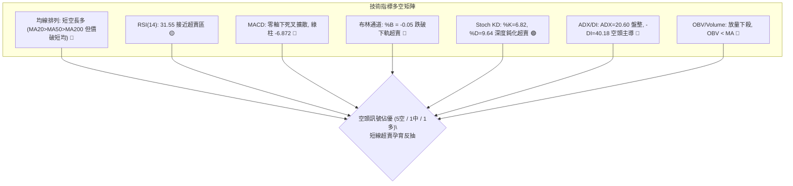

### 📈 移動平均線排列分析

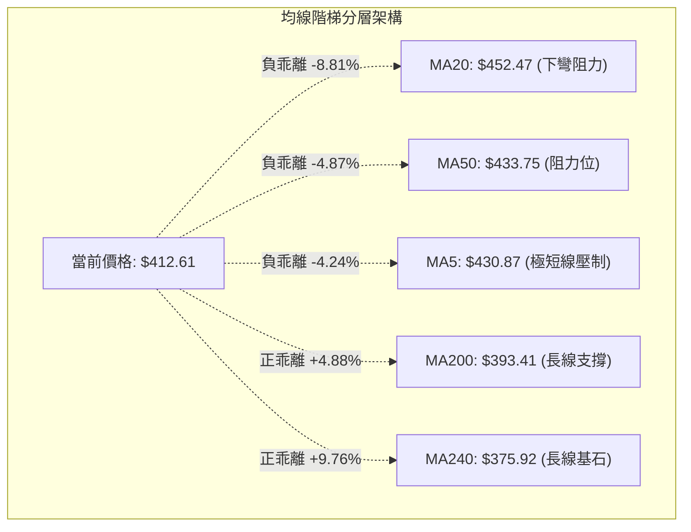

#### 移動平均線數據對比解讀

| 均線名稱 | 數值 | 價格相對於均線 | 乖離率 | 排列與趨勢走向解讀 |
|----------|------|----------------|--------|--------------------|
| **MA5** | $430.87 | 價格位於下方 | -4.24% | 短線急速殺跌，短天期乖離率擴大 |
| **MA10** | $450.59 | 價格位於下方 | -8.43% | 下穿 MA20 形成短線死亡交叉 |
| **MA20** | $452.47 | 價格位於下方 | -8.81% | 20日均線下彎，構成反彈首要強阻力帶 |
| **MA50** | $433.75 | 價格位於下方 | -4.87% | 跌破中期生命線，中期上升通道遭受破壞 |
| **MA60** | $428.49 | 價格位於下方 | -3.71% | 跌破季線，季線由支撐轉為阻力 |
| **MA120** | $424.46 | 價格位於下方 | -2.79% | 半年線失守，形成密集均線反壓蓋頂 |
| **MA200** | $393.41 | 價格位於上方 | +4.88% | **長期多頭防線**，方向持續向上，多頭最後盾牌 |
| **MA240** | $375.92 | 價格位於上方 | +9.76% | 年線基石穩固，中長期牛市基調仍未崩壞 |

### 📉 RSI(14) 分析

- **RSI(14) 當前數值**：**31.55**
- **強度進度條**：
  ```
  0 [██████░░░░░░░░░░░░░░░░░░░░░░░░] 100  (31.55% - 瀕臨超賣臨界線 30)
  ```
- **超買超賣狀態**：數值自 2026-10-04 的極度超買值 **85.9** 斷崖式跳水至 **31.55**，兩週內消化所有多頭浮額。目前逼近 30 閾值，技術性反彈動能正在積累。
- **背離判斷**：
  - 價格自 $472.78 下挫至 $412.61，RSI 同步自 85.9 急殺至 31.6。
  - **結論**：指標與價格同向快速下行，**無底背離，亦無頂背離**，屬於典型的單邊宣洩性殺跌。KD 指標進入極限低檔（%K=6.82, %D=9.64），預示跌勢已進入尾聲階段。

### 📊 MACD(12/26/9) 訊號解讀

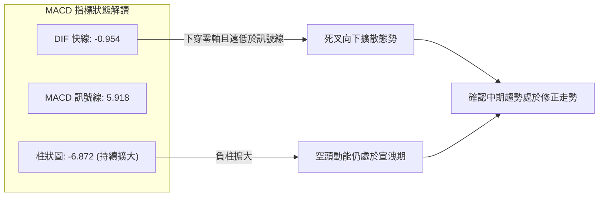

- **MACD 快線 (DIF)**：-0.954
- **MACD 訊號線 (Signal)**：5.918
- **柱狀圖 (Histogram)**：-6.872（🔴 看空）
- **動能評估**：快線由正轉負跌破零軸，且與訊號線剪刀差擴大至 -6.872。這顯示週線層級的多頭主升段已被空頭修正所打斷，空方賣壓在短時間內集中釋放，尚未見到紅柱收斂訊號。

### 📦 布林通道分析

```
TSM 布林通道 (20, 2) 結構圖
══════════════════════════════════════════════════════════════
$488.40 ┬────────────────────── 上軌 (極度超買區 / 波段頂部)
        │
$452.47 ┼────────────────────── 中軌 (MA20 下彎反壓 / 多空分水嶺)
        │
$416.53 ┼────────────────────── 下軌 (動態超賣支撐線)
        │
$412.61 ┴─● 現價跌破下軌 (%B = -0.05，短線嚴重超賣)
══════════════════════════════════════════════════════════════
```

- **布林帶寬與狀態**：
  - 上軌：$488.40 ｜ 中軌 (MA20)：$452.47 ｜ 下軌：$416.53
  - **帶寬 (Bandwidth)**：($488.40 - $416.53) / $452.47 = 15.88%
  - **%B 指標**：**-0.05**（小於 0 意味價格已實質貫穿下軌線外側）
- **技術解讀**：現價跌出下軌是罕見的極端超賣訊號，通常伴隨價格向通道內部（均值回歸）進行反抽修正，反抽第一阻力即為下軌附近的 **R1 $419.86**。

### 💹 成交量分析（量價配合度）

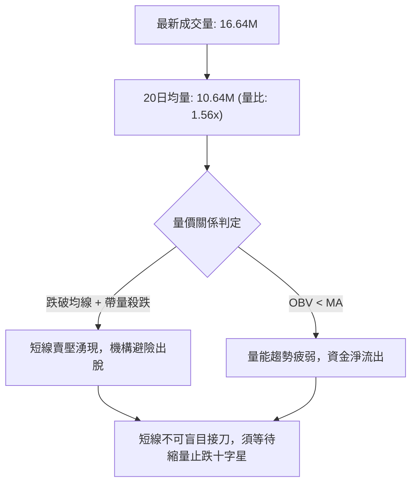

- **成交量對比**：最新日成交量為 16,637,200 股，顯著高於 20日均量 10,635,465 股（量比 1.56x）與 50日均量 10,115,496 股。
- **週成交量動態**：本週成交量達 71,698,500 股，相較於前兩週的 44M-49M 出現明顯放量長黑。
- **OBV 能量潮解讀**：OBV 處於其均線下方，顯示近期反彈資金參與度低，而殺跌過程中主動拋盤密集，呈現空頭價跌量增的弱勢格局。

---

## 6. 動能與波動率

### ⚡ 動能評估四象限

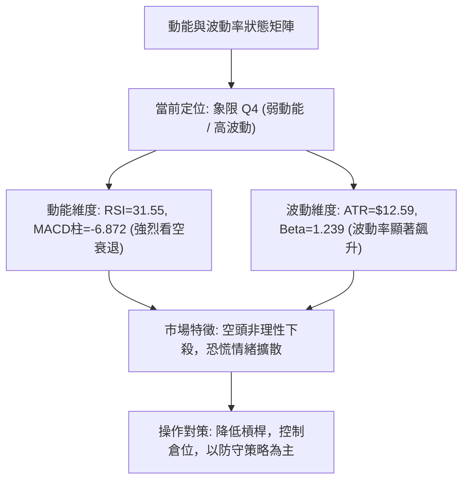

#### 動能與波動四象限對照表

| 象限 | 動能維度 | 波動維度 | 當前狀態 | 評估與策略指引 |
|------|----------|----------|----------|----------------|
| **Q1 (主升段)** | 強動能 (多頭) | 低波動 | — | 最佳波段持股與加碼環境 |
| **Q2 (盤整段)** | 弱動能 (中性) | 低波動 | — | 觀望等待方向突破，布林區間高拋低吸 |
| **Q3 (極限衝頂)**| 強動能 (狂熱) | 高波動 | — | 隨時防範假突破與流星線反轉 |
| **Q4 (恐慌釋放)**| **弱動能 (空頭)** | **高波動** | **✓ 當前狀態** | **避免盲目抄底，尊重空頭趨勢；等待縮量收斂進入 Q2 後再行佈局** |

### 📊 ATR 波動率分析

- **ATR(14) 讀數**：**$12.59**
- **ATR 佔比**：佔當前價格 $412.61 的 **3.05%**
- **風控止損應用標準**：
  - *超短線交易止損距離*：1.0 × ATR = **$12.59**
  - *波段交易止損距離*：1.5 × ATR = **$18.89**
  - *寬鬆波段止損距離*：2.0 × ATR = **$25.18**
- **實盤解讀**：目前每日固有波動幅度超過 12 美元，任何低於 1.5 倍 ATR（$18.89）的緊密止損極易被市場雜訊掃出場，部位規模必須相應縮小以適應高 ATR 環境。

### 📐 Beta 與市場相關性

- **Beta 係數**：**1.239**
  ```
  低波動 0.0 [═══════════════1.0──────█──────] 2.0 高波動  (Beta = 1.239)
  ```
- **解讀**：TSM 對標普 500 / 費城半導體指數具有顯著的進攻性彈性。當半導體板塊走弱時，TSM 平均承受大盤 1.24 倍的下行放大衝擊；反之，若科技板塊止跌反彈，其反抽彈性亦將顯著超越整體市場。

---

## 7. 多時框架總結

### 📋 時框架評分表

| 時框架 | 趨勢方向 | 動能狀態 | 均線排列 | 形態特徵 | 綜合評分 | 建議 |
|--------|----------|----------|----------|----------|----------|------|
| **短期 (日線)** | 🔴 強烈空頭 | 弱 (RSI 31.6) | 短均空頭排列 | 破布林下軌超賣 | 25/100 | 防守觀望，等待止跌 |
| **中期 (週線)** | 🟡 震盪回調 | 轉弱 (MACD轉負) | MA20破, MA50撐 | 雙頂回踩斐波38.2%| 45/100 | 關鍵支撐 S1 尋找反彈點 |
| **長期 (月線)** | 🟢 堅挺多頭 | 良好 (年漲幅大) | MA200/240多頭髮散| 巨型上升通道中繼 | 75/100 | 長期投資者無需恐慌 |

### 🔲 綜合訊號矩陣

```
╔══════════════════════════════════════════════════════════════════╗
║                    多時框綜合訊號矩陣 (TSM)                      ║
╠══════════════════╦══════════════╦══════════════╦═════════════════╣
║ 分析維度         ║ 短期 (日線)  ║ 中期 (週線)  ║ 長期 (月線)     ║
╠══════════════════╬══════════════╬══════════════╬═════════════════╣
║ 趨勢方向 (Trend) ║ 🔴 下行跌破  ║ 🟡 箱體回檔  ║ 🟢 穩固上升     ║
║ 動能強度 (Mom.)  ║ 🔴 弱勢超賣  ║ 🔴 柱狀下散  ║ 🟢 處於強勢區   ║
║ 均線結構 (MAs)   ║ 🔴 全線倒掛  ║ 🟡 考驗中軌  ║ 🟢 標準多頭排列 ║
║ 形態位置 (Pattern║ 🔴 下探尋底  ║ 🟡 頸線爭奪  ║ 🟢 多頭推升中繼 ║
║ 支撐壓力 (S/R)   ║ 考驗 S1 $406 ║ 依託斐波38.2%║ 依賴 MA200防線  ║
╠══════════════════╬══════════════╬══════════════╬═════════════════╣
║ 最終訊號結論     ║ 🔴 偏空      ║ 🟡 中性防守  ║ 🟢 偏多         ║
╚══════════════════╩══════════════╩══════════════╩═════════════════╝
```

### ⚖️ 多時框收斂結論

依據多時框收斂優先級規則：
1. **行情定性**：當前 **ADX(14) 讀數為 20.60**，明確處於 **< 25 的弱趨勢 / 盤整行情**。
2. **主導維度依歸**：在 ADX < 25 的盤整結構中，市場缺乏單邊趨勢延伸能力，**交易應以日線布林通道上下軌與箱體邊界作為主要決策依據**。
3. **時框衝突收斂**：日線雖然空頭排列極度凌厲，但週線與月線長期均線（MA200 $393.41）依然維持完好多頭排列，且斐波那契 38.2%（$402.11）與波段支撐 S1（$406.43）近在咫尺。日線 %B=-0.05 跌出下軌，顯示短期下行屬於箱體內的「過度延伸（Overshoot）」。
4. **唯一方向性結論**：**【偏空防守，中性觀望，等待箱體下沿支撐確認】**。整體綜合評分為 **38/100**，根據策略路由規則，**策略主軸定義為偏空防守 / 逢高做空，輔以關鍵支撐位之超跌技術反彈**。

---

## 8. 交易策略建議

### 🗺️ 策略決策流程圖

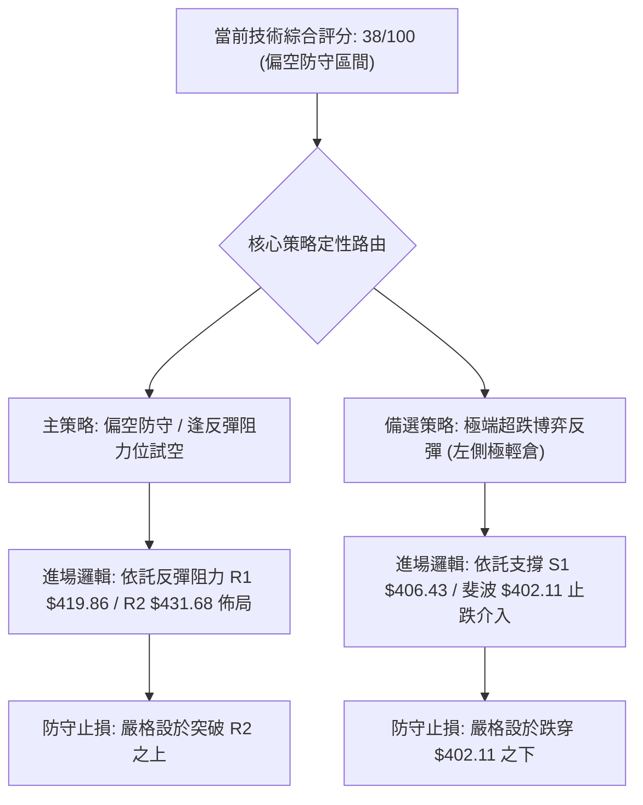

### 🧭 策略路由

- **綜合評分**：**38/100**（偏空 ≤40 區間）
- **主策略方向**：**【主推空頭防守與反彈沽空策略】**。目前日線動能全面看空，均線下彎形成沉重反壓。除非多頭能放量收復 MA50 與 R2 $431.68，否則所有向上反抽均視為空頭防守與逢高減碼/試空機會。

### 🎯 價格情境階梯（Price Scenarios）

完全引用第 4 章及關鍵價位之精確數據：

| 觸發條件 | 下一目標 | 後續延伸 | 情境含義 |
|----------|----------|----------|----------|
| **向上反抽突破 R1 $419.86** | 阻力 R2 **$431.68** | 阻力 R3 **$445.50** | 緩解短線下殺動能，進入日線超賣修復，測試 MA50 阻力 |
| **維持於現價 $412.61 震盪** | 測試支撐 S1 **$406.43** | 回測斐波 **$402.11** | 空頭動能暫歇，多空於波段箱體下沿展開激烈爭奪 |
| **實質跌破 S1 $406.43** | 支撐 S2 **$384.06** | 支撐 S3 **$371.72** | 雙頂頸線正式失守，下行空間全面打開，下探年線與牛熊分水嶺 |

### 📊 情境機率分佈

| 情境 | 機率 | 主要依據 |
|------|------|----------|
| **弱勢下探再測底 (下探 S1/S2)** | **55%** | MACD 柱擴散至 -6.872，-DI (40.18) 強勢控盤，OBV 跌破均線顯示機構買盤尚未進場承接 |
| **區間震盪築底 ($406 - $420)** | **30%** | ADX 僅 20.60 缺乏單邊趨勢續航力，布林 %B=-0.05 嚴重超賣，KD (6.82/9.64) 限制下行空間 |
| **強勁 V 型反轉 (突破 R2 $431)** | **15%** | 短均線全面下彎死叉蓋頂，上方 MA20 ($452.47) 累積大量套牢籌碼，反轉難度極高 |

### 🟢 主策略詳情

依據評分 38/100，主推策略為空頭波段策略（策略 A），同時提供超跌反抽策略（策略 B）：

| 策略要素 | 策略 A（主推：順勢逢高沽空） | 策略 B（輔助：左側超跌博弈反彈） |
|----------|---------------------------------|-----------------------------------|
| **策略類型** | 順應日線趨勢之反彈高空 | 逆勢博弈短線均值回歸反抽 |
| **進場條件** | 股價反彈至 R1 遇阻回落，或反抽接近 R2 無力 | 股價下探 S1 $406.43 出現長下影線或 15K 底背離 |
| **進場價格** | **$419.86**（阻力 R1 處） | **$406.43**（支撐 S1 處） |
| **目標價 T1** | **$406.43**（支撐 S1，獲利 3.20%） | **$419.86**（阻力 R1，獲利 3.30%） |
| **目標價 T2** | **$384.06**（強支撐 S2，獲利 8.53%）| **$431.68**（阻力 R2，獲利 6.21%） |
| **止損價格** | **$428.49**（MA60 / 突破 R1 上方 2%）| **$399.50**（跌破斐波 38.2% $402.11） |
| **風險報酬比** | **1 : 3.02**（以 T2 計算） | **1 : 3.64**（以 T2 計算） |
| **成功機率** | **65%** | **40%** |
| **建議倉位** | **15%** | **5% (嚴格輕倉試單)** |

### 🔴 反向風險觸發點（對沖提示）

若出現以下訊號，空頭主策略必須立即撤銷並止損：
1. **價位突破**：日線收盤價強勢實體站上 **R2 $431.68**，化解短期均線倒掛壓力。
2. **指標轉向**：日線 MACD 柱狀圖收斂至 -2.0 以內，且 RSI(14) 回升穿過 45 強弱分界線。
3. **量能反轉**：出現單日成交量大於 2500 萬股的「穿頭破腳」長紅吞噬 K 線。

### ⭐ 整體訊號強度評星

```
做多訊號強度：★★☆☆☆  (2/5星 - 僅有極度超賣支撐，左側交易風險高)
做空訊號強度：★★★★☆  (4/5星 - 均線倒掛、動能潰敗、放量破位)
整體可信度：  ★★★☆☆  (3/5星 - ADX<25 顯示進入震盪，空頭延續力易受限)
```

---

## 9. 風險提示與監控

### ✅ 關鍵監控指標 Checklist

```
╔══════════════════════════════════════════════════════════════════╗
║                    技術監控清單 (Checklist)                      ║
╠══════════════════════════════════════════════════════════════════╣
║ [ ] 監控支撐 S1 ($406.43)：是否跌破並引發停損賣壓？            ║
║ [ ] 監控斐波 38.2% ($402.11)：能否在整數大關 $400 前形成護盤？  ║
║ [ ] 監控阻力 R1 ($419.86)：反彈是否在此遇阻縮量？               ║
║ [ ] 觀察 RSI(14) 數值：是否正式跌破 30 進入鈍化，或止跌回升？   ║
║ [ ] 追蹤 MACD Histogram：負柱是否開始縮短（收斂買訊）？         ║
║ [ ] 檢視布林 %B：能否由 -0.05 重新站回 0.00 ($416.53) 之上？     ║
║ [ ] 監控量能動態：單日成交量是否回落至 1000 萬股以下（洗盤量縮）？║
╚══════════════════════════════════════════════════════════════════╝
```

### ⚠️ 風險場景分析

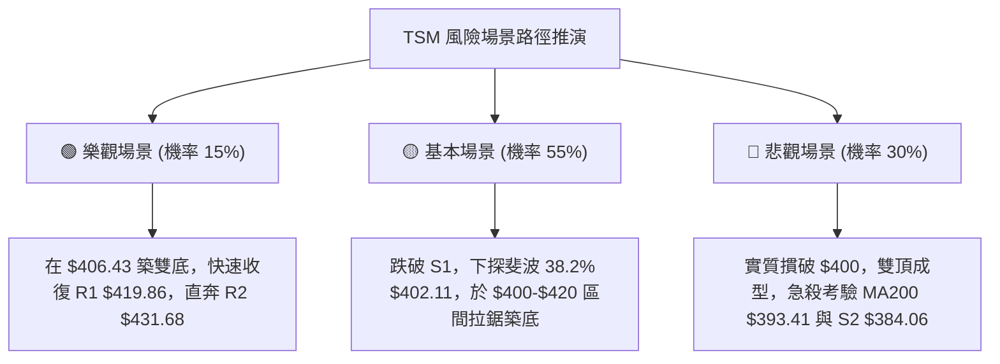

### 🛡️ 風險管理重要提醒

1. **ATR 動態倉位控制**：鑑於當前 ATR 達到高達 $12.59（波幅 3.05%），單筆交易的風險敞口（Stop Loss Amount）不可超過總交易資金的 1.0% - 1.5%。若以 1.5 倍 ATR（$18.89）作為止損幅度，持倉規模應嚴格限制於總資產的 15% - 20% 以內。
2. **Beta 槓桿防護**：TSM 的 Beta 為 1.239，在大盤走弱時具有下行放大特質。切忌使用融資（Margin）於此位置加碼抄底。
3. **左側交易紀律**：當前指標處於超賣狀態，但「超賣不代表立即見底」。KD 進入個位數時常出現低檔鈍化，盲目接刀極易遭受二度重創，務必等待右側反轉形態（如收出長下影線且突破前日高點）方可動用少量資金試單。

---

## 📋 報告總結

```
╔══════════════════════════════════════════════════════════════════╗
║                    TSM 技術分析報告總結                          ║
╠══════════════════════════════════════════════════════════════════╣
║ 報告日期：2026-10-18                                            ║
║ 當前價格：$412.61                                                ║
║ 分析評級：🔴 偏空防守 / 盤整尋底 (評分: 38/100)                  ║
║                                                                  ║
║ 關鍵結論：                                                       ║
║ ├─ 長期趨勢：🟢 強烈偏多 (MA200 $393.41 持續向上發散)            ║
║ ├─ 中期趨勢：🟡 箱體修正 (雙頂回檔測試斐波 38.2% $402.11 防線)   ║
║ ├─ 短期趨勢：🔴 單邊下殺 (日均線全線死叉，布林通道破底超賣)     ║
║ ├─ 關鍵支撐：S1 $406.43 ｜ S2 $384.06 ｜ S3 $371.72              ║
║ ├─ 關鍵阻力：R1 $419.86 ｜ R2 $431.68 ｜ R3 $445.50              ║
║ └─ 分析師目標：均值 $584.39 (最低 $440.00 / 最高 $1000.00)       ║
║                                                                  ║
║ 最優策略組合：                                                   ║
║ 1. 🥇 最佳機會：反抽阻力 R1 $419.86 順勢試空，看至 S1/S2 (R/R=3.0)║
║ 2. 🥈 次選機會：靜待價格回踩 S1 $406.43 出現止跌K線後極輕倉搏反抽║
║ 3. 🥉 保守選擇：空倉觀望，等待日線 MACD 翻紅且收復 MA20 後再行進場║
╚══════════════════════════════════════════════════════════════════╝
```

---

> ⚠️ **免責聲明**：本報告為技術分析研究，所有數據及估算均基於市場歷史行情與既定技術分析模型。本報告**僅供研究與學術參考**，**不構成任何形式的投資要約或買賣建議**。金融市場具有高度風險，投資決策應依據個人財務狀況獨立判斷並自負盈虧。

---

*報告生成時間：2026-10-18 ｜ 數據來源：Yahoo Finance ｜ 分析框架：多時框技術分析模型*