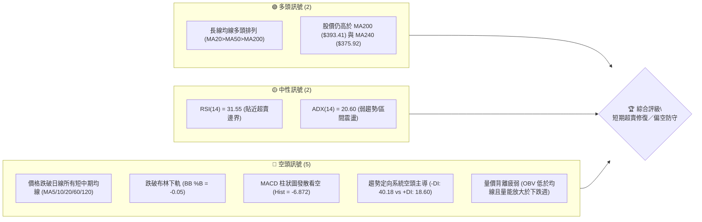
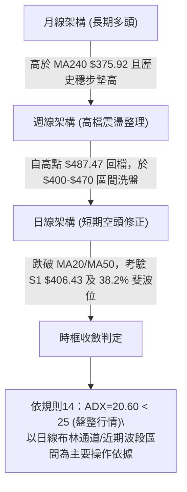
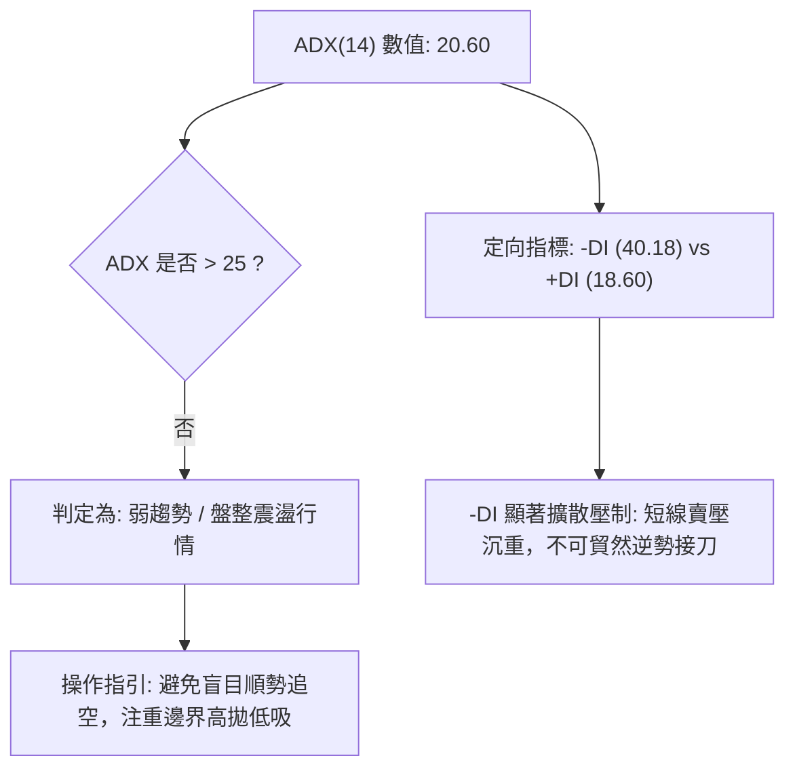
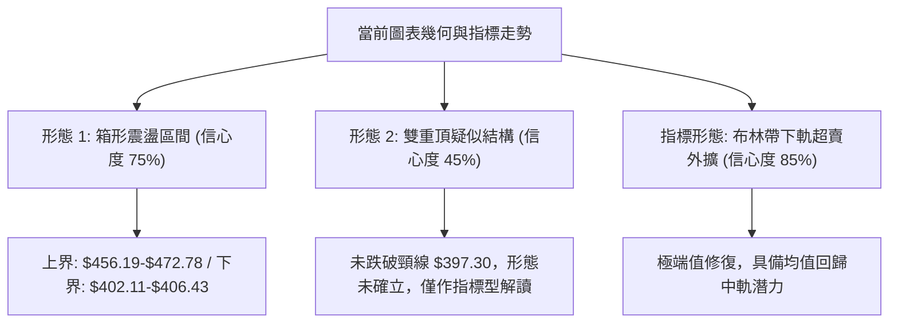
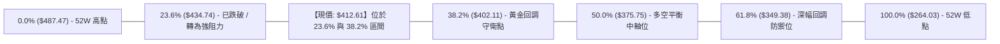
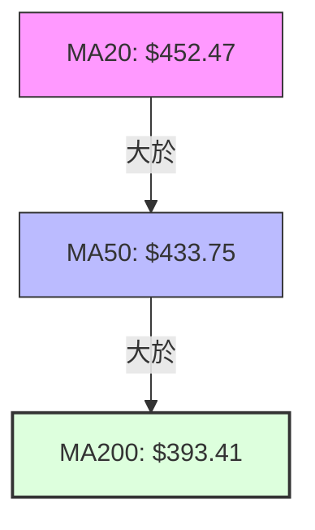
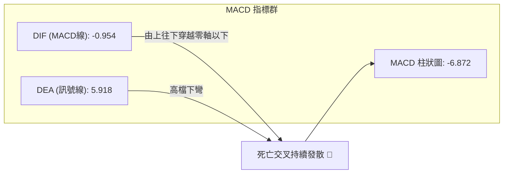
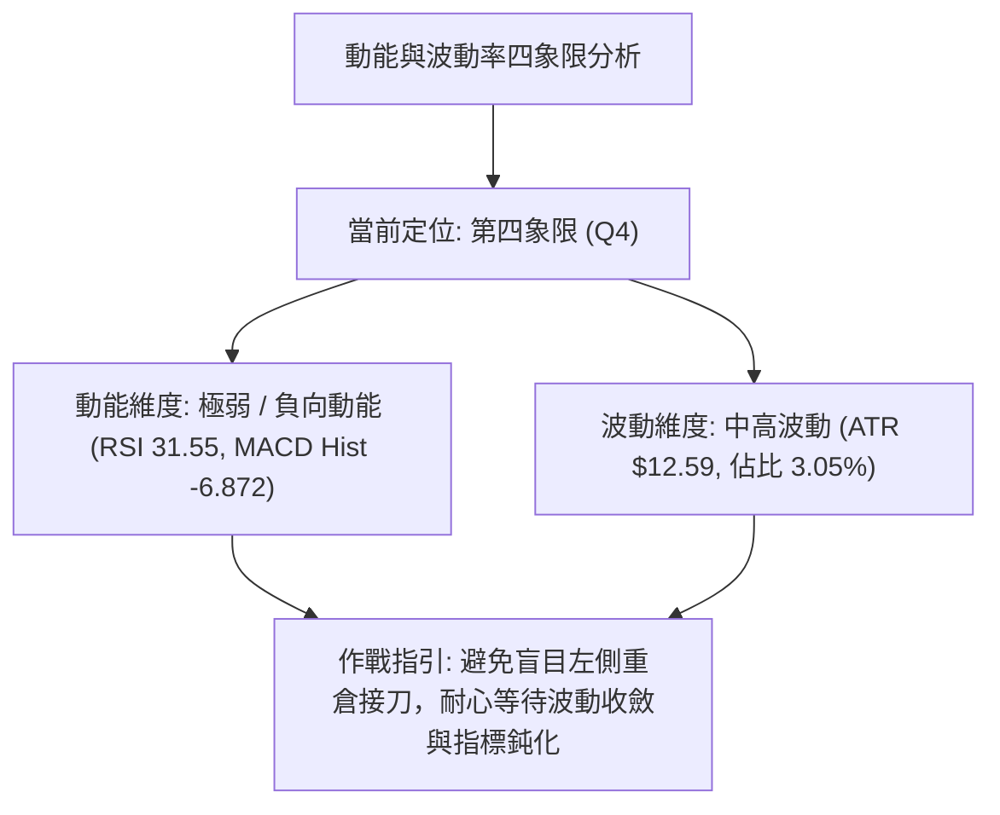
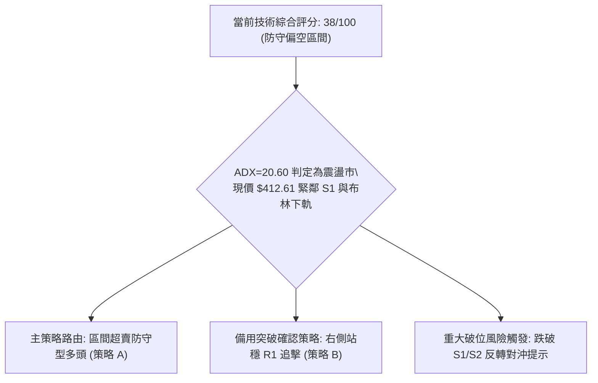
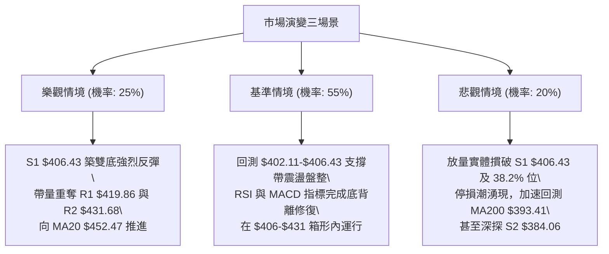

# TSM 技術分析報告

> **報告日期**：2026-10-19 ｜ **語言**：繁體中文 ｜ **數據來源**：Yahoo Finance ｜ **當前價格**：$412.61

---

## 目錄

| 章節 | 內容 |
|------|------|
| [1. 技術面概覽](#1-技術面概覽) | 訊號儀表板、核心指標、評分卡 |
| [2. 趨勢分析](#2-趨勢分析) | 多時框趨勢、長中短期走勢 |
| [3. 圖表形態分析](#3-圖表形態分析) | 形態識別、K線組合、目標價 |
| [4. 支撐與阻力](#4-支撐與阻力) | 關鍵價位、斐波那契回調 |
| [5. 技術指標深度解讀](#5-技術指標深度解讀) | MA/RSI/MACD/布林/成交量 |
| [6. 動能與波動率](#6-動能與波動率) | 動能評估、ATR、Beta |
| [7. 多時框架總結](#7-多時框架總結) | 時框架評分矩陣 |
| [8. 交易策略建議](#8-交易策略建議) | 多空策略、風險報酬比 |
| [9. 風險提示與監控](#9-風險提示與監控) | 監控指標、風險場景 |

---

## 1. 技術面概覽

### 🎯 技術訊號儀表板



### 📊 核心指標速覽表

| 指標類別 | 指標名稱 | 當前數值 | 訊號 | 解讀 |
|----------|----------|----------|------|------|
| **價格** | 當前價格 | $412.61 | 🔴 | 跌破所有短中期移動平均線，回測中長期支撐帶 |
| **均線** | MA20 | $452.47 | 🔴 | 價格低於 MA20 達 -8.81%，短期下行趨勢顯著 |
| **均線** | MA50 | $433.75 | 🔴 | 價格跌破中期生命線 -4.87%，形成上方重要阻力區 |
| **均線** | MA200 | $393.41 | 🟢 | 價格位於牛熊分水嶺上方 +4.88%，長線多頭根基未破 |
| **均線** | MA240 | $375.92 | 🟢 | 價格高於年線 +9.76%，長期趨勢維持上升通道 |
| **動能** | RSI(14) | 31.55 | 🟡 | 位於 30 邊界上方，動能疲弱但進入超賣修復敏感區 |
| **動能** | MACD (12,26,9) | -0.954 / 5.918 | 🔴 | MACD 線下穿訊號線，柱狀圖 -6.872 處於強烈空頭擴散 |
| **動能** | Stoch %K / %D | 6.82 / 9.64 | 🟡 | 隨機指標進入深度超賣區（<20），短線存在技術反彈需求 |
| **趨勢** | ADX (14) | 20.60 | 🟡 | ADX < 25 表明非單邊趨勢行情，偏向高波動區間震盪整理 |
| **定向** | +DI / -DI | 18.60 / 40.18 | 🔴 | -DI 大幅凌駕 +DI，賣方在日線週期佔據完全主導優勢 |
| **通道** | 布林帶 %B | -0.05 | 🔴 | 跌破下軌 ($416.53)，顯示極端超賣，有回歸通道內部壓力 |
| **波動** | ATR(14) | $12.59 | 🟡 | 佔現價 3.05%，每日波動幅度中等偏高，風控宜放寬緩衝 |
| **量能** | 最新成交量 / 20日均量 | 16.64M / 10.64M | 🔴 | 量比 1.56x，下跌帶量；OBV 處於均線下方，籌碼流出 |

### 🏆 技術評分卡

```
╔══════════════════════════════════════════════════════════════╗
║                 技術評分卡 — TSM (2026-10-19)               ║
╠══════════════════════════════════════════════════════════════╣
║ 趨勢強度 (ADX/DI)   ████░░░░░░░░░░░░░░░░  25/100  🔴 空頭佔優 ║
║ 動能指標 (RSI/MACD) ██████░░░░░░░░░░░░░░  30/100  🔴 動能疲軟 ║
║ 支撐穩定度 (波段/斐波)████████████░░░░░░░░  60/100  🟡 考驗支撐 ║
║ 成交量配合 (OBV/量比) ██████░░░░░░░░░░░░░░  30/100  🔴 放量下挫 ║
║ 形態完整度 (通道/回撤)██████████░░░░░░░░░░  50/100  🟡 形態重整 ║
║ 均線排列 (多時框收斂) ████████░░░░░░░░░░░░  40/100  🟡 長多短空 ║
╠══════════════════════════════════════════════════════════════╣
║ 綜合技術評分        ███████░░░░░░░░░░░░░  38/100  🔴 偏空防守 ║
╚══════════════════════════════════════════════════════════════╝
```

---

## 2. 趨勢分析

### 🌐 多時框趨勢分析



### 📈 長期趨勢 — 12個月走勢圖（Unicode）

```
TSM 月線走勢圖（過去12個月：2025-11 至 2026-10）
價格軸 ($)
$480 ┤                                        ● (06月高點 $476.29)
$460 ┤                                      ╭─╯   ╰╮
$440 ┤                                      │      ╰─● (09月 $456.19)
$420 ┤                                  ●───╯        ╰──● (10月現價 $412.61)
$400 ┤                             ╭────╯               │
$380 ┤                 ● (02月)   ╭╯                    │
$360 ┤                ╭╯╰╮       ╭╯                     │
$340 ┤                │  ╰●(03月)╯                      │
$320 ┤            ●───╯                                 │
$300 ┤     ●──●───╯ (12月/01月)                         │
$280 ┤ ●───╯ (11月 $288.46)                             │
     └─┬────┬────┬────┬────┬────┬────┬────┬────┬────┬────┬────┬─
      11月 12月 01月 02月 03月 04月 05月 06月 07月 08月 09月 10月
      '25  '25  '26  '26  '26  '26  '26  '26  '26  '26  '26  '26
```

#### 走勢特徵分析表格

| 階段區間 | 起訖月份 | 起訖價位 | 漲跌幅 | 走勢特徵與技術解讀 |
|----------|----------|----------|--------|--------------------|
| 第一階段：基礎蓄勢 | 2025-11 ~ 2026-01 | $288.46 → $327.98 | +13.70% | 穩健沿短期均線上攻，突破 $300 整數心理關卡 |
| 第二階段：主升加速 | 2026-01 ~ 2026-06 | $327.98 → $476.29 | +45.22% | 多頭波段爆發，歷經 3 月短暫洗盤後衝刺至歷史高點 $487.47 |
| 第三階段：高檔分歧 | 2026-06 ~ 2026-08 | $476.29 → $414.21 | -13.03% | 07月長黑回測 $403.17，籌碼開始進行高檔獲利了結換手 |
| 第四階段：次頂回落 | 2026-08 ~ 2026-10 | $414.21 → $412.61 | -0.39%  | 09月反彈至 $456.19 受阻於 R3/歷史前高，10月再度急殺跌破短期均線 |

### 📊 中期趨勢（週線分析）

中期走勢呈現典型「高檔箱形對稱震盪」。近 20 週數據顯示：
- **震盪頂部阻力**：集中於 2026-10-04 週的收盤高點 $472.78 與 52 週高點 $487.47。
- **震盪底部支撐**：集中於 2026-07-19 週低點 $397.30，與日線關鍵支撐 S1 $406.43、38.2% 斐波位 $402.11 形成強韌匯聚帶。
- **週線指標警訊**：2026-10-18 最新週收盤下挫至 $412.61，單週成交量放大至 71,698,500 股，週 RSI 驟降至 31.6，週 MACD 柱狀圖由正轉大幅負值（-6.872），表明中期下行動能仍未見減速鈍化。

```
近期週線壓力與支撐示意圖：
[高檔阻力區]  $472.78 - $487.47 ═════════════════════ (多次上攻未果受阻區)
                    │
                    ▼ (拉回整理)
[短線反彈壓]  $431.68 - $434.74 --------------------- (23.6% 斐波位與 R2 密集區)
                    │
[當前收盤位]  $412.61  ◄ 現價位置（超賣回測中）
                    │
[關鍵防守帶]  $402.11 - $406.43 ═════════════════════ (S1 支撐與 38.2% 斐波黃金共振)
[中期生命線]  $393.41          ..................... (日線 MA200 牛熊分界)
```

### ⚡ 趨勢強度評估（ADX 解讀）



#### ADX 趨勢強度對照表

| 指標變數 | 當前讀數 | 門檻區間 | 技術解讀與行情定位 |
|----------|----------|----------|--------------------|
| **ADX (14)** | 20.60 | < 25.00 | **弱趨勢／無明確單邊趨勢**。市場處於寬幅震盪消化期，單邊追單風險高 |
| **+DI (14)** | 18.60 | 基準線 20 | 多方動能衰竭，多頭反攻力度受抑 |
| **-DI (14)** | 40.18 | > 30 極強 | 空方動能主導日線下行波段，顯示急速拋壓尚在釋放 |
| **DI 差值分歧** | -21.58 | 負向擴大 | 短線空方控盤，但因 ADX 位於低位，預示下行易在關鍵支撐區引發均值回歸 |

---

## 3. 圖表形態分析

### 🔍 形態識別系統



#### 圖表形態信心度評估表

| 形態類別 | 信心度 | 判斷依據（引用數據） | 完成度 | 目標價（附嚴謹計算式） |
|----------|--------|----------------------|--------|------------------------|
| **高檔箱形震盪** | **75%** | 價格在 2026-07 低點 $403.17、08月 $414.21、10月現價 $412.61 反覆測底；上方頂部為 09月收盤 $456.19 與波段高點 R3 $445.50 | 70% | 區間下軌 S1 $406.43 企穩後，反彈目標測向區間中軸 MA50 $433.75 及箱頂 $456.19 |
| **雙重頂 (M頭)** | **45%** | 第一頂為 06月 $476.29 (52W高 $487.47)，第二頂為 09月 $456.19 (10-04週收 $472.78)。頸線為 07-19 週低點 $397.30 | 40% (未跌破頸線) | **訊號不足，僅作指標型解讀**。若跌破頸線 $397.30，理論測幅：$397.30 - ($476.29 - $397.30) = $318.31 (接近 78.6% 斐波位 $311.84) |
| **布林帶破軌超賣** | **85%** | 當前收盤價 $412.61 < BB下軌 $416.53，%B 為 -0.05，伴隨 RSI(14)=31.55 及 Stoch %K=6.82 深度超賣 | 90% | 均值回歸中軌 MA20 ($452.47)，短線首道回測目標為 R1 $419.86 |

### 🕯️ 重要K線形態分析

| 月份 | 收盤價 | K線形態 | 解讀 | 訊號 |
|------|--------|---------|------|------|
| **2026-06** | $476.29 | 高檔長上影長陽線 | 創 52 週新高 $487.47 後遭逢強大高檔獲利結套賣壓 | 🟡 滯漲警訊 |
| **2026-07** | $403.17 | 中長黑實體陰線 | 單月重挫 -15.35%，下殺洗盤於 $397-$403 區間獲低接買盤支撐 | 🔴 空方宣洩 |
| **2026-08** | $414.21 | 下影線小陽線（十字陀螺） | 賣壓收斂，多空於 $400 關卡上方展開拉鋸平衡 | 🟢 止跌初顯 |
| **2026-09** | $456.19 | 大陽線實體反彈 | 多方強勢反撲重回多頭排列上方，惟量能未突破 6 月天量 | 🟢 次波反彈 |
| **2026-10** | $412.61 | 吞噬型長陰線（進行中） | 月內回吐前月漲幅，直接灌破月內短期防線，空方重掌發球權 | 🔴 空方壓制 |

### 📉 ASCII 走勢形態示意圖

```
TSM 高檔箱形震盪與疑似雙頂頸線結構：
價格 ($)
$487.47 ┤                 ▲ 頂點一 (52W High)
        │                ╱ ╲
$472.78 ┤               ╱   ╲                         ▲ 頂點二 (10-04週)
        │              ╱     ╲                       ╱ ╲
$450.00 ┤             ╱       ╲                     ╱   ╲   <- 阻力位 R3 $445.50
        │            ╱         ╲                   ╱     ╲
$430.00 ┤           ╱           ╲                 ╱       ╲ <- 均線密集區 MA50 $433.75
        │          ╱             ╲               ╱         ╲
$412.61 ┤─────────┼───────────────┼─────────────┼───────────● 現價破下軌 ($412.61)
        │        ╱                 ╲           ╱
$406.43 ┤       ╱                   ╲         ╱               <- 支撐位 S1 $406.43
$397.30 ┤──────● 頸線波谷一 (07-19週) ╲───────● 潛在支撐帶 ──── <- 關鍵頸線防線
        └──────┴─────────────────────┴────────┴───────────────
              2026-05               2026-07    2026-09    2026-10
```

### 🎯 形態目標價計算

根據**高檔箱形震盪區間**測算：
1. **箱形底部支撐帶**：以近期波段低點聚類 S1 為基底，確立為 **$406.43**。
2. **箱形頂部阻力帶**：以波段高點反彈極限 R3 確立為 **$445.50**。
3. **箱形垂直高度**：
   $$\text{形態高度} = \$445.50 - \$406.43 = \$39.07$$
4. **反彈目標價推算**：
   - **保守目標（回歸中軸）**：中軌與 MA50 區域，參考波段高點聚類 **R2 = $431.68**。
   - **樂觀目標（測試箱頂）**：波段高點聚類 **R3 = $445.50**。
5. **破位測幅（極端風險）**：
   - 若有效收破頸線防線 $397.30，下行目標將向下延伸至波段支撐 **S3 = $371.72**（此位置亦高度重合 50.0% 斐波那契回調位 $375.75 與 MA240 $375.92）。

---

## 4. 支撐與阻力

### 🗺️ 關鍵價位分布圖（Unicode）

```
TSM 價位結構分布圖
═══════════════════════════════════════════════════════════════
$487.47 ║██████████████████████████████║ 52W 最高點 / 歷史強壓
$452.47 ║████████████████████████      ║ MA20 日均線 / 下降壓力線
$445.50 ║██████████████████████        ║ 強阻力 R3 (波段高點聚類)
$434.74 ║████████████████              ║ 23.6% 斐波那契回調位
$431.68 ║██████████████                ║ 阻力 R2 (MA50 匯聚區)
$419.86 ║████████                      ║ 近期阻力 R1 (布林下軌反壓)
$412.61 ╠══════════════════════════════╣ ◄ 現價位置 ($412.61)
$406.43 ║▓▓▓▓▓▓▓▓                      ║ 近期第一支撐 S1 (前波低點聚類)
$402.11 ║▓▓▓▓▓▓▓▓▓▓                    ║ 38.2% 斐波那契關鍵回調位
$393.41 ║▓▓▓▓▓▓▓▓▓▓▓▓▓▓                ║ MA200 長期牛熊分界線
$384.06 ║██████████████████            ║ 強支撐 S2 (波段低點聚類)
$375.75 ║████████████████████          ║ 50.0% 斐波那契中軸位 / MA240 ($375.92)
$371.72 ║████████████████████████      ║ 強支撐 S3 (年線防守聚類)
═══════════════════════════════════════════════════════════════
```

### 🚧 阻力位分析表

所有價位均嚴格引用 OHLCV 計算之波段高點聚類值：

| 阻力級別 | 價位 | 與現價距離 | 形成原因與技術共振 | 突破難度 | 重要性 |
|----------|------|------------|--------------------|----------|--------|
| **R1** | **$419.86** | +1.76% | 日線布林通道下軌 ($416.53) 突破後的初級反壓點，同時為近期下跌黑K實體上沿 | 🟡 中等 | 短線轉強初級門檻 |
| **R2** | **$431.68** | +4.62% | 與日線 MA50 ($433.75) 及 23.6% 斐波位 ($434.74) 形成三重共振壓制區 | 🔴 極高 | 中期多空重奪關鍵 |
| **R3** | **$445.50** | +7.97% | 前波反彈高點聚類，接近 MA20 ($452.47) 趨勢反轉阻力線 | 🔴 極高 | 波段格局反轉點 |

### 🛡️ 支撐位分析表

所有價位均嚴格引用 OHLCV 計算之波段低點聚類值：

| 支撐級別 | 價位 | 與現價距離 | 形成原因與技術共振 | 守住機率 | 重要性 |
|----------|------|------------|--------------------|----------|--------|
| **S1** | **$406.43** | -1.50% | 近一年波段低點密集聚類，緊鄰 38.2% 斐波那契防守點 ($402.11) | 🟡 65% | 短線多頭最後防線 |
| **S2** | **$384.06** | -6.92% | 跌破 MA200 ($393.41) 後的深層低點聚類，主力籌碼防禦區 | 🟢 80% | 中期結構性防線 |
| **S3** | **$371.72** | -9.91% | 年線 MA240 ($375.92) 與 50.0% 斐波位 ($375.75) 共振帶下方波段低點 | 🟢 90% | 長期多頭生死線 |

### 📐 斐波那契回調位分析

依據 52 週完整波段起訖點（52W Low: **$264.03** → 52W High: **$487.47**，總波段跨度 **$223.44**）嚴格對照：



#### 斐波那契回調深度解讀

1. **現價區間定位**：現價 **$412.61** 處於 **23.6% ($434.74)** 與 **38.2% ($402.11)** 之間。此區間為健康牛市回調的典型「首級防守緩衝帶」。
2. **關鍵攻防研判**：
   - 上方阻力：**23.6% ($434.74)** 與阻力位 **R2 ($431.68)** 高度重疊，未帶量收復此位置前，技術架構維持弱勢整理。
   - 下方支撐：**38.2% ($402.11)** 與支撐位 **S1 ($406.43)** 形成寬度僅 1.0% 的堅實買盤共振帶。若 38.2% 支撐失守，價格將進一步向 **50.0% ($375.75)** 尋求沉澱，該處與波段支撐 **S3 ($371.72)** 及 MA240 ($375.92) 構成強大的長期多頭護城河。

---

## 5. 技術指標深度解讀

### 🎛️ 指標訊號總覽

```mermaid
graph TD
    PRICE["現價: $412.61"] --> MA_GRP["均線系統: 短空長多"]
    PRICE --> OSC_GRP["擺盪指標: 深度超賣"]
    PRICE --> BB_GRP["布林通道: 破軌超跌"]
    PRICE --> VOL_GRP["量能系統: 帶量下殺"]

    MA_GRP -->|"MA20 > MA50 > MA200"| M1["長期維持多頭架構 🟢"]
    MA_GRP -->|"收盤價 < MA5/10/20/60/120"| M2["短中期均線全數失守 🔴"]

    OSC_GRP -->|"RSI("14") = 31.55"| O1["逼近超賣界限 🟡"]
    OSC_GRP -->|"Stoch %K=6.82, %D=9.64"| O2["KD 深度超賣鈍化 🟡"]
    OSC_GRP -->|"MACD Hist = -6.872"| O3["空頭動能加速發散 🔴"]

    BB_GRP -->|"BB %B = -0.05 跌破下軌"| B1["均值回歸修復概率高 🟡"]

    VOL_GRP -->|"OBV < MA, 量比 1.56x"| V1["量價背離，空方主動拋盤 🔴"]
```

### 📈 移動平均線排列分析



#### 均線數據全景監控表

| 均線名稱 | 均線價位 | 現價乖離率 | 狀態趨勢 | 歷史形態軌跡 | 解讀含義 |
|----------|----------|------------|----------|--------------|----------|
| **MA 5** | $430.87 | -4.24% | ▼ 快速下彎 | ▇████▇▆▅▄▂ | 超短線下殺動能強烈，成為日內第一道反壓 |
| **MA 10** | $450.59 | -8.43% | ▼ 陡峭下行 | ████████▇▆ | 短期持股成本全線套牢，反彈解套賣壓密集 |
| **MA 20** | $452.47 | -8.81% | ▼ 高檔拐頭 | ▇▇▇██████ | 短期月均線反轉，確立短線進入空方修正走勢 |
| **MA 50** | $433.75 | -4.87% | ▼ 走平下彎 | ▃▄▅▆▇█████ | 中期生命線失守，原本之多頭支撐轉化為強大阻力 |
| **MA 60** | $428.49 | -3.71% | ▼ 走平 | ▂▃▃▄▅▆▇██ | 季線遭實體陰線貫穿，季級別買盤需重聚防守 |
| **MA 120**| $424.46 | -2.79% | ▼ 震盪下行 | ▅▆▆▆▇▇▇███ | 半年線失守，顯示近半年的進場籌碼已呈微幅套牢 |
| **MA 200**| $393.41 | +4.88% | ▲ 穩步墊高 | ▅▅▅▆▆▆▇▇▇ | 牛熊分水嶺，長期多頭最重要實質支撐線 |
| **MA 240**| $375.92 | +9.76% | ▲ 向上昂揚 | ▄▄▅▅▅▆▆▇▇ | 年線基底深厚，長期多頭宏觀趨勢未遭破壞 |

**綜合均線評判**：雖然整體形態在結構上仍保留 `MA20 > MA50 > MA200` 的長期多頭骨架，但價格已經全面崩跌至短期及中期均線群（MA5 至 MA120）下方，形成嚴重的「長多短空格局」。

### 📉 RSI(14) 分析

```
RSI(14) 讀數：31.55
0                    30            50                  70                 100
├────────────────────┼─────────────┼───────────────────┼────────────────────┤
[   極度超賣區間   ]  ▲ [   弱勢整理   ]     [   強勢多頭   ]   [   極度超買區間   ]
                     31.55 (臨界反彈位)
進度展示：██████░░░░░░░░░░░░░░ 31.55%
```

- **背離判斷**：
  - **日線背離結論**：無明顯底背離。價格創出 10 月新低，RSI 同步下挫至 31.55，指標與價格趨勢完全同步下行，未見價格破底而 RSI 抬高的底背離徵兆。
  - **週線背離分析**：週線級別 RSI 自 10-04 週的 85.9（極端超買）急墜至當前的 31.6，屬於高檔急速降溫過程，尚未形成多週期共振底背離。
- **超買超賣結論**：RSI 雖未實質摜破 30，但已緊貼 31.55，顯示短線賣壓釋放極度充分，下行空間開始受到指標極限壓縮。

### 📊 MACD(12,26,9) 訊號解讀



- **指標讀數**：MACD 線（-0.954）已跌破零軸，Signal 線（5.918）處於正值區加速下行，兩者差值導致 Histogram 柱狀圖暴跌至 **-6.872**。
- **訊號解析**：MACD 柱狀圖呈現陡峭的負向擴散，週線 MACD 柱亦自 +2.837 翻黑擴大至 -6.872，明確揭示當前空頭動能主導市場，中短期動能指標尚未出現任何底部鈍化收斂信號。

### 📦 布林通道分析

```
TSM 布林通道現況示意圖（參數：20, 2）：
$488.40 ┤═══════════════════════════════════ 上軌（極端壓力區）
        │
$452.47 ┤─────────────────────────────────── 中軌 / MA20（反彈基準目標）
        │
$416.53 ┤═══════════════════════════════════ 下軌（超跌警示界線）
        │   ● 現價: $412.61 (%B = -0.05) 破軌超跌
$406.43 ┤ - - - - - - - - - - - - - - - - - 支撐 S1
```

- **軌道狀態**：
  - BB 上軌：**$488.40**
  - BB 中軌（MA20）：**$452.47**
  - BB 下軌：**$416.53**
  - **BB %B = -0.05**（數值小於 0，代表收盤價已經跌穿下軌下方）。
- **通道技術含義**：價格貫破布林帶下軌，此為極端拋售訊號。根據統計均值回歸定律，在 ADX=20.60（震盪行情）環境下，股價持續在下軌外部運行的機率通常小於 10%，預期 1-3 個交易日內將發生技術性抽腳，重回布林通道內部（首道回歸目標為下軌 $416.53 及 R1 $419.86）。

### 💹 成交量分析（量價配合度）

1. **量能指標讀數**：
   - 當日成交量：**16,637,200 股**
   - 20日均量：**10,635,465 股**
   - **量比（Volume Ratio）**：**1.56 倍**（顯著帶量）
   - 最新單週成交量：**71,698,500 股**（較前一週大幅放大 45.6%）
2. **OBV 能量潮趨勢分析**：
   - 數據明確顯示：`OBV < MA → 量能疲弱`。
   - 在股價自 10 月初高點回落期間，成交量並未萎縮，反而伴隨長陰放量，反映機構法人籌碼在財報或總體因素影響下進行避險與調倉流出。
3. **量價結論**：
   - 目前處於「帶量破位下殺」階段，量能未出現「量縮價穩」的籌碼沉澱特徵，因此任何短線急拉若無持續量能支撐，均暫視為空頭抵抗或技術反抽。

---

## 6. 動能與波動率

### ⚡ 動能評估四象限



#### 動能與波動率象限矩陣

| 象限標記 | 動能強度 | 波動率狀態 | 當前狀態判定 | 交易戰術評估 |
|----------|----------|------------|--------------|--------------|
| **Q1** | 強（多頭） | 低波動 | — | 趨勢平穩慢牛，最佳順勢加碼環境 |
| **Q2** | 弱（整理） | 低波動 | — | 盤整蓄勢，適合小區間高拋低吸 |
| **Q3** | 強（多頭） | 高波動 | — | 主升加速突破，擴大止盈與移動停利 |
| **Q4** | **弱（空頭）** | **中高波動** | **✓ 當前定位** | **下行急殺與恐慌釋放，嚴格控制倉位，僅限嚴設止損之超跌反彈短線博弈** |

### 📊 ATR 波動率分析

```
ATR (14) 讀數：$12.59 ｜ 佔股價比率：3.05%
┌────────────────────────────────────────────────────────┐
│ 止損緩衝距離建議 (以 ATR 為乘數基準)                    │
│ ├─ 激進超短線 (1.0 × ATR) = $12.59                     │
│ ├─ 標準波段 (1.5 × ATR)   = $18.89                     │
│ └─ 保守防守 (2.0 × ATR)   = $25.18                     │
└────────────────────────────────────────────────────────┘
```

- **波動率解讀**：ATR(14) 達到 $12.59，顯示 TSM 目前每日平均振幅超過 12 美元，單日價格波動區間可達 3% 以上。這意味著在制定進出場計劃時，過於狹窄的止損（例如小於 1%）極易遭受盤中隨機噪音掃單出場。
- **風控參數計算**：以當前收盤價 $412.61 計算，1.0 倍 ATR 下方剛好觸及 $400.02，與重要支撐位 S1 ($406.43) 及 38.2% 斐波那契回調位 ($402.11) 形成極佳的技術結構防護緩衝。

### 📐 Beta 與市場相關性

- **Beta 係數**：**1.239**。
- **市場敏感性評估**：TSM 的 Beta 值顯著高於 1.0，表明該股具有明顯的高彈性與進攻性特質。當費城半導體指數（SOX）或標普 500 指數波動 1% 時，TSM 預期將產生 1.24% 的同向波動。
- **系統性風險折算**：在高 Beta 背景下，短線若美股大盤走勢疲弱，TSM 將面臨槓桿式放大下修；反之，一旦大盤止跌回穩，TSM 的技術性超賣回補彈力亦將領先族群。

---

## 7. 多時框架總結

### 📋 時框架評分表

| 時框架 | 趨勢方向 | 動能狀態 | 均線排列狀況 | 形態特徵 | 綜合評分 | 操作指引 |
|--------|----------|----------|--------------|----------|----------|----------|
| **月線 (長期)** | 🟢 多頭向上 | 🟢 健康偏強 | MA240 向上昂揚 ($375.92) | 歷史多頭大架構，自低檔穩健翻倍 | **75 / 100** | 長期投資者持股續抱，回測長天期均線分批佈局 |
| **週線 (中期)** | 🟡 箱形震盪 | 🔴 賣壓釋放 | 處於 20 週與 50 週均線交纏處 | 處於 $397 - $476 寬幅震盪結構 | **45 / 100** | 箱形未破，不宜過度悲觀，等待區間底部信號 |
| **日線 (短期)** | 🔴 急速回檔 | 🔴 深度超賣 | 均線空頭排列，跌破 MA5-MA120 | 跌破布林下軌，短線超跌下尋支撐 | **25 / 100** | 嚴禁盲目追空，空手者等待右側止跌確認再進場 |

### 🔲 綜合訊號矩陣

```
時框架訊號交叉驗證矩陣：
┌────────────┬─────────────┬─────────────┬─────────────┐
│ 評估維度   │ 日線 (短期) │ 週線 (中期) │ 月線 (長期) │
├────────────┼─────────────┼─────────────┼─────────────┤
│ 趨勢方向   │ 🔴 看空     │ 🟡 中性     │ 🟢 看多     │
│ 均線系統   │ 🔴 空頭壓制 │ 🟡 多空拉鋸 │ 🟢 多頭排列 │
│ 動能指標   │ 🟡 逼近超賣 │ 🔴 負向擴散 │ 🟢 強勢區間 │
│ 支撐防守   │ 🟡 測試 S1  │ 🟢 守住波谷 │ 🟢 遠離年線 │
│ 量價結構   │ 🔴 帶量下跌 │ 🔴 週量大增 │ 🟢 趨勢配合 │
└────────────┴─────────────┴─────────────┴─────────────┘
結論：中長多頭防線依然穩固，短線受空方強烈壓制，呈現多時框「劇烈分歧」。
```

### ⚖️ 多時框收斂結論

依據多時框收斂規範（嚴格要求 14）：
1. **行情定性**：當前 ADX(14) 讀數為 **20.60**（明確小於 25 臨界值），技術面確立為**盤整行情（區間震盪）**，而非單邊流暢的破位下跌趨勢行情。
2. **時框優先權收斂**：在盤整行情中，日線布林通道上下軌與近期波段支撐/阻力為主要依歸；月線多頭（MA200/MA240 支撐）提供下檔堅實防護罩，日線空頭下殺則提供超賣進場博弈機會。
3. **唯一方向性結論**：**中性觀望偏多防守（區間超跌等待反彈）**。
   - 儘管短線動能偏空（綜合評分 38/100 偏向防守），但因現價 $412.61 已跌破布林下軌（%B = -0.05），且距核心支撐 S1 ($406.43) 及 38.2% 斐波那契回調位 ($402.11) 僅一步之遙，**空頭盈虧比極差，嚴禁順勢追空**；策略首選為**以防守心態在強支撐上方尋找超跌反彈的高盈虧比多頭契機**。

---

## 8. 交易策略建議

### 🗺️ 策略決策流程圖



### 🧭 策略路由

> **當前主策略方向 = 區間超跌防禦型買入（依技術評分 38/100 進入極端超賣區，配合盤整市特性主打支撐位反彈，以小博大）**

*說明：由於 ADX < 25 表明市場非單邊趨勢，且股價已實質跌穿布林下軌，各項指標（Stoch %K=6.82, RSI=31.55）均處於極度超賣邊界，做空空間已被 S1 ($406.43) 壓縮至 1.5% 以內。因此主推在支撐位佈局的「超跌修復策略」，空頭僅列為下破關鍵頸線時的極端對沖風控提示。*

### 🎯 價格情境階梯（Price Scenarios）

所有價位均嚴格引用第 4 章及數據庫真實算定數值：

| 觸發條件 | 下一目標 | 後續延伸 | 情境技術含義 |
|----------|----------|----------|--------------|
| **突破 R1 $419.86** | **R2 $431.68** | **R3 $445.50** | 股價重回布林帶內部，確認超賣修復，挑戰 MA50 與 23.6% 斐波位 |
| **站穩現價 $412.61** | **R1 $419.86** | **S1 $406.43** | 於布林下軌與前波低點之間築底盤整，時間換取空間 |
| **跌破 S1 $406.43** | **S2 $384.06** | **S3 $371.72** | 跌穿 38.2% 斐波位，波段弱勢擴大，將直接考驗 MA200 牛熊線 ($393.41) |

### 📊 情境機率分佈

| 情境劇本 | 機率 | 主要依據與技術論證 |
|----------|------|--------------------|
| **探底反彈（均值回歸）** | **55%** | 布林 %B = -0.05 處於嚴重破軌狀態；Stoch KD 深度超賣；38.2% 斐波那契回調位 ($402.11) 歷史支撐強韌，極易引發均值回歸反抽 |
| **區間弱勢震盪** | **30%** | ADX = 20.60 壓制單邊趨勢展開；MACD 柱狀圖大幅負擴散，上方短中期均線形成重重解套壓力，需在 $406 - $420 反覆磨底 |
| **向下破位加速** | **15%** | 最新週成交量暴增至 71.69M 呈現放量下跌；-DI 高達 40.18，若跌破 $400 整數心理防線，可能引發多頭停損賣壓 |

### 🟢 主策略詳情

#### 策略 A：左側支撐低吸策略（超跌均值回歸）
- **進場條件**：股價回測波段支撐位 S1 ($406.43) 至 38.2% 斐波位 ($402.11) 區間，盤中出現 15/60 分鐘線長下影線或量縮止跌。
- **進場價格**：**$406.43**（精確錨定支撐位 S1）。
- **止損價格**：**$398.50**（嚴格設定於 38.2% 斐波位 $402.11 下方約 1% 處，且避開 $400 整數關卡）。
- **目標價 T1**：**$419.86**（波段阻力 R1，鎖定第一階段利潤）。
- **目標價 T2**：**$431.68**（波段阻力 R2，重測 MA50 與 23.6% 斐波共振區）。
- **風險報酬比**：
  $$\text{盈虧比 (至 T2)} = \frac{\$431.68 - \$406.43}{\$406.43 - \$398.50} = \frac{\$25.25}{\$7.93} = \mathbf{3.18 : 1}$$
- **成功機率**：**60%**。
- **建議倉位**：**10% - 15%**（輕倉試單，不可重壓）。

#### 策略 B：右側突破確認策略（站穩布林下軌）
- **進場條件**：日線收盤價強勢收復阻力位 R1 ($419.86)，重回布林通道內部且 RSI 重新上穿 35。
- **進場價格**：**$419.86**。
- **止損價格**：**$409.00**（設定於進場點下方約 1 倍 ATR 緩衝區內）。
- **目標價 T1**：**$431.68**（波段阻力 R2）。
- **目標價 T2**：**$445.50**（強阻力 R3，挑戰下降通道頂部）。
- **風險報酬比**：
  $$\text{盈虧比 (至 T2)} = \frac{\$445.50 - \$419.86}{\$419.86 - \$409.00} = \frac{\$25.64}{\$10.86} = \mathbf{2.36 : 1}$$
- **成功機率**：**55%**。
- **建議倉位**：**15% - 20%**。

### 🔴 反向風險觸發點（對沖提示）

- **觸發條件**：若日線實體陰線無情摜破支撐位 **S1 ($406.43)**，且跌破關鍵斐波位 **$402.11**。
- **對沖應對指引**：
  - 立即全面撤銷所有多頭掛單，持多者觸發強制止損出場。
  - 機構或大部位投資人可啟動空頭對沖操作（例如建立反向部位或購買 Put 避險），下方目標價鎖定強支撐 **S2 ($384.06)**，終極防禦線為 **S3 ($371.72)**。

### ⭐ 整體訊號強度評星

```
做多訊號強度：★★☆☆☆  (2.5/5星 — 短線受阻於均線，純屬超跌博弈)
做空訊號強度：★★★☆☆  (3.0/5星 — 空頭動能充沛但盈虧比嚴重不佳)
整體可信度：  ★★★★☆  (4.0/5星 — 支撐阻力結構清晰，斐波那契共振明確)
```

---

## 9. 風險提示與監控

### ✅ 關鍵監控指標 Checklist

```
╔══════════════════════════════════════════════════════════════════╗
║               TSM 交易風控與技術監控清單 (Checklist)             ║
╠══════════════════════════════════════════════════════════════════╣
║ [ ] 1. 價格是否守穩 38.2% 斐波那契回調位 ($402.11)              ║
║ [ ] 2. 日線收盤是否重回布林下軌內部 ($416.53 上方)              ║
║ [ ] 3. RSI(14) 是否脫離 30 附近之超賣邊界並形成底背離          ║
║ [ ] 4. MACD 柱狀圖負值是否開始萎縮收斂 (目前為 -6.872)          ║
║ [ ] 5. 成交量是否萎縮至 20 日均量 (10.63M) 以下以確認浮額沉澱   ║
║ [ ] 6. 日線是否能放量站上第一道阻力關卡 R1 ($419.86)            ║
║ [ ] 7. 觀察費城半導體指數 (SOX) 是否在年線附近同步出現止跌K線   ║
╚══════════════════════════════════════════════════════════════════╝
```

### ⚠️ 風險場景分析



### 🛡️ 風險管理重要提醒

1. **嚴禁在破軌處盲目追空**：當前股價跌破布林下軌（%B = -0.05），技術上隨時可能出現無預警的報復性長陽抽腳，此處追空面臨極大的空頭軋空風險。
2. **左側交易嚴守停損紀律**：對於採取策略 A 於 S1 ($406.43) 附近摸底的交易者，必須以 $398.50 作為不可逾越的鐵律停損點，嚴禁將短線超跌交易轉化為長期套牢投資。
3. **倉位配置比例限制**：在日線均線呈現空頭壓制、ADX 弱勢的環境下，總技術面交易部位不宜超過總資金的 **15% - 20%**，應保留充裕現金以因應大盤系統性波動。

---

## 📋 報告總結

```
╔══════════════════════════════════════════════════════════════════╗
║                    TSM 技術分析報告總結                          ║
╠══════════════════════════════════════════════════════════════════╣
║ 報告日期：2026-10-19                                             ║
║ 當前價格：$412.61                                                ║
║ 分析評級：⚖️ 中性觀望／超賣反彈防守 (綜合評分: 38/100)           ║
╠══════════════════════════════════════════════════════════════════╣
║ 關鍵結論：                                                       ║
║ ├─ 長期趨勢：🟢 多頭未變 (股價高於 MA200 $393.41 與 MA240 $375)  ║
║ ├─ 中期趨勢：🟡 箱形整理 (處於 $402-$476 大區間拉鋸)            ║
║ ├─ 短期趨勢：🔴 急速下修 (跌破短中期均線，布林下軌外極端超賣)   ║
║ ├─ 關鍵支撐：S1 $406.43  / 38.2% 斐波位 $402.11                  ║
║ ├─ 關鍵阻力：R1 $419.86  / R2 $431.68                           ║
║ └─ 外資共識：強力買進 (20位分析師，目標價均值 $584.39)           ║
╠══════════════════════════════════════════════════════════════════╣
║ 最優策略組合：                                                   ║
║ 1. 🥇 最佳機會：回測 S1 $406.43 輕倉承接，博弈布林回歸中軌反彈   ║
║ 2. 🥈 次選機會：靜待放量站穩 R1 $419.86 後右側進場追擊至 R2      ║
║ 3. 🥉 保守選擇：完全空手觀望，靜待日線 MACD 柱狀圖轉正再行佈局   ║
╚══════════════════════════════════════════════════════════════════╝
```

---

> ⚠️ **免責聲明**：本報告為技術分析研究，所有數據、圖表及估算均基於歷史量價與技術指標模型演算，絕不構成任何形式的投資邀約或買賣建議。市場存在劇烈波動風險，投資人應獨立評估自身風險承受能力並嚴格執行交易紀律。

---

*報告生成時間：2026-10-19 ｜ 數據來源：Yahoo Finance ｜ 分析框架：多時框技術分析模型*