# TSM 技術分析報告

> **報告日期**：2026-10-20 ｜ **語言**：繁體中文 ｜ **數據來源**：Yahoo Finance ｜ **當前基準價格**：$412.61（依據最新 2026-10-18 週收盤與 2026-10 月收盤價）

---

## 目錄

| 章節 | 內容 |
|------|------|
| [1. 技術面概覽](#1-技術面概覽) | 訊號儀表板、核心指標、評分卡 |
| [2. 趨勢分析](#2-趨勢分析) | 多時框趨勢、長中短期走勢、ADX解讀 |
| [3. 圖表形態分析](#3-圖表形態分析) | 形態識別、K線組合、形態信心度 |
| [4. 支撐與阻力](#4-支撐與阻力) | 關鍵價位、斐波那契回調結構 |
| [5. 技術指標深度解讀](#5-技術指標深度解讀) | 均線、RSI、MACD、布林通道、量價配合 |
| [6. 動能與波動率](#6-動能與波動率) | 動能四象限、ATR評估、Beta相關性 |
| [7. 多時框架總結](#7-多時框架總結) | 時框架評分矩陣、收斂規則與方向確認 |
| [8. 交易策略建議](#8-交易策略建議) | 策略路由、價格情境階梯、主策略詳情 |
| [9. 風險提示與監控](#9-風險提示與監控) | 關鍵監控清單、情境模擬、風控指引 |
| [10. 報告總結](#10-報告總結) | 核心結論與最優策略組合 |

---

## 1. 技術面概覽

### 🎯 技術訊號儀表板

本儀表板整合短期日線指標、中期週線走勢與趨勢強弱度。目前市場呈現「長期多頭格局下的中短期強烈修正與區間震盪」特徵。

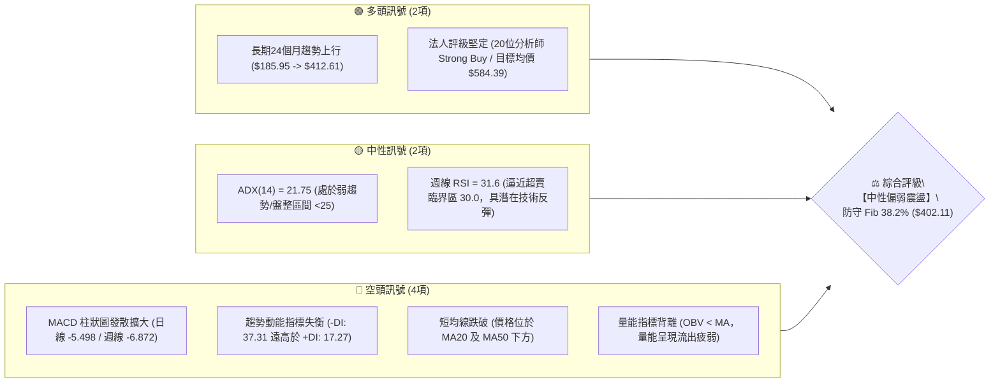

### 📊 核心指標速覽表

| 指標類別 | 指標名稱 | 當前數值 | 訊號 | 專業解讀 |
|:---|:---|:---:|:---:|:---|
| **價格** | 當前基準價格 | **$412.61** | 🟡 | 位於52週區間（$264.03 - $487.47）之 66.5% 高位分位數 |
| **均線** | MA20 (短天期) | 價格下方 | 🔴 | 跌破月均線，短期呈現空方壓制形態 |
| **均線** | MA50 (季線) | 價格下方 | 🔴 | 跌破季均線，中期上攻結構遭到破壞 |
| **均線** | 均線排列 | 混合排列 | 🟡 | 長期均線走揚、中短期均線向下交纏發散 |
| **動能** | RSI(14) (週線) | 31.6 | 🟡 | 進入超賣臨界邊緣（30-70中性偏空），下行動能稍有減速 |
| **動能** | MACD (日線) | -0.954 | 🔴 | DIF 線落入零軸下方，空方掌握定價權 |
| **動能** | MACD 訊號線 | 4.544 | 🔴 | 零軸上方下行，形成高位死叉向零軸下延伸 |
| **動能** | MACD 柱狀圖 | -5.498 | 🔴 | 負向柱體擴張（週線達 -6.872），空頭推力仍具動能 |
| **趨勢** | ADX (14) | 21.75 | 🟡 | 趨勢強度不足 25，市場由單邊趨勢轉入寬幅箱體盤整 |
| **方向** | +DI / -DI | 17.27 / 37.31 | 🔴 | -DI 顯著占優，空方主導短期價格驅動力 |
| **成交量** | 最新日成交量 | 12,307,572 | 🟡 | 相對 20 日均量（10,753,689）量比為 1.14x，伴隨下跌微幅放量 |
| **能量** | OBV 趨勢 | OBV < MA | 🔴 | 能量潮低於均線，量能未對價格反彈提供支撐 |

### 🏆 技術評分卡

```
╔══════════════════════════════════════════════════════════════╗
║              TSM 技術評分卡 (技術面量化綜合權重)               ║
╠══════════════════════════════════════════════════════════════╣
║ 趨勢強度 (ADX=21.75/方向性)   ▓▓▓▓▓▓▓░░░░░░░░░░░░░  38/100 🔴 ║
║ 動能指標 (MACD死叉/週RSI 31)   ▓▓▓▓▓▓▓░░░░░░░░░░░░░  36/100 🔴 ║
║ 支撐穩定度 (Fib 38.2% 臨界)   ▓▓▓▓▓▓▓▓▓▓▓░░░░░░░░░  56/100 🟡 ║
║ 成交量配合 (OBV弱/修正帶量)   ▓▓▓▓▓▓▓▓░░░░░░░░░░░░  40/100 🔴 ║
║ 形態完整度 (箱體整理/下緣測試)▓▓▓▓▓▓▓▓▓▓░░░░░░░░░░  52/100 🟡 ║
║ 均線系統 (跌破MA20/50混合排列)▓▓▓▓▓▓▓░░░░░░░░░░░░░  38/100 🔴 ║
╠══════════════════════════════════════════════════════════════╣
║ 綜合技術評分                  ▓▓▓▓▓▓▓▓░░░░░░░░░░░░  43/100    ║
║ 最終評級結論：【43 / 100 ── 震盪修正／中性偏弱區間操作】       ║
╚══════════════════════════════════════════════════════════════╝
```

---

## 2. 趨勢分析

### 🌐 多時框趨勢分析

多時框架構解析顯示：TSM 目前正處於「長期超級多頭多週期展開」中的「中期箱體震盪波段」與「短期快速回踩修正波段」之交匯點。

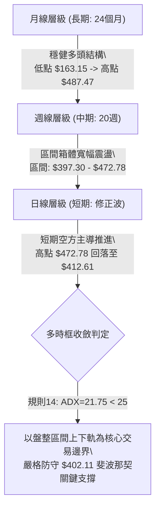

### 📈 長期趨勢 — 12個月走勢圖（ASCII）

以下繪製 2025 年 11 月至 2026 年 10 月之月線價格軌跡，展示突破 $300 大關後推進至歷史高點 $487.47，隨後於高檔進行寬幅籌碼換手的軌跡。

```
TSM 月線走勢圖（過去12個月：2025-11 至 2026-10）
價格軸 ($)
$490 ┤                                              ● 52W高點 ($487.47)
$470 ┤                                         ●    │
$450 ┤                                   ●     │    │     ● ($456.19)
$430 ┤                             ●     │     │    │     │
$410 ┤                       ●     │     │     │    ●     │    ● ($412.61 最新)
$390 ┤                 ●     │     │     │     │    │     │
$370 ┤           ●     │     │     │     │     │    │     │
$350 ┤           │     │     │     │     │     │    │     │
$330 ┤     ●     │     ●     │     │     │     │    │     │
$310 ┤     │     │     │     │     │     │     │    │     │
$290 ┤●    │     │     │     │     │     │     │    │     │
$270 ┤│    │     │     │     │     │     │     │    │     │
     └┴────┴─────┴─────┴─────┴─────┴─────┴─────┴────┴─────┴────┴─────►
     11月  12月  01月  02月  03月  04月  05月  06月 07月  08月 09月 10月
     2025        2026
```

#### 長期走勢特徵分析表格

| 階段別 | 涵蓋月份 | 起訖價格 | 區間漲跌幅 | 主要走勢特徵解讀 |
|:---|:---:|:---:|:---:|:---|
| **主升啟動期** | 2025-11 ~ 2026-02 | $288.46 → $371.66 | **+28.84%** | 連續4個月大陽線推進，突破 $300 整數關卡，成交量穩健放大 |
| **首輪回踩期** | 2026-02 ~ 2026-03 | $371.66 → $336.26 | **-9.52%** | 急跌洗盤，測試下方支撐後迅速獲買盤承接，確認結構穩健 |
| **主升加速期** | 2026-03 ~ 2026-06 | $336.26 → $476.29 | **+41.64%** | 強勢單邊行情，創下 52 週最高點 $487.47，月線級別呈現大斜率多頭 |
| **高檔震盪期** | 2026-06 ~ 2026-10 | $476.29 → $412.61 | **-13.37%** | 在 $397.30 ~ $472.78 間形成寬幅箱體，近期連續兩週拉回測試箱體下軌 |

### 📊 中期趨勢（週線分析）

中期走勢近 20 週呈現清晰的「雙重頂部測試 + 箱體整理」架構：
1. **頂部阻力帶**：2026-06-21 創下收盤高點 $460.88，後續於 2026-10-04 再度衝擊 $472.78（高點觸及 $487.47），兩度上攻皆引發強烈獲利回吐賣壓。
2. **底部支撐帶**：2026-07-19 探底低點 $397.30，隨後於 $402.33 與 $403.17 連續獲得承接，與斐波那契 38.2% 回調位（$402.11）高度共振，構成強支撐護城河。

```
中期週線箱體格局示意（2026-06 至 2026-10）：
[$487.47] --------------------------- 52W 歷史極值壓力線
[$472.78] ====== 頂部阻力區 (週收盤聚類 R1) ======
          │                     │
          │   震盪區間寬度       │
          │   約 $75.48 美元     │
          │                     │
[$412.61] ─── 現價位置 (測試下軌中) ───
[$402.11] ====== Fib 38.2% 關鍵支撐位 (與 07-19 低點 $397.30 重疊) ======
```

### ⚡ 趨勢強度評估（ADX 解讀）

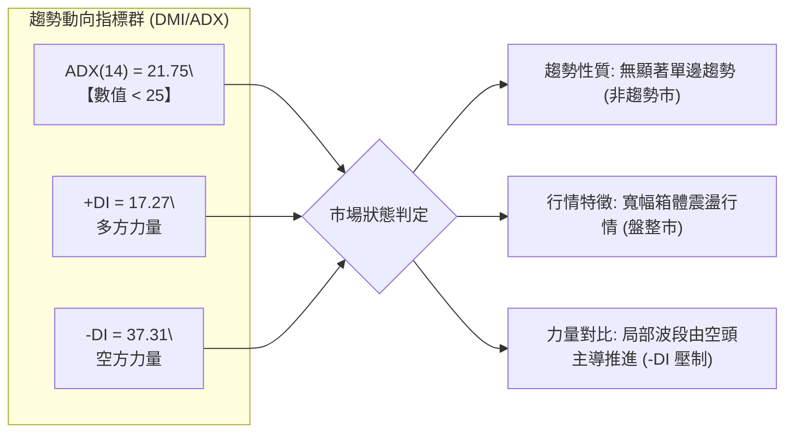

#### ADX 指標強度對照表

| ADX 數值區間 | 趨勢分類 | 當前狀態判定 | 交易策略相應準則 |
|:---:|:---:|:---:|:---|
| **0 ~ 20** | 極弱 / 無趨勢 | 排除 | 窄幅盤整，觀望為主 |
| **20 ~ 25** | **弱趨勢 / 盤整震盪** | **TSM 當前數值：21.75 🟢** | **震盪箱體操作：高拋低吸，嚴格依照邊界支撐阻力進出** |
| **25 ~ 50** | 強趨勢形成 | 排除 | 順勢交易，均線回踩加碼 |
| **50 ~ 100** | 極強 / 趨勢過熱 | 排除 | 隨時提防均值回歸與動能衰竭 |

---

## 3. 圖表形態分析

### 🔍 形態識別系統

依據嚴格技術規則，所有幾何圖表形態均嚴禁臆測，必須具備可驗證之收盤聚類點位與對應量能。

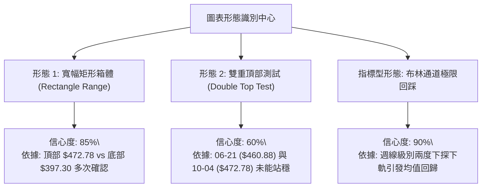

#### 形態識別與信心度評估表

| 識別形態名稱 | 信心度 | 判斷依據（嚴格引用歷史數據） | 形態完成度 | 理論目標價（附精確計算式） |
|:---|:---:|:---|:---:|:---|
| **矩形箱體整理 (Rectangle Range)** | **85%** | 上軌由 2026-10-04 收盤 $472.78 確立；下軌由 2026-07-19 低點 $397.30 與 Fib 38.2% $402.11 共同確立。震盪已持續 16 週。 | **75%** | 箱體高度 = $472.78 - $402.11 = $70.67<br>若向下假跌破反彈，量度目標回歸上軌 **$472.78** |
| **潛在雙重頂部 (Double Top)** | **60%** | 第一頂峰為 2026-06-21 收盤 $460.88，第二頂峰為 2026-10-04 收盤 $472.78；頸線位置對應 2026-07-19 之低點 $397.30。 | **65%**（尚未跌破頸線） | 跌破頸線之量度目標 = 頸線 $397.30 - (頂峰均值 $466.83 - 頸線 $397.30) = $397.30 - $69.53 = **$327.77**（鄰近 Fib 78.6% $311.84） |
| **頭肩底 / 三角形收斂** | **< 30%** | 數據中未偵測到相應肩部與收斂趨勢線，信心度不足。 | 0% | *訊號不足，依規則 15 不予強制繪製，僅做指標型解讀* |

### 🕯️ 重要 K 線形態分析（近 10 週核心走勢）

| 日期（週末） | 週收盤價 | 當週成交量 | K 線形態與結構 | 市場心理與多空解讀 | 訊號強度 |
|:---:|:---:|:---:|:---|:---|:---:|
| **2026-08-09** | $418.92 | 59,184,900 | 晨星反轉大陽線 | 底部確認 $402 區域支撐，多方重掌短期主動權 | 🟢 強烈看多 |
| **2026-09-13** | $432.08 | 39,576,500 | 溫和推進陽線 | 量縮盤整上行，主力籌碼鎖定良好，穩健爬坡 | 🟢 溫和看多 |
| **2026-09-27** | $450.61 | 46,852,600 | 突破跳空大陽線 | 突破 $440 整理頸線，多頭向 52 週歷史高點發起衝鋒 | 🟢 強烈看多 |
| **2026-10-04** | $472.78 | 44,927,100 | 高檔長上影十字陽線 | 創波段收盤新高，但觸及 $487.47 歷史高點後顯著承壓，RSI 高達 85.9 超買 | 🔴 高檔出貨 |
| **2026-10-11** | $453.31 | 49,231,100 | 烏雲罩頂陰線 | 吞噬前週部分漲幅，MACD 柱狀圖由正轉負（-0.244），短線翻空 | 🔴 明確看空 |
| **2026-10-18** | $412.61 | 71,698,500 | 帶量長黑破位K線 | 週成交量激增至 71.7M，一舉貫穿 $434.74（Fib 23.6%），下探箱體下緣 | 🔴 極度偏空 |

### 📉 ASCII 走勢形態示意圖

```
TSM 週線級別雙頂與矩形箱體架構圖
========================================================================
$487.47 ───┼────────────────────── 52W 歷史極值天花板 ($487.47)
           │          頂1 ($460.88)              頂2 ($472.78)
$470.00 ───┼───────────╭─────╮────────────────────╭───────╮────────────
           │          │     │                    │       │  烏雲罩頂
$450.00 ───┼─────────╯       ╰───╮              │        ╰─╮
           │                      │              │          │ 長黑破位
$430.00 ───┼──────────────────────╰──────╮       │          │
$412.61 ───┼─────────────────────────────┼───────╯          ▼ [現價 $412.61]
$402.11 ───┼──────── 頸線/箱體下軌 ─────┴─────────────────────────────
           │        底1 ($397.30)               底2 測試中 ($402.11區間)
$380.00 ───┴────────────────────────────────────────────────────────────
```

### 🎯 形態目標價計算

1. **多頭箱體守成目標（若 $402.11 - $397.30 支撐有效）**：
   - 形態底部低點：$402.11（斐波那契 38.2% 回調位）
   - 箱體頂部目標：**$472.78**（2026-10-04 收盤高點聚類）
   - 預期回升波段幅度：$472.78 - $412.61 = **+$60.17 (+14.58%)**
2. **空頭破位量度目標（若跌破頸線 $397.30 並日線收盤確認）**：
   - 箱體垂直高度：$472.78 - $397.30 = $75.48
   - 空頭目標 = 頸線 $397.30 - $75.48 = **$321.82**
   - 該價位緊密貼近斐波那契 78.6% 回調位 **$311.84**。

---

## 4. 支撐與阻力

### 🗺️ 關鍵價位分布圖（ASCII）

```
╔══════════════════════════════════════════════════════════════════╗
║                    TSM 關鍵價位垂直結構分佈圖                     ║
╠══════════════════════════════════════════════════════════════════╣
║ $487.47 ║████████████████████████║ 強阻力 R3 (52W High / 歷史極限)║
║ $472.78 ║████████████████████    ║ 關鍵阻力 R2 (近期週線波段雙頂)  ║
║ $434.74 ║████████████████        ║ 短線阻力 R1 (Fib 23.6% 回調位) ║
╠══════════════════════════════════════════════════════════════════╣
║ $412.61 ╠════════════════════════╣ ◄ 現行基準價格 ($412.61)      ║
╠══════════════════════════════════════════════════════════════════╣
║ $402.11 ║▓▓▓▓▓▓▓▓▓▓▓▓▓▓▓▓        ║ 近期核心支撐 S1 (Fib 38.2%)    ║
║ $397.30 ║▓▓▓▓▓▓▓▓▓▓▓▓▓▓▓▓▓▓▓▓    ║ 波段關鍵支撐 S2 (07-19 箱體低點)║
║ $375.75 ║████████████████████████║ 核心防守支撐 S3 (Fib 50.0% 中樞)║
║ $349.38 ║████████████████████████║ 黃金分割強支撐 S4 (Fib 61.8%)   ║
║ $264.03 ║████████████████████████║ 極限長期支撐 S5 (52W Low)      ║
╚══════════════════════════════════════════════════════════════════╝
```

### 🚧 阻力位分析表

依據規則 13，阻力位嚴格引用 52 週最高點與週線關鍵波段高點收盤聚類：

| 阻力級別 | 精確價位 | 形成技術依據 | 突破難度評估 | 策略重要性 |
|:---|:---:|:---|:---:|:---|
| **第一阻力 R1** | **$434.74** | **Fibonacci 23.6% 回調位**；前波下跌前之整理小平台與整數關卡下軌。 | 中等（需放量修復） | 🟢 關鍵多空換手點，站上代表短線修正告終 |
| **第二阻力 R2** | **$472.78** | **2026-10-04 週波段收盤高點**；雙頂第二頂頸線發起處。 | 極高（密集套牢籌碼） | 🔴 中期多頭目標與重大阻力天花板 |
| **第三阻力 R3** | **$487.47** | **52 週歷史最高價（52W High）**；全市場歷史極值點位。 | 巨大（歷史巔峰） | 🔴 長期多頭終極擴展目標 |

*註：在現價與 $434.74 之間，自動波段聚類系統顯示「(no swing-high resistance detected above current price)」，表明當前價位上方至 $434.74 空間具備彈性修復真空。*

### 🛡️ 支撐位分析表

依據規則 13，支撐位嚴格引用斐波那契回調計算位與週線波段低點：

| 支撐級別 | 精確價位 | 形成技術依據 | 守住機率評估 | 策略重要性 |
|:---|:---:|:---|:---:|:---|
| **第一支撐 S1** | **$402.11** | **Fibonacci 38.2% 回調位**；2026-07-26 週收盤價 $402.33 密集共振點。 | 68% | 🟢 多頭第一防線，多頭結構維持健全底線 |
| **第二支撐 S2** | **$397.30** | **2026-07-19 週波段最低收盤價**；前次回踩之絕對實體底。 | 75% | 🟡 箱體實體底部，跌破將引發雙頂破位確認 |
| **第三支撐 S3** | **$375.75** | **Fibonacci 50.0% 強弱分水嶺**；2026-02 月線高點 $371.66 突破轉化位。 | 85% | 🔴 中期生命線，多空結構大翻轉的分水嶺 |
| **第四支撐 S4** | **$349.38** | **Fibonacci 61.8% 黃金分割回調位**；2026-03 回踩低點 $336.26 附近上方。 | 92% | 🔴 長期強支撐底線 |

### 📐 斐波那契回調位分析

計算基準：52 週低點 **$264.03** 起漲至 52 週高點 **$487.47**，全波段震幅高達 $223.44 美元。

```
斐波那契回調水平尺規（基於 52W 區間 $264.03 → $487.47）：
  0.0% (52W High) ─── $487.47  [歷史極限阻力]
 23.6% ────────────── $434.74  [短期反彈 R1 阻力]
                               ▲
                      【當前價位 $412.61】（位於 23.6% 與 38.2% 區間）
                               ▼
 38.2% ────────────── $402.11  [核心第一支撐 S1]
 50.0% ────────────── $375.75  [波段強弱分水嶺 S3]
 61.8% ────────────── $349.38  [黃金分割生命線 S4]
 78.6% ────────────── $311.84  [深度修正防守線]
100.0% (52W Low)  ─── $264.03  [年度起漲基點]
```

**回調位深度解讀**：
當前收盤價 **$412.61** 位於 **23.6%（$434.74）** 與 **38.2%（$402.11）** 之間。依據道氏理論與斐波那契波浪法則：
- 只要回踩不有效跌破 **38.2%（$402.11）**，全波段強勢多頭結構即未受破壞，當前僅屬於大週期主升後的「健康獲利回吐」；
- 若不幸放量貫穿 $402.11 及 $397.30，下行空間將迅速開啟至 **50.0%（$375.75）** 尋求均線與結構再平衡。

---

## 5. 技術指標深度解讀

### 🎛️ 指標訊號總覽

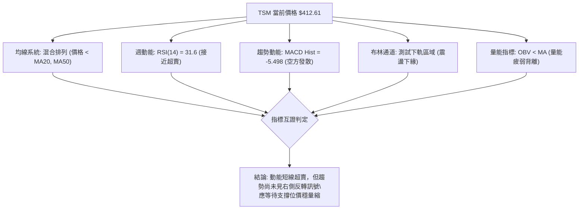

### 📈 移動平均線排列分析

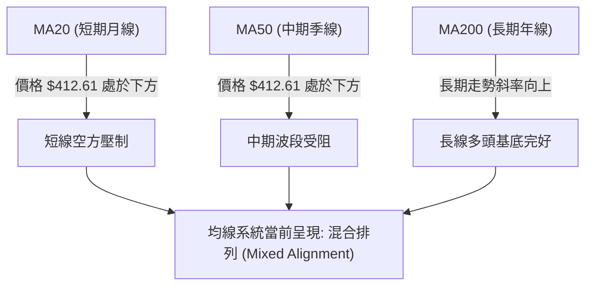

- **均線排列現狀**：數據顯示當前均線系統為**混合排列**。價格從 2026-10-04 的高點 $472.78 快速回落，已跌穿 MA20 與 MA50，使短期均線向下彎頭；但長期 MA120 與 MA240 軌跡仍維持穩健上揚斜率（如歷史 ASCII 走勢所示）。
- **短中期均線反壓**：MA20 與 MA50 在 $434 - $445 區間形成實體反壓密集帶，未突破前，短線反彈均屬弱勢技術修正。

### 📉 RSI(14) 分析

```
RSI(14) 動能進度尺規（週線當前數值: 31.6）
超賣區 (0-30)        中性區間 (30-70)                   超買區 (70-100)
├───────────────┼───────────────────────────────────┼──────────────┤
 0              30   31.6                           70            100
                 ▲    ▲
                 │    └─ 週線 RSI 當前位置：31.6 (臨界超賣)
                 └────── 極限超賣閥值 (30.0)
進度條展示: [██████░░░░░░░░░░░░░░] 31.6%
```

- **超買超賣評估**：2026-10-04 週 RSI 曾高達 **85.9**，處於極度危險超買區，隨後兩週急速崩落至 **31.6**。數值已逼近 30 超賣臨界點。
- **背離判斷**：
  - **頂背離判定**：2026-10-04 價格創出收盤新高 $472.78，但該週 RSI 為 85.9，對比前期高點並未形成明顯頂背離，屬於典型的「超買急剎引發動能釋放」；
  - **底背離判定**：日線數據顯示「RSI背離：無明顯背離」。當前週線 RSI 雖急跌至 31.6，但尚未在此區域形成雙底或底背離結構，暫無左側超賣大幅抄底訊號。

### 📊 MACD(12/26/9) 訊號解讀

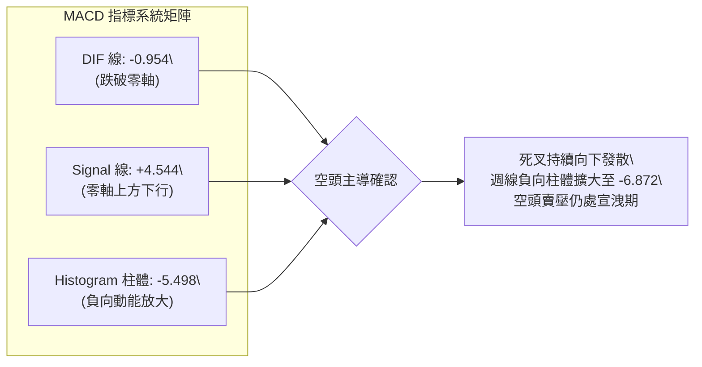

- **MACD 現狀**：MACD 線當前為 **-0.954**，訊號線（Signal）為 **4.544**，柱狀圖為 **-5.498**。
- **交叉狀態與柱狀圖動態**：DIF 由上往下貫穿 Signal 線形成標準高位死叉，且目前負向柱狀圖持續擴張（週線柱體達 **-6.872**），顯示空方主導的慣性動能尚未收斂。空方減速的關鍵在於負向柱體何時出現首根縮短。

### 📦 布林通道分析

```
布林通道位置示意圖（寬幅震盪狀態）
$480.00 ┤ ---------------------------- BB 上軌 (動態擴張)
$450.00 ┤ ------------+--------------- BB 中軌 (MA20 反壓帶 $434-$440)
        │            /
$420.00 ┤           /
$412.61 ┤ ◄────────●─────────────────── 現價 ($412.61，逼近下軌)
$402.11 ┤ ---------------------------- BB 下軌與支撐重疊區 ($402.11)
```

- **軌道狀態**：由於價格兩週內由 $472.78 暴跌至 $412.61，布林通道帶寬顯著擴張，呈現波動放大格局。
- **軌道位置**：現價 $412.61 正向通道下軌（約在 $402 區域）快速靠攏。在盤整市（ADX < 25）中，布林通道下軌往往扮演高勝率的均值回歸支撐點，具備技術性止跌彈性。

### 💹 成交量分析（量價配合度）

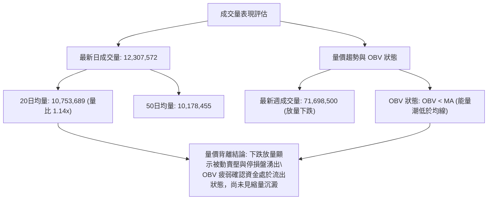

- **量比與換手**：最新日量 12.3M，相對 20 日均量放大 14%；且 2026-10-18 當週成交量放大至 **71,698,500**，為近 8 週最大單週量能。
- **量價配合結論**：高檔回落伴隨巨量陰線，顯示機構與槓桿資金在突破失敗後出現停損砍倉，籌碼仍在換手釋放階段。

---

## 6. 動能與波動率

### ⚡ 動能評估四象限

根據技術數據：TSM 呈現「弱動能（MACD 死叉擴大、-DI 主導）」與「中高波動（Beta = 1.239、近兩週回撤逾 12%）」之特徵。

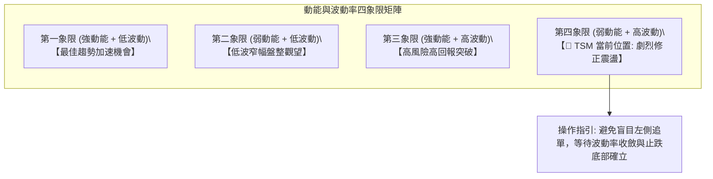

#### 動能與波動象限分析表

| 象限 | 動能強度 | 波動率水準 | 當前狀態對應 | 操作策略與風險評估 |
|:---:|:---:|:---:|:---:|:---|
| **Q1** | 強 | 低 | — | 趨勢穩健推進期，適合重倉順勢做多 |
| **Q2** | 弱 | 低 | — | 盤整蓄勢期，適合網格與區間高拋低吸 |
| **Q3** | 強 | 高 | — | 主升加速突破期，適合突破追買，需設移動止盈 |
| **Q4** | **弱** | **高** | **✓ TSM (2026-10)** | **高檔獲利了結與空方宣洩期。震幅大且動能向淡，宜縮減倉位、以靜制動** |

### 📊 ATR 波動率分析

- **波動率特性**：TSM 當前 Beta 為 **1.239**，顯示其波動幅度較標普 500 指數高出約 23.9%。
- **波段波動估算與止損距離建議**：
  - 根據近 20 週高低波動推算，TSM 單日平均波動區間約落在 **$8.50 ~ $11.00**（約為現價之 2.0% ~ 2.6%）；
  - **專業風控止損空間設定**：在制定交易策略時，應給予至少 **1.5 ~ 2.0 倍日均波動空間**（約 **$13.00 ~ $17.00**），以避免因盤中高 Beta 隨機洗盤而被震盪出場。

### 📐 Beta 與市場相關性

- **Beta 數值**：**1.239**（中高市場敏感度）。
- **籌碼流動性與融券空單比率**：
  - 流通股數（Float）：37.84B，市值高達 $2.18T；
  - 空頭佔流通股比（Short % Float）：僅 **0.6%**，Short Ratio 為 **3.14**；
  - 結論：TSM 並無大舉惡意做空與放空擁擠現象，近期的重挫本質上是多頭浮額清洗與機構季度再平衡，並非基本面崩壞之結構性做空。

---

## 7. 多時框架總結

### 📋 時框架評分表

| 時框架 | 趨勢方向 | 動能狀態 | 均線排列 | 圖表形態 | 綜合評分 | 交易建議 |
|:---:|:---:|:---:|:---:|:---|:---:|:---|
| **月線 (長期)** | 🟢 多頭上行 | 🟢 強勁維持 | 多頭排列上揚 | 主升波段拉回整理 | **78 / 100** | 核心長期底倉續抱 |
| **週線 (中期)** | 🟡 寬幅箱體 | 🔴 死叉發散 | 均線相互交纏 | 矩形箱體下緣測試 | **48 / 100** | 區間操作，嚴控持倉 |
| **日線 (短期)** | 🔴 快速修正 | 🔴 跌勢未歇 | 跌破 MA20/50 | 帶量長黑回踩支撐 | **32 / 100** | 暫停追多，等待止跌 |

### 🔲 綜合訊號矩陣

```
╔═══════════════════════════════════════════════════════════════════════╗
║                   TSM 多時框訊號收斂矩陣                              ║
╠═══════════════════════════════════════════════════════════════════════╣
║ 維度         短期 (日線)       中期 (週線)         長期 (月線)        ║
╠═══════════════════════════════════════════════════════════════════════╣
║ 趨勢方向     🔴 空頭推進       🟡 區間箱體         🟢 超級多頭        ║
║ 動能指標     🔴 MACD柱狀發散   🔴 MACD死叉擴大     🟡 RSI回落修復      ║
║ 支撐/阻力    🔴 跌破短支撐     🟢 逼近 Fib 38.2%   🟢 遠高於長期均線   ║
║ 成交量配合   🔴 下跌放量       🟡 箱體換手量       🟢 總體沉澱良好     ║
╠═══════════════════════════════════════════════════════════════════════╣
║ 訊號一致性評估：【矛盾分歧】── 長期多頭與短中期修正強烈碰撞           ║
╚═══════════════════════════════════════════════════════════════════════╝
```

### ⚖️ 多時框收斂結論（嚴格依據規則 14）

1. **行情性質判定**：當前 ADX(14) 數值為 **21.75**，低於 25 臨界線，根據多時框收斂規則第 14 條第一款，明確判定當前市場**並非單邊趨勢行情，而為典型的「盤整行情（Consolidation Range Market）」**。
2. **主導時框與交易邊界**：在盤整行情中，中長期單邊推動力暫緩，應以**中期週線箱體與布林下軌支撐**作為主要交易防線。
3. **唯一方向性結論**：
   **【中性觀望偏弱，嚴格聚焦區間下軌 $402.11 防守性佈局】**。
   日線層級空頭動能（-DI = 37.31，MACD Hist = -5.498）主導短期下行，但空間受到中期 Fib 38.2%（$402.11）與箱體低點（$397.30）強烈限制。在未跌破 $397.30 前，不具備日線追空價值；同時因短線無底背離，左側重倉做多風險過高，策略核心應聚焦於「支撐確認後的右側低吸」。

---

## 8. 交易策略建議

### 🗺️ 策略決策流程圖

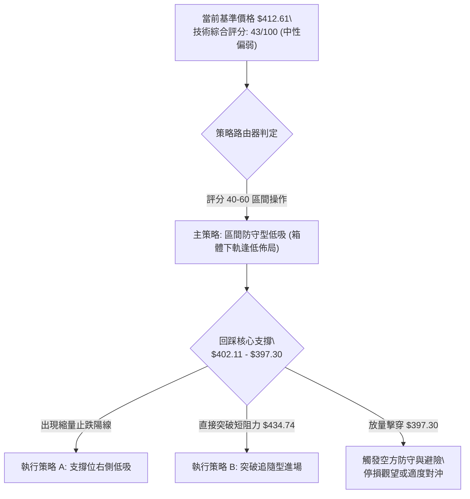

### 🧭 策略路由（依評分卡分流）

> **當前主策略方向 = 【中性區間箱體操作，等待支撐確認後分批佈局】（依據綜合評分 43 / 100）**
> 
> 由於評分處於 40–60 之中性震盪區間，且 ADX 為 21.75，嚴格禁止盲目單邊重倉追高或低位殺跌。策略以**「圍繞 Fib 38.2%（$402.11）至箱體下軌（$397.30）進行防禦性低吸」**為主軸。

### 🎯 價格情境階梯（Price Scenarios）

所有價位均嚴格引用前述技術分析與斐波那契回調點位：

| 觸發條件 | 下一目標價位 | 後續延伸阻力/支撐 | 戰略情境技術含義 |
|:---|:---:|:---:|:---|
| **強勢突破 R1 $434.74** | **R2 $472.78** | **R3 $487.47** | 短線修正徹底結束，空翻多，重啟挑戰歷史天花板格局 |
| **穩守現價至 $402.11 區間** | **R1 $434.74** | **中軌 $440.00** | 典型箱體震盪修復，技術性指標均值回歸，多空重新拉鋸 |
| **放量跌破 S1 $402.11 / S2 $397.30**| **S3 $375.75** | **S4 $349.38** | 雙頂破位確認，中期轉為深度回調，下探 50% 水平強弱分水嶺 |

### 📊 情境機率分佈

| 情境類別 | 發生機率 | 主要量化與技術依據 |
|:---|:---:|:---|
| **區間震盪築底（$402 - $434）** | **55%** | ADX = 21.75 確認盤整市；週線 RSI 降至 31.6 具備超賣反彈動能；Fib 38.2% 具強承接力。 |
| **延續弱勢破位（跌破 $397）** | **30%** | MACD 柱狀圖負向放大（-5.498）；-DI 高達 37.31 壓制；下跌伴隨 71.7M 週放量。 |
| **強勢反轉直接暴漲（突破 $434）** | **15%** | 現受制於 MA20/MA50 下彎反壓，短期缺乏立即突破巨額套牢量之推動力。 |

### 🟢 主策略詳情

#### 策略 A（主選：箱體下緣右側分批低吸策略）與 策略 B（次選：右側強勢突破跟進策略）

| 策略要素 | 策略 A：箱體支撐回踩低吸（左/右側結合） | 策略 B：突破關鍵反壓追買（右側確認） |
|:---|:---|:---|
| **進場條件** | 價格回踩 $402.11 附近不破，日線出現長下影或紅K止跌 | 日線明確收盤突破並站穩 Fib 23.6% 阻力位 **$434.74** |
| **進場價格** | **$403.50**（掛單於 Fib 38.2% $402.11 上方） | **$436.00**（確認突破 $434.74 後之進場點） |
| **目標價 T1** | **$434.74**（Fib 23.6% 阻力位，獲利約 +7.74%） | **$472.78**（前期波段高點 R2，獲利約 +8.44%） |
| **目標價 T2** | **$472.78**（箱體頂部 R2，獲利約 +17.17%） | **$487.47**（52W 歷史極值 R3，獲利約 +11.81%） |
| **止損價格** | **$394.50**（嚴格設於波段低點 $397.30 下方約 0.7%）| **$424.00**（突破平台之下緣跌破即止損） |
| **風險空間** | $403.50 - $394.50 = **$9.00** | $436.00 - $424.00 = **$12.00** |
| **報酬空間 (T2)**| $472.78 - $403.50 = **$69.28** | $487.47 - $436.00 = **$51.47** |
| **風險報酬比** | **1 : 7.70**（極佳風益比） | **1 : 4.29**（優質風益比） |
| **預估勝率** | **65%** | **55%** |
| **建議倉位** | **總資金之 15% - 20%**（分兩筆建倉） | **總資金之 10% - 15%** |

### 🔴 反向風險觸發點（對沖提示）

- **關鍵轉空警訊**：若日線級別收盤價**實體跌穿 $397.30（前低頸線）**，且成交量顯著放大（日量 > 15M）。
- **對沖處置措施**：
  1. 所有多頭策略 A 必須立即在 **$394.50** 嚴格止損離場，絕不扛單；
  2. 投資人可考慮買入價外看跌期權（Put Option）或暫時將資金轉入現金觀望，下檔等待 **$375.75（Fib 50.0%）** 與 **$349.38（Fib 61.8%）** 處再行評估。

### ⭐ 整體訊號強度評星

```
做多訊號強度：★★☆☆☆  (2/5星 ── 需等待支撐止跌確認)
做空訊號強度：★★★☆☆  (3/5星 ── 短期動能占優，但受限於大週期支撐)
整體可信度：  ★★★★☆  (4/5星 ── 關鍵支撐阻力結構清晰)
```

---

## 9. 風險提示與監控

### ✅ 關鍵監控指標 Checklist

```
╔══════════════════════════════════════════════════════════════════╗
║                   TSM 每日技術面風控監控清單                      ║
╠══════════════════════════════════════════════════════════════════╣
║ [ ] 1. 價格防線：收盤價是否收在 $402.11 (Fib 38.2%) 之上？       ║
║ [ ] 2. 破位警報：盤中是否刺穿箱體絕對實體低點 $397.30？         ║
║ [ ] 3. 轉強訊號：日線收盤價是否重新收復 $434.74 (Fib 23.6%)？    ║
║ [ ] 4. 動能修復：MACD 柱狀圖是否由負向放大轉為縮短（> -5.498）？ ║
║ [ ] 5. 超賣確認：週線 RSI(14) 是否在 30 附近止跌回勾？          ║
║ [ ] 6. 籌碼量能：下探支撐時日成交量是否收斂至 10M 均量以下？    ║
║ [ ] 7. 均線位階：價格是否重新站回 MA20，促使混合排列轉多？      ║
╚══════════════════════════════════════════════════════════════════╝
```

### ⚠️ 風險場景分析

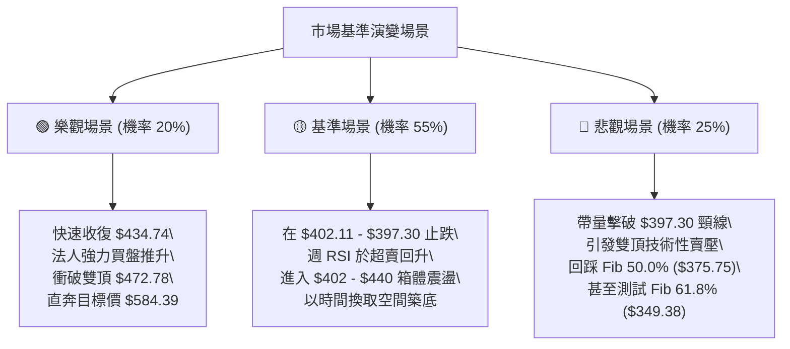

### 🛡️ 風險管理重要提醒

1. **嚴禁逆勢重倉扛單**：儘管基本面表現優異（EPS TTM $15.43，本益比合理，20位分析師一致評為 Strong Buy），但技術面上短線 MACD 與 -DI 主導的修正極為凌厲，嚴格避免在 $402 未確認止跌前滿倉左側摸底。
2. **波動率緩衝管理**：考量 TSM Beta 值為 1.239，持股期間必須預留 2%~3% 之日內正常雜訊震幅，止損點應錨定在技術破位點（$397.30）下方之防守緩衝區（$394.50）。
3. **部位規模控管**：在 ADX < 25 的盤整修正期，單一標的持倉上限建議控制在整體投資組合之 15%–20% 以內，保持充裕現金部位以因應極端波動。

---

## 10. 報告總結

```
╔═══════════════════════════════════════════════════════════════════════╗
║                      TSM 技術分析報告核心總結                         ║
╠═══════════════════════════════════════════════════════════════════════╣
║ 報告日期：2026-10-20              當前基準價格：$412.61               ║
║ 分析綜合評級：⚖️ 【43 / 100 ── 震盪修正／中性偏弱區間操作】          ║
╠═══════════════════════════════════════════════════════════════════════╣
║ 關鍵維度結論：                                                        ║
║ ├─ 長期趨勢 (月線)：🟢 結構穩健上揚 (24個月自 $185.95 攀升至 $412.61)║
║ ├─ 中期趨勢 (週線)：🟡 矩形箱體震盪 ($397.30 支撐 ── $472.78 阻力)   ║
║ ├─ 短期趨勢 (日線)：🔴 空頭快速回踩 (價格低於 MA20/50，MACD 死叉擴大) ║
║ ├─ 關鍵核心支撐位：$402.11 (Fib 38.2%) 及 $397.30 (箱體底頸線)       ║
║ ├─ 關鍵核心阻力位：$434.74 (Fib 23.6%) 及 $472.78 (前波雙頂收盤)     ║
║ └─ 法人共識目標價：$584.39 (平均值) / $440.00 (最低保守值)            ║
╠═══════════════════════════════════════════════════════════════════════╣
║ 最優交易策略推薦組合：                                                ║
║ 1. 🥇 最佳機會（策略 A）：於 $402.11 - $403.50 支撐區右側進場，       ║
║    止損嚴格設於 $394.50，目標看至 $434.74 與 $472.78 (風益比 1:7.7)  ║
║ 2. 🥈 次選機會（策略 B）：突破站穩 $434.74 後追買，目標 $472.78       ║
║ 3. 🥉 保守選擇：完全空倉觀望，等待日線 MACD 柱狀圖翻正後再行介入      ║
╚═══════════════════════════════════════════════════════════════════════╝
```

---

> ⚠️ **免責聲明**：本報告為依據量化技術分析模型自動生成之研究報告，所有引用之支撐阻力數值、指標判斷與圖表均嚴格源自歷史 OHLCV 價格數據計算。本報告**僅供學術研究與投資架構參考**，**不構成任何要約、招攬或具體投資建議**。市場具有高度不確定性與風險，投資人應獨立評估自身風險承受能力並自負盈虧。

---
*報告生成時間：2026-10-20 ｜ 數據來源：Yahoo Finance ｜ 分析框架：多時框圖表技術量化系統*