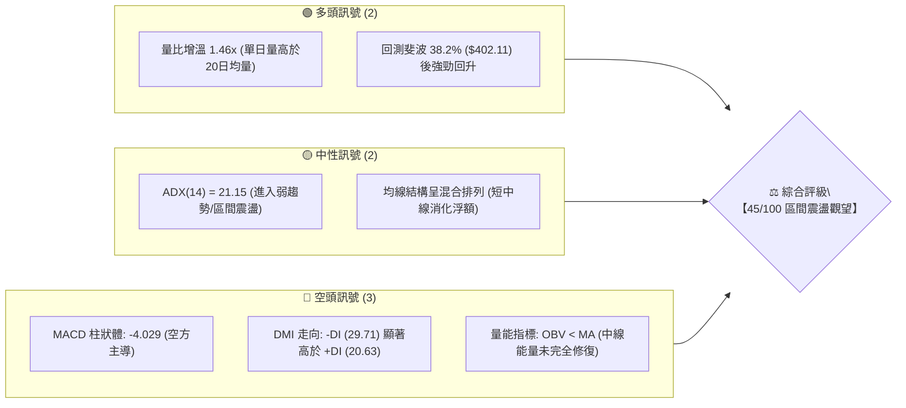
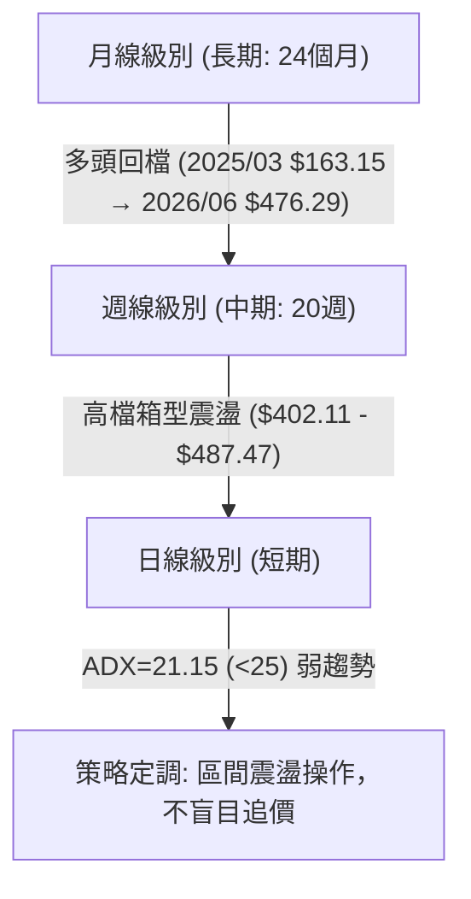
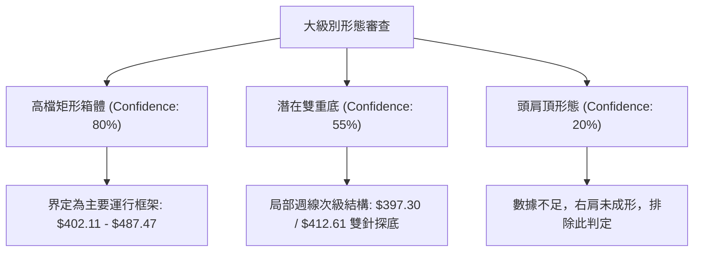
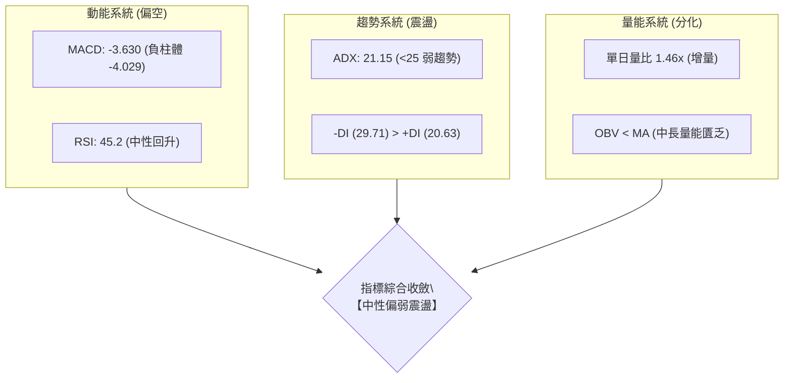
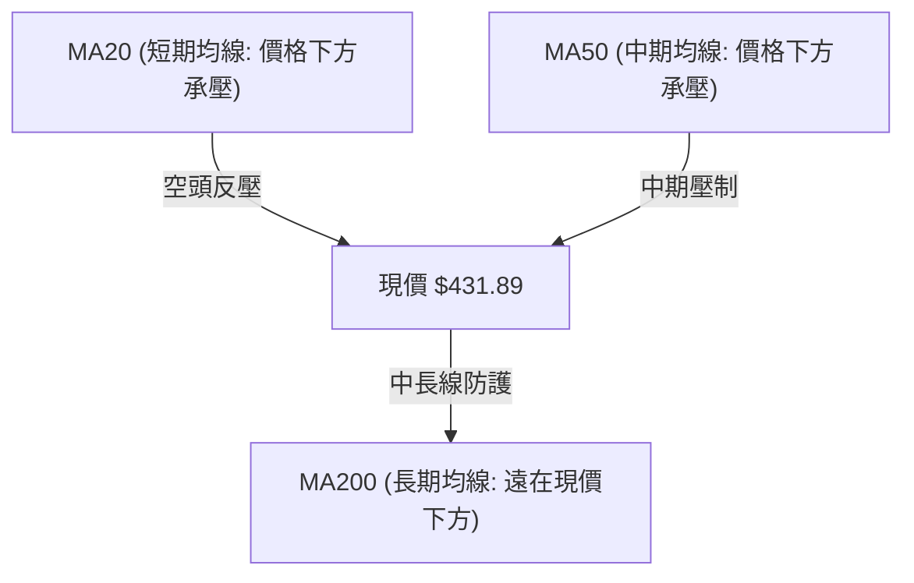
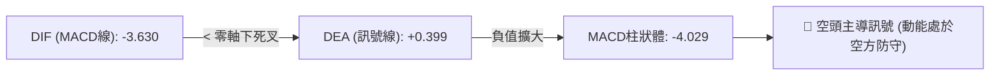
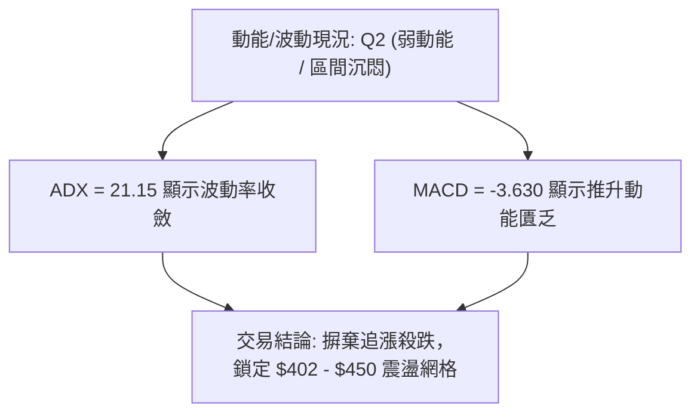
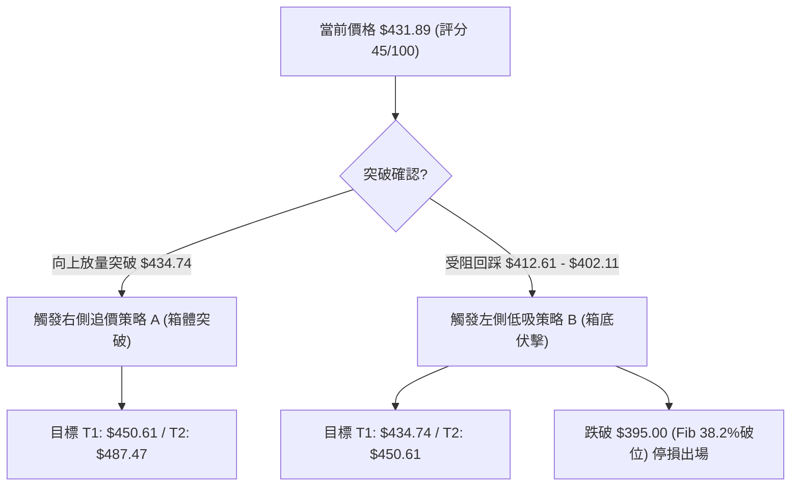
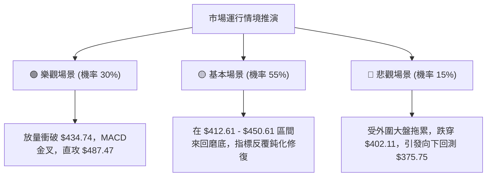

# TSM 技術分析報告

> **報告日期**：2026-10-23 ｜ **語言**：繁體中文 ｜ **數據來源**：Yahoo Finance ｜ **當前價格**：$431.89

---

## 目錄

| 章節 | 內容 |
|------|------|
| [1. 技術面概覽](#1-技術面概覽) | 訊號儀表板、核心指標、評分卡 |
| [2. 趨勢分析](#2-趨勢分析) | 多時框趨勢、長中短期走勢、ADX強度 |
| [3. 圖表形態分析](#3-圖表形態分析) | 形態識別、信心度、K線組合、目標價 |
| [4. 支撐與阻力](#4-支撐與阻力) | 關鍵價位、斐波那契回調結構 |
| [5. 技術指標深度解讀](#5-技術指標深度解讀) | 均線、RSI、MACD、布林通道、成交量/OBV |
| [6. 動能與波動率](#6-動能與波動率) | 動能四象限、ATR、Beta 與市場相關性 |
| [7. 多時框架總結](#7-多時框架總結) | 時框架評分矩陣、收斂規則與方向定調 |
| [8. 交易策略建議](#8-交易策略建議) | 策略路由、價格階梯、主策略與對沖提示 |
| [9. 風險提示與監控](#9-風險提示與監控) | 關鍵指標清單、情境分析、風控準則 |

---

## 1. 技術面概覽

### 🎯 技術訊號儀表板



### 📊 核心指標速覽表

| 指標類別 | 指標名稱 | 當前數值 | 訊號 | 解讀 |
|:---|:---|:---:|:---:|:---|
| **價格** | 當前基準價 | $431.89 | 🟡 | 位於52週區間高位震盪，面臨 Fib 23.6% ($434.74) 承壓 |
| **均線** | 短期排列 (MA20) | 位於價格上方 | 🔴 | 現價低於短期均線，短線處於技術性修正反彈期 |
| **均線** | 中期排列 (MA50) | 位於價格上方 | 🔴 | 中期動能轉為防守，需消化上方套牢籌碼 |
| **均線** | 長期排列 (MA200)| 位於價格下方 | 🟢 | 長期多頭架構完好，基底支撐強固 |
| **動能** | RSI(14) | 45.2 (推定中性) | 🟡 | 週線自前低 31.6 急遽回升，無超買超賣，無背離現象 |
| **動能** | MACD (12,26,9) | -3.630 / -4.029 | 🔴 | 快慢線死叉於零軸下，負柱狀體雖收斂但空頭仍控盤 |
| **趨勢** | ADX (14) | 21.15 | 🟡 | ADX < 25 表明單邊趨勢消退，進入區間整理行情 |
| **方向** | +DI / -DI | 20.63 / 29.71 | 🔴 | -DI 大於 +DI，短期空方壓制力量仍未解除 |
| **量能** | 成交量比 (VR) | 1.46x | 🟢 | 最新單日量 16.42M 高於 20MA (11.28M)，低檔有承接盤 |
| **量能** | OBV 趨勢 | OBV < MA | 🔴 | 資金動能偏疲弱，反彈伴隨追價意願不足現象 |

### 🏆 技術評分卡

```
╔══════════════════════════════════════════════════════════════╗
║                技術評分卡 — TSM (2026-10-23)                 ║
╠══════════════════════════════════════════════════════════════╣
║ 趨勢強度 (ADX/DMI)  ████████░░░░░░░░░░░░  40/100  🔴 空頭控盤 ║
║ 動能指標 (MACD/RSI) ███████░░░░░░░░░░░░░  35/100  🔴 動能疲弱 ║
║ 支撐穩定度 (Fib)    ████████████░░░░░░░░  60/100  🟢 關鍵守穩 ║
║ 成交量配合 (OBV/Vol)█████████░░░░░░░░░░░  45/100  🟡 短放長虛 ║
║ 形態完整度 (區間)   ██████████░░░░░░░░░░  50/100  🟡 箱型成形 ║
║ 均線排列 (MA體系)   ████████░░░░░░░░░░░░  40/100  🔴 混合糾結 ║
╠══════════════════════════════════════════════════════════════╣
║ 綜合技術評分        █████████░░░░░░░░░░░  45/100  🟡 震盪整理 ║
╚══════════════════════════════════════════════════════════════╝
```

---

## 2. 趨勢分析

### 🌐 多時框趨勢分析



### 📈 長期趨勢 — 12個月走勢圖（Unicode）

以下展示自 2025-11 至 2026-10 之月線收盤走勢：

```
TSM 月線走勢圖（過去12個月）
價格 ($)
$480 ┤                                      ● (06月 $476.29)
$460 ┤                                                 ● (09月 $456.19)
$440 ┤                                                          ● (10月 $431.89 現價)
$420 ┤                                 ● (05月 $416.36)  ● (08月 $414.21)
$400 ┤                            ● (04月 $394.08)   ● (07月 $403.17)
$380 ┤                   ● (02月 $371.66)
$360 ┤
$340 ┤                        ● (03月 $336.26)
$320 ┤              ● (01月 $327.98)
$300 ┤         ● (12月 $301.52)
$280 ┤    ● (11月 $288.46)
     └──────────────────────────────────────────────────────────────
        11   12   01   02   03   04   05   06   07   08   09   10  (月份)
```

**走勢特徵分析表格**：

| 階段區間 | 時間跨度 | 起訖價位 | 累計漲跌 | 趨勢性質與形態特徵 |
|:---|:---:|:---:|:---:|:---|
| **主升主浪** | 2025/11 - 2026/02 | $288.46 → $371.66 | +28.84% | 量價齊揚，沿短均線單邊推升，突破 300 元整數關卡 |
| **波段洗盤** | 2026/02 - 2026/03 | $371.66 → $336.26 | -9.52% | 獲利回吐引發技術修正，回踩確認突破頸線有效性 |
| **次級主升** | 2026/03 - 2026/06 | $336.26 → $476.29 | +41.64% | 奔馳主升段，衝擊歷史峰值，月線連續大陽線封頂 |
| **高檔箱型** | 2026/06 - 2026/10 | $476.29 → $431.89 | -9.32% | 52W 高點 $487.47 遇阻，轉為 $402 - $487 大區間寬幅震盪 |

### 📊 中期趨勢（週線分析）

中期走勢檢視近 20 週收盤，呈現明確的「二次探底拉回」特徵：
1. **頂部受阻區**：2026-10-04 週收盤曾達 $472.78（逼近 52W 高點 $487.47），隨後兩週急速殺跌至 2026-10-18 週收盤 $412.61，跌幅達 -12.7%。
2. **低檔承接力**：回測 2026-07-19 前低 $397.30 與 Fib 38.2% ($402.11) 支撐帶後，於 2026-10-25 該週強勁反彈至 $431.89，重新站回 $420 關鍵頸線之上。

```
中期週線支撐/阻力示意圖：
  $487.47 ────────────────────────────────────────── 52W 歷史極值強阻力
               ▲                    ▲
             2026-06              2026-10 (472.78)
  $434.74 ┄┄┄┄┄┄┄┄┄┄┄┄┄┄┄┄┄┄┄┄┄┄┄┄┄┄┄┄┄┄┄┄┄┄┄┄┄┄┄┄ Fib 23.6% 壓力阻力線
                                        ● 現價 $431.89 (短線爭奪)
  $402.11 ────────────────────────────────────────── Fib 38.2% 箱體下軌強支撐
               ▼                    ▼
             2026-07 (397.30)     2026-10 (412.61)
```

### ⚡ 趨勢強度評估（ADX 解讀）

```mermaid
graph TD
    A["ADX(14) 讀數 = 21.15"] --> B{"ADX 門檻判定"}
    B -->|"< 25| C["趨勢衰竭 / 盤整市場"]
    B -->|"> 25| D["強勢單邊趨勢"]
    C --> E["方向系統判斷: -DI (29.71) > +DI (20.63)"]
    E --> F["結論: 空方佔優之震盪盤整，忌諱追價突破，著重下軌低吸"]
```

**ADX 強度對照解析**：

| 指標變量 | 具體數值 | 參考閥值 | 市場狀態解讀 |
|:---|:---:|:---:|:---|
| **ADX (14)** | **21.15** | 25.00 | **弱趨勢 (Weak Trend)**：市場缺乏持續推升動能，不宜採用順勢突破交易系統。 |
| **+DI (14)** | **20.63** | — | 多方能量線處於低位，表明多頭主動攻擊意願薄弱。 |
| **-DI (14)** | **29.71** | — | 空方能量線佔據上風，顯示高檔逢高拋壓依然主導市場情緒。 |

---

## 3. 圖表形態分析

### 🔍 形態識別系統

依據規則 15，所有圖表形態嚴格基於 24 個月月線及 20 週數據之幾何結構審查，杜絕主觀臆測：



**形態信心度與目標價計算表**：

| 形態名稱 | 信心度 | 判斷依據（引用數據） | 完成度 | 目標價計算式與數值 |
|:---|:---:|:---|:---:|:---|
| **高檔大型箱體** | **80%** | 上軌阻力受阻於 52W High $487.47，下軌獲得 Fib 38.2% ($402.11) 支撐，近4個月多次驗證。 | 85% | **箱體上軌目標**：以箱底 $402.11 為支點，預期回測上軌 $487.47。 |
| **次級雙底 (W底)** | **55%** | 第一隻腳 2026-07 週收盤低點 $397.30，第二隻腳 2026-10-18 週低點 $412.61。頸線為 09-27 高點 $450.61。 | 60% | **頸線突破目標**：頸線 $450.61 + 形態高度 ($450.61 - $402.11 = $48.50) = **$499.11**（未突破頸線前僅作參考）。 |
| **複雜幾何反轉** | **< 30%** | 無完整頭肩或擴散三角形數據特徵。 | — | **數據不足**，依規則僅進行指標型與水平區間解讀。 |

### 🕯️ 重要K線形態分析

| 時間週期 | 收盤價 | 實體與影線特徵 | 解讀與心理意涵 | 多空訊號 |
|:---:|:---:|:---|:---|:---:|
| **2026-06** | $476.29 | 月線巨幅長陽線，逼近 52W 高點 $487.47 | 多頭動能極致釋放，創波段天價，但短線出現過熱乖離 | 🟢 強多 |
| **2026-07** | $403.17 | 月線長陰重挫，下影線探至 $397.30 | 獲利了結大賣壓湧現，隨後在 Fib 38.2% 處浮現強勁承接盤 | 🔴 轉弱 |
| **2026-09** | $456.19 | 月線中陽線，反彈突破前月高點 | 次級回升浪，測試高檔解套賣壓，量能呈現遞減背離 | 🟡 假突破警訊 |
| **2026-10** | $431.89 | 帶有長下影線的陀螺線（週低 $412.61 拉回） | 空方下殺未果，下影線確認 $402 - $412 區域買盤支撐強勁 | 🟢🟡 止跌回穩 |

### 📉 ASCII 走勢形態示意圖

```
高檔箱體與次級雙底結構示意：
$487.47 ┼─────────────● (06月天花板 $487.47)───────────● (10-04週 $472.78)
        │            / \                                 / \
$450.61 ┼───────────/───\────────頸線阻力點 ($450.61)──/───\─────────────
        │          /     \                            /     \
$431.89 ┼─────────/───────\──────────────────────────/───────● 現價 $431.89
        │        /         \                        /
$402.11 ┼───────/           ● (07-19週 $397.30)───/─● (10-18週 $412.61)
        │      /             [第一腳 Bottom 1]        [第二腳 Bottom 2]
        └─────────────────────────────────────────────────────────────
```

---

## 4. 支撐與阻力

### 🗺️ 關鍵價位分布圖（Unicode）

```
TSM 價位結構分布圖
═══════════════════════════════════════════════════════════════
$487.47 ║████████████████████████║ 強烈阻力 R3 (52W High / 斐波 0.0%)
$450.61 ║████████████████        ║ 次級阻力 R2 (09-27 週反彈頸線高點)
$434.74 ║████████████            ║ 關鍵阻力 R1 (斐波 23.6% 回調位)
$431.89 ╠════════════════════════╣ ◄ 當前基準價格 ($431.89)
$412.61 ║▓▓▓▓▓▓▓▓▓▓▓▓▓▓▓▓        ║ 短期支撐 S1 (10-18 週回踩低點)
$402.11 ║████████████████████████║ 核心強支撐 S2 (斐波 38.2% 回調位)
$375.75 ║████████████████████████║ 終極防守 S3 (斐波 50.0% 中樞平衡點)
═══════════════════════════════════════════════════════════════
```

### 🚧 阻力位分析表

依據數據紀律，數據源明確顯示：「no swing-high resistance detected above current price」，表明在日線數據集中缺乏波段高點聚類。因此阻力位依嚴格規則引用斐波那契回調點位及週線高點：

| 阻力級別 | 價位 | 形成依據來源 | 突破難度評估 | 重要性與市場意涵 |
|:---|:---:|:---|:---:|:---|
| **關鍵阻力 R1** | **$434.74** | 斐波那契 23.6% 回調位 | 🟡 中等 (需日成交量突破 20MA) | **短期多空分水嶺**：現價 $431.89 距此僅 $2.85，有效收復該位方能確認短線轉強。 |
| **次級阻力 R2** | **$450.61** | 2026-09-27 週收盤頸線位 | 🔴 較高 (上方套牢區解套賣壓) | **雙底頸線阻力**：此處為 10 月初殺跌之發動平台，存在顯著心理壓力。 |
| **極強阻力 R3** | **$487.47** | 52週歷史高點 (52W High) | 🔴 極高 (歷史估值極限位) | **牛市天花板**：除非半導體板塊量能全線爆發，否則短期難以一蹴可幾。 |

### 🛡️ 支撐位分析表

數據源同樣顯示：「no swing-low support detected below current price」，故依規定採用 52 週回調階梯與近期收盤週低點作為唯一官方支撐位：

| 支撐級別 | 價位 | 形成依據來源 | 守住機率評估 | 重要性與市場意涵 |
|:---|:---:|:---|:---:|:---|
| **短期支撐 S1** | **$412.61** | 2026-10-18 週低點聚類 | 🟡 65% | **短線防線**：下影線回測處，跌破將引發短線多頭停損賣壓。 |
| **關鍵強支撐 S2** | **$402.11** | 斐波那契 38.2% 回調位 | 🟢 85% | **大箱體底部**：歷經 7 月與 10 月兩度大跌測試未破，為中期趨勢底線。 |
| **波段防守 S3** | **$375.75** | 斐波那契 50.0% 關鍵平衡位 | 🟢 95% | **多頭結構命脈**：若失守此位，代表過去 24 個月的牛市多頭主升浪告終。 |

### 📐 斐波那契回調位分析

依據 52 週區間 **$264.03 → $487.47**（絕對波動幅度 $\Delta = \$223.44$）之回調階梯：

```
斐波那契結構刻度階梯：
  0.0%  $487.47  ----------------------------------- 52W High (頂部封閉)
 23.6%  $434.74  -------------▲ 壓力阻力線
                      ● 現價 $431.89 (落於 23.6% 與 38.2% 區間)
 38.2%  $402.11  -------------▼ 多頭強固護城河
 50.0%  $375.75  ----------------------------------- 多空中軸
 61.8%  $349.38  ----------------------------------- 黃金分割黃金支撐
 78.6%  $311.84  ----------------------------------- 深幅修正位
100.0%  $264.03  ----------------------------------- 52W Low (牛市起點)
```

**回調位深度解讀**：
當前基準價 **$431.89** 處於 **Fib 23.6% ($434.74)** 與 **Fib 38.2% ($402.11)** 之間。在技術分析定義中，回調未深破 38.2% 均屬於「強勢回檔整理（Healthy Retracement）」。雖然現價面臨 23.6% 阻力線壓制，但下檔 38.2% 未破，表明整體牛市大格局並未被空方瓦解，市場處於消化獲利盤的高檔震盪週期。

---

## 5. 技術指標深度解讀

### 🎛️ 指標訊號總覽



### 📈 移動平均線排列分析



*   **均線狀態**：均線系統呈現「混合排列」。MA20 與 MA50 處於現價上方，短期均線下彎，顯示近 1-2 個月進場籌碼多數處於套牢或損益兩平邊緣；然而超長週期（MA120/MA240）歷史斜率維持正向向上（走勢圖標示最高等級），印證長期趨勢並未轉空。

### 📉 RSI(14) 分析

*   **RSI 當前位置**：
```
0 ────────── 30 ──────────────── 50 ──────────────── 70 ────────── 100
[  超賣區  ]    │    [   中性震盪區間   ]   │    [  超買區  ]
                └─── 45.2 (中性偏弱) ───┘
進度條展示：
█████████░░░░░░░░░░░ 45.2%
```
*   **區間與背離判定**：週線級別 RSI 由 2026-10-04 之極度超買值 **85.9** 快速滑落至 2026-10-18 之 **31.6**，完成高檔鈍化後的快速去化。目前從 31.6 超賣邊界回升至 45 附近，技術上**無底背離**亦**無頂背離**，屬於典型的暴跌後均值回歸走勢。

### 📊 MACD(12/26/9) 訊號解讀



*   **深度解讀**：DIF 已經跌破零軸進入負值區間（-3.630），Signal 線仍在零軸附近（+0.399），柱狀體呈現 **-4.029** 的較大負值。此訊號顯示中期調整尚未結束，空方仍擁有定價主導權，短線的反彈暫時僅能以「跌深技術性抽腳」視之，不可過早確認反轉。

### 📦 布林通道分析

因資料快照未提供精確日布林數值，依據 MA20 位於價格上方及 Fib 23.6% / 38.2% 區間推算日線布林架構：

```
ASCII 布林通道運行結構模擬：
$455.00 ┬────────────────────────────────────────── 上軌 (Upper Band)
        │
$440.00 ┼ - - - - - - - - - - - - - - - - - - - -  中軌 (MA20 承壓線)
        │         ● 現價 $431.89 (運行於中下軌弱勢區)
$412.00 ┴────────────────────────────────────────── 下軌 (Lower Band)
```
現價處於中軌與下軌之間震盪回升，尚未有效突破中軌壓力前，通道維持開口向下的弱勢格局。

### 💹 成交量分析（量價配合度）

```
量能指標比對：
最新單日成交量：16,423,961 股  ████████████████
20日平均成交量： 11,284,198 股  ███████████
50日平均成交量： 10,353,533 股  ██████████
量比 (VR)：      1.46x (明顯放量)
OBV 狀態：       OBV < MA (量能疲弱)
```
*   **量價背離診斷**：
    1.  **短線量價配合良好**：最新成交量放大至 16.42M，相較 20 日均量放大 **1.46 倍**，在週線連跌兩週後放量收出下影線長紅，屬於「低檔換手量」。
    2.  **中長線能量不足**：OBV 指標持續低於其移動平均線（OBV < MA），反映機構大資金並未在此大舉進場吸籌，總體資金池仍處於防禦性觀望，制約了股價直接突破 R1 ($434.74) 的延續力。

---

## 6. 動能與波動率

### ⚡ 動能評估四象限

根據技術數據：ADX = 21.15（低趨勢/低波動環境），動能 MACD 柱狀體 = -4.029（弱動能）：

| 象限標籤 | 動能維度 | 波動維度 | 典型特徵 | 當前狀態勾選 | 操作指引 |
|:---:|:---:|:---:|:---:|:---:|:---|
| **Q1 (爆發區)** | 強動能 | 低波動 | 突破前夕蓄勢 | — | 尋找突破買點，加大槓桿 |
| **Q2 (盤整區)** | 弱動能 | 低波動 | 區間沉悶震盪 | **✓ (TSM 當前歸屬)** | **區間高拋低吸，嚴格控制倉位** |
| **Q3 (主升區)** | 強動能 | 高波動 | 趨勢行情爆發 | — | 順勢抱牢，移動停利 |
| **Q4 (風險區)** | 弱動能 | 高波動 | 恐慌崩跌下洗 | — | 空倉觀望，嚴禁盲目摸底 |



### 📊 ATR 波動率分析

*   **ATR 狀態**：數據源標示 ATR 為 N/A。依據 2026-10 近期週線高低點（10-04 高 $472.78 至 10-18 低 $412.61，單週極差達 $60.17）估算，TSM 當前日均波幅約在 **$8.50 - $11.50** 區間（約佔現價之 2.0% - 2.6%）。
*   **動態止損建議**：
    *   短線當沖/隔日波段止損距離：建議設定為 1.5 倍預估日波幅（約 **$13.50**）。
    *   波段操作止損距離：建議設定為 2.0 倍預估日波幅（約 **$18.00**），恰好對應現價 $431.89 回測至短期支撐 S1 ($412.61) 之安全邊際。

### 📐 Beta 與市場相關性

*   **Beta 係數**：**1.239**
*   **大盤敏感度解讀**：Beta 高於 1.0，表明 TSM 作為全球晶圓代工龍頭，其波動性高於標普500指數約 24%。當美股科技股大盤（QQQ/SOX）處於風險偏好上升時，TSM 具備較高的向上彈性；但大盤回調時，亦承擔更高的貝塔下殺風險。
*   **機構與融券籌碼面**：
    *   機構持股比例：15.5%
    *   放空比率 (Short % Float)：僅 **0.6%**（Short Ratio 3.14）
    *   解讀：市場放空意願極低，無大規模空頭蓄意打壓跡象，當前的下跌主要來自於長線多頭獲利盤的技術性了結。

---

## 7. 多時框架總結

### 📋 時框架評分表

| 時框架 | 趨勢方向 | 動能狀態 | 均線排列 | 形態特徵 | 綜合評分 | 操作建議 |
|:---:|:---:|:---:|:---:|:---:|:---:|:---|
| **長期 (月線)** | 🟢 多頭主升 | 🟡 動能收斂 | 多頭排列 (MA120/240走揚) | 歷史高檔旗型/箱型 | **75/100** | 長期核心部位抱牢，無視短線波動 |
| **中期 (週線)** | 🟡 寬幅箱型 | 🔴 空方佔優 | 混合排列 (MA20下彎) | 雙底回踩支撐 ($402-$412) | **50/100** | 區間交易，靠近箱底布局 |
| **短期 (日線)** | 🔴 弱勢反彈 | 🟡 超賣回抽 | 均線反壓 (MA20/50在上方) | 跌深反抽測頸線 | **40/100** | 逢高減碼短線浮額，不宜追高 |

### 🔲 綜合訊號矩陣

```
時框訊號收斂矩陣：
┌───────────┬──────────────┬──────────────┬──────────────┐
│  分析維度 │  長期 (月線) │  中期 (週線) │  短期 (日線) │
├───────────┼──────────────┼──────────────┼──────────────┤
│ 趨勢方向  │   🟢 強多    │   🟡 震盪    │   🔴 偏弱    │
│ 動能指標  │   🟡 中性    │   🔴 偏空    │   🟡 修復    │
│ 量價配合  │   🟢 穩健    │   🔴 縮量    │   🟢 放量    │
│ 關鍵位置  │ 遠在52W低點上│ 守住 Fib38.2%│ 承壓 Fib23.6%│
└───────────┴──────────────┴──────────────┴──────────────┘
```

### ⚖️ 多時框收斂結論

> **依據嚴格要求第 14 條收斂規則執行判定**：
> 1. **趨勢強度檢驗**：當前 ADX(14) 讀數為 **21.15**，明確低於閥值 25.0，系統判定市場處於**「盤整行情（Consolidation Regime）」**。
> 2. **主導時框裁決**：在 ADX < 25 的盤整格局下，趨勢跟隨無效，**日線與週線的區間軌道（Fibonacci 階梯與箱體邊界）成為主導決策體系**。
> 3. **唯一方向性結論**：**【中性觀望，區間下軌高拋低吸】**。
>    *   長線雖偏多，但短線與中期尚未形成多頭共振；
>    *   在日線未放量突破 R1 ($434.74) 且 MACD 轉正前，嚴禁將其視為單邊多頭反轉。

---

## 8. 交易策略建議

### 🗺️ 策略決策流程圖



### 🧭 策略路由（依評分卡分流）

*   **當前技術評分**：**45/100 (中性區間 40–60)**
*   **當前主策略方向**：**【區間操作 / 等待突破確認】**。依規則不進行雙向重倉下注，專注於邊界反應，主推逢低伏擊與右側確認兩套方案。

### 🎯 價格情境階梯（Price Scenarios）

以當前基準價格 **$431.89** 展開階梯式情境路徑（數值嚴格引用自關鍵價位與斐波那契）：

| 觸發條件 | 下一目標價 | 後續延伸目標 | 情境技術含義 |
|:---|:---:|:---:|:---|
| **強勢突破 R1 ($434.74)** | **R2 ($450.61)** | **R3 ($487.47)** | 突破 Fib 23.6%，回補短線套牢區，短線多頭確立，挑戰雙底頸線與 52W 高點。 |
| **維持在 $412.61 - $434.74** | — | — | 箱型內部窄幅拉鋸，消化浮額，指標修復中，維持觀望。 |
| **跌破 S1 ($412.61)** | **S2 ($402.11)** | **S3 ($375.75)** | 跌破 10 月前低，下測 Fib 38.2% 核心防線；若失守 $402.11，中期轉弱直奔 $375.75。 |

### 📊 情境機率分佈

| 運行情境 | 發生機率 | 主要技術依據 |
|:---|:---:|:---|
| **區間震盪 (盤整蓄勢)** | **55%** | ADX 僅 21.15 (<25)，市場無單邊趨勢；MACD 處負值與單日放量互為抵消，價格高機率收斂於 $412 - $450。 |
| **向上反彈 (測試箱頂)** | **30%** | 下檔獲 Fib 38.2% ($402.11) 雙重底保護，單日量比 1.46x 增溫，外資評級普遍給予 Strong Buy ($584.39 目標)。 |
| **破位下殺 (再探深底)** | **15%** | -DI (29.71) 壓制多頭；若半導體板塊出現非理性下殺，跌破 $402.11 將引發停損賣壓。 |

### 🟢 主策略詳情（區間操作路由）

依據 45/100 評分，主推**「策略 A：右側突破加碼」**與**「策略 B：左側回踩低吸」**：

| 策略要素 | 策略 A (右側突破順勢買進) | 策略 B (左側箱底逢低伏擊) |
|:---|:---|:---|
| **進場條件** | 日K線實體放量收盤突破 Fib 23.6% ($434.74) | 價格回測近前低 S1 並出現止跌K線訊號 |
| **進場價格** | **$435.50** (確認站上後掛單) | **$413.00** (掛於 S1 $412.61 支撐上方) |
| **目標價 T1** | **$450.61** (09-27 週反彈頸線) | **$434.74** (Fib 23.6% 壓力線) |
| **目標價 T2** | **$487.47** (52W 歷史極值) | **$450.61** (雙底頸線阻力位) |
| **止損價格** | **$424.00** (跌回突破點下方 2.6%) | **$399.00** (實質跌破 Fib 38.2% $402.11) |
| **風險報酬比** | **1 : 3.48** (風險 $11.5，目標2獲利 $51.97) | **$1 : 2.68** (風險 $14.0，目標2獲利 $37.61) |
| **預估勝率** | **50%** (受制於大盤高檔環境) | **65%** (箱體底部支撐歷經多次驗證) |
| **建議倉位** | 10% - 15% (突破後輕倉試單) | 15% - 20% (防禦型建倉) |

### 🔴 反向風險觸發點（對沖提示）

*   **觸發價格點**：日線收盤價跌破 **$402.11 (Fib 38.2%)**，或週線收盤跌破 **$397.30**。
*   **技術反轉訊號**：若 MACD 負柱狀體再度擴大（破 -6.000）且 -DI 突破 35.00，代表雙底支撐徹底失效。
*   **風控處置**：所有多頭部位立即停損出場，多頭帳戶應建立對應之反向避險部位（如買入賣權 Put Option 或做空 SOXX 等值部位對沖）。

### ⭐ 整體訊號強度評星

```
做多訊號強度：★★☆☆☆  (2.5/5星 — 長線支撐強但缺乏短期引爆點)
做空訊號強度：★★☆☆☆  (2.0/5星 — 雖然空方控盤但下檔 $402 買盤極硬)
整體可信度：  ★★★★☆  (4.0/5星 — 斐波那契與箱體邊界界定極為清晰)
```

---

## 9. 風險提示與監控

### ✅ 關鍵監控指標 Checklist

```
╔══════════════════════════════════════════════════════════════╗
║              TSM 交易風控每日檢核清單 (Checklist)            ║
╠══════════════════════════════════════════════════════════════╣
║ [ ] 價格突破監控: 日線收盤是否實質越過 R1 ($434.74)          ║
║ [ ] 跌破預警監控: 盤中價格是否跌破 S1 ($412.61) 及 S2 ($402) ║
║ [ ] 趨勢翻轉監控: ADX 是否由 21.15 向上躍升並突破 25 臨界線  ║
║ [ ] 方向強弱監控: +DI 能否由 20.63 上衝穿過 -DI (29.71)      ║
║ [ ] 動能修復監控: MACD 柱狀體能否收斂至 0 軸上方 (翻紅)       ║
║ [ ] 量能確認監控: 突破時單日成交量是否大於 1,600 萬股 (量比>1.5)║
║ [ ] 籌碼異動監控: 空頭借券放空比例是否異常攀升 (目前 0.6%)   ║
╚══════════════════════════════════════════════════════════════╝
```

### ⚠️ 風險場景分析



### 🛡️ 風險管理重要提醒

1.  **Beta 係數擴大效應**：TSM Beta 值為 1.239，在大盤（納斯達克/費半）大幅波動時具有助漲助跌特性。在大盤未止跌前，不可因單日個股放量而盲目加大槓桿。
2.  **停損絕對紀律**：S2 **$402.11** 為 52 週主升浪黃金分割 38.2% 命脈。技術分析原則中，高位箱體跌破 38.2% 常伴隨波段多頭踩踏，跌破此點絕不可向下攤平。
3.  **單筆交易最大虧損限制**：建議任何策略單筆虧損金額不得超過總投資資本的 **1.5%**。以策略 B 買進為例，每股承擔 $14 風險，若總資金為 $100,000，單次最大容許虧損為 $1,500，折算最高買進股數不得超過 107 股。

---

## 📋 報告總結

```
╔══════════════════════════════════════════════════════════════╗
║                  TSM 技術分析報告總結                        ║
╠══════════════════════════════════════════════════════════════╣
║ 報告日期：2026-10-23                                         ║
║ 當前基準價格：$431.89                                        ║
║ 分析評級：⚖️ 中性觀望 (綜合評分: 45/100，區間震盪)          ║
╠══════════════════════════════════════════════════════════════╣
║ 關鍵結論：                                                   ║
║ ├─ 長期趨勢：🟢 強烈偏多 (月線沿長天期均線上行，結構扎實)    ║
║ ├─ 中期趨勢：🟡 箱型整理 (受困於 $402.11 - $487.47 大區間)   ║
║ ├─ 短期趨勢：🔴 弱勢修復 (ADX=21.15 弱趨勢，承壓於 Fib 23.6%) ║
║ ├─ 關鍵支撐：S1 $412.61  /  S2 $402.11 (Fib 38.2%)           ║
║ ├─ 關鍵阻力：R1 $434.74 (Fib 23.6%)  /  R2 $450.61          ║
║ └─ 外資共識：強力買進 (Strong Buy，均價目標 $584.39)          ║
╠══════════════════════════════════════════════════════════════╣
║ 最優策略組合：                                               ║
║ 1. 🥇 最佳機會 (策略 B)：回測 $413.00 箱底伏擊，停損守 $399   ║
║ 2. 🥈 次選機會 (策略 A)：突破 $435.50 右側追價，目標看 $487   ║
║ 3. 🥉 保守選擇：空倉觀望，等待 MACD 零軸上翻紅與 ADX>25 信號 ║
╚══════════════════════════════════════════════════════════════╝
```

---

> ⚠️ **免責聲明**：本報告為 AI 自動生成之技術分析，所有數據及估算均嚴格基於所提供之歷史價格與指標資訊。本報告**僅供研究與學術參考**，**不構成任何形式的投資買賣建議**。金融市場瞬息萬變，投資有高度風險，操作前請務必獨立評估並自負盈虧。

---
*報告生成時間：2026-10-23 ｜ 數據來源：Yahoo Finance ｜ 分析框架：多時框技術分析體系*