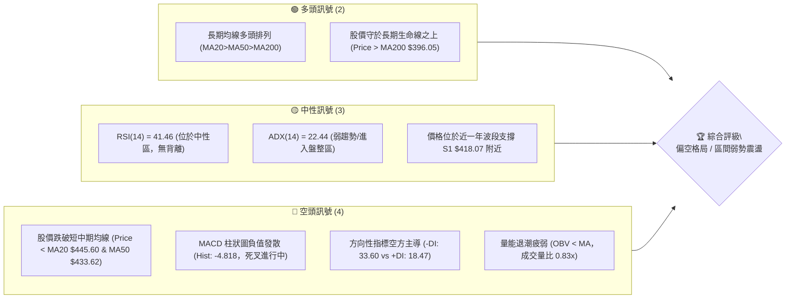
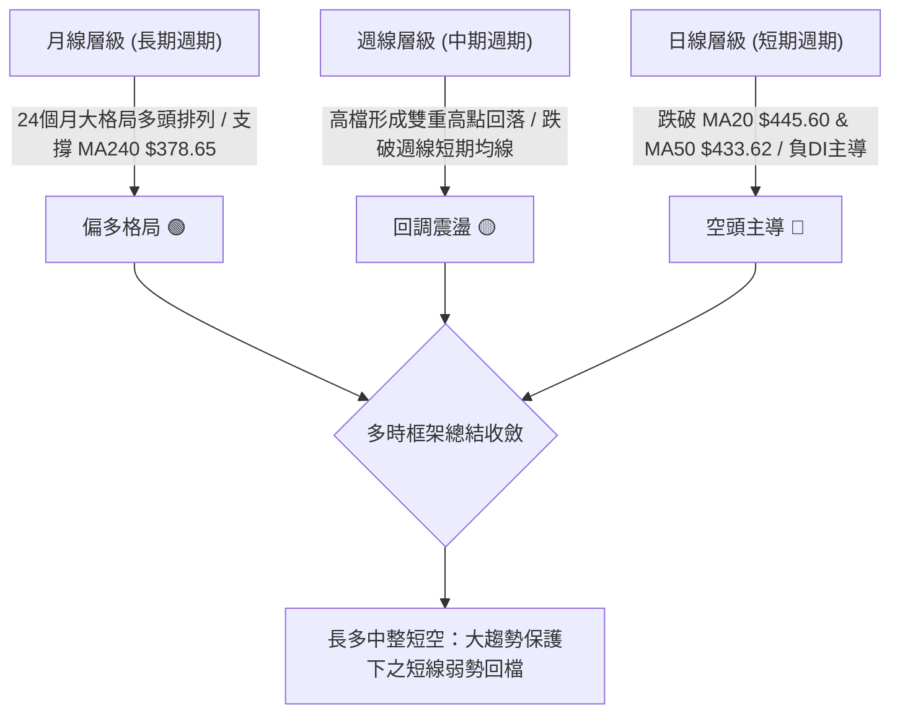
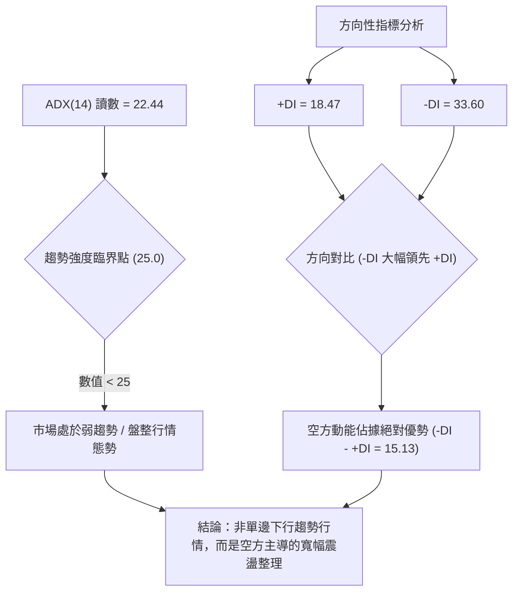
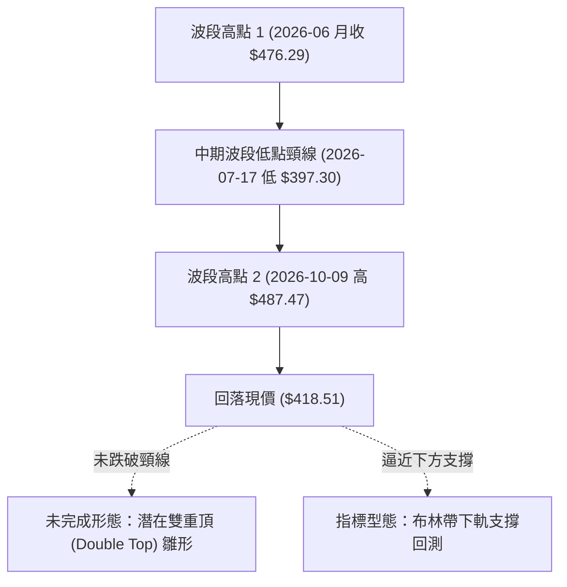
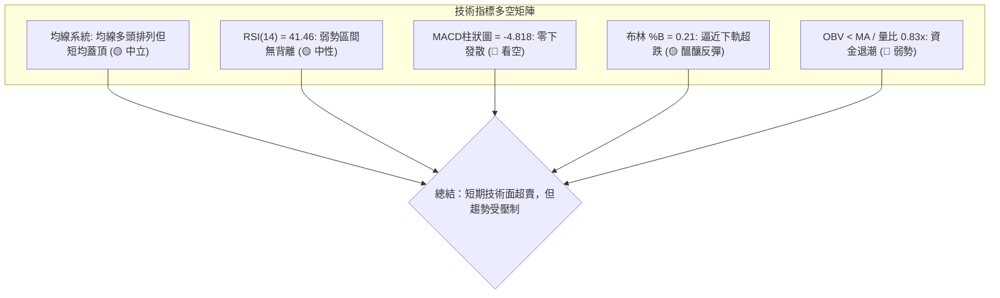
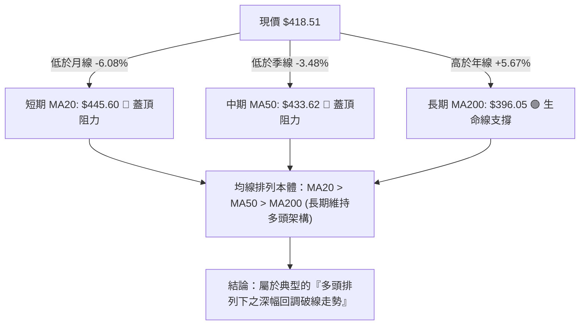
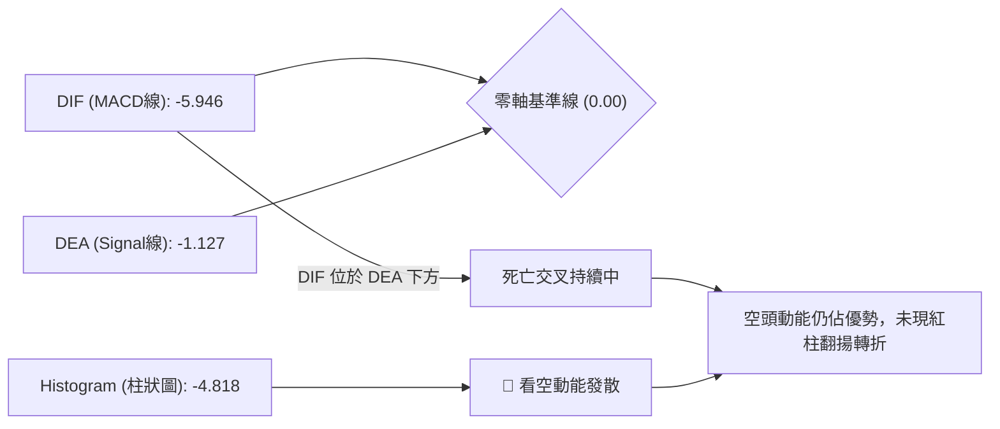
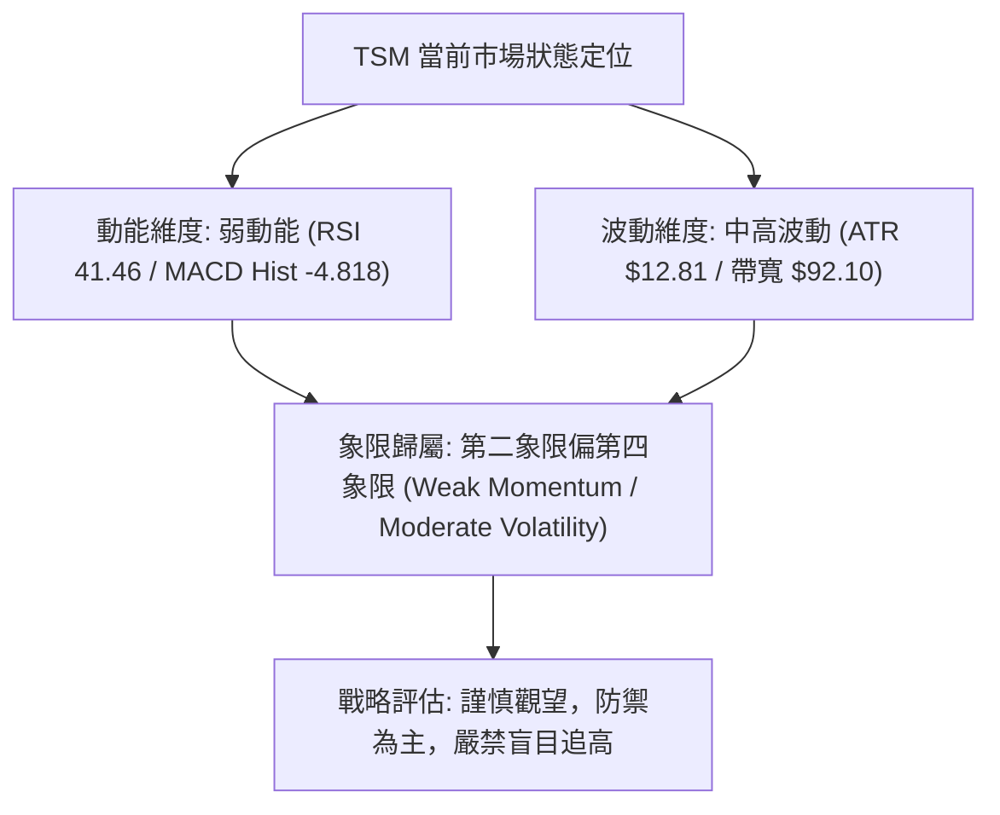
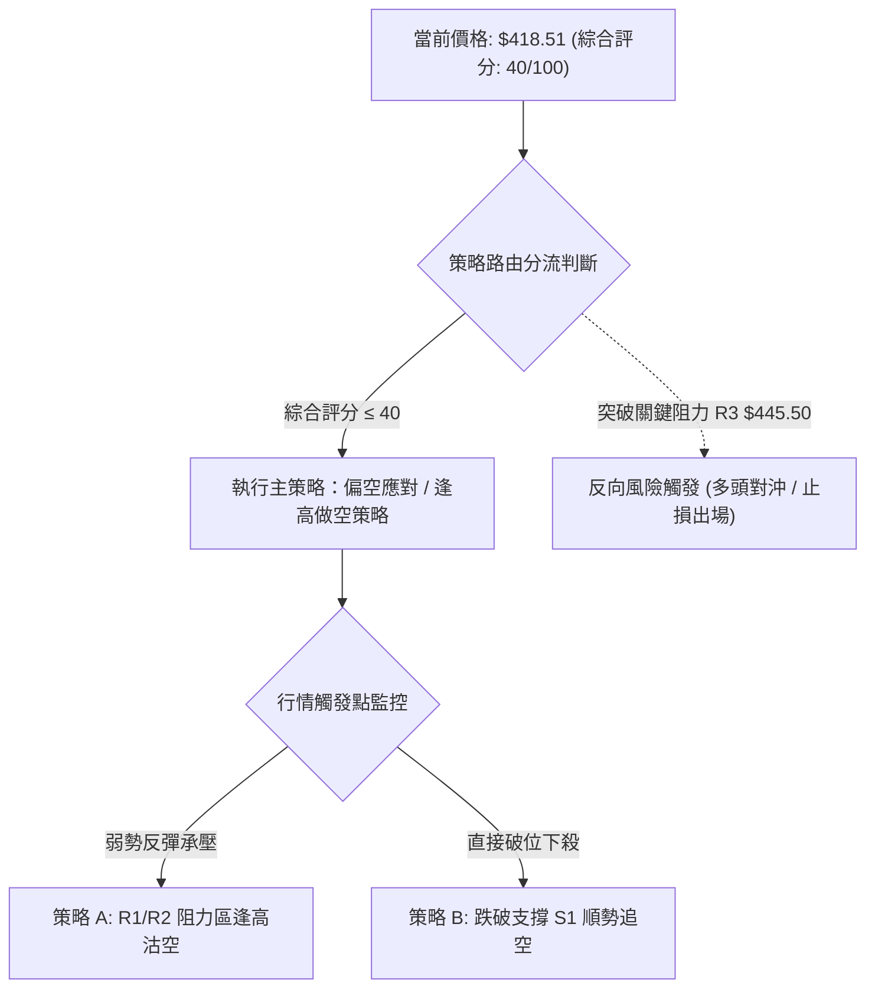
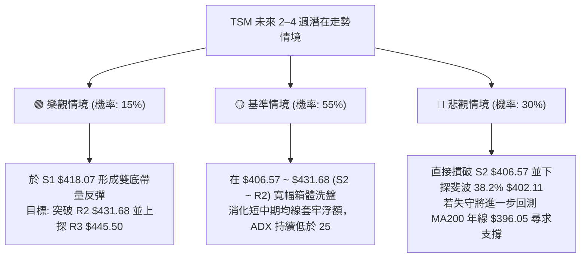

# TSM 技術分析報告

> **報告日期**：2026-10-24 ｜ **語言**：繁體中文 ｜ **數據來源**：Yahoo Finance ｜ **當前價格**：$418.51

---

## 目錄

| 章節 | 內容 |
|------|------|
| [1. 技術面概覽](#1-技術面概覽) | 訊號儀表板、核心指標、評分卡 |
| [2. 趨勢分析](#2-趨勢分析) | 多時框趨勢、長中短期走勢、ADX解讀 |
| [3. 圖表形態分析](#3-圖表形態分析) | 形態識別、K線組合、目標價推算 |
| [4. 支撐與阻力](#4-支撐與阻力) | 關鍵價位、斐波那契回調結構 |
| [5. 技術指標深度解讀](#5-技術指標深度解讀) | MA/RSI/MACD/布林/成交量量價整合 |
| [6. 動能與波動率](#6-動能與波動率) | 動能象限、ATR止損模型、Beta相關性 |
| [7. 多時框架總結](#7-多時框架總結) | 時框架評分矩陣、多時框收斂定調 |
| [8. 交易策略建議](#8-交易策略建議) | 策略路由、主策略規劃、風險報酬比 |
| [9. 風險提示與監控](#9-風險提示與監控) | 監控清單、情境模擬、倉位風控 |

---

## 1. 技術面概覽

### 🎯 技術訊號儀表板



### 📊 核心指標速覽表

| 指標類別 | 指標名稱 | 當前數值 | 訊號 | 解讀 |
|:---|:---|:---|:---:|:---|
| **價格** | 當前收盤價 | $418.51 | 🟡 | 位於52週區間69.1%處，高檔拉回整理中 |
| **均線** | MA20 (月線) | $445.60 | 🔴 | 價格在MA20下方 -6.08%，短期下行壓力顯著 |
| **均線** | MA50 (季線) | $433.62 | 🔴 | 價格在MA50下方 -3.48%，中期均線失守轉為阻力 |
| **均線** | MA200 (年線) | $396.05 | 🟢 | 價格在MA200上方 +5.67%，長期多頭底線尚未破壞 |
| **動能** | RSI(14) | 41.46 | 🟡 | 處於40–50中性偏弱區，未進入極端超賣，無背離訊號 |
| **動能** | MACD (12,26,9) | -5.946 / -1.127 | 🔴 | MACD位於零軸下方且低於信號線，柱狀圖 -4.818 看空 |
| **動能** | KD (Stoch %K/%D) | 14.43 / 17.25 | 🟡 | KD進入20以下超賣區，存在短線超跌反彈動能 |
| **趨勢** | ADX(14) / ±DI | 22.44 (-DI: 33.60) | 🔴 | ADX<25屬盤整行情，但-DI大幅壓制+DI，空方掌控短線 |
| **通道** | 布林通道 %B | 0.21 (帶寬 $92.10) | 🟡 | 逼近下軌 $399.55，顯示短線下挫已達波動區間下緣 |
| **成交量** | 量比 / OBV | 0.83x / OBV < MA | 🔴 | 最新成交量 9.45M 低於20日均量，OBV走弱量價背離 |
| **波動** | ATR(14) | $12.81 (3.06%) | 🟡 | 每日波幅適中，提供明確止損與波動風控緩衝 |

### 🏆 技術評分卡

```
╔══════════════════════════════════════════════════════════════════╗
║               技術評分卡 — TSM (2026-10-24)                      ║
╠══════════════════════════════════════════════════════════════════╣
║ 評估維度      進度條與強度標記           得分/100     狀態標記   ║
╟──────────────────────────────────────────────────────────────────╢
║ 趨勢強度      ██████░░░░░░░░░░░░░░        30/100         🔴      ║
║ 動能指標      ███████░░░░░░░░░░░░░        35/100         🔴      ║
║ 支撐穩定度    ███████████░░░░░░░░░        55/100         🟡      ║
║ 成交量配合    ██████░░░░░░░░░░░░░░        30/100         🔴      ║
║ 形態完整度    ████████░░░░░░░░░░░░        40/100         🟡      ║
║ 均線排列      ██████████░░░░░░░░░░        50/100         🟡      ║
╠══════════════════════════════════════════════════════════════════╣
║ 綜合評分      ████████░░░░░░░░░░░░        40/100         🔴      ║
║ 評級結論      偏空震盪（弱勢整理階段，依規則18算術平均取整）     ║
╚══════════════════════════════════════════════════════════════════╝
```
*註：綜合評分由六項子評分嚴格依算術平均計算：(30 + 35 + 55 + 30 + 40 + 50) ÷ 6 = 240 ÷ 6 = 40/100。*

---

## 2. 趨勢分析

### 🌐 多時框趨勢分析



### 📈 長期趨勢 — 12個月走勢圖（Unicode）

依據月度收盤價數據（2025-11 至 2026-10）繪製過去 12 個月之長線價格變動軌跡：

```
TSM 月線走勢圖（過去12個月：2025-11 至 2026-10）
價格軸 ($)
$480 ┤                                      ● (2026-06: $476.29)
$460 ┤                                              ● (2026-09: $456.19)
$440 ┤
$420 ┤                                  ●               ● (2026-10: $418.51 現價)
$400 ┤                              ●       ● (2026-07: $403.17)
$380 ┤                      ●
$360 ┤                  ● (2026-02: $371.66)
$340 ┤              ●
$320 ┤          ● (2026-01: $327.98)
$300 ┤  ●   ● (2025-12: $301.52)
$280 ┤● (2025-11: $288.46)
     └─────────────────────────────────────────────────────────────
       N   D   J   F   M   A   M   J   J   A   S   O (月份: 2025-11 至 2026-10)
```

#### 長期走勢特徵分析表格

| 階段區間 | 時間跨度 | 起訖收盤價 | 區間漲跌幅 | 主要技術特徵與結構意涵 |
|:---|:---|:---:|:---:|:---|
| **主升段起漲** | 2025-11 ~ 2026-02 | $288.46 → $371.66 | +28.84% | 單邊噴出走勢，月K線連續收紅，突破300美元整數大關。 |
| **中繼洗盤** | 2026-02 ~ 2026-03 | $371.66 → $336.26 | -9.52% | 快速獲利回吐，於330美元上方確立長期波段支撐平台。 |
| **強勢主推升** | 2026-03 ~ 2026-06 | $336.26 → $476.29 | +41.64% | 多頭動能爆發，創下月線收盤新高，奠定長期牛市基礎。 |
| **高位箱體震盪** | 2026-06 ~ 2026-10 | $476.29 → $418.51 | -12.13% | 7月探底403.17美元、9月反彈至456.19美元，目前回落至區間下緣。 |

### 📊 中期趨勢（週線分析）

從近 20 週收盤走勢觀察，TSM 呈現顯著的寬幅箱體震盪結構：
1. **中期天花板（壓力帶）**：2026-10-09 當週高點創下 52 週新高 $487.47，隨後爆量（週成交量 71.74M）長黑下殺，收盤跌破 $420.00，形成明顯的中期阻力防線。
2. **中期地板（支撐帶）**：2026-07-17 週低點來到 $397.30，隨後連續數週在 $402–$407 區間形成強大買盤承接平台。
3. **週線均線與量能狀態**：2026-10-16 當週收盤 $412.61，一舉摜破短期週均線；雖然 2026-10-23 週反彈至 $418.51，但成交量降至 61.54M，週 MACD 柱狀圖仍為負值（-4.818），週線層級仍處於高位修正波段。

```
TSM 中期（週線）壓力與支撐示意圖
═════════════════════════════════════════════════════════════════
  52W 最高點 / 歷史阻力帶    [$487.47]  ──────────────────────── (高點天花板)
                              ▲
                              │ 波段拉回 -14.15%
                              ▼
  當前現價位置              [$418.51]  ◄─── 測試近一年聚類支撐 S1 $418.07
                              ▲
                              │ 緩衝距離 -5.13%
                              ▼
  週線波段強支撐帶 / 頸線    [$397.30]  ──────────────────────── (2026-07低點)
═════════════════════════════════════════════════════════════════
```

### ⚡ 趨勢強度評估（ADX 解讀）



#### ADX 與方向指標量化對照表

| 指標名稱 | 實際數值 | 標準參考區間 | 當前技術狀態解讀 |
|:---|:---:|:---:|:---|
| **ADX(14)** | **22.44** | < 20: 無趨勢<br>20–25: 弱趨勢/醞釀期<br>> 25: 強趨勢形成 | 當前數值低於 25，表明個股未處於強勁單邊趨勢，大架構屬於無方向性的箱體洗盤行情。 |
| **+DI (多方)** | **18.47** | > 25 偏多主導 | 多方動能明顯退縮，缺乏推升價格突破均線之意願。 |
| **-DI (空方)** | **33.60** | > 25 偏空主導 | 空方指標高居 30 以上，說明近期賣壓盤踞，壓制短線任何反彈波。 |
| **綜合判定** | **空方佔優之震盪盤** | ADX < 25 且 -DI > +DI | 依據收斂規則14，應以**日線布林通道 ($399.55–$491.65) 與均線區間**進行區間震盪策略規劃。 |

---

## 3. 圖表形態分析

### 🔍 形態識別系統

在日線與週線結構上，TSM 自 2026 年 6 月創下 $476.29 收盤後，於 2026-10-09 再度衝高至 $487.47 未果下墜，呈現高檔雙重高點（M頭雛形）；然而，由於中期頸線尚未被實質擊穿，該形態尚未正式確認成立。



#### 圖表形態信心度評估表（依規則 15）

| 形態名稱 | 信心度 | 判斷依據（引用數據） | 完成度 | 目標價（附嚴格計算式） |
|:---|:---:|:---|:---:|:---|
| **潛在雙重頂 (M頭雛形)** | **45%** | 兩次高點分別為 2026-06 之 $476.29 與 2026-10-09 之 $487.47；中間頸線為 2026-07-17 低點 $397.30。目前價格 $418.51 尚未跌破頸線。 | **65%** | *信心度 < 50%，未跌破頸線前不觸發破位目標。若未來跌破頸線 $397.30：目標價 = 頸線 $397.30 − (高點 $487.47 − 頸線 $397.30) = $397.30 − $90.17 = **$307.13**。* |
| **日線布林下軌超跌反彈形態** | **70%** | BB %B 來到 0.21，日線低點回踩下軌 $399.55 附近（10-15 低點 $407.13），Stoch %K 進入 14.43 超賣區。 | **85%** | 形態回測中軌目標價 = **MA20 $445.60**（由布林中軌定義推算）。 |

### 🕯️ 重要 K 線形態分析

依據規則 19，嚴格採用數據中提供之「近10根日K」與「近8根週K」四個基準價格（開、高、低、收）展開量化分析：

#### 近10根日 K 棒形態解讀

| 日期 | 開盤價 | 最高價 | 最低價 | 收盤價 | 成交量 | K線形態名稱 | 結構解讀與市場心理 | 訊號 |
|:---:|:---:|:---:|:---:|:---:|:---:|:---|:---|:---:|
| **10-12** | $453.55 | $454.40 | $444.35 | $444.35 | 8,867,200 | 光腳中陰線 | 開高走低，收盤即最低，多頭全線潰退 | 🔴 |
| **10-13** | $439.52 | $445.50 | $437.40 | $445.12 | 8,581,100 | 低開小陽線 | 逢低微幅承接，受制於 R3 $445.50 壓力 | 🟡 |
| **10-14** | $436.25 | $440.39 | $428.06 | $430.00 | 15,167,200 | 放量中陰線 | 帶量跌破430整數關卡，賣壓明顯湧現 | 🔴 |
| **10-15** | $415.17 | $423.66 | $407.13 | $422.25 | 22,445,800 | 長下影錘頭陽線 | 爆出22.4M近期巨量，探底407.13強烈拉升 | 🟢 |
| **10-16** | $421.22 | $421.50 | $410.58 | $412.61 | 16,675,100 | 陰包陽回吐線 | 吞噬前日反彈實體，顯示抄底籌碼再度鬆動 | 🔴 |
| **10-19** | $421.66 | $427.16 | $415.50 | $420.22 | 12,353,800 | 孕線十字星 | 多空拉鋸，波動範圍收窄，觀望情緒濃 | 🟡 |
| **10-20** | $416.29 | $428.21 | $416.12 | $425.08 | 12,538,600 | 溫和推進陽線 | 低開高走站上425，展現短線抵抗買盤 | 🟢 |
| **10-21** | $433.14 | $435.16 | $423.74 | $431.89 | 10,721,100 | 跳空上影小陰線 | 跳空開高遭遇解套賣壓，未能守住435上方 | 🟡 |
| **10-22** | $419.39 | $421.91 | $410.22 | $412.35 | 16,475,100 | 放量長陰反撲 | 再次測試410支撐，多頭反彈攻勢遭無情瓦解 | 🔴 |
| **10-23** | $412.29 | $421.31 | $411.15 | $418.51 | 9,451,901 | 下影收高陽線 | 於S1 $418.07處企穩，縮量收在418.51，空方動能減弱 | 🟢 |

#### 近8根週 K 棒形態解讀

| 日期 | 開盤價 | 最高價 | 最低價 | 收盤價 | 週成交量 | 週K線形態 | 中期趨勢架構解讀 | 訊號 |
|:---:|:---:|:---:|:---:|:---:|:---:|:---|:---|:---:|
| **09-04** | $416.11 | $428.67 | $406.73 | $427.76 | 41,073,900 | 下影實體陽線 | 回踩406獲支撐，多頭重新掌控週線發球權 | 🟢 |
| **09-11** | $436.85 | $443.10 | $422.92 | $432.08 | 39,576,500 | 高位震盪十字陰 | 於440關卡前換手洗盤，籌碼結構健康 | 🟡 |
| **09-18** | $414.90 | $434.82 | $411.45 | $434.67 | 59,602,200 | 放量反轉陽線 | 帶量突破前高，形成中繼上攻組合 | 🟢 |
| **09-25** | $440.80 | $455.03 | $437.06 | $450.61 | 46,852,600 | 突破中陽線 | 站上450整數關卡，週線RSI衝破60 | 🟢 |
| **10-02** | $448.39 | $474.79 | $443.11 | $472.78 | 44,927,100 | 奔馳長紅K | 週線RSI達到71.7超買區，主升浪極致狂熱 | 🟢 |
| **10-09** | $478.77 | $487.47 | $449.75 | $453.31 | 49,231,100 | 高檔長上影墓碑陰線 | 創52W新高 $487.47 後遭逢強大拋壓，主力出貨顯著 | 🔴 |
| **10-16** | $453.55 | $454.40 | $407.13 | $412.61 | 71,736,400 | 爆量破位長黑K | 爆出71.7M天量殺跌，吞噬前三週漲幅，轉入空頭調整 | 🔴 |
| **10-23** | $421.66 | $435.16 | $410.22 | $418.51 | 61,540,501 | 下影收斂陰十字 | 連續兩週低點守住407–410，賣壓初顯衰竭但買盤謹慎 | 🟡 |

### 📉 ASCII 走勢形態示意圖

以下展示 2026 年 10 月以來日線從創高 $487.47 急殺後，在 $407–$445 區間形成的「箱體下緣爭奪」形態：

```
TSM 2026年10月 日線局部形態示意圖
價格
$488 ┤        ▲ (10-09 高點 $487.47 — 假突破誘多天花板)
$470 ┤       ╱ ╲
$450 ┤      ╱   ╲           (10-12 陰線破位)
$445 ┤─────┼─────╲─────────● (10-13 阻力 R3 $445.50)
$430 ┤    ╱       ╲       ╱ ╲ (10-21 高點 $435.16)
$420 ┤───┼─────────╲─────●───┼───● (現價 $418.51 / S1 $418.07)
$410 ┤  ╱           ╲   ╱     ╲ ╱
$407 ┤─┴─────────────●─┴───────● (10-15 低 $407.13 & 10-22 低 $410.22 雙底測試)
     └────────────────────────────────────────────────────────────► 時間
```

### 🎯 形態目標價計算

依據前述日線超跌反彈形態與日線布林通道軌道推算：
1. **反彈第 1 階段目標（T1）**：以聚類阻力位 **R1 $419.86** 為短線第一道防線；若確認站穩，依形態高度推算至 **R2 $431.68**。
2. **反彈第 2 階段目標（T2）**：回抽中軌重壓區 **MA20 / R3 $445.50**。
   - 計算式：頸線/支撐基準 $418.07 + 區間波動高差 ($431.68 − $418.07) = $445.29（收斂至聚類阻力 **$445.50**）。

---

## 4. 支撐與阻力

### 🗺️ 關鍵價位分布圖（Unicode）

```
TSM 價位結構分布圖（嚴格依據 OHLCV 聚類與斐波那契點位）
═════════════════════════════════════════════════════════════════
$487.47  ║██████████████████████████████║ 52W 最高點 / 歷史強阻力
$445.50  ║████████████████████████      ║ 強阻力 R3 (重合 MA20 $445.60)
$434.74  ║██████████████████            ║ 斐波那契 23.6% 回調位
$431.68  ║████████████████              ║ 阻力 R2 (近一年波段高點聚類)
$419.86  ║████████████                  ║ 關鍵短阻力 R1 (+0.32%)
$418.51  ╠══════════════════════════════╣ ◄ 當前收盤價 ($418.51)
$418.07  ║▓▓▓▓▓▓▓▓▓▓▓▓                  ║ 近期支撐 S1 (-0.11%)
$406.57  ║▓▓▓▓▓▓▓▓▓▓▓▓▓▓▓▓▓▓            ║ 強支撐 S2 (波段低點聚類)
$402.11  ║▓▓▓▓▓▓▓▓▓▓▓▓▓▓▓▓▓▓▓▓          ║ 斐波那契 38.2% 回調位
$399.55  ║▓▓▓▓▓▓▓▓▓▓▓▓▓▓▓▓▓▓▓▓▓▓        ║ 布林通道下軌
$396.05  ║▓▓▓▓▓▓▓▓▓▓▓▓▓▓▓▓▓▓▓▓▓▓▓▓      ║ MA200 牛熊分水嶺
$384.06  ║██████████████████████████████║ 波段極限強支撐 S3 (-8.23%)
═════════════════════════════════════════════════════════════════
```

### 🚧 阻力位分析表

依據數據「關鍵價位」區塊嚴格列示阻力位，絕無任意編造：

| 阻力級別 | 精確價位 | 距現價幅標 | 形成原因與技術意涵 | 突破難度 | 重要性 |
|:---:|:---:|:---:|:---|:---:|:---:|
| **R1** | **$419.86** | +0.32% | 近一年波段高點聚類位，近3日K線高點密集壓制區。 | 🟡 中等 | ★★★☆☆ |
| **R2** | **$431.68** | +3.15% | 波段高點聚類位，逼近日線 MA60 ($430.83) 與 MA50 ($433.62)。 | 🔴 較高 | ★★★★☆ |
| **R3** | **$445.50** | +6.45% | 近一年密集高點聚類，與布林中軌 MA20 ($445.60) 形成雙重絕對共振反壓。 | 🔴 極高 | ★★★★★ |

### 🛡️ 支撐位分析表

依據數據「關鍵價位」區塊嚴格列示支撐位：

| 支撐級別 | 精確價位 | 距現價幅標 | 形成原因與技術意涵 | 守住機率 | 重要性 |
|:---:|:---:|:---:|:---|:---:|:---:|
| **S1** | **$418.07** | -0.11% | 近一年波段低點聚類，現價貼近此線，為當前第一道多頭防禦工事。 | 🟡 50% | ★★★☆☆ |
| **S2** | **$406.57** | -2.85% | 波段低點聚類，守護 10-15 根K棒低點 $407.13 與 9-04 週K低點 $406.73。 | 🟢 70% | ★★★★☆ |
| **S3** | **$384.06** | -8.23% | 長期強支撐聚類，位於 MA200 ($396.05) 與 MA240 ($378.65) 緩衝防守區。 | 🟢 85% | ★★★★★ |

### 📐 斐波那契回調位分析

依據 52 週波動區間（最低 $264.03 → 最高 $487.47，全波段落差 $223.44）之回調位分析：

| 回調比例 | 精確價位 | 相對現價位置 | 結構意義解讀 |
|:---:|:---:|:---:|:---|
| **0.0%** | **$487.47** | 上方 +16.48% | 52 週最高點，歷史極限壓力天花板。 |
| **23.6%** | **$434.74** | 上方 +3.88% | **第一回調阻力**：多頭強勢回檔臨界點，目前已跌破轉為阻力。 |
| **38.2%** | **$402.11** | 下方 -3.92% | **黃金分割關鍵支撐**：中長期健康回調分水嶺，重合布林下軌 $399.55。 |
| **50.0%** | **$375.75** | 下方 -10.22% | 多空平衡中軸，貼近 MA240 ($378.65)。 |
| **61.8%** | **$349.38** | 下方 -16.52% | 絕對多頭防守底線。 |
| **78.6%** | **$311.84** | 下方 -25.49% | 深幅回撤防線。 |
| **100.0%** | **$264.03** | 下方 -36.91% | 52 週最低點，牛市起漲基石。 |

**現價區間解讀**：
當前收盤價 **$418.51** 精確落在 **23.6% ($434.74)** 與 **38.2% ($402.11)** 之間。這表明股價自歷史高點跌破 23.6% 強勢回調位後，修正幅度擴大，正向下尋求 38.2% ($402.11) 與近一年支撐 S2 ($406.57) 的支撐共振帶。只要股價堅守在 38.2% ($402.11) 之上，長線牛市格局並未遭到根本性破壞。

---

## 5. 技術指標深度解讀

### 🎛️ 指標訊號總覽



### 📈 移動平均線排列分析



#### 各級別移動平均線量化數據表

| 均線名稱 | 數值 | 現價差距 | 乖離率 | 排列狀態與趨勢意涵 |
|:---:|:---:|:---:|:---:|:---|
| **MA 5** | $421.61 | -$3.10 | -0.74% | 極短線下彎，短多受制於 5 日線下方。 |
| **MA 10** | $426.24 | -$7.73 | -1.81% | 短線反壓線，反彈首要考驗。 |
| **MA 20** | $445.60 | -$27.09 | -6.08% | 月線下行斜率擴大，形成短空格局核心阻力。 |
| **MA 60** | $430.83 | -$12.32 | -2.86% | 季線下移，與 R2 $431.68 高度重合。 |
| **MA120** | $425.60 | -$7.09 | -1.67% | 半年線失守，中度套牢浮額沉重。 |
| **MA200** | $396.05 | +$22.46 | +5.67% | 年線穩定向上，多方長線最後戰略防線。 |
| **MA240** | $378.65 | +$39.86 | +10.53% | 兩年均線基石，強大中長線重力支撐。 |

### 📉 RSI(14) 分析

當前 RSI(14) Wilder 數值為 **41.46**：
- **數值進度條**：`████████░░░░░░░░░░░░` 41.46% （處於 30–70 中性弱勢區間）
- **背離判斷**：數據明確標示「RSI 背離：無明顯背離（僅比較近20根K棒首尾的價格與RSI方向）」。價格從 10-09 高位拉回至現價 $418.51，RSI 同步自週線 71.7 殺跌至當前 41.46，量化指標忠實反映價格跌勢，並無背離誘空或底背離跡象，顯示當前弱勢屬於正常的價格修正。

### 📊 MACD(12/26/9) 訊號解讀


- **MACD 數值**：-5.946 遠低於訊號線 -1.127，差值柱狀圖擴大至 -4.818。
- **解讀**：雙線於零軸下方運行，且未出現收斂跡象，表明中短期動能仍由空方掌握，任何單日反彈均暫時定位為技術性修復，尚未構成買進訊號。

### 📦 布林通道分析

```
TSM 日線布林通道 (20, 2) 結構圖
═════════════════════════════════════════════════════════════════
  布林上軌 (Upper Band)   [$491.65]  ────── 波動極限阻力
                                      ▲
                                      │ 帶寬 $92.10 (寬幅波動)
  布林中軌 (Middle Band)  [$445.60]  ────── MA20 月線反壓位
                                      ▲
  當前現價 (Last Close)   [$418.51]  ◄───── %B = 0.21 (逼近下軌超賣區)
                                      ▼
  布林下軌 (Lower Band)   [$399.55]  ────── 波動極限支撐 (近$400大關)
═════════════════════════════════════════════════════════════════
```
- **帶寬與位置**：%B 值僅為 **0.21**，價格運行於下軌 ($399.55) 與中軌 ($445.60) 的下半區間。
- **技術意義**：當 %B 接近 0.20 時，往往代表短線乖離已大，下行空間受制於布林下軌支撐。

### 💹 成交量分析（量價配合度）

- **量能規模**：最新日成交量 **9,451,901 股**，相較 20 日均量 **11,371,755 股**，量比僅為 **0.83x**。
- **OBV 能量潮**：數據顯示「OBV 趨勢：OBV < MA → 量能疲弱」。
- **量價背離分析**：在 10-15 跌至 $407.13 爆出 22.4M 巨量後，反彈過程成交量反向萎縮（10-21 僅 10.7M，10-23 僅 9.45M），形成典型的「量縮價彈、放量下殺」之空方對稱結構，量能未確認反轉有效性。

---

## 6. 動能與波動率

### ⚡ 動能評估四象限



#### 動能與波動狀態對照表

| 象限標記 | 動能維度 | 波動維度 | TSM 當前狀態 | 戰略應對方針 |
|:---:|:---:|:---:|:---:|:---|
| **Q1 (最佳機會)** | 強 (Bullish) | 低 (Low Vol) | — | 趨勢穩健推升，順勢重倉持股。 |
| **Q2 (謹慎觀望)** | 弱 (Bearish) | 低 (Low Vol) | — | 盤整蓄勢，耐心等待放量方向確認。 |
| **Q3 (高風險收益)**| 強 (Bullish) | 高 (High Vol) | — | 主升浪或突破走勢，緊盯移動止損。 |
| **Q4 (避免進場)** | **弱 (Bearish)** | **中高 (Mod-High)**| **✓ (當前狀態)** | **動能疲弱且震盪劇烈，宜降低部位防守。** |

### 📊 ATR 波動率分析

- **ATR(14) 數值**：**$12.81**（佔現價比例 **3.06%**，Wilder 計算）。
- **日內安全防禦區間**：
  - 1 倍 ATR 波動區間：$418.51 ± $12.81 ➔ **$405.70 ~ $431.32**（完美對應 S2 $406.57 與 R2 $431.68）。
  - 1.5 倍 ATR 動態止損間距：$12.81 × 1.5 = **$19.22**。
  - 2 倍 ATR 極限風控間距：$12.81 × 2 = **$25.62**。

### 📐 Beta 與市場相關性

- **Beta 係數**：**1.239**。
- **解讀**：TSM 具備高於大盤 23.9% 的波動敏感度。在當前半導體板塊調整期，高 Beta 意味著回檔深度往往大於標普500指數，但在止跌反彈階段亦能提供優於大盤的彈升力道。
- **空頭比例 (Short Interest)**：Short Ratio 為 3.14 天，空頭佔流通股比例僅 0.6%，表明目前回跌純屬多頭獲利結算與機構調倉，並未出現大規模放空對沖賣壓。

---

## 7. 多時框架總結

### 📋 時框架評分表

| 時框架 | 趨勢方向 | 動能狀態 | 均線排列狀況 | 圖表形態 | 綜合評分 | 建議方針 |
|:---:|:---:|:---:|:---:|:---:|:---:|:---|
| **月線 (長期)** | 🟢 多頭趨勢 | 🟢 偏強 (遠高於MA240) | MA20>MA50>MA200 全多頭 | 24個月多頭大箱體上移 | **80/100** | 長線多單底倉續抱 |
| **週線 (中期)** | 🟡 寬幅箱體 | 🔴 轉弱 (MACD負發散) | 跌破短期均線，守住中長期 | 高檔雙重頂雛形震盪 | **45/100** | 中期波段減倉觀望 |
| **日線 (短期)** | 🔴 偏空格局 | 🔴 疲弱 (RSI 41.5 / -DI 33.6) | 破 MA20/MA50，受制下行 | 布林下軌超跌反彈整理 | **35/100** | 嚴控部位，輕倉操作 |

### 🔲 綜合訊號矩陣

```
TSM 多時框訊號一致性診斷矩陣
═════════════════════════════════════════════════════════════════
  時間維度    MA趨勢    動能(MACD)    超買超賣    量價關係    一致性判定
  ─────────────────────────────────────────────────────────────
  長期 (月)    🟢 多      🟢 多        🟡 中性     🟢 充沛     高度看多
  中期 (週)    🟡 震      🔴 空        🟡 中性     🔴 巨量陰   多空分歧
  短期 (日)    🔴 空      🔴 空        🟡 超賣區   🔴 縮量彈   短線偏空
═════════════════════════════════════════════════════════════════
  多時框衝突診斷：長期向上趨勢與短期回調修正產生嚴重時間框架撕裂。
```

### ⚖️ 多時框收斂結論

依據「嚴格要求 14」之多時框收斂規則：
1. **趨勢/盤整行情判定**：當前 **ADX(14) 讀數為 22.44（小於 25）**，系統確認當前處於**「盤整行情態勢」**，而非單邊趨勢行情。
2. **主導時框與優先級**：在盤整行情中，依規則 14 規定，**「以日線布林通道上下軌 ($399.55 ~ $491.65) 與均線區間作為主要交易空間」**。
3. **唯一方向性結論**：第 1 章技術評分卡算術平均綜合評分為 **40/100**，定義為**【偏空震盪（弱勢整理階段）】**。短線受制於 MA20 ($445.60) 與 MA50 ($433.62) 反壓，主策略方向定調為**逢高防守、偏空應對之區間操作**。

---

## 8. 交易策略建議

### 🗺️ 策略決策流程圖



### 🧭 策略路由（依評分卡分流）

> **當前主策略方向 = 偏空操作（依綜合評分 40/100，嚴格依規則 18 與路由規則分流）**
> 
> *註：由於綜合評分剛好落在偏空臨界點 40/100，且日線 -DI (33.60) 遠高於 +DI (18.47)，MACD 柱狀圖負發散 (-4.818)，本報告主推空頭策略；多頭僅列為反轉對沖風控提示。*

### 🎯 價格情境階梯（Price Scenarios）

價位嚴格引用自第 4 章及數據「關鍵價位」區塊之客觀數值：

| 觸發條件 | 下一目標 | 後續延伸 | 情境技術含義 |
|:---|:---:|:---:|:---|
| **強勢突破 R1 $419.86** | **R2 $431.68** | **R3 $445.50** | 短線超跌反彈展開，測試下降中軌壓制。 |
| **受阻於 R1 $419.86，跌破 S1 $418.07** | **S2 $406.57** | **S3 $384.06** | 空方再度發力，下探測試斐波那契 38.2% ($402.11) 及布林下軌。 |
| **實體擊穿 S2 $406.57** | **$402.11 (38.2%)** | **MA200 $396.05** | 中期形態惡化，全面考驗年線多頭底線。 |

### 📊 情境機率分佈

| 情境劃分 | 機率估算 | 主要指標與量化依據 |
|:---|:---:|:---|
| **回落再探底 (弱勢下行)** | **55%** | MACD 柱狀圖 -4.818 負值發散，-DI 達 33.60 主導市場，OBV 疲弱且量比 0.83x。 |
| **區間弱勢震盪 (S1~R2)** | **35%** | ADX 僅 22.44 (<25 處盤整市)，Stoch KD 處於 14–17 超賣區，S1 $418.07 具短線買盤。 |
| **強勢反轉上行 (重返R3)** | **10%** | 上方遭遇 MA20 ($445.60) 與 MA50 ($433.62) 重重均線反壓，目前量能嚴重不足。 |

### 🔴 主策略詳情（偏空/防守策略）

依據規則 17，做空之風險報酬比計算式為：**(進場價 − 目標價 T1) ÷ (止損價 − 進場價)**。

| 策略要素 | 策略 A（反彈受阻放空） | 策略 B（破位順勢跟進） |
|:---|:---:|:---:|
| **策略名稱** | 逢高回抽阻力位做空 | 破位跌穿波段支撐順勢空 |
| **進場條件** | 股價反彈至 R2 $431.68 遇阻回落，日K收上影線 | 日K實體跌破 S1 $418.07，收盤確認破位 |
| **進場價格** | **$431.68**（引用 R2 精確值） | **$417.00**（以跌破 S1 $418.07 之預設進場點計） |
| **目標價 T1** | **$406.57**（引用 S2 支撐） | **$384.06**（引用 S3 極限強支撐） |
| **目標價 T2** | **$396.05**（引用 MA200 年線） | **$375.75**（引用 斐波那契 50.0% 回調位） |
| **止損價格** | **$445.50**（引用 R3 / MA20 阻力） | **$431.68**（引用 R2 阻力） |
| **風險報酬比** | **1 : 1.82（以 T1 計）**<br>*(計算式: (431.68-406.57)/(445.50-431.68) = 25.11/13.82)* | **1 : 2.24（以 T1 計）**<br>*(計算式: (417.00-384.06)/(431.68-417.00) = 32.94/14.68)* |
| **勝率預估** | **65%** | **55%** |
| **建議倉位** | **15% (輕倉防守)** | **10% (嚴控曝險)** |

### 🟢 反向風險觸發點（對沖與停損提示）

若市場出現以下訊號，代表偏空架構被實質破壞，應立即平倉空頭並啟動多頭避險：
1. **反轉價位觸發**：日線收盤價**帶量實體突破 R3 $445.50 及布林中軌 MA20 ($445.60)**。
2. **指標轉折觸發**：MACD 柱狀圖由負翻正（翻紅），且日線 RSI(14) 強勢穿越 55 枯榮線。
3. **處置作為**：空單無條件停損出場；左側多頭可於回踩 R2 $431.68 不破時，重新建立第一批多頭多單。

### ⭐ 整體訊號強度評星

```
做多訊號強度：★★☆☆☆  (2.0/5星 — 短線受制於多條下行均線，多頭動能不足)
做空訊號強度：★★★★☆  (4.0/5星 — 均線蓋頂、MACD發散、-DI主導，空方佔優)
整體可信度：  ★★★☆☆  (3.5/5星 — ADX<25處於震盪期，須防範超賣引發急彈)
```

---

## 9. 風險提示與監控

### ✅ 關鍵監控指標 Checklist

```
╔══════════════════════════════════════════════════════════════════╗
║              TSM 技術面每日盤後監控 CHECKLIST                    ║
╠══════════════════════════════════════════════════════════════════╣
║ [ ] 1. 支撐保衛：收盤價是否跌破近一年波段支撐 S1 $418.07？      ║
║ [ ] 2. 極限防禦：收盤價是否跌穿 S2 $406.57 與布林下軌 $399.55？   ║
║ [ ] 3. 均線反壓：盤中反彈是否受阻於 R1 $419.86 或 R2 $431.68？   ║
║ [ ] 4. 趨勢轉變：日線收盤價是否成功站上 MA20 月線 $445.60？     ║
║ [ ] 5. 動能轉折：MACD 柱狀圖負值（-4.818）是否出現收斂或翻紅？   ║
║ [ ] 6. 趨勢強度：ADX(14) 是否由 22.44 向上突破 25 形成單邊趨勢？  ║
║ [ ] 7. 量能異動：日成交量是否放大至 20 日均量 (11.37M) 的 1.5 倍？║
╚══════════════════════════════════════════════════════════════════╝
```

### ⚠️ 風險場景分析



### 🛡️ 風險管理重要提醒

1. **波動度止損紀律**：目前 ATR(14) 高達 **$12.81**，日內雜訊波動劇烈。任何短線交易止損區間切勿設定過窄（至少需預留 1.0 ~ 1.5 倍 ATR，即 $13 ~ $19 空間），以防在 S1 $418.07 附近遭洗盤掃出場。
2. **倉位管理守則**：鑑於 ADX 顯示當前為弱趨勢盤整市場，總持倉曝險度建議降至正常水準之 **30%–40%** 以下，嚴禁在此位置動用融資槓桿。
3. **籌碼與財報事件防範**：雖然台積電基本面營收與獲利成長強勁（最新季度營收年增 50.9%，毛利率達 65.8%），但當前技術面正處於獲利籌碼了結週期，不可單憑基本面優秀而忽視技術指標破位之實質下行風險。

---

## 📋 報告總結

```
╔══════════════════════════════════════════════════════════════════╗
║                    TSM 技術分析報告總結                          ║
╠══════════════════════════════════════════════════════════════════╣
║ 報告日期：2026-10-24                                             ║
║ 當前價格：$418.51 USD                                            ║
║ 綜合評分：40 / 100（依規則18算術平均取整）                       ║
║ 分析評級：🔴 偏空震盪（弱勢整理階段，區間操作為主）             ║
╟──────────────────────────────────────────────────────────────────╢
║ 關鍵結論：                                                       ║
║ ├─ 長期趨勢：🟢 偏多（MA20>MA50>MA200，價格守於 MA200 $396.05 上）║
║ ├─ 中期趨勢：🟡 震盪（52W高點 $487.47 回跌，高檔形成箱體修正）  ║
║ ├─ 短期趨勢：🔴 偏空（跌破 MA20 $445.60，MACD 柱狀圖 -4.818 發散）║
║ ├─ 關鍵支撐：S1 $418.07 ｜ S2 $406.57 ｜ S3 $384.06              ║
║ ├─ 關鍵阻力：R1 $419.86 ｜ R2 $431.68 ｜ R3 $445.50              ║
║ └─ 外資共識：強力買進（20位分析師目標均價 $584.39，最低 $440.00）║
╟──────────────────────────────────────────────────────────────────╢
║ 最優策略組合：                                                   ║
║ 1. 🥇 最佳機會：反彈至 R2 $431.68 遇阻放空，止損設 R3 $445.50， ║
║                 目標看 S2 $406.57，風險報酬比 1 : 1.82。         ║
║ 2. 🥈 次選機會：實體跌破 S1 $418.07 追空至 S3 $384.06，止損設   ║
║                 R2 $431.68，風險報酬比 1 : 2.24。                ║
║ 3. 🥉 保守選擇：空手觀望，靜待股價回測 MA200 年線 $396.05 附近  ║
║                 出現帶量打底訊號後，再行長線分批佈局。          ║
╚══════════════════════════════════════════════════════════════════╝
```

---

> ⚠️ **免責聲明**：本報告為 AI 自動生成之技術分析，所有數據及估算均嚴格基於所提供之歷史價格與量化技術指標資訊。本報告**僅供研究與學術參考**，**不構成任何形式之投資建議、招攬或承諾**。金融市場投資具高度風險，交易決策應由投資人自行獨立判斷，並自負盈虧責任。

---

*報告生成時間：2026-10-24 ｜ 數據來源：Yahoo Finance ｜ 分析框架：多時框技術分析模型*