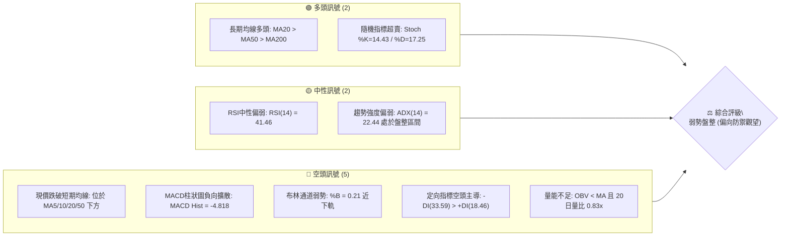
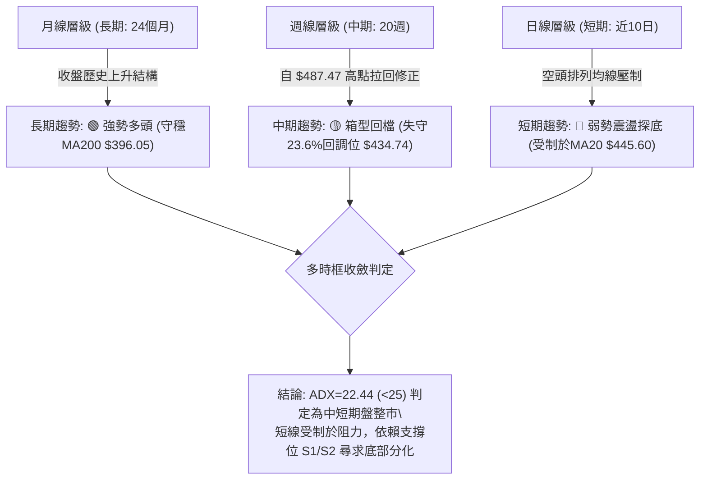
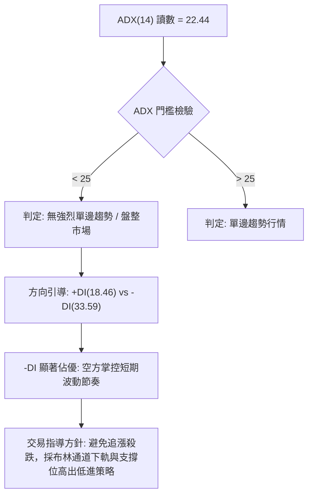
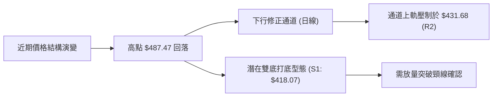
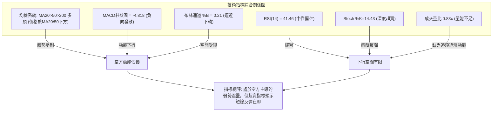
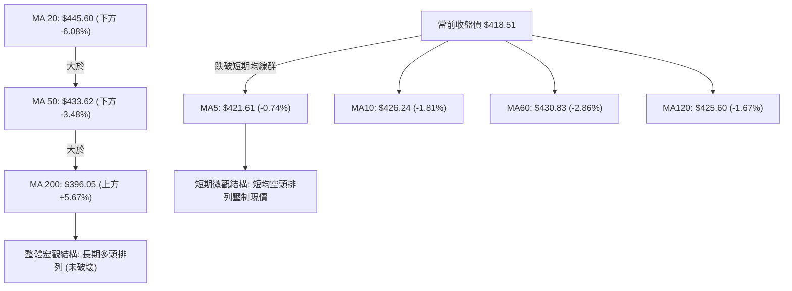
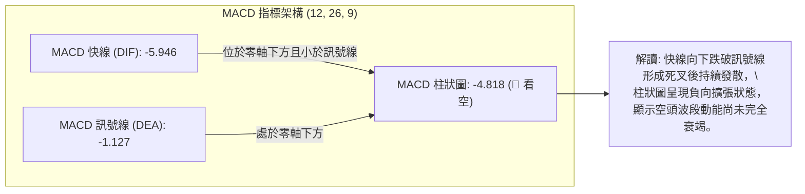
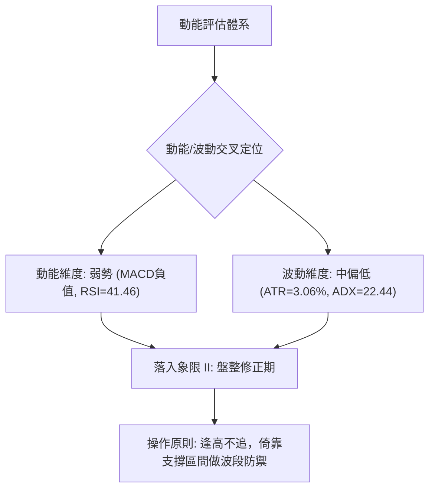
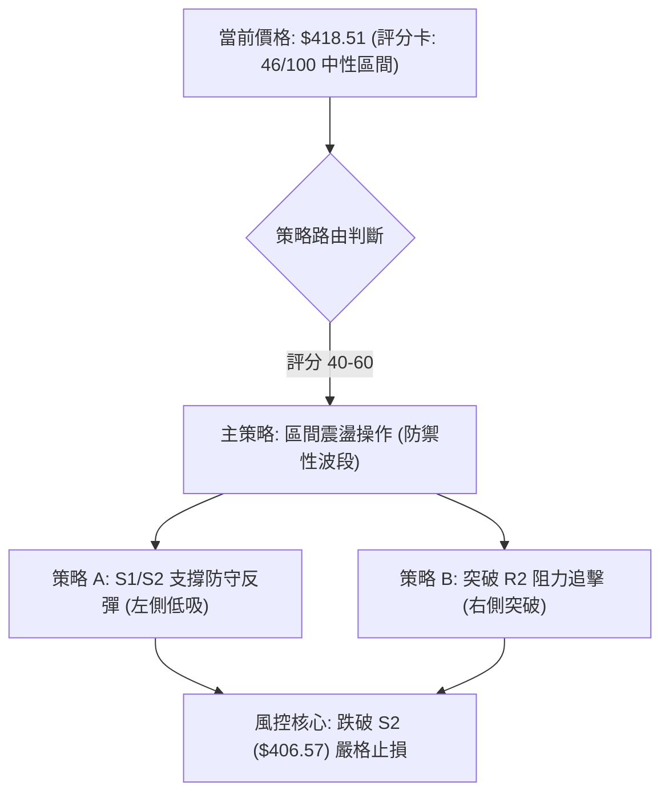
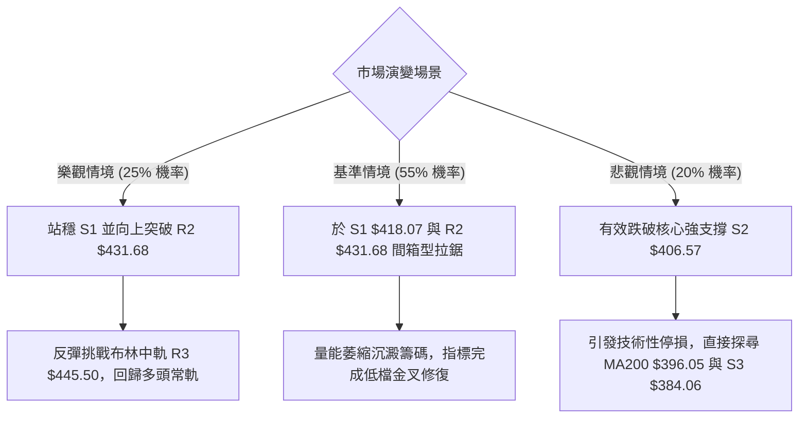

# TSM 技術分析報告

> **報告日期**：2026-10-25 ｜ **語言**：繁體中文 ｜ **數據來源**：Yahoo Finance ｜ **當前價格**：$418.51 USD

---

## 目錄

| 章節 | 內容 |
|------|------|
| [1. 技術面概覽](#1-技術面概覽) | 訊號儀表板、核心指標、評分卡 |
| [2. 趨勢分析](#2-趨勢分析) | 多時框趨勢、長中短期走勢 |
| [3. 圖表形態分析](#3-圖表形態分析) | 形態識別、K線組合、目標價 |
| [4. 支撐與阻力](#4-支撐與阻力) | 關鍵價位、斐波那契回調 |
| [5. 技術指標深度解讀](#5-技術指標深度解讀) | MA/RSI/MACD/布林/成交量 |
| [6. 動能與波動率](#6-動能與波動率) | 動能評估、ATR、Beta |
| [7. 多時框架總結](#7-多時框架總結) | 時框架評分矩陣 |
| [8. 交易策略建議](#8-交易策略建議) | 多空策略、風險報酬比 |
| [9. 風險提示與監控](#9-風險提示與監控) | 監控指標、風險場景 |

---

## 1. 技術面概覽

### 🎯 技術訊號儀表板



### 📊 核心指標速覽表

| 指標類別 | 指標名稱 | 當前數值 | 訊號 | 解讀 |
|:---|:---|:---|:---:|:---|
| **價格** | 當前收盤價 | $418.51 | 🟡 | 位於52週區間($264.03 - $487.47)之 69.1% 水位，回檔整理 |
| **均線** | MA20 | $445.60 | 🔴 | 現價低於MA20達 -6.08%，短期趨勢偏空 |
| **均線** | MA50 | $433.62 | 🔴 | 現價低於MA50達 -3.48%，中期動能受阻 |
| **均線** | MA200 | $396.05 | 🟢 | 現價高於MA200達 +5.67%，長期多頭底線尚未破壞 |
| **均線** | 均線排列 | 多頭排列 | 🟢 | 總體均線仍呈 MA20 > MA50 > MA200 多頭排列架構 |
| **動能** | RSI(14) | 41.46 | 🟡 | 處於30-70中性區間偏下緣，空方佔優但尚未極端超賣 |
| **動能** | MACD (12,26,9) | -5.946 / -1.127 | 🔴 | 快慢線雙雙處於零軸下方且負向發散，柱狀圖 -4.818 |
| **震盪** | Stoch %K / %D | 14.43 / 17.25 | 🟢 | 進入20以下超賣區間，隨時具備技術性跌深反彈契機 |
| **趨勢** | ADX (14) | 22.44 | 🟡 | ADX < 25 表示單邊趨勢強度不足，市場進入盤整修正週期 |
| **趨勢** | DMI (+DI / -DI) | 18.46 / 33.59 | 🔴 | -DI 大幅高於 +DI，空方力量牢固主導短期走勢 |
| **通道** | 布林通道 %B | 0.21 | 🔴 | 運行於中軌($445.60)與下軌($399.55)之間，貼近下軌整理 |
| **波動** | ATR(14) | $12.81 | 🟡 | 佔股價 3.06%，日常波動幅度適中偏平穩 |
| **成交量** | 20日均量比 | 0.83x | 🔴 | 當日成交量 9,478,300 股，低於20日均量(11,373,075)，量能疲弱 |

### 🏆 技術評分卡

```
╔══════════════════════════════════════════════════════════════════╗
║                   技術評分卡 — TSM (2026-10-25)                 ║
╠══════════════════════════════════════════════════════════════════╣
║ 趨勢強度 (ADX=22.44, -DI>+DI)   ████████░░░░░░░░░░░░  40/100 🔴  ║
║ 動能指標 (MACD空頭, RSI=41.46)  ████████░░░░░░░░░░░░  38/100 🔴  ║
║ 支撐穩定度 (守穩S1=418.07)      ████████████░░░░░░░░  60/100 🟡  ║
║ 成交量配合 (量比0.83x, OBV疲弱) ███████░░░░░░░░░░░░░  35/100 🔴  ║
║ 形態完整度 (日線下行通道成形)   ██████████░░░░░░░░░░  50/100 🟡  ║
║ 均線架構 (MA20>50>200,跌破短均) ██████████░░░░░░░░░░  52/100 🟡  ║
╠══════════════════════════════════════════════════════════════════╣
║ 綜合評分 (六項算術平均)         █████████░░░░░░░░░░░  46/100 🟡  ║
║ 評級結論：中性偏空 / 弱勢盤整 (40–60 區間操作，嚴控回檔風險)   ║
╚══════════════════════════════════════════════════════════════════╝
```

---

## 2. 趨勢分析

### 🌐 多時框趨勢分析



### 📈 長期趨勢 — 12個月走勢圖（Unicode）

```
TSM 月線走勢圖（過去12個月：2025-11 至 2026-10）
價格軸 ($)
$480 ┤                                              ●(2026-06 $476.29)
$450 ┤                                        ●(09)
$420 ┤                                  ●(05)       ●(08)  ●(現在 10: $418.51)
$390 ┤                            ●(04)       ●(07)
$360 ┤                      ●(02)
$330 ┤                ●(01)       ●(03)
$300 ┤          ●(12)
$270 ┤    ●(11)
$240 ┤
     └─────────────────────────────────────────────────────────────►
          25-11 25-12 26-01 26-02 26-03 26-04 26-05 26-06 26-07 26-08 26-09 26-10
```

#### 長期走勢特徵分析表格

| 階段區間 | 起始月收盤 | 終止月收盤 | 區間漲跌幅 | 主要走勢特徵與結構演變 |
|:---|:---:|:---:|:---:|:---|
| **啟動突破期** (2025-11 ~ 2026-02) | $288.46 | $371.66 | +28.84% | 連續4個月大陽線上攻，突破$300關卡，動能澎湃 |
| **震盪換手期** (2026-02 ~ 2026-03) | $371.66 | $336.26 | -9.52% | 短期多頭獲利了結，回踩中期均線清洗浮額 |
| **主升驅動期** (2026-03 ~ 2026-06) | $336.26 | $476.29 | +41.64% | 形成主升浪，月線連續創高，攀升至歷史級高點區間 |
| **高位箱型期** (2026-06 ~ 2026-10) | $476.29 | $418.51 | -12.13% | 於 $400 - $487 間大幅度震盪，目前回測箱體下緣尋求支撐 |

### 📊 中期趨勢（週線分析）

```
TSM 中期週線支撐阻力結構圖 (2026-06 至 2026-10)
價位 ($)
$487.47 ┼─────────────────────────────────────── 52W High (2026-10-09)
        │                                  ╭─╮
$460.00 ┼               ╭─╮                │ │
        │               │ │                │ │╭─╮
$434.74 ┼─ 23.6% 斐波 ──┼─┼────────╭───────┼─┼┼─┼────── 週線關鍵反壓區
        │        ╭─╮╭─╮ │ │╭─╮╭─╮╭─╮│ ╭─╮╭─╮│ ││ │
$418.51 ┼────────┼─┼┼─┼─┼─┼┼─┼┼─┼┼─┼┼─┼┼─┼┼─┼┼─┼┼─┼────── 現價 ($418.51)
        │        │ ││ │ │ ││ ││ ││ ││ ││ ││ ││ ││ │╭─╮
$402.11 ┼─ 38.2% 斐波 ──┴─┴──────┴─┴┴─┴┴─┴┴─┴┴─┴──┴─┴── 週線強支撐帶
$396.05 ┼─────────────────────────────────────── MA200 長期防線
```

週線指標顯示，自 2026-10-09 創下 52 週高點 $487.47 後，隨即於 2026-10-16 當週爆出巨量 (71,736,400 股) 長黑下殺，收盤重挫至 $412.61，週 RSI 驟降至 34.3，週 MACD 柱狀圖由正轉負擴大至 -6.872。最新一週 (2026-10-23) 收盤微幅反彈至 $418.51，成交量萎縮至 61,566,900 股，呈現中線拉回、短線試圖止跌的整理格局。

### ⚡ 趨勢強度評估（ADX 解讀）



#### ADX 趨勢強度對照表

| 數值區間 | 趨勢狀態 | TSM 當前狀態 | 技術策略含義 |
|:---|:---|:---:|:---|
| **0 – 20** | 極弱 / 無趨勢狀態 | ── | 價格混沌震盪，指標經常失效 |
| **20 – 25** | **微弱趨勢 / 進入盤整** | **22.44 (當前)** | **趨勢動能鈍化，宜以區間震盪交易系統為主** |
| **25 – 50** | 明確強趨勢形成 | ── | 順勢交易，均線與動能指標指引方向 |
| **50 – 75** | 極強趨勢行情 | ── | 動能過熱，提防加速趕頂或趕底 |
| **75 – 100**| 罕見極端單邊推升 | ── | 隨時面臨動能枯竭反轉 |

---

## 3. 圖表形態分析

### 🔍 形態識別系統



#### 圖表形態信心度評估表

| 形態名稱 | 信心度 | 判斷依據（引用技術數據） | 完成度 | 目標價（附嚴謹計算式） |
|:---|:---:|:---|:---:|:---|
| **日線下行修正通道** | 75% | 自 2026-10-09 高點 $487.47 連接 10-12 高點 $454.40、10-21 高點 $435.16 形成下降軌道；低點由 10-15 的 $407.13 與 10-22 的 $410.22 呼應。 | 85% | 通道下緣支撐測試完成；若向上突破軌道上軌（即 R2 $431.68），等距測幅目標 = 頸線 $431.68 + (形態高度: $431.68 − S2 $406.57 = $25.11) = **$456.79**（註：未突破前僅供參考）。 |
| **短線雙重底 (W底) 雛形** | 52% | 第一次低點為 10-15 之 $407.13（貼近 S2 $406.57），反彈高點為 10-21 之 $435.16；第二次回踩低點為 10-22 之 $410.22（守穩 S1 $418.07 附近區域）。 | 45% | 形態尚未突破頸線確認。計算式：頸線高點 $435.16 + (形態高度: $435.16 − 低點 $407.13 = $28.03) = **$463.19**（需待突破頸線方可確立）。 |
| **中長期頭肩頂/大複合底** | 20% | 數據不足，僅屬短期震盪走勢，不具備大型頭部幾何對稱性。 | 10% | **訊號不足，僅做指標型解讀**（依規則 15 不予編造目標價）。 |

### 🕯️ 重要 K 線形態分析

本分析嚴格依據提供的「近10根日K」與「近8根週K」開高低收數據進行客觀解讀：

| 日期（週期） | 開盤價 | 最高價 | 最低價 | 收盤價 | K線形態名稱 | 技術解讀 | 訊號強度 |
|:---|:---:|:---:|:---:|:---:|:---|:---|:---:|
| **2026-10-15 (日K)** | $415.17 | $423.66 | $407.13 | $422.25 | **長下影錘頭線 (Hammer)** | 盤中下探 $407.13 後爆出 22,445,800 股巨量強力拉回，收在開盤之上，浮現逢低買盤支撐。 | 🟢 中強 |
| **2026-10-16 (日K)** | $421.22 | $421.50 | $410.58 | $412.61 | **光頭中陰線** | 開盤即為最高點附近，多頭無力承接，再度回吐前日漲幅，形成空頭反撲。 | 🔴 偏空 |
| **2026-10-20 (日K)** | $416.29 | $428.21 | $416.12 | $425.08 | **多頭反彈陽線** | 低開高走，實體陽線收復 5 日均線阻力，成交量溫和配合 (12,538,600 股)。 | 🟢 溫和 |
| **2026-10-21 (日K)** | $433.14 | $435.16 | $423.74 | $431.89 | **高位墓碑星/長上影陰線** | 跳空高開衝擊 $435.16 受阻於 MA50($433.62)，上方賣壓沉重，實體由紅翻黑。 | 🔴 偏空 |
| **2026-10-22 (日K)** | $419.39 | $421.91 | $410.22 | $412.35 | **跳空破位大陰線** | 開盤即跌破前日低點，最低探至 $410.22，放量下殺收於全天低位，空方力量再度宣洩。 | 🔴 強空 |
| **2026-10-23 (日K)** | $412.29 | $421.31 | $411.11 | $418.51 | **低檔小陽吞噬線** | 低開高走收復前日跌幅一半以上，收於 $418.51，成功守住 S1($418.07) 線位。 | 🟢 溫和 |
| **2026-10-09 (週K)** | $478.77 | $487.47 | $449.75 | $453.31 | **長上影流星線 (Shooting Star)** | 衝擊 52 週歷史高點 $487.47 遭逢強烈拋售，週收盤大跌留下 34.16 元長上影線，宣告波段見頂。 | 🔴 強空 |
| **2026-10-16 (週K)** | $453.55 | $454.40 | $407.13 | $412.61 | **大黑巨量中長陰** | 週跌幅逾 8.9%，伴隨 71,736,400 股成交量，實體貫穿多道短期均線。 | 🔴 強空 |
| **2026-10-23 (週K)** | $421.66 | $435.16 | $410.22 | $418.51 | **低位震盪十字星/孕線** | 高低點均落於前一週陰線實體內部，空方推低動能顯著減弱，呈現築底整理態勢。 | 🟡 中性 |

### 📉 ASCII 走勢形態示意圖

```
日線短線築底與下行壓制示意圖 (2026-10-12 至 2026-10-23)
價格 ($)
$454.40 ┼─● (10-12 高點)
        │  ╲
$445.50 ┼───╲───● (10-13 阻力 R3: $445.50)
        │    ╲
$435.16 ┼─────╲─────────● (10-21 反彈高點 / R2: $431.68 區域)
        │      ╲         │╲
$418.51 ┼───────╲───────┼──● (現價 $418.51 / S1: $418.07)
        │        ╲       │  │
$407.13 ┼─────────●─────┴──┴─ (10-15 低點 $407.13 / 10-22 低點 $410.22 / S2: $406.57)
        └──────────────────────────────────────────────► 時間
                 [第一打底]      [第二打底]
```

### 🎯 形態目標價計算

根據上述日線下行修正與低檔測試架構，計算潛在對稱測幅目標：

1. **下行通道突破目標計算**：
   - 通道下軌支撐基準：$406.57 (S2 附近)
   - 通道上軌頸線阻力：$431.68 (R2 聚類位)
   - 形態垂直高度：$431.68 − $406.57 = $25.11
   - **向上突破目標** = 頸線 $431.68 + 高度 $25.11 = **$456.79** (若能突破，將進一步測試 9月收盤高位 $456.19)
2. **破位下行測幅計算 (防範極端風險)**：
   - 若有效跌破 S2 ($406.57)，形態破位向下測幅：
   - **向下目標** = S2 $406.57 − 高度 $25.11 = **$381.46** (極為接近 S3 支撐位 $384.06)

---

## 4. 支撐與阻力

### 🗺️ 關鍵價位分布圖（Unicode）

```
TSM 價位結構分布圖 (由 OHLCV 與斐波那契精準計算)
══════════════════════════════════════════════════════════════════
$487.47 ║██████████████████████████████║ 52週最高點 (0.0% 斐波那契回調)
$445.50 ║████████████████████████      ║ 強阻力 R3 (MA20 匯聚處 $445.60)
$434.74 ║██████████████████            ║ 23.6% 斐波那契重要回調反壓
$431.68 ║████████████████              ║ 中期阻力 R2 (反彈高點聚類)
$419.86 ║██████████                    ║ 短線即時阻力 R1 (+0.32%)
$418.51 ╠══════════════════════════════╣ ◄ 當前收盤價 ($418.51)
$418.07 ║▓▓▓▓▓▓▓▓▓▓▓▓                  ║ 即時關鍵支撐 S1 (-0.11%)
$406.57 ║██████████████████            ║ 波段核心強支撐 S2 (-2.85%)
$402.11 ║████████████████████          ║ 38.2% 斐波那契中線關鍵防線
$396.05 ║██████████████████████        ║ MA200 長期多空分水嶺
$384.06 ║████████████████████████      ║ 深層波段支撐 S3 (-8.23%)
══════════════════════════════════════════════════════════════════
```

### 🚧 阻力位分析表

所有價位均直接取自技術數據「關鍵價位」區塊：

| 阻力級別 | 價位數值 | 距現價幅標 | 形成原因與技術匯聚 | 突破難度 | 重要性等級 |
|:---|:---:|:---:|:---|:---:|:---:|
| **R1 (即時阻力)** | **$419.86** | +0.32% | 近期交易日密集波動上緣，短線空方防守的第一道陣地。 | 🟡 中等 | ★★★☆☆ |
| **R2 (波段阻力)** | **$431.68** | +3.15% | 波段高點聚類位，且與 60日均線 ($430.83) 及 MA50 ($433.62) 形成強力重合反壓帶。 | 🔴 極高 | ★★★★☆ |
| **R3 (強阻力區)** | **$445.50** | +6.45% | 近一年波段高點重要阻力，恰與布林通道中軌暨 MA20 ($445.60) 形成雙重結構壓制。 | 🔴 難以逾越 | ★★★★★ |

### 🛡️ 支撐位分析表

所有價位均直接取自技術數據「關鍵價位」區塊：

| 支撐級別 | 價位數值 | 距現價幅標 | 形成原因與技術匯聚 | 守住機率 | 重要性等級 |
|:---|:---:|:---:|:---|:---:|:---:|
| **S1 (即時支撐)** | **$418.07** | -0.11% | 近期波段低點聚類位，10-23 收盤價 ($418.51) 正精準坐落於此線上，為短線多頭第一道防線。 | 🟡 60% | ★★★☆☆ |
| **S2 (核心支撐)** | **$406.57** | -2.85% | 10-15 探底低點 $407.13 與波段低點重疊區，緊鄰布林通道下軌 ($399.55) 與 38.2% 回調位 ($402.11)。 | 🟢 75% | ★★★★★ |
| **S3 (深層支撐)** | **$384.06** | -8.23% | 近一年重要波段低點密集聚類，位於 MA200 ($396.05) 與 240日均線 ($378.65) 之間，為多頭終極護城河。 | 🟢 90% | ★★★★☆ |

### 📐 斐波那契回調位分析

依據 52 週完整波動區間（低點 **$264.03** → 高點 **$487.47**，總垂直振幅 $223.44）計算之回調位分析：

| 回調比例 | 價位數值 | 現價相對位置 | 結構意義與多空攻防解讀 |
|:---|:---:|:---:|:---|
| **0.0% (52W High)** | **$487.47** | 上方 +16.48% | 2026-10-09 創下的歷史極值，波段封頂反轉點。 |
| **23.6% 回調** | **$434.74** | 上方 +3.88% | **第一道關鍵反壓**。現價已失守此位置，由支撐轉為強阻力，壓制中期反彈空間。 |
| **當前價格** | **$418.51** | **基準點** | **目前現價處於 23.6% ($434.74) 與 38.2% ($402.11) 兩大黃金分割位之間**。 |
| **38.2% 回調** | **$402.11** | 下方 -3.92% | **黃金分割中級防守位**。此處與布林下軌($399.55)及MA200($396.05)形成強烈共振，為多頭底線。 |
| **50.0% 回調** | **$375.75** | 下方 -10.22% | 多空平衡分水嶺，若失守宣告中期多頭架構徹底崩解。 |
| **61.8% 回調** | **$349.38** | 下方 -16.52% | 絕對強支撐位，黃金分割最後防線。 |
| **78.6% 回調** | **$311.84** | 下方 -25.49% | 深度回撤區域。 |
| **100.0% (52W Low)**| **$264.03** | 下方 -36.91% | 52 週循環起漲基石。 |

---

## 5. 技術指標深度解讀

### 🎛️ 指標訊號總覽



### 📈 移動平均線排列分析



#### 均線系統深度解讀表

| 均線名稱 | 當前價位 | 距現價差距 | 方向斜率 | 技術意涵與攻防解讀 |
|:---|:---:|:---:|:---:|:---|
| **MA 5** | $421.61 | -0.74% | ▼ 下彎 | 短期超短線第一道反彈反壓，需日K收盤站穩方可止跌。 |
| **MA 10** | $426.24 | -1.81% | ▼ 下彎 | 過去兩週籌碼平均套牢成本，反彈時的次級解套賣壓區。 |
| **MA 20** | $445.60 | -6.08% | ▼ 下彎 | 月線生命線，當前下彎速度較快，對股價構成實質天花板。 |
| **MA 50** | $433.62 | -3.48% | ▼ 下彎 | 中期生命線，失守後轉為強大反壓帶，需放量方能收復。 |
| **MA 60** | $430.83 | -2.86% | ▼ 下彎 | 季線位置，與阻力 R2 ($431.68) 重合，壓制中期反彈空間。 |
| **MA 120** | $425.60 | -1.67% | ▼ 下彎 | 半年線防線已轉為上方反壓。 |
| **MA 200** | $396.05 | +5.67% | ▲ 上揚 | **牛熊分界線**。維持堅挺上揚，提供長期強勁保護。 |
| **MA 240** | $378.65 | +10.53%| ▲ 上揚 | 長期年線基石，多頭長線終極安全防護墊。 |

### 📉 RSI(14) 分析

#### RSI 指標強度進度條
```
RSI(14) 讀數: 41.46
0 ────────────── 30 ────────────── 50 ────────────── 70 ───────────── 100
[超賣區間]       [  中性偏弱震盪  ] [   強勢區間   ]   [極端超買區間]
████████████████░░░░░░░░░░░░░░░░░░░░░░░░░░░░░░░░░░░░░░░░░ 41.46%
```

- **超買超賣狀態**：RSI(14) Wilder 讀數為 41.46，脫離了上週五的極低點 34.3，目前處於 30 至 50 之間的中性偏弱格局。空方掌握控盤節奏，但動能已不再單邊宣洩。
- **背離分析**：依據技術數據嚴謹比對「近20根K棒首尾之價格與RSI方向」，RSI 背離判斷結論為：**無明顯背離**。價格自高位 $487.47 回落至 $418.51，RSI 亦同步自 71.7 高檔滑落至 41.5 水平，指標與價格波動高度吻合，無底背離或頂背離產生。

### 📊 MACD(12/26/9) 訊號解讀



週線層級 MACD 柱狀圖亦呈現連兩週負值放大（-6.872 與 -4.818），日線級別 DIF 負值持續深化至 -5.946。若欲扭轉空頭頹勢，需見到柱狀圖收斂至 -2.0 以內並出現快線拐頭向上。

### 📦 布林通道分析

```
布林通道 (20, 2) 結構示意圖 (寬度 = $92.10)
價位 ($)
$491.65 ┼───────────────────────────────── 上軌 (Upper Band)
        │
$445.60 ┼───────────────────────────────── 中軌 (MA20: $445.60)
        │
$418.51 ┼─────────● 現價 ($418.51, %B = 0.21)
        │
$399.55 ┼───────────────────────────────── 下軌 (Lower Band)
```

- **通道帶寬與形態**：目前上軌位於 $491.65，中軌位於 $445.60，下軌位於 $399.55。帶寬高達 $92.10（約佔股價 22%），顯示前期由歷史高點回落引發之巨大波動仍未收斂。
- **%B 位置解讀**：%B 數值為 **0.21**，表明現價極度貼近下軌（0 代表下軌，0.5 代表中軌）。通常當 %B 跌至 0.20 以下且伴隨 Stoch %K 超賣時，常引發向布林中軌均值回歸的技術性反抽。

### 💹 成交量分析（量價配合度）

```
成交量與均量對比進度條
當日成交量:  9,478,300 股  ████████████████░░░░ 83.3%
20日平均量: 11,373,075 股  ████████████████████ 100.0%
50日平均量: 10,380,242 股  ██████████████████░░ 91.3%
```

- **量比分析**：當前成交量 9,478,300 股，相較於 20日均量呈現 **0.83x** 縮量格局。
- **OBV 趨勢**：數據明確顯示 **「OBV < MA → 量能疲弱」**。能量潮指標持續位於其均線下方運行，說明在拉回過程中，大資金承接意願偏向被動掛單，主動性追價買盤不足，尚未具備發動 V 型反轉的量能基礎。

---

## 6. 動能與波動率

### ⚡ 動能評估四象限

| 象限分區 | 動能維度 (Momentum) | 波動率維度 (Volatility) | TSM 當前狀態 | 策略指導與風險評估 |
|:---|:---:|:---:|:---:|:---|
| **象限 I** | 強動能 (Bullish) | 低波動 (Low Vol) | ── | 穩健推升主升段，為最理想持股環境 |
| **象限 II (當前)** | **弱動能 (Bearish)** | **低/中波動 (Mid/Low)** | **✓ (TSM 坐落處)** | **修正整理區間，動能不足且波動收斂，宜以高拋低吸防禦為本** |
| **象限 III** | 強動能 (Bullish) | 高波動 (High Vol) | ── | 劇烈單邊爆發，高風險高預期回報 |
| **象限 IV** | 弱動能 (Bearish) | 高波動 (High Vol) | ── | 恐慌崩跌與多殺多，應嚴格空倉避險 |



### 📊 ATR 波動率分析

- **ATR(14) 數值**：**$12.81**（佔現價 $418.51 之比例為 **3.06%**，採 Wilder 平滑算法）。
- **日間真實波動範圍**：每日平均波動約 12.8 美元，這意味著在日內常態交易中，$418.51 上下各 13 美元均屬正常噪聲範圍。
- **止損與部位控制建議**：
  - 短線波段止損緩衝距離：建議設定為 **1.0 至 1.5 倍 ATR**（約 **$12.81 ~ $19.22**）。
  - 當前若以 S1 ($418.07) 附近建立試倉，保守止損應置於 S2 ($406.57) 下方，間距剛好約為 12.0 美元（約 1.0 倍 ATR），極具技術合理性。

### 📐 Beta 與市場相關性

- **Beta 係數**：**1.239**。
- **市場敏感度解讀**：TSM 相對於標普500指數呈現高彈性特徵（Beta > 1）。當半導體板塊或大盤指數波動 1% 時，TSM 平均產生約 1.24% 的同向波動。
- **籌碼與放空結構**：
  - 空頭淨額佔流通股比率 (Short % Float)：僅 **0.6%**。
  - 空頭回補天數 (Short Ratio)：**3.14 天**。
  - 機構持股比例：**15.5%**。
  - 解讀：市場整體做空意願極低，當前下挫主要源自獲利了結與籌碼洗盤，並非機構大舉放空所致。

---

## 7. 多時框架總結

### 📋 時框架評分表

| 時框架 | 趨勢方向 | 動能狀態 | 均線排列狀況 | 圖表形態識別 | 綜合評分 | 建議操作導向 |
|:---|:---:|:---:|:---:|:---:|:---:|:---|
| **長期 (月線)** | 🟢 多頭上行 | 🟢 充沛 | MA200($396)強勢上揚，MA240走多 | 歷史級主升浪高位震盪 | **78/100** | 長線多單堅定續抱，無懼回檔 |
| **中期 (週線)** | 🟡 箱型回踩 | 🔴 轉弱 | 跌破5週線，守於20週均線之上 | 流星線後巨量回調，進行整理 | **48/100** | 逢高減碼獲利，保留現金 |
| **短期 (日線)** | 🔴 弱勢震盪 | 🔴 空方主導 | 跌破MA5/10/20/50，壓制明顯 | 下行修正通道，回踩S1/S2支撐 | **36/100** | 嚴禁盲目追多，待突破確認 |

### 🔲 綜合訊號矩陣

```
時框訊號一致性評估矩陣
────────────────────────────────────────────────────────────────
維度        長期 (月線)        中期 (週線)        短期 (日線)
────────────────────────────────────────────────────────────────
趨勢方向    🟢 多頭向上        🟡 區間震盪        🔴 空頭探底
均線位置    🟢 遠高於MA200     🟡 跌破MA20        🔴 處MA20/50下方
動能指標    🟢 歷史多頭延續    🔴 MACD柱轉負      🔴 MACD發散中
成交量配合  🟢 宏觀籌碼鎖定    🔴 逢高放量下殺    🔴 量縮無力反彈
────────────────────────────────────────────────────────────────
綜合一致性  中度衝突 (長多 vs 中短空) ── 判定為「牛市中期健康回調」
────────────────────────────────────────────────────────────────
```

### ⚖️ 多時框收斂結論

依據多時框收斂規則（嚴格要求 14）：
1. **行情性質判定**：當前日線 ADX(14) 數值為 **22.44 (< 25)**，明確定義當前市場處於**「盤整行情（震盪市）」**，而非單邊強趨勢行情。
2. **主導時框與優先級取捨**：由於日線單邊趨勢強度不足，中長期週線多頭排列（MA20>MA50>MA200）仍未崩壞，但短期日線空頭均線壓制強烈。在盤整市規則下，**以日線布林通道區間（下軌 $399.55 至 中軌 $445.60）及關鍵支撐阻力為核心交易依據**。
3. **收斂唯一方向性結論**：**【中性觀望 / 弱勢區間整理】**。多空雙方在 S1 ($418.07) 與 S2 ($406.57) 展開拉鋸，短期受制於 R1 ($419.86) 與 R2 ($431.68) 反壓，交易策略嚴禁追高，應聚焦於強支撐帶之低吸高拋。

---

## 8. 交易策略建議

### 🗺️ 策略決策流程圖



### 🧭 策略路由（依評分卡分流）

> **當前主策略方向 = 中性區間震盪操作（依評分 46/100，落於 40–60 區間）**  
> 說明：綜合評分 46 分代表空方雖佔短期優勢，但已深入超賣區且逼近長期強支撐帶，不宜盲目追空；同時均線壓制未解，亦不具備全線做多條件。主推**「區間低吸高拋與關鍵點位防守策略」**。

### 🎯 價格情境階梯（Price Scenarios）

價位完全嚴格引用技術數據計算數值：

| 觸發條件 | 下一目標 | 後續延伸目標 | 情境技術含義與市場行為 |
|:---|:---:|:---:|:---|
| **向上突破 R1 ($419.86)** | **R2 ($431.68)** | **R3 ($445.50)** | 短線空頭下挫動能衰竭，引發向布林中軌均值回歸的技術性反彈。 |
| **守穩現價與 S1 ($418.07)** | **R1 ($419.86)** | **$425.00** | 於 $410 - $425 狹幅區間進行換手築底，等待均線下移收斂。 |
| **跌破 S1 下探 S2 ($406.57)** | **38.2%斐波 ($402.11)**| **S3 ($384.06)** | 短線支撐失守，向下考驗布林下軌($399.55)及MA200($396.05)終極多頭防線。 |

### 📊 情境機率分佈

| 情境劃分 | 機率 | 主要技術指標依據 |
|:---|:---:|:---|
| **區間震盪打底 (主情境)** | **55%** | ADX=22.44 彰顯震盪格局，Stoch(%K=14.43)處於超賣區，成交量萎縮(0.83x)顯示殺跌動能遞減。 |
| **技術性反彈回抽** | **25%** | 布林通道 %B 達 0.21 低位，現價偏離 MA20 達 -6.08%，具備強烈均值回歸修復需求。 |
| **跌破支撐深幅回落** | **20%** | MACD 柱狀圖(-4.818)持續擴散，-DI(33.59)大幅壓制+DI(18.46)，若失守 S2 恐引發停損賣壓。 |

### 🟢 主策略詳情

進場價採精確點位，風險報酬比嚴格按公式計算：$(T1 − 進場價) ÷ (進場價 − 止損價)$

| 策略要素 | 策略 A（支撐區逢低吸納策略） | 策略 B（右側突破加碼策略） |
|:---|:---|:---|
| **策略類型** | 左側防禦型（依託 S1/S2 強支撐） | 右側確認型（突破重要下降軌道） |
| **進場條件** | 股價回踩守穩 S1($418.07) 或 S2($406.57) 出現止跌K棒 | 日K線實體放量收盤突破 R2($431.68) 阻力位 |
| **進場價格** | **$418.07**（精確引用 S1 支撐位） | **$431.68**（精確引用 R2 突破位） |
| **目標價 T1** | **$431.68**（引用 R2 波段阻力） | **$445.50**（引用 R3 強阻力） |
| **目標價 T2** | **$445.50**（引用 R3 強阻力） | **$487.47**（引用 52W High） |
| **止損價格** | **$406.57**（精確引用 S2 核心支撐） | **$419.86**（精確引用 R1 阻力轉支撐） |
| **風險報酬比** | **1 : 1.18**（以 T1 計）<br>計算式: ($431.68−$418.07) ÷ ($418.07−$406.57) = 13.61 ÷ 11.50 = 1.18<br>*(若以 T2 計則為 1 : 2.39)* | **1 : 1.17**（以 T1 計）<br>計算式: ($445.50−$431.68) ÷ ($431.68−$419.86) = 13.82 ÷ 11.82 = 1.17<br>*(若以 T2 計則為 1 : 4.72)* |
| **成功機率估計** | **60%** | **50%** |
| **建議倉位** | **15% - 20%** (防禦性底倉) | **10% - 15%** (動能追隨倉) |

### 🔴 反向風險觸發點（對沖提示）

- **全面停損／反手對沖觸發價**：**$406.57 (S2)**。若日K線跌破並收在 $406.57 之下，宣告短線打底徹底失敗，極可能迅速下測 38.2% 回調位 **$402.11** 及 MA200 **$396.05**，多頭頭寸應全數離場或建立空頭避險部位。
- **指標失效告警**：若 RSI(14) 跌破 30 進入深度鈍化，且日成交量暴增至 20,000,000 股以上長黑下殺，切勿盲目抄底。

### ⭐ 整體訊號強度評星

```
╔══════════════════════════════════════════════════╗
║ 做多訊號強度：★★☆☆☆  (2.5/5星 - 需等待右側確認)  ║
║ 做空訊號強度：★★★☆☆  (3.0/5星 - 短線主導但超賣)  ║
║ 整體可信度：  ★★★★☆  (4.0/5星 - 支撐阻力結構清晰)║
╚══════════════════════════════════════════════════╝
```

---

## 9. 風險提示與監控

### ✅ 關鍵監控指標 Checklist

```
╔══════════════════════════════════════════════════════════════════╗
║               TSM 每日交易監控清單 (Checklist)                  ║
╠══════════════════════════════════════════════════════════════════╣
║ [ ] 價格能否持續收在 S1 ($418.07) 之上？                         ║
║ [ ] RSI(14) 是否由 41.46 向上突破 50 中軸分水嶺？                ║
║ [ ] MACD 柱狀圖是否由當前 -4.818 出現顯著收斂（向 0 軸靠攏）？    ║
║ [ ] 日成交量能否回升至 20日均量 (11,373,075 股) 之上？           ║
║ [ ] 股價衝擊 R1 ($419.86) 與 R2 ($431.68) 時是否遭遇長上影線？   ║
║ [ ] Stoch %K(14.43) 是否與 %D(17.25) 在 20 以下形成低檔金叉？    ║
║ [ ] 跌破 S2 ($406.57) 時是否立即觸發無條件止損紀律？             ║
╚══════════════════════════════════════════════════════════════════╝
```

### ⚠️ 風險場景分析



### 🛡️ 風險管理重要提醒

1. **半導體產業 Beta 波動風險**：TSM 具備 1.239 的高 Beta 特徵，極易放大整體半導體產業指數的回檔幅度。在近期新聞提及「市場擔憂 2027 前景」與地緣政治敏感環境下，總體情緒波動劇烈，單一部位曝險不可超過總投資組合之 15%。
2. **嚴格禁止逆勢左側重倉**：當前 MACD 柱狀圖仍為負值 (-4.818)，且 -DI 壓制 +DI，技術結構屬於標準弱勢修正。任何在 $418.07 附近的建倉均屬「試探性佈局」，必須以輕倉、分批、嚴格掛設 $406.57 止損為最高鐵律。
3. **匯率與報表口徑差異注意事項**：本標的交易價格為美元 (USD)，但底層財務報表以新台幣 (TWD) 編製，需防範台幣對美元匯率大幅波動對 ADR 折溢價造成的短期定價偏離。

---

## 📋 報告總結

```
╔══════════════════════════════════════════════════════════════════════════════╗
║                         TSM 技術分析報告總結                                 ║
╠══════════════════════════════════════════════════════════════════════════════╣
║ 報告日期：2026-10-25                                                         ║
║ 當前價格：$418.51 USD                                                        ║
║ 分析評級：⚖️ 中性偏空 / 弱勢盤整 (綜合評分: 46/100)                         ║
║                                                                              ║
║ 關鍵結論：                                                                   ║
║ ├─ 長期趨勢：🟢 強勢多頭 (月線均線多頭排列 MA20>MA50>MA200，MA200=$396.05)   ║
║ ├─ 中期趨勢：🟡 箱型修正 (高點 $487.47 回落，失守 23.6% 回調位 $434.74)      ║
║ ├─ 短期趨勢：🔴 弱勢震盪 (受制於短期均線群，現價在 MA20 下方 -6.08%)         ║
║ ├─ 關鍵支撐：S1: $418.07 ｜ 核心支撐 S2: $406.57 ｜ 深層防線 S3: $384.06     ║
║ ├─ 關鍵阻力：R1: $419.86 ｜ 波段反壓 R2: $431.68 ｜ 強阻力區 R3: $445.50     ║
║ └─ 分析師共識目標：均價 $584.39 (最低 $440.00，最高 $1000.00，評級: Strong Buy)║
║                                                                              ║
║ 最優策略組合：                                                               ║
║ 1. 🥇 最佳機會 (區間低吸)：於 S1 ($418.07) 守穩試倉，止損 $406.57，目標 $431.68 ║
║ 2. 🥈 次選機會 (右側突破)：突破 R2 ($431.68) 後追擊，止損 $419.86，目標 $445.50 ║
║ 3. 🥉 保守選擇 (防禦觀望)：持幣觀望，等待回踩 MA200 ($396.05) 或帶量長陽扭轉 ║
╚══════════════════════════════════════════════════════════════════════════════╝
```

---

> ⚠️ **免責聲明**：本報告為 AI 自動生成之技術分析，所有數據及估算均嚴格基於所提供的即時價格與歷史量價資訊。本報告**僅供研究與學術參考**，**不構成任何買賣要約或投資建議**。金融市場瞬息萬變，投資必定伴隨風險，投資人應獨立評估自身風險承受能力並嚴守風控紀律，入市需謹慎。

---

*報告生成時間：2026-10-25 ｜ 數據來源：Yahoo Finance ｜ 分析框架：多時框技術分析模型*