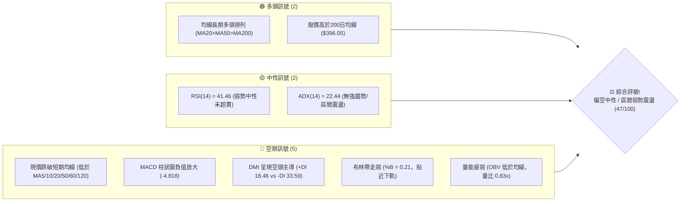
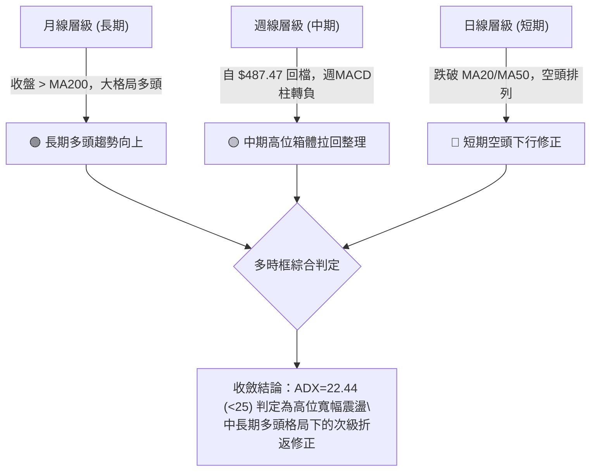
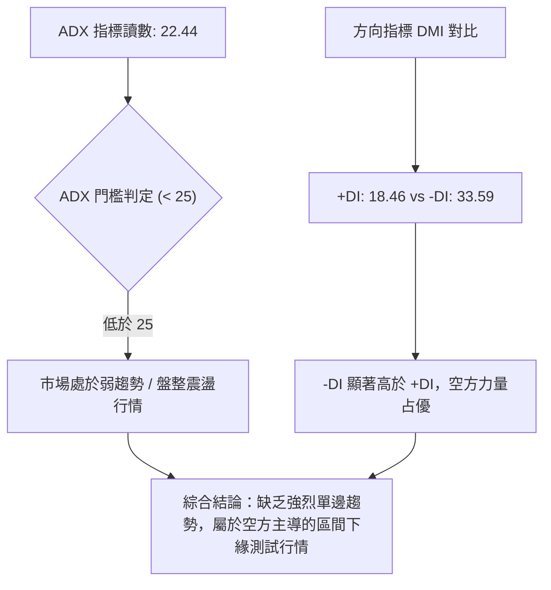
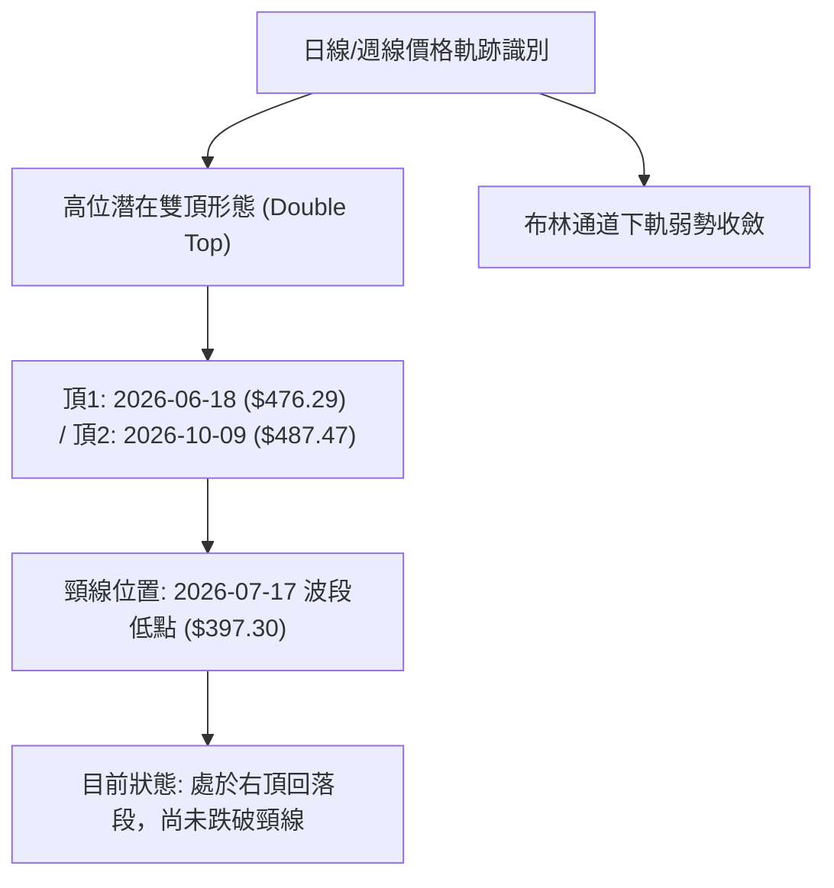
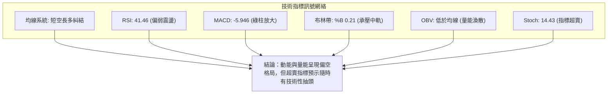
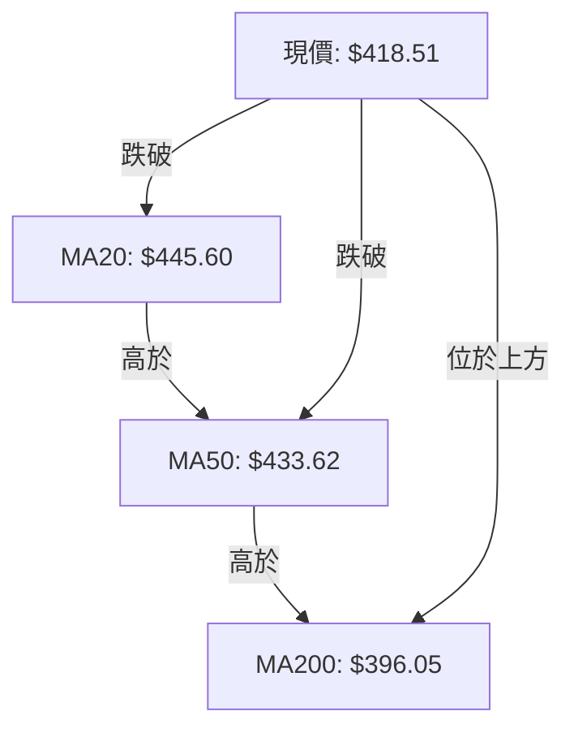
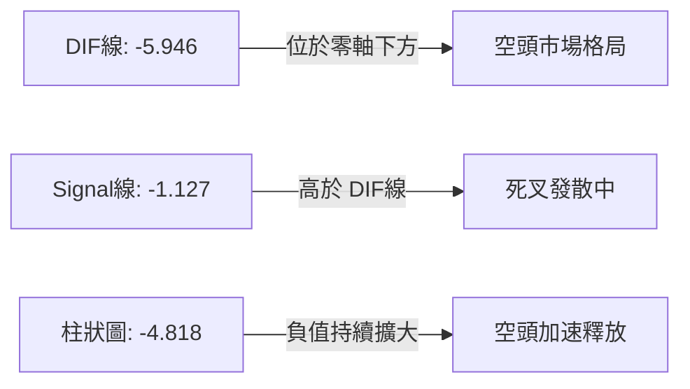
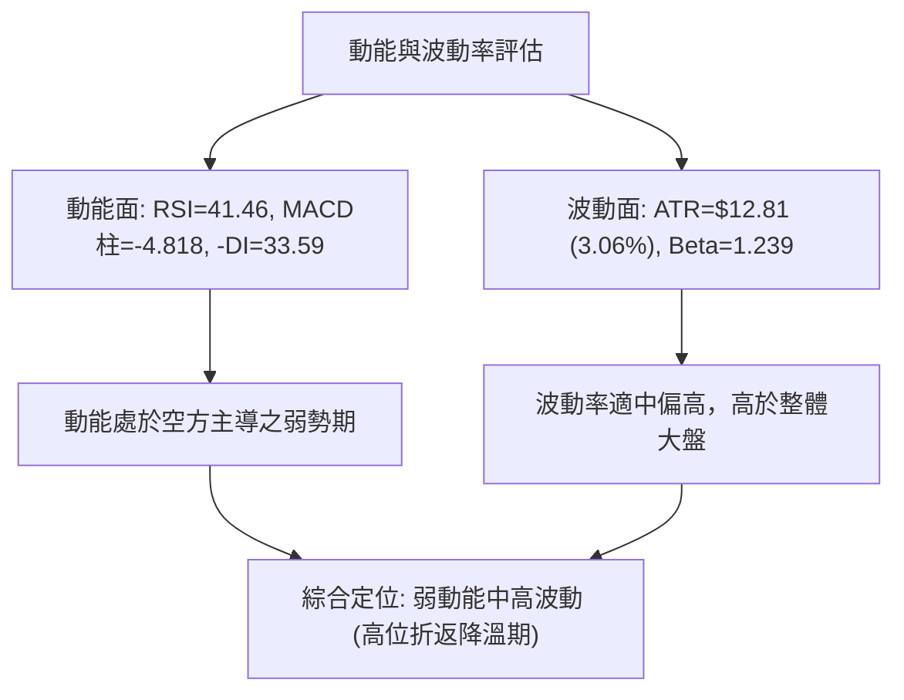
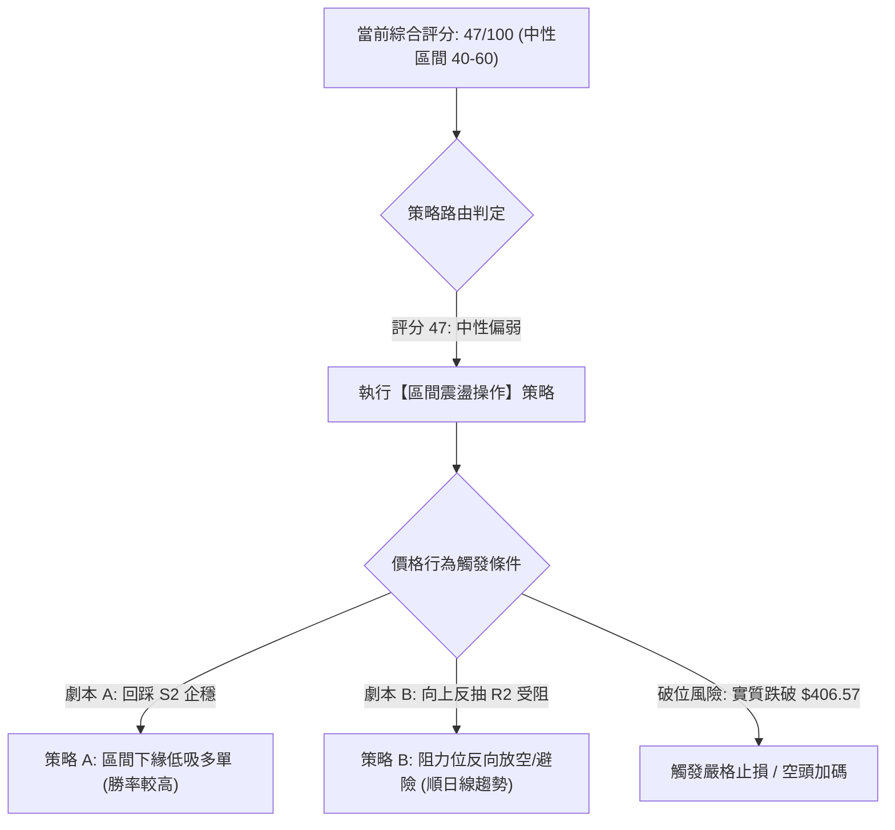
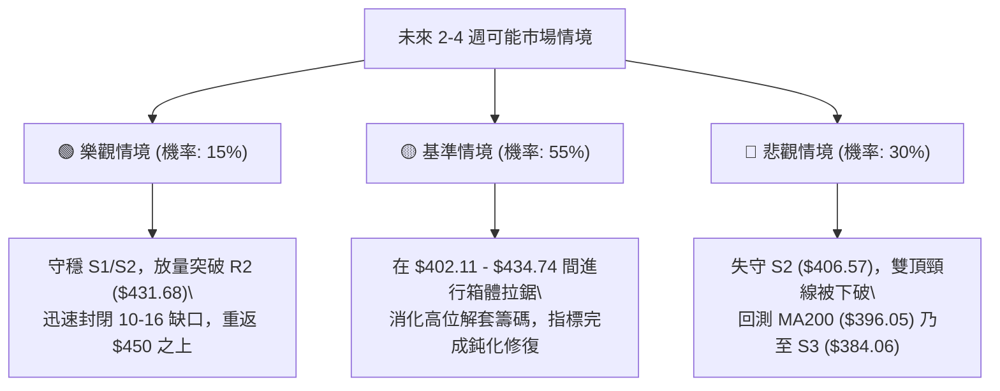

# TSM 技術分析報告

> **報告日期**：2026-10-26 ｜ **語言**：繁體中文 ｜ **數據來源**：Yahoo Finance ｜ **當前價格**：$418.51

---

## 目錄

| 章節 | 內容 |
|------|------|
| [1. 技術面概覽](#1-技術面概覽) | 訊號儀表板、核心指標、評分卡 |
| [2. 趨勢分析](#2-趨勢分析) | 多時框趨勢、長中短期走勢 |
| [3. 圖表形態分析](#3-圖表形態分析) | 形態識別、K線組合、目標價 |
| [4. 支撐與阻力](#4-支撐與阻力) | 關鍵價位、斐波那契回調 |
| [5. 技術指標深度解讀](#5-技術指標深度解讀) | MA/RSI/MACD/布林/成交量 |
| [6. 動能與波動率](#6-動能與波動率) | 動能評估、ATR、Beta |
| [7. 多時框架總結](#7-多時框架總結) | 時框架評分矩陣 |
| [8. 交易策略建議](#8-交易策略建議) | 多空策略、風險報酬比 |
| [9. 風險提示與監控](#9-風險提示與監控) | 監控指標、風險場景 |

---

## 1. 技術面概覽

### 🎯 技術訊號儀表板



### 📊 核心指標速覽表

| 指標類別 | 指標名稱 | 當前數值 | 訊號 | 解讀 |
|----------|----------|----------|------|------|
| **價格** | 當前價格 | $418.51 | 🟡 | 位於52週區間 69.1% 位置，自高點回檔後尋求短線支撐 |
| **均線** | MA20 | $445.60 | 🔴 | 現價低於 MA20 達 -6.08%，短期下行趨勢顯著 |
| **均線** | MA50 | $433.62 | 🔴 | 現價跌破中期生命線，短中期動能轉弱 |
| **均線** | MA200 | $396.05 | 🟢 | 現價高於長期年線 +5.67%，長線多頭基底尚存 |
| **動能** | RSI(14) | 41.46 | 🟡 | 處於 30–70 中性偏弱區，無顯著超賣或底背離 |
| **動能** | MACD (12,26,9) | -5.946 (柱: -4.818) | 🔴 | DIF 與 Signal 雙雙落入零軸下方，綠柱擴大，空頭控盤 |
| **動能** | 隨機指標 Stoch | %K: 14.43 / %D: 17.25 | 🟢 | 進入 20 以下超賣區，短線具備技術性反彈動能 |
| **趨勢** | ADX(14) | 22.44 (-DI: 33.59) | 🔴 | ADX < 25 屬盤整/弱趨勢，但 -DI 壓制 +DI，空方主導偏弱震盪 |
| **通道** | 布林通道 | %B: 0.21 (下軌 $399.55) | 🟡 | 股價運行於中軌與下軌間，下軌具防守拉力 |
| **量能** | 成交量 / OBV | 9.48M (量比 0.83x) | 🔴 | 縮量陰跌，OBV < MA 指示資金外流，量能不配合上攻 |
| **波動** | ATR(14) | $12.81 (3.06%) | 🟡 | 每日波幅適中，風控設定需預留至少 1–1.5 倍 ATR |

### 🏆 技術評分卡

```
╔══════════════════════════════════════════════════════════════╗
║              技術評分卡 — TSM (2026-10-26)                   ║
╠══════════════════════════════════════════════════════════════╣
║ 趨勢強度      ████████░░░░░░░░░░░░  40/100  🔴 空頭控盤弱趨勢║
║ 動能指標      ██████░░░░░░░░░░░░░░  30/100  🔴 MACD弱勢/超賣 ║
║ 支撐穩定度    ████████████░░░░░░░░  60/100  🟡 臨近S1/S2支撐 ║
║ 成交量配合    ████████░░░░░░░░░░░░  40/100  🔴 量能萎縮OBV弱 ║
║ 形態完整度    ██████████░░░░░░░░░░  50/100  🟡 頂部回檔整理  ║
║ 均線排列      ████████████░░░░░░░░  60/100  🟡 長多短空糾結  ║
╠══════════════════════════════════════════════════════════════╣
║ 綜合評分      █████████░░░░░░░░░░░  47/100  ⚖️ 區間弱勢震盪  ║
╚══════════════════════════════════════════════════════════════╝
```
*(註：綜合評分由六項子指標算術平均計算：(40 + 30 + 60 + 40 + 50 + 60) / 6 = 46.67 ≈ 47/100，符合規則 18)*

---

## 2. 趨勢分析

### 🌐 多時框趨勢分析



### 📈 長期趨勢 — 12個月走勢圖（Unicode）

```
TSM 月線走勢圖（2025-11 至 2026-10）
價格軸 ($)
$480 ┤                                           ●(06月高點 $476.29)
$450 ┤                                                ●(09月 $456.19)
$420 ┤                                 ●        ●     ●(現價 $418.51)
$390 ┤                            ●    
$360 ┤                       ●         
$330 ┤                  ●    
$300 ┤        ●    ●(01月 $327.98)
$270 ┤   ●(11月 $288.46)
     └───────────────────────────────────────────────────────────────
        11   12   01   02   03   04   05   06   07   08   09   10  (月份)
```

**走勢特徵分析表格**：

| 階段區間 | 起訖月份 | 起訖價格 | 區間漲跌幅 | 主要走勢特徵與量價結構 |
|----------|----------|----------|------------|------------------------|
| **主升浪前段** | 2025-11 → 2026-02 | $288.46 → $371.66 | +28.84% | 單邊強勢推升，突破 $300 整數關卡，各期均線發散向上 |
| **首次折返** | 2026-02 → 2026-03 | $371.66 → $336.26 | -9.52% | 獲利回吐引發技術修正，於 $330 獲得買盤支撐 |
| **主升浪後段** | 2026-03 → 2026-06 | $336.26 → $476.29 | +41.64% | 加速噴出階段，創下歷史天價區，日均量顯著放大 |
| **高位箱體震盪** | 2026-06 → 2026-10 | $476.29 → $418.51 | -12.13% | 在 $400–$487 間大幅寬幅擺動，高點未能實質站穩 $480 |

### 📊 中期趨勢（週線分析）

從近20週數據觀察，TSM 呈現明顯的寬幅雙波段擺動：
1. **第一波修正與回升**：自 6 月中旬 $460.88 一路下滑至 2026-07-17 當週低點 $397.30（當週成交量爆發至 91.50M 形成短線承接底），隨後展開反彈，於 9 月底推升至 $450.61。
2. **第二波衝高回落**：2026-10-09 當週創下 52 週高點 $487.47 後，遭逢強烈拋壓，收盤於 $453.31 留長上影線；隨後一週（2026-10-16）出現大陰線摜破短期均線，收盤暴跌至 $412.61，單週成交量高達 71.74M；當前週（2026-10-23）收於 $418.51，展開反彈但量能降至 61.57M。

```
TSM 近8週週線走勢與區間示意
$487.47 ──┬────────────────── ● (10-09 刺破 52W 高點後反轉)
          │                 ╱   ╲
$450.00 ──┼────── ● ────── ●     ╲ (10-16 長黑摜破)
          │     ╱   ╲   ╱         ╲
$420.00 ──┼── ● ───── ● ────────── ● 現價 $418.51 (弱勢掙扎)
          │ ╱                       │
$406.00 ──┴● (09-04 支撐起漲點)     └─ 關鍵下檔支撐帶 ($406.57 - $402.11)
```

### ⚡ 趨勢強度評估（ADX 解讀）



**ADX 趨勢強度對照解讀表**：

| 指標項 | 當前讀數 | 標準區間 | 走勢狀態判定 | 操作含義 |
|--------|----------|----------|--------------|----------|
| **ADX(14)** | 22.44 | 0 – 25 (弱趨勢/震盪) | 缺乏單邊單向動能，不宜採用順勢突破追價策略 | 以區間高拋低吸或等待通道邊界確認為宜 |
| **+DI (14)** | 18.46 | 參照 -DI | 多頭買盤力道薄弱，未能形成持續性推升力 | 追高風險極大，反彈空間受限於阻力位 |
| **-DI (14)** | 33.59 | 數值 > 30 (空方強烈) | 短線空方賣壓強勁，主導當前價格波動節奏 | 空頭佔據主導，下檔測試支撐機率偏高 |

---

## 3. 圖表形態分析

### 🔍 形態識別系統



**形態信心度與目標評估表**（依規則 15）：

| 形態名稱 | 信心度 | 判斷依據（引用數據） | 完成度 | 目標價（附嚴格計算式） |
|----------|--------|----------------------|--------|------------------------|
| **高位潛在雙頂 (Double Top)** | 62% | 兩次波段峰值分別為 6 月收盤 $476.29 與 10-09 週最高 $487.47，中間低點為 07-17 週收盤 $397.30 | 65% (尚未跌破頸線) | 若有效跌破頸線 $397.30，形態高度 = $487.47 - $397.30 = $90.17；量度跌幅目標 = $397.30 - $90.17 = **$307.13**（若未破則無效） |
| **短線箱體下緣整理** | 75% | 近兩週於日K低點 $407.13 與阻力 R2 $431.68 之間拉鋸，收盤密集於 $412–$425 | 80% (進行中) | 突破箱頂 R2 則量度反彈：$431.68 + ($431.68 - $407.13) = **$456.23**；跌破低點則看至支撐 S2 **$406.57** |

### 🕯️ 重要K線形態分析

根據報告提供的「近10根日K」與「近8根週K」實際開高低收數據進行嚴格識別（依規則 19）：

| 日期（日K/週K） | 開 | 高 | 低 | 收 | K線形態 | 解讀 | 訊號 |
|-----------------|----|----|----|----|---------|------|------|
| **2026-10-09 (週K)** | 478.77 | 487.47 | 449.75 | 453.31 | **長上影流星陰線** | 創 52 週新高 $487.47 後遭空頭痛擊，長上影線長達 $34.16，顯示高檔多頭嚴重力竭套牢 | 🔴 強烈空頭反轉 |
| **2026-10-15 (日K)** | 415.17 | 423.66 | 407.13 | 422.25 | **長下影錘頭陽線** | 盤中下探波段低點 $407.13 後爆量（22.45M）強烈拉升，收盤高於開盤，多頭於 $407 築防線 | 🟢 短線止跌支撐 |
| **2026-10-16 (日K)** | 421.22 | 421.50 | 410.58 | 412.61 | **光頭中陰線** | 開盤即為全日最高點，多頭反攻無力，回吐前一日大部分漲幅，確認短線反彈受阻 | 🔴 短空延續 |
| **2026-10-21 (日K)** | 433.14 | 435.16 | 423.74 | 431.89 | **跳空低收假陰星** | 跳空開高上衝至 $435.16（受阻於阻力 R2 $431.68 上方），買盤無法維持，高檔拋壓沉重 | 🟡 多空僵持轉弱 |
| **2026-10-22 (日K)** | 419.39 | 421.91 | 410.22 | 412.35 | **反轉長黑陰線** | 吞噬前一日實體，收盤於次低點 $412.35，成交量放大至 16.48M，直接壓回下軌區 | 🔴 強勢空頭打壓 |
| **2026-10-23 (日K)** | 412.29 | 421.31 | 411.11 | 418.51 | **低開反彈小陽線** | 守住前低 $410.22，自低位回升收盤 $418.51，但成交量縮減至 9.48M，量能顯著不足 | 🟡 縮量弱勢反抽 |

### 📉 ASCII 走勢形態示意圖

```
TSM 近兩週日K線架構示意圖（2026-10-12 至 2026-10-23）
$455 ┤ ┬ (10-12 高 $454.40)
$445 ┤ █ ┬ 
$435 ┤ │ █     ┬ (10-21 高 $435.16，受阻於阻力 R2 區間)
$425 ┤ │ │ ┬ ┬ █ █ ┬
$415 ┤ │ │ █ █ │ │ █ ┬ (10-23 收 $418.51)
$405 ┤ ┴ ┴ ┴ ┴ ┴ ┴ ┴ ┴ (10-15 低 $407.13，多頭下影防線)
     └──────────────────────────────────────────────
       12 13 14 15 16 19 20 21 22 23 (十月交易日)
```

### 🎯 形態目標價計算

1. **潛在雙頂頸線跌破情境**：
   - 頂部一：$476.29（2026-06 收盤）
   - 頂部二：$487.47（2026-10-09 週最高點）
   - 形態頸線：$397.30（2026-07-17 週收盤波段低點）
   - 形態高度：$487.47 - $397.30 = $90.17
   - 破位量度跌幅目標：$397.30 - $90.17 = **$307.13**（對應斐波那契 78.6% 回調位 $311.84 附近）

2. **短線箱體振幅推算情境**：
   - 短線下箱底支撐（10-15 低點）：$407.13
   - 短線上箱頂阻力（阻力位 R2）：$431.68
   - 箱體高度：$431.68 - $407.13 = $24.55
   - 向上突破目標：$431.68 + $24.55 = **$456.23**（對應 9 月收盤高點 $456.19）
   - 向下跌破目標：$407.13 - $24.55 = **$382.58**（對應近一年低點聚類支撐 S3 $384.06）

---

## 4. 支撐與阻力

### 🗺️ 關鍵價位分布圖（Unicode）

```
╔══════════════════════════════════════════════════════════════╗
║              TSM 價位結構分布圖 (OHLCV 精確計算)             ║
╠══════════════════════════════════════════════════════════════╣
║ $487.47 ║████████████████████████║ 52W 歷史最高點 (Fib 0.0%)║
║ $445.50 ║████████████████████    ║ 強阻力 R3 (密集套牢區/MA20)║
║ $434.74 ║████████████████        ║ Fib 23.6% 回調阻力位      ║
║ $431.68 ║████████████████████    ║ 阻力 R2 (反彈阻力位/MA50) ║
║ $419.86 ║████████████            ║ 關鍵阻力 R1 (短線突破點)  ║
║ $418.51 ╠════════════════════════╣ ◄ 當前收盤價 ($418.51)     ║
║ $418.07 ║▓▓▓▓▓▓▓▓▓▓▓▓▓▓▓▓        ║ 即時支撐 S1 (短線防守點)  ║
║ $406.57 ║████████████████████    ║ 強支撐 S2 (波段前低聚類)  ║
║ $402.11 ║████████████████        ║ Fib 38.2% 關鍵黃金分割位  ║
║ $396.05 ║████████████████████████║ MA200 牛熊分界生命線      ║
║ $384.06 ║████████████████████████║ 極限強支撐 S3 (波段深底)  ║
║ $264.03 ║████████████████████████║ 52W 歷史最低點 (Fib 100%) ║
╚══════════════════════════════════════════════════════════════╝
```

### 🚧 阻力位分析表

*(價位嚴格引用自數據「關鍵價位」區塊)*

| 阻力級別 | 價位 | 形成原因 | 突破難度 | 重要性 |
|----------|------|----------|----------|--------|
| **R1** | $419.86 | 近一年波段高點聚類，距現價僅 +0.32%，上週五收盤爭奪點 | 🟡 中等 | 短線多空強弱分界線，突破代表小幅企穩 |
| **R2** | $431.68 | 波段反彈高點聚類，重合 MA50 ($433.62) 與 MA60 ($430.83) | 🔴 高 | 中期強弱樞軸點，未能放量站上則下行趨勢不改 |
| **R3** | $445.50 | 密集套牢峰值，重合 MA20 下降軌道 ($445.60) 及布林中軌 | 🔴 極高 | 波段空頭防線，空轉多必須收復的關鍵多空分水嶺 |

### 🛡️ 支撐位分析表

*(價位嚴格引用自數據「關鍵價位」區塊)*

| 支撐級別 | 價位 | 形成原因 | 守住機率 | 重要性 |
|----------|------|----------|----------|--------|
| **S1** | $418.07 | 近一年波段低點聚類，距現價 -0.11%，即時超短期防守線 | 🟡 50% | 當前日K線收盤依託，若失守將直接引發回踩 S2 |
| **S2** | $406.57 | 波段低點聚類（重合 10-15 日K低點 $407.13 與 09-04 週低 $406.73） | 🟢 65% | 短期多頭生命底線，跌破則預示高位雙頂頸線將被挑戰 |
| **S3** | $384.06 | 近一年長期低點聚類，位於 MA200 ($396.05) 與 Fib 50% ($375.75) 之間 | 🟢 85% | 戰略性長期買盤承接區，多頭最後的防守堡壘 |

### 📐 斐波那契回調位分析

依據 52 週區間波段（極值：低點 $264.03 → 高點 $487.47，總極差 $223.44）之精確黃金分割點位：

| 斐波那契比例 | 價位 | 當前相對位置與市場意義解讀 |
|--------------|------|----------------------------|
| **0.0% (52W High)** | $487.47 | 歷史極值天花板，10-09 週線衝高反轉點，強大解套拋壓 |
| **23.6%** | $434.74 | 第一道關鍵折返阻力，與 MA50 ($433.62) 緊密重合，目前現價已跌破，轉為強阻力 |
| **現價位點** | **$418.51** | **落於 23.6% ($434.74) 與 38.2% ($402.11) 之間，偏向測試下緣** |
| **38.2%** | $402.11 | 經典弱勢回調極限，重合布林通道下軌 ($399.55)，為中期多頭不能實質失守的關鍵防線 |
| **50.0%** | $375.75 | 強勢多頭架構分水嶺，重合 MA240 ($378.65) 長期均線 |
| **61.8%** | $349.38 | 黃金分割強防守位，若跌破此處宣告 2026 年主升浪徹底終結 |
| **78.6%** | $311.84 | 深度回調極限位，雙頂理論量度目標 ($307.13) 匯聚於此 |
| **100.0% (52W Low)**| $264.03 | 52 週最低點基底 |

---

## 5. 技術指標深度解讀

### 🎛️ 指標訊號總覽



### 📈 移動平均線排列分析



**移動平均線狀態詳解**：
- **短均線壓制**：現價 $418.51 處於 MA5 ($421.61, -0.74%)、MA10 ($426.24, -1.81%)、MA20 ($445.60, -6.08%) 下方，且短期均線群呈現下傾角度，空頭排列嚴密。
- **生命線失守**：跌破 MA50 ($433.62) 與 MA60 ($430.83)，宣告中期上行通道遭到破壞，此區域由原先支撐全面轉換為厚重反壓。
- **長線多頭殘存**：現價仍穩於 MA200 ($396.05, +5.67%) 與 MA240 ($378.65, +10.53%) 之上，宏觀長期牛市基調並未反轉，當前定義為「大牛市格局下的深度中期回檔」。

### 📉 RSI(14) 分析

- **RSI 讀數進度條**：
  `RSI(14) = 41.46` ｜ `████████░░░░░░░░░░░░` 41.46% (中性偏弱)
- **區間評估**：數值 41.46 位於 30–70 中性區間之下半段，顯示空方動能佔優但未達極度恐慌之超賣水準（<30）。
- **背離分析判斷**：
  - **日線背離判定**：檢視近 20 根 K 棒走勢，價格自 10-09 波段高點回跌至 10-15 低點 $407.13，隨後反彈至 10-21 高點 $435.16 再度回檔至 $418.51；RSI 同步自超買區回落至當前 41.46。首尾兩端價格與動能方向一致，**明確判定：無底背離，亦無頂背離**，下行動能仍處自然釋放過程中。

### 📊 MACD(12/26/9) 訊號解讀


- **量化數值解析**：MACD 線已深跌至 -5.946，訊號線為 -1.127，二者在零軸之下張角擴大；柱狀圖（Histogram）為 -4.818 呈現實體紅柱（空頭能量柱），表明自 10 月初以來的空方殺跌力道尚未出現收斂拐點，短期仍不具備形成黃金交叉之條件。

### 📦 布林通道分析

```
TSM 布林通道現狀示意 (週期20, 2個標準差)
$491.65 ────────────────────── 上軌 (強阻力帶)
        │
$445.60 ────────────── 中軌 (MA20 下跌斜率, 現反壓 $445.60)
        │
$418.51 ─────── ◄ 現價 ($418.51, %B = 0.21)
        │
$399.55 ────────────────────── 下軌 (動態支撐帶，臨近 S2 $406.57)
```
- **帶寬與位置**：%B 讀數為 **0.21**，價格運行於布林帶下四分之一區間，非常接近下軌 $399.55。
- **形態暗示**：價格貼軌運行往往代表單邊下行壓力強烈，但下軌目前向上具有一定曲率支撐，若價格觸及 $399–$402 區域且帶寬不再急劇擴張，容易觸發技術性乖離回抽。

### 💹 成交量分析（量價配合度）

```
成交量對比柱狀圖 (股數)
最新量 (10-23)  █████████░ 9.48M (量比 0.83x)
20日均量        ███████████ 11.37M
50日均量        ██████████ 10.38M
```
- **量價配合分析**：
  1. 10-15 觸及低點 $407.13 時放量至 22.45M，顯示下檔有大資金被動吸籌；但隨後反彈過程（10-19 至 10-21）日成交量萎縮至 10M–12M 水準，量能未達 20 日均量。
  2. 10-22 下跌陰線成交量再度放大至 16.48M，而 10-23 小陽線反彈量卻急劇萎縮至 9.48M。呈現標準的**「跌時放量、漲時縮量」**之量價背離疲弱態勢。
  3. **OBV 趨勢**：OBV < MA，能量潮指標落於均線下方，指示機構籌碼仍在減倉觀望，量能無法確認價格反轉。

---

## 6. 動能與波動率

### ⚡ 動能評估

| 象限 | 動能維度 | 波動維度 | 歷史參照狀態 | 當前 TSM 狀態判定 |
|------|----------|----------|--------------|-------------------|
| **Q1** | 強動能 (Bullish) | 低波動 (Low Vol) | 緩步主升浪 | ─ |
| **Q2** | 弱動能 (Bearish) | 低波動 (Low Vol) | 橫盤陰跌蓄勢 | ─ |
| **Q3** | 強動能 (Bullish) | 高波動 (High Vol) | 快速拉升噴出 | ─ |
| **Q4** | **弱動能 (Bearish)** | **高波動 (Moderate/High)** | **高位劇烈洗盤折返** | **✓ 當前落點 (Q4 偏 Q2 交界)** |



### 📊 ATR 波動率分析

- **ATR 讀數**：Wilder ATR(14) 為 **$12.81**，佔當前股價比例為 **3.06%**。
- **日間真實波幅含義**：TSM 每日正常波動區間約在 $12–$13 之間，在規劃日內交易或波段交易時，短期震盪雜訊容易達到此範圍。
- **止損距離建議**：
  - **極限緊密止損 (0.75 ATR)**：$12.81 × 0.75 = **$9.61**（極易被日內毛刺掃出）
  - **標準波段止損 (1.00 ATR)**：$12.81 × 1.00 = **$12.81**（常規交易建議風控邊界）
  - **寬鬆風控止損 (1.50 ATR)**：$12.81 × 1.50 = **$19.22**（適合中長線防守結構）

### 📐 Beta 與市場相關性

- **Beta 係數**：**1.239**。
- **大盤聯動解讀**：TSM 具有高於標普 500 指數約 24% 的彈性波動特徵。當大盤（如納斯達克或費城半導體指數）上漲時，TSM 傾向產生放大漲幅；反之，在科技板塊承壓或宏觀流動性收縮時，其下行殺傷力亦高於防禦型板塊。因此，在當前短期下行趨勢中，高 Beta 意味著回檔幅度較為劇烈。

---

## 7. 多時框架總結

### 📋 時框架評分表

| 時框架 | 趨勢方向 | 動能狀態 | 均線排列 | 形態結構 | 綜合評分 | 操作建議 |
|--------|----------|----------|----------|----------|----------|----------|
| **長期 (月線)** | 🟢 多頭向上 | 🟡 擴張後回落 | 🟢 完美多頭 (價格遠高於MA200) | 🟢 歷史級主升浪後整理 | 75/100 | 長期投資者底倉續抱，不盲目砍倉 |
| **中期 (週線)** | 🟡 寬幅箱體 | 🔴 動能轉負 | 🟡 MA20高檔彎頭 | 🔴 潛在雙頂未遂回跌 | 45/100 | 減倉觀望，防範下軌跌破風險 |
| **短期 (日線)** | 🔴 下行通道 | 🔴 空方控盤 | 🔴 短期空頭排列 (跌破MA20/50)| 🟡 S1/S2 區間築底中 | 35/100 | 嚴禁盲目追多，等待企穩訊號 |

### 🔲 綜合訊號矩陣

```
╔══════════════════════════════════════════════════════════════╗
║              TSM 多時框訊號一致性矩陣                        ║
╠══════════════════════════════════════════════════════════════╣
║ 維度         短期 (日線)       中期 (週線)       長期 (月線) ║
╠══════════════════════════════════════════════════════════════╣
║ 趨勢方向     🔴 看空           🟡 震盪           🟢 看多     ║
║ 動能指標     🔴 空頭主導       🔴 轉弱回調       🟢 強勢擴張 ║
║ 量價結構     🔴 跌放量漲縮量   🟡 縮量回測       🟢 主力高控盤║
║ 支撐防守     🟡 考驗 S1/S2     🟢 守穩頸線       🟢 遠高於年線║
╚══════════════════════════════════════════════════════════════╝
```

### ⚖️ 多時框收斂結論

依據多時框收斂原則（規則 14）：
1. **行情定性**：當前 ADX(14) 讀數為 **22.44 (< 25)**，明確指示當前市場處於**「盤整/震盪行情」**，而非單邊趨勢行情。
2. **優先級收斂**：在 ADX < 25 的盤整結構下，交易邏輯應以日線布林通道（下軌 $399.55 至中軌 $445.60）及密集支撐/阻力聚類（S2 $406.57 至 R2 $431.68）為主要區間交易邊界。
3. **主導趨勢與次級折返**：長期月線與 MA200 仍堅定看多，但日線短週期已進入明確的空頭修正。依據盤整規則，日線短期弱勢正在消化中期漲幅。
4. **唯一方向性結論**：**【中性偏弱觀望，以區間下緣防守為核心】**。短期不可因長期多頭而逆勢重倉抄底，必須等待日線下探 S2 ($406.57) 或斐波那契 38.2% ($402.11) 出現企穩反轉結構。

---

## 8. 交易策略建議

### 🗺️ 策略決策流程圖



### 🧭 策略路由（依評分卡分流）

**當前主策略方向 = 區間震盪操作（等待下緣確認或反抽阻力），綜合評分 47/100**
依規則，評分落於 40–60 之間，市場處於布林通道中下軌震盪修復階段，主推**區間高拋低吸之結構化策略**，不押注單邊大突破。

### 🎯 價格情境階梯（Price Scenarios）

*(價位嚴格引用第 4 章／關鍵價位區塊實際數據)*

| 觸發條件 | 下一目標 | 後續延伸 | 情境含義 |
|----------|----------|----------|----------|
| **向上突破 R1 $419.86** | 阻力 R2 $431.68 | 阻力 R3 $445.50 | 短線止跌轉強，回補日線乖離 |
| **站穩現價 $418.51 區間** | 阻力 R1 $419.86 | 支撐 S1 $418.07 | 窄幅縮量震盪，指標築底消化賣壓 |
| **跌破 S1 $418.07** | 支撐 S2 $406.57 | 斐波那契 $402.11 | 短線弱勢尋底，測試關鍵多頭防線 |
| **跌破 S2 $406.57** | 支撐 S3 $384.06 | MA200 $396.05 | 中期頭部確立，進入深度回調浪 |

### 📊 情境機率分佈

| 情境劇本 | 機率 | 主要依據 |
|----------|------|----------|
| **區間下緣震盪築底** | **55%** | ADX 22.44 屬震盪行情，布林 %B 接近下軌，隨機指標 Stoch (14.43) 深度超賣具備防守拉力 |
| **跌破 S2 向下探底** | **30%** | MACD 綠柱放大 (-4.818)，-DI (33.59) 處於強勢壓制，成交量呈現陰跌出貨跡象 |
| **強勢突破 R2 單邊反轉**| **15%** | 均線 MA20/MA50 呈下壓走勢，量能萎縮（量比 0.83x），缺乏主力大舉反攻動能 |

### 🟢 主策略詳情

*(風險報酬比嚴格依規則 17 計算：(目標價 T1 − 進場價) ÷ (進場價 − 止損價))*

| 策略要素 | 策略 A（下緣支撐低吸 - 多） | 策略 B（反彈受阻放空 - 空） |
|----------|-----------------------------|-----------------------------|
| **操作性質** | 逆日線短空、順中期大趨勢之左側/區間多單 | 順日線短空排列、打擊反彈阻力之右側空單 |
| **進場條件** | 價格回踩支撐 S2 出現下影線企穩不破 | 價格反抽至阻力 R2 遇阻回落，長上影確認 |
| **進場價格** | **$406.57**（精確引自 S2 支撐） | **$431.68**（精確引自 R2 阻力） |
| **目標價 T1** | **$431.68**（引自 R2 阻力） | **$406.57**（引自 S2 支撐） |
| **目標價 T2** | **$445.50**（引自 R3 阻力） | **$384.06**（引自 S3 支撐） |
| **止損價格** | **$396.05**（引自 MA200 牛熊線下緣） | **$445.50**（引自 R3 阻力/MA20） |
| **風險報酬比** | **1 : 2.39**（以 T1 計）<br>*(計算: (431.68-406.57)/(406.57-396.05) = 25.11/10.52)* | **1 : 1.82**（以 T1 計）<br>*(計算: (431.68-406.57)/(445.50-431.68) = 25.11/13.82)* |
| **風險報酬比 (T2)**| 1 : 3.70（以 T2 計，分子 38.93） | 1 : 3.45（以 T2 計，分子 47.62） |
| **成功機率** | 60% | 55% |
| **建議倉位** | 15%（分批建倉） | 10%（嚴格短線對沖） |

### 🔴 反向風險觸發點（對沖提示）

- **多頭策略失效閥值**：若收盤價連續兩日實質跌破 **$402.11 (Fib 38.2%)** 或下探破位 **$396.05 (MA200)**，多頭應無條件全數止損離場，不可抗單。
- **空頭策略失效閥值**：若買盤放量（單日成交量 > 15M）實質突破並收於 **$434.74 (Fib 23.6%)** 或 **$445.50 (R3)** 之上，短空結構徹底瓦解，空單必須立即回補。

### ⭐ 整體訊號強度評星

```
做多訊號強度：★★☆☆☆  (2/5星 — 短線均線空頭壓制，需等待超賣反彈確立)
做空訊號強度：★★★☆☆  (3/5星 — 日線指標主跌，但受制於下軌與超賣支撐)
整體可信度：  ★★★★☆  (4/5星 — 關鍵點位聚集度極高，區間邊界分明)
```

---

## 9. 風險提示與監控

### ✅ 關鍵監控指標 Checklist

```
╔══════════════════════════════════════════════════════════════╗
║              TSM 每日交易前關鍵監控清單 (Checklist)           ║
╠══════════════════════════════════════════════════════════════╣
║ [ ] 價格是否跌破 S1 ($418.07)？  ── 若跌破，日內偏空運行     ║
║ [ ] 價格回踩 S2 ($406.57) 之反應？── 觀察是否出現量縮企穩    ║
║ [ ] RSI(14) 是否觸及 30 超賣線？ ── 低於 30 隨時防範技術彈升 ║
║ [ ] MACD 柱狀圖是否由負值收斂？ ── 若收縮至 -2.0 之上視為轉強║
║ [ ] 日成交量是否放大至 12M 之上？── 放量突破 R1 乃反轉信號   ║
║ [ ] 半導體產業及 ADR 溢價波動？ ── 高 Beta (1.24) 需警惕跳空 ║
╚══════════════════════════════════════════════════════════════╝
```

### ⚠️ 風險場景分析



### 🛡️ 風險管理重要提醒

1. **ATR 波動防護**：當前 ATR 高達 **$12.81**，意即單日內出現 $13 左右的波動實屬常態。進場時切勿將止損設定於 0.5 ATR 以內，以免遭到無效市場雜訊洗盤出局。
2. **財報與外匯特殊性注意**：雖然 TSM ADR 以美元計價交易，但其底層財務報表以新台幣 (TWD) 編製。美元指數的大幅波動將透過匯率直接傳導至 ADR 價格折溢價上，需額外留意匯率風險。
3. **倉位管理嚴律**：在 ADX 讀數未升破 25 且 MACD 尚未由負轉正前，嚴禁使用融資或超過總資金 **20%** 的高槓桿倉位進場搏反彈。採取分批建倉法（如：觸及支撐先建 5%，確認拉升再加碼 10%）為上策。

---

## 📋 報告總結

```
╔══════════════════════════════════════════════════════════════╗
║                    TSM 技術分析報告總結                      ║
╠══════════════════════════════════════════════════════════════╣
║ 報告日期：2026-10-26                                         ║
║ 當前價格：$418.51                                            ║
║ 分析評級：⚖️ 偏空中性 / 區間弱勢震盪 (評分: 47/100)          ║
║                                                              ║
║ 關鍵結論：                                                   ║
║ ├─ 長期趨勢：🟢 強勢多頭 (價格遠高於 MA200 $396.05)          ║
║ ├─ 中期趨勢：🟡 寬幅箱體回調 (受阻於 52W 高點 $487.47)        ║
║ ├─ 短期趨勢：🔴 弱勢震盪探底 (跌破 MA20 $445.60 及 MA50)     ║
║ ├─ 關鍵支撐：S1 $418.07 ｜ S2 $406.57 ｜ S3 $384.06          ║
║ ├─ 關鍵阻力：R1 $419.86 ｜ R2 $431.68 ｜ R3 $445.50          ║
║ └─ 外資共識：強力買入 (20位分析師，平均目標價 $584.39)       ║
║                                                              ║
║ 最優策略組合：                                               ║
║ 1. 🥇 最佳機會：等待回測 S2 $406.57 企穩後，低吸布局多單，  ║
║                 停損設於 MA200 $396.05，首要目標 R2 $431.68 ║
║                 (風險報酬比 1 : 2.39)                        ║
║ 2. 🥈 次選機會：若反彈受阻於 R2 $431.68 且動能不足，短線放空║
║                 對沖，目標回看 S2 $406.57，止損 R3 $445.50   ║
║                 (風險報酬比 1 : 1.82)                        ║
║ 3. 🥉 保守選擇：空倉觀望，等待日線 MACD 柱狀圖收斂翻紅，且   ║
║                 放量收復 MA50 ($433.62) 後再行順勢介入      ║
╚══════════════════════════════════════════════════════════════╝
```

---

> ⚠️ **免責聲明**：本報告為技術分析研究，所有數據、圖表及價位推算均嚴格基於歷史公開市場行情資訊。本報告**僅供研究與學術參考**，**不構成任何要約、招攬或投資建議**。市場具有高度不確定性，金融商品價格瞬息萬變，投資人應依個人財務狀況與風險承受度獨立評估，自負投資盈虧。

---

*報告生成時間：2026-10-26 ｜ 數據來源：Yahoo Finance ｜ 分析框架：多時框技術分析模型*