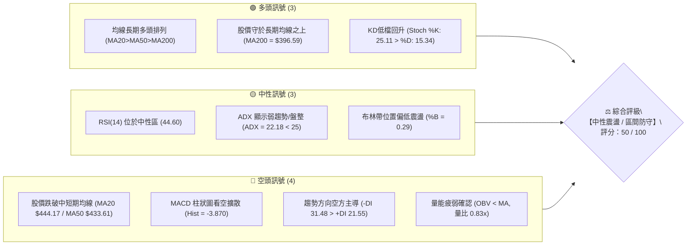
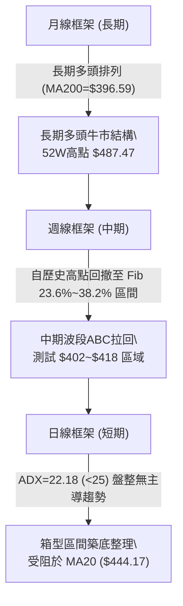
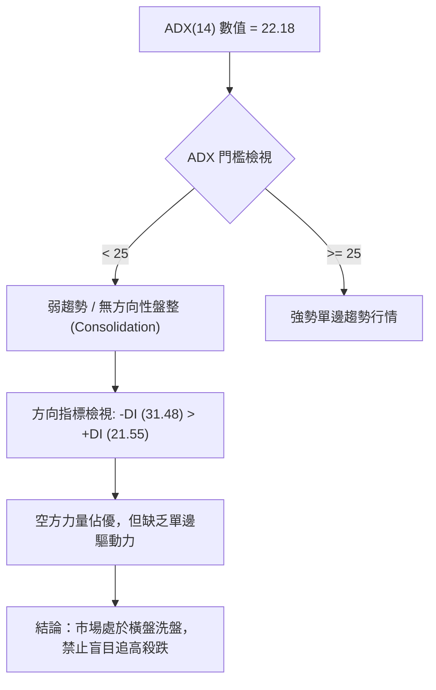
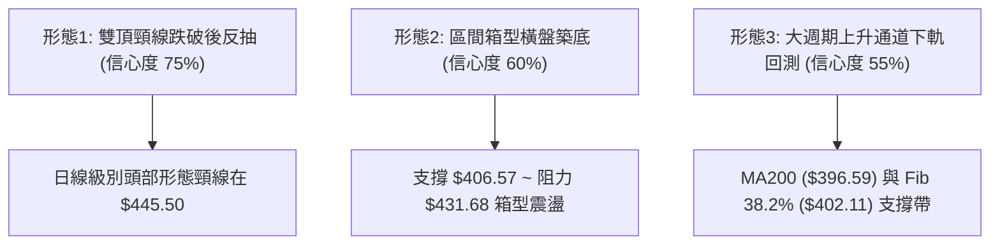
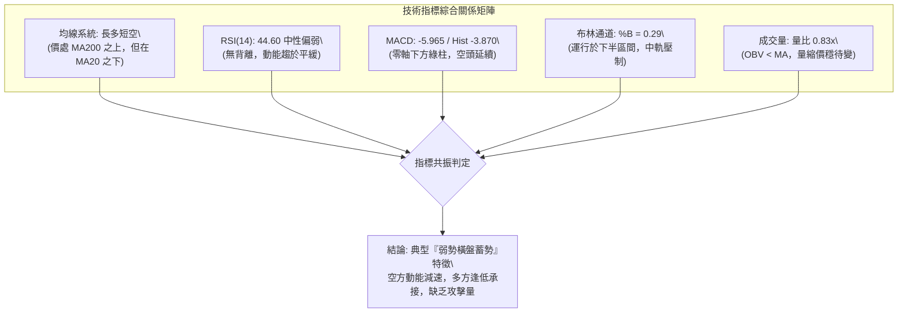
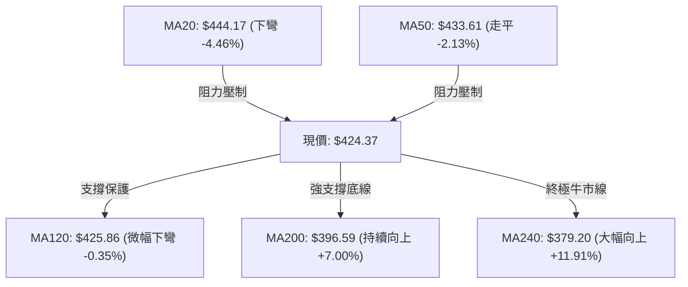
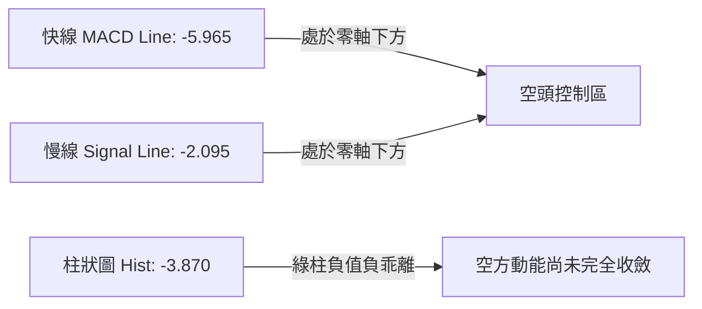
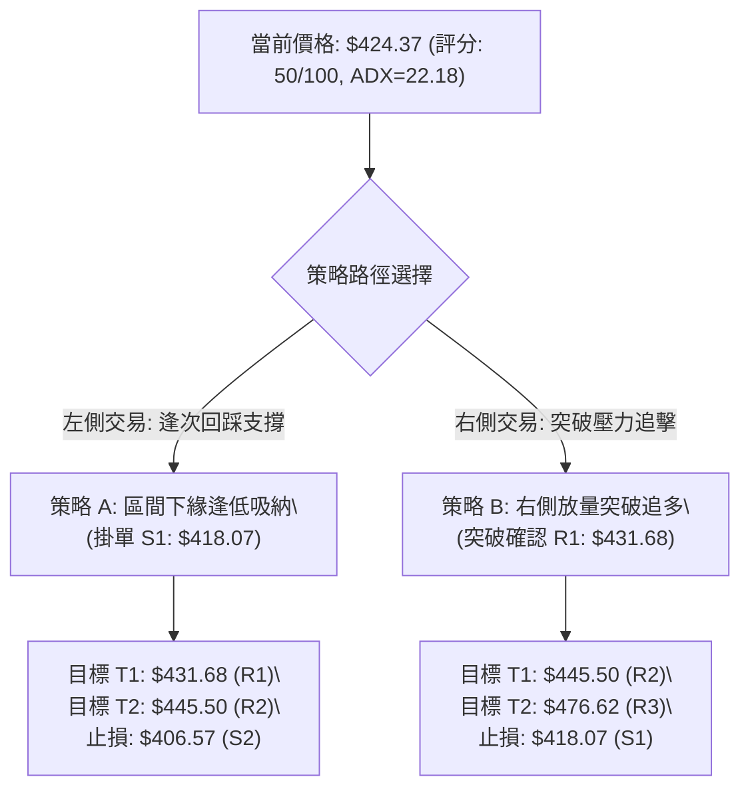
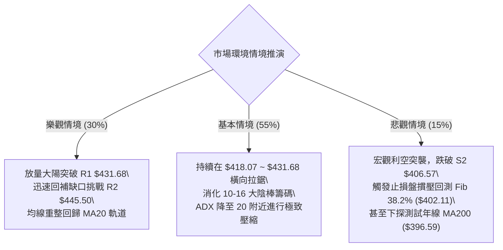

# TSM 技術分析報告

> **報告日期**：2026-10-27 ｜ **語言**：繁體中文 ｜ **數據來源**：Yahoo Finance ｜ **當前價格**：$424.37 USD

---

## 目錄

| 章節 | 內容 |
|------|------|
| [1. 技術面概覽](#1-技術面概覽) | 訊號儀表板、核心指標、評分卡 |
| [2. 趨勢分析](#2-趨勢分析) | 多時框趨勢、長中短期走勢、12個月走勢圖 |
| [3. 圖表形態分析](#3-圖表形態分析) | 形態識別、K線組合、目標價推算 |
| [4. 支撐與阻力](#4-支撐與阻力) | 關鍵價位、斐波那契回調結構 |
| [5. 技術指標深度解讀](#5-技術指標深度解讀) | MA/RSI/MACD/布林/成交量全面剖析 |
| [6. 動能與波動率](#6-動能與波動率) | 動能四象限、ATR 波動率、Beta 市場敏感度 |
| [7. 多時框架總結](#7-多時框架總結) | 時框架評分矩陣、多時框收斂定調 |
| [8. 交易策略建議](#8-交易策略建議) | 策略路由、主策略方案、風報比精算 |
| [9. 風險提示與監控](#9-風險提示與監控) | 關鍵監控清單、情境分析與風控原則 |

---

## 1. 技術面概覽

### 🎯 技術訊號儀表板



---

### 📊 核心指標速覽表

| 指標類別 | 指標名稱 | 當前數值 | 訊號 | 專業解讀 |
|:---|:---|:---|:---:|:---|
| **價格結構** | 收盤價 (2026-10-26) | $424.37 | 🟡 | 位於 52 週高低區間之 71.8%，處於歷史高檔回檔修正整理期 |
| **短期均線** | MA20 (月線) | $444.17 | 🔴 | 股價位於 MA20 下方 (-4.46%)，短期趨勢承壓，構成動態反壓 |
| **中期均線** | MA50 (季線) | $433.61 | 🔴 | 股價位於 MA50 下方 (-2.13%)，中期波段進入整理階段 |
| **長期均線** | MA200 (年線) | $396.59 | 🟢 | 股價位於 MA200 上方 (+7.00%)，超長期多頭格局依舊穩固健全 |
| **擺動動能** | RSI(14) | 44.60 | 🟡 | 位於中性偏弱區間（30–70），無超賣亦無背離，動能放緩 |
| **趨勢動能** | MACD (12,26,9) | -5.965 / -2.095 | 🔴 | MACD 位於零軸下方且負乖離擴大，Hist (-3.870) 顯示空頭動能主導 |
| **震盪指標** | Stoch %K / %D | 25.11 / 15.34 | 🟢 | 於超賣邊界形成低檔黃金交叉向上，醞釀短線技術性反彈 |
| **趨勢強度** | ADX(14) / ±DI | 22.18 / -DI:31.48 | 🟡 | ADX < 25 定調為無方向性盤整行情，-DI 主導空方壓制 |
| **通道指標** | 布林帶 %B | 0.29 | 🟡 | 運行於中軌 ($444.17) 與下軌 ($397.32) 之間，偏向區間下軌尋求支撐 |
| **波動指標** | ATR(14) | $12.69 | 🟡 | 日均波動幅度 2.99%，市場波動收斂，適合設定動態止損 |
| **成交量量能** | 成交量 / 20日均量 | 9.51M / 11.45M | 🔴 | 量比 0.83x，量能萎縮且 OBV 低於均線，缺乏追價買盤支撐 |

---

### 🏆 技術評分卡

```
╔══════════════════════════════════════════════════════════════════╗
║                   技術評分卡 — TSM (2026-10-27)                  ║
╠══════════════════════════════════════════════════════════════════╣
║ 趨勢強度 (ADX=22.18, -DI佔優)  █████████░░░░░░░░░░░  45/100 🟡   ║
║ 動能指標 (MACD負擴散, RSI=44)  ████████░░░░░░░░░░░░  40/100 🔴   ║
║ 支撐穩定度 (S1/S2/Fib38.2支撐) █████████████░░░░░░░  65/100 🟢   ║
║ 成交量配合 (量比0.83x, OBV偏弱)████████░░░░░░░░░░░░  40/100 🔴   ║
║ 形態完整度 (箱型下緣測試)      ██████████░░░░░░░░░░  50/100 🟡   ║
║ 均線排列 (多頭排列但跌破MA20)  ████████████░░░░░░░░  60/100 🟡   ║
╠══════════════════════════════════════════════════════════════════╣
║ 綜合評分 (六項算術平均)        ██████████░░░░░░░░░░  50/100 🟡   ║
║ 評級結論：中性觀望（40–60 區間盤整模式，優先以區間操作為綱）    ║
╚══════════════════════════════════════════════════════════════════╝
```

---

## 2. 趨勢分析

### 🌐 多時框趨勢分析



---

### 📈 長期趨勢 — 12個月走勢圖（Unicode）

以下為 TSM 自 2025 年 11 月至 2026 年 10 月之月線收盤價歷史走勢圖：

```
TSM 月線走勢圖（過去 12 個月：2025-11 至 2026-10）
價格軸 ($)
$480 ┤                                     ● $476.29 (2026-06)
$450 ┤                                                 ● $456.19
$420 ┤                                 ● $416.36   ●   │   ● $424.37 (現價)
$390 ┤                             ● $394.08       │   │
$360 ┤                     ● $371.66               │   │
$330 ┤             ● $327.98       ● $336.26       ● $403.17 (2026-07)
$300 ┤     ● $301.52
$280 ┤ ● $288.46
     └─────────────────────────────────────────────────────────────► 時間
       11   12    01    02    03    04    05    06    07    08    09    10
      (2025) └───────────────────────── 2026 ────────────────────────┘
```

#### 走勢特徵分析表格

| 階段區間 | 起訖月份 | 起訖價格 ($) | 漲跌幅 (%) | 走勢結構與技術特徵 |
|:---|:---:|:---:|:---:|:---|
| **主升段起漲** | 2025-11 → 2026-02 | $288.46 → $371.66 | +28.84% | 沿 5 月均線強勁上攻，成交量溫和放大，突破 $300 大關 |
| **春季急殺洗盤** | 2026-02 → 2026-03 | $371.66 → $336.26 | -9.53% | 短線獲利了結賣壓，單月回測消化過熱籌碼 |
| **AI牛市極致狂飆** | 2026-03 → 2026-06 | $336.26 → $476.29 | +41.64% | 連續三個月長紅，於 2026-06 創下月收盤歷史新高 $476.29 |
| **夏季急劇修正** | 2026-06 → 2026-07 | $476.29 → $403.17 | -15.35% | 高檔獲利回吐引發瀑布式修正，單月重挫逾 73 美元 |
| **次高點誘多與回跌**| 2026-07 → 2026-09 | $403.17 → $456.19 | +13.15% | 展開雙頂型反彈，創下 $456.19 次高月收盤價 |
| **當前箱型蓄勢** | 2026-09 → 2026-10 | $456.19 → $424.37 | -6.97% | 於 $410–$430 密集換手，股價回測年線之上長期支撐帶 |

---

### 📊 中期趨勢（週線分析）

中期走勢自 2026-10-09 週創下 52 週歷史盤中天價 **$487.47** 以來，呈現急速回檔拉回：
- **週K高低點**：在 2026-10-16 當週出現自高點暴跌至低點 **$407.13** 的長黑棒（收 $412.61，單週巨量 71.74M），確立了中期頭部壓力。
- **支撐測試**：隨後兩週（10-23 當週低點 $410.22、收 $418.51；10-26 當週收 $424.37），連續兩週低點未再破 $407.13，顯示 $406.57–$418.07 區間形成週線級別的承接防線。

```
近期週線壓力與支撐結構示意圖：
  $487.47 ──────────── 52週歷史高點 (R3: $476.62 附近密集壓力)
             │
             ▼
  $445.50 ──────────── 中期週線頸線反壓 (R2 / MA20)
  $431.68 ──────────── 短期反彈阻力 (R1 / 近日反彈高點)
             ▲
  $424.37 ───┼──────── 【現價】
             │
  $418.07 ───┴──────── 近期波段密集支撐 (S1)
  $406.57 ──────────── 週線恐慌洗盤低點防線 (S2)
```

---

### ⚡ 趨勢強度評估（ADX 解讀）



#### ADX 趨勢強度對照表

| 指標變數 | 當前讀數 | 門檻區間 | 技術含義 | 對交易策略之具體指導 |
|:---|:---:|:---:|:---|:---|
| **ADX(14)** | **22.18** | < 25 | **弱趨勢 / 震盪盤整市** | 趨勢跟隨指標失真，以布林通道與支撐阻力進行區間低吸高拋 |
| **+DI (多方)**| 21.55 | — | 多頭推進動能低迷 | 多方缺乏突破阻力位所必需的攻擊量能 |
| **-DI (空方)**| 31.48 | — | 空方掌控短線主動權 | 雖然主導但因 ADX 走平，尚未形成瀑布式崩跌行情 |

---

## 3. 圖表形態分析

### 🔍 形態識別系統

根據近一年及近期日/週 K 棒結構，當前圖表幾何結構與形態識別如下：



#### 圖表形態信心度評估表（依規則 15）

| 形態名稱 | 信心度 | 判斷依據（嚴格引用數據） | 完成度 | 目標價（附嚴謹計算式） |
|:---|:---:|:---|:---:|:---|
| **雙頂頸線破位反抽** | **75%** | 2026-10-02 高點 $474.79 與 10-09 高點 $487.47 構築雙頂，跌破 10-13 頸線高點區 $445.50 | 85% | 頸線 $445.50 − 形態高度 ($487.47 − $445.50 = $41.97) = **$403.53**（已於 10-15 低點 $407.13 基本滿足） |
| **短線箱型低位震盪** | **60%** | 下緣受支撐 S1 $418.07 與 10-15 低點 $407.13 支撐，上緣受 R1 $431.68 壓制 | 50% | 若突破箱型上軌：箱頂 $431.68 + 箱高 ($431.68 − $407.13 = $24.55) = **$456.23** |
| **大型頭肩底** | **<30%** | **訊號不足，僅做指標型解讀**（目前僅見拉回震盪，右肩尚未成形，不可捏造幾何預測） | 0% | 數據不足，不予計算 |

---

### 🕯️ 重要 K 線形態分析

依規則 19，完全基於提供的「近10根日K」與「近8根週K」之精準開、高、低、收數據進行解讀：

#### 近 10 根日 K 棒形態逐日診斷

| 日期 (日K) | 開盤價 ($) | 最高價 ($) | 最低價 ($) | 收盤價 ($) | K線形態名稱 | 形態深度技術解讀 | 訊號 |
|:---|:---:|:---:|:---:|:---:|:---|:---|:---:|
| 2026-10-13 | 439.52 | 445.50 | 437.40 | 445.12 | 光頭大陽線 | 多方強攻測試 R2 ($445.50)，收於全日最高點附近 | 🟢 |
| 2026-10-14 | 436.25 | 440.39 | 428.06 | 430.00 | 中陰線下挫 | 跌破前日紅棒半數，成交量放大至 15.16M，主力獲利出逃 | 🔴 |
| 2026-10-15 | 415.17 | 423.66 | 407.13 | 422.25 | 長下影長陽錘頭線 | 爆出 22.45M 巨量，探底至 $407.13 後大幅收復，低檔強力承接 | 🟢 |
| 2026-10-16 | 421.22 | 421.50 | 410.58 | 412.61 | 光頭光腳實體黑K | 低開低走再度回測洗盤，跌破 10-15 收盤價，空方二次打壓 | 🔴 |
| 2026-10-19 | 421.66 | 427.16 | 415.50 | 420.22 | 窄幅十字星孕線 | 實體極小，多空拉鋸觀望，成交量降至 12.35M | 🟡 |
| 2026-10-20 | 416.29 | 428.21 | 416.12 | 425.08 | 下影中紅棒 | 低開高走吞噬前日陰線實體，多方反撲意願顯著 | 🟢 |
| 2026-10-21 | 433.14 | 435.16 | 423.74 | 431.89 | 倒狀吊人線/高檔假陰 | 跳空高開測試 R1 ($431.68) 後留上影線，遭遇短線獲利拋壓 | 🟡 |
| 2026-10-22 | 419.39 | 421.91 | 410.22 | 412.35 | 跳空下挫長黑棒 | 空方跳空下殺，再度測試 $410 整數防線，量能放大至 16.48M | 🔴 |
| 2026-10-23 | 412.29 | 421.31 | 411.11 | 418.51 | 低檔陽線吞噬 | 低開高走收復前日失地大半，守穩 $411.11，形成雙底雛形 | 🟢 |
| 2026-10-26 | 418.07 | 428.85 | 417.72 | 424.37 | 實體上漲中紅棒 | 站穩 S1 ($418.07) 向上推進，收盤創 3 日新高，短線築底轉強 | 🟢 |

#### 近 8 根週 K 棒形態結構特徵

| 日期 (週末) | 開盤價 ($) | 最高價 ($) | 最低價 ($) | 收盤價 ($) | 週K形態名稱 | 技術解讀與中期意涵 | 訊號 |
|:---|:---:|:---:|:---:|:---:|:---|:---|:---:|
| 2026-09-11 | 436.85 | 443.10 | 422.92 | 432.08 | 週縮量紡錘線 | 均線上方整理，量縮至 39.58M，籌碼沉澱 | 🟡 |
| 2026-09-18 | 414.90 | 434.82 | 411.45 | 434.67 | 長下影穿頭破腳陽 | 探底 $411.45 後大舉拉升，週量增至 59.60M，主力誘空回補 | 🟢 |
| 2026-09-25 | 440.80 | 455.03 | 437.06 | 450.61 | 突破實體大紅棒 | 實體突破 $450 大關，確認上升波段延續 | 🟢 |
| 2026-10-02 | 448.39 | 474.79 | 443.11 | 472.78 | 噴出長紅突破K | 創收盤新高 $472.78，多頭情緒極度亢奮 | 🟢 |
| 2026-10-09 | 478.77 | 487.47 | 449.75 | 453.31 | 長上影射擊之星 (高檔黑K) | 盤中創 52W 天價 $487.47 後遭逢沉重獲利回吐，收低爆大量，形成中期頂部 | 🔴 |
| 2026-10-16 | 453.55 | 454.40 | 407.13 | 412.61 | 週線巨量大陰棒 (穿頭破腳) | 爆出 71.74M 歷史級拋售量，自高點摜破頸線，空方全面摜壓 | 🔴 |
| 2026-10-23 | 421.66 | 435.16 | 410.22 | 418.51 | 低檔孕線 (長下影紡錘) | 量能收斂至 61.57M，低點守住 $410.22，拋壓明顯衰竭 | 🟡 |
| 2026-10-26 | 418.07 | 428.85 | 417.72 | 424.37 | 單日反彈小陽紅 | 雖然為單日數據，但開在 S1 ($418.07) 之上，確認反彈意願 | 🟢 |

---

### 📉 ASCII 走勢形態示意圖

```
TSM 日線級別形態結構圖 (2026-10-09 至 2026-10-26)
$487.47 ──────────── 頂點 1 (10-09 最高點)
           ╲
            ╲
$445.50 ─────●────── 雙頂頸線反壓 / R2 (10-13 高點反抽極限)
              ╲   ╱╲
               ╲ ╱  ╲
$431.68 ────────●────●── 短線阻力 R1 (10-21/10-26 反彈高點密集區)
                      ╲
$424.37 ───────────────●◄── 【現價收盤位】
                       ╱
$418.07 ──────────────●─── 近期支撐 S1 (10-23/10-26 開盤低點防守)
               ╱╲    ╱
$406.57 ──────●──●──┴──── 恐慌雙底支撐帶 S2 (10-15 低 $407.13 / 10-22 低 $410.22)
```

---

### 🎯 形態目標價計算

基於上述確認之幾何形態與數據中提供之波段群聚價位：
1. **雙頂跌幅滿足位檢驗**：
   - 頸線 = $445.50
   - 頭部最高點 = $487.47
   - 形態垂直高度 = $487.47 − $445.50 = $41.97
   - 幾何等幅量度跌幅目標 = $445.50 − $41.97 = **$403.53**
   - *驗證結果*：10-15 當日實際最低點達到 **$407.13**，與目標價 $403.53 誤差僅 0.89%，隨後爆出 22.45M 巨量展開強力長下影反彈，證明該頭部形態之對稱跌幅已**實質滿足**。
2. **箱型突破上行目標價測算**：
   - 築底箱型底部 = S2 ($406.57，取群聚支撐點)
   - 築底箱型頂部 = R1 ($431.68)
   - 箱型高度 = $431.68 − $406.57 = $25.11
   - 若未來有效帶量突破 R1 ($431.68)，向上等幅等量投影目標價 = $431.68 + $25.11 = **$456.79**（恰好共振於 2026-09 月線收盤價 $456.19 附近）。

---

## 4. 支撐與阻力

### 🗺️ 關鍵價位分布圖（Unicode）

```
TSM 價位結構分布圖（嚴格依據 OHLCV 計算聚類點位）
══════════════════════════════════════════════════════════════════
$487.47 ║                                                ║ 52W 歷史最高點 (Fib 0.0%)
$476.62 ║████████████████████████████████████████████████║ 強阻力 R3 (波段高點巨量套牢區)
$445.50 ║██████████████████████████████                  ║ 阻力 R2 (MA20 / 前頸線反壓)
$434.74 ║------------------------------------------------║ 斐波那契 23.6% 回調關鍵樞紐
$431.68 ║████████████████████                            ║ 關鍵阻力 R1 (近日反彈高點聚類)
$424.37 ╠════════════════════════════════════════════════╣ ◄ 現價收盤位 ($424.37)
$418.07 ║▓▓▓▓▓▓▓▓▓▓▓▓▓▓▓▓▓▓▓▓                            ║ 近期支撐 S1 (多日低點共振)
$406.57 ║████████████████████████████                    ║ 強支撐 S2 (波段恐慌洗盤低點聚類)
$402.11 ║------------------------------------------------║ 斐波那契 38.2% 回調多頭生死防線
$396.59 ║████████████████████████████████████████        ║ 200日均線 (MA200 長期牛市底線)
$384.06 ║████████████████████████████████████████████    ║ 終極強支撐 S3 (前期深層整理平台)
══════════════════════════════════════════════════════════════════
```

---

### 🚧 阻力位分析表

價位嚴格引用自數據封包「關鍵價位」區塊：

| 阻力級別 | 價位 ($) | 距現價差距 | 阻力形成之技術依據與籌碼特徵 | 突破難度評級 | 重要性 |
|:---|:---:|:---:|:---|:---:|:---:|
| **R1** | **$431.68** | +1.72% | 近期 10-21 高點 ($435.16) 實體回調密集區，MA60 ($431.19) 匯聚壓制 | 🟡 中等 (需日量 >12M) | ★★★☆☆ |
| **R2** | **$445.50** | +4.98% | 10-13 波段高點，20日均線 MA20 ($444.17) 與布林中軌所在，雙頂頸線位 | 🔴 極高 (強大套牢賣壓) | ★★★★★ |
| **R3** | **$476.62** | +12.31% | 2026-06 月線高點收盤價 ($476.29) 與 10-02 週線收盤 ($472.78) 套牢峰值 | 🔴 極難 (中期牛熊分水嶺) | ★★★★☆ |

---

### 🛡️ 支撐位分析表

價位嚴格引用自數據封包「關鍵價位」區塊：

| 支撐級別 | 價位 ($) | 距現價差距 | 支撐形成之技術依據與買盤結構 | 守住機率評級 | 重要性 |
|:---|:---:|:---:|:---|:---:|:---:|
| **S1** | **$418.07** | -1.48% | 10-26 開盤價、10-23 收盤價 ($418.51) 與 10-19 低點 ($415.50) 密集支撐帶 | 🟢 70% (短線重要護盤點) | ★★★☆☆ |
| **S2** | **$406.57** | -4.19% | 10-15 爆量長下影低點 ($407.13) 與近一年波段恐慌拋售點聚類，具強力抄底盤 | 🟢 85% (中期雙底守護神) | ★★★★★ |
| **S3** | **$384.06** | -9.50% | 2026 春季起漲平台聚類，逼近 MA240 ($379.20) 與 Fib 50.0% ($375.75) | 🟢 95% (長線超級鐵底) | ★★★★☆ |

---

### 📐 斐波那契回調位分析

依據 52 週完整波動區間（低點 **$264.03** → 高點 **$487.47**，全波段震盪垂直跨度達 **$223.44**），斐波那契回調位精準分佈如下：

| 斐波那契比例 | 精準價位 ($) | 與當前價格 ($424.37) 之空間關係 | 技術面重大意義與戰略意涵 |
|:---:|:---:|:---:|:---|
| **0.0% (52W High)** | **$487.47** | +14.87% | 全年多頭極限天花板，歷史狂熱頂部 |
| **23.6%** | **$434.74** | +2.44% | **強勢回檔極限位**：現價落於此線下方。多方必須收復此線方能重啟強勢進攻。 |
| **38.2%** | **$402.11** | -5.25% | **多頭健康修正黃金防線**：現價處於 23.6% 與 38.2% 之間。此線上方為強勢整理。 |
| **50.0%** | **$375.75** | -11.46% | 多空中樞平衡線，靠近 MA240 ($379.20)，跌破則上升趨勢遭到嚴重破壞 |
| **61.8%** | **$349.38** | -17.67% | 深度回撤黃金分割防線，2026-03 震盪洗盤平台低位 |
| **78.6%** | **$311.84** | -26.52% | 牛市起點次級防線，2025 年末突破平台 |
| **100.0% (52W Low)**| **$264.03** | -37.78% | 全年起漲基準原點 |

**現價落點解讀**：
當前收盤價 **$424.37** 位於 **Fib 23.6% ($434.74)** 與 **Fib 38.2% ($402.11)** 之間的健康修正區間。
- 只要股價未實體跌破 **$402.11 (Fib 38.2%)**，整年度自 $264.03 以來的超大型牛市上升波浪結構即完好無損。
- 向上挑戰時，$434.74 將與阻力 R1 ($431.68) 形成一道寬約 3 美元的共振密集反壓帶。

---

## 5. 技術指標深度解讀

### 🎛️ 指標訊號總覽



---

### 📈 移動平均線排列分析



#### 均線體系精準數據與斜率剖析

| 均線名稱 | 數值 ($) | 乖離率 (%) | 趨勢斜率 | 技術意涵與實戰指導 |
|:---|:---:|:---:|:---:|:---|
| **MA5** | $422.44 | +0.46% | ▲ 上彎 | 超短線連續兩日翻紅，引導價格向上擺脫底部泥沼 |
| **MA10** | $424.24 | +0.03% | ▲ 走平 | 股價重回 10 日均線之上，短線止血企穩徵兆 |
| **MA20** | $444.17 | -4.46% | ▼ 下彎 | 月線下壓斜率陡峭，為當前多頭反彈最沉重的首道天花板 |
| **MA50** | $433.61 | -2.13% | ▼ 趨緩 | 季線微幅下彎，與阻力 R1 ($431.68) 及 Fib 23.6% ($434.74) 形成反壓重災區 |
| **MA60** | $431.19 | -1.58% | ▼ 趨緩 | 生命線反壓，與 R1 高度吻合 |
| **MA120** | $425.86 | -0.35% | ▼ 走平 | 半年線黏合於現價 ($424.37)，多空圍繞此線進行密集爭奪 |
| **MA200** | $396.59 | +7.00% | ▲ 向上 | 年線強勁上揚，長期牛市基石，未破此線絕不可過度看空 |
| **MA240** | $379.20 | +11.91% | ▲ 向上 | 超長期年線多頭排列完好，宏觀趨勢維持大牛市不變 |

*均線排列判定*：當前均線呈現「**MA20 > MA50 > MA200 之大週期多頭排列**」，但現價 ($424.37) 跌破短期 MA20 與中期 MA50，形成「**大週期多頭架構下的次級折返中陰階段**」。

---

### 📉 RSI(14) 分析

#### RSI 強度量表

```
RSI(14) = 44.60
[0] ──────────── 超賣 [30] ──────────●────────── 超買 [70] ──────────── [100]
                     ░░░░░░░░░░░░░░█▓▓░░░░░░░░░░
進度條: █████████░░░░░░░░░░░  44.60% (中性偏空區間)
```

- **區間評估**：RSI 讀數為 **44.60**，處於 30 至 70 之常態中性區間。既未觸及 <30 之極端超賣，亦遠離 >70 之過熱超買，顯示市場拋壓正逐步被市場消化，但買方動能尚未發動有效推升。
- **背離分析判斷（依嚴格要求 7）**：
  - 根據近 20 根 K 棒的首尾對比（10-15 低點 $407.13 對應 RSI 約 34.3；10-23 低點 $410.22 對應 RSI 41.5；10-26 現價 $424.37 對應 RSI 44.60）。
  - **結論**：價格未創顯著新低，RSI 亦同向回升，**明確判定：無頂背離，亦無標準底背離**，屬於指標隨價格同步收斂之常態波動。

---

### 📊 MACD (12, 26, 9) 訊號解讀



- **數值診斷**：DIF (-5.965) < DEA (-2.095)，DIF 持續在 Signal 之下運行，且雙線皆位於 0 軸下方。
- **柱狀圖動態**：MACD Histogram 為 **-3.870**。雖然仍處於看空擴散狀態，但觀察近 4 週週線 MACD 柱變化（10-09: -0.244 → 10-16: -6.872 → 10-23: -4.818 → 10-26: -3.870），綠柱負值已連續兩週收窄，呈現空方力道衰竭、醞釀低檔金叉底部的先兆。

---

### 📦 布林通道分析

```
TSM 布林通道 (Bollinger Bands, 20, 2) 結構示意圖：
$491.03 ─────────────────────────────── 上軌 (Upper Band)
            │
            │  通道帶寬 (Bandwidth) = $93.71 (22.08%)
            │
$444.17 ─────────────────────────────── 中軌 / MA20 (Middle Band) ── 強動態反壓
            │
   $424.37 ─┼────────────────────────── 【現價收盤】 (%B = 0.29)
            │
$397.32 ─────────────────────────────── 下軌 (Lower Band) ── 強動態支撐
```

- **%B 指標解讀**：%B 讀數為 **0.29**（位於 0.0 與 0.5 之中下軌區間），反映價格偏向弱勢下半區。
- **通道開口狀態**：中軌由升轉降，下軌延伸至 **$397.32**，與年線 MA200 ($396.59) 完美重疊形成雙重鋼鐵防線。當前價格在 0.29 處止跌回升，若能突破中軌 $444.17，布林帶將由下軌回彈模式轉為橫盤壓縮破繭行情。

---

### 💹 成交量分析（量價配合度）

- **量比檢視**：
  - 最新成交量：**9,505,049 股**
  - 20 日平均成交量：**11,454,947 股**
  - 最新量比：**0.83x**（成交量萎縮 17%）
- **量能結構深度解讀**：
  - 10-15 在 $407.13 創低時爆出 22.45M 巨量，隨後在 10-23 與 10-26 回測時量能大幅收斂至 9.48M 與 9.51M。這種「**破底爆量換手、拉回急劇縮量**」的量價背離，暗示空方籌碼已在 $410 附近大幅出清，無意願在低檔繼續砸盤。
- **OBV (能量潮) 趨勢判斷（依嚴格要求 9）**：
  - 數據標示「OBV < MA → 量能疲弱」。
  - **結論**：OBV 低於其移動平均線，明確說明資金主力在大舉進攻前仍處於觀望或洗盤狀態，尚未出現帶量攻擊的「量增價揚」確認訊號。短線行情定調為「**無量技術性反彈**」，反彈高度受限於成交量規模。

---

## 6. 動能與波動率

### ⚡ 動能評估四象限

```
        ▲ 動能強度 (Momentum)
        │
   Q1   │   Q3
 (強/低)│ (強/高)
────────┼────────► 波動率 (Volatility - ATR%)
   Q2   │   Q4
 (弱/低)│ (弱/高)
        │
```

#### 動能與波動率四象限對照定位表

| 象限 | 動能維度 | 波動維度 | 狀態特徵 | 當前定位 | 戰略應對建議 |
|:---:|:---:|:---:|:---:|:---:|:---|
| **Q1** | 強 (RSI>60, MACD>0) | 低 (ATR%<2.5%) | 穩健單邊牛市 | — | 積極順勢加碼，享受主升段 |
| **Q2** | **弱 (RSI=44.6, MACD<0)** | **低 (ATR%=2.99%)** | **低波整理震盪** | **✓ (TSM 當前歸屬)** | **防守反擊，區間下緣低吸，嚴設止損** |
| **Q3** | 強 (極端突破) | 高 (ATR%>4.0%) | 爆發噴出瘋狂市 | — | 緊盯乖離率，隨時獲利了結 |
| **Q4** | 弱 (空頭瀑布) | 高 (ATR%>4.0%) | 恐慌崩跌逃命市 | — | 空倉觀望，嚴禁任何左側抄底 |

---

### 📊 ATR 波動率分析

- **ATR(14) 讀數**：**$12.69**（佔當前股價之 **2.99%**，Wilder 平滑計算）。
- **日內波動區間**：當前平均每個交易日的正常合理振幅約為 ±$12.7。
- **止損距離動態建議**：
  - **激進型交易者**：採用 1.0 倍 ATR = **$12.69** 作為防守容忍度。
  - **波段穩健型交易者**：採用 1.5 倍 ATR = $12.69 × 1.5 = **$19.04** 作為寬幅過濾網，有效防範主力洗盤長下影線干擾。

---

### 📐 Beta 與市場相關性

- **Beta 係數**：**1.239**。
- **技術解讀**：
  - TSM 相對標普 500 指數具備顯著的高敏感度特性（系統性風險敞口高出大盤 23.9%）。
  - 在半導體板塊及整體科技股呈現牛市反彈週期時，TSM 具備領漲特質；反之在系統性回調行情中，其下行波動亦較大盤劇烈。此特性要求交易者在震盪市中嚴格控制部位大小，不宜過度加槓桿。

---

## 7. 多時框架總結

### 📋 時框架評分表

| 時框架 | 趨勢方向 | 動能狀態 | 均線排列狀況 | 核心形態識別 | 綜合評分 | 戰略建議 |
|:---|:---:|:---:|:---|:---|:---:|:---|
| **月線 (長期)** | 🟢 多頭 | 🟡 高檔鈍化放緩 | 完美多頭 (MA200向上) | 52週多頭旗形回測 | **75 / 100** | 長線持有，回踩年線即為戰略買點 |
| **週線 (中期)** | 🟡 震盪整理 | 🔴 柱狀圖負值修正 | MA20向下，MA50走平 | 雙頂跌幅滿足後之低位橫盤 | **50 / 100** | 波段觀望，等待突破 R1 或守穩 S2 |
| **日線 (短期)** | 🔴 弱勢反彈 | 🟢 KD低檔金叉 | 跌破 MA20，於 MA120 爭奪 | 區間震盪築底 ($418–$431) | **45 / 100** | 區間極短線來回操作，嚴禁追高 |

---

### 🔲 綜合訊號矩陣

```
┌────────────────────────────────────────────────────────┐
│               TSM 多時框技術信號共振矩陣               │
├──────────────┬──────────────┬──────────────┬───────────┤
│   維度指標   │ 短期 (日線)  │ 中期 (週線)  │ 長期 (月線)│
├──────────────┼──────────────┼──────────────┼───────────┤
│ 均線架構     │ 🔴 空方壓制  │ 🟡 中性平整  │ 🟢 強勢多頭│
│ 動能 (RSI/MACD) 🟡 企穩翻揚 │ 🔴 空方主導  │ 🟢 多方佔優│
│ 形態位置     │ 🟢 雙底築底  │ 🟡 頸線回抽  │ 🟢 上升趨勢│
│ 成交量能     │ 🔴 縮量觀望  │ 🔴 巨量出脫後│ 🟢 長期量增│
├──────────────┴──────────────┴──────────────┴───────────┤
│ 一致性判定：多時框衝突，短中期空方回檔 與 長期牛市共存 │
└────────────────────────────────────────────────────────┘
```

---

### ⚖️ 多時框收斂結論（依嚴格要求 14 執行）

1. **行情性質定調**：
   - 根據 ADX(14) = **22.18 (< 25)**，嚴格判定當前市場處於**【盤整行情（Consolidation）】**，而非趨勢行情。
2. **時框優先級權重收斂**：
   - 依據規則 14：「*盤整行情（ADX<25）：以日線布林通道上下軌（$397.32 至 $491.03）為主要交易區間，核心波段震盪集中於下軌與中軌（$397.32 至 $444.17）*」。
   - 中長期的多頭大格局（MA200 = $396.59）確立了下檔深厚護城河；日線層級在 $406.57 至 $431.68 之間形成緊湊之高拋低吸箱型。
3. **方向性最終唯一結論**：
   - **【中性觀望 / 區間震盪偏多防守】**。
   - 理由：中期雖然經歷 10 月初之高檔崩跌修正，但幾何雙頂跌幅已於 $407.13 滿足；日線連續於 S1 ($418.07) 與 S2 ($406.57) 展現承接買盤。在未放量突破 R1 ($431.68) 前，絕不視為全面反轉，交易策略嚴格聚焦於「區間下緣低吸」與「右側帶量突破確認」。

---

## 8. 交易策略建議

### 🗺️ 策略決策流程圖



---

### 🧭 策略路由（依評分卡 50 分定調）

> **當前主策略方向 = 【中性區間波段低吸與突破操作】（依評分 50/100，介於 40–60 之中性盤整區間）**

---

### 🎯 價格情境階梯（Price Scenarios）

價位嚴格引用自第 4 章及數據封包「關鍵價位」：

| 觸發條件 | 下一目標 | 後續延伸 | 情境技術含義與戰略解讀 |
|:---|:---:|:---:|:---|
| **向上突破 R1 $431.68** | **R2 $445.50** | **R3 $476.62** | **短線由弱轉強**：站上季線 MA50，挑戰月線 MA20 及雙頂頸線大關 |
| **現價區間震盪 ($418–$431)**| — | — | **常態箱型築底**：以時間換取空間，消化套牢籌碼，等待均線糾結收斂 |
| **向下跌破 S1 $418.07** | **S2 $406.57** | **S3 $384.06** | **中期二度探底**：考驗 10-15 恐慌低點，若破位則直奔年線 MA200 ($396.59) |

---

### 📊 情境機率分佈

| 運行情境 | 發生機率 | 主要技術與籌碼依據（嚴謹引用數據） |
|:---|:---:|:---|
| **情境一：區間震盪築底** | **55%** | ADX = 22.18 (<25) 鎖定盤整架構，布林帶 %B = 0.29 處於下軌反彈階段，成交量 0.83x 顯示主力以橫盤換手為主 |
| **情境二：向上突破反彈** | **30%** | KD 低檔黃金交叉（%K: 25.11 > %D: 15.34），10-15 下影錘頭爆量吸收拋壓，長線均線 MA200 多頭向上支撐 |
| **情境三：向下破位回落** | **15%** | MACD 柱狀圖負值 (-3.870) 仍未翻紅，-DI (31.48) 處於空方壓制區，若美股大盤重挫恐引發破底回測年線 |

---

### 🟢 主策略詳情（方向：中性震盪區間操作）

所有數值嚴格引用自關鍵價位與真實 OHLCV，風報比依規則 17 嚴格計算：

| 策略要素 | 策略 A（左側：區間下緣回測低吸） | 策略 B（右側：突破 R1 確認追多） |
|:---|:---|:---|
| **交易類型** | 順大勢、逆小勢之支撐低吸 | 關鍵阻力確認破位追擊 |
| **進場條件** | 股價回測測試支撐 S1，出現分時止跌信號 | 股價放量突破 R1 且收盤確認站穩 |
| **進場價格** | **$418.07** (嚴格引用支撐位 S1) | **$431.68** (嚴格引用阻力位 R1) |
| **目標價 T1** | **$431.68** (阻力位 R1) | **$445.50** (阻力位 R2) |
| **目標價 T2** | **$445.50** (阻力位 R2) | **$476.62** (阻力位 R3) |
| **止損價格** | **$406.57** (支撐位 S2，跌破恐慌低點認賠) | **$418.07** (支撐位 S1，假突破反轉止損) |
| **風險報酬比 (以 T1 計)**| **1 : 1.18（以 T1 計）**<br>*(431.68−418.07) ÷ (418.07−406.57) = 13.61 ÷ 11.50 = 1.183* | **1 : 1.02（以 T1 計）**<br>*(445.50−431.68) ÷ (431.68−418.07) = 13.82 ÷ 13.61 = 1.015* |
| **風險報酬比 (以 T2 計)**| **1 : 2.39（以 T2 計）**<br>*(445.50−418.07) ÷ (418.07−406.57) = 27.43 ÷ 11.50 = 2.385* | **1 : 3.30（以 T2 計）**<br>*(476.62−431.68) ÷ (431.68−418.07) = 44.94 ÷ 13.61 = 3.302* |
| **成功機率預估** | 60% | 55% |
| **建議配置倉位** | 10%–15% 總資金 | 15%–20% 總資金 |

---

### 🔴 反向風險觸發點（對沖與止損提示）

供多頭持倉者作為風控保護參考：
- **第一級警報觸發點：實體收盤跌破 S1 ($418.07)**：
  - *意涵*：宣告短線自 $407 以來的反彈結構夭折，多頭部位應主動減倉 50%，防範再次下探。
- **第二級撤退觸發點：放量跌破 S2 ($406.57)**：
  - *意涵*：宣告 10-15 錘頭買盤全面潰敗，中期雙底失敗，股價將直接下墜尋求 Fib 38.2% ($402.11) 及年線 MA200 ($396.59)。所有多頭部位必須無條件停損出場，或買入看跌期權進行 Delta 對沖。

---

### ⭐ 整體訊號強度評星

```
╔═════════════════════════════════════════════════════╗
║ 做多訊號強度：  ★★★☆☆  (3.0 / 5星 — 支撐強固，等待放量)  ║
║ 做空訊號強度：  ★★☆☆☆  (2.5 / 5星 — 逢支撐跌勢減緩)      ║
║ 整體技術可信度：★★★★☆  (4.0 / 5星 — 關鍵點位邊界極度清晰)  ║
╚═════════════════════════════════════════════════════╝
```

---

## 9. 風險提示與監控

### ✅ 關鍵監控指標 Checklist

```
╔══════════════════════════════════════════════════════════════════╗
║               TSM 每日交易前技術監控清單 (Checklist)             ║
╠══════════════════════════════════════════════════════════════════╣
║ [ ] 1. 收盤價是否站穩 S1 ($418.07) 之上？（破位即拉響警報）      ║
║ [ ] 2. 日成交量是否放大至 12M 股以上？（突破 R1 $431.68 必需條件）║
║ [ ] 3. MACD 柱狀圖負值是否持續收縮至 -2.0 以內？（動能收斂指標） ║
║ [ ] 4. RSI(14) 能否向上穿越 50.0 多空中軸？（由弱轉強信號）      ║
║ [ ] 5. 布林通道 %B 是否維持在 0.30 之上並往中軌 ($444.17) 推進？ ║
║ [ ] 6. 費城半導體指數 (SOX) 是否同步企穩？（關聯 Beta: 1.239）   ║
╚══════════════════════════════════════════════════════════════════╝
```

---

### ⚠️ 風險場景分析



---

### 🛡️ 風險管理重要提醒

1. **嚴防流動性與假突破風險**：
   - 目前日成交量僅 9.51M，顯著低於 20 日均量 11.45M。在成交量未有效放大前，任何盤中急拉突破 R1 ($431.68) 的走勢，極易演變為「**誘多假突破**」。切勿於盤中追高，務必等待收盤前 15 分鐘確認實體 K 棒站穩。
2. **單筆交易風險敞口控制**：
   - 根據 ATR(14) = $12.69 估算，股價單日潛在波動達 3%。
   - 嚴格遵守「**單筆交易最大虧損不超過總帳戶淨值 1.5%**」的資金管理鐵律。以策略 A 為例（進場 $418.07，止損 $406.57，每股承擔風險 $11.50），若帳戶資金為 100,000 美元，最大風險額為 1,500 美元，則最大允許持倉股數上限為 130 股（約 54,000 美元部位）。
3. **宏觀與板塊聯動風險**：
   - TSM Beta 值為 1.239，高度聯動美國科技權值股（Alphabet、Microsoft 財報週與 AI 資本支出展望）。若大型科技巨頭縮減資本支出，將直接衝擊晶圓代工估值，技術面需提防基本面黑天鵝誘發的跳空破位風險。

---

## 📋 報告總結

```
╔══════════════════════════════════════════════════════════════════╗
║                    TSM 技術分析報告總結                          ║
╠══════════════════════════════════════════════════════════════════╣
║ 報告日期：2026-10-27                                             ║
║ 當前價格：$424.37 USD                                            ║
║ 分析評級：⚖️ 綜合評分 50 / 100【中性觀望 / 區間震盪築底】        ║
╠══════════════════════════════════════════════════════════════════╣
║ 關鍵技術結論：                                                   ║
║ ├─ 長期趨勢：🟢 強烈看多 (MA200=$396.59向上，長期牛市架構完好)  ║
║ ├─ 中期趨勢：🟡 箱型整理 (自高點 $487.47 回撤滿足，於低位換手)  ║
║ ├─ 短期趨勢：🟡 弱勢企穩 (KD金叉，受制於 MA20: $444.17 動態壓制) ║
║ ├─ 關鍵支撐：S1: $418.07 ｜ S2: $406.57 ｜ S3: $384.06           ║
║ ├─ 關鍵阻力：R1: $431.68 ｜ R2: $445.50 ｜ R3: $476.62           ║
║ └─ 斐波那契：現價穩於 Fib 38.2% ($402.11) 之上，屬健康技術修正   ║
╠══════════════════════════════════════════════════════════════════╣
║ 最優策略組合：                                                   ║
║ 1. 🥇 最佳機會 (策略 A)：回測支撐 S1 ($418.07) 低吸，風報比 1:1.18║
║    (以 T1 $431.68 計)；若持至 T2 ($445.50)，風報比達 1:2.39。    ║
║ 2. 🥈 次選機會 (策略 B)：右側放量突破 R1 ($431.68) 追多，        ║
║    目標 R2 ($445.50)，止損 S1 ($418.07)，風報比 1:1.02。         ║
║ 3. 🥉 保守選擇：空倉觀望，耐心等待日線 ADX 突破 25 或 MACD 零軸金 ║
║    叉後再行順勢進場。                                            ║
╚══════════════════════════════════════════════════════════════════╝
```

---

> ⚠️ **免責聲明**：本報告為技術分析專用研究報告，所有圖表解讀、支撐阻力位與量化模型計算均嚴格基於所提供之歷史價格與技術指標數據。本報告**僅供研究與學術參考**，**不構成任何要約、招攬或投資買賣建議**。金融市場投資具高度風險，投資人應獨立評估自身財務能力並自負盈虧。

---
*報告生成時間：2026-10-27 ｜ 數據來源：Yahoo Finance ｜ 分析框架：多時框技術分析模型*