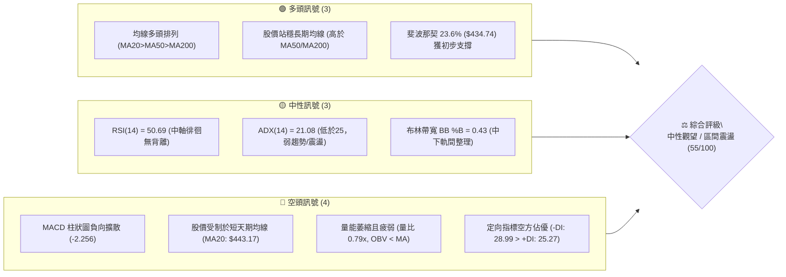
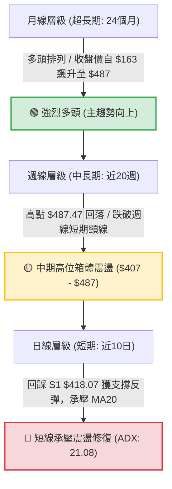
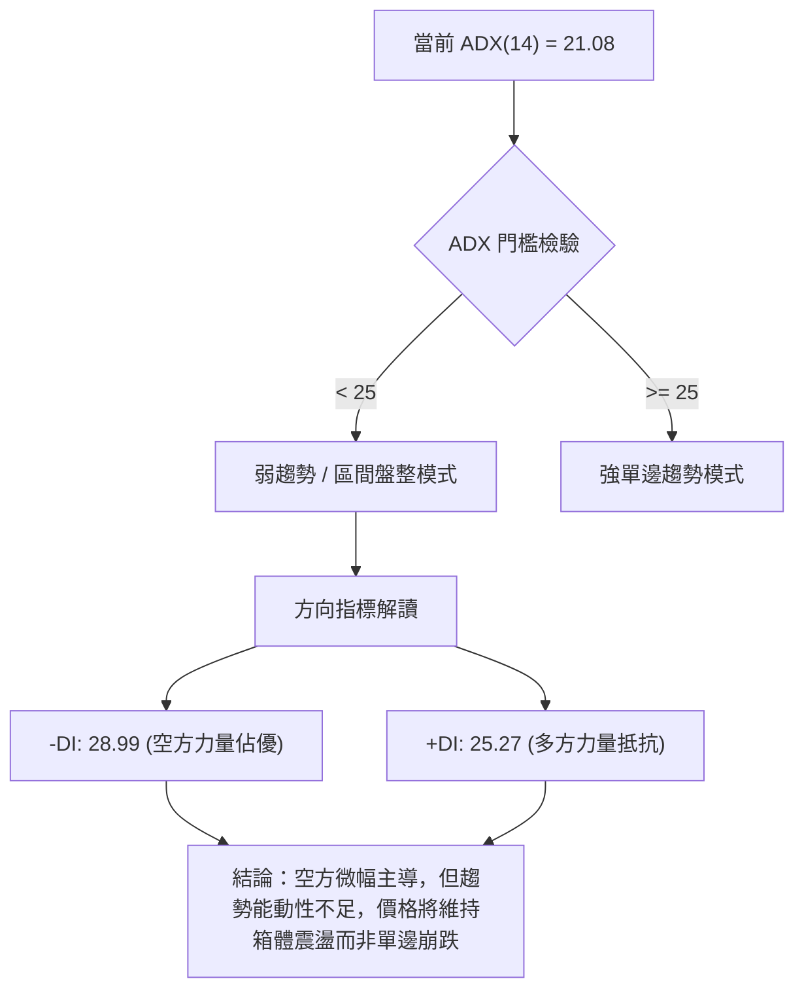
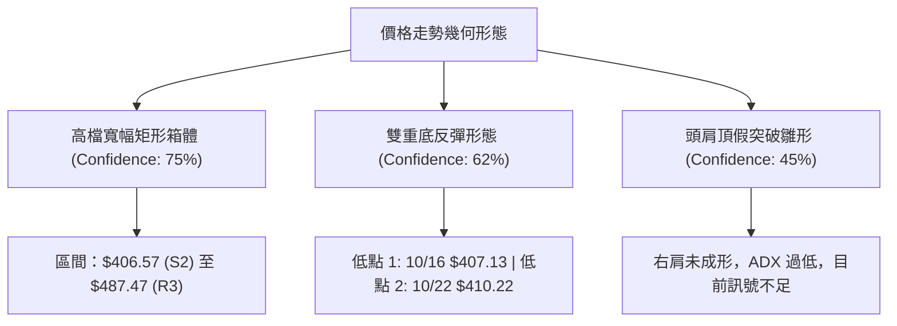
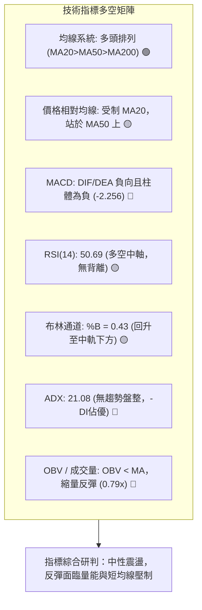
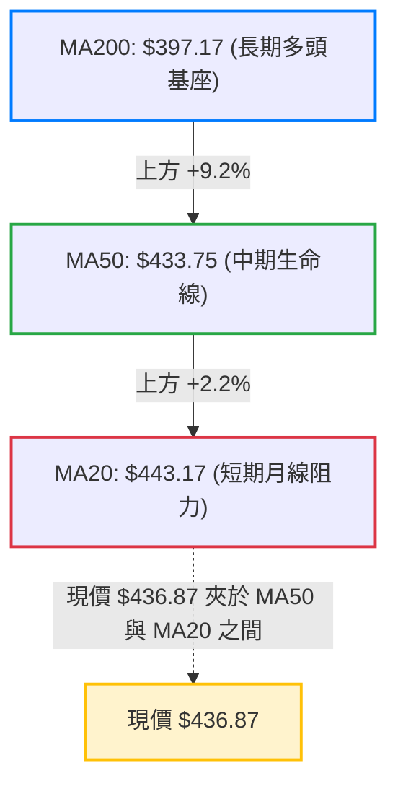
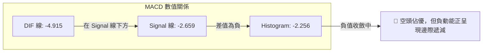
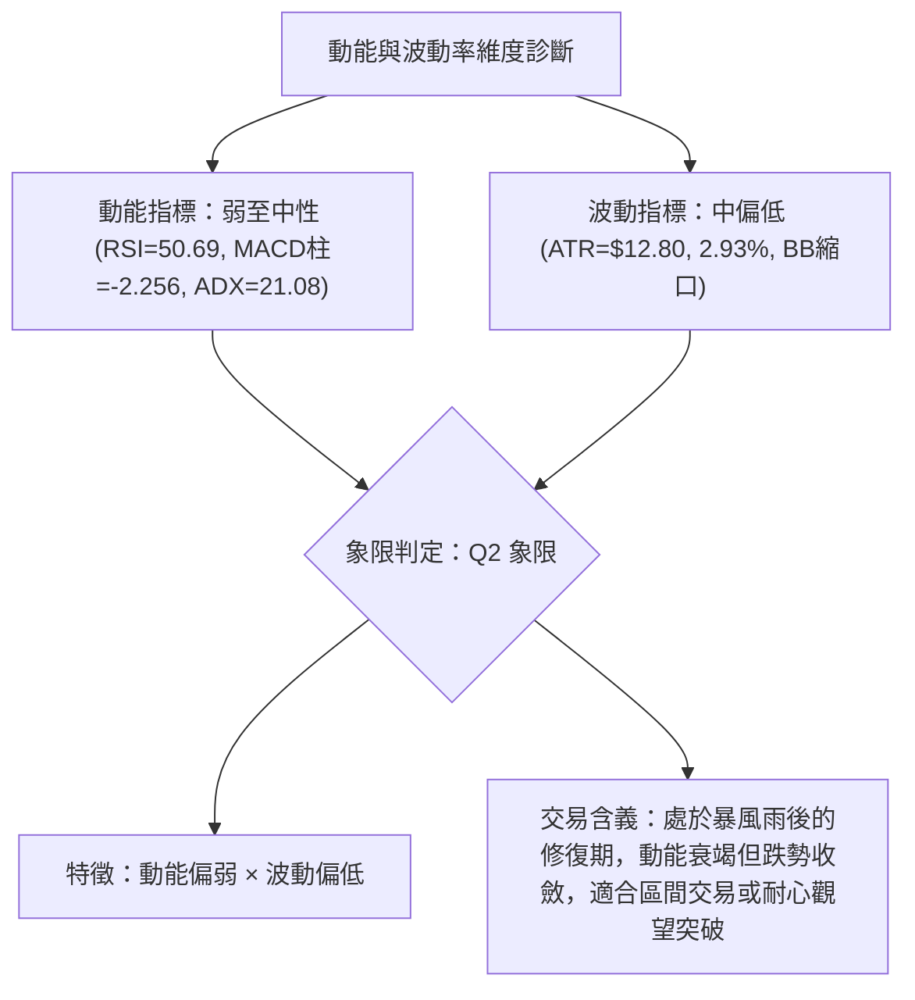
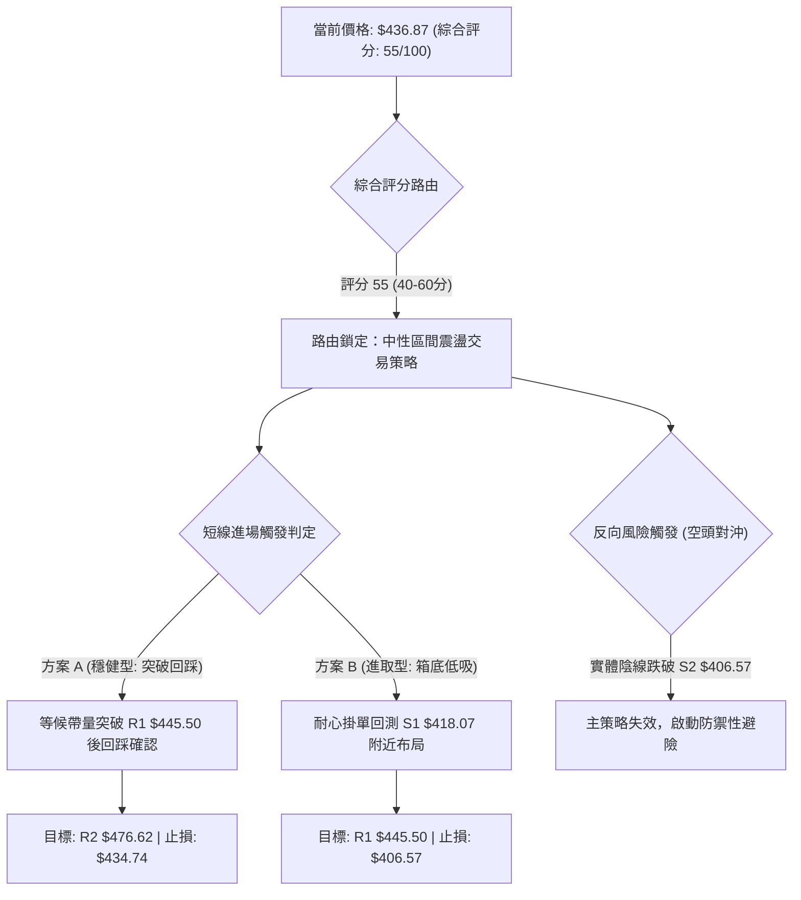
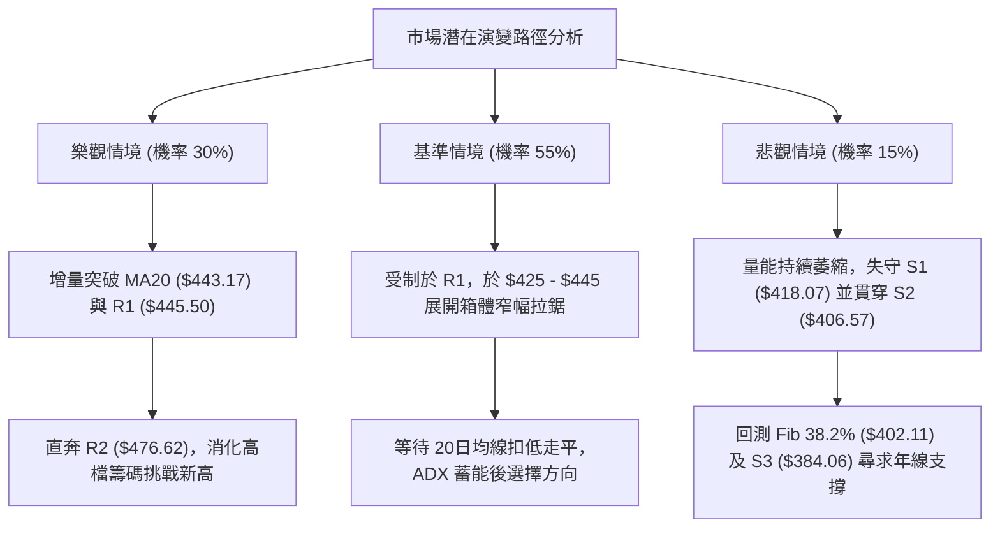

# TSM 技術分析報告

> **報告日期**：2026-10-28 ｜ **語言**：繁體中文 ｜ **數據來源**：Yahoo Finance ｜ **當前價格**：$436.87 USD

---

## 目錄

| 章節 | 內容 |
|------|------|
| [1. 技術面概覽](#1-技術面概覽) | 訊號儀表板、核心指標、評分卡 |
| [2. 趨勢分析](#2-趨勢分析) | 多時框趨勢、長中短期走勢、ADX 解讀 |
| [3. 圖表形態分析](#3-圖表形態分析) | 形態識別、K線組合、目標價計算 |
| [4. 支撐與阻力](#4-支撐與阻力) | 關鍵價位分布、波段高低點、斐波那契回調 |
| [5. 技術指標深度解讀](#5-技術指標深度解讀) | MA/RSI/MACD/布林/成交量/OBV |
| [6. 動能與波動率](#6-動能與波動率) | 動能四象限、ATR、Beta 與市場敏感度 |
| [7. 多時框架總結](#7-多時框架總結) | 時框架矩陣、多時框收斂結論 |
| [8. 交易策略建議](#8-交易策略建議) | 策略路由、情境階梯、風報比精算 |
| [9. 風險提示與監控](#9-風險提示與監控) | 監控清單、極端情境、風控原則 |

---

## 1. 技術面概覽

### 🎯 技術訊號儀表板



### 📊 核心指標速覽表

| 指標類別 | 指標名稱 | 當前數值 | 訊號 | 解讀 |
|:---|:---|:---|:---:|:---|
| **價格** | 當前收盤價 | $436.87 | 🟡 | 位於52週區間 77.4% 處，短線處於自歷史高點回檔後的弱勢反彈段 |
| **均線** | MA20 (月線) | $443.17 | 🔴 | 現價位於 MA20 下方 (-1.42%)，短期趨勢承壓，構成第一道動態阻力 |
| **均線** | MA50 (季線) | $433.75 | 🟢 | 現價高於 MA50 (+0.72%)，中期生命線維持向上扣抵，發揮托底作用 |
| **均線** | MA200 (年線)| $397.17 | 🟢 | 現價大幅高於 MA200 (+10.00%)，長期結構屬於健康的多頭循環底座 |
| **動能** | RSI(14) | 50.69 | 🟡 | 位於 50 多空中軸，未進入超買(>70)或超賣(<30)，短期動能進入平衡期 |
| **動能** | MACD (12,26,9)| -4.915 / -2.659 | 🔴 | DIF 線低於訊號線，柱狀圖為 -2.256，空頭動能尚未出現黃金交叉 |
| **動能** | KD (Stoch %K/%D)| 46.43 / 28.65 | 🟡 | %K 由超賣區向上穿越 %D，進入中性整理帶，短線跌勢暫緩但動能有限 |
| **動能** | 趨勢強度 (ADX)| 21.08 | 🟡 | ADX < 25 表明非單邊趨勢行情，進入盤整格局；-DI(28.99) > +DI(25.27) |
| **通道** | 布林通道 | $396.60 ~ $489.73 | 🟡 | %B 為 0.43，價格脫離下軌支撐回升至中軌下方，通道維持擴張後的收斂 |
| **波動** | ATR(14) | $12.80 | 🟡 | 佔股價 2.93%，屬於科技巨頭正常波動水準，每日波幅預期約 ±$12.80 |
| **成交量**| 最新量 / 20日均量| 8,992,418 / 11,414,496| 🔴 | 量比 0.79x，成交量未能放大確認反彈，且 OBV < MA 顯示資金沉澱疲弱 |

### 🏆 技術評分卡

```
╔══════════════════════════════════════════════════════════════════════════╗
║                    技術評分卡 — TSM (2026-10-28)                         ║
╠══════════════════════════════════════════════════════════════════════════╣
║ 評估維度      進度條（滿分 100）           得分   狀態   權重解讀       ║
╟──────────────────────────────────────────────────────────────────────────╢
║ 趨勢強度      ████████░░░░░░░░░░░░         40/100  🟡   ADX=21.08 弱趨勢 ║
║ 動能指標      ████████░░░░░░░░░░░░         42/100  🔴   MACD柱負值/RSI中軸║
║ 支撐穩定度    ██████████████░░░░░░         70/100  🟢   S1 $418/Fib 23.6%║
║ 成交量配合    ████████░░░░░░░░░░░░         38/100  🔴   量比0.79x, OBV偏弱║
║ 形態完整度    ██████████████░░░░░░         68/100  🟢   箱體支撐成形中   ║
║ 均線排列      ██████████████░░░░░░         72/100  🟢   MA20>MA50>MA200  ║
╠══════════════════════════════════════════════════════════════════════════╣
║ 綜合評分      ███████████░░░░░░░░░         55/100  🟡   中性觀望 (區間)  ║
╚══════════════════════════════════════════════════════════════════════════╝
```
> *註：綜合評分由六項子指標算術平均導出：(40 + 42 + 70 + 38 + 68 + 72) / 6 = 330 / 6 = 55.0分（四捨五入至整數為 55/100）。*

---

## 2. 趨勢分析

### 🌐 多時框趨勢分析



### 📈 長期趨勢 — 12個月走勢圖（Unicode）

以下為 TSM 過去 12 個月（2025-11 至 2026-10）之月線收盤走勢圖，標記歷史高點與關鍵波段軌跡：

```
TSM 月線走勢圖（過去12個月：2025-11 至 2026-10）
價格軸 ($)
$500 ┤                                        
$475 ┤                                  ● $476.29 (2026-06 高點)
$450 ┤                                        ● $456.19
$425 ┤                            ● $416.36   │     ● $436.87 (當前)
$400 ┤                      ● $394.08         ● $403.17 (2026-07 低點)
$375 ┤                ● $371.66
$350 ┤          ● $336.26 (拉回)
$325 ┤    ● $327.98
$300 ┤● $288.46──● $301.52
$275 ┤ 
     └─────────────────────────────────────────────────────────────►
       11   12   01   02   03   04   05   06   07   08   09   10  (月份)
     [ 2025年 ] [                      2026年                      ]
```

**走勢特徵分析表格**：

| 階段區間 | 起訖月份 | 起點價格 | 終點價格 | 區間漲跌幅 | 結構特徵與技術解讀 |
|:---|:---|:---:|:---:|:---:|:---|
| **第一階段：基底突破** | 2025-11 ~ 2026-02 | $288.46 | $371.66 | +28.84% | 強力單邊上漲，月K線連續推升，突破 $300 整數關卡，成交量能顯著擴大 |
| **第二階段：健康回踩** | 2026-02 ~ 2026-03 | $371.66 | $336.26 | -9.52% | 獲利了結回檔，回踩前波突破平台，確認長期支撐後重啟攻勢 |
| **第三階段：主升浪狂飆** | 2026-03 ~ 2026-06 | $336.26 | $476.29 | +41.64% | 半導體主升段，月線收盤創歷史新高 $476.29（盤中觸及 52W 高點 $487.47） |
| **第四階段：高位劇烈洗盤**| 2026-06 ~ 2026-07 | $476.29 | $403.17 | -15.35% | 高位快速去槓桿，月線重挫回測 $400 大關，回補籌碼缺口 |
| **第五階段：二次摸頂收斂**| 2026-07 ~ 2026-10 | $403.17 | $436.87 | +8.36% | 反彈衝擊 $456.19 未能過頂，10月再度拉回 $436.87，進入對稱收斂三角 |

### 📊 中期趨勢（週線分析）

從近 20 週數據觀察，TSM 呈現明顯的高檔大箱體震盪形態：
1. **箱頂壓力帶**：2026-10-02 當週最高曾衝至 $474.79，2026-10-09 盤中創下 52W 最高點 **$487.47**，隨即出現大量長上影線陰線（收 $453.31），顯示 $475 - $487 為沉重解套籌碼帶。
2. **箱底支撐帶**：2026-07-17 當週低點來到 $397.30，隨後在 2026-10-16 當週最低探至 **$407.13**，週線 RSI 降至 34.3 超賣區邊界後迅速獲得逢低買盤進場，低點穩固在 **$406.57 - $418.07** 區間。
3. **週線 MACD 狀態**：週線 MACD 柱狀圖在 10 月初創下高點後快速轉負（2026-10-16 為 -6.872，最新一週收斂至 -2.256），顯示中期回檔修正的殺跌力道正在衰退，呈現低檔鈍化與修復態勢。

```
近期週線壓力與支撐示意圖：
$487.47 ──┬─────────────────────────────────────────────── 高點 R3 ($487.47)
          │  [高檔套牢壓力區：量大滯漲]
$445.50 ──┼─────────────────────────────────────────────── 短期頸線壓力 R1 ($445.50)
          │           ▲ 現價 $436.87 (反彈測試中)
$418.07 ──┼─────────────────────────────────────────────── 箱體平台支撐 S1 ($418.07)
          │  [買盤護盤承接區：縮量築底]
$406.57 ──┴─────────────────────────────────────────────── 箱體底部強支撐 S2 ($406.57)
```

### ⚡ 趨勢強度評估（ADX 解讀）



**ADX 趨勢強度量化對照表**：

| ADX 區間 | 趨勢分類 | 適用交易哲學 | TSM 現狀判定 |
|:---:|:---:|:---|:---:|
| 0 – 20 | 極弱 / 無趨勢 | 均值回歸、完全觀望 | 否 |
| **20 – 25** | **弱趨勢 / 轉向盤整** | **區間震盪、高拋低吸、布林通道交易** | **🟢 符合現狀 (21.08)** |
| 25 – 40 | 強趨勢建立 | 順勢突破、移動止損追蹤 | 否 |
| 40 – 60 | 極強主升/主跌浪 | 緊握趨勢單、嚴禁逆勢摸頂抄底 | 否 |

---

## 3. 圖表形態分析

### 🔍 形態識別系統

在多時框結構中，TSM 呈現「高位寬幅箱體」與「收斂三角形末端」的交集狀態。



**形態信心度與目標價評估表**：

| 形態名稱 | 信心度 | 判斷依據（引用數據） | 完成度 | 目標價（附計算式） |
|:---|:---:|:---|:---:|:---|
| **短期雙底 (W底)** | **62%** | 兩次回踩波段低點（10/15-16 最低 $407.13，10/22-23 最低 $410.22 於 S1 $418 附近止跌） | 70% | 頸線為 10/21 高點 $435.16。突破後測算目標：$435.16 + ($435.16 - $407.13) = **$463.19**（介於 R1 $445.50 與 R2 $476.62 間） |
| **高位矩形箱體** | **75%** | 52週高點 $487.47 與 7月/10月低點聚類 S2 $406.57 形成高低軌道震盪 | 85% | 箱底 $406.57 支撐有效，上軌目標即為箱頂阻力 **R2 $476.62** 與 **R3 $487.47** |
| **頭肩頂形態** | **35%** | 訊號不足。左肩 6月高點 $476.29、頭部 10/09 $487.47，但右肩未構築，且 ADX<25 不支持崩跌形態 | 20% | 訊號不足，僅做指標型解讀，不預設跌破目標 |

### 🕯️ 重要K線形態分析

根據「近10根日K」與「近8根週K」之精確 OHLC 數據進行形態識別：

| 日期（日K/週K） | 開 | 高 | 低 | 收 | K線形態 | 解讀 | 訊號 |
|:---|:---:|:---:|:---:|:---:|:---|:---|:---:|
| **日K 2026-10-15** | 415.17 | 423.66 | 407.13 | 422.25 | **長下影錘頭陽線** | 盤中下探波段極低點 $407.13 獲強勁低接買盤收復，實體收高，顯著止跌 | 🟢 |
| **日K 2026-10-21** | 433.14 | 435.16 | 423.74 | 431.89 | **衝高回落小陰線** | 測試短期阻力未果，留下長上影線，表明短線獲利盤逢高出脫 | 🟡 |
| **日K 2026-10-22** | 419.39 | 421.91 | 410.22 | 412.35 | **跳空低開中黑K** | 二次回測低點支撐，收盤跌破開盤價，空方進行二次試探 | 🔴 |
| **日K 2026-10-23** | 412.29 | 421.31 | 411.11 | 418.51 | **低檔回升紡錘陽線**| 回測 $411.11 守穩，成交量縮至 949 萬股，浮額洗淨，構築第二隻腳 | 🟢 |
| **日K 2026-10-26** | 418.07 | 428.85 | 417.72 | 424.37 | **紅三兵首根推升陽K**| 開盤恰在 S1 $418.07，一路走高收復短期均線，確認低點抬高 | 🟢 |
| **日K 2026-10-27** | 427.16 | 438.58 | 426.00 | 436.87 | **實體增量中陽線** | 突破 10/21 頸線高點 $435.16，最高觸及 $438.58，短底反彈確立 | 🟢 |
| **週K 2026-10-09** | 478.77 | 487.47 | 449.75 | 453.31 | **歷史天價長上影陰K**| 創歷史高點 $487.47 後引發龐大解套拋壓，主力高位出貨特徵顯著 | 🔴 |
| **週K 2026-10-16** | 453.55 | 454.40 | 407.13 | 412.61 | **長黑貫穿大陰K** | 單週重挫 $40.7，放量 7,173 萬股殺跌，迅速尋找底部支撐區 | 🔴 |
| **週K 2026-10-27** | 418.07 | 438.58 | 417.72 | 436.87 | **週線下影反彈陽K** | 守穩前期平台，多方展開技術性反撲，目前收於全週相對高點 | 🟢 |

### 📉 ASCII 走勢形態示意圖

```
TSM 近10日日K「雙底 (W底) 頸線突破」結構示意圖
價格 ($)
$440 ┤                                                    ● 10/27 收 $436.87 (逼近MA20)
     │                                ╭─ 頸線 $435.16 ───╭╯
$430 ┤                      ● 10/21   │                  │
     │                      │         │                  ● 10/26 收 $424.37
$420 ┤    ● 10/14 收 $430.0 │         │                  │
     │    │                 ● 10/20   ● 10/19 收 $420.22 │
$410 ┤    ● 10/15 錘頭收$422│         │                  ● 10/23 收 $418.51 (第二腳)
     │    │                 ● 10/16   ● 10/22 收 $412.35 
$405 ┴────┴─────────────────┴─────────┴──────────────────┴───────────────────►
        [ 底 1: 10/15 $407.13 ]     [ 底 2: 10/22 $410.22 ]     時間軸
```

### 🎯 形態目標價計算

根據雙底形態學計算：
- **形態低點 ($L$)**：取波段極值低點 $407.13（2026-10-15 日K低點）
- **形態頸線 ($N$)**：兩底間的反彈高點 $435.16（2026-10-21 日K高點）
- **形態高度 ($H$)**：$H = N - L = 435.16 - 407.13 = 28.03$ 美元
- **第一滿足目標 (T1)**：依等幅測量原理，$N + H = 435.16 + 28.03 =$ **$463.19**
- **第二滿足目標 (T2)**：若向上突破箱體，則測算箱體高度（$487.47 - 406.57 = 80.90$ 美元），自箱底回升至箱頂阻力為 **$487.47**。

---

## 4. 支撐與阻力

### 🗺️ 關鍵價位分布圖（Unicode）

```
TSM 價位結構分布圖（OHLCV 實際計算聚類）
═══════════════════════════════════════════════════════════════════════
$487.47 ║████████████████████████████████████████║ 強阻力 R3 (52W歷史最高點)
$476.62 ║████████████████████████████            ║ 波段阻力 R2 (6月高點聚類)
$445.50 ║████████████████                        ║ 關鍵阻力 R1 (月線MA20/波段高點)
$436.87 ╠════════════════════════════════════════╣ ◄ 現價收盤 ($436.87)
$434.74 ║░░░░░░░░░░░░░░░░░░░░░░░░░░░░░░░░░░░░░░░░║ 斐波那契 23.6% 回調關鍵樞軸
$418.07 ║▓▓▓▓▓▓▓▓▓▓▓▓▓▓▓▓▓▓▓▓▓▓▓▓                ║ 近期波段支撐 S1 (雙底平台)
$406.57 ║████████████████████████████████        ║ 強支撐 S2 (7月/10月雙低點聚類)
$384.06 ║████████████████████████████████████████║ 終極防線 S3 (年線MA200下方)
═══════════════════════════════════════════════════════════════════════
```

### 🚧 阻力位分析表

所有數值均嚴格引用 OHLCV 計算之阻力聚類：

| 阻力級別 | 價位 | 形成原因 | 突破難度 | 重要性 |
|:---:|:---:|:---|:---:|:---:|
| **R1** | **$445.50** | 近一年波段高點聚類，與當前下降中之 MA20 ($443.17) 重疊，為短期空方反撲陣地 | 中等 (需 1.2x 均量配合) | 🔴 極高（短線多空分水嶺） |
| **R2** | **$476.62** | 2026年6月月線收盤天花板與10月起跌長黑K開盤密集區，籌碼套牢深重 | 極高 (需連續增量換手) | 🟡 中長期強阻力 |
| **R3** | **$487.47** | 52週歷史最高點（2026-10-09 當週高點），多頭終極天花板，獲利了結賣壓核心 | 極高 (歷史極端值) | 🔴 頂部終極阻力 |

### 🛡️ 支撐位分析表

所有數值均嚴格引用 OHLCV 計算之支撐聚類：

| 支撐級別 | 價位 | 形成原因 | 守住機率 | 重要性 |
|:---:|:---:|:---|:---:|:---:|
| **S1** | **$418.07** | 近期波段低點聚類，10/23 開盤價與 10/26 最低點支撐，雙底結構頸線下軌 | 75% | 🟢 短期防禦核心 |
| **S2** | **$406.57** | 7月中旬低點 ($397.30~$403.17) 與 10/15 低點 ($407.13) 重疊聚類，機構護盤底線 | 85% | 🟢 中期強支撐底座 |
| **S3** | **$384.06** | 波段深幅回檔聚類點，接近 MA240 ($379.82) 與斐波那契 50.0% ($375.75) | 95% | 🟢 長期牛熊分界線 |

### 📐 斐波那契回調位分析

依據 52 週絕對波動區間（最低點 **$264.03** → 最高點 **$487.47**，總垂直振幅 $223.44）計算：

| 斐波那契比例 | 精確對應價位 | 與現價 ($436.87) 相對關係 | 技術意義與多空攻防解讀 |
|:---:|:---:|:---:|:---|
| **0.0%** | **$487.47** | +11.58% | 52W 歷史極值高點，多頭牛市頂部阻力 |
| **23.6%** | **$434.74** | **-0.49%** | **現價 ($436.87) 緊貼此位上方**。作為強勢回調位，守穩代表多頭主趨勢未遭破壞 |
| **38.2%** | **$402.11** | -7.96% | 正常回調滿足點，緊鄰 S2 ($406.57) 與 200日均線 ($397.17)，多頭防禦核心 |
| **50.0%** | **$375.75** | -13.99% | 多空中性平衡分水嶺，與 MA240 年線 ($379.82) 形成強烈支撐共振 |
| **61.8%** | **$349.38** | -20.03% | 黃金分割強防守位，若跌破則宣告長期牛市主升浪終結 |
| **78.6%** | **$311.84** | -28.62% | 深度回撤洗盤底線，歷史密集整理平台 |
| **100.0%** | **$264.03** | -39.56% | 52W 歷史極值低點 |

> **當前價位定位解讀**：現價 $436.87 精準位於 **0.0% ($487.47) 至 23.6% ($434.74)** 的極強勢回檔區間頂部邊界。股價在跌破 23.6% 後迅速於 3 個交易日內收復，並站穩 $434.74 之上，顯示市場在回調時拒絕深跌，多頭底蘊仍存。

---

## 5. 技術指標深度解讀

### 🎛️ 指標訊號總覽



### 📈 移動平均線排列分析



**均線系統詳細參數與運行特徵**：
- **MA5 ($424.80) & MA10 ($423.41)**：短天期均線已出現底部黃金交叉向上（MA5 > MA10），斜率翻揚，帶動近 3 日股價連續推升。
- **MA20 ($443.17)**：斜率目前呈現微幅下彎（-1.42%），現價落於其下 1.42%，構成短線上檔最直接的動態壓制線。
- **MA50 ($433.75)**：維持穩健上升軌道（+1.19%），現價成功收復 MA50（高於 0.72%），形成短期由空轉多的中繼支撐。
- **MA60 ($431.72)、MA120 ($426.02)、MA240 ($379.82)**：全數呈現多頭多層次發散排列，長期結構極為穩固。

### 📉 RSI(14) 分析

- **當前 RSI(14) 讀數**：`50.69`
```
RSI(14) 強度儀表：
[超賣 0] ────────── [30] ───── [50: 中軸] ───── [70] ────────── [100 超買]
                            ▲ (50.69)
進度展示：█████████████████████████░░░░░░░░░░░░░░░░░░░░░░░░ 50.69%
```
- **區間評估**：RSI 脫離 10/16 觸及的波段低點 34.3，回升至 50.69，顯示超賣修正已告一段落，目前進入多空平衡拉鋸。
- **背離判斷**：數據明確提示「無明顯背離」。比對近 20 根日 K 棒首尾，價格自高位回落時 RSI 同步下行，底部的兩次回踩中，10/16 低點 $407.13 對應 RSI 34.3，10/23 低點 $418.51 對應 RSI 41.5，呈現價格與動能同向的底抬高特徵，無頂背離或底背離矛盾。

### 📊 MACD(12/26/9) 訊號解讀



- **狀態評估**：DIF (-4.915) 仍小於 DEA (-2.659)，且雙線均處於零軸下方，表明自 10 月初創下的空頭修正波尚未正式扭轉。
- **柱狀圖動態**：週線 MACD 柱狀圖由 -6.872 縮窄至 -2.256，日線柱狀圖亦在逐步回升，說明空頭殺跌動能已現疲態，正孕育零軸下方的低位金叉機會。

### 📦 布林通道分析

```
TSM 布林通道 (20日, 2.0σ) 結構示意圖
價格軸 ($)
$489.73 ┼───────────────────────────────────────────── 上軌 (Band Top)
        │
$460.00 ┤
        │
$443.17 ┼───-─-─-─-─-─-─-─-─-─-─-─-─-─-─-─-─-─-─-─- 中軌 MA20 (反彈阻力)
        │        ▲ 現價 $436.87 (%B = 0.43)
$420.00 ┤
        │
$396.60 ┼───────────────────────────────────────────── 下軌 (Band Bottom)
```
- **布林參數**：上軌 **$489.73**、中軌 **$443.17**、下軌 **$396.60**、帶寬約 $93.13。
- **通道位置 (%B)**：當前 %B 為 **0.43**（計算式：$(436.87 - 396.60) / (489.73 - 396.60) = 40.27 / 93.13 = 0.43$）。
- **結構含義**：%B 脫離 0.2 以下的超跌區，回升至 0.43，表明價格已脫離單邊沿下軌運行的「跌軌」狀態，進入中軌至下軌間的整理區。中軌 $443.17 恰與阻力位 R1 ($445.50) 共振，成為上行第一考驗。

### 💹 成交量分析（量價配合度）

- **量比與均量對比**：最新成交量為 **8,992,418 股**，相較於 20 日均量（11,414,496 股），量比僅為 **0.79x**；相較於 50 日均量（10,436,872 股）亦呈萎縮。
- **量能特徵**：在過去 3 個交易日股價自 $418 反彈至 $436.87 的過程中，日成交量由 949 萬股降至 899 萬股，呈現典型的「**價漲量縮**」背離格局。
- **OBV (能量潮)**：數據明確指出「**OBV < MA → 量能疲弱**」。OBV 處於均線下方，反映自 10/09 高點以來機構資金主要處於出脫或觀望沉澱狀態，反彈主力以場內融資空頭回補與散戶抄底為主，缺乏大規模機構增量資金推升。

---

## 6. 動能與波動率

### ⚡ 動能評估四象限

評估市場當前在「動能強度」與「波動率」兩大維度之座標分布：



**動能與波動率四象限對照矩陣**：

| 象限代號 | 動能強度 | 波動率狀態 | 當前標的狀態 | 交易策略指導 |
|:---:|:---:|:---:|:---:|:---|
| **Q1** | 強 (動能充沛) | 低 (穩定推進) | — | 最佳順勢單邊持倉區間 |
| **Q2** | **弱 (動能休眠)**| **低 (波動收斂)**| **✓ 判定吻合 (TSM 現狀)** | **謹慎觀望、防守型區間高拋低吸、等待量能破局** |
| **Q3** | 強 (劇烈發散) | 高 (寬幅震盪) | — | 高風險主升/主跌段，嚴設移動止損 |
| **Q4** | 弱 (無向漂移) | 高 (無序震盪) | — | 市場恐慌去槓桿期，應全面空倉迴避 |

### 📊 ATR 波動率分析

- **ATR(14) 數值**：**$12.80**（Wilder 計算，佔當前股價之 **2.93%**）。
- **日內波動區間推算**：
  - 理論日內阻力位：現價 + 1.0 ATR = $436.87 + $12.80 = **$449.67**（已穿越 R1 $445.50）
  - 理論日內支撐位：現價 - 1.0 ATR = $436.87 - $12.80 = **$424.07**（接近 10/26 收盤價）
- **交易風控止損距離指導**：
  - **短期波段止損 (1.5 ATR)**：$1.5 \times \$12.80 = \mathbf{\$19.20}$。以當前進場價計算，下檔保護應設在 $436.87 - $19.20 = **$417.67**（恰好落在 S1 $418.07 下緣 0.4 美元處，具備高度技術合理性）。
  - **中長線寬鬆止損 (2.5 ATR)**：$2.5 \times \$12.80 = \mathbf{\$32.00}$。回撤保護設在 $436.87 - $32.00 = **$404.87**（位於強支撐 S2 $406.57 稍下方，能有效過濾主力洗盤噪聲）。

### 📐 Beta 與市場相關性

- **Beta 係數**：**1.239**。
- **市場敏感度解讀**：
  - TSM 相對標普 500 指數與費城半導體指數具有 **1.24 倍的進攻彈性**。在大盤反彈週期中，其漲幅通常放大 24%；但在市場調整期，其回撤幅度亦擴大約 24%。
  - 空頭部位比率（Short % Float）僅為 **0.6%**（空頭回補天數 Short Ratio 為 3.14），表明機構法人並未在當前價位建立大規模做空部位，拋壓主要源於多頭平倉與獲利回吐，不存在深幅軋空（Short Squeeze）誘因。

---

## 7. 多時框架總結

### 📋 時框架評分表

| 時框架 | 趨勢方向 | 動能狀態 | 均線排列 | 圖表形態 | 綜合評分 | 操作指導建議 |
|:---|:---:|:---:|:---:|:---:|:---:|:---|
| **長期 (月線)** | 🟢 多頭主升 | 🟢 強烈健康 | 🟢 多頭排列 (MA>MA50>MA200)| 向上階梯型突破 | **85/100** | 長線多單堅定續抱，無逆轉風險 |
| **中期 (週線)** | 🟡 高檔箱體 | 🔴 柱狀圖負值 | 🟢 依託上升均線 | 寬幅整理矩形 ($406-$487) | **60/100** | 箱體操作，箱底逢低承接，箱頂減碼 |
| **短期 (日線)** | 🔴 震盪修復 | 🟡 中性回升 | 🔴 承壓 MA20 下方 | 雙底頸線突破測試中 | **45/100** | 謹慎做多，嚴控倉位，不追高阻力位 |

### 🔲 綜合訊號矩陣

```
╔══════════════════════════════════════════════════════════════════════════╗
║                    多時框多空訊號矩陣一致性檢驗                          ║
╠══════════════════════════════════════════════════════════════════════════╣
║ 維度 / 週期       日線 (短期)          週線 (中期)          月線 (長期)   ║
╟──────────────────────────────────────────────────────────────────────────╢
║ 均線軌道          承壓下彎 MA20 🔴      站穩上升 MA20 🟢     標準牛市排列 🟢║
║ 動能指標          MACD 負向收斂 🟡     MACD 轉負修正 🔴     高檔強勢鈍化 🟢║
║ 擺動指標          RSI 50.69 (中性) 🟡   RSI 50.7 (中性) 🟡   RSI > 65 (強勢)🟢║
║ 量能支持          量縮反彈背離 🔴      殺跌放量/反彈縮量 🔴 長期機構底倉穩 🟢║
║ 支撐防守          守穩 S1 $418 🟢      守穩 S2 $406 🟢      MA200 $397 🟢  ║
╠══════════════════════════════════════════════════════════════════════════╣
║ 衝突度判定        日線修復 vs 週線調整：存在局部中短期衝突，但長期牛市同向║
╚══════════════════════════════════════════════════════════════════════════╝
```

### ⚖️ 多時框收斂結論

依據多時框收斂優先級規則（規則 14）：
1. **趨勢模式檢驗**：當前 ADX(14) 數值為 **21.08**，明確小於 25 臨界線，判定市場處於**「盤整行情（震盪市）」而非「單邊趨勢行情」**。
2. **主導規則收斂**：在 ADX < 25 的盤整結構中，均線趨勢信號效能遞減，**應以日線布林通道上下軌（$396.60 ~ $489.73）與關鍵波段聚類點（S1 $418.07 至 R1 $445.50）作為主要交易區間**。
3. **方向性唯一結論**：**中性觀望（偏多修復，但上檔空間受制於 R1）**。
   - 儘管月線與週線多頭架構完好，但日線受阻於 MA20 ($443.17) 且成交量比僅 0.79x，量能背離不支持單邊追多。
   - 綜合評分定格在 **55/100**，定性為**「中性震盪區間操作」**。

---

## 8. 交易策略建議

### 🗺️ 策略決策流程圖



### 🧭 策略路由（依評分卡分流）

> **當前主策略方向 = 中性偏多區間操作（依綜合評分 55/100）**
> 
> *依據規則：評分處於 40–60 區間，界定為「區間高拋低吸與等待突破確認」模式。嚴禁在阻力位前盲目追高，主推「高勝率區間防守單」與「右側突破追蹤單」。*

### 🎯 價格情境階梯（Price Scenarios）

所有價位均嚴格引用第 4 章由 OHLCV 精確計算之聚類數值：

| 觸發條件 | 下一目標 | 後續延伸 | 情境技術含義 |
|:---|:---:|:---:|:---|
| **強勢突破 R1 ($445.50)** | **R2 ($476.62)** | **R3 ($487.47)** | 突破月線 MA20 壓制，雙底頸線延伸滿足，多頭重啟主升浪挑戰歷史高點 |
| **站穩現價區間 ($434.74 ~ $445.50)**| **R1 ($445.50)** | **S1 ($418.07)** | 於 Fib 23.6% 與 MA20 間狹幅洗盤，消化短期獲利籌碼，蓄勢待發 |
| **失守跌破 S1 ($418.07)** | **S2 ($406.57)** | **S3 ($384.06)** | 雙底頸線破位，中期震盪轉弱，考驗年線 MA200 與箱體下限重要支撐 |

### 📊 情境機率分佈

| 情境劃分 | 機率預估 | 主要技術依據 |
|:---|:---:|:---|
| **區間震盪蓄勢** | **55%** | **ADX=21.08 低於25**，布林通道進入收斂期，日量能萎縮至 899 萬股，市場進入籌碼沉澱階段 |
| **向上突破攻堅** | **30%** | **均線呈現 MA20>MA50>MA200 多頭排列**，站穩 Fib 23.6% ($434.74)，週線下影線展現機構買盤護盤意願 |
| **向下破位探底** | **15%** | MACD 柱狀圖仍為負值 (-2.256)，OBV < MA 量能不足，若美股半導體板塊重挫可能拖累回測 S2 |

### 🟢 主策略詳情（方向依上方路由）

依規則 17，風險報酬比計算式為：$\text{風報比} = (T1 - \text{進場價}) \div (\text{進場價} - \text{止損價})$。進場價若為區間，以其區間中點精準計算。

| 策略要素 | 策略 A（右側突破順勢單） | 策略 B（左側支撐低吸單） |
|:---|:---|:---|
| **策略類型** | 突破 R1 確認順勢跟進策略 | 回踩 S1 箱底支撐低吸策略 |
| **進場條件** | 日K收盤實體帶量（>1.2x均量）突破 R1 $445.50 回踩不破 | 股價回踩 S1 附近，出現 15/60 分鐘底背離或長下影線 |
| **進場價格** | **$446.00**（突破確認點） | **$419.00**（S1 $418.07 上方緩衝區） |
| **第一目標價 (T1)**| **$476.62**（阻力位 R2，引用數據） | **$445.50**（阻力位 R1，引用數據） |
| **第二目標價 (T2)**| **$487.47**（阻力位 R3 / 52W高點，引用數據）| **$476.62**（阻力位 R2，引用數據） |
| **止損價格** | **$434.74**（斐波那契 23.6% 回調關鍵樞軸）| **$406.57**（強支撐位 S2，引用數據） |
| **風險報酬比** | **1 : 2.72（以 T1 計）**<br>*計算: (476.62-446.00)/(446.00-434.74) = 30.62/11.26*<br>*(以 T2 計為 1 : 3.68)* | **1 : 2.13（以 T1 計）**<br>*計算: (445.50-419.00)/(419.00-406.57) = 26.50/12.43*<br>*(以 T2 計為 1 : 4.64)* |
| **成功機率預估** | **65%** | **60%** |
| **建議倉位** | **15% - 20%**（資金部位） | **10% - 15%**（分批承接） |

### 🔴 反向風險觸發點（對沖提示）

- **全面停損／反手避險點位**：**日K收盤價實體跌破 S2 $406.57**。
- **觸發技術含義**：
  - 意味著自 2026-06 建立的箱體結構徹底破位。
  - 將宣告短期雙底反彈失敗，價格將直接向 Fib 38.2% ($402.11) 以及 S3 **$384.06** / MA200 年線尋求支撐。
- **應對機制**：所有多頭部位無條件市價清倉，激進投資者可小規模建立空頭避險衍生品，目標下看 S3 $384.06。

### ⭐ 整體訊號強度評星

```
做多訊號強度：★★★☆☆  (3/5星 — 均線長多護航，但短線量能不濟，上檔面臨月線壓制)
做空訊號強度：★★☆☆☆  (2/5星 — ADX過低不支持主跌崩盤，下檔有多重波段支撐聚類)
整體可信度：  ★★★★☆  (4/5星 — 價位結構清晰，斐波那契與波段高低點高密度重疊共振)
```

---

## 9. 風險提示與監控

### ✅ 關鍵監控指標 Checklist

```
╔══════════════════════════════════════════════════════════════════════════╗
║                    TSM 每日交易前技術監控清單 (Checklist)                 ║
╠══════════════════════════════════════════════════════════════════════════╣
║ [ ] 1. MA20 動態得失：觀察日K能否收盤站穩 $443.17 之上？               ║
║ [ ] 2. 成交量配合度：反彈時日成交量是否回升突破 11,414,496 股 (20日均量)?║
║ [ ] 3. MACD 零軸下交叉：觀察 MACD 柱狀圖是否由 -2.256 翻正轉為紅柱？     ║
║ [ ] 4. Fib 23.6% 樞軸守衛：盤中震盪低點是否始終守穩 $434.74？           ║
║ [ ] 5. S1 支撐底線：若遇回踩，10/26 突破點 $418.07 是否展現強勁承接盤？ ║
║ [ ] 6. 半導體族群 Beta 共振：關注費城半導體指數 (SOX) 是否同步回穩？   ║
╚══════════════════════════════════════════════════════════════════════════╝
```

### ⚠️ 風險場景分析



### 🛡️ 風險管理重要提醒

1. **嚴禁阻力區追漲**：目前價格距阻力位 R1 ($445.50) 僅有不到 2% 空間，而量比僅 0.79x。在成交量未有效放大前，R1 附近屬於「高盈虧比空方防禦點」，盲目追多極易套牢在區間震盪高點。
2. **波動度適應性部位控制**：當前 ATR 為 $12.80，單日震盪幅度可達 3%。建議單筆交易承擔之風險金額不得超過總投資組合淨資產的 **1.0% - 1.5%**。以策略 A 止損距離 $11.26 計算，每 10 萬美元資產之持倉規模不應超過 100 - 130 股。
3. **乖離率修正風險**：當前股價高於 200 日年線 ($397.17) 達 10.00%，長期均線乖離雖已自 6 月的高峰收斂，但在宏觀利率環境震盪期，隨時存在均線牽引回踩需求，多頭切忌過度使用財務槓桿。

---

## 📋 報告總結

```
╔══════════════════════════════════════════════════════════════════════════╗
║                          TSM 技術分析報告總結                            ║
╠══════════════════════════════════════════════════════════════════════════╣
║ 報告日期：2026-10-28                                                     ║
║ 當前價格：$436.87 USD                                                    ║
║ 分析評級：⚖️ 中性觀望 / 區間震盪操作 (綜合評分: 55/100)                  ║
╟──────────────────────────────────────────────────────────────────────────╢
║ 關鍵結論：                                                               ║
║ ├─ 長期趨勢：🟢 強烈看多 (MA200 年線 $397.17 穩定上行，長牛格局完整)     ║
║ ├─ 中期趨勢：🟡 箱體震盪 ($406.57 強支撐 至 $487.47 歷史高點寬幅拉鋸)    ║
║ ├─ 短期趨勢：🔴 弱勢修復 (受制 MA20 $443.17 壓制，量能萎縮量比 0.79x)   ║
║ ├─ 關鍵支撐：S1 $418.07 ｜ S2 $406.57 ｜ S3 $384.06                      ║
║ ├─ 關鍵阻力：R1 $445.50 ｜ R2 $476.62 ｜ R3 $487.47                      ║
║ └─ 分析師共識目標價：$584.39 (Target Mean)                               ║
╟──────────────────────────────────────────────────────────────────────────╢
║ 最優策略組合：                                                           ║
║ 1. 🥇 最佳機會（穩健型右側）：等待放量收復 R1 $445.50 後回踩買進，       ║
║    目標 R2 $476.62，止損設 Fib 23.6% $434.74 (風報比 1 : 2.72)。        ║
║ 2. 🥈 次選機會（進取型左側）：回踩 S1 $419.00 附近輕倉低吸，            ║
║    目標 R1 $445.50，止損設 S2 $406.57 (風報比 1 : 2.13)。               ║
║ 3. 🥉 保守選擇（長線投資人）：目前處於盤整市 (ADX=21.08)，保持 5成以下  ║
║    底倉耐心續抱，未有效突破 R1 或跌破 S2 前，不執行盲目加碼。             ║
╚══════════════════════════════════════════════════════════════════════════╝
```

---

> ⚠️ **免責聲明**：本報告為技術分析研究，所有數據、圖表及價位測算均基於歷史已發生之交易資訊。本報告**僅供研究與學術參考**，**不構成任何要約、招攬或具體投資買賣建議**。金融市場瞬息萬變，投資人應獨立評估自身風險承受能力並自行承擔交易盈虧。

---

*報告生成時間：2026-10-28 ｜ 數據來源：Yahoo Finance (TSM Technical Data Package) ｜ 分析框架：資深多時框技術分析模型*