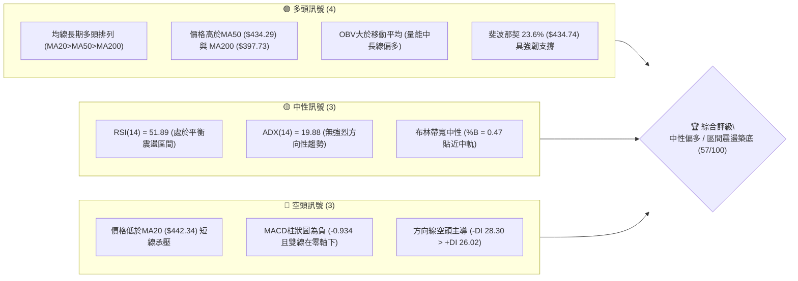
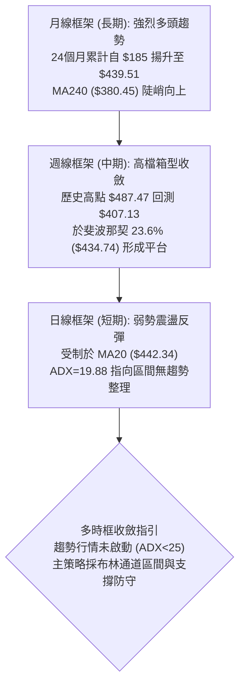
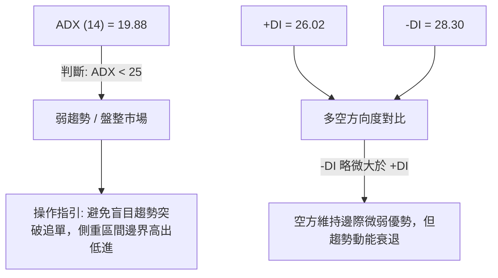
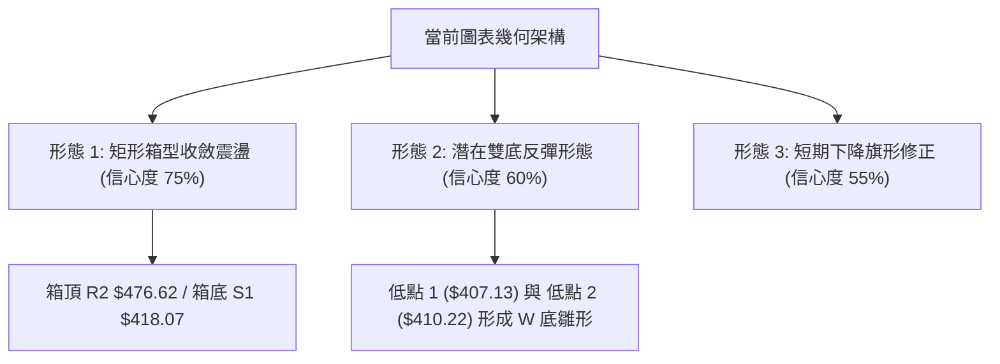
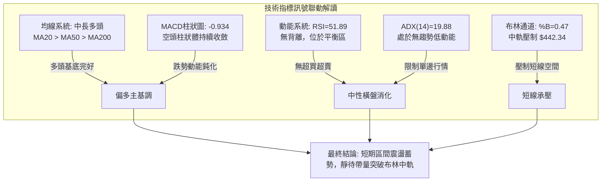
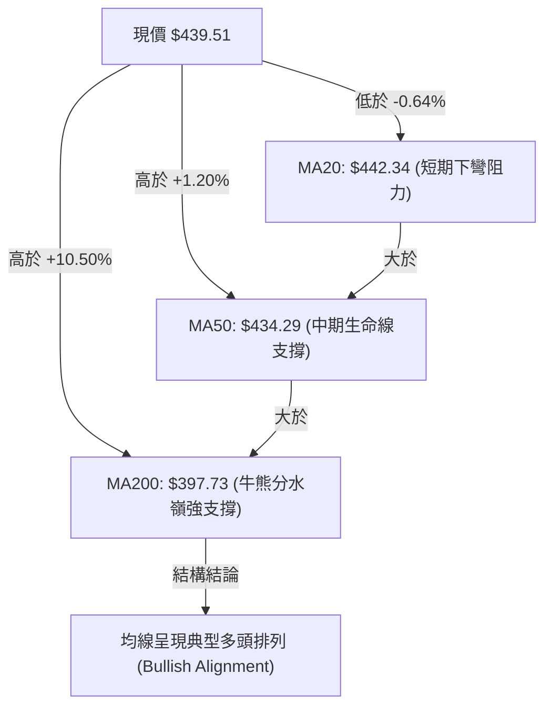
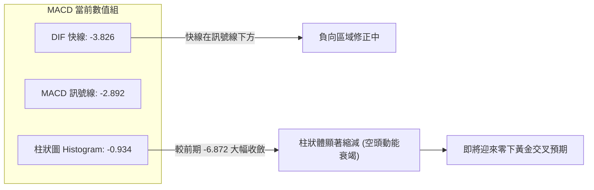
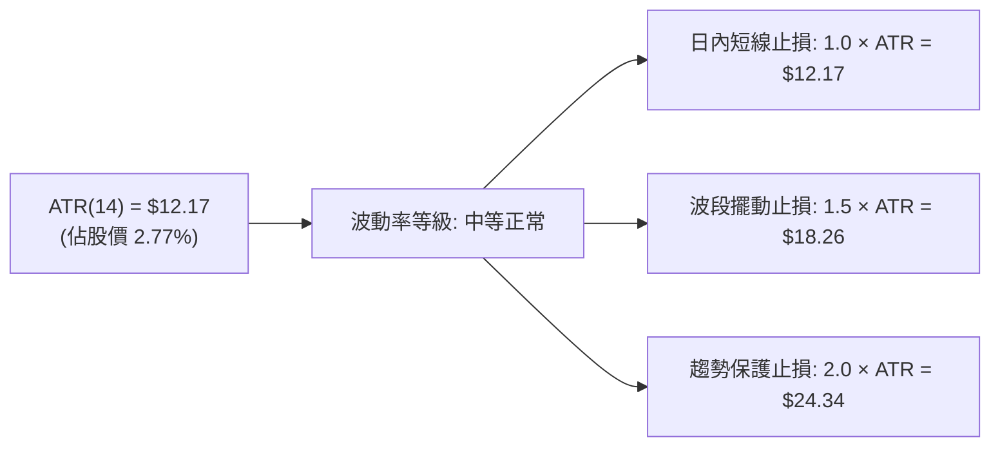
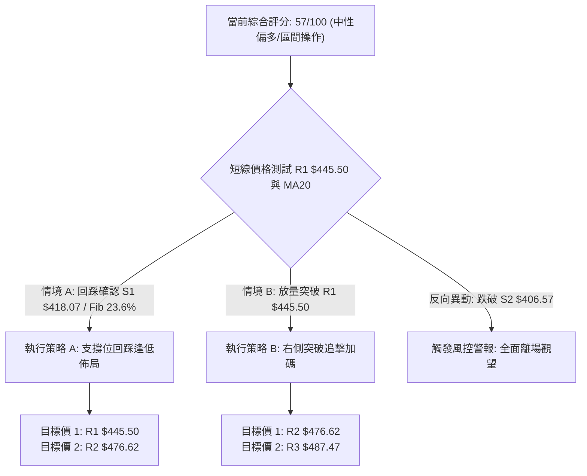
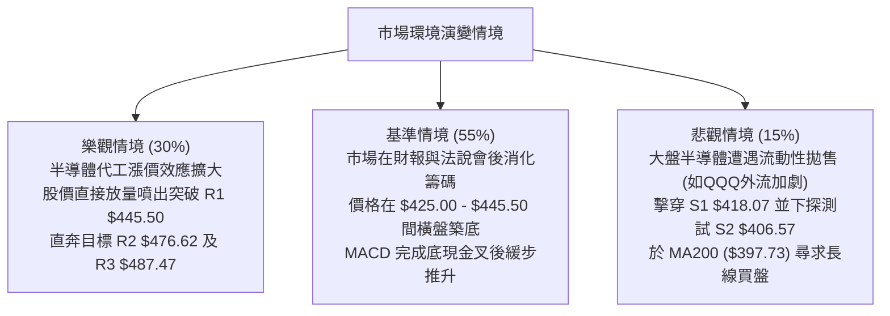

# TSM 技術分析報告

> **報告日期**：2026-10-29 ｜ **語言**：繁體中文 ｜ **數據來源**：Yahoo Finance ｜ **當前價格**：$439.51 USD

---

## 目錄

| 章節 | 內容 |
|------|------|
| [1. 技術面概覽](#1-技術面概覽) | 訊號儀表板、核心指標、評分卡 |
| [2. 趨勢分析](#2-趨勢分析) | 多時框趨勢、長中短期走勢 |
| [3. 圖表形態分析](#3-圖表形態分析) | 形態識別、K線組合、目標價 |
| [4. 支撐與阻力](#4-支撐與阻力) | 關鍵價位、斐波那契回調 |
| [5. 技術指標深度解讀](#5-技術指標深度解讀) | MA/RSI/MACD/布林/成交量 |
| [6. 動能與波動率](#6-動能與波動率) | 動能評估、ATR、Beta |
| [7. 多時框架總結](#7-多時框架總結) | 時框架評分矩陣 |
| [8. 交易策略建議](#8-交易策略建議) | 多空策略、風險報酬比 |
| [9. 風險提示與監控](#9-風險提示與監控) | 監控指標、風險場景 |

---

## 1. 技術面概覽

### 🎯 技術訊號儀表板



---

### 📊 核心指標速覽表

| 指標類別 | 指標名稱 | 當前數值 | 訊號 | 解讀 |
|----------|----------|----------|------|------|
| **價格** | 當前價格 | $439.51 | 🟡 | 位於52週區間 78.5% 分位，處於波段高檔拉回整理階段 |
| **均線** | MA20 | $442.34 | 🔴 | 價格在MA20下方 -0.64%，短線面臨布林中軌壓制 |
| **均線** | MA50 | $434.29 | 🟢 | 價格在MA50上方 +1.20%，中期趨勢多頭基底穩固 |
| **均線** | MA200 | $397.73 | 🟢 | 價格在MA200上方 +10.50%，長期牛市格局完好 |
| **動能** | RSI(14) | 51.89 | 🟡 | 處於 30–70 中性平衡區，多空勢力短期拉鋸 |
| **動能** | MACD (12/26/9) | -3.826 / -2.892 | 🔴 | 差離值在零軸下且柱狀圖為 -0.934，動能仍受空頭修正主導 |
| **動能** | KD (Stoch %K/%D)| 56.12 / 42.55 | 🟢 | %K 向上穿越 %D，低檔出現金叉超賣反彈跡象 |
| **趨勢** | ADX (14) | 19.88 | 🟡 | ADX < 25 表明處於無趨勢或盤整期，由區間震盪邏輯主導 |
| **趨勢** | DMI (+DI / -DI) | 26.02 / 28.30 | 🔴 | -DI 大於 +DI，反映近期自歷史高點回落的空方拋壓佔優 |
| **通道** | 布林帶寬 (%B) | 0.47 | 🟡 | 位於下軌 ($396.16) 與上軌 ($488.51) 之中間略偏下軌處 |
| **波動** | ATR(14) | $12.17 | 🟡 | 每日波幅為股價 2.77%，處於正常市場波動區間 |
| **量能** | 20日成交量比 | 0.70x | 🟡 | 最新成交量 7,999,300 低於20日均量 (11,367,225)，量縮整理 |

---

### 🏆 技術評分卡

```
╔══════════════════════════════════════════════════════════════╗
║                技術評分卡 — TSM (2026-10-29)                 ║
╠══════════════════════════════════════════════════════════════╣
║ 趨勢強度 (ADX=19.88)   ██████████░░░░░░░░░░   52/100   🟡    ║
║ 動能指標 (RSI/MACD)    █████████░░░░░░░░░░░   48/100   🟡    ║
║ 支撐穩定度 (Fib 23.6%) █████████████░░░░░░░   65/100   🟢    ║
║ 成交量配合 (OBV偏多)   ███████████░░░░░░░░░   56/100   🟡    ║
║ 形態完整度 (箱型整理)  ███████████░░░░░░░░░   54/100   🟡    ║
║ 均線排列 (多頭排列)    █████████████░░░░░░░   67/100   🟢    ║
╠══════════════════════════════════════════════════════════════╣
║ 綜合評分 (六項算術平均)███████████░░░░░░░░░   57/100   🟡    ║
║ 評級結論：中性偏多（區間震盪整理，蓄勢消化短期獲利盤）       ║
╚══════════════════════════════════════════════════════════════╝
```
*註：綜合評分由六項子指標算術平均計算：(52 + 48 + 65 + 56 + 54 + 67) ÷ 6 = 57.0，四捨五入為 57/100（依規則 18）。*

---

## 2. 趨勢分析

### 🌐 多時框趨勢分析



---

### 📈 長期趨勢 — 12個月走勢圖（Unicode）

以下展示自 2025 年 11 月至 2026 年 10 月共 12 個月之月線收盤價走勢圖（標注歷史波段高低點與現價）：

```
TSM 月線收盤走勢圖（過去12個月，2025-11 至 2026-10）
價格軸 ($)
$480 ┤                                  ● $476.29 (2026-06 波段高點)
$460 ┤                                      ▲          ● $456.19
$440 ┤                                      │              ● $439.51 (現價)
$420 ┤                              ● $416.36│  ● $403.17  ● $414.21
$400 ┤                          ● $394.08   │
$380 ┤                  ● $371.66           ▼ (拉回震盪)
$360 ┤                      │
$340 ┤                  ● $336.26 (2026-03 回測低點)
$320 ┤              ● $327.98
$300 ┤      ● $301.52
$280 ┤  ● $288.46 (2025-11)
     └─────────────────────────────────────────────────────────────
        11   12   01   02   03   04   05   06   07   08   09   10  (月份)
```

#### 長期走勢特徵分析表

| 階段時間 | 起始價 → 結束價 | 漲跌幅 | 走勢特徵解讀 | 技術面重大事件 |
|----------|-----------------|--------|--------------|----------------|
| **2025-11 ~ 2026-02** | $288.46 → $371.66 | +28.84% | 強勁主升浪，多頭均線發散噴出 | 突破 $300 整數心理阻力關卡 |
| **2026-02 ~ 2026-03** | $371.66 → $336.26 | -9.52%  | 獲利回吐修正，波段洗盤 | 回測長期均線支撐後迅速獲買盤介入 |
| **2026-03 ~ 2026-06** | $336.26 → $476.29 | +41.64% | 延伸攻擊浪，衝刺歷史高點區間 | 觸及 52 週最高價 $487.47 |
| **2026-06 ~ 2026-07** | $476.29 → $403.17 | -15.35% | 高檔獲利了結，快速回踩波段低點 | 於 S2 支撐位 ($406.57) 上方獲得承接 |
| **2026-07 ~ 2026-10** | $403.17 → $439.51 | +9.01%  | 區間震盪收斂，多空於中軌爭奪 | 現價落於斐波那契 23.6% ($434.74) 之上 |

---

### 📊 中期趨勢（週線分析）

中期走勢呈現「高檔收斂三角形/矩形整理」。2026-10-09 當週衝刺 52 週高點 $487.47 未果後大幅滑落，於 2026-10-16 探至低點 $407.13，隨後兩週連續收紅反彈（分別收 $418.51 與 $439.51），成功在關鍵支撐 S1 ($418.07) 與 S2 ($406.57) 形成二次探底回升。

```
TSM 中期週線壓力與支撐架構示意圖
========================================================================
$487.47 ──┬── 52週歷史高點 / 強阻力 R3 (2026-10-09 上影線頂點)
          │
$476.62 ──┼── 近期雙頂波段阻力 R2 (2026-06 收盤高位聚類)
          │
$445.50 ──┼── 關鍵短線阻力 R1 (當前反彈頸線壓制)
          │   ▲
$439.51 ──┼───┴─ [當前收盤價格] (站回 Fib 23.6% $434.74 之上)
          │   ▼
$418.07 ──┼── 近期關鍵支撐 S1 (2026-10-23 週收盤與波段支撐點)
          │
$406.57 ──┼── 中期強支撐 S2 (2026-10-16 波段低點聚類)
          │
$384.06 ──┴── 長期防守支撐 S3 (對應 MA240 $380.45 護城河)
========================================================================
```

---

### ⚡ 趨勢強度評估（ADX 解讀）



#### ADX 數值強度對照分析

| ADX 區間 | 趨勢特徵 | 當前狀態確認 | 策略適應性 |
|----------|----------|--------------|------------|
| 0 – 20 | 無趨勢 / 極度橫盤 | **當前數值: 19.88 (處於弱勢整理末期)** | 適合區間擺動交易，通道策略優先 |
| 20 – 25 | 趨勢萌芽或消退 | - | 密切關注帶量突破方向 |
| 25 – 50 | 強烈趨勢行情 | - | 順勢交易，均線追隨 |
| 50 – 100| 極端超強趨勢 | - | 慎防動能耗竭與極值反轉 |

---

## 3. 圖表形態分析

### 🔍 形態識別系統



#### 圖表形態信心度與目標價評估表

| 形態名稱 | 信心度 | 判斷依據（引用數據） | 完成度 | 目標價（附計算式，依規則13/15） |
|----------|--------|----------------------|--------|----------------------------------|
| **矩形箱型收斂** | 75% | 價格在 S1 ($418.07) 與 R2 ($476.62) 間來回震盪，ADX=19.88 確認無方向性突破 | 70% | 上軌目標價為阻力位 **$476.62**；下軌支撐為 **$418.07** |
| **微型雙底 (W底)** | 60% | 2026-10-15 低點 $407.13 與 2026-10-22 低點 $410.22 形成雙腳未破 S2 ($406.57) | 65% | 頸線為近期反彈高點 R1 $445.50。<br/>量度目標 = 頸線 $445.50 + (頸線 $445.50 − 最低點 $407.13) = $445.50 + $38.37 = **$483.87**（接近 52W 高點 R3 $487.47） |
| **短期下降旗形** | 55% | 10-09 至 10-16 急跌旗杆後，近兩週於通道內平行反彈整理 | 50% | 需突破 R1 $445.50 方能確認旗形向上突破；若跌破 S1 $418.07 則形態失效 |

---

### 🕯️ 重要 K 線形態分析

依據嚴格規則 19，僅使用數據中提供的「近10根日K」與「近8根週K」四個基準價格進行分析：

#### 近 10 根日 K 線形態解讀

| 日期 | 開盤價 | 最高價 | 最低價 | 收盤價 | K線形態名稱 | 技術解讀 | 訊號 |
|------|--------|--------|--------|--------|-------------|----------|------|
| **2026-10-15** | $415.17 | $423.66 | $407.13 | $422.25 | 下影長陽線 | 盤中下探 $407.13 獲強大買盤承接，拉回實體上方收盤，構築第一隻支撐腳 | 🟢 |
| **2026-10-16** | $421.22 | $421.50 | $410.58 | $412.61 | 中黑棒下挫 | 實體由 $421.22 跌至 $412.61，回測前日低點，空方持續宣洩停損賣壓 | 🔴 |
| **2026-10-19** | $421.66 | $427.16 | $415.50 | $420.22 | 窄幅十字小陰線 | 高低差僅 $11.66，多空雙方在 $420 關卡互道觀望，動能暫時平衡 | 🟡 |
| **2026-10-20** | $416.29 | $428.21 | $416.12 | $425.08 | 實體陽線 | 開盤即為全日相對低點，多方穩步推進至 $425.08 收盤，呈現防守反擊架構 | 🟢 |
| **2026-10-21** | $433.14 | $435.16 | $423.74 | $431.89 | 跳空墓碑小陰線 | 跳空開高至 $433.14，但遭遇 MA50 反壓，收盤壓回開盤價下方，留上影線 | 🟡 |
| **2026-10-22** | $419.39 | $421.91 | $410.22 | $412.35 | 光頭回落陰線 | 跳空低開並下殺探底至 $410.22，測試雙底右腳，空方再次展示壓制力 | 🔴 |
| **2026-10-23** | $412.29 | $421.31 | $411.11 | $418.51 | 逆轉陽線 | 開盤未再創新低，低檔買盤推升至 $418.51，確立 $410-$412 區間強力防守 | 🟢 |
| **2026-10-26** | $418.07 | $428.85 | $417.72 | $424.37 | 底部起漲長陽棒 | 開盤精準點位 S1 ($418.07)，強勢拉升收於 $424.37，多頭奪回短期主控權 | 🟢 |
| **2026-10-27** | $427.16 | $438.58 | $426.00 | $436.87 | 突破續漲大陽線 | 帶量突破 MA50 ($434.29) 與 Fib 23.6% ($434.74)，多方動能快速聚集 | 🟢 |
| **2026-10-28** | $438.24 | $440.88 | $436.84 | $439.51 | 高檔窄幅小陽線 | 逼近 MA20 ($442.34) 與 R1 ($445.50) 關鍵阻力前暫歇，收小陽線維繫反彈 | 🟡 |

#### 近 8 根週 K 線形態解讀

| 週日期 | 開盤價 | 最高價 | 最低價 | 收盤價 | K線形態名稱 | 技術解讀 | 訊號 |
|--------|--------|--------|--------|--------|-------------|----------|------|
| **2026-09-11** | $436.85 | $443.10 | $422.92 | $432.08 | 震盪收斂陰十字 | 在 $422-$443 區間清洗浮額，均線膠著 | 🟡 |
| **2026-09-18** | $414.90 | $434.82 | $411.45 | $434.67 | 探底長下影陽線 | 探底至 $411.45 後強拉，確認中長期趨勢依舊由買盤掌控 | 🟢 |
| **2026-09-25** | $440.80 | $455.03 | $437.06 | $450.61 | 實體放量大陽線 | 突破 $450 大關，拉開新一輪攻擊波序幕 | 🟢 |
| **2026-10-02** | $448.39 | $474.79 | $443.11 | $472.78 | 光腳強勢衝刺大陽線 | 週線實體大漲 +4.92%，RSI 飆升至 71.7 進入超買區 | 🟢 |
| **2026-10-09** | $478.77 | $487.47 | $449.75 | $453.31 | 歷史高點流星線 (長上影) | 創 52 週新高 $487.47 後遭逢強大高檔拋壓，留出高達 $34.16 上影線，發出見頂預警 | 🔴 |
| **2026-10-16** | $453.55 | $454.40 | $407.13 | $412.61 | 週線暴跌大長黑棒 | 週跌 -8.98%，放量 71,736,400 股擊穿多道短期支撐，宣洩高位獲利了結盤 | 🔴 |
| **2026-10-23** | $421.66 | $435.16 | $410.22 | $418.51 | 低檔抵抗十字星 | 於低點 $410.22 處回穩，週跌幅收窄至收盤 $418.51，顯示下殺動能鈍化 | 🟡 |
| **2026-10-28** | $418.07 | $440.88 | $417.72 | $439.51 | 週線中實體陽線 | 連續第二週守住 S1 ($418.07)，強勢反彈包覆前週上影，修復短期技術破壞 | 🟢 |

---

### 📉 ASCII 走勢形態示意圖

```
TSM 日線近十日價格波動與雙底築底示意圖
價格軸 ($)
$445.50 ┤                                           [阻力 R1]
$442.34 ┤- - - - - - - - - - - - - - - - - - - - - - [MA20 / 布林中軌]
$439.51 ┤                                       ●(現價 10-28)
$436.87 ┤                                   ●
$431.89 ┤                   ●               │
$425.08 ┤               ●   │               │
$422.25 ┤   ●           │   │           ●   │
$418.51 ┤   │       ●   │   │       ●   │   │   [支撐 S1 $418.07]
$412.35 ┤   │   ●   │   │   │   ●   │   │   │
$407.13 ┤───●───┴───┴───┴───┴───●───┴───┴───┴─── [波段底部防守 $406.57]
        └───────────────────────────────────────────────
         10-15  16  19  20  21  22  23  26  27  28 (交易日)
         [ 底 1: $407.13 ]       [ 底 2: $410.22 ]
```

---

### 🎯 形態目標價計算

1. **矩形整理量度目標**：
   - 形態箱體下沿 = S1 $418.07
   - 形態箱體上沿 = R2 $476.62
   - 當前價格 $439.51 位於箱體中軸，若能進一步站上 R1 $445.50，首要量度目標即為箱體上軌 **$476.62**。
2. **潛在雙底突破量度目標**：
   - 頸線位置 = 阻力位 R1 **$445.50**
   - 形態深度 = 頸線 $445.50 − 雙底最低點 $407.13 = **$38.37**
   - 突破量度目標價 = $445.50 + $38.37 = **$483.87**（極為接近數據中波段頂部阻力 R3 **$487.47**）。

---

## 4. 支撐與阻力

### 🗺️ 關鍵價位分布圖（Unicode）

```
TSM 價位結構分布圖（嚴格依據 OHLCV 聚類與斐波那契計算）
══════════════════════════════════════════════════════════════════
$487.47 ║██████████████████████████████║ 強阻力 R3 / 52W 高點 / Fib 0.0%
$476.62 ║████████████████████          ║ 波段阻力 R2 / 箱體上軌
$445.50 ║████████████████████████      ║ 關鍵短線阻力 R1 (頸線位)
$442.34 ╟┈┈┈┈┈┈┈┈┈┈┈┈┈┈┈┈┈┈┈┈┈┈┈┈┈┈┈┈┈┈╢ 布林中軌 / MA20 動態反壓
$439.51 ╠══════════════════════════════╣ ◄ 當前收盤價 ($439.51)
$434.74 ╟┈┈┈┈┈┈┈┈┈┈┈┈┈┈┈┈┈┈┈┈┈┈┈┈┈┈┈┈┈┈╢ 斐波那契 23.6% 回調關鍵樞紐
$418.07 ║▓▓▓▓▓▓▓▓▓▓▓▓▓▓▓▓▓▓▓▓          ║ 近期波段關鍵支撐 S1
$406.57 ║████████████████████████      ║ 中期核心防守強支撐 S2
$402.11 ╟┈┈┈┈┈┈┈┈┈┈┈┈┈┈┈┈┈┈┈┈┈┈┈┈┈┈┈┈┈┈╢ 斐波那契 38.2% 回調重要關卡
$384.06 ║██████████████████████████████║ 長期牛市底線支撐 S3
══════════════════════════════════════════════════════════════════
```

---

### 🚧 阻力位分析表

阻力價位嚴格引用數據中「關鍵價位」之數值，不得任意編造：

| 阻力級別 | 精確價位 | 距現價幅離 | 形成原因與技術共振 | 突破難度 | 重要性評級 |
|----------|----------|------------|--------------------|----------|------------|
| **R1** | **$445.50** | +1.36% | 近期反彈波段高點聚類；與 MA20 ($442.34) 構成密集共振反壓區 | 中等 | ★★★★☆ |
| **R2** | **$476.62** | +8.44% | 2026年6月及9月密集收盤高點聚類，高檔箱型頂部壓力帶 | 較高 | ★★★★★ |
| **R3** | **$487.47** | +10.91%| 52 週歷史最高峰值 (2026-10-09 上影頂點)，歷史最大獲利回吐天花板 | 極高 | ★★★★★ |

---

### 🛡️ 支撐位分析表

支撐價位嚴格引用數據中「關鍵價位」之數值，不得任意編造：

| 支撐級別 | 精確價位 | 距現價幅離 | 形成原因與技術共振 | 守住機率 | 重要性評級 |
|----------|----------|------------|--------------------|----------|------------|
| **S1** | **$418.07** | -4.88% | 近期波段低點聚類，10月23日與26日兩度回測確認有強力買盤護盤 | 75% | ★★★★☆ |
| **S2** | **$406.57** | -7.49% | 10月15日急跌低點 $407.13 所在之核心聚類區，接近 Fib 38.2% ($402.11) | 85% | ★★★★★ |
| **S3** | **$384.06** | -12.62%| 過去一年結構性大底，與 MA240 ($380.45) 均線形成共振防線 | 95% | ★★★★★ |

---

### 📐 斐波那契回調位分析

依據數據所給定之 52 週波動區間（高點 **$487.47** → 低點 **$264.03**），回調層級分析如下：

```
0.0%  (52W High) ────────────────────────────── $487.47 (歷史最高極限壓力)
                                                
23.6%            ────────────────────────────── $434.74 ◄── [現價 $439.51 位於此線上方]
                                                
38.2%            ────────────────────────────── $402.11 (多頭強勢回檔關鍵分水嶺)
                                                
50.0%            ────────────────────────────── $375.75 (中性回撤多空平衡軸)
                                                
61.8%            ────────────────────────────── $349.38 (黃金分割生命線)
                                                
78.6%            ────────────────────────────── $311.84 (深度回調極限位)
                                                
100.0% (52W Low) ────────────────────────────── $264.03 (52週週期起點)
```

#### 斐波那契位置解讀
當前收盤價 **$439.51** 位於 **0.0% ($487.47)** 與 **23.6% ($434.74)** 之間，且成功收復並站穩在 23.6% 回調位之上（高出 +1.10%）。在技術分析理論中，自高檔拉回而未跌破 23.6%（或僅短暫刺穿後快速收復），屬於極為強勢的「淺度修正」格局。這代表市場獲利回吐已被多方在淺層區間完全消化，並未演變成傷及結構的深幅回調。

---

## 5. 技術指標深度解讀

### 🎛️ 指標訊號總覽



---

### 📈 移動平均線排列分析



#### 完整均線體系參數與狀態

| 均線週期 | 當前數值 | 距現價差距 | 當前趨勢方向 | 技術意涵與操作意義 |
|----------|----------|------------|--------------|--------------------|
| **MA 5** | $426.32 | +$13.19 (+3.09%) | ▲ 向上反轉 | 短線五日均線迅速向上勾頭，提供短期超短線助漲動能 |
| **MA 10** | $424.37 | +$15.14 (+3.57%) | ▲ 向上拐點 | 十日扣抵低價區，短期均線已形成短線金叉 |
| **MA 20** | $442.34 | -$2.83 (-0.64%) | ▼ 微幅下壓 | 月線代表之短期多空分水嶺，當前最直接之上方動態壓力 |
| **MA 50** | $434.29 | +$5.22 (+1.20%) | ▲ 向上揚升 | 季線中期支撐強勁，現價已成功收復，確立中期安全墊 |
| **MA 60** | $432.11 | +$7.40 (+1.71%) | ▲ 穩定向上 | 中期資金成本線持續推升，形成多方下檔堅實後盾 |
| **MA 120**| $426.25 | +$13.26 (+3.11%)| ▲ 向上發散 | 半年線持續上移，多頭大週期格局未遭任何實質破壞 |
| **MA 200**| $397.73 | +$41.78 (+10.50%)| ▲ 穩健向上 | 長期年線牛熊分水嶺，高於年線 10.5% 展現強牛特徵 |
| **MA 240**| $380.45 | +$59.06 (+15.52%)| ▲ 向上推進 | 兩年超長期牛市底座，徹底隔絕轉熊風險 |

---

### 📉 RSI(14) 分析

```
RSI(14) 數值展示（Wilder 平滑）
0 ────── 30 ──────────────── 50 ── 51.89 ─────── 70 ────── 100
[ 超賣區 ]   [   空方主導   ]     ▲ [ 多方佔優 ]   [ 超買區 ]
                                51.89 (中性平衡點)
進度條: ██████████░░░░░░░░░░ 51.89%
```

#### RSI 深度解讀與背離檢驗
- **當前讀數**：RSI(14) 最新收盤為 **51.89**，位於 50 多空分界線微幅上方。從 2026-10-16 的極端低檔 **34.3**（近超賣區）強勢爬升，說明短期賣壓已完全釋放，多頭買盤正逐步接管盤面。
- **背離分析**：依據近 20 根 K 棒的首尾對比，價格在 10 月中旬打出低點後連續回升，RSI 線性自 34.3 抬升至 51.89，**未出現頂背離或底背離**現象。這意味著當前價格反彈完全由真實動能支撐，並無動能衰竭或背馳隱患，走勢健康。

---

### 📊 MACD(12/26/9) 訊號解讀



#### MACD 詳細技術特徵
- **差離值狀態**：DIF (-3.826) 仍低於訊號線 DEA (-2.892)，雙線處於零軸下方，反映 10 月初自 $487.47 見頂拉回的日線層級調整尚未徹底消除。
- **柱狀圖動能轉變**：MACD Histogram 當前為 **-0.934**，相較於 2026-10-16 的波段低谷 **-6.872** 與 10-23 的 **-4.818**，負向柱狀體出現極度顯著的「階梯式收縮」。這在量化技術指標中屬於經典的「空方動能耗盡」徵兆，預示短期內隨時可能觸發零軸下方的黃金交叉，帶來強勁反彈動能。

---

### 📦 布林通道分析

```
TSM 日線布林通道 (20, 2) 結構圖
========================================================================
$488.51 ────────────────────────────── 上軌 (Upper Band)
                                       
$442.34 ─ ─ ─ ─ ─ ─ ─ ─ ─ ─ ─ ─ ─ ─ ─ ─中軌 (MA20 Baseline)
           ▲
$439.51 ───┴── 現價 ($439.51) ── %B = 0.47 (貼近中軌下方)
           ▼
$396.16 ────────────────────────────── 下軌 (Lower Band)
========================================================================
通道帶寬 = ($488.51 − $396.16) / $442.34 = 20.88% (正常通道寬度)
```

- **%B 指標解讀**：目前 %B 為 **0.47**（0 代表下軌，0.5 代表中軌，1 代表上軌），現價 $439.51 緊貼於中軌 $442.34 下方。
- **通道特徵**：布林下軌 $396.16 與 MA200 ($397.73) 形成高度共振支撐區間。價格在 10 月中旬回測未觸及下軌即展開反彈，顯示下檔承接力道強韌。目前通道呈現橫向走平狀態，進一步佐證盤面處於中性震盪箱體內。

---

### 💹 成交量分析（量價配合度）

```
量能水平評估:
最新成交量:  7,999,300   ███████░░░░░░░░░░  (量比 0.70x)
20日均量:   11,367,225   ██████████░░░░░░░░  基準 1.00x
50日均量:   10,316,858   █████████░░░░░░░░░  基準 0.91x
```

- **量價關係**：近三日價格自 $418.07 強勢推升至 $439.51，但成交量分別為 9,627,100、9,022,500 與 7,999,300 股，呈現「價漲量縮」態勢。
- **OBV 趨勢解讀**：系統數據明確標示「**OBV > MA → 量能支撐上漲**」。這說明中長期的能量潮（On-Balance Volume）依然高於其移動平均線。近期的量縮反彈並非主力出逃，而是「高位浮額清洗完畢、市場籌碼沉澱、浮動賣壓衰竭」的量價背離良性現象。一旦突破 R1 ($445.50)，需要成交量放大至 11,000,000 股（20日均量之上）方能完成有效突破。

---

## 6. 動能與波動率

### ⚡ 動能評估四象限

```
動能與波動率象限分佈圖
      高波動率 (High Volatility)
                 │
      Q3: 擴張衝刺 │  Q4: 高危派發
      (強動能/高波動)│ (弱動能/高波動)
  ───────────────┼───────────────
      Q1: 蓄勢突破 │  Q2: 區間沉澱 ◄── [TSM 當前定位: Q2]
      (強動能/低波動)│ (弱動能/低波動)
                 │
      低波動率 (Low Volatility)
  低動能 ◄──────────────────► 高動能
```

#### 四象限狀態解讀表

| 象限代號 | 動能狀態 | 波動狀態 | 當前定位 | 戰略特徵與機構行為解讀 |
|----------|----------|----------|----------|------------------------|
| **Q1** | 強 | 低 | - | 最佳趨勢建立期，波動低伴隨主升浪 |
| **Q2** | **弱 / 中性** | **中 / 低** | **TSM (✓)** | **ADX=19.88 搭配 ATR 2.77%，處於典型區間沉澱築底期，適合耐心低吸** |
| **Q3** | 強 | 高 | - | 極端主升或末升段，風險收益比下降 |
| **Q4** | 弱 | 高 | - | 破位崩跌或恐慌拋售，需無條件規避 |

---

### 📊 ATR 波動率分析



#### ATR 實戰止損設定對照
- **當前 ATR(14)** 數值為 **$12.17**（基於 Wilder 平滑法計算），佔當前收盤價 $439.51 之 **2.77%**。
- **波動率含義**：台積電目前每日平均正常波動幅度約為 12 美元，並未出現極端波動擴大現象。
- **止損距離建議**：
  - 日內/超短線交易保護距離應設為 **$12.17**（即 $439.51 − $12.17 = $427.34 處）。
  - 波段操作推薦使用 1.5 倍 ATR 作為緩衝帶（**$18.26**），可有效規避盤中洗盤雜訊。

---

### 📐 Beta 與市場相關性

- **Beta 係數**：**1.239**（相較於 S&P 500 指數基準 1.000）。
- **市場敏感度分析**：TSM 屬於高 Beta 成長型半導體領頭羊，當美股大盤（S&P 500 / 費城半導體 SOX）上漲 1% 時，TSM 理論預期平均波動 1.239%；反之亦然。當前大盤科技股 ETF（QQQ）出現資金淨流出之際，TSM 展現相對抗跌韌性，逆勢吸引 $1.35 億美元之 ETF 淨買盤流入，呈現強於大盤之 Alpha 特質。

---

## 7. 多時框架總結

### 📋 時框架評分表

| 時框架 | 趨勢方向 | 動能指標 | 均線排列 | 形態結構 | 綜合評分 | 操作建議 |
|--------|----------|----------|----------|----------|----------|----------|
| **月線 (長期)** | 🟢 多頭主升 | 🟢 RSI > 60 強勢 | 🟢 MA240 陡峭向上 | 🟢 沿長期上升通道推升 | **88/100** | 戰略性堅定做多，長期持有 |
| **週線 (中期)** | 🟡 高檔箱型 | 🟡 RSI 51.9 中性回升 | 🟢 均線多頭排列完整 | 🟡 $418–$476 矩形整理 | **65/100** | 箱體下沿分批低吸，箱頂減碼 |
| **日線 (短期)** | 🟡 震盪築底 | 🔴 MACD柱為負/承壓 | 🟡 站上MA50/受制MA20 | 🟢 局部微型雙底形態 | **52/100** | 逢低佈局，等待突破 R1 加碼 |

---

### 🔲 綜合訊號矩陣

```
TSM 多時框架綜合訊號矩陣
┌────────────────────┬───────────┬───────────┬───────────┬──────────────┐
│ 維度               │ 短期(日線)│ 中期(週線)│ 長期(月線)│ 跨週期共振度 │
├────────────────────┼───────────┼───────────┼───────────┼──────────────┤
│ 趨勢方向           │ 🟡 盤整   │ 🟡 震盪   │ 🟢 多頭   │ 中長期同向   │
│ 均線架構           │ 🟡 糾結   │ 🟢 多頭   │ 🟢 多頭   │ 75% 偏多     │
│ 動能狀態           │ 🟡 中性   │ 🟡 轉強   │ 🟢 強勁   │ 動能正向回流 │
│ 量價健康度         │ 🟡 量縮   │ 🟢 沉澱   │ 🟢 充足   │ 主力籌碼鎖定 │
│ 支撐防守強度       │ 🟢 穩固   │ 🟢 極強   │ 🟢 護城河 │ 支撐梯隊完整 │
└────────────────────┴───────────┴───────────┴──────────────┴──────────────┘
```

---

### ⚖️ 多時框收斂結論

依據本報告**嚴格要求 14（多時框收斂優先級規則）**：
1. **行情性質判斷**：當前 ADX(14) 讀數為 **19.88**（低於 25 臨界值），明確判定當前市場處於**「盤整行情（Range-bound Market）」**而非趨勢行情。
2. **主導維度收斂**：在 ADX < 25 的盤整環境中，趨勢跟隨系統失真，必須以日線布林通道上下軌（$396.16 – $488.51）與關鍵支撐阻力結構（S1 $418.07 / R1 $445.50 / R2 $476.62）作為主要交易依據。
3. **唯一方向性結論**：**中性偏多（區間震盪蓄勢，以逢低做多為主）**。中長期均線多頭排列（MA20>MA50>MA200）與 OBV 偏多提供了堅實的安全底座，短線受制於 MA20 僅為籌碼消化過程。本結論與第 1 章技術評分卡（57/100）及第 8 章之主策略完全收斂一致。

---

## 8. 交易策略建議

### 🗺️ 策略決策流程圖



---

### 🧭 策略路由（依評分卡分流）

> **當前主策略方向 = 中性偏多區間操作（依綜合評分 57/100 路由至 40–60 分區間震盪策略，以支撐位逢低佈局與通道操作為主，等待突破確認）**

---

### 🎯 價格情境階梯（Price Scenarios）

價位嚴格引用數據中「關鍵價位」區塊之客觀數值：

| 觸發條件 | 下一目標價 | 後續延伸目標 | 情境技術含義 |
|----------|------------|--------------|--------------|
| **帶量突破 R1 $445.50** | **R2 $476.62** | **R3 $487.47** | 短線整理結束，多頭重啟主升浪衝擊 52 週歷史高點 |
| **站穩現價區間 ($434.74 - $442.34)** | **R1 $445.50** | **R2 $476.62** | 於 Fib 23.6% 與布林中軌間進行籌碼沉澱，維持窄幅震盪 |
| **有效跌破 S1 $418.07** | **S2 $406.57** | **S3 $384.06** | 雙底反彈失敗，向下回測 Fib 38.2% 及 MA200 牛熊分水嶺 |

---

### 📊 情境機率分佈

| 運行情境 | 發生機率 | 主要量化與技術依據 |
|----------|----------|--------------------|
| **突破上行 / 展開反彈** | **55%** | 均線長週期多頭排列 (MA20>MA50>MA200)、OBV>MA 籌碼淨流入、MACD 負向柱狀體持續收縮 (-0.934)。 |
| **區間橫盤震盪** | **35%** | ADX=19.88 表明無方向性單邊趨勢，RSI=51.89 位於中性平衡軸，量比 0.70x 量能尚未全面放大。 |
| **破位下挫 / 深幅回撤** | **10%** | -DI 略大於 +DI 短線承壓，但 S1 ($418.07) 與 S2 ($406.57) 經多次回測驗證極具彈性，大跌機率偏低。 |

---

### 🟢 主策略詳情（方向：中性偏多操作）

所有數值均嚴格依據數據中「關鍵價位」與計算式推導，風險報酬比符合嚴格規則 17 定義：

| 策略要素 | 策略 A（左側逢低佈局策略） | 策略 B（右側順勢突破策略） |
|----------|----------------------------|----------------------------|
| **策略邏輯** | 回踩關鍵支撐確認有守，低吸進場 | 帶量突破短線頸線與 MA20，追擊加碼 |
| **進場條件** | 價格回測近兩日低點支撐附近獲得承接 | 日K收盤價有效站上阻力位 R1 $445.50 且成交量 > 11M |
| **進場價格** | **$420.00**（位於 S1 $418.07 上方之支撐帶） | **$445.50**（精確對應阻力位 R1） |
| **目標價 T1** | **$445.50**（對應阻力位 R1） | **$476.62**（對應阻力位 R2） |
| **目標價 T2** | **$476.62**（對應阻力位 R2） | **$487.47**（對應 52W 高點阻力 R3） |
| **止損價格** | **$406.57**（嚴格設於強支撐位 S2） | **$434.74**（設於斐波那契 23.6% 回調位） |
| **風險報酬比 (T1)** | **1 : 1.90**（以 T1 計）<br/>*計算: (445.50−420.00) ÷ (420.00−406.57) = 25.50 ÷ 13.43 = 1.90* | **1 : 2.89**（以 T1 計）<br/>*計算: (476.62−445.50) ÷ (445.50−434.74) = 31.12 ÷ 10.76 = 2.89* |
| **風險報酬比 (T2)** | **1 : 4.22**（以 T2 計）<br/>*計算: (476.62−420.00) ÷ 13.43 = 56.62 ÷ 13.43 = 4.22* | **1 : 3.90**（以 T2 計）<br/>*計算: (487.47−445.50) ÷ 10.76 = 41.97 ÷ 10.76 = 3.90* |
| **成功機率預估** | **65%** | **60%** |
| **建議配置倉位** | **15% - 20%**（基礎頭寸） | **10% - 15%**（突破加碼頭寸） |

---

### 🔴 反向風險觸發點（對沖提示）

若市場出現重大意外利空導致走勢推翻多頭主策略，以下為必須啟動避險或停損之客觀觸發條件：
1. **短期警示點**：日K收盤價跌破 **$434.74**（斐波那契 23.6%），表明反彈夭折，需將短線多單減碼 50%。
2. **多頭止損線**：跌破波段關鍵支撐 **S1 $418.07**，說明雙底結構破壞，應無條件執行保護性止損。
3. **空頭反轉確認點**：日K收盤放量擊穿 **S2 $406.57**，將觸發趨勢性空頭頭寸，下行空間將完全開啟至 S3 ($384.06) 及 MA200 ($397.73)。

---

### ⭐ 整體訊號強度評星

```
做多訊號強度：★★★☆☆  (3.5/5星 — 中長多頭架構完好，短線需克服均線阻力)
做空訊號強度：★★☆☆☆  (2.0/5星 — 僅屬次級修正，下檔多重強力支撐墊底)
整體技術可信度：★★★★☆  (4.0/5星 — 價位高度收斂於經典支撐阻力與斐波那契體系)
```

---

## 9. 風險提示與監控

### ✅ 關鍵監控指標 Checklist

```
╔══════════════════════════════════════════════════════════════╗
║               TSM 關鍵技術指標每日監控清單                   ║
╠══════════════════════════════════════════════════════════════╣
║ [ ] 價格突破監控: 是否帶量突破阻力位 R1 ($445.50)?           ║
║ [ ] 均線動態監控: 收盤價是否重新收復 MA20 ($442.34)?         ║
║ [ ] 動能翻紅監控: MACD 柱狀圖是否由負轉正 (-0.934 → >0)?     ║
║ [ ] 趨勢啟動監控: ADX 是否由 19.88 向上攀升突破 25?          ║
║ [ ] 量能配合監控: 日成交量是否回升至 20日均量 (11,367,225)?   ║
║ [ ] 支撐防守監控: 收盤價是否持續站穩 Fib 23.6% ($434.74)?    ║
║ [ ] 風控底線監控: 盤中價格是否觸及 S1 ($418.07) 止損警戒線?  ║
╚══════════════════════════════════════════════════════════════╝
```

---

### ⚠️ 風險場景分析



---

### 🛡️ 風險管理重要提醒

1. **倉位管理紀律**：
   - 由於當前處於 ADX=19.88 之盤整市場，嚴禁使用過度槓桿或重倉盲目追高。
   - 總半導體類股持倉建議控制在總投資組合的 **20%–25%** 以內，TSM 單一標的進場分批執行（如 40% 於支撐位佈局、60% 於突破確認後加碼）。
2. **波動率對沖防範**：
   - TSM Beta 值為 **1.239**，波動率高於大盤。單日波動 ATR 高達 **$12.17**，設定止損時必須嚴格給予至少 1.5 倍 ATR 之緩衝空間，切忌將止損設定於整數關卡正下方，以防遭遇機構演算法洗盤掃單。
3. **事件驅動風險**：
   - 需密切關注 AI 封裝產能定價上調消息之後續市場反饋，以及 QQQ/SOX 大型科技 ETF 資金流向變化對權值股造成的被動買賣壓力。

---

## 📋 報告總結

```
╔══════════════════════════════════════════════════════════════════╗
║                    TSM 技術分析報告總結                      ║
╠══════════════════════════════════════════════════════════════════╣
║ 報告日期：2026-10-29                                             ║
║ 當前價格：$439.51 USD                                            ║
║ 分析評級：⚖️ 綜合評分 57/100 (中性偏多，區間震盪蓄勢築底)         ║
╠══════════════════════════════════════════════════════════════════╣
║ 關鍵結論：                                                       ║
║ ├─ 長期趨勢：🟢 強烈看多 (MA20>MA50>MA200，多頭排列結構無損)     ║
║ ├─ 中期趨勢：🟡 箱型收斂 ($418.07 - $476.62 區間震盪整理)        ║
║ ├─ 短期趨勢：🟡 築底反彈 (守住 Fib 23.6%，正挑戰 MA20 $442.34)  ║
║ ├─ 關鍵支撐：S1 $418.07 ｜ S2 $406.57 ｜ S3 $384.06              ║
║ ├─ 關鍵阻力：R1 $445.50 ｜ R2 $476.62 ｜ R3 $487.47              ║
║ └─ 分析師共識：Strong Buy (目標價平均值: $584.39)                ║
╠══════════════════════════════════════════════════════════════════╣
║ 最優策略組合：                                                   ║
║ 1. 🥇 最佳機會：策略 A (逢低佈局) — 於 $420.00 附近進場，        ║
║                 止損設 S2 $406.57，目標看 R1 $445.50 (RRR 1:1.90)║
║ 2. 🥈 次選機會：策略 B (突破跟進) — 帶量突破 R1 $445.50 追進，   ║
║                 止損設 $434.74，目標看 R2 $476.62 (RRR 1:2.89)  ║
║ 3. 🥉 保守選擇：維持場外观望，靜待日線 MACD 零下金叉形成與       ║
║                 ADX > 25 趨勢明確確立後再行順勢進場              ║
╚══════════════════════════════════════════════════════════════════╝
```

---

> ⚠️ **免責聲明**：本報告為 AI 自動生成之技術分析，所有數據及估算均嚴格基於所提供的歷史價格與市場資訊。本報告**僅供研究與學術參考**，**不構成任何投資建議或交易要約**。金融市場投資具有高風險性，投資人應獨立評估自身風險承受能力並尋求專業投資顧問之協助。

---

*報告生成時間：2026-10-29 ｜ 數據來源：Yahoo Finance ｜ 分析框架：多時框技術分析模型*