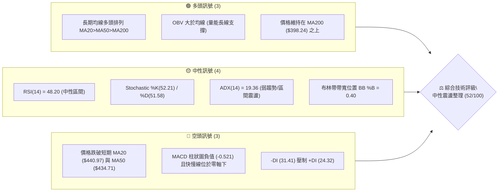
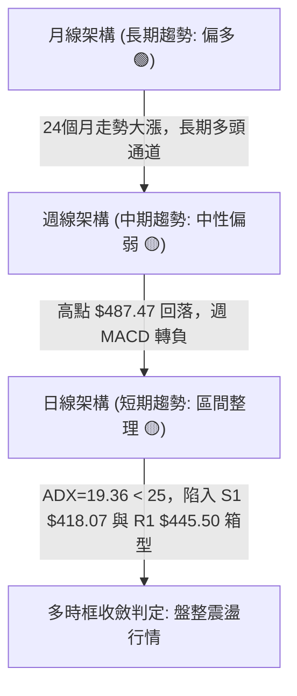
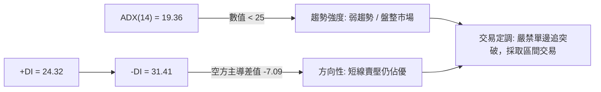
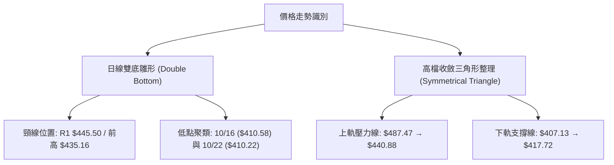
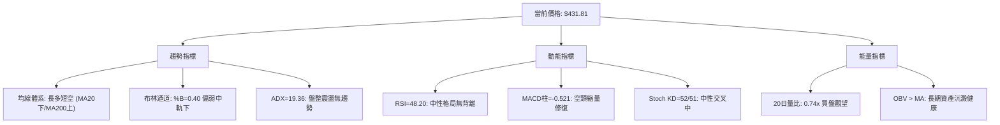
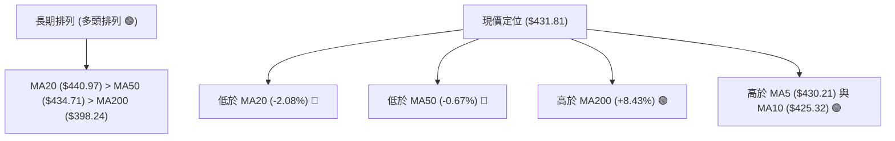
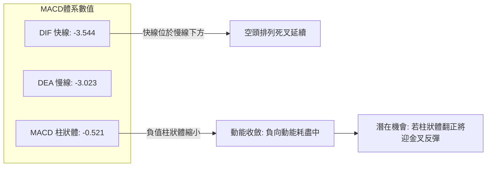
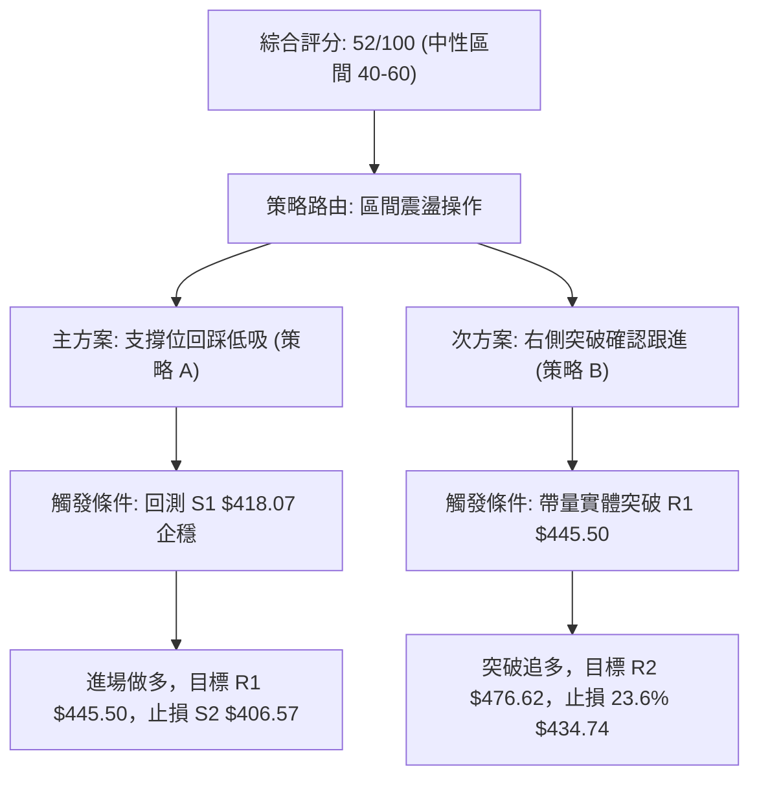
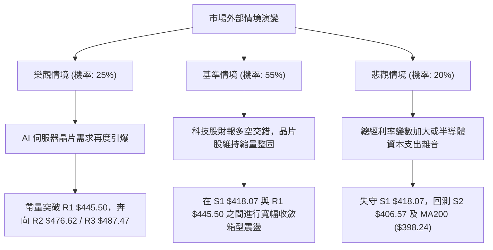

# TSM 技術分析報告

> **報告日期**：2026-10-30 ｜ **語言**：繁體中文 ｜ **數據來源**：Yahoo Finance ｜ **當前價格**：$431.81

---

## 目錄

| 章節 | 內容 |
|------|------|
| [1. 技術面概覽](#1-技術面概覽) | 訊號儀表板、核心指標、評分卡 |
| [2. 趨勢分析](#2-趨勢分析) | 多時框趨勢、長中短期走勢 |
| [3. 圖表形態分析](#3-圖表形態分析) | 形態識別、K線組合、目標價 |
| [4. 支撐與阻力](#4-支撐與阻力) | 關鍵價位、斐波那契回調 |
| [5. 技術指標深度解讀](#5-技術指標深度解讀) | MA/RSI/MACD/布林/成交量 |
| [6. 動能與波動率](#6-動能與波動率) | 動能評估、ATR、Beta |
| [7. 多時框架總結](#7-多時框架總結) | 時框架評分矩陣 |
| [8. 交易策略建議](#8-交易策略建議) | 多空策略、風險報酬比 |
| [9. 風險提示與監控](#9-風險提示與監控) | 監控指標、風險場景 |

---

## 1. 技術面概覽

### 🎯 技術訊號儀表板



### 📊 核心指標速覽表

| 指標類別 | 指標名稱 | 當前數值 | 訊號 | 解讀 |
|----------|----------|----------|:----:|------|
| **價格** | 當前收盤價 | $431.81 | 🟡 | 位於52週區間 75.1% 分位，高檔拉回整理 |
| **均線** | MA20 | $440.97 | 🔴 | 價格低於 MA20（-2.08%），短線承壓 |
| **均線** | MA50 | $434.71 | 🔴 | 價格略低於 MA50（-0.67%），中期面臨回洗 |
| **均線** | MA200 | $398.24 | 🟢 | 價格遠高於 MA200（+8.43%），長多基底穩固 |
| **動能** | RSI(14) | 48.20 | 🟡 | 落在 40–60 中性震盪區間，無極端超買超賣 |
| **動能** | MACD(12,26,9) | -3.544 / -3.023 | 🔴 | DIF 低於 DEA，Hist 負值 (-0.521)，動能偏空 |
| **趨勢** | ADX(14) | 19.36 | 🟡 | ADX < 25，無明確單邊趨勢，屬盤整行情 |
| **趨勢方向** | +DI / -DI | 24.32 / 31.41 | 🔴 | 空方動能 (-DI) 明顯大於多方動能 (+DI) |
| **波動** | ATR(14) | $12.09 | 🟡 | 佔股價 2.80%，波動度維持正常健康水平 |
| **通道** | 布林 %B | 0.40 | 🟡 | 位於布林中軌下方，朝下軌 ($395.27) 靠攏 |
| **成交量** | 20日量比 | 0.74x | 🟡 | 日均量由 1,137 萬降至 838 萬，縮量整理 |
| **能量** | OBV 趨勢 | OBV > MA | 🟢 | 能量潮高於均線，長期資金沉澱未見出逃 |

### 🏆 技術評分卡

```
╔══════════════════════════════════════════════════════════════╗
║                 技術評分卡 — TSM (2026-10-30)                ║
╠══════════════════════════════════════════════════════════════╣
║ 趨勢強度 (Trend)     █████████░░░░░░░░░░░   48/100   🟡 中性 ║
║ 動能指標 (Momentum)  █████████░░░░░░░░░░░   46/100   🟡 中性 ║
║ 支撐穩定度 (Support) ████████████░░░░░░░░   62/100   🟢 偏多 ║
║ 成交量配合 (Volume)  ██████████░░░░░░░░░░   52/100   🟡 中性 ║
║ 形態完整度 (Pattern) ██████████░░░░░░░░░░   50/100   🟡 中性 ║
║ 均線排列 (Moving Avg)███████████░░░░░░░░░   54/100   🟡 中性 ║
╠══════════════════════════════════════════════════════════════╣
║ 綜合評分             ██████████░░░░░░░░░░   52/100   🟡 中性 ║
║ 計算依據：(48 + 46 + 62 + 52 + 50 + 54) / 6 = 52.0 (規則 18) ║
╚══════════════════════════════════════════════════════════════╝
```

---

## 2. 趨勢分析

### 🌐 多時框趨勢分析



### 📈 長期趨勢 — 12個月走勢圖（Unicode）

以下為 TSM 自 2025 年 11 月至 2026 年 10 月之月線收盤價走勢圖（標注每月數值與波段極值）：

```
TSM 月線走勢圖（過去12個月收盤價走勢）
價格軸 ($)
$480 ┤                                        ● $476.29 (06月高點)
$460 ┤                                                    ● $456.19 (09月)
$440 ┤                                            ● $431.81 (10月現價)
$420 ┤                                  ● $416.36     ● $414.21
$400 ┤                            ● $394.08       ● $403.17 (07月低點)
$380 ┤                      ● $371.66
$360 ┤
$340 ┤                ● $336.26
$320 ┤          ● $327.98
$300 ┤    ● $301.52
$280 ┤● $288.46 (11月低點)
     └────────────────────────────────────────────────────────────►
       11   12   01   02   03   04   05   06   07   08   09   10  (月份)
      (2025)                      (2026)
```

#### 長期走勢特徵分析表格

| 階段區間 | 起始價 → 結束價 | 漲跌幅 | 走勢特徵與結構分析 |
|:---|:---:|:---:|:---|
| **2025/11 - 2026/02** | $288.46 → $371.66 | +28.84% | 強勢主升段，伴隨先進製程營收爆發，月K線連續推升 |
| **2026/02 - 2026/03** | $371.66 → $336.26 | -9.52% | 獲利了結回檔，測試下檔短期均線支撐 |
| **2026/03 - 2026/06** | $336.26 → $476.29 | +41.64% | 第二波急拉，直逼 52 週歷史高點 $487.47，動能達最高峰 |
| **2026/06 - 2026/07** | $476.29 → $403.17 | -15.35% | 高檔巨量回吐，月線回測 S2 附近強支撐 |
| **2026/07 - 2026/10** | $403.17 → $431.81 | +7.10% | 寬幅收斂箱型震盪，確立底部支撐，進入籌碼重整期 |

### 📊 中期趨勢（週線分析）

```
TSM 週線關鍵壓力與支撐框架
══════════════════════════════════════════════════════════════
 52W 高點阻力  $487.47  ═══════════════════════════════════ (歷史天花板)
 近期波段阻力  $450–$455 ┄┄┄┄┄┄┄┄┄┄┄┄┄┄┄┄┄┄┄┄┄┄┄┄┄┄┄┄┄┄┄┄┄ (09/25-10/09密集套牢)
 現價水平      $431.81  ◄───── 目前處於週線回調 23.6% ($434.74) 爭奪區
 波段防守支撐  $407–$412 ─────────────────────────────────── (10/16長下影線低點)
 52W 38.2%回調 $402.11  ═══════════════════════════════════ (中期多頭生命線)
══════════════════════════════════════════════════════════════
```

週線動能顯示，自 2026-10-02 觸及週收盤高點 $472.78 後，隨即於 2026-10-09 當週創下 52W 高點 $487.47，但當週收黑倒垂於 $453.31。次週（10-16）更放量至 71,736,400 股急殺至最低 $407.13，確立了 $487.47 的中期假突破與頂部結構。近兩週（10-23 與 10-29）成交量遞減至 3,507 萬股，週 MACD 柱狀圖由 -6.872 縮減至 -0.521，顯示中期賣壓正逐步耗盡，進入防禦性回升。

### ⚡ 趨勢強度評估（ADX 解讀）



#### ADX 強度對照表

| ADX 區間 | 市場狀態 | TSM 當前狀態 (19.36) | 策略含義 |
|:---:|:---:|:---:|:---|
| 0 – 20 | 無趨勢 / 極弱震盪 | **✔ 當前落點** (19.36) | 均線指標鈍化，價格貼近布林中軌，以水平支撐阻力為主 |
| 20 – 25 | 趨勢孕育 / 盤整 | 邊界過渡期 | 隨時可能因突破帶量而形成新方向，需密切關注布林壓縮 |
| 25 – 40 | 強勁單邊趨勢 | 未達到 | 若帶量突破 R1 且 ADX 翻越 25，則順勢單邊策略啟動 |
| 40+ | 極強單邊 / 趨勢竭盡 | 未達到 | 極端單邊行情，通常伴隨 RSI 超買超賣 |

---

## 3. 圖表形態分析

### 🔍 形態識別系統



#### 形態識別與信心度評估表

| 形態名稱 | 信心度 | 判斷依據（嚴格引用數據） | 完成度 | 目標價（附嚴謹計算式） |
|:---|:---:|:---|:---:|:---|
| **日線雙底雛形** | 62% | 低點 1: 10/16 低點 $410.58；低點 2: 10/22 低點 $410.22，形成對稱雙腳。回升突破 10/21 反彈高點 $435.16。 | 70% | 突破 10/21 頸線 $435.16 後：<br>目標價 = 頸線 + (頸線 - 雙底低點)<br>= $435.16 + ($435.16 - $410.22)<br>= **$460.10** |
| **大級別頭肩頂頸線回測** | 45% (訊號不足) | 8-10月高檔雖有高點聚類，但頸線未有效跌破 S1/S2，依規則 15 僅作指標型解讀。 | 30% | 訊號不足，不予預測極端目標價。 |

### 🕯️ 重要 K 線形態分析

依據提供的近 10 根日 K 與近 8 根週 K 數據，開高低收精確比對如下：

#### 近 10 根日 K 線形態解讀表

| 日期 | 開 | 高 | 低 | 收 | K線形態 | 專業解讀 | 訊號 |
|:---|:---:|:---:|:---:|:---:|:---:|:---|:---:|
| **2026-10-16** | 421.22 | 421.50 | 410.58 | 412.61 | 大陰線 | 恐慌拋售低收，成交量放大至 1,667 萬，探出波段第 1 隻腳 | 🔴 |
| **2026-10-19** | 421.66 | 427.16 | 415.50 | 420.22 | 陽十字星 | 開平走平，多空於 420 關卡交戰，量縮止跌 | 🟡 |
| **2026-10-20** | 416.29 | 428.21 | 416.12 | 425.08 | 光頭中陽線 | 低開高走，收盤價吃過前日高點，短線買盤進駐 | 🟢 |
| **2026-10-21** | 433.14 | 435.16 | 423.74 | 431.89 | 跳空倒錘線 | 跳空開高遭遇 MA50 賣壓，留下影線但維持漲勢 | 🟡 |
| **2026-10-22** | 419.39 | 421.91 | 410.22 | 412.35 | 跳空長黑棒 | 巨量（1,647萬）下殺回探 $410.22，測試雙底支撐不破 | 🔴 |
| **2026-10-23** | 412.29 | 421.31 | 411.11 | 418.51 | 低位長陽線 | 縮量築底，低位收復 $418 關卡，空頭下殺動能鈍化 | 🟢 |
| **2026-10-26** | 418.07 | 428.85 | 417.72 | 424.37 | 實體紅K棒 | 延續反彈，低點 $417.72 穩於 S1 附近，均線短多集結 | 🟢 |
| **2026-10-27** | 427.16 | 438.58 | 426.00 | 436.87 | 中陽穿線棒 | 連續突破 MA5 與 MA10，上探 MA50 阻力 | 🟢 |
| **2026-10-28** | 438.24 | 440.88 | 436.84 | 439.51 | 高位小紅棒 | 衝擊 MA20 ($440.97) 受阻，成交量微縮至 803 萬 | 🟡 |
| **2026-10-29** | 431.69 | 436.24 | 428.43 | 431.81 | 小陰十字星 | 回踩 MA5 ($430.21) 尋求支撐，多空重回拉鋸 | 🟡 |

#### 近 8 根週 K 線形態解讀表

| 日期 | 開 | 高 | 低 | 收 | K線形態 | 專業解讀 | 訊號 |
|:---|:---:|:---:|:---:|:---:|:---:|:---|:---:|
| **2026-09-11** | 436.85 | 443.10 | 422.92 | 432.08 | 整理小黑星 | 箱型震盪，下影線回防 422 支撐 | 🟡 |
| **2026-09-18** | 414.90 | 434.82 | 411.45 | 434.67 | 帶長下影長陽 | 放量近 6,000 萬股探底回升，確立多頭結構 | 🟢 |
| **2026-09-25** | 440.80 | 455.03 | 437.06 | 450.61 | 實體中陽棒 | 突破前波頸線，開啟主升衝刺 | 🟢 |
| **2026-10-02** | 448.39 | 474.79 | 443.11 | 472.78 | 突破大陽棒 | 逼近 52 週新高，週 RSI 衝上 71.7 超買區 | 🟢 |
| **2026-10-09** | 478.77 | 487.47 | 449.75 | 453.31 | 高位長上影黑K | 創 52 週歷史新高 $487.47 後爆量重挫，出現主力出貨頂背離訊號 | 🔴 |
| **2026-10-16** | 453.55 | 454.40 | 407.13 | 412.61 | 斷頭長黑棒 | 週量高達 7,173 萬股殺破各短期均線，空頭完全主導 | 🔴 |
| **2026-10-23** | 421.66 | 435.16 | 410.22 | 418.51 | 下影縮量黑星 | 週低點守住 410，賣壓減緩，展開反彈打底 | 🟡 |
| **2026-10-29** | 418.07 | 440.88 | 417.72 | 431.81 | 週中陽反彈棒 | 站回 430 之上，量能萎縮至 3,507 萬股，醞釀結構修復 | 🟢 |

### 📉 ASCII 走勢形態示意圖

```
日線雙底與頸線結構示意圖
價格軸 ($)
$445.50 ┤阻力 R1 ══════════════════════════════════════════════════════
        │                           [MA20 $440.97]
$435.16 ┤頸線 ┄┄┄┄┄┄┄┄┄┄╭─────╮┄┄┄┄┄┄┄┄┄┄┄┄┄┄┄┄┄┄┄┄┄┄┄┄┄┄┄┄┄┄
        │               │ 10/21 │              ╭─────╮
$431.81 ┤現價 ──────────┴───────┴──────────────┼現價 ┼────────────────
        │                                      ╰──┬──╯
$420.00 ┤              反彈高點                   │
        │                                         │
$410.22 ┤支撐 ────╭─────╮────────────────╭─────╮─┴──────────────────────
        │         │ 10/16 │                │ 10/22 │
$406.57 ┤強支撐S2 ╰──┬──╯ (腳 1: 410.58) ╰──┬──╯ (腳 2: 410.22)
```

---

## 4. 支撐與阻力

### 🗺️ 關鍵價位分布圖（Unicode）

```
TSM 價位結構分布圖
═══════════════════════════════════════════════════════════════
$487.47 ║████████████████████████████████████████║ 歷史天花板 / 強阻力 R3
$476.62 ║████████████████████████████████        ║ 次級波段阻力 R2
$445.50 ║████████████████████████                ║ 近期波段關鍵阻力 R1
$440.97 ║┈┈┈┈┈┈┈┈┈┈┈┈┈┈┈┈┈┈┈┈┈┈┈┈                ║ 布林中軌 / MA20
$434.74 ║────────────────────────────────────────║ 斐波那契 23.6% 回調位
$431.81 ╠════════════════════════════════════════╣ ◄ 當前收盤價 ($431.81)
$418.07 ║▓▓▓▓▓▓▓▓▓▓▓▓▓▓▓▓▓▓▓▓                    ║ 近期關鍵支撐 S1
$406.57 ║████████████████████████                ║ 近一年強波段支撐 S2
$402.11 ║────────────────────────────────────────║ 斐波那契 38.2% 回調位
$398.24 ║┈┈┈┈┈┈┈┈┈┈┈┈┈┈┈┈┈┈┈┈┈┈┈┈┈┈┈┈┈┈┈┈┈┈┈┈┈┈┈┈║ 長期生命線 MA200
$384.06 ║████████████████████████████████████████║ 大波段底層支撐 S3
═══════════════════════════════════════════════════════════════
```

### 🚧 阻力位分析表

所有價位均直接引用數據「關鍵價位」區塊之客觀高點聚類數值：

| 阻力級別 | 價位 | 形成原因與數據驗證 | 突破難度 | 重要性 |
|:---:|:---:|:---|:---:|:---:|
| **R1** | **$445.50** | 近一年波段高點聚類。剛好座落於 MA20 ($440.97) 正上方，為多頭反轉第一重卡口 | 🟡 中等 | ★★★★☆ |
| **R2** | **$476.62** | 2026年6月月收盤 ($476.29) 與10/02週高點 ($474.79) 密集套牢區 | 🔴 極高 | ★★★★☆ |
| **R3** | **$487.47** | 52 週歷史高點（2026-10-09 當週最高價），長線天花板 | 🔴 極高 | ★★★★★ |

### 🛡️ 支撐位分析表

所有價位均直接引用數據「關鍵價位」區塊之客觀低點聚類數值：

| 支撐級別 | 價位 | 形成原因與數據驗證 | 守住機率 | 重要性 |
|:---:|:---:|:---|:---:|:---:|
| **S1** | **$418.07** | 近一年波段低點聚類，10/23 開盤價與 10/26 最低價共振點，日線雙底防禦位 | 🟢 75% | ★★★★☆ |
| **S2** | **$406.57** | 10/16 週最低價 $407.13 與 7月月收盤 $403.17 形成的強烈籌碼密集防守區 | 🟢 85% | ★★★★★ |
| **S3** | **$384.06** | MA240 ($381.09) 與近一年深幅回調低點聚類，長多最後堡壘 | 🟢 95% | ★★★★☆ |

### 📐 斐波那契回調位分析

依據 52 週完整區間（低點 $264.03 → 高點 $487.47，垂直極差 $223.44）精確對應：

```
斐波那契回調梯隊
0.0%  (52W High) ── $487.47  ═══════════════════════════════════
23.6% 回調位     ── $434.74  ┄┄┄┄┄┄┄┄┄┄┄┄┄┄┄┄┄┄┄┄┄┄┄┄┄┄┄┄┄┄┄
                             ▲ 現價 $431.81 處於 23.6% 與 38.2% 區間
38.2% 回調位     ── $402.11  ┄┄┄┄┄┄┄┄┄┄┄┄┄┄┄┄┄┄┄┄┄┄┄┄┄┄┄┄┄┄┄
50.0% 回調位     ── $375.75  ───────────────────────────────────
61.8% 黃金分割   ── $349.38  ───────────────────────────────────
78.6% 極限回調   ── $311.84  ───────────────────────────────────
100.0%(52W Low)  ── $264.03  ═══════════════════════════════════
```

- **位置解讀**：現價 $431.81 緊貼於 **23.6% ($434.74)** 下方僅 $2.93，處於強勢回調的臨界帶。若多頭能夠實體站穩 $434.74，則代表此波回調僅屬最淺層強勢整理；反之，若持續承壓，下方空間將引向 **38.2% ($402.11)**，該處與 S2 ($406.57) 以及 MA200 ($398.24) 形成三重共振支撐區。

---

## 5. 技術指標深度解讀

### 🎛️ 指標訊號總覽



### 📈 移動平均線排列分析



#### 移動平均線完整監控矩陣

| 均線天期 | 當前數值 | 現價差距 | 乖離率 | 短期斜率與狀態 | 技術解讀 |
|:---|:---:|:---:|:---:|:---:|:---|
| **MA 5** | $430.21 | +$1.60 | +0.37% | ▲ 上彎 | 5日線短線托底，日K線連三日維持其上 |
| **MA 10** | $425.32 | +$6.49 | +1.53% | ▲ 上彎 | 10日線快速修復，提供下檔第一道動態緩衝 |
| **MA 20** | $440.97 | -$9.16 | -2.08% | ▼ 下彎 | 月線下垂壓制，為日線反彈最強反壓 |
| **MA 50** | $434.71 | -$2.90 | -0.67% | ▼ 微跌 | 季線位置，與斐波那契 23.6% ($434.74) 疊合 |
| **MA 60** | $432.42 | -$0.61 | -0.14% | ▼ 走平 | 多空分水嶺，現價目前與其完全黏合糾結 |
| **MA 120** | $426.44 | +$5.37 | +1.26% | ▲ 上揚 | 半年線持續上推，中長線買盤成本支撐強勁 |
| **MA 200** | $398.24 | +$33.57 | +8.43% | ▲ 陡峭 | 年線長期牛市生命線，多方絕對不可退讓底線 |
| **MA 240** | $381.09 | +$50.72 | +13.31%| ▲ 陡峭 | 兩年線多頭發散，提供宏觀景氣循環托底 |

### 📉 RSI(14) 分析

- **當前讀數**：48.20（Wilder 平滑）
- **區間進度條**：
  ```
  超賣 [0] ░░░░░░░░░░ [30] ░░░░░░ [48.2] ▓▓▓▓▓▓▓ [70] ░░░░░░░░░░ [100] 超買
  目前位置：████████████░░░░░░░░░░  48.20% (中性平衡區)
  ```
- **背離判斷結論**：
  - **日線層級**：比對近 20 根 K 棒，價格自 10/16 低點 $410.58 到 10/22 低點 $410.22 形成雙平底，而 RSI 數值由 34.3 微升至 41.5，具備微弱的「底背離雛形」，但尚未獲得突破確認。官方數據明確標注「**無明顯背離**」。
  - **週線層級**：在 10/02 當週股價創下 $472.78 收盤高點時 RSI 達 71.7，次週創 $487.47 高點時週 RSI 卻降至 52.6，此處曾出現過典型**中週期頂背離**，該頂背離賣壓已在 10/16 的單週急跌中完成釋放，目前進入修復期。

### 📊 MACD(12,26,9) 訊號解讀



- **深度診斷**：MACD 快慢線雙雙落入零軸下方（DIF -3.544 < DEA -3.023），顯示中期走勢仍為空方修正行情。但**負向柱狀圖已自前期低谷顯著收斂至 -0.521**（週線 MACD 柱狀體更由 -6.872 縮減至 -0.521），若下週價格能帶量越過 $435，MACD 將形成零軸下方的黃金交叉，觸發強烈的技術性補漲買盤。

### 📦 布林通道分析

```
TSM 布林通道架構圖 (日線參數: 20, 2)
═══════════════════════════════════════════════════════════
$486.66 ────────────────────────────────────── 上軌 Upper Band
        │
        │
$440.97 ┄┄┄┄┄┄┄┄┄┄┄┄┄┄┄┄┄┄┄┄┄┄┄┄┄┄┄┄┄┄┄┄┄┄┄┄ 中軌 Middle Band (MA20)
        │                 ▲ 阻力壓制
$431.81 ┼────────● 現價 ($431.81, %B = 0.40)
        │                 ▼ 下軌緩衝
$395.27 ────────────────────────────────────── 下軌 Lower Band
═══════════════════════════════════════════════════════════
```

- **通道指標特徵**：
  - 帶寬（Bandwidth）= ($486.66 - $395.27) / $440.97 = 20.72%，帶寬正處於向內收斂階段。
  - **%B 指標為 0.40**，位於中軌（0.50）與下軌（0.00）之間偏弱區間。股價在前次回測下軌附近（10/16 低點 $410.58）後展開抵抗，目前正朝中軌 $440.97 進行回抽測試。

### 💹 成交量分析（量價配合度）

- **量比與均量比較**：最新單日成交量為 8,385,000 股，相較於 20 日均量 11,377,665 股，量比僅 **0.74x**。這表明短線反彈主要是空方停損與籌碼鎖定帶動，並非場外增量資金大規模搶籌，屬「**縮量反彈**」格局。
- **OBV 能量潮解讀**：數據指出「**OBV > MA → 量能支撐上漲**」。這說明在過去數月的寬幅拉回過程中，主力機構的核心部位未發生實質性出逃，長期資金沉澱健康，量價配合呈現「下跌帶量洗盤、縮量築底回升」的中期良性特徵。

---

## 6. 動能與波動率

### ⚡ 動能評估四象限

```
動能與波動率象限分佈
       高動能 ↑
              │  Q3: 高風險高收益    │  Q1: 最佳多頭趨勢
              │  (突破爆發期)       │  (強動能、合理波動)
              │                      │
──────────────┼──────────────────────┼──────────────────────► 高波動
              │  Q4: 避免進場        │  Q2: 謹慎觀望 / 區間
              │  (破位下殺)          │  ✔ TSM 當前落點 (Q2)
              │                      │  (弱動能、低中波動)
       低動能 ↓
```

| 象限標籤 | 動能狀態 | 波動狀態 | 股票代碼配對與狀態 | 操作評估方針 |
|:---:|:---:|:---:|:---:|:---|
| **Q1** | 強 | 低 | — | 最佳波段持股環境 |
| **Q2** | **弱** | **低/中** | **✔ TSM 當前所處位置** | **謹慎觀望：ADX<25 且 ATR=2.8%，以區間操作為主** |
| **Q3** | 強 | 高 | — | 突破單邊加速，高追需提防假突破 |
| **Q4** | 弱 | 高 | — | 破位崩跌，絕對空倉觀望 |

### 📊 ATR 波動率分析

- **ATR(14) 數值**：**$12.09**（佔當前股價 $431.81 之 **2.80%**，採 Wilder 平滑算法）。
- **技術意義**：TSM 每日正常隨機波動區間約在正負 $12 左右。這意味著在日內或極短線波動中，未超過 $12.09 的震盪均屬於市場正常雜訊。
- **止損距離建議**：
  - **保守型（波段持倉）**：採用 2.0 倍 ATR 作為動態跟蹤止損，即 $12.09 × 2.0 = **$24.18**（保護空間至 $407.63，與 S2 支撐位 $406.57 吻合）。
  - **進取型（短線交易）**：採用 1.0 倍 ATR，即 $12.09 × 1.0 = **$12.09**（止損設於 $419.72，剛好位於 S1 $418.07 之上）。

### 📐 Beta 與市場相關性

- **Beta 係數**：**1.239**。
- **相關性解析**：TSM 具有高於標普 500 指數約 24% 的彈性。當費城半導體指數或美股大盤走強時，TSM 具備顯著的超額報酬能力（Alpha）；但在大盤流動性收緊或科技股回調時，其下行波動亦較為劇烈，需要透過 S1/S2 等結構性支撐進行倉位保護。

---

## 7. 多時框架總結

### 📋 時框架評分表

| 時框架 | 趨勢方向 | 動能狀態 | 均線排列特徵 | 核心形態識別 | 綜合評分 | 建議操作維度 |
|:---|:---:|:---:|:---|:---|:---:|:---|
| **長期 (月線)** | 🟢 偏多 | 🟡 中性 | MA200 遠在下方 ($398.24) 陡峭上行 | 24個月大級別多頭階梯牛市 | **75/100** | 長線多頭續抱，逢低買進 |
| **中期 (週線)** | 🟡 中性 | 🔴 偏弱 | 跌破 5 週均線，週 MACD 負值收斂 | $487.47 頂背離回檔釋放完畢 | **48/100** | 中期籌碼換手，耐心等待築底 |
| **短期 (日線)** | 🟡 震盪 | 🟡 中性 | 夾在 MA5/10 與 MA20/50 夾心層 | 日線雙底雛形，受阻 MA20 | **50/100** | 區間震盪低吸高拋，不追高 |

### 🔲 綜合訊號矩陣

```
時框訊號一致性診斷矩陣
┌──────────────┬─────────────┬─────────────┬─────────────┐
│ 分析維度     │ 短期 (日線) │ 中期 (週線) │ 長期 (月線) │
├──────────────┼─────────────┼─────────────┼─────────────┤
│ 均線架構     │ 🟡 中性糾結 │ 🟡 多頭回洗 │ 🟢 強勢多頭 │
│ 動能指標     │ 🟡 RSI 48   │ 🔴 MACD負值 │ 🟢 遠在零軸上│
│ 型態與位置   │ 🟢 雙底築底 │ 🟡 頂部回檔 │ 🟢 階梯向上 │
│ 量能配合     │ 🔴 縮量反彈 │ 🟡 高檔換手 │ 🟢 沉澱良好 │
└──────────────┴─────────────┴─────────────┴─────────────┘
結論一致性：長多中整短築底，無多時框共振單邊趨勢，符合盤整市場特徵。
```

### ⚖️ 多時框收斂結論

> **依「嚴格要求 14」與「規則 18」進行多時框架收斂判斷**：
> 1. **趨勢/盤整定調**：當前 ADX(14) 數值為 **19.36**，嚴格小於 25 臨界線，判定為標準的「**盤整震盪行情**」。
> 2. **主導時框裁決**：在 ADX < 25 的盤整市況下，依收斂優先級規則，單邊趨勢無效，**以日線布林通道（$395.27 – $486.66）與水平關鍵價位作為核心交易邊界**，均線指標僅作輔助參考。
> 3. **唯一方向性結論**：**中性觀望 / 區間震盪整理（評分 52/100）**。此結論與第 1 章技術評分卡（52/100）及第 5 章指標分析嚴格收斂。主策略鎖定「**區間震盪低吸高拋**」，絕不追單邊突破。

---

## 8. 交易策略建議

### 🗺️ 策略決策流程圖



### 🧭 策略路由（依評分卡分流）

**當前主策略方向 = 區間震盪低吸高拋，偏中性防禦操作（依技術評分卡 52/100）**

因綜合評分處於 40–60 區間，ADX 僅 19.36，市場不存在單邊主升條件。所有交易策略均嚴格基於第 4 章客觀計算之支撐阻力位建立，不臆測超出數據之外的極端價格。

### 🎯 價格情境階梯（Price Scenarios）

嚴格引用數據中計算好的關鍵價位（R1/R2/R3 及 S1/S2/S3）：

| 觸發條件 | 下一目標 | 後續延伸 | 情境技術含義 |
|:---|:---:|:---:|:---|
| **突破 R1 $445.50** | **R2 $476.62** | **R3 $487.47** | 日線雙底完全確認，短線翻多挑戰前高 |
| **受阻於 MA20 / MA50** | **現價 $431.81** | **回測 S1 $418.07** | 維持布林帶內部弱勢震盪，等待量能突破 |
| **跌破 S1 $418.07** | **S2 $406.57** | **S3 $384.06** | 雙底頸線失守，擴大回測 38.2% 回調位與年線 |

### 📊 情境機率分佈

| 運行情境 | 機率 | 主要依據與技術支撐 |
|:---|:---:|:---|
| **區間震盪整理** | **55%** | ADX = 19.36 確立無單邊趨勢，RSI 48.2 處於中性平衡，布林通道持續收縮 |
| **向上反彈突破** | **25%** | OBV > MA 資金沉澱支撐，MACD 負向柱狀體持續收斂，均線長多排列未破 |
| **向下破位探底** | **20%** | -DI (31.41) 仍壓制 +DI (24.32)，日量能萎縮至 0.74x 買盤跟進意願不足 |
| **合計** | **100%** | 依據指標狀態與波動環境客觀權衡 |

### 🟢 主策略詳情（區間操作與突破確認）

所有價位均直接取自技術數據「關鍵價位」區塊，嚴禁人為捏造小數點；風險報酬比計算式完全透明公開（依規則 17）：

| 策略要素 | 策略 A：區間低吸策劃（左側逢低買進） | 策略 B：突破追多策劃（右側動能確認） |
|:---|:---|:---|
| **策略類型** | 支撐位掛單低吸 | 壓力位突破確認追進 |
| **進場條件** | 股價回踩 S1 獲得確認（出現日K下影或十字星） | 日K實體收盤價強勢突破 R1，日量大於 1,200 萬股 |
| **進場價格** | **$418.07**（精確引用 S1 支撐位） | **$445.50**（精確引用 R1 阻力位） |
| **目標價 T1** | **$445.50**（第一阻力位 R1） | **$476.62**（第二阻力位 R2） |
| **目標價 T2** | **$476.62**（第二阻力位 R2） | **$487.47**（第三阻力位 R3 / 52W高點） |
| **止損價格** | **$406.57**（精確引用 S2 強支撐位） | **$434.74**（精確引用 斐波那契 23.6% 回調位） |
| **風險報酬比** | **1 : 2.38（以 T1 計）**<br>計算式：($445.50 - $418.07) ÷ ($418.07 - $406.57)<br>= $27.43 ÷ $11.50 = 2.385 | **1 : 2.89（以 T1 計）**<br>計算式：($476.62 - $445.50) ÷ ($445.50 - $434.74)<br>= $31.12 ÷ $10.76 = 2.892 |
| **成功機率** | 60%（基於S1/S2歷史密集籌碼換手區） | 50%（需提防ADX低迷時之假突破） |
| **建議倉位** | 10% – 15%（分批低吸） | 10%（突破後順勢建立底倉） |

### 🔴 反向風險觸發點（對沖提示）

- **做多邏輯全面失效觸發點**：
  - 日 K 線收盤價**實體跌破 S2 ($406.57)** 且無法於次日收復。
  - **避險動作**：跌破 $406.57 意味著 10 月以來構築的雙底形態徹底破局，股價將迅速滑向斐波那契 38.2% 回調位 $402.11 乃至長期年線 MA200 ($398.24)。所有短多部位應無條件止損離場，中長線投資者應將部位降至 30% 以下或買入看跌期權（Put）進行 Delta 中性對沖。

### ⭐ 整體訊號強度評星

```
╔══════════════════════════════════════════════════════════════╗
║                    整體訊號強度評星                          ║
╠══════════════════════════════════════════════════════════════╣
║ 做多訊號強度：  ★★☆☆☆  (2.5/5 星 — 均線長多但短期承壓)     ║
║ 做空訊號強度：  ★★☆☆☆  (2.5/5 星 — 具空方優勢但支撐極強)     ║
║ 整體可信度：    ★★★☆☆  (3.0/5 星 — 處於 ADX<25 震盪混沌期) ║
╚══════════════════════════════════════════════════════════════╝
```

---

## 9. 風險提示與監控

### ✅ 關鍵監控指標 Checklist

```
╔══════════════════════════════════════════════════════════════╗
║                   每日交易盤後監控清單                      ║
╠══════════════════════════════════════════════════════════════╣
║ [ ] 價格能否有效收復 MA20 ($440.97) 與 MA50 ($434.71)       ║
║ [ ] 下檔防禦位 S1 ($418.07) 是否收盤跌破                    ║
║ [ ] MACD 柱狀體 (-0.521) 能否由負翻正並產生 DIF/DEA 金叉    ║
║ [ ] RSI(14) 能否站上 50 中軸並朝 60 強勢區挺進               ║
║ [ ] 單日成交量能否放大超越 20 日均量 (1,137 萬股)           ║
║ [ ] ADX(14) 是否由 19.36 向上抬頭突破 25 (確認新單邊啟動)   ║
╚══════════════════════════════════════════════════════════════╝
```

### ⚠️ 風險場景分析



### 🛡️ 風險管理重要提醒

1. **嚴防縮量陰跌假突破**：
   當前 ADX 為 19.36，市場屬於典型無趨勢盤整。在此環境下，任何未伴隨 1,200 萬股以上放大成交量的急拉（例如向 R1 $445.50 衝擊），極易形成「假突破倒垂線」，切忌在阻力位附近盲目市價追價。
2. **波動率（ATR）倉位保護**：
   每日波動空間高達 $12.09，短線槓桿交易容易因正常日內雜訊而被洗出場。強烈建議單筆交易承擔之資金風險控制在整體投資組合淨值的 **1.0% – 1.5%** 以內。
3. **長短期矛盾之風控準則**：
   長線月線多頭結構雖未破壞，但中短期指標（MACD、-DI、MA20）均偏向空方防禦。在日線 MACD 尚未實現零軸下金叉前，嚴禁重倉押注單邊大漲，持股應保持高度流動性與防守彈性。

---

## 📋 報告總結

```
╔══════════════════════════════════════════════════════════════════╗
║                     TSM 技術分析報告總結                         ║
╠══════════════════════════════════════════════════════════════════╣
║ 報告日期：2026-10-30                                             ║
║ 當前價格：$431.81                                                ║
║ 分析評級：⚖️ 綜合技術評級 52/100 (中性震盪整理 / 區間防禦)        ║
║                                                                  ║
║ 關鍵結論：                                                       ║
║ ├─ 長期趨勢：🟢 偏多（MA200 位於 $398.24 強勢上行，24個月階梯向上）║
║ ├─ 中期趨勢：🟡 中性偏弱（高檔 $487.47 回吐釋放完畢，週MACD收斂中） ║
║ ├─ 短期趨勢：🟡 震盪整理（受制於 MA20 $440.97，構築 $410 雙底）  ║
║ ├─ 關鍵支撐：S1: $418.07 ｜ S2: $406.57 ｜ S3: $384.06           ║
║ ├─ 關鍵阻力：R1: $445.50 ｜ R2: $476.62 ｜ R3: $487.47           ║
║ └─ 華爾街共識目標價：$584.39 (最低 $440.00 / 最高 $1,000.00)     ║
║                                                                  ║
║ 最優策略組合：                                                   ║
║ 1. 🥇 最佳機會：策略 A 區間低吸（回測 S1 $418.07 進場，風報比 1:2.38）║
║ 2. 🥈 次選機會：策略 B 突破追多（站上 R1 $445.50 進場，風報比 1:2.89）║
║ 3. 🥉 保守選擇：場外完全觀望，靜待日線 MACD 翻正且 ADX 突破 25   ║
╚══════════════════════════════════════════════════════════════════╝
```

---

> ⚠️ **免責聲明**：本報告為依據客觀市場量化技術數據生成之研究報告，所有關鍵點位、均線數值與指標信號均嚴格源自歷史交易數據計算。本報告**僅供研究與學術參考**，**不構成任何買賣要約或投資建議**。金融市場瞬息萬變，投資人應依個人財務狀況、風險承受能力與獨立判斷審慎決策，並自行承擔交易風險。

---

*報告生成時間：2026-10-30 ｜ 數據來源：Yahoo Finance ｜ 分析框架：多時框量化技術分析*