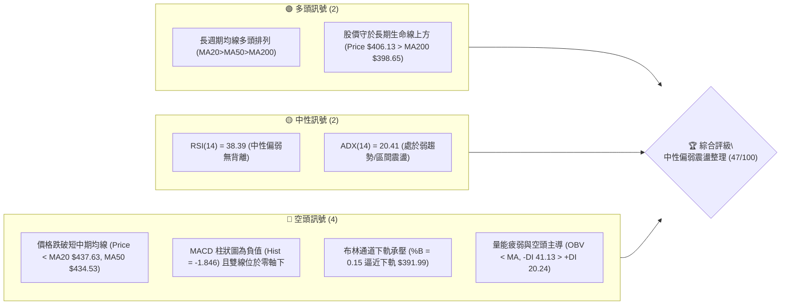
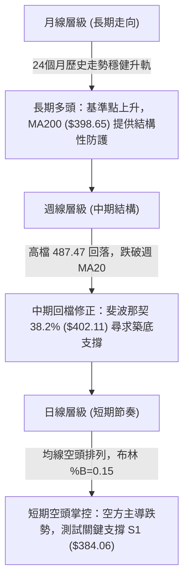
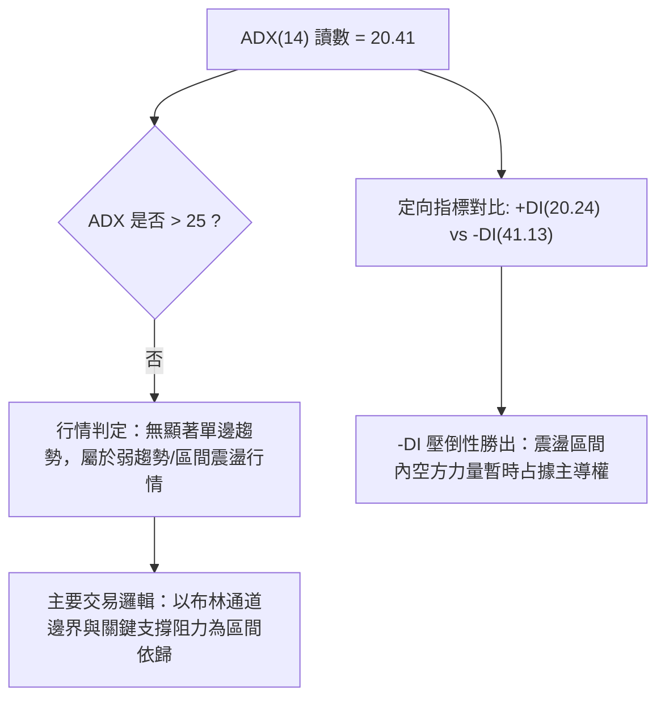
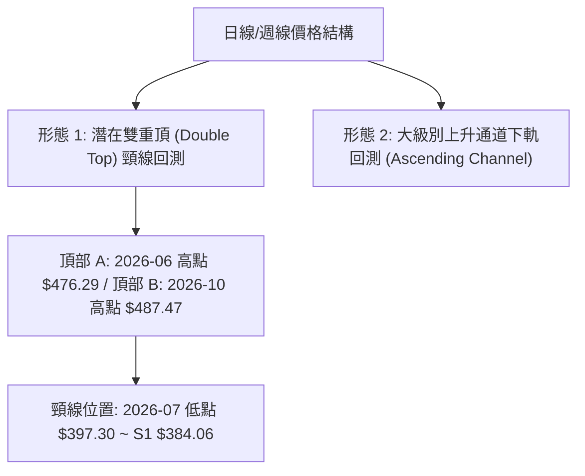
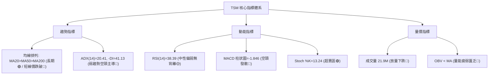
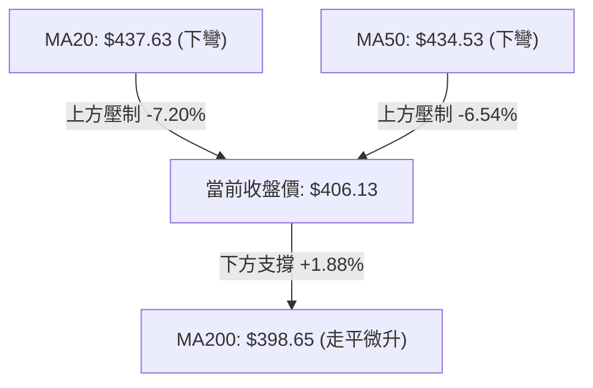
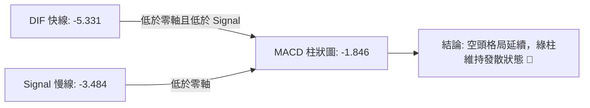
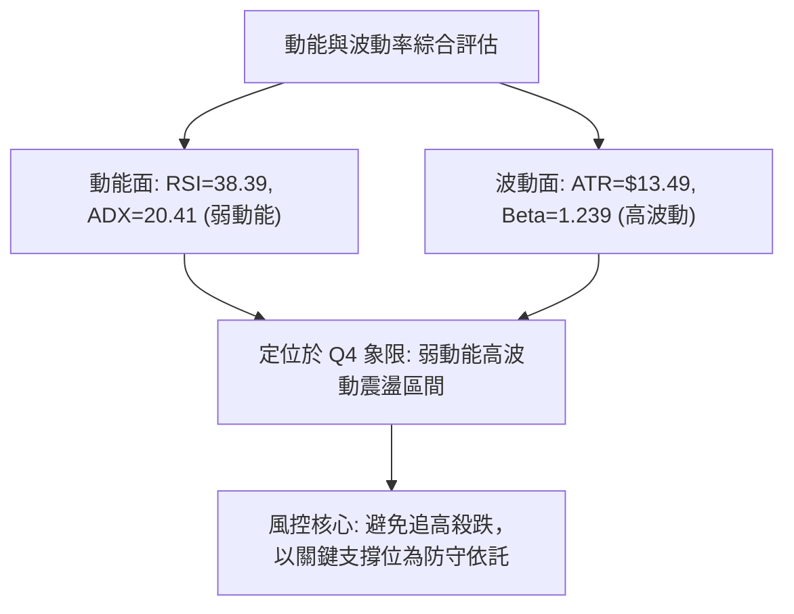
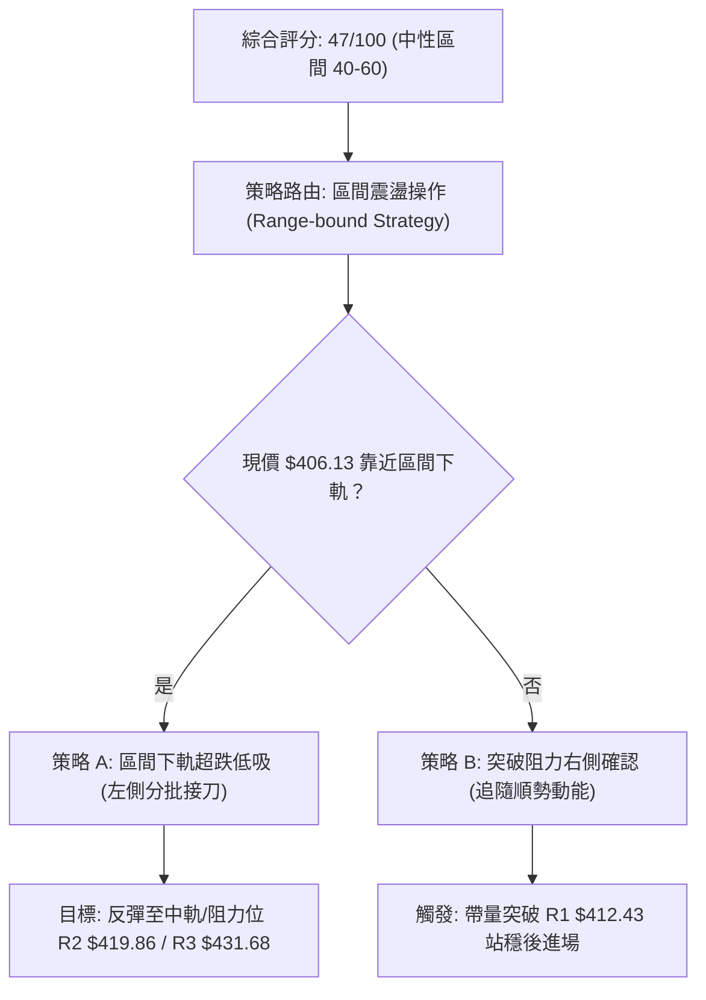
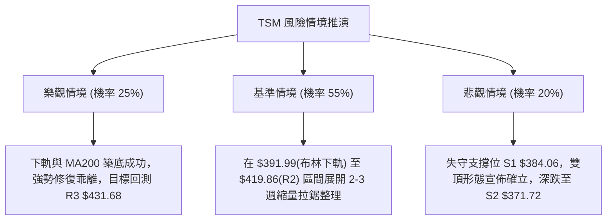

# TSM 技術分析報告

> **報告日期**：2026-10-31 ｜ **語言**：繁體中文 ｜ **數據來源**：Yahoo Finance ｜ **當前價格**：$406.13

---

## 目錄

| 章節 | 內容 |
|------|------|
| [1. 技術面概覽](#1-技術面概覽) | 訊號儀表板、核心指標、評分卡 |
| [2. 趨勢分析](#2-趨勢分析) | 多時框趨勢、長中短期走勢 |
| [3. 圖表形態分析](#3-圖表形態分析) | 形態識別、K線組合、目標價 |
| [4. 支撐與阻力](#4-支撐與阻力) | 關鍵價位、斐波那契回調 |
| [5. 技術指標深度解讀](#5-技術指標深度解讀) | MA/RSI/MACD/布林/成交量 |
| [6. 動能與波動率](#6-動能與波動率) | 動能評估、ATR、Beta |
| [7. 多時框架總結](#7-多時框架總結) | 時框架評分矩陣 |
| [8. 交易策略建議](#8-交易策略建議) | 多空策略、風險報酬比 |
| [9. 風險提示與監控](#9-風險提示與監控) | 監控指標、風險場景 |

---

## 1. 技術面概覽

### 🎯 技術訊號儀表板



### 📊 核心指標速覽表

| 指標類別 | 指標名稱 | 當前數值 | 訊號 | 解讀 |
|:---|:---|:---|:---:|:---|
| **價格** | 當前收盤價 | $406.13 | 🟡 | 位於52週區間($264.03–$487.47)的63.6%，波段大幅拉回修正中 |
| **均線** | MA20 | $437.63 | 🔴 | 價格低於MA20達-7.20%，短期動能顯著走弱且均線下彎 |
| **均線** | MA50 | $434.53 | 🔴 | 價格低於MA50達-6.54%，中期趨勢面臨多空分水嶺考驗 |
| **均線** | MA200 | $398.65 | 🟢 | 價格高於MA200約+1.88%，長期牛市基底支撐仍然有效 |
| **動能** | RSI(14) | 38.39 | 🟡 | 處於30–70中性區間偏下緣，無背離現象，未達極端超賣 |
| **動能** | MACD (12,26,9) | -5.331 | 🔴 | 訊號線-3.484，柱狀圖-1.846，處於空頭發散結構 |
| **動能** | Stoch %K / %D | 13.24 / 40.52 | 🟢 | %K進入超賣區(<20)，短線醞釀技術性跌深反彈動能 |
| **趨勢** | ADX(14) / 方向 | 20.41 | 🟡 | ADX<25顯示為弱趨勢/盤整，但 -DI(41.13) 遠高於 +DI(20.24) 空頭占優 |
| **通道** | 布林通道 %B | 0.15 | 🔴 | 價格貼近布林下軌($391.99)，中軌($437.63)形成重壓 |
| **量能** | 最新量 / 量比 | 21,907,500 | 🔴 | 量比1.83x且OBV < MA，黑K放量下殺顯示籌碼湧現獲利了結賣壓 |
| **波動** | ATR(14) | $13.49 | 🟡 | 佔現價3.32%，單日波動區間正常，有利於設定防守空間 |

### 🏆 技術評分卡

```
╔══════════════════════════════════════════════════════════════════╗
║                   技術評分卡 — TSM (2026-10-31)                   ║
╠══════════════════════════════════════════════════════════════════╣
║ 趨勢強度 (ADX=20.41 弱趨勢, -DI 主導)   ████████░░░░░░░░░░░░  40/100 🔴 ║
║ 動能指標 (RSI=38.39, MACD 翻黑, KD 超賣)████████░░░░░░░░░░░░  40/100 🔴 ║
║ 支撐穩定度 (守住斐波那契38.2%及MA200)   ████████████░░░░░░░░  60/100 🟡 ║
║ 成交量配合 (大跌放量, OBV < 均線)       ██████░░░░░░░░░░░░░░  30/100 🔴 ║
║ 形態完整度 (雙頂頸線跌破測試長期通道)   ██████████░░░░░░░░░░  50/100 🟡 ║
║ 均線排列 (長期多頭排列 MA20>MA50>MA200) ████████████░░░░░░░░  60/100 🟢 ║
╠══════════════════════════════════════════════════════════════════╣
║ 綜合評分 (六項算術平均：(40+40+60+30+50+60)/6)  █████████░░░░░  47/100 🟡 ║
║ 評級結論：中性偏弱震盪整理 (ADX<25 盤整為主，防守 MA200 關鍵支撐)   ║
╚══════════════════════════════════════════════════════════════════╝
```

---

## 2. 趨勢分析

### 🌐 多時框趨勢分析



### 📈 長期趨勢 — 12個月走勢圖（Unicode）

以下為 TSM 過去 12 個月（2025-11 至 2026-10）收盤價走勢圖，標注歷史高點、修正低點與現價：

```
TSM 月線收盤走勢圖（過去12個月：2025-11 至 2026-10）
價格軸 ($)
$480 ┤                                                 ● 476.29 (2026-06 歷史收盤高點)
$460 ┤                                            ●    │
$440 ┤                                            │    │         ● 456.19
$420 ┤                                      ●     │    │         │
$400 ┤                                      │     │    ● 403.17  │    ● 406.13 (現價)
$380 ┤                            ● 371.66  │     │    │    ●    │    │
$360 ┤                            │    │    │     │    │    │    │    │
$340 ┤                       ●    │    ●    │     │    │    │    │    │
$320 ┤                  ●    │    │    336.26     │    │    │    │    │
$300 ┤        ● 301.52  │    │    │         │     │    │    │    │    │
$280 ┤   ●    │         │    │    │         │     │    │    │    │    │
     └─┬────┬────┬────┬────┬────┬────┬────┬────┬────┬────┬────┬────┘
     11月 12月 01月 02月 03月 04月 05月 06月 07月 08月 09月 10月
       2025年                  2026年
```

#### 長期走勢特徵分析表

| 階段區間 | 時間跨度 | 起訖收盤價 ($) | 區間漲跌幅 | 走勢特徵分析 |
|:---|:---:|:---:|:---:|:---|
| **啟動突破期** | 2025-11 ~ 2026-02 | $288.46 → $371.66 | +28.84% | 強勢單邊推升，月K連四紅，突破300元大關並確立半導體主升段 |
| **首輪回洗期** | 2026-02 ~ 2026-03 | $371.66 → $336.26 | -9.52% | 快速回測支撐，於月線均線上方獲得強勁買盤承接，快速完成技術換手 |
| **主升攻頂期** | 2026-03 ~ 2026-06 | $336.26 → $476.29 | +41.64% | 巨量單邊推升行情，創下52週盤中高點 $487.47 與月收盤高點 $476.29 |
| **高位箱體期** | 2026-06 ~ 2026-10 | $476.29 → $406.13 | -14.73% | 於 $400–$480 建立寬幅大箱體震盪，目前收盤回測箱體下緣與 38.2% 回調位 |

### 📊 中期趨勢（週線分析）

中期走勢顯示自 2026 年 10 月初創下波段高點 $487.47 以來，週線走出兩波劇烈下殺（10-09 至 10-16 連續長黑下跌至 $412.61，隨後反彈至 $418.51 遇阻，本週再破底至 $406.13）。

```
週線級別價格壓力與支撐示意圖
══════════════════════════════════════════════════════════════════
 阻力位 R3: $431.68  ──────────────────────────────────────────
                     ▲ 週反彈高點頸線阻力 / MA60 ($432.24)
 阻力位 R2: $419.86  ──────────────────────────────────────────
                     ▲ 2026-10-23 週收盤位 / 短線反彈密集成交區
 阻力位 R1: $412.43  ──────────────────────────────────────────
 ──────────────────────────────────────────────────────────────
 現  價:   $406.13  ◄── 斐波那契 38.2% 回調位 ($402.11) 支撐測試中
 ──────────────────────────────────────────────────────────────
 支撐位 S1: $384.06  ──────────────────────────────────────────
                     ▼ 密集波段低點 / MA240 ($381.61) 防守帶
 支撐位 S2: $371.72  ──────────────────────────────────────────
                     ▼ 斐波那契 50.0% ($375.75) 與 2026-02 平台低點
══════════════════════════════════════════════════════════════════
```

### ⚡ 趨勢強度評估（ADX 解讀）



#### ADX 趨勢強度對照表

| 指標名稱 | 數值 | 判斷標準 | 市場狀態結論 |
|:---|:---:|:---:|:---|
| **ADX(14)** | **20.41** | <20: 極弱/無趨勢；20–25: 弱趨勢/盤整；>25: 明確趨勢 | 當前處於 **弱趨勢/高波動區間盤整** |
| **+DI** | **20.24** | 多方攻擊動能強度指標 | 多方動能明顯減退，缺乏主動推升意願 |
| **-DI** | **41.13** | 空方摜壓動能強度指標 | 空方掌控短線盤面，短線下行慣性強烈 |
| **收斂結論** | 規則 14 | 依據 ADX<25 規則，當前市場應遵循 **日線布林通道與波段關鍵支撐** 進行防守型操作 |

---

## 3. 圖表形態分析

### 🔍 形態識別系統



#### 圖表形態信心度評估表

| 形態名稱 | 信心度 | 判斷依據（引用數據） | 完成度 | 目標價（附計算式） |
|:---|:---:|:---|:---:|:---|
| **雙重頂 (M頭)** | 55% | 頂1(2026-06週收$460.88/高點$476.29)與頂2(2026-10-09高點$487.47)，頸線位於2026-07-17低點$397.30 | 70% | 跌破頸線$397.30後之量度跌幅：頸線$397.30 - (高點$487.47 - 頸線$397.30 = $90.17) = $307.13（接近斐波那契 78.6% $311.84） |
| **高位箱體震盪** | 75% | 近4個月收盤集中於區間內(07月$403.17、08月$414.21、10月$406.13)，高點受阻於R3/BB上軌 | 85% | 震盪下緣目標即為數據支撐位 S1 $384.06 與布林下軌 $391.99 |

### 🕯️ 重要K線形態分析

根據提供的「近10根日K」與「近8根週K」實際開、高、低、收數據進行客觀解讀：

| 日期（層級） | 開 | 高 | 低 | 收 | 成交量 | K線形態名稱 | 技術解讀與多空訊號 |
|:---|:---:|:---:|:---:|:---:|:---:|:---:|:---|
| **2026-10-21 (日K)** | 433.14 | 435.16 | 423.74 | 431.89 | 10,721,100 | 高檔十字紡錘線 | 實體極小，多空於 MA60($432.24) 附近激烈爭奪，動能停滯 🟡 |
| **2026-10-22 (日K)** | 419.39 | 421.91 | 410.22 | 412.35 | 16,475,100 | 放量中長黑K | 跳空低開走低收最低，成交量放大至16.4M，確立短線跌勢 🔴 |
| **2026-10-27 (日K)** | 427.16 | 438.58 | 426.00 | 436.87 | 9,022,500 | 帶上影中紅K | 嘗試挑戰 MA20($437.63) 遇阻，縮量反彈顯示追價買盤不足 🟡 |
| **2026-10-28 (日K)** | 438.24 | 440.88 | 436.84 | 439.51 | 8,037,400 | 高位孕線/停頓小紅 | 開高走平，受阻於阻力帶，量能萎縮至8M，反彈動能衰竭 🟡 |
| **2026-10-29 (日K)** | 431.69 | 436.24 | 428.43 | 431.81 | 8,465,900 | 帶下影黑紡錘線 | 跌破前日低點，反彈宣告結束，均線反壓沉重 🔴 |
| **2026-10-30 (日K)** | 414.08 | 418.09 | 400.12 | 406.13 | 21,907,500 | 長下影爆量長黑K | 裂口低開下探$400.12整數關卡，成交量飆升至21.9M(量比1.83x)，下影線展現$400關卡買盤承接但實體偏弱 🔴 |
| **2026-10-09 (週K)** | 478.77 | 487.47 | 449.75 | 453.31 | 49,231,100 | 創高倒轉錘頭黑K | 創52週新高$487.47後大幅跳水，留長達$34.16之上影線，高檔主力派發訊號 🔴 |
| **2026-10-16 (週K)** | 453.55 | 454.40 | 407.13 | 412.61 | 71,736,400 | 爆量破位大長黑 | 週跌幅逾40元，週量暴增至71.7M，一舉貫穿週MA20，中期結構破壞 🔴 |
| **2026-10-30 (週K)** | 418.07 | 440.88 | 400.12 | 406.13 | 57,060,400 | 帶長上下影實體黑K | 高點觸及$440.88受阻，低點測試$400.12，收盤跌破前週低點，空方延續 🔴 |

### 📉 ASCII 走勢形態示意圖

```
日K線近10日走勢與關鍵價位示意圖
價格軸 ($)
$442 ┬                                     ┌─┐ (10-28 高: 440.88)
$438 ┤                 ┌─┐ (10-21)         │ │
$434 ┤                 │ │                 │ └─┐ (10-27)
$430 ┤                 │ │                 │   │     ┌─┐ (10-29)
$426 ┤                 │ │           ┌─┐   │   │     │ │
$422 ┤  ┌─┐   ┌─┐      │ │           │ │   │   │     │ │
$418 ┤  │ │   │ │      │ │     ┌─┐   │ │   │   │     │ │
$414 ┤  │ │   │ │      │ └─┐   │ │   │ │   │   │     │ │     ┌─┐ (10-30)
$410 ┤  │ │   │ │      │   │   │ │   │ │   │   │     │ │     │ │
$406 ┤──┼─┼───┼─┼──────┼───┼───┼─┼───┼─┼───┼───┼─────┼─┼─────┼─┴─● 收 406.13
$402 ┤  │ │   │ │      │   │   │ │   │ │   │   │     │ │     │
$398 ┴──┴─┴───┴─┴──────┴───┴───┴─┴───┴─┴───┴───┴─────┴─┴─────┴─ (10-30 低: 400.12)
       10-19 10-20    10-21   10-22 10-23 10-26 10-27 10-28   10-29   10-30
```

### 🎯 形態目標價計算

根據雙重頂形態與箱體突破之經典量度跌幅計算規則：
1. **雙重頂潛在跌幅計算式**：
   - 形態頸線基準點：2026-07-17 週低點 $397.30
   - 形態最高頂部點：2026-10-09 週高點 $487.47
   - 垂直高度 $H = 487.47 - 397.30 = 90.17$
   - 理論量度目標價 $Target = 397.30 - 90.17 = 307.13$（注：若跌破頸線確認成立，空方最終延伸目標將指向數據中的斐波那契 78.6% 回調位 $311.84）。
2. **高位箱體下緣支撐目標**：
   - 箱體頂部密集區為阻力位 R3 $431.68 至布林上軌 $483.28。
   - 箱體底部第一防守點為支撐位 S1 $384.06（距現價 -5.43%），第二極限支撐為 S2 $371.72（斐波那契 50.0% 處 $375.75 上方）。

---

## 4. 支撐與阻力

### 🗺️ 關鍵價位分布圖（Unicode）

```
╔══════════════════════════════════════════════════════════════════╗
║                     TSM 價位結構分布圖                           ║
╠══════════════════════════════════════════════════════════════════╣
║ $487.47 ║████████████████████████║ 52W 歷史最高點 (52W High)    ║
║ $437.63 ║████████████████████    ║ 布林中軌 / MA20 強阻力帶      ║
║ $431.68 ║████████████████████████║ 關鍵阻力 R3 (+6.29%)         ║
║ $419.86 ║████████████████        ║ 短線阻力 R2 (+3.38%)         ║
║ $412.43 ║████████████            ║ 即時阻力 R1 (+1.55%)         ║
╠═════════╬════════════════════════╬══════════════════════════════╣
║ $406.13 ╠════════════════════════╣ ◄── 現價收盤位置              ║
╠═════════╬════════════════════════╬══════════════════════════════╣
║ $402.11 ║▓▓▓▓▓▓▓▓▓▓▓▓▓▓▓▓▓▓▓▓▓▓▓▓║ 斐波那契 38.2% 回調支撐       ║
║ $398.65 ║▓▓▓▓▓▓▓▓▓▓▓▓▓▓▓▓▓▓▓▓    ║ 牛熊生命線 MA200 支撐        ║
║ $391.99 ║▓▓▓▓▓▓▓▓▓▓▓▓▓▓▓▓        ║ 布林下軌支撐                 ║
║ $384.06 ║████████████████████████║ 密集低點支撐 S1 (-5.43%)     ║
║ $371.72 ║████████████████████    ║ 強結構支撐 S2 (-8.47%)       ║
║ $358.75 ║████████████████████████║ 深度防守支撐 S3 (-11.67%)    ║
╚══════════════════════════════════════════════════════════════════╝
```

### 🚧 阻力位分析表

所有數值均嚴格引用 OHLCV 計算所得之關鍵價位區塊：

| 阻力級別 | 價位 ($) | 漲幅距離 | 形成原因與籌碼解讀 | 突破難度 | 重要性 |
|:---|:---:|:---:|:---|:---:|:---:|
| **R1** | **$412.43** | +1.55% | 2026-10-16 週低點收盤平台、10-22 日黑K收盤價反壓密集區 | 🟡 中等 | 短線轉強初階門檻 |
| **R2** | **$419.86** | +3.38% | 近10日多根K棒高低點重疊區（如10-23收盤$418.51與10-19低點$415.50） | 🔴 較高 | 空方防守第一道陣線 |
| **R3** | **$431.68** | +6.29% | 2026-10-21 及 10-29 收盤價共振區，極為接近下彎之 MA60 ($432.24) | 🔴 極高 | 中期反轉確認分水嶺 |

### 🛡️ 支撐位分析表

所有數值均嚴格引用 OHLCV 計算所得之關鍵價位區塊：

| 支撐級別 | 價位 ($) | 跌幅距離 | 形成原因與籌碼解讀 | 守住機率 | 重要性 |
|:---|:---:|:---:|:---|:---:|:---:|
| **S1** | **$384.06** | -5.43% | 近一年多次波段回踩之密集成交低點聚類，且上方緊鄰 MA200 ($398.65) | 70% | 結構性多頭防守底線 |
| **S2** | **$371.72** | -8.47% | 2026-02 月線收盤平台低點($371.66)與斐波那契 50% ($375.75) 疊加區 | 80% | 中期大箱體絕對強支撐 |
| **S3** | **$358.75** | -11.67% | 2026 年第一季主升段啟動前的最後洗盤震盪換手平台聚類 | 90% | 牛市極限容忍支撐帶 |

### 📐 斐波那契回調位分析

依據數據給定之 52 週完整波動區間（低點 $264.03 → 高點 $487.47，落差 $223.44）計算之回調位分佈：

| 斐波那契水平 | 對應價位 ($) | 與現價 ($406.13) 相對位置 | 技術面解讀與支撐阻力意義 |
|:---|:---:|:---:|:---|
| **0.0% (52W High)** | **$487.47** | +20.03% | 歷史天花板，大級別雙頂之最高點壓力位 |
| **23.6%** | **$434.74** | +7.04% | 位於現價上方，與 MA50 ($434.53) 完美重疊，為強大阻力帶 |
| **38.2%** | **$402.11** | -0.99% | ◄ **現價核心防守區**，10-30 日K盤中低點 $400.12 獲支撐處 |
| **50.0%** | **$375.75** | -7.48% | 中期多空平衡樞紐，緊鄰支撐位 S2 ($371.72) |
| **61.8%** | **$349.38** | -13.97% | 黃金分割強防守位，半導體週期長期牛市結構支撐位 |
| **78.6%** | **$311.84** | -23.22% | 深度修正回調位，雙頂量度跌幅($307.13)之對應目標區 |
| **100.0% (52W Low)**| **$264.03** | -34.99% | 52週循環起漲點 |

**位置解讀**：現價 $406.13 精準座落於 **23.6% ($434.74)** 與 **38.2% ($402.11)** 區間內，目前僅距 38.2% 回調位不到 1%。該位置同時受到 10-30 測試低點 $400.12 與下方 MA200 ($398.65) 的雙重保護，是多方不容有失的最後陣地。

---

## 5. 技術指標深度解讀

### 🎛️ 指標訊號總覽



### 📈 移動平均線排列分析



#### 均線系統全面評估表

| 均線名稱 | 數值 ($) | 距現價幅差 | 走勢特徵 | 訊號意涵 |
|:---|:---:|:---:|:---|:---:|
| **MA 5** | 427.74 | -5.05% | 急速下彎 | 短線超跌，乖離率擴大 |
| **MA 10** | 424.67 | -4.37% | 下彎走弱 | 短期反彈第一壓力線 |
| **MA 20** | 437.63 | -7.20% | 轉向朝下 | 月線反壓沉重，確立中期回檔 |
| **MA 50** | 434.53 | -6.54% | 走平下彎 | 季線防線告失，多空陷入焦土戰 |
| **MA 60** | 432.24 | -6.04% | 下彎 | 與 R3 ($431.68) 共振成複合阻力 |
| **MA 120** | 426.47 | -4.77% | 走平 | 半年線失守，中長期籌碼鬆動 |
| **MA 200** | 398.65 | +1.88% | 上揚保護 | **牛熊分界線**，提供最後多頭生機 |
| **MA 240** | 381.61 | +6.43% | 緩步上揚 | 緊鄰 S1 ($384.06)，具備極佳結構支撐 |

**綜合均線排列結論**：儘管絕對順序仍維持 `MA20 > MA50 > MA200` 之名義多頭排列，但現價已全面摜破 MA5 至 MA120，且短期均線已呈現「死叉並同步向下發散」之倒空排列態勢，唯有 MA200 仍堅守於現價下方提供實質支撐。

### 📉 RSI(14) 分析

- **RSI(14) 讀數**：**38.39**
- **強度指示條**：`████████░░░░░░░░░░░░` 38.39% (偏空震盪區間)
- **區間評估**：跌破 50 中軸線，處於 30 至 50 弱勢整理區，尚未觸及 <30 之極端超賣區。
- **背離分析**：依據近 20 根 K 棒對比，價格由 10-09 週之 $453.31 跌至 10-30 之 $406.13，RSI 相應由 52.6 降至 38.4，指標走勢與價格同步下行。結論為 **「無明顯背離」**，下行慣性依然由空方掌舵。

### 📊 MACD(12,26,9) 訊號解讀



- **MACD 快線**：-5.331
- **訊號線 (Signal)**：-3.484
- **柱狀圖 (Histogram)**：-1.846
- **解讀**：雙線於零軸下方持續死叉發散，且柱狀圖維持為負值（-1.846）。雖然週線級別 MACD 負柱狀體較前週（-4.818）有所收斂，但日線動能仍受壓於負向動能擴張，多方反彈訊號尚未具備結構性支撐。

### 📦 布林通道分析

```
日線布林通道 (20, 2) 結構圖
══════════════════════════════════════════════════════════════════
上軌:   $483.28 ────────────────────────────────────── (多方天花板)
                ▲
                │   通道寬度: $91.29 (寬幅震盪狀態)
                │
中軌:   $437.63 ────────────────────────────────────── (MA20 下彎反壓)
                ▲
                │
現價:   $406.13 ◄── %B = 0.15 (緊貼下軌運行)
                ▼
下軌:   $391.99 ────────────────────────────────────── (動態第一支撐)
══════════════════════════════════════════════════════════════════
```

- **布林通道參數**：上軌 $483.28、中軌(MA20) $437.63、下軌 $391.99。
- **%B 指標**：**0.15**，極度逼近下軌（0 代表下軌，0.5 代表中軌）。此讀數表明股價已進入通道下軌超跌區，短線若進一步下探下軌 $391.99，易觸發技術性反抽。

### 💹 成交量分析（量價配合度）

1. **爆量下殺現象**：10-30 最新成交量達 21,907,500 股，相較於 20 日均量 11,980,545 股，量比高達 **1.83x**。在收盤跌破多道短期均線之際爆出巨量，顯示市場存在恐慌性籌碼派發。
2. **OBV (能量潮) 指標**：數據明確標示 **「OBV < MA → 量能疲弱」**。OBV 線位居均線之下，呈現量隨價跌之空頭格局，資金未見大規模回流跡象，成交量暫時無法為價格反轉提供確認信號。

---

## 6. 動能與波動率

### ⚡ 動能評估四象限

| 象限 | 動能維度 | 波動維度 | TSM 當前狀態 | 交易環境解讀與策略建議 |
|:---:|:---:|:---:|:---:|:---|
| **Q1 (高動能/低波動)** | 強多頭 | 低 | — | 穩定推升主升段（非當前現狀） |
| **Q2 (低動能/低波動)** | 弱勢 | 低 | — | 窄幅縮量橫盤（非當前現狀） |
| **Q3 (強動能/高波動)** | 強單邊 | 高 | — | 趨勢噴發或崩跌行情 |
| **Q4 (低動能/高波動)** | **弱勢 (ADX=20)** | **高 (Beta=1.24)** | **✓ (TSM 座落於此)** | **震盪洗盤格局：動能方向混亂，區間波動加劇，極易產生假突破/假跌破，應嚴格執行區間邊界操作** |



### 📊 ATR 波動率分析

- **ATR(14) 讀數**：**$13.49**（Wilder 平滑法計算）。
- **ATR 佔比**：約佔當前股價之 **3.32%**，處於中高波動狀態。
- **止損距離建議**：
  - *短線當沖/隔夜波段*：建議設定 1.0x ATR = **$13.49**。
  - *中線波段防守*：建議設定 1.5x 至 2.0x ATR = **$20.24 至 $26.98**。以現價 $406.13 扣除 1.5x ATR 正好指向 $385.89，高度吻合關鍵支撐位 S1 ($384.06)。

### 📐 Beta 與市場相關性

- **Beta 係數**：**1.239**。
- **市場特徵解讀**：TSM 屬於標準的高貝塔半導體核心資產，其價格波動幅度高於大盤約 24%。當美股科技股（以費城半導體指數或納斯達克為代表）出現系統性修正時，TSM 修正速度顯著放大；反之，若大盤企穩，其彈升爆發力亦名列前茅。

---

## 7. 多時框架總結

### 📋 時框架評分表

| 時框架 | 趨勢方向 | 動能狀態 | 均線排列 | 形態特徵 | 綜合評分 | 操作建議 |
|:---|:---:|:---:|:---:|:---:|:---:|:---|
| **長期 (月線)** | 🟢 多頭 | 🟡 中性回落 | 🟢 多頭 (MA200向上) | 24個月上升大通道 | 70/100 | 長期投資者逢低分批佈局 |
| **中期 (週線)** | 🟡 震盪整理 | 🔴 偏空修正 | 🟡 糾結 (失守週MA20) | 高檔大箱體測試底邊 | 45/100 | 觀望等待週線止跌回穩 |
| **短期 (日線)** | 🔴 空頭掌控 | 🔴 負向發散 | 🔴 倒空 (破MA20/50) | 爆量下探下軌超跌 | 35/100 | 嚴控持倉，切忌盲目摸底 |

### 🔲 綜合訊號矩陣

```
時框架訊號收斂分析陣列
══════════════════════════════════════════════════════════════════
時框層級       趨勢   均線   動能   量價   通道位置   方向判定
長  期 (月線)   🟢     🟢     🟡     🟡      中軌上     偏多
中  期 (週線)   🟡     🟡     🔴     🔴      中下軌     中性偏弱
短  期 (日線)   🔴     🔴     🔴     🔴      逼近下軌   偏空
══════════════════════════════════════════════════════════════════
```

### ⚖️ 多時框收斂結論

依據本報告之 **「多時框收斂規則（規則 14）」**：
1. **行情屬性判定**：當前 ADX(14) 讀數為 **20.41 (<25)**，嚴格判定為 **「盤整/箱體震盪行情」**。
2. **主導時框與交易邏輯**：在盤整行情下，單邊趨勢策略失效，必須以 **日線布林通道上下軌（$391.99–$483.28）與波段關鍵支撐阻力（S1 $384.06 至 R3 $431.68）** 作為區間操作之核心依據。
3. **方向性收斂**：雖然長期月線多頭基底尚存，但短中期日線與週線動能全數呈現負向發散，且綜合評分為 **47/100（落入 40–60 中性區間）**。
4. **唯一結論**：**中性偏弱觀望，以區間下軌防守應對**。操作上嚴禁追高，應耐心等待股價回踩 MA200 ($398.65) 至布林下軌 ($391.99) 測試支撐穩定度。

---

## 8. 交易策略建議

### 🗺️ 策略決策流程圖



### 🧭 策略路由

> **當前主策略方向 = 區間震盪低吸策略（依評分卡綜合評分 47/100 定調）**

由於評分落於 40–60 之間，且 ADX<25 確立盤整市，本報告不進行極端多空單邊押注，主推以 **「下軌支撐回踩低吸（策略 A）」** 與 **「突破關鍵阻力右側跟進（策略 B）」** 兩套區間操作策略，並嚴格以數據給定之支撐阻力位為錨定基準。

### 🎯 價格情境階梯（Price Scenarios）

價位嚴格引用關鍵價位區塊已算出之數值：

| 觸發條件 | 下一目標 | 後續延伸目標 | 情境技術含義與應對策略 |
|:---|:---:|:---:|:---|
| **強勢突破 R1 ($412.43)** | **R2 ($419.86)** | **R3 ($431.68)** | 短線止跌回穩，空頭下行被遏制，展開均線修復反彈 |
| **守穩現價 ($406.13) ~ 38.2%** | **R1 ($412.43)** | **R2 ($419.86)** | 區間震盪築底，於 $400 整數大關進行多空籌碼換手 |
| **跌破 S1 ($384.06)** | **S2 ($371.72)** | **S3 ($358.75)** | 跌破 MA200 與布林下軌，中期結構轉空，下探50%回調位 |

### 📊 情境機率分佈

| 情境劃分 | 機率預估 | 主要技術指標支撐依據 |
|:---|:---:|:---|
| **情境一：守穩支撐反彈** | **35%** | Stoch KD 進入超賣區(%K=13.24)、股價貼近布林下軌(%B=0.15)、斐波38.2%($402.11)具防守性 |
| **情境二：區間劇烈震盪** | **45%** | **ADX=20.41 確認無趨勢盤整**、月線與日線衝突拉鋸、ATR 高達 $13.49 |
| **情境三：摜破支撐再探底** | **20%** | MACD 柱狀圖為負(-1.846)、量能疲弱(OBV<MA)、-DI(41.13)強勢主導 |

### 🟢 主策略詳情（區間操作多頭）

嚴格遵循規則 17 之風險報酬比定義：$(T1 - 進場價) \div (進場價 - 止損價)$。

| 策略要素 | 策略 A（下軌支撐低吸 - 左側交易） | 策略 B（突破阻力右側跟進 - 右側交易） |
|:---|:---|:---|
| **進場條件** | 股價回踩布林下軌與 MA200，出現下影線或止跌訊號 | 帶量突破 R1 ($412.43) 且 15 分鐘/日 K 收盤確認站穩 |
| **進場價格** | **$402.11**（精確錨定斐波那契 38.2% 關鍵位） | **$412.43**（精確錨定阻力位 R1） |
| **目標價 T1** | **$419.86**（阻力位 R2，短線獲利點） | **$431.68**（阻力位 R3，挑戰 MA60 壓力） |
| **目標價 T2** | **$431.68**（阻力位 R3，波段獲利點） | **$437.63**（布林中軌 MA20 重壓位） |
| **止損價格** | **$391.99**（跌破布林通道下軌極限） | **$402.11**（假突破跌回斐波那契 38.2% 下方） |
| **風險報酬比** | **1 : 1.75（以 T1 計）**<br>計算式：$(419.86 - 402.11) \div (402.11 - 391.99) = 17.75 \div 10.12 = 1.75$<br>*註：若以 T2 計為 1 : 2.92* | **1 : 1.87（以 T1 計）**<br>計算式：$(431.68 - 412.43) \div (412.43 - 402.11) = 19.25 \div 10.32 = 1.865$<br>*註：若以 T2 計為 1 : 2.44* |
| **成功機率** | 55% | 50% |
| **建議倉位** | 10% ~ 15%（輕倉防守型） | 15% ~ 20%（確認型建倉） |

### 🔴 反向風險觸發點（對沖提示）

- **全面停損轉空警訊**：若日線收盤價帶量**實體跌破 $384.06 (S1)**，即代表自 2026 年初以來之長期上升趨勢結構徹底遭到破壞，雙頂形態完成。多頭應立即全面停損離場，空方可順勢啟動避險對沖，下一階段回測目標直指 S2 ($371.72) 與 S3 ($358.75)。

### ⭐ 整體訊號強度評星

```
做多訊號強度：★★☆☆☆  (2/5星 — 短期均線壓制，僅具超賣反彈機會)
做空訊號強度：★★★☆☆  (3/5星 — 空方佔優但面臨 MA200 與下軌支撐)
整體可信度：  ★★★☆☆  (3/5星 — ADX 顯示盤整，技術假訊號機率較高)
```

---

## 9. 風險提示與監控

### ✅ 關鍵監控指標 Checklist

```
╔══════════════════════════════════════════════════════════════════╗
║                     TSM 技術面日常監控清單                       ║
╠══════════════════════════════════════════════════════════════════╣
║ [ ] 價格是否跌破斐波那契 38.2% ($402.11) 及整數大關 $400.00      ║
║ [ ] 日線收盤是否有效守住牛熊分界線 MA200 ($398.65)              ║
║ [ ] RSI(14) 是否跌破 30 進入深度超賣，或出現底背離抬頭跡象       ║
║ [ ] MACD 負柱狀體 (-1.846) 是否開始出現收斂翻紅（買盤進駐）     ║
║ [ ] 日成交量是否萎縮至 10M 以下完成「量縮測底」                  ║
║ [ ] 股價反彈是否能帶量收復阻力位 R1 ($412.43) 及 R2 ($419.86)   ║
╚══════════════════════════════════════════════════════════════════╝
```

### ⚠️ 風險場景分析



### 🛡️ 風險管理重要提醒

1. **嚴禁擴大槓桿與攤平**：目前 TSM 面臨 -DI 高達 41.13 之空方慣性摜壓，下影線雖展現低接意願，但在 MACD 翻紅前，左側摸底具有高滑價風險，嚴禁越跌越買或盲目加槓桿。
2. **波動度調適**：ATR 為 $13.49，盤中單日上下 15 元屬於正常波動範圍，設定止損時必須嚴格給予至少 1.0x ATR 以上之呼吸緩衝空間，切勿緊貼現價導致頻繁停損。
3. **資金水位控制**：鑑於 ADX<25 震盪格局與綜合評分僅 47 分，整體美股投資組合中 TSM 之曝險比例建議壓低在 20% 以內，保留 80% 現金儲備以應對系統性波動。

---

## 📋 報告總結

```
╔══════════════════════════════════════════════════════════════════╗
║                   TSM 技術分析報告總結                          ║
╠══════════════════════════════════════════════════════════════════╣
║ 報告日期：2026-10-31                                             ║
║ 當前價格：$406.13                                                ║
║ 分析評級：⚖️ 中性觀望 / 區間偏弱整理 (評分 47/100)               ║
║                                                                  ║
║ 關鍵技術結論：                                                   ║
║ ├─ 長期趨勢：🟢 偏多格局尚存，價格仍高於生命線 MA200 ($398.65)   ║
║ ├─ 中期趨勢：🟡 寬幅箱體回調，考驗斐波那契 38.2% ($402.11) 支撐  ║
║ ├─ 短期趨勢：🔴 空頭主導，全面失守短期均線，MACD 處於負向發散   ║
║ ├─ 關鍵支撐：S1 $384.06 ｜ S2 $371.72 ｜ 布林下軌 $391.99        ║
║ ├─ 關鍵阻力：R1 $412.43 ｜ R2 $419.86 ｜ R3 $431.68              ║
║ └─ 分析師目標：均價 $584.39 (低 $440.00 / 高 $1000.00)           ║
║                                                                  ║
║ 最優策略組合：                                                   ║
║ 1. 🥇 最佳機會：於 $402.11 附近輕倉低吸，防守 $391.99，博弈超跌反彈║
║ 2. 🥈 次選機會：靜待帶量突破 R1 $412.43 後右側進場，目標 R2/R3    ║
║ 3. 🥉 保守選擇：空倉觀望，等待日線 MACD 翻紅與成交量縮小後再行介入║
╚══════════════════════════════════════════════════════════════════╝
```

---

> ⚠️ **免責聲明**：本報告為技術分析研究，所有數據、圖表及價位推算均基於系統提供之歷史交易資訊（Yahoo Finance）。本報告**僅供學術研究與參考**，**不構成任何形式的投資招攬或交易建議**。金融市場瞬息萬變，投資人應獨立評估風險並自負盈虧。

---

*報告生成時間：2026-10-31 ｜ 數據來源：Yahoo Finance ｜ 分析框架：多時框技術分析模型*