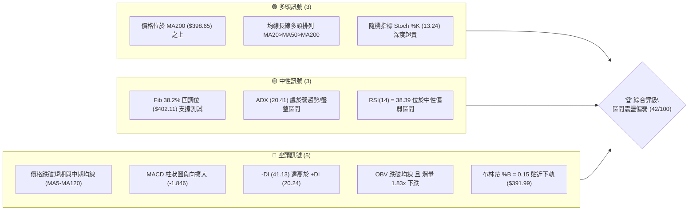
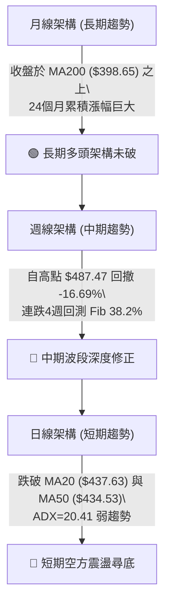
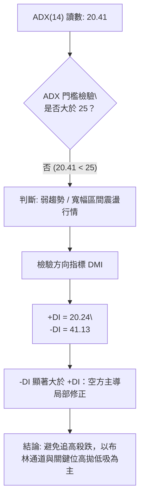
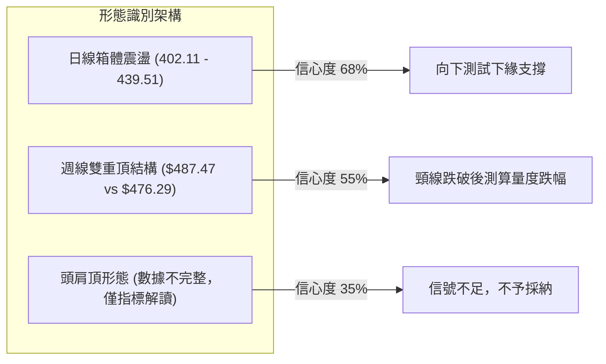
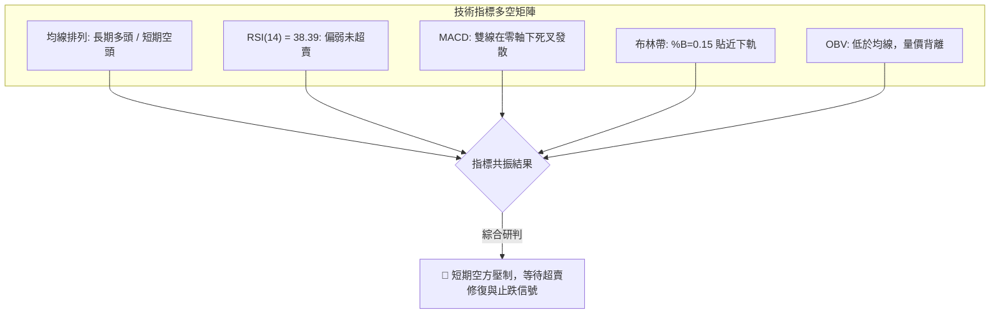
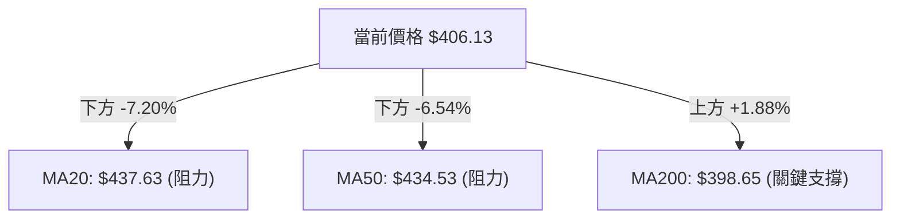
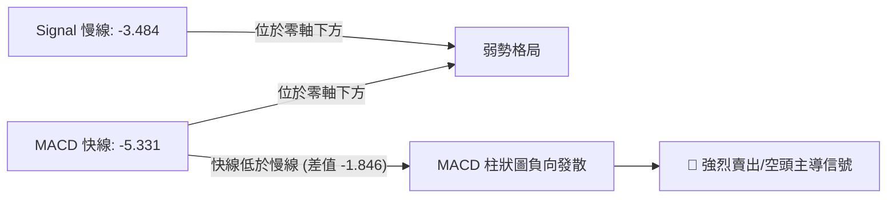
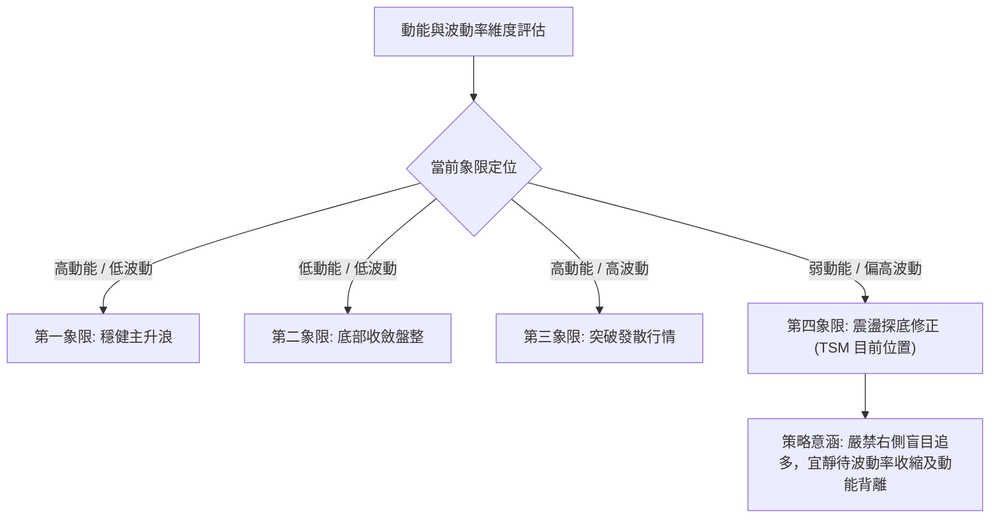
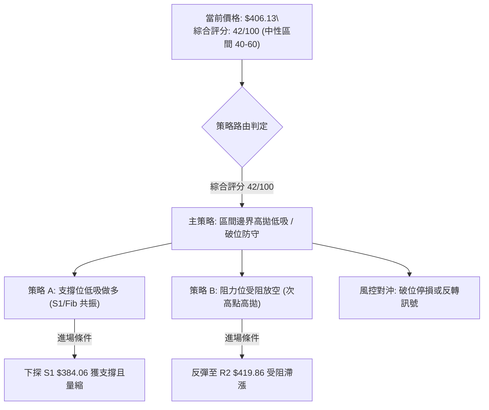
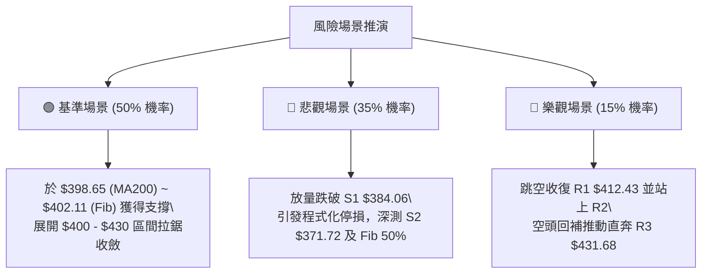

# TSM 技術分析報告

> **報告日期**：2026-11-01 ｜ **語言**：繁體中文 ｜ **數據來源**：Yahoo Finance ｜ **當前價格**：$406.13

---

## 目錄

| 章節 | 內容 |
|------|------|
| [1. 技術面概覽](#1-技術面概覽) | 訊號儀表板、核心指標、評分卡 |
| [2. 趨勢分析](#2-趨勢分析) | 多時框趨勢、長中短期走勢 |
| [3. 圖表形態分析](#3-圖表形態分析) | 形態識別、K線組合、目標價 |
| [4. 支撐與阻力](#4-支撐與阻力) | 關鍵價位、斐波那契回調 |
| [5. 技術指標深度解讀](#5-技術指標深度解讀) | MA/RSI/MACD/布林/成交量 |
| [6. 動能與波動率](#6-動能與波動率) | 動能評估、ATR、Beta |
| [7. 多時框架總結](#7-多時框架總結) | 時框架評分矩陣 |
| [8. 交易策略建議](#8-交易策略建議) | 多空策略、風險報酬比 |
| [9. 風險提示與監控](#9-風險提示與監控) | 監控指標、風險場景 |

---

## 1. 技術面概覽

### 🎯 技術訊號儀表板



### 📊 核心指標速覽表

| 指標類別 | 指標名稱 | 當前數值 | 訊號 | 解讀 |
|----------|----------|----------|------|------|
| **價格** | 當前收盤價 | $406.13 | 🟡 | 位於52週區間63.6%，回測斐波那契38.2% ($402.11) |
| **均線** | MA20 | $437.63 | 🔴 | 現價位於MA20下方 -7.20%，短期空頭主導 |
| **均線** | MA50 | $434.53 | 🔴 | 現價位於MA50下方 -6.54%，中期動能轉弱 |
| **均線** | MA200 | $398.65 | 🟢 | 現價位於MA200上方 +1.88%，長期牛熊分界線未破 |
| **動能** | RSI(14) | 38.39 | 🟡 | 位於中性偏弱區間 (30–70)，尚未進入極端超賣 (<30) |
| **動能** | MACD (12/26/9) | -5.331 | 🔴 | MACD線低於訊號線 (-3.484)，柱狀圖 -1.846，空頭發散 |
| **動能** | Stoch %K / %D | 13.24 / 40.52 | 🟢 | %K 跌入超賣區 (<20)，短線具備技術性反彈動能 |
| **趨勢** | ADX(14) | 20.41 | 🟡 | ADX < 25 表明處於弱趨勢/盤整格局，非單邊行情 |
| **趨勢** | 方向指標 (DMI) | +DI: 20.24 / -DI: 41.13 | 🔴 | -DI 大幅壓制 +DI，空方力量在盤整中佔據主動 |
| **通道** | 布林通道 | 上 $483.28 / 下 $391.99 | 🔴 | 現價接近下軌，%B 僅 0.15，波動向下擴展 |
| **量能** | 當日成交量 | 21,907,500 股 | 🔴 | 量比 1.83x (高於20日均量 11,980,545)，放量收陰 |
| **波動** | ATR(14) | $13.49 (3.32%) | 🟡 | 波動率適中，單日波動區間約 $13.5 美元 |

### 🏆 技術評分卡

```
╔══════════════════════════════════════════════════════════════════╗
║                   技術評分卡 — TSM (2026-11-01)                  ║
╠══════════════════════════════════════════════════════════════════╣
║ 趨勢強度 (ADX/DMI)   ███████░░░░░░░░░░░░░  36/100  🔴 空方主導   ║
║ 動能指標 (RSI/MACD)  ███████░░░░░░░░░░░░░  34/100  🔴 動能疲弱   ║
║ 支撐穩定度 (S1/Fib)  ██████████░░░░░░░░░░  52/100  🟡 考驗MA200  ║
║ 成交量配合 (OBV/VOL) ██████░░░░░░░░░░░░░░  30/100  🔴 放量下殺   ║
║ 形態完整度 (K線/通道)█████████░░░░░░░░░░░  46/100  🟡 測通道下軌 ║
║ 均線排列 (多時框MA)  ███████████░░░░░░░░░  54/100  🟡 長牛短弱   ║
╠══════════════════════════════════════════════════════════════════╣
║ 綜合評分             ████████░░░░░░░░░░░░  42/100  🟡 區間震盪偏弱║
╚══════════════════════════════════════════════════════════════════╝
```
*註：綜合評分由六項子評分算術平均得出：(36 + 34 + 52 + 30 + 46 + 54) ÷ 6 = 42.0，四捨五入至整數為 42/100。*

---

## 2. 趨勢分析

### 🌐 多時框趨勢分析



### 📈 長期趨勢 — 12個月走勢圖（Unicode）

```
TSM 月線收盤走勢圖（過去12個月：2025-11 至 2026-10）
價格軸 ($)
$480 ┤                                           ● (2026-06: $476.29)
$450 ┤                                                 ● (2026-09: $456.19)
$420 ┤                             ● (2026-05: $416.36)      ● (2026-08: $414.21)
$390 ┤                       ● (2026-04: $394.08)            ●←現價 ($406.13)
$360 ┤             ● (2026-02: $371.66)
$330 ┤       ● (2026-01: $327.98)  ● (2026-03: $336.26)
$300 ┤ ● (2025-11: $288.46)
$270 ┤
     └──────────────────────────────────────────────────────────────────
       11M   12M    01M    02M    03M    04M    05M    06M    07M    08M    09M    10M
      (2025)                      (2026)
```

#### 走勢特徵分析表格

| 階段區間 | 起止價格 | 漲跌幅 | 趨勢特徵 | 關鍵技術事件 |
|----------|----------|--------|----------|--------------|
| **2025-11 ~ 2026-02** | $288.46 → $371.66 | +28.84% | 強勢主升浪 | 帶量突破 $300 大關，MA多頭發散 |
| **2026-02 ~ 2026-03** | $371.66 → $336.26 | -9.52% | 漲多健康回檔 | 回測 MA50 支撐不破，洗盤整理 |
| **2026-03 ~ 2026-06** | $336.26 → $476.29 | +41.64% | 加速趕頂浪 | 創下月線收盤新高，動能達到極值 |
| **2026-06 ~ 2026-07** | $476.29 → $403.17 | -15.35% | 快速回撤 | 高位獲利了結，首度測試 $400 心理關卡 |
| **2026-07 ~ 2026-09** | $403.17 → $456.19 | +13.15% | 次高點反彈 | 形成雙頂雛形，週線未創歷史新高 |
| **2026-09 ~ 2026-10** | $456.19 → $406.13 | -10.97% | 二次下探 | 跌破所有短期均線，考驗 MA200 支撐 |

### 📊 中期趨勢（週線分析）

```
TSM 週線結構壓力與支撐示意圖
════════════════════════════════════════════════════════════════════
$487.47 ──────────────────────────────────────── 52W 歷史極值 (2026-10-09)
              ▼
$453.31 ──────────────────────────────────────── 週線破位頸線 (2026-10-09 收盤)
              ▼
$431.68 ──────────────────────────────────────── 強阻力 R3 (波段密集區)
              ▼
$406.13 ━━━━━━━━━━━━━━━━━━━━━━━━━━━━━━━━━━━━━━━━ 現價 (測試 Fib 38.2% $402.11)
              ▲
$398.65 ┄┄┄┄┄┄┄┄┄┄┄┄┄┄┄┄┄┄┄┄┄┄┄┄┄┄┄┄┄┄┄┄┄┄┄┄┄ MA200 終極防線
              ▲
$384.06 ──────────────────────────────────────── 近一年波段低點支撐 S1
════════════════════════════════════════════════════════════════════
```

### ⚡ 趨勢強度評估（ADX 解讀）



#### ADX 趨勢強度對照表

| 指標變數 | 當前數值 | 參考標準區間 | 市場狀態解讀 |
|----------|----------|--------------|--------------|
| **ADX(14)** | 20.41 | 0 ~ 25：無趨勢/盤整<br>25 ~ 50：強趨勢<br>50 ~ 100：極強趨勢 | **無明確單邊趨勢**。市場進入中長期的寬幅盤整，動能指標指標有效性高於趨勢突破指標。 |
| **+DI(14)** | 20.24 | 基準多頭動能線 | 多方進攻意願低落，買盤以被動防守為主。 |
| **-DI(14)** | 41.13 | 基準空頭動能線 | 空方力量大幅佔優（差值達 20.89），顯示賣壓沉重但未達失控單邊崩跌。 |

---

## 3. 圖表形態分析

### 🔍 形態識別系統



#### 圖表形態信心度與目標價評估

| 形態名稱 | 信心度 | 判斷依據（引用數據） | 完成度 | 目標價（附計算式） |
|----------|--------|----------------------|--------|--------------------|
| **日線寬幅箱體** | 68% | 箱頂為 2026-10-28 高點 $440.88，箱底為 Fib 38.2% $402.11 與 S1 $384.06 | 85% | 跌破箱底測算：箱底 $402.11 − (箱頂 $440.88 − 箱底 $402.11) = **$363.34**（接近 S3 $358.75） |
| **週線雙重頂** | 55% | 左頂 2026-06 高點 $476.29，右頂 2026-10 高點 $487.47，頸線為 2026-07 低點 $397.30 | 70% | 跌破頸線測算：頸線 $397.30 − (高點 $487.47 − 頸線 $397.30) = **$307.13**（接近 Fib 78.6% $311.84） |
| **頭肩頂形態** | 35% | 左肩缺乏標準對稱高點，僅有局部波動，數據不足以確立幾何結構 | 20% | **訊號不足，僅做指標型解讀**（布林下軌支撐測試） |

### 🕯️ 重要K線形態分析

嚴格依據提供的「近10根日K」與「近8根週K」開高低收數據進行客觀解讀：

| 週期與日期 | 開盤價 | 最高價 | 最低價 | 收盤價 | K線形態名稱 | 形態深度解讀 | 技術訊號 |
|------------|--------|--------|--------|--------|-------------|--------------|----------|
| **日K 10-22** | $419.39 | $421.91 | $410.22 | $412.35 | 中黑實體陰線 | 破位下殺，成交量 16.48M 放大，確認跌破短期橫盤區間 | 🔴 看空 |
| **日K 10-27** | $427.16 | $438.58 | $426.00 | $436.87 | 長陽實體線 | 多頭反撲向上挑戰 MA20，但成交量僅 9.02M 呈現量價背離 | 🟡 假突破 |
| **日K 10-28** | $438.24 | $440.88 | $436.84 | $439.51 | 高位受阻十字 | 觸及波段高點 $440.88 後上影線承壓，成交量萎縮至 8.04M | 🔴 滯漲 |
| **日K 10-30** | $414.08 | $418.09 | $400.12 | $406.13 | 帶下影放量大陰 | 跳空低開重挫，成交量暴增至 21.91M (1.83x)，下探 $400 關卡 | 🔴 空方釋放 |
| **週K 10-09** | $478.77 | $487.47 | $449.75 | $453.31 | 長上影倒錘頭 | 衝擊 52W 歷史極值 $487.47 遭沉重賣壓砸回，形成波段見頂信號 | 🔴 頂部確立 |
| **週K 10-16** | $453.55 | $454.40 | $407.13 | $412.61 | 長黑大陰棒 | 週跌幅達 -8.98%，放量 71.74M 跌破多條短期均線支撐 | 🔴 趨勢轉空 |
| **週K 10-30** | $418.07 | $440.88 | $400.12 | $406.13 | 衝高回落下探陰線 | 當週最高拉升至 $440.88 後失守，週K收破 $410，收盤逼近低點 | 🔴 空方延續 |

### 📉 ASCII 走勢形態示意圖

```
日K線近期形態結構演變圖（2026-10-19 至 10-30）
價格
$445 ┤
$440 ┤                     ┌─┐ 10-28 (高點 $440.88)
$435 ┤                 ┌─┐ │ │
$430 ┤         ┌─┐     │ │ └─┘   ┌─┐
$425 ┤     ┌─┐ │ │     │ │       │ │
$420 ┤ ┌─┐ │ │ │ │     └─┘       └─┘
$415 ┤ │ │ └─┘ └─┘ ┌─┐                 ┌─┐
$410 ┤ └─┘         │ │ ┌─┐             │ │ 10-30 收盤 $406.13
$405 ┤             └─┘ │ │             │ │
$400 ┤                 └─┘             └─┴─ 10-30 最低 $400.12
     └──────────────────────────────────────────────────────────
      10-19 10-20 10-21 10-22 10-23 10-26 10-27 10-28 10-29 10-30
```

### 🎯 形態目標價計算

1. **日線箱體破位測算**：
   - 箱體上限：$440.88（10-28 高點）
   - 箱體下限：$402.11（Fib 38.2% 回調位）
   - 形態垂直高度：$440.88 − $402.11 = **$38.77**
   - 向下量度跌幅目標價 = 箱體下限 $402.11 − $38.77 = **$363.34**（位於支撐位 S2 $371.72 與 S3 $358.75 之間）。

2. **週線波段回撤測算**：
   - 52週波段頂點：$487.47（10-09 當週高點）
   - 首波急跌低點：$407.13（10-16 當週低點）
   - 跌幅高度：$487.47 − $407.13 = **$80.34**
   - 反彈次高點：$440.88（10-30 當週高點）
   - 等長二次下探目標價 = $440.88 − $80.34 = **$360.54**（高度收斂於 S3 $358.75 附近）。

---

## 4. 支撐與阻力

### 🗺️ 關鍵價位分布圖（Unicode）

```
TSM 價位結構分布圖（OHLCV 聚類與斐波那契疊加）
═══════════════════════════════════════════════════════════════
$487.47 ║██████████████████████████████║ 52W 歷史極值 (Fib 0.0%)
$434.74 ║██████████████████████        ║ Fib 23.6% 回調位
$431.68 ║██████████████████████████████║ 強阻力 R3 (波段密集高點)
$419.86 ║████████████████████          ║ 阻力 R2 (次高點聚類)
$412.43 ║████████████████████████      ║ 關鍵阻力 R1 (短期破位頸線)
$406.13 ╠══════════════════════════════╣ ◄ 當前價格 ($406.13)
$402.11 ║▓▓▓▓▓▓▓▓▓▓▓▓▓▓▓▓▓▓▓▓▓▓▓▓▓▓▓▓  ║ Fib 38.2% 回調位 (現價關鍵支撐)
$398.65 ║▓▓▓▓▓▓▓▓▓▓▓▓▓▓▓▓▓▓▓▓▓▓▓▓      ║ 牛熊分界 MA200
$384.06 ║██████████████████████████████║ 近期強支撐 S1 (近一年波段低點)
$375.75 ║████████████████████          ║ Fib 50.0% 關鍵平衡位
$371.72 ║████████████████████████      ║ 強支撐 S2 (波段深幅低點)
$358.75 ║██████████████████████████████║ 極限防守支撐 S3
═══════════════════════════════════════════════════════════════
```

### 🚧 阻力位分析表

*嚴格引用 OHLCV 聚類計算之實際數值：*

| 阻力級別 | 具體價位 | 距現價幅動 | 形成原因與技術意涵 | 突破難度 | 重要性 |
|----------|----------|------------|--------------------|----------|--------|
| **R1** | $412.43 | +1.55% | 10-16 週K收盤價 ($412.61) 與 10-22 日K破位收盤 ($412.35) 密集區 | 🟡 中等 | 短線多頭重返升勢的首要門檻 |
| **R2** | $419.86 | +3.38% | 10-23 日K反彈收盤 ($418.51) 與 10-22 開盤 ($419.39) 壓制帶 | 🔴 偏高 | 短期均線密集成交區，解套賣壓集中 |
| **R3** | $431.68 | +6.29% | 10-21 日K收盤 ($431.89)、10-29 日K收盤 ($431.81) 及 MA60 ($432.24) 匯合處 | 🔴 極高 | 中期強弱分水嶺，未放量站穩無法扭轉空局 |

### 🛡️ 支撐位分析表

*嚴格引用 OHLCV 聚類計算之實際數值：*

| 支撐級別 | 具體價位 | 距現價幅動 | 形成原因與技術意涵 | 守住機率 | 重要性 |
|----------|----------|------------|--------------------|----------|--------|
| **S1** | $384.06 | -5.43% | 近一年多次波段下探低點聚類，接近 MA240 ($381.61) 防守帶 | 🟡 65% | 多頭第一道防線，失守將開啟深幅修正 |
| **S2** | $371.72 | -8.47% | 2026-02 月線收盤 ($371.66) 與 Fib 50% ($375.75) 緩衝區 | 🟢 75% | 中期結構核心支撐，具備強烈買盤護盤基礎 |
| **S3** | $358.75 | -11.67% | 近一年極端洗盤底部聚類，箱體下破量度跌幅滿足區 ($363.34) | 🟢 85% | 終極價值防守底線，跌破則長期多頭徹底瓦解 |

### 📐 斐波那契回調位分析

依據 52 週波動區間：**最低點 $264.03** 至 **最高點 $487.47** 計算：

```
斐波那契回調位對應分佈：
0.0%  (52W High) : $487.47  ──────────────────────────────── 歷史最高峰
23.6%            : $434.74  ──────────────────────────────── 跌破轉弱點 (對應 MA50 $434.53)
38.2%            : $402.11  ◄── 現價 ($406.13) 正緊貼此位測試
50.0%            : $375.75  ──────────────────────────────── 多空中期強弱平衡軸心
61.8%            : $349.38  ──────────────────────────────── 黃金分割極限防守位
78.6%            : $311.84  ──────────────────────────────── 結構失效警戒線
100.0% (52W Low) : $264.03  ──────────────────────────────── 起漲基準點
```

#### 深度解讀
當前收盤價 **$406.13** 剛好懸停於 **38.2% 回調位 ($402.11)** 與 **23.6% 回調位 ($434.74)** 之間，距 38.2% 僅有 **+1.00%** 的微小緩衝。
- **關鍵信號**：在經典技術分析理論中，牛市第一階段回調常於 38.2% 處獲得強勁支撐。若此位置能配合 MA200 ($398.65) 出現縮量止跌或日K長下影線，將形成堅固的中期右側進場點；反之，若放量收破 $402.11，市場將無可避免地滑向 50.0% 回調位 **$375.75** 甚至 S2 **$371.72**。

---

## 5. 技術指標深度解讀

### 🎛️ 指標訊號總覽



### 📈 移動平均線排列分析



#### 均線系統數據明細表

| 均線名稱 | 當前價格 | 價格與均線差值 | 偏離百分比 | 均線歷史軌跡走勢特徵 | 訊號意涵 |
|----------|----------|----------------|------------|----------------------|----------|
| **MA 5** | $427.74 | -$21.61 | -5.05% | 快速掉頭下彎，形成短期壓制線 | 🔴 短線弱勢 |
| **MA 10** | $424.67 | -$18.54 | -4.37% | 下穿短期均線，呈現空頭排列 | 🔴 短線看空 |
| **MA 20** | $437.63 | -$31.50 | -7.20% | 月線走平轉跌，短多生命線告破 | 🔴 波段轉空 |
| **MA 50** | $434.53 | -$28.40 | -6.54% | 季線遭大陰線實體擊穿 | 🔴 中期轉弱 |
| **MA 60** | $432.24 | -$26.11 | -6.04% | 持續走低，壓制反彈空間 | 🔴 中期阻力 |
| **MA120** | $426.47 | -$20.34 | -4.77% | 半年線失守，長期均線支撐轉移 | 🔴 支撐轉阻力 |
| **MA200** | $398.65 | +$7.48 | +1.88% | 穩定向上傾斜，長期牛熊分界未破 | 🟢 長期看多 |
| **MA240** | $381.61 | +$24.52 | +6.43% | 年線堅挺向上，構成深層保護 | 🟢 長期防線 |

**深入解讀**：均線結構呈現極端分化。長週期均線（MA200、MA240）依然保持堅定的向上攻擊角度，確認長達兩年的宏觀牛市基底尚未崩潰；然而短中天期均線（MA5 至 MA120）已全線倒戈，價格遭受所有中短期均線「天花板」式覆蓋，上方解套賣壓層層疊加。

### 📉 RSI(14) 分析

- **當前讀數**：`38.39`（Wilder 平滑法）
- **動能強度進度條**：
  ```
  RSI(14): [███████████████░░░░░░░░░░░░░] 38.39 / 100 🟡 (弱勢盤整區間)
  ```
- **區間評估**：既未處於 50 以上的多頭強勢區，亦未跌破 30 的極端超賣區。這意味著空方動能尚未完全衰竭，市場缺乏「恐慌性拋售後的V型反轉條件」，短線預計以反覆震盪打底或弱勢抵抗為主。
- **背離判斷**：
  - **結論：無明顯背離**。
  - **數據比對**：檢視近 20 根 K 棒，價格自 10-28 高點 $440.88 下跌至 10-30 低點 $400.12，創出波段收盤新低；同期 RSI(14) 亦由約 50 水平同步回落至 38.39，價格與動能方向一致，未出現頂背離或底背離跡象。

### 📊 MACD(12/26/9) 訊號解讀



- **指標具體數值**：
  - **DIF (快線)**：`-5.331`
  - **DEA (慢線/Signal)**：`-3.484`
  - **MACD Histogram (柱狀圖)**：`-1.846`
- **結構特徵**：
  MACD 雙線均已墜入零軸之下運作，且負向柱狀圖自前週的 -0.244、-6.872 後，雖在 10-23 出現短暫收斂 (-4.818)，但 10-30 隨現價重挫再度加深空頭優勢。快線加速遠離慢線，確認當前仍處於次級空頭波段的釋放期。

### 📦 布林通道分析

```
TSM 布林通道現狀示意圖 (參數: 20, 2)
═══════════════════════════════════════════════════════════════
$483.28 ────────────────────────────────────── BB 上軌 (Upper)
              
$437.63 ────────────────────────────────────── BB 中軌 (MA20)
              
$406.13 ━━━━━━━━━━━━━━━━━━━━━━━━━━━━━━━━━━━━━━ 現價 (%B = 0.15)
              ▼ 距下軌僅 $14.14
$391.99 ────────────────────────────────────── BB 下軌 (Lower)
═══════════════════════════════════════════════════════════════
```

- **布林帶數據**：
  - **上軌**：$483.28
  - **中軌 (MA20)**：$437.63
  - **下軌**：$391.99
  - **帶寬 (Bandwidth)**：($483.28 − $391.99) ÷ $437.63 = **20.86%**
  - **位置指標 (%B)**：`0.15`
- **通道行為解析**：
  %B 數值 0.15 顯示現價極度貼近下軌（0 代表下軌，0.5 代表中軌）。通常 %B < 0.20 表明價格已跌入極度超賣的通道邊界，若價格未引發布林帶向下開口擴張，下軌 **$391.99** 將與 MA200 **$398.65** 產生強烈的空間共振，提供技術性反彈支撐。

### 💹 成交量分析（量價配合度）

```
TSM 量能指標儀表板
最新成交量  : [████████████████████████████████████] 21,907,500
20日均量    : [██████████████████░░░░░░░░░░░░░░░░] 11,980,545
量比 (Ratio): 1.83x (放量下挫)
OBV 趨勢    : OBV < MA (能量潮持續走低，資金呈淨流出狀態)
```

- **量價關係解讀**：
  1. **放量收陰**：10-30 成交量激增至 2,190.75 萬股，量比高達 1.83x，為近 10 個交易日最大量能。在反彈無力後伴隨大量下跌，表明機構投資者存在被動減倉或程式化停損單觸發。
  2. **OBV 弱勢確認**：OBV 跌破其信號均線，顯示近兩週反彈過程中成交量顯著萎縮（10-27 至 10-29 日均量僅約 850 萬股），而下跌時放量，呈現典型的「量增價跌、量縮價漲」弱勢背離格局。

---

## 6. 動能與波動率

### ⚡ 動能評估四象限



#### 動能與波動評估矩陣表

| 象限標記 | 動能維度 (RSI / MACD) | 波動維度 (ATR / BBW) | 當前判定 | 操作策略指導 |
|----------|-----------------------|----------------------|----------|--------------|
| **Q1** | 強勢 (RSI > 60) | 低波動 (ATR% < 2%) | 否 | 最佳趨勢抱牢階段 |
| **Q2** | 中性 (RSI 45-55) | 低波動 (ATR% < 2.5%) | 否 | 觀望等待方向突破 |
| **Q3** | 強勢 (RSI > 65) | 高波動 (ATR% > 4%) | 否 | 減碼高拋、防範假突破 |
| **Q4** | **疲弱 (RSI 38.39)** | **適中偏高 (ATR% 3.32%)** | **✓ 是** | **防守優先、控制倉位、逢高減碼** |

### 📊 ATR 波動率分析

- **ATR(14) 讀數**：`$13.49`（佔股價比例：`3.32%`，Wilder 算法）
- **單日波動範圍**：正常單日波動預期為 $406.13 ± $13.49（區間：$392.64 ~ $419.62）。
- **風控止損空間測算**：
  - **1.0x ATR 止損距離**：$13.49（激進超短線）
  - **1.5x ATR 止損距離**：$20.24（波段交易合理緩衝）
  - **2.0x ATR 止損距離**：$26.98（中長線防假突破過濾網）
- **止損位置實務應用**：若以當前價進場，1.5x ATR 止損位設於 $406.13 − $20.24 = **$385.89**，此點位高度貼近 S1 支撐位 **$384.06**，具備優良的統計學與結構學雙重共振保護。

### 📐 Beta 與市場相關性

- **Beta 係數**：`1.239`
- **市場特徵解析**：
  TSM 具備高於大盤（S&P 500，Beta = 1.0）23.9% 的波動敏感度。這意味著在半導體產業或大盤風險偏好下行階段，TSM 的調整幅度將顯著放大。當前高 Beta 伴隨空方 DMI 主導，說明短線下行慣性依然存在，不可僅因估值合理而忽視系統性波動溢出風險。

---

## 7. 多時框架總結

### 📋 時框架評分表

| 時框架 | 趨勢方向 | 動能狀態 | 均線排列特徵 | 關鍵形態與水平位 | 綜合評分 | 戰術建議 |
|--------|----------|----------|--------------|------------------|----------|----------|
| **日線 (短期)** | 🔴 看空 | 弱勢 (RSI 38.4) | 空頭排列 (P < MA5 < MA20) | 逼近布林下軌 $391.99 | 35/100 | 反彈減碼，暫不開新多倉 |
| **週線 (中期)** | 🔴 偏空 | 轉弱 (MACD 負向) | 跌破 MA20，測試 MA50 | 雙頂高位回撤，測 Fib 38.2% | 45/100 | 等待止跌結構確認 |
| **月線 (長期)** | 🟢 看多 | 充沛 (長線多頭) | 價格穩居 MA200 ($398.65) 上 | 兩年上行大通道完好 | 65/100 | 長期分批逢低佈局點 |

### 🔲 綜合訊號矩陣

```
時框維度協同性分析：
┌───────────┬──────────────┬──────────────┬──────────────┐
│ 分析維度  │ 日線 (短期)  │ 週線 (中期)  │ 月線 (長期)  │
├───────────┼──────────────┼──────────────┼──────────────┤
│ 均線系統  │ 🔴 空頭壓制  │ 🟡 均線糾纏  │ 🟢 多頭完好  │
│ 動能指標  │ 🔴 空方發散  │ 🔴 動能減退  │ 🟢 歷史高位  │
│ 形態結構  │ 🔴 箱體下破  │ 🔴 頂部回撤  │ 🟢 主升趨勢  │
│ 量能配合  │ 🔴 放量下殺  │ 🔴 增量走低  │ 🟢 長線沉澱  │
└───────────┴──────────────┴──────────────┴──────────────┘
```

### ⚖️ 多時框收斂結論

依據多時框收斂規則第 14 條：
1. **行情定性**：當前 **ADX(14) = 20.41 (< 25)**，嚴格界定為**「盤整/弱趨勢行情」**。
2. **主導維度取捨**：由於日線 ADX 未達 25，市場缺乏強大單邊推動力，日線各項突破指標極易產生「假突破」；此時交易主軸應遵循**「日線布林通道 ($391.99 ~ $483.28) 及關鍵波段高低點所界定的區間」**進行邊界防守。
3. **時框衝突收斂**：長線 MA200 ($398.65) 與中線 Fib 38.2% ($402.11) 提供了強大的長週期買盤底限，但日線短週期動能處於空方加速階段。
4. **唯一方向性結論**：**中性觀望偏弱（區間操作評級 42/100）**。戰略上認可長期牛市格局未死，但戰術上絕不左側猜底；交易主軸鎖定在 **$384.06 (S1) 至 $431.68 (R3)** 的寬幅區間內等待邊界信號確認。

---

## 8. 交易策略建議

### 🗺️ 策略決策流程圖



### 🧭 策略路由

> **當前主策略方向 = 區間震盪偏弱操作（依技術評分卡 42/100 定位，介於 40–60 之間）**
> 
> 當前技術面處於「長多短空」的指標修復期。操作上嚴禁追漲殺跌，嚴格依據第 4 章所列之實際支撐位與阻力位進行區間交易，靜待布林帶與均線收斂突破。

### 🎯 價格情境階梯（Price Scenarios）

*所有價位完全引用「關鍵價位（由 OHLCV 計算）」與斐波那契回調區塊：*

| 觸發條件 | 第一目標 | 後續延伸目標 | 情境技術含義與市場心理 |
|----------|----------|--------------|------------------------|
| **強勢向上突破 R1 $412.43** | R2 $419.86 | R3 $431.68 | 短線空頭衰竭，啟動均線修復反彈浪 |
| **向上突破 R3 $431.68 並站穩** | Fib 23.6% $434.74 | 52W High $487.47 | 中期調整徹底結束，重啟歷史級主升浪 |
| **懸停於 $402.11 ~ $412.43 區間** | — | — | 於 Fib 38.2% 處縮量橫盤，多空進入拉鋸待變期 |
| **有效放量跌破 S1 $384.06** | S2 $371.72 | S3 $358.75 | MA200 宣告失守，轉入中期深幅熊市修正結構 |

### 📊 情境機率分佈

| 演變情境 | 機率估計 | 主要技術指標支撐依據 |
|----------|----------|----------------------|
| **情境一：區間震盪修復（守住 S1 反彈）** | **50%** | ADX = 20.41 (<25) 確認為震盪市；Stoch 處於超賣區 (%K 13.24)；MA200 ($398.65) 與 Fib 38.2% ($402.11) 具備多頭長線抵抗力。 |
| **情境二：慣性下探考驗深層支撐（回測 S2）** | **35%** | 當前成交量放大至 1.83x 且 OBV < MA 顯示資金流出；MACD 柱狀圖 -1.846 負向擴大；-DI (41.13) 佔據壓倒性優勢。 |
| **情境三：強勢反轉直接收復短期均線** | **15%** | 短期 MA5-MA120 呈現全面空頭反壓；上檔套牢籌碼沉重，缺乏量能配合難以直接 V 轉。 |

### 🟢 主策略詳情

*嚴格遵循規則 17，所有數值取自第 4 章關鍵價位，計算式完全閉合：*

| 策略要素 | 策略 A（左側低吸反彈多單） | 策略 B（右側反彈遇阻做空） |
|----------|----------------------------|----------------------------|
| **策略邏輯** | 於核心波段低點支撐 S1 處掛單，博弈超賣反彈 | 於反彈次高點阻力 R2 處建立順勢短空單 |
| **進場條件** | 價格回測 S1 且 1小時/日線出現止跌K線 | 價格反彈至 R2 附近出現上影線或滯漲黑K |
| **進場價格** | **$384.06**（S1 關鍵支撐位） | **$419.86**（R2 關鍵阻力位） |
| **目標價 T1** | **$412.43**（R1 阻力位） | **$384.06**（S1 支撐位） |
| **目標價 T2** | **$431.68**（R3 強阻力位） | **$371.72**（S2 強支撐位） |
| **止損價格** | **$371.72**（S2 支撐位跌破點） | **$431.68**（R3 阻力位突破點） |
| **風險報酬比** | **1 : 2.30（以 T1 計）**<br>計算式：($412.43 − $384.06) ÷ ($384.06 − $371.72) = 28.37 ÷ 12.34 = 2.299<br>*[另標注：1 : 3.86（以 T2 計）]* | **1 : 3.03（以 T1 計）**<br>計算式：($419.86 − $384.06) ÷ ($431.68 − $419.86) = 35.80 ÷ 11.82 = 3.0287<br>*[另標注：1 : 4.07（以 T2 計）]* |
| **成功機率** | 55% | 60% |
| **建議倉位** | 10% ~ 15%（防守型底倉） | 10% ~ 15%（輕倉戰術對沖） |

### 🔴 反向風險觸發點（對沖提示）

- **推翻做空邏輯之關鍵信號**：日線帶量收盤突破 **R3 $431.68**，並收復 MA50 ($434.53)。若此信號觸發，代表多頭重掌話語權，所有空頭避險倉位必須無條件離場。
- **推翻多頭抄底邏輯之關鍵信號**：日線實體大陰線有效擊破 **S1 $384.06** 且收於 MA240 ($381.61) 下方。若此情況發生，代表中長期結構崩塌，多頭應立即停損離場，下看 S2 $371.72 甚至 S3 $358.75。

### ⭐ 整體訊號強度評星

```
╔═══════════════════════════════════════════════════════╗
║ 做多訊號強度：★★☆☆☆  (2/5 星 — 僅限支撐位左側博弈)   ║
║ 做空訊號強度：★★★☆☆  (3/5 星 — 順應短中期均線動能)   ║
║ 整體可信度  ：★★★☆☆  (3/5 星 — ADX<25 震盪雜訊較多) ║
╚═══════════════════════════════════════════════════════╝
```

---

## 9. 風險提示與監控

### ✅ 關鍵監控指標 Checklist

```
╔══════════════════════════════════════════════════════════════════╗
║               TSM 每日交易前技術監控清單 (Checklist)             ║
╠══════════════════════════════════════════════════════════════════╣
║ [ ] 價格是否跌破斐波那契 38.2% 關鍵分水嶺 ($402.11)？            ║
║ [ ] 長期牛熊線 MA200 ($398.65) 是否首次遭到盤中摜穿？           ║
║ [ ] 成交量是否從 21.9M 異常高位萎縮回 20日均量 (11.9M) 以下？    ║
║ [ ] RSI(14) 是否正式跌入 < 30 的極端恐慌超賣區？                ║
║ [ ] MACD 負向柱狀圖是否由當前的 -1.846 開始顯著收斂向上？        ║
║ [ ] 布林帶下軌 ($391.99) 是否隨價格下探而出現「喇叭口」外擴？    ║
║ [ ] 日線能否收復短線第一防線 R1 ($412.43)？                      ║
╚══════════════════════════════════════════════════════════════════╝
```

### ⚠️ 風險場景分析



### 🛡️ 風險管理重要提醒

1. **ATR 波動風險匹配**：
   TSM 目前單日 ATR 高達 **$13.49 (3.32%)**。在進場建立倉位時，必須確保止損空間至少保留 1.5x ATR（約 $20.24 美元寬度），切勿將止損設定在 $2–$3 美元的極窄範圍內，以免在正常的日內噪音波動中遭到「洗盤出局」。
2. **總倉位曝險控制**：
   在 ADX = 20.41 的弱趨勢環境中，勝率難以維持在 60% 以上。建議投資人**將整體股票倉位控制在 30%–40% 以內**，單筆交易虧損額度不得超過總投資本金的 **1.0% ~ 1.5%**。
3. **重大匯率與會計標記警示**：
   TSM 美股 ADR 報價以 USD 為基準，而台積電底層財務報表以 TWD 計價。若國際外匯市場新台幣出現劇烈波動，可能造成 ADR 出現脫離技術面的溢折價跳空波動，隔夜持倉者須密切留意匯率變化。

---

## 📋 報告總結

```
╔══════════════════════════════════════════════════════════════════╗
║                       TSM 技術分析報告總結                       ║
╠══════════════════════════════════════════════════════════════════╣
║ 報告日期：2026-11-01                                             ║
║ 當前價格：$406.13                                                ║
║ 分析評級：⚖️ 區間震盪偏弱（綜合技術評分：42 / 100）              ║
╠══════════════════════════════════════════════════════════════════╣
║ 關鍵結論：                                                       ║
║ ├─ 長期趨勢：🟢 完好多頭（價格穩居 MA200 $398.65 之上）          ║
║ ├─ 中期趨勢：🔴 頂部回撤（自 $487.47 回跌 -16.69%，週線轉弱）   ║
║ ├─ 短期趨勢：🔴 空方主導（跌破 MA20/MA50，放量下探考驗下軌）    ║
║ ├─ 關鍵支撐：S1 $384.06 ｜ Fib 38.2% $402.11 ｜ MA200 $398.65    ║
║ ├─ 關鍵阻力：R1 $412.43 ｜ R2 $419.86 ｜ R3 $431.68              ║
║ └─ 外資分析師目標價共識：均價 $584.39 (高 $1000.00 / 低 $440.00) ║
╠══════════════════════════════════════════════════════════════════╣
║ 最優策略組合：                                                   ║
║ 1. 🥇 最佳機會（左側）：回測 S1 ($384.06) 輕倉低吸做多，          ║
║      設定止損 $371.72 (S2)，目標 $412.43 (R1)，風報比 1 : 2.30  ║
║ 2. 🥈 次選機會（右側）：反彈至 R2 ($419.86) 承壓建立順勢空單，    ║
║      設定止損 $431.68 (R3)，目標 $384.06 (S1)，風報比 1 : 3.03  ║
║ 3. 🥉 保守選擇：空倉觀望，等待日線在 $398-$402 區域形成雙底或   ║
║      收復 R1 $412.43 確認短期止跌信號後再行介入。                ║
╚══════════════════════════════════════════════════════════════════╝
```

---

> ⚠️ **免責聲明**：本報告為技術分析專用研究文件，所有數據、圖表及點位測算均嚴格基於歷史量價數據（OHLCV）客觀生成。本報告**僅供研究與學術參考**，**不構成任何要約、招攬或投資建議**。市場有風險，交易需依個人風險承受力嚴格執行止損。

---

*報告生成時間：2026-11-01 ｜ 數據來源：Yahoo Finance ｜ 分析框架：多時框技術分析體系*