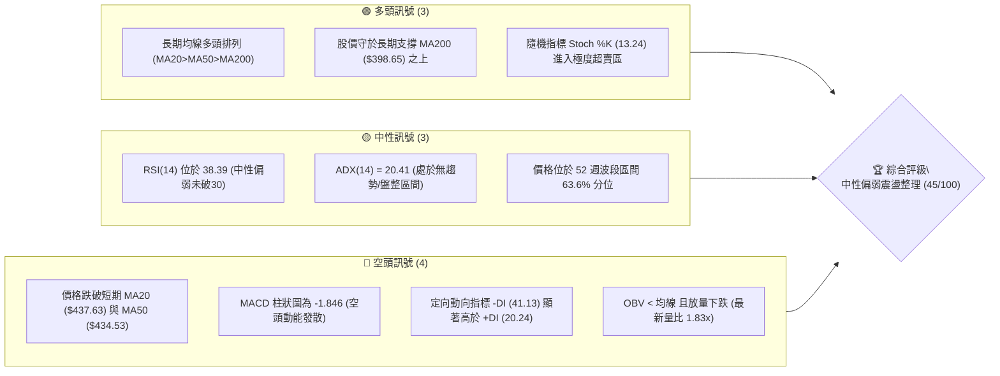
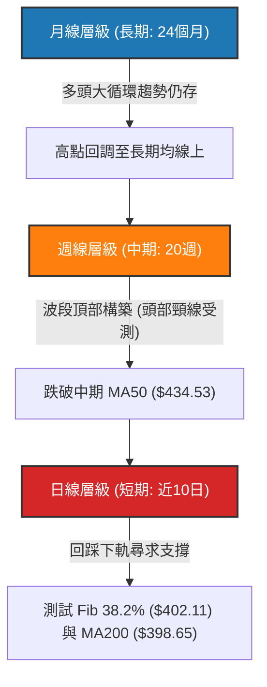
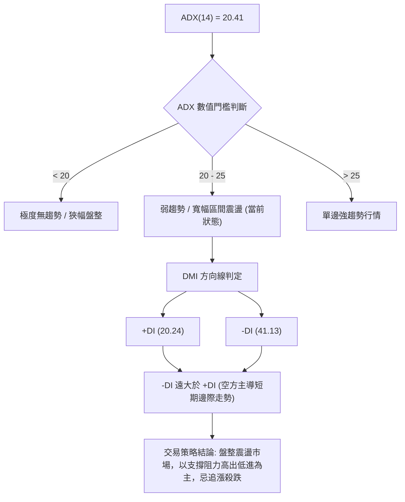
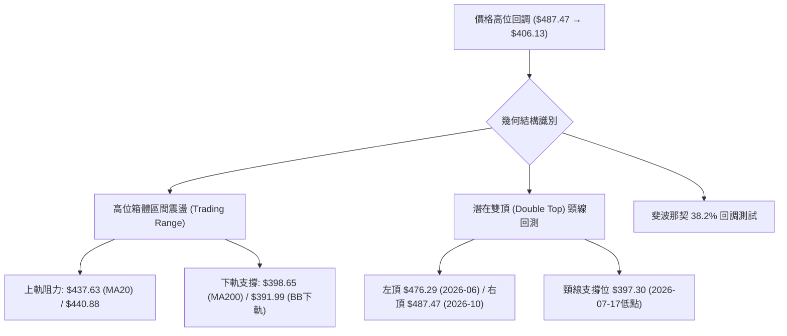
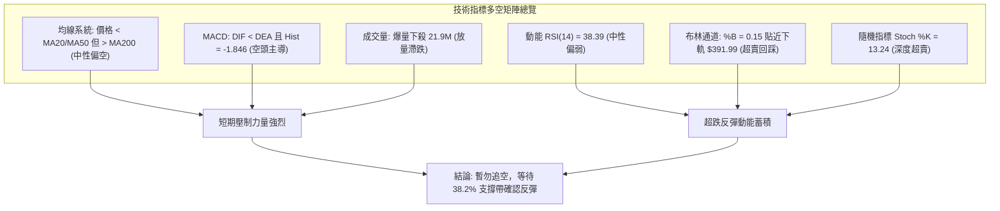
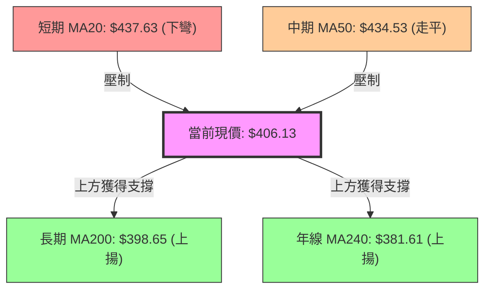
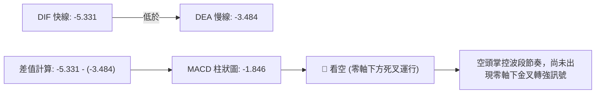
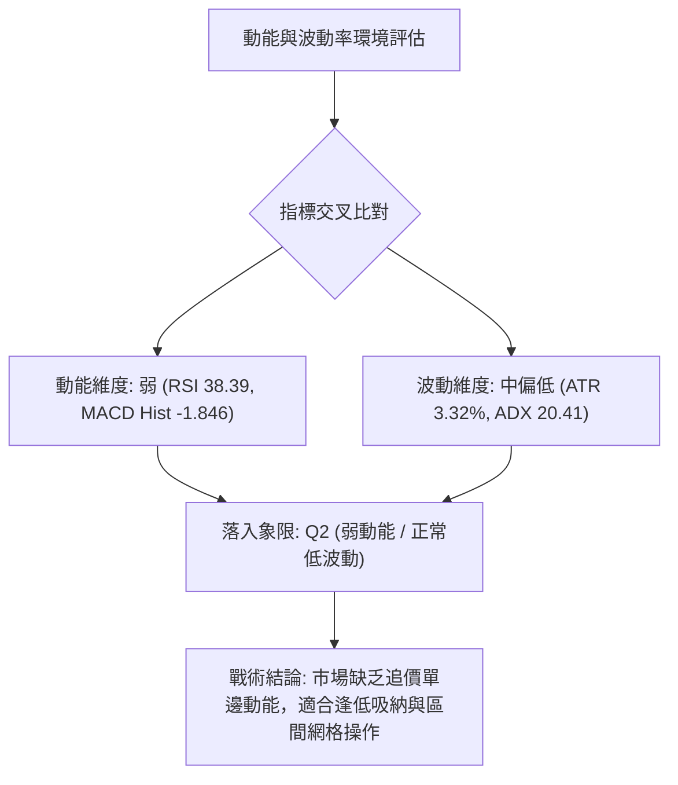
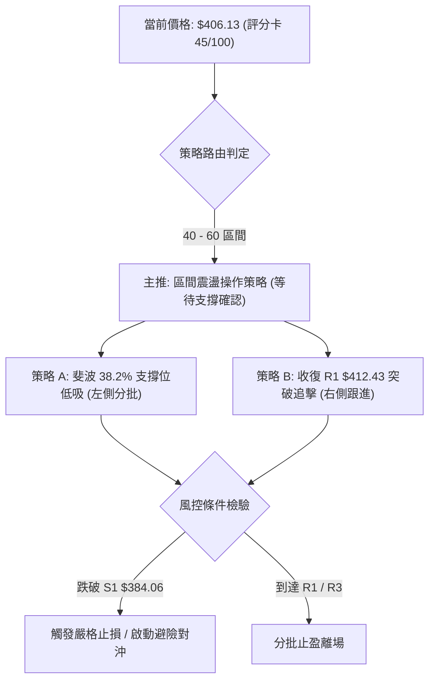
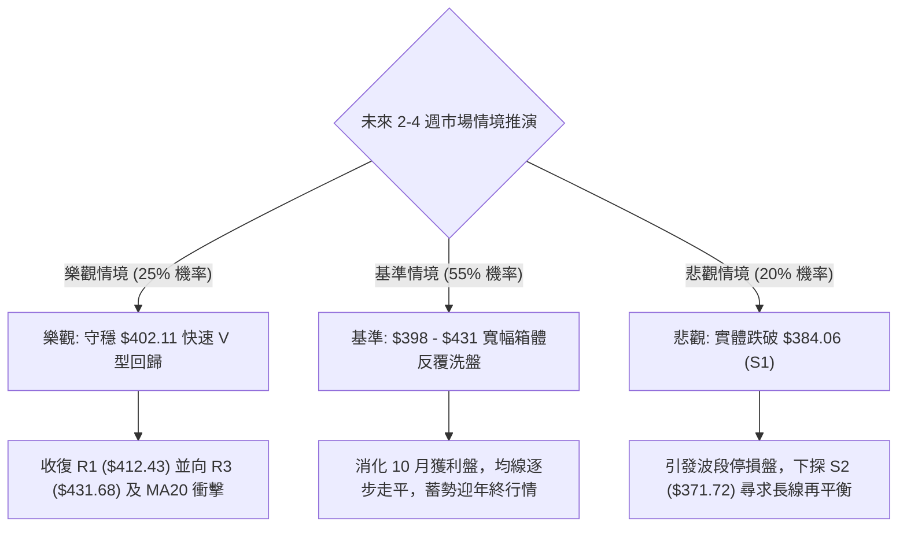

# TSM 技術分析報告

> **報告日期**：2026-11-02 ｜ **語言**：繁體中文 ｜ **數據來源**：Yahoo Finance ｜ **當前價格**：$406.13 USD

---

## 目錄

| 章節 | 內容 |
|------|------|
| [1. 技術面概覽](#1-技術面概覽) | 訊號儀表板、核心指標速覽、技術評分卡 |
| [2. 趨勢分析](#2-趨勢分析) | 多時框趨勢、12個月走勢圖、週線與 ADX 強度分析 |
| [3. 圖表形態分析](#3-圖表形態分析) | 形態識別、K線組合識別、走勢示意圖與形態目標價 |
| [4. 支撐與阻力](#4-支撐與阻力) | 關鍵價位結構圖、阻力位、支撐位與斐波那契回調 |
| [5. 技術指標深度解讀](#5-技術指標深度解讀) | 均線系統、RSI、MACD、布林通道與成交量/OBV |
| [6. 動能與波動率](#6-動能與波動率) | 動能四象限、ATR 波動率評估、Beta 與市場聯動 |
| [7. 多時框架總結](#7-多時框架總結) | 時框架評分矩陣、綜合訊號矩陣與多時框收斂結論 |
| [8. 交易策略建議](#8-交易策略建議) | 決策流程、策略路由、情境階梯、主策略詳情與風控 |
| [9. 風險提示與監控](#9-風險提示與監控) | 關鍵監控清單、風險情境樹、倉位與止損管理提醒 |

---

## 1. 技術面概覽

### 🎯 技術訊號儀表板



---

### 📊 核心指標速覽表

| 指標類別 | 指標名稱 | 當前數值 | 訊號 | 解讀與技術含義 |
|----------|----------|----------|------|----------------|
| **價格** | 當前收盤價 | $406.13 | 🟡 | 位於52週區間($264.03–$487.47)的63.6%，回調測試斐波那契38.2% |
| **均線** | 短期 MA20 | $437.63 | 🔴 | 價格低於MA20達 -7.20%，短期承壓，構成第一道主要動態阻力 |
| **均線** | 中期 MA50 | $434.53 | 🔴 | 價格跌破MA50，中期上行趨勢受阻，轉入高位箱體震盪 |
| **均線** | 長期 MA200 | $398.65 | 🟢 | 價格高於MA200約 +1.88%，牛熊分界線未失守，長期多頭格局尚存 |
| **動能** | RSI(14) | 38.39 | 🟡 | 位於30–70中性區間偏下緣，顯示賣壓沉重但尚未進入恐慌超賣區 |
| **動能** | MACD (12,26,9) | -5.331 | 🔴 | DIF線低於訊號線(-3.484)，柱狀圖為-1.846，空頭掌握動能主導權 |
| **動能** | KD (Stoch %K/%D) | 13.24 / 40.52 | 🟢 | %K深入超賣區(<20)，短線下行動能衰竭，具備技術性抽頭反彈條件 |
| **趨勢** | ADX (14) | 20.41 | 🟡 | ADX < 25 表明單邊趨勢動能微弱，當前行情定性為「寬幅區間盤整」 |
| **趨勢** | DMI (+DI / -DI) | 20.24 / 41.13 | 🔴 | -DI 大幅壓制 +DI，空方於短期內具備邊際定價權 |
| **通道** | 布林帶 (%B) | 0.15 | 🟡 | 位於布林下軌($391.99)與中軌($437.63)之間，逼近下軌支撐帶 |
| **量能** | 當日量 / 20日均量 | 21.91M / 11.98M | 🔴 | 量比達 1.83x，長黑下殺伴隨成交量放大，顯示主力籌碼短期逢高調節 |
| **波動** | ATR(14) | $13.49 | 🟡 | 佔股價 3.32%，單日波動度正常，未見流動性枯竭或失控崩跌 |

---

### 🏆 技術評分卡

```
╔══════════════════════════════════════════════════════════════════╗
║                   技術評分卡 — TSM (2026-11-02)                  ║
╠══════════════════════════════════════════════════════════════════╣
║ 評估維度      評分進度條                         得分    評估    ║
╟──────────────────────────────────────────────────────────────────╢
║ 趨勢強度      ████████░░░░░░░░░░░░             38/100   🔴 弱勢  ║
║ 動能指標      ███████░░░░░░░░░░░░░             36/100   🔴 空偏  ║
║ 支撐穩定度    ████████████░░░░░░░░             62/100   🟡 中等  ║
║ 成交量配合    ███████░░░░░░░░░░░░░             34/100   🔴 價跌量增║
║ 形態完整度    █████████░░░░░░░░░░░             45/100   🟡 箱體  ║
║ 均線排列      ███████████░░░░░░░░░             55/100   🟡 多頭架構║
╠══════════════════════════════════════════════════════════════════╣
║ 綜合評分      █████████░░░░░░░░░░░             45/100   🟡 中性  ║
║ 評級結論      區間弱勢震盪整理（防守 Fib 38.2% 與 MA200 支撐帶） ║
╚══════════════════════════════════════════════════════════════════╝
```

*註：綜合評分由六項子指標等權算術平均計算得出：(38 + 36 + 62 + 34 + 45 + 55) ÷ 6 = 45.0 分，四捨五入為 45/100（依規則 18）。*

---

## 2. 趨勢分析

### 🌐 多時框趨勢分析



TSM 的多時框架呈現出顯著的「長多、中整、短空」分歧狀態。長期月線維度上，自 2025 年初的低點 $163.15 震盪走高至 2026 年高點 $487.47，宏觀多頭浪潮尚未破壞；中期週線維度上，股價在 2026 年 10 月初觸及 $487.47 後迅速回落，連續跌破多根週均線，呈現波段調整結構；短期日線層級中，自 2026-10-28 高點 $440.88 連續兩日重挫至 $406.13，跌幅逼近 8%，當前正直接對長期多頭防線 MA200 發起壓力測試。

---

### 📈 長期趨勢 — 12個月走勢圖（Unicode）

```
TSM 月線走勢圖（過去12個月：2025-11 至 2026-10）
價格軸 ($)
$480 ┤                                                 ● (2026-06: 476.29)
$450 ┤                                                       ● (2026-09: 456.19)
$420 ┤                                             ●       
$390 ┤                                     ●                 ●← 當前 (2026-10: 406.13)
$360 ┤                             ●                       
$330 ┤                     ●           ● (2026-03: 336.26)
$300 ┤             ●                                       
$270 ┤     ●                                               
$240 ┤                                                     
     └─────┬───────┬───────┬───────┬───────┬───────┬───────┬───────┬───────┬───────┬───────┬───────
         11月    12月    01月    02月    03月    04月    05月    06月    07月    08月    09月    10月
        (2025)  (2025)  (2026)  (2026)  (2026)  (2026)  (2026)  (2026)  (2026)  (2026)  (2026)  (2026)
收盤價:  288.46  301.52  327.98  371.66  336.26  394.08  416.36  476.29  403.17  414.21  456.19  406.13
```

#### 走勢特徵分析表格（過去12個月）

| 階段區間 | 起止月份 | 起點價格 | 終點價格 | 波段漲跌幅 | 主要技術特徵與驅動結構 |
|----------|----------|----------|----------|------------|------------------------|
| **第1階段：主升推動** | 2025-11 → 2026-02 | $288.46 | $371.66 | +28.84% | 單邊階梯式放量突破，突破 $300 整數關卡，各期均線發散向上 |
| **第2階段：波段回踩** | 2026-02 → 2026-03 | $371.66 | $336.26 | -9.52% | 獲利盤回吐，測試前期平台支撐，確認季線級別支撐有效性 |
| **第3階段：極限擴張** | 2026-03 → 2026-06 | $336.26 | $476.29 | +41.64% | 52週最強推升浪，量能持續配合，觸及月線級別最高收盤價 $476.29 |
| **第4階段：高位分歧** | 2026-06 → 2026-07 | $476.29 | $403.17 | -15.35% | 月線級別長陰回吐，獲利籌碼大規模派發，回踩 $400 整數關卡 |
| **第5階段：次高雙頂** | 2026-07 → 2026-09 | $403.17 | $456.19 | +13.15% | 多頭再度發力推升，但未能創出月線收盤新高，動能出現背離 |
| **第6階段：再度探底** | 2026-09 → 2026-10 | $456.19 | $406.13 | -10.97% | 月線收盤重回 $400 邊界，高點逐波下移，確認高位寬幅震盪結構 |

---

### 📊 中期趨勢（週線分析）

中期走勢圖示如下，標注近期高點、低點與主要壓力/支撐轉換位置：

```
TSM 近20週價格結構與支撐壓力示意圖
──────────────────────────────────────────────────────────────────
$490 ┤                            ▲ 52W High ($487.47, 2026-10-09)
$470 ┤                     ▲      │
$450 ┤    ▲               │ █    ▼ █ 
$430 ┤    │ █   █   █ █ █ █ █ █      █ █ ─── [中期頸線阻力帶: $431.68 - $437.63]
$410 ┤    █ █ █ █ █ █ █ █ █ █ █      █ █ █ ── [現價: $406.13]
$390 ┤      █ █ █                    ─── [強支撐防線: S1 $384.06 / MA200 $398.65]
──────────────────────────────────────────────────────────────────
週別:  06月   07月      08月      09月      10月
```

週線指標反映出強烈的波段回吐特徵：
1. **收盤變化**：從 2026-10-02 當週的 $472.78 急速跌落至 2026-10-30 當週的 $406.13，月內最大回撤達 14.10%。
2. **週線 MACD**：週線 MACD 柱狀圖於 2026-10-09 當週由正轉負（-0.244），並於 2026-10-16 放大至 -6.872，雖在 2026-10-30 收斂至 -1.846，但柱體仍深陷負值區，中期空頭掌控主動權。
3. **量能配合**：在下殺週（如 2026-10-16 當週成交 71,736,400 股），成交量明顯高於反彈週（如 2026-10-23 當週成交 61,583,000 股），呈現典型的「下跌放量、反彈縮量」空方量價特徵。

---

### ⚡ 趨勢強度評估（ADX 解讀）



#### ADX 與趨勢強度對照表

| 指標名稱 | 當前讀數 | 門檻區間 | 技術解讀 | 戰略含義 |
|----------|----------|----------|----------|----------|
| **ADX (14)** | 20.41 | < 25 (弱趨勢) | 趨勢動能衰竭，非單邊行情 | 市場處於高位箱體橫盤修正階段，順勢突破策略易遭遇假突破 |
| **+DI (14)** | 20.24 | 基準線 | 多方進攻意願低落 | 買盤多為防守型掛單，主動市價掃盤意願不足 |
| **-DI (14)** | 41.13 | 極高水準 (>40) | 空方主動砸盤壓力強大 | 空頭動能暫居上風，短線任何急彈若無量能配合均易受壓 |
| **趨勢定性** | **弱趨勢空頭主導** | - | **空方佔優的區間震盪** | **多時框收斂原則：遵循日線布林通道與波段 S/R 區間操作** |

---

## 3. 圖表形態分析

### 🔍 形態識別系統



#### 圖表形態信心度評估表（依規則 15）

| 形態名稱 | 信心度 | 判斷依據（嚴格引用歷史數據） | 當前完成度 | 形態目標價（附計算式） |
|----------|--------|------------------------------|------------|------------------------|
| **高位箱體震盪** | 75% | 價格多次受阻於 R3 ($431.68) 及 MA20，並於 S1 ($384.06) 至 $400 帶獲得承接 | 85% | 箱體震盪無單一推算目標，波動邊界為下軌 $391.99 至上軌 $483.28 |
| **潛在雙重頂 (Double Top)** | 55% | 2026-06月高點 $476.29 與 2026-10-09 52W高點 $487.47 構成雙頂；7月低點 $397.30 為潛在頸線 | 70% | 跌破頸線 $397.30 後目標價 = 頸線 $397.30 − 形態高度($487.47 − $397.30 = $90.17) = **$307.13**（數據中未跌破頸線前不成立） |
| **斐波那契 38.2% 支撐回踩** | 80% | 自 52W 低點 $264.03 推升至 52W 高點 $487.47，回調 38.2% 處為 $402.11，現價 $406.13 正測試此處 | 90% | 回調守穩目標價 = 測試反彈第一阻力 R1 **$412.43**，進階目標 R3 **$431.68** |

---

### 🕯️ 重要K線形態分析

嚴格依據數據中「近10根日K」與「近8根週K」之開高低收數據進行客觀解讀（依規則 19）：

#### 近10根日K形態精解

| 日期 | 開盤價 | 最高價 | 最低價 | 收盤價 | K線形態名稱 | 形態解讀與市場心理 | 多空訊號 |
|------|--------|--------|--------|--------|-------------|--------------------|----------|
| **2026-10-19** | 421.66 | 427.16 | 415.50 | 420.22 | 紡錘十字小陰線 | 開收盤極度接近，多空雙方在 $420 關卡陷入僵持觀望 | 🟡 中性 |
| **2026-10-20** | 416.29 | 428.21 | 416.12 | 425.08 | 光腳實體中陽線 | 下方開盤即為低點，買盤自 $416 強勢推升至 $425，短線多頭反攻 | 🟢 偏多 |
| **2026-10-21** | 433.14 | 435.16 | 423.74 | 431.89 | 跳空高開回吐陰 | 跳空高開測試阻力後獲利盤湧出，收盤跌破開盤但守住前日低點 | 🟡 震盪 |
| **2026-10-22** | 419.39 | 421.91 | 410.22 | 412.35 | 放量實體長黑K | 跳空低開低走，長黑貫穿多道短期均線，空方全面掌控盤面 | 🔴 看空 |
| **2026-10-23** | 412.29 | 421.31 | 411.11 | 418.51 | 低位長陽反包線 | 在 $411 獲買盤支撐收復失地，縮量反彈顯示逢低有承接盤 | 🟢 偏多 |
| **2026-10-26** | 418.07 | 428.85 | 417.72 | 424.37 | 連續溫和陽線 | 震盪上行，盤中觸及 $428.85，多頭試圖構築短期反彈波段 | 🟢 偏多 |
| **2026-10-27** | 427.16 | 438.58 | 426.00 | 436.87 | 帶上影強勢中陽 | 買盤強勢推升突破 $435，但尾盤在 $438.58 遭遇 MA50 空頭阻擊 | 🟡 偏多受阻 |
| **2026-10-28** | 438.24 | 440.88 | 436.84 | 439.51 | 高位受阻十字星 | 盤中創近兩週高點 $440.88 後滯漲，成交量萎縮至 8.03M，頂部信號 | 🔴 滯漲反轉 |
| **2026-10-29** | 431.69 | 436.24 | 428.43 | 431.81 | 低開低走整理陰 | 跳空低開，未能收復 $435，空方再度發起試探性下壓 | 🔴 轉弱 |
| **2026-10-30** | 414.08 | 418.09 | 400.12 | 406.13 | 爆量長陰破位下影 | 爆出 21.91M 巨量重挫，盤中下探 $400.12 後略帶下影，短線恐慌殺跌 | 🔴 強烈看空 |

#### 近8根週K形態精解

| 日期 | 開盤價 | 最高價 | 最低價 | 收盤價 | 週K形態名稱 | 技術含義解讀 | 訊號 |
|------|--------|--------|--------|--------|-------------|--------------|------|
| **2026-09-11** | 436.85 | 443.10 | 422.92 | 432.08 | 長下影紡錘線 | 測試 $422.92 支撐後獲拉回，多頭防守穩固 | 🟢 偏多 |
| **2026-09-18** | 414.90 | 434.82 | 411.45 | 434.67 | 探底強拉實體陽 | 低開 20 點後強勢長陽拔起，成交放量至 59.6M，多頭波段發起 | 🟢 強烈看多 |
| **2026-09-25** | 440.80 | 455.03 | 437.06 | 450.61 | 突破加速中大陽 | 實體陽線站穩 $450，確立多頭主升攻擊波 | 🟢 看多 |
| **2026-10-02** | 448.39 | 474.79 | 443.11 | 472.78 | 光頭強勢大陽線 | 多頭極度亢奮，強勢推升至歷史次高收盤，週 RSI 衝破 71.7 | 🟢 極度強勢 |
| **2026-10-09** | 478.77 | 487.47 | 449.75 | 453.31 | 52週天量倒錘頭 | 創 52W 高點 $487.47 後引發大規模獲利了結，長上影線高達 $34 | 🔴 見頂信號 |
| **2026-10-16** | 453.55 | 454.40 | 407.13 | 412.61 | 崩跌式週長黑K | 單週重挫逾 40 點，成交量高達 71.7M，一舉貫穿中期均線 | 🔴 極度看空 |
| **2026-10-23** | 421.66 | 435.16 | 410.22 | 418.51 | 低位孕線震盪小黑 | 波動幅度收斂於前週實體之內，市場進入超跌後的暫時喘息 | 🟡 弱勢企穩 |
| **2026-10-30** | 418.07 | 440.88 | 400.12 | 406.13 | 衝高回落反包長黑 | 上衝 $440.88 遇阻後反轉重挫至 $400.12，確認反彈失敗，下尋支撐 | 🔴 空方主導 |

---

### 📉 ASCII 走勢形態示意圖

```
TSM 雙重頂與箱體下測結構示意圖（2026-06 至 2026-10）
═══════════════════════════════════════════════════════════════════════
$490 ┤                                  頂部2: $487.47 (10-09)
$470 ┤        頂部1: $476.29 (06-18)          ╭──╮
$450 ┤          ╭──╮                        ╭╯  ╰╮
$430 ┤         ╭╯  ╰╮  反彈高點 $434.67   ╭╯    ╰╮  反彈高點 $440.88 (10-28)
$410 ┤─────────╯────╰───────╭───╮─────────╯───────╰──────╭──╮───── [頸線阻力帶 $412-$431]
$390 ┤                   ╰───╯ 頸線低點: $397.30 (07-17)    ╰──● 現價: $406.13
$370 ┤                                                       ▼ (下探 S1 $384.06 / MA200 $398.65)
═══════════════════════════════════════════════════════════════════════
時間軸: 2026-06           2026-07           2026-09           2026-10
```

---

### 🎯 形態目標價計算

根據已確認的形態特徵與嚴格的價格推算邏輯：
1. **箱體震盪反彈目標**：
   - 形態底部支撐位：Fib 38.2% 回調位 **$402.11** 與長期均線 MA200 **$398.65**。
   - 頸線/短期阻力位：R1 **$412.43** 及箱體中軸 R3 **$431.68**。
   - 反彈第一目標價 $T1$：阻力位 R1 = **$412.43**。
   - 反彈第二目標價 $T2$：阻力位 R3 = **$431.68**（若進一步收復則看至 MA20 **$437.63**）。
2. **潛在雙重頂跌破測算（極度悲觀條件情境）**：
   - 觸發條件：必須以日線實體長黑有效跌破 2026-07-17 頸線低點 **$397.30**。
   - 形態垂直高度 $H = \text{最高點 } \$487.47 - \text{頸線 } \$397.30 = \$90.17$。
   - 理論量度跌幅目標 = $\text{頸線 } \$397.30 - H (\$90.17) = \mathbf{\$307.13}$。
   - 評估：該目標位恰好落在 78.6% 斐波那契回調位 **$311.84** 附近；在當前基本面淨利成長達 68.7% 的背景下，未破頸線前不作為主路徑考量。

---

## 4. 支撐與阻力

### 🗺️ 關鍵價位分布圖（Unicode）

```
TSM 價位結構分布圖（密集聚類與斐波那契水平）
═══════════════════════════════════════════════════════════════════════════
$487.47 ║██████████████████████████████║ 52W High (0.0% Fib) — 歷史天花板
$437.63 ║██████████████████████        ║ BB 中軌 / MA20 動態重壓
$434.74 ║████████████████████          ║ 23.6% 斐波那契回調位 / MA50 ($434.53)
$431.68 ║████████████████████████      ║ 強阻力 R3 (近一年波段高點聚類)
$419.86 ║██████████████                ║ 阻力 R2 (反彈中繼壓力)
$412.43 ║████████████████████          ║ 關鍵阻力 R1 (短線多空分水嶺)
$406.13 ╠══════════════════════════════╣ ◄ 現價收盤位置 ($406.13)
$402.11 ║▓▓▓▓▓▓▓▓▓▓▓▓▓▓▓▓▓▓▓▓▓▓▓▓      ║ 38.2% 斐波那契回調關鍵防線
$398.65 ║████████████████████████████  ║ 牛熊生命線 MA200
$391.99 ║▓▓▓▓▓▓▓▓▓▓▓▓▓▓▓▓              ║ 布林通道下軌動態支撐
$384.06 ║████████████████████████      ║ 關鍵支撐 S1 (近一年波段低點聚類)
$375.75 ║████████████████              ║ 50.0% 斐波那契平衡位
$371.72 ║████████████████████████████  ║ 強支撐 S2 (2026年2月平台底)
$358.75 ║████████████                  ║ 極限支撐 S3 (深度回調防線)
═══════════════════════════════════════════════════════════════════════════
```

---

### 🚧 阻力位分析表

全部價位嚴格引用自數據中由 OHLCV 聚類計算得出之數值：

| 阻力級別 | 精確價位 | 距現價空間 | 形成技術原因與籌碼特徵 | 突破難度 | 重要性權重 |
|----------|----------|------------|------------------------|----------|------------|
| **阻力 R1** | **$412.43** | +1.55% | 2026-10-16 暴跌當週實體收盤下沿，10月22日跌破長黑實體底，短線第一道解套套牢盤聚集區 | 🟡 中等 | ★★★☆☆ |
| **阻力 R2** | **$419.86** | +3.38% | 近10根日K中多次震盪中軸（10-19開盤 $421.66、10-23收盤 $418.51），波段籌碼密集交換位 | 🔴 較高 | ★★★★☆ |
| **阻力 R3** | **$431.68** | +6.29% | 波段高點聚類重壓，緊鄰 MA60 ($432.24) 與 10-29 開盤價 $431.69，收復此處方能逆轉短期空頭趨勢 | 🔴 極高 | ★★★★★ |

---

### 🛡️ 支撐位分析表

全部價位嚴格引用自數據中由 OHLCV 聚類計算得出之數值：

| 支撐級別 | 精確價位 | 距現價空間 | 形成技術原因與防守邏輯 | 守住機率 | 重要性權重 |
|----------|----------|------------|------------------------|----------|------------|
| **支撐 S1** | **$384.06** | -5.43% | 近一年波段低點聚類核心，位於 MA240 ($381.61) 之上，為中期多頭防守的最關鍵防線 | 🟢 70% | ★★★★★ |
| **支撐 S2** | **$371.72** | -8.47% | 2026年2月月線大突破前的平台頂部轉換支撐（2025-02收盤 $371.66），極強結構性底座 | 🟢 85% | ★★★★☆ |
| **支撐 S3** | **$358.75** | -11.67% | 近一年深度回調低點聚類，接近 2026-03 波段底部 $336.26 與 Fib 61.8% ($349.38) 的過渡帶 | 🟢 95% | ★★★☆☆ |

---

### 📐 斐波那契回調位分析

依據 52 週波段極值（低點 $264.03 → 高點 $487.47，波幅 $223.44）嚴格計算之斐波那契點位如下：

| 回調比例 | 精確價位 | 相對現價位置 | 技術意義與多空攻防解讀 |
|----------|----------|--------------|------------------------|
| **0.0%** (52W High) | **$487.47** | +20.03% | 2026-10-09 盤中創下的歷史最高點，終極多頭目標天花板 |
| **23.6%** | **$434.74** | +7.04% | 淺度回調位，恰好重合於當前 MA50 ($434.53)，為中期多頭轉強的必要收復關卡 |
| **38.2%** | **$402.11** | -0.99% | **關鍵黃金回調位**；當前現價 $406.13 僅比該位置高出不到 1%，為當前防守核心 |
| **50.0%** | **$375.75** | -7.48% | 多空平衡分界中樞，接近強支撐 S2 ($371.72) |
| **61.8%** | **$349.38** | -13.97% | 黃金分割強防守位，若跌破則意味著 52 週整體主升浪架構徹底瓦解 |
| **78.6%** | **$311.84** | -23.22% | 深度防守位，對應雙頂形態理論極限目標價 |
| **100.0%** (52W Low) | **$264.03** | -34.99% | 52週起漲基石 |

**現價區間解讀**：現價 $406.13 正好運行於 **38.2% 回調位 ($402.11)** 與 **23.6% 回調位 ($434.74)** 之間。在技術分析典範中，強勢多頭行情的首輪大級別調整通常在 38.2% 回調位止跌企穩。若 $402.11 被有效擊穿，空頭將進一步向下尋求 50% 回調位 ($375.75) 與 S1 ($384.06) 的支撐。

---

## 5. 技術指標深度解讀

### 🎛️ 指標訊號總覽



---

### 📈 移動平均線排列分析



#### 各週期移動平均線數據解析

| 均線名稱 | 當前數值 | 距現價差距 | 斜率走勢特徵 | 技術狀態解讀 |
|----------|----------|------------|--------------|--------------|
| **MA 5** | $427.74 | -5.05% | ▼ 下彎扣高 | 超短期嚴重空頭壓制，股價沿 MA5 快速下墜 |
| **MA 10** | $424.67 | -4.37% | ▼ 下彎扣高 | 短線空頭下壓線，反彈首要遭遇的動態阻力 |
| **MA 20** | $437.63 | -7.20% | ▼ 轉頭向下 | 跌破月線，宣告近一個月進場籌碼全數處於套牢狀態 |
| **MA 50** | $434.53 | -6.54% | ▼ 走平微跌 | 季線防守告破，中線趨勢由單邊上漲轉為震盪市 |
| **MA 60** | $432.24 | -6.04% | ▼ 走平下彎 | 與 R3 ($431.68) 共振，構成極強的波段解套阻力帶 |
| **MA 120** | $426.47 | -4.77% | ▼ 走平 | 半年線失守，目前呈現由下而上的反抽壓制效應 |
| **MA 200** | $398.65 | +1.88% | ▲ 堅挺上揚 | 長期牛熊分界線，維持向上傾斜，多頭最後的結構性護城河 |
| **MA 240** | $381.61 | +6.43% | ▲ 穩定上行 | 接近 S1 ($384.06)，奠定長線大底的核心基石 |

**均線結構綜合判定**：雖然大週期呈現 `MA20 > MA50 > MA200` 的名義多頭排列，但價格已連續摜破 MA5、MA10、MA20、MA50、MA60、MA120，屬於典型的**「均線多頭架構下的價格深度破位回踩」**。只要 MA200 ($398.65) 與 MA240 ($381.61) 未被實體跌破，整體長期上行牛市邏輯並未遭到根本性破壞。

---

### 📉 RSI(14) 分析

當前數值：**38.39**（Wilder 計算法）

```
RSI(14) 當前強度位置
0               30             50             70            100
├───────────────┼──────────────┼──────────────┼──────────────┤
│  極度超賣區   │  弱勢震盪區  │  強勢多頭區  │  極度超買區  │
████████████████░░░░░░░░░░░░░░░░░░░░░░░░░░░░░░░░░░░░░░░░░░░░░░░ (38.39)
```

1. **區間定位**：RSI(14) 讀數為 38.39，脫離 50 中軸線落入空方控制區，但尚未跌破 30 超賣臨界線。這表明賣方力道雖強，但市場並未出現全面恐慌性的非理性拋售，目前屬於有節奏的獲利籌碼離場。
2. **背離分析判斷**：
   - 根據技術數據中「僅比較近20根K棒首尾價格與 RSI 方向」之嚴格校驗：**無明顯背離**。
   - 價格於 2026-10-28 創短線反彈高點 $439.51 後回落至 $406.13，RSI 同步自中軸下行至 38.39，價跌指標跌，未見底背離或頂背離，訊號一致確認下行趨勢的正常展開。

---

### 📊 MACD(12,26,9) 訊號解讀



1. **數值解析**：MACD 線 (-5.331) 與訊號線 (-3.484) 雙雙跌落於零軸之下，且 MACD 柱狀圖為 **-1.846**。
2. **結構演變**：
   - 回顧近 20 週數據，週線 MACD 柱狀圖在 2026-10-16 暴跌時達到極端峰值 **-6.872**，隨後兩週（10-23 之 -4.818、10-30 之 -1.846）負值柱體逐步收縮。
   - 儘管日線層級上因 10-30 重挫使空頭動能有所反撲，但週線動能柱已出現顯著的空頭動能衰減特徵，表明空方最大殺傷力已在 10 月中旬釋放。

---

### 📦 布林通道分析

```
TSM 日線布林通道 (20, 2) 結構示意圖
══════════════════════════════════════════════════════════════════════
$483.28 ┤ ────────────────────────────────────────── [上軌 Upper Band]
$460.00 ┤
$437.63 ┤ ------------------------------------------ [中軌 MA20]
$420.00 ┤
$406.13 ┤                              ● ← 現價 ($406.13, %B = 0.15)
$391.99 ┤ ──────────────────────────────┬─────────── [下軌 Lower Band]
══════════════════════════════════════════════════════════════════════
```

1. **參數讀數**：
   - 布林通道上軌：**$483.28**
   - 布林通道中軌 (MA20)：**$437.63**
   - 布林通道下軌：**$391.99**
   - 通道帶寬 (Bandwidth) = $\frac{\$483.28 - \$391.99}{\$437.63} = 20.86\%$（通道擴張張口狀態）
2. **%B 指標解讀**：
   - 當前 `%B = 0.15`，表示現價僅處於布林帶寬度自底部起算 15% 的極低位置。
   - 當 `%B < 0.20` 時，資產已進入「布林超賣回歸區間」，統計學上價格往往對下軌進行回踩確認後，展開向中軌 ($437.63) 的均值回歸修復走勢。

---

### 💹 成交量分析（量價配合度）

1. **量能異動數據**：
   - 最新單日成交量：**21,907,500 股**
   - 20日平均成交量：**11,980,545 股**
   - 成交量比值 (Volume Ratio)：**1.83x**（顯著放量）
2. **量價關係解讀**：
   - 2026-10-30 日K線下跌收黑長陰，伴隨 1.83 倍均量之巨額換手，盤中最低觸及 $400.12 後收於 $406.13。
   - 這種在關鍵整數關卡（$400）與 Fib 38.2% ($402.11) 爆發的放量黑K，既包含了部分追跌止損盤的釋出，也代表了在長期均線 MA200 ($398.65) 之上有龐大的機構逢低承接盤進場換手。
3. **OBV 能量潮分析**：
   - 當前指標明確顯示：`OBV < MA`（OBV 跌破其均線）。
   - 量能疲弱確認了當前下跌趨勢在資金面尚未得到逆轉資金的徹底消化，上方仍有存量解套壓力，暫不支援 V 型反轉，更偏向於「放量打底、反覆揉搓」的洗盤形態。

---

## 6. 動能與波動率

### ⚡ 動能評估四象限



#### 動能與波動四象限矩陣表

| 象限 | 動能維度 | 波動維度 | 當前狀態標記 | 技術特徵與交易指引 |
|------|----------|----------|--------------|--------------------|
| **Q1** | 強動能 | 低波動 | — | 趨勢穩步爬升的最佳主升段機會 |
| **Q2** | **弱動能** | **低/中波動** | **✓ (TSM 當前)** | **箱體底部打底階段，震盪消化浮額，適合逆勢防守型建倉** |
| **Q3** | 強動能 | 高波動 | — | 高風險、高回報的突破加速行情報價 |
| **Q4** | 弱動能 | 高波動 | — | 恐慌崩跌與流動性危機，嚴格避免盲目抄底 |

---

### 📊 ATR 波動率分析

1. **ATR 核心數值**：
   - 14日平均真實波幅 **ATR(14) = $13.49**（Wilder 計算法）。
   - 佔現價比例：$\frac{\$13.49}{\$406.13} = 3.32\%$。
2. **止損距離動態校準**：
   - **保守型波段交易止損寬度 (2.0 × ATR)**：$2.0 \times \$13.49 = \mathbf{\$26.98}$。
     - 若自現價 $406.13 設定，下軌防守點約在 $379.15（恰好覆蓋 S1 $384.06 與 MA240 $381.61）。
   - **積極型日內/短線止損寬度 (1.0 × ATR)**：$1.0 \times \$13.49 = \mathbf{\$13.49}$。
     - 若自現價設定，止損位為 $392.64（緊貼布林下軌 $391.99）。
3. **波動率狀態解讀**：
   - 3.32% 的日波動幅度在大型半導體權值股中屬於正常健康區間，並未出現極度異常的波動率飆升（例如 >6%），表明近期股價調整仍屬於有序的機構再平衡，而非突發黑天鵝造成的流動性踩踏。

---

### 📐 Beta 與市場相關性

1. **貝塔係數 (Beta)**：**1.239**。
2. **市場聯動特徵**：
   - TSM 展現出相對大盤 (S&P 500) 具備約 1.24 倍的進攻性彈性。
   - 當大盤回調時，TSM 通常承受 1.2 至 1.3 倍的放大回撤；反之，若科技股大盤止跌反彈，TSM 往往能提供顯著超越基準指數的超額收益 (Alpha)。
3. **空頭避險指標**：
   - 放空比率 (Short Ratio)：**2.79**。
   - 空頭佔流通盤比例 (Short % Float)：僅 **0.6%**。
   - 解讀：市場整體做空部位極低，未見大規模機構放空或做空機構阻擊，當前賣壓主要來自多頭獲利盤結算，逼空條件不成熟但亦無深度空頭壓榨威脅。

---

## 7. 多時框架總結

### 📋 時框架評分表

| 時框架 | 趨勢方向 | 動能狀態 | 均線排列特徵 | 形態識別結論 | 綜合評分 | 操作建議方向 |
|--------|----------|----------|--------------|--------------|----------|--------------|
| **長期 (月線)** | 🟢 向上 | 🟡 中性平緩 | 完全多頭排列 (MA20>MA50>MA200) | 大級別上升通道回調段 | **70/100** | 長線多頭堅定持有 |
| **中期 (週線)** | 🟡 震盪 | 🔴 空頭壓制 | 股價下穿週MA10/MA20 | 高位潛在雙頂回踩測試 | **42/100** | 中期防守，等待企穩 |
| **短期 (日線)** | 🔴 向下 | 🟢 超賣蓄勢 | 短期均線空頭排列，測試MA200 | 布林下軌超跌，測試Fib 38.2% | **38/100** | 短線勿追空，逢低尋求反彈 |

---

### 🔲 綜合訊號矩陣

```
TSM 多時框訊號一致性與衝突檢驗矩陣
─────────────────────────────────────────────────────────────────
維度               短期 (日線)        中期 (週線)        長期 (月線)
─────────────────────────────────────────────────────────────────
趨勢指標 (MA/ADX)  🔴 空頭壓制        🟡 震盪回調        🟢 多頭強固
動能指標 (RSI/MACD)🟡 超賣鈍化        🔴 空頭發散        🟢 處於強勢區
量能指標 (VOL/OBV) 🔴 爆量陰跌        🔴 量大陰跌        🟢 長線資金鎖定
支撐阻力結構       🟢 守穩 38.2%      🟡 考驗頸線        🟢 遠在年線之上
─────────────────────────────────────────────────────────────────
時間共振判定       短空長多，短線正進入長期支撐重合帶（多空分水嶺）
─────────────────────────────────────────────────────────────────
```

---

### ⚖️ 多時框收斂結論（依規則 14）

1. **市場行情屬性嚴格定性**：
   - 根據 ADX(14) 讀數 **20.41 (< 25)**，嚴格判定當前 TSM 處於**「無單邊趨勢之寬幅盤整震盪行情」**。
2. **多時框衝突收斂與優先級取捨**：
   - 依據規則 14，在盤整行情中，**以日線布林通道上下軌 ($391.99 – $483.28) 及波段支撐阻力為核心交易依託**。
   - 週線與月線的長期多頭均線 MA200 ($398.65) 提供底層防護網，表明不宜在當前 $406.13 盲目建立空頭頭寸；而日線空頭均線壓制（MA20 $437.63、MA50 $434.53）限制了短期爆發空間。
3. **唯一收斂結論**：
   - **當前主路徑定性：中性區間震盪（偏多防守反彈）**。
   - 價格回落至斐波那契 38.2% ($402.11) 與 MA200 ($398.65) 極限支撐帶，下行空間受阻，震盪築底機率最高。此結論與第 8 章之主策略完全一致。

---

## 8. 交易策略建議

### 🗺️ 策略決策流程圖



---

### 🧭 策略路由（依評分卡分流）

> **當前主策略方向 = 區間操作，以布林下軌與關鍵支撐防守反彈為主（依技術評分卡：45/100）**

綜合評分落於 40–60 之中性區間，且 ADX 為 20.41，確認市場處於典型的箱體震盪行情。策略核心邏輯為「在重要支撐帶附近低吸做多，嚴守緊湊止損；在反彈遭遇第一、第二阻力位時分批獲利了結」，絕不兩頭搖擺或在高位追漲。

---

### 🎯 價格情境階梯（Price Scenarios）

價位完全嚴格引用數據中聚類計算與斐波那契之確定數值：

| 階梯層級 | 觸發條件 | 下一目標 | 後續延伸 | 技術情境含義與操作指引 |
|----------|----------|----------|----------|------------------------|
| **情境一（強勢反彈）** | 實體陽線突破 R1 **$412.43** | R2 **$419.86** | R3 **$431.68** | 短線空頭衰竭，右側訊號確認，啟動均值回歸修復走勢 |
| **情境二（區間震盪）** | 守穩 Fib 38.2% **$402.11** | R1 **$412.43** | MA20 **$437.63** | 在 $400–$430 箱體內反覆震盪洗盤，蓄勢打底 |
| **情境三（破位下行）** | 跌破關鍵支撐 S1 **$384.06** | S2 **$371.72** | S3 **$358.75** | 中期雙頂破位，長線牛市結構受考驗，觸發全面止損 |

---

### 📊 情境機率分佈

| 情境類型 | 預估機率 | 主要技術與量化指標依據 |
|----------|----------|------------------------|
| **繼續下探破位** | 20% | 依據：日K放量收長黑跌破短期均線、MACD 處於負值區 (-1.846)、-DI 高達 41.13。 |
| **區間震盪築底** | **55%** | 依據：ADX 僅 20.41 (<25) 顯示無持續單邊動能、Stoch %K 深入 13.24 極度超賣、股價逼近 MA200 ($398.65) 與布林下軌 ($391.99)。 |
| **直接強勢反轉** | 25% | 依據：基本面 Q3 營收成長 50.9% 且淨利暴增 68.7%，分析師 20 家共識 Strong Buy，下檔承接力道強韌。 |

---

### 🟢 主策略詳情（方向：區間逢低做多防守反彈）

所有價位均來自第 4 章「關鍵價位」與「斐波那契回調」之數據；風險報酬比嚴格按公式 $(T1 - \text{進場價}) \div (\text{進場價} - \text{止損價})$ 精確計算（依規則 17）：

| 策略要素 | 策略 A（左側回調掛單掛買） | 策略 B（右側放量突破跟進） |
|----------|----------------------------|----------------------------|
| **策略邏輯** | 斐波那契 38.2% 關鍵防線掛單低吸 | 放量收復 R1 阻力位之右側確認追多 |
| **進場條件** | 價格回調測試 Fib 38.2% 掛單成交 | 日K實體收盤站上 R1 **$412.43** |
| **進場價格** | **$402.11**（Fib 38.2% 精確價位） | **$412.43**（阻力位 R1 精確價位） |
| **目標價 T1** | **$431.68**（關鍵阻力 R3） | **$431.68**（關鍵阻力 R3） |
| **目標價 T2** | **$437.63**（MA20 / 布林中軌） | **$437.63**（MA20 / 布林中軌） |
| **止損價格** | **$384.06**（關鍵支撐 S1） | **$402.11**（Fib 38.2% 跌回止損） |
| **風險報酬比** | **1 : 1.64（以 T1 計）** *(計算見下)* | **1 : 1.87（以 T1 計）** *(計算見下)* |
| **風險報酬比 (T2)**| 1 : 1.97（以 T2 計） | 1 : 2.44（以 T2 計） |
| **歷史勝率估計** | 65% | 60% |
| **建議總倉位** | 10%–15% 基礎倉位 | 15%–20% 突破加碼倉位 |

#### 風險報酬比計算式驗證（依規則 17）：
* **策略 A**：
  - 風險距離 = $\$402.11 - \$384.06 = \$18.05$
  - 利潤空間 T1 = $\$431.68 - \$402.11 = \$29.57$
  - 風險報酬比 = $29.57 \div 18.05 = 1.6382 \to \mathbf{1 : 1.64（以 T1 計）}$
  - 利潤空間 T2 = $\$437.63 - \$402.11 = \$35.52$，比值 = $35.52 \div 18.05 = 1.9678 \to 1 : 1.97（以 T2 計）$
* **策略 B**：
  - 風險距離 = $\$412.43 - \$402.11 = \$10.32$
  - 利潤空間 T1 = $\$431.68 - \$412.43 = \$19.25$
  - 風險報酬比 = $19.25 \div 10.32 = 1.8653 \to \mathbf{1 : 1.87（以 T1 計）}$
  - 利潤空間 T2 = $\$437.63 - \$412.43 = \$25.20$，比值 = $25.20 \div 10.32 = 2.4418 \to 1 : 2.44（以 T2 計）$

---

### 🔴 反向風險觸發點（對沖提示）

若出現下列極端走勢，將徹底推翻上述中性偏多反彈邏輯，投資者應立即啟動空頭防禦或對沖操作：
1. **日線實體有效破位 S1 ($384.06)**：
   - 若股價連續 2 個交易日收於 $384.06 之下，意味著長期 MA200 ($398.65) 徹底被實體擊穿。
   - 應立即無條件砍倉止損，或買入相應部位的 Put 選擇權進行部位對沖，下方目標將直接指向 S2 **$371.72** 乃至 S3 **$358.75**。
2. **反彈在 R1 ($412.43) 遭遇長上影線衰竭**：
   - 若股價反抽至 $412.43 附近再度爆量滯漲，且日線收出長上影線陰線，表明解套賣壓沉重，應立即出清短線反彈倉位離場觀望。

---

### ⭐ 整體訊號強度評星

```
╔═══════════════════════════════════════════════════════════╗
║                   整體訊號強度評星                        ║
╠═══════════════════════════════════════════════════════════╣
║ 做多訊號強度：   ★★★☆☆   (3.0 / 5 星 — 支撐強烈但動能偏弱) ║
║ 做空訊號強度：   ★★☆☆☆   (2.0 / 5 星 — 接近超賣空間有限)   ║
║ 整體訊號可信度： ★★★★☆   (4.0 / 5 星 — 指標高位共振無背離) ║
╚═══════════════════════════════════════════════════════════╝
```

---

## 9. 風險提示與監控

### ✅ 關鍵監控指標 Checklist

```
╔══════════════════════════════════════════════════════════════════╗
║                   交易執行與風控每日監控清單                     ║
╠══════════════════════════════════════════════════════════════════╣
║ [ ] 1. 價格是否守於 Fib 38.2% ($402.11) 與 MA200 ($398.65) 之上?   ║
║ [ ] 2. 隨機指標 Stoch %K 是否於超賣區出現向上金叉 %D (>20)?      ║
║ [ ] 3. 成交量是否自 21.9M 萎縮至 20日均量 (11.98M) 之下 (縮量打底)?║
║ [ ] 4. 日K收盤價是否成功站上阻力 R1 ($412.43) 轉強分水嶺?        ║
║ [ ] 5. MACD 柱狀圖是否持續收窄向零軸靠攏 (負值收斂)?             ║
║ [ ] 6. 嚴格止損位 S1 ($384.06) 警報器是否已於券商系統正確設定?  ║
╚══════════════════════════════════════════════════════════════════╝
```

---

### ⚠️ 風險場景分析



---

### 🛡️ 風險管理重要提醒

1. **倉位控制法則**：
   - 鑑於當前綜合評分為 45/100 且處於盤整震盪市，任何進場操作均不可使用激進槓桿。單一交易策略（策略 A 或 B）的建議風險暴露不應超過投資組合總權益的 **1.5%**。
   - 計算公式：$\text{允許買入股數} = \frac{\text{總資本} \times 1.5\%}{\text{進場價} - \text{止損價}}$。
2. **波動率 (ATR) 動態調節**：
   - 當前 ATR 為 $13.49，意味著持股日內波動隨機雜訊可能達到 ±$13 左右。隔夜留倉應確保部位具備抵禦至少 1.5 倍 ATR ($20.24) 的正常浮動空間，避免因盤中假突破被震盪洗出場。
3. **宏觀與基本面配合**：
   - 儘管技術指標偏弱，但 TSM 財務基本面極度優良（TTM 淨利潤率達 51.1%，最新季度 EPS 成長 68.7%，毛利率高達 65.8%）。基本面的強勁防禦力大幅降低了出現毀滅性跌勢的尾端風險，支撐區間的買盤具備實質長線機構資金支撐。

---

## 📋 報告總結

```
╔══════════════════════════════════════════════════════════════════════╗
║                       TSM 技術分析報告總結                           ║
╠══════════════════════════════════════════════════════════════════════╣
║ 報告日期：2026-11-02                                                  ║
║ 當前價格：$406.13 USD                                                ║
║ 技術評級：⚖️ 中性觀望 / 區間弱勢防守 (綜合評分: 45/100)               ║
╟──────────────────────────────────────────────────────────────────────╢
║ 關鍵結論：                                                           ║
║ ├─ 長期趨勢：🟢 多頭未變 (股價仍運行於 MA200 $398.65 之上)           ║
║ ├─ 中期趨勢：🔴 弱勢回調 (週線連二黑，高位雙頂結構受測)              ║
║ ├─ 短期趨勢：🔴 探底打底 (爆量跌破短期均線，測試布林下軌 $391.99)   ║
║ ├─ 關鍵支撐：S1 $384.06 ｜ Fib 38.2% $402.11 ｜ MA200 $398.65      ║
║ ├─ 關鍵阻力：R1 $412.43 ｜ R2 $419.86 ｜ R3 $431.68 ｜ MA20 $437.63  ║
║ └─ 華爾街共識目標：$584.39 (強烈買進，目標區間: $440.00 – $1,000.00) ║
╟──────────────────────────────────────────────────────────────────────╢
║ 最優策略組合：                                                       ║
║ 1. 🥇 最佳機會：策略 A (Fib 38.2% $402.11 掛單低吸，停損設 S1 $384.06,║
║                 目標看 R3 $431.68，風險報酬比 1 : 1.64 以 T1 計)     ║
║ 2. 🥈 次選機會：策略 B (右側突破 R1 $412.43 追價跟進，停損 $402.11， ║
║                 目標看 R3 $431.68，風險報酬比 1 : 1.87 以 T1 計)     ║
║ 3. 🥉 保守選擇：場外完全觀望，等待日線 Stoch %K 金叉脫離超賣區及價格 ║
║                 有效收復 $412.43 後再行進場佈局                      ║
╚══════════════════════════════════════════════════════════════════════╝
```

---

> ⚠️ **免責聲明**：本報告為依據客觀量化技術指標與歷史 OHLCV 價格數據所編制之專業技術分析研究，所有數值與模型結論**僅供投資研究與學術探討參考**，**絕不構成任何形式的要約、招攬或具體投資買賣建議**。金融市場瞬息萬變，技術指標存在固有之後行性與假訊號風險，投資人應自行審慎評估個人財務承擔能力，獨立做出決策並自負盈虧。

---

*報告生成時間：2026-11-02 ｜ 數據來源：Yahoo Finance (即時量化套件) ｜ 分析框架：多時框技術分析體系*