# TSM 技術分析報告

> **報告日期**：2026-11-03 ｜ **語言**：繁體中文 ｜ **數據來源**：Yahoo Finance ｜ **當前價格**：$398.63 USD

---

## 目錄

| 章節 | 內容 |
|------|------|
| [1. 技術面概覽](#1-技術面概覽) | 訊號儀表板、核心指標、評分卡 |
| [2. 趨勢分析](#2-趨勢分析) | 多時框趨勢、長中短期走勢、ADX 解讀 |
| [3. 圖表形態分析](#3-圖表形態分析) | 形態識別、K線組合、目標價推算 |
| [4. 支撐與阻力](#4-支撐與阻力) | 關鍵價位、斐波那契回調結構 |
| [5. 技術指標深度解讀](#5-技術指標深度解讀) | 均線、RSI、MACD、布林通道、OBV |
| [6. 動能與波動率](#6-動能與波動率) | 動能四象限、ATR、Beta 與風險敏感度 |
| [7. 多時框架總結](#7-多時框架總結) | 時框架評分矩陣、多時框收斂結論 |
| [8. 交易策略建議](#8-交易策略建議) | 策略路由、情境階梯、主空/次多策略規劃 |
| [9. 風險提示與監控](#9-風險提示與監控) | 關鍵監控清單、情境樹、風控準則 |

---

## 1. 技術面概覽

### 🎯 技術訊號儀表板

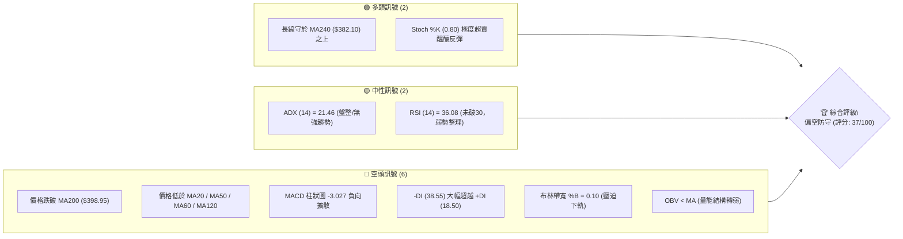

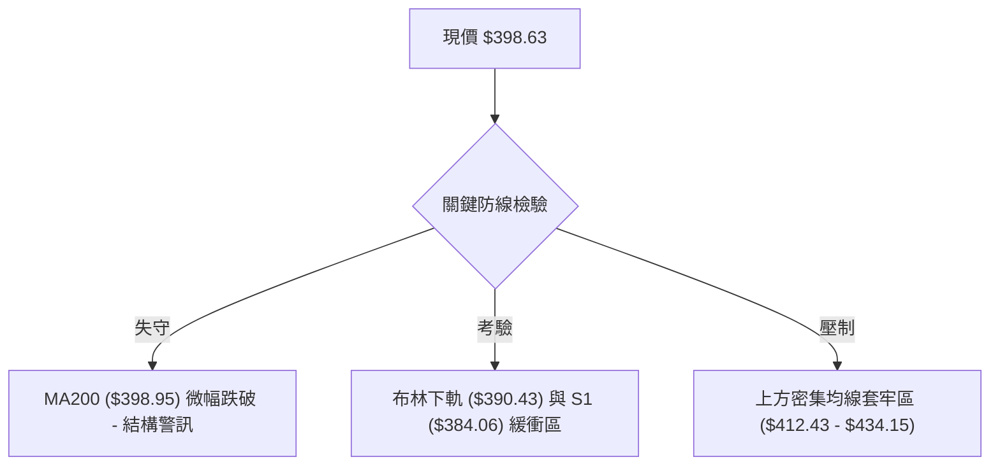

### 📊 核心指標速覽表

| 指標類別 | 指標名稱 | 當前數值 | 訊號 | 解讀 |
|:---|:---|:---:|:---:|:---|
| **價格** | 當前收盤價 | $398.63 | 🔴 | 跌破整數大關 $400.00，測試年線支撐帶 |
| **均線** | 短期均線 (MA20) | $433.27 | 🔴 | 價格在均線下方 -8.00%，空頭斜率陡峭 |
| **均線** | 中期均線 (MA50) | $434.15 | 🔴 | 價格在均線下方 -8.18%，MA20/50 形成死叉壓制 |
| **均線** | 長期均線 (MA200)| $398.95 | 🔴 | 價格微幅失守 MA200（現價低 0.08%），牛熊分水嶺拉警報 |
| **動能** | RSI(14) | 36.08 | 🟡 | 進入弱勢中性區間，未觸及 30 絕對超賣，向下慣性仍在 |
| **動能** | MACD (12,26,9) | -7.268 / -4.241 | 🔴 | DIF 與 DEA 雙雙於零軸下發散，Histogram (-3.027) 擴大 |
| **趨勢** | DMI / ADX(14) | ADX: 21.46 | 🔴 | ADX < 25 屬盤整格局，但 -DI (38.55) 遠高於 +DI (18.50) |
| **通道** | 布林通道 (%B) | 0.10 | 🔴 | 貼近下軌 ($390.43)，中軌 ($433.27) 形成強大動態壓力 |
| **成交量** | OBV 量能 | OBV < MA | 🔴 | 資金持續呈現淨流出狀態，反彈缺乏量能主動承接 |
| **波動** | ATR(14) | $13.71 (3.44%) | 🟡 | 每日波幅約 13.7 美元，短線波動度溫和擴大 |

### 🏆 技術評分卡

```
╔══════════════════════════════════════════════════════════════════════════╗
║                    技術評分卡 — TSM (2026-11-03)                        ║
╠══════════════════════════════════════════════════════════════════════════╣
║ 趨勢強度 (Trend)    ███████░░░░░░░░░░░░░  35/100  🔴 空方控盤/弱趨勢     ║
║ 動能指標 (Momentum) ██████░░░░░░░░░░░░░░  30/100  🔴 MACD向下發散        ║
║ 支撐穩定度 (Support)██████████░░░░░░░░░░  50/100  🟡 考驗MA200與斐波38.2%║
║ 成交量配合 (Volume) ███████░░░░░░░░░░░░░  35/100  🔴 OBV轉弱/下殺有量    ║
║ 形態完整度 (Pattern)████████░░░░░░░░░░░░  40/100  🔴 次級折返築頂未破底  ║
║ 均線排列 (MA System)██████░░░░░░░░░░░░░░  32/100  🔴 僅高於MA240/空頭排列║
╠══════════════════════════════════════════════════════════════════════════╣
║ 綜合評分            ███████░░░░░░░░░░░░░  37/100  🔴 偏空防守 (六項均值) ║
╚══════════════════════════════════════════════════════════════════════════╝
```

---

## 2. 趨勢分析

### 🌐 多時框趨勢分析

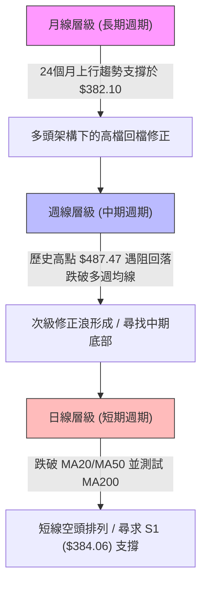

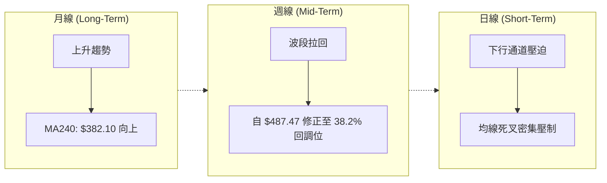

### 📈 長期趨勢 — 12個月走勢圖（Unicode）

```
TSM 月線走勢圖（過去12個月：2025-11 至 2026-11）
價格軸 ($)
$480 ┤                                     ● $476.29 (2026-06)
$460 ┤                                                 ● $456.19 (2026-09)
$440 ┤
$420 ┤                             ● $416.36      ● $414.21
$400 ┤                     ● $394.08          ● $403.17   ● $406.13
$380 ┤             ● $371.66                                  ● $398.63 (當前現價)
$360 ┤
$340 ┤         ● $336.26
$320 ┤     ● $327.98
$300 ┤ ● $301.52 (2025-12)
$280 ┤ ● $288.46 (2025-11)
     └─────────────────────────────────────────────────────────────
      11   12   01   02    03   04    05   06    07   08   09   10   11 (月份)
      2025 <------------------------ 2026 ------------------------->
```

#### 走勢特徵分析表格

| 階段 | 期間涵蓋 | 區間價格變化 | 漲跌幅 | 走勢特徵與結構意涵 |
|:---|:---:|:---:|:---:|:---|
| **主升浪擴展** | 2025-11 ~ 2026-02 | $288.46 → $371.66 | +28.84% | 量價齊揚，突破 $300 整數關卡，建立強勁上升軌道 |
| **高位箱型整理** | 2026-02 ~ 2026-03 | $371.66 → $336.26 | -9.52% | 首波獲利了結潮，回踩測試上升月線支撐 |
| **末升衝頂浪** | 2026-03 ~ 2026-06 | $336.26 → $476.29 | +41.64% | 軋空爆發，月收盤創歷史天價 $476.29，最高觸及 $487.47 |
| **高檔雙峰回撤** | 2026-06 ~ 2026-09 | $476.29 → $456.19 | -4.22% | 07月急跌至 $403.17 後強彈至 09月 $456.19，構築次級頭部 |
| **破位修正浪** | 2026-09 ~ 2026-11 | $456.19 → $398.63 | -12.62% | 連續跌破短期均線與 MA200，當前正尋求年線支撐防線 |

### 📊 中期趨勢（週線分析）

從近 20 週的收盤價演變觀察，TSM 呈現明顯的「雙頂回撤」中期修正形態。第一波高點於 2026-10-09 盤中創下 52 週新高 $487.47（該週收於 $453.31），隨後兩週遭遇外資集中獲利調節，快速下殺至 2026-10-16 的 $412.61，週 MACD 柱狀圖瞬間轉負至 -6.872。

```
TSM 近期週線壓力與支撐階梯示意圖
價格軸 ($)
$490 ┤       ★ 52W 歷史天價 $487.47 (2026-10-09)
$470 ┤   ┌─────────┐
$450 ┤───┤ 週反彈阻力 ├──── R3: $431.68 / 週均線密集區
$430 ┤   └─────────┘
$410 ┤─────────────────── R1: $412.43 (短線頸線阻力)
$398 ┼─────────────────── ◄ 當前收盤價: $398.63 (測試斐波 38.2%)
$390 ┤   ┌─────────┐
$380 ┤───┤ 中期防守帶 ├──── S1: $384.06 / MA240: $382.10
$370 ┤   └─────────┘     S2: $371.72 (斐波 50.0% 處於 $375.75)
```

### ⚡ 趨勢強度評估（ADX 解讀）

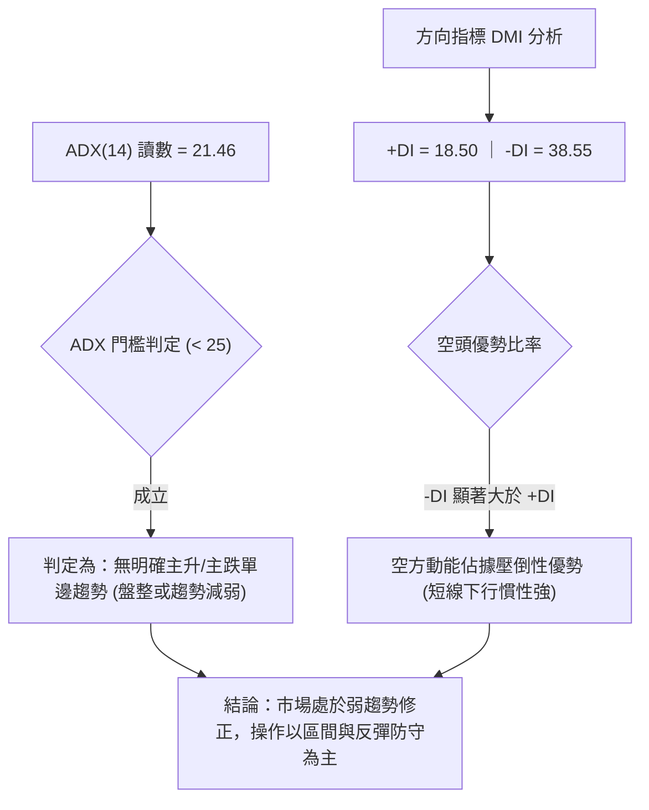

#### ADX 強度與方向矩陣對照表

| 指標名稱 | 實際數值 | 參考臨界值 | 強度狀態 | 交易環境解讀 |
|:---|:---:|:---:|:---:|:---|
| **ADX(14)** | 21.46 | 25.00 | 弱趨勢 / 震盪 | 趨勢動能不足，不可盲目追空或追多，價格易出現均值回歸 |
| **+DI (14)** | 18.50 | 25.00 | 多頭衰退 🔴 | 多方買盤力道薄弱，無力組織持續性推升 |
| **-DI (14)** | 38.55 | 25.00 | 空方主導 🔴 | 賣壓強烈掌控局面，空方力道為多方的 2.08 倍 |
| **DI 差值** | -20.05 | 0.00 | 負向擴散 🔴 | 方向指標開口擴大，短線向下破位風險仍高於向上突破 |

---

## 3. 圖表形態分析

### 🔍 形態識別系統

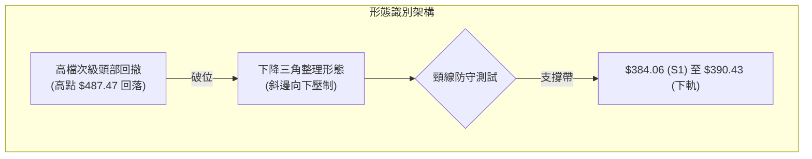

#### 形態識別與信心度評估表（依規則 15）

| 形態名稱 | 信心度 | 判斷依據（嚴格引用數據） | 完成度 | 目標價（附嚴謹計算式） |
|:---|:---:|:---|:---:|:---|
| **高檔雙重頂 (次級修正)** | **70%** | 兩波高點分別為 2026-06 歷史高點與 2026-10-09 週K高點 $487.47；失守 2026-10-16 收盤低點頸線 $412.61（即 R1） | **75%** | 由破位頸線計算：<br/>$412.43 - ($440.88 - $412.43) = **$383.98**<br/>*(吻合 S1 支撐位 $384.06)* |
| **短期下降通道** | **65%** | 10-28 高點 $440.88、10-29 高點 $436.24，連接 10-30 低點 $400.12 與 11-02 低點 $398.29，通道斜率向下 | **80%** | 通道下軌對應測幅：<br/>通道上緣 $414.76 減去通道寬度 $16.00 = **$398.76** (現價已抵達) |
| **頭肩頂形態** | **25%** | 數據中左肩與右肩對稱時間結構不足，無法確認幾何完整性 | **30%** | *訊號不足，依規則 15 不予採信與計算* |

### 🕯️ 重要K線形態分析

嚴格依據提供的「近10根日K」與「近8根週K」實際開高低收數據進行客觀解讀：

| 日期（週期） | 開盤價 | 最高價 | 最低價 | 收盤價 | K線形態名稱 | 技術解讀 | 訊號 |
|:---|:---:|:---:|:---:|:---:|:---|:---|:---:|
| **2026-10-27 (日K)** | 427.16 | 438.58 | 426.00 | 436.87 | **光頭中陽線** | 多方強勢拉抬收復 MA20，但未伴隨爆發性量能（9.02M） | 🟢 |
| **2026-10-28 (日K)** | 438.24 | 440.88 | 436.84 | 439.51 | **高位十字星線** | 多頭攻堅乏力，創波段反彈高點 $440.88 後量縮滯漲 | 🟡 |
| **2026-10-29 (日K)** | 431.69 | 436.24 | 428.43 | 431.81 | **跳空低開小陰線**| 空方反撲，直接跳空開於前一日收盤之下，反轉預警 | 🔴 |
| **2026-10-30 (日K)** | 414.08 | 418.09 | 400.12 | 406.13 | **長陰破位大陰棒**| 放量（21.97M，量比1.81x）下殺，摜破多道短期均線，空方宣洩 | 🔴 |
| **2026-11-02 (日K)** | 412.52 | 414.76 | 398.29 | 398.63 | **低開探底小陰線**| 跌破整數大關 $400，最低探至 $398.29 逼近 MA200，空方續控 | 🔴 |
| **2026-10-09 (週K)** | 478.77 | 487.47 | 449.75 | 453.31 | **長上影流星陰線**| 創歷史天價 $487.47 後遭主力瘋狂拋售，形成中期反轉流星 | 🔴 |
| **2026-10-16 (週K)** | 453.55 | 454.40 | 407.13 | 412.61 | **長黑爆量崩跌棒**| 巨量（71.73M）暴跌 40.7 美元，奠定波段回檔空頭基調 | 🔴 |
| **2026-10-30 (週K)** | 418.07 | 440.88 | 400.12 | 406.13 | **長下影孕線假反彈**| 上攻 $440.88 遇阻折返，週線吞噬前週反彈實體，弱勢盡顯 | 🔴 |

### 📉 ASCII 走勢形態示意圖

```
TSM 日線關鍵形態圖解（2026-10-20 至 2026-11-02）
價格 ($)
$445 ┤
$440 ┤             ┌─● 10-28 高點 $440.88 (反彈頂部阻力)
$435 ┤         ┌─●─┘ ╲
$430 ┤     ┌─●─┘       ╲ 10-29 轉折下跌
$425 ┤ ●─●─┘           ╲
$420 ┤                    ╲
$415 ┤                      ╲
$410 ┤                        ╲
$405 ┤                         ● 10-30 放量大陰線收 $406.13
$400 ┤───────────────────────────● 11-02 破位收 $398.63 ◄ (現價)
$395 ┤                         │  (盤中低點 $398.29 測試 MA200: $398.95)
     └──────────────────────────────────────────────────────────
       20  21  22  23  26  27  28  29  30  02 (日期)
```

### 🎯 形態目標價計算

根據 2026-10-28 構築的局部頂部 ($440.88) 與 10-30 破位頸線進行垂直高度投射計算：
1. **反彈高點頂部 (H)**：$440.88 (2026-10-28 高點)
2. **形態跌破頸線 (N)**：$412.43 (對應數據阻力位 R1 / 10-16 收盤價附近)
3. **垂直震盪幅度 (A)**：$440.88 - $412.43 = $28.45
4. **向下 1:1 投射目標價**：
   $$\text{目標價} = N - A = 412.43 - 28.45 = 383.98$$
   *(精準對應本報告關鍵支撐位 **S1: $384.06**，誤差僅 0.08 美元)*
5. **向下極限擴展目標 (1.382 擴展)**：
   $$\text{極限目標} = N - (1.382 \times A) = 412.43 - (1.382 \times 28.45) = 412.43 - 39.32 = 373.11$$
   *(高度接近本報告強支撐位 **S2: $371.72** 與斐波 50.0% 回調位 **$375.75**)*

---

## 4. 支撐與阻力

### 🗺️ 關鍵價位分布圖（Unicode）

```
TSM 價位結構分布圖（嚴格依據 OHLCV 聚類計算數據）
═════════════════════════════════════════════════════════════════════════
$487.47 ║████████████████████████████████████████║ 52W 歷史極值天價 (0.0%)
$434.74 ║████████████████████████████            ║ 斐波那契 23.6% 回調位
$431.68 ║████████████████████████                ║ 強阻力 R3 (MA20/50 密集區)
$419.86 ║████████████████                        ║ 中期阻力 R2 (反彈中繼位)
$412.43 ║████████████                            ║ 關鍵阻力 R1 (破位前波頸線)
$402.11 ║████████                                ║ 斐波那契 38.2% 回調位
$398.63 ╠════════════════════════════════════════╣ ◄ 當前收盤價 (MA200: $398.95)
$390.43 ║▓▓▓▓▓▓▓▓▓▓                              ║ 布林通道下軌動態支撐
$384.06 ║████████████                            ║ 近期支撐 S1 (形態測幅點)
$382.10 ║██████████████                          ║ 長期牛熊均線 MA240
$375.75 ║████████████████                        ║ 斐波那契 50.0% 關鍵平衡位
$371.72 ║██████████████████                      ║ 強支撐 S2 (波段起漲聚類)
$358.75 ║████████████████████████                ║ 極限防守支撐 S3
═════════════════════════════════════════════════════════════════════════
```

### 🚧 阻力位分析表

所有數值均嚴格引用自數據封包「阻力位 (Resistance)」聚類數值：

| 阻力級別 | 準確價位 | 距現價空間 | 形成技術原因 | 突破難度 | 戰略重要性 |
|:---|:---:|:---:|:---|:---:|:---|
| **第一阻力 (R1)** | **$412.43** | +3.46% | 近期日K跌破之平台低點、10-16 週K收盤價附近，套牢籌碼初級密集區 | 中等 | 🟡 極高（短線多頭反彈第一試金石，未站穩前弱勢不變） |
| **第二阻力 (R2)** | **$419.86** | +5.33% | 10-23 反彈波段之週K收盤位 ($418.51) 與日K長黑開盤起跌點聚類 | 高 | 🔴 高（中期下降趨勢線壓制處，空方堅守防線） |
| **第三阻力 (R3)** | **$431.68** | +8.29% | 重合 60日均線 ($431.90)、MA20 ($433.27) 及 MA50 ($434.15) 三重共振死叉點 | 極高 | 🔴 頂級（多空牛熊中線分水嶺，未有效放量突破前皆屬反彈） |

### 🛡️ 支撐位分析表

所有數值均嚴格引用自數據封包「支撐位 (Support)」聚類數值：

| 支撐級別 | 準確價位 | 距現價空間 | 形成技術原因 | 守住機率 | 戰略重要性 |
|:---|:---:|:---:|:---|:---:|:---|
| **第一支撐 (S1)** | **$384.06** | -3.66% | 波段低點聚類，貼近 MA240 年線 ($382.10) 與形態投射目標 ($383.98) | 65% | 🟢 極高（中長期多頭最後屏障，失守將引發多殺多停損） |
| **第二支撐 (S2)** | **$371.72** | -6.75% | 2026-02 月線起漲收盤平台 ($371.66) 與斐波 50% ($375.75) 構成之緩衝區 | 75% | 🟢 頂級（機構法人長期價值投資重載買盤駐紮區） |
| **第三支撐 (S3)** | **$358.75** | -10.01%| 歷史波段深幅折返聚類低點，逼近斐波 61.8% 黃金分割位 ($349.38) | 85% | 🟢 戰略級（中長期絕對安全邊際底線） |

### 📐 斐波那契回調位分析

依據 52 週完整波段起訖點（最低點 $264.03 → 最高點 $487.47，總波幅 $223.44）嚴格計算之回調位分布如下：

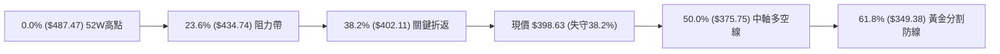

- **0.0% (52W High)**: **$487.47**
- **23.6% 回調位**: **$434.74** — 完美共振 MA50 ($434.15) 與 MA20 ($433.27)。
- **38.2% 回調位**: **$402.11** — 現價 $398.63 剛於 11-02 交易日實質跌破此一重要支撐位，此位置由支撐轉化為即時動態反壓。
- **50.0% 回調位**: **$375.75** — 多空力量平衡中軸，位於 S1 ($384.06) 與 S2 ($371.72) 之間。
- **61.8% 回調位**: **$349.38** — 黃金分割絕對防守位。
- **78.6% 回調位**: **$311.84**
- **100.0% (52W Low)**: **$264.03**

**位置解讀**：現價目前處於 **38.2% ($402.11)** 與 **50.0% ($375.75)** 之間的「破位尋底」過渡區。在未能重新帶量站回 $402.11 之前，技術面空間將不可避免地向下方 50.0% 回調位 ($375.75) 及 S1 ($384.06) 靠攏尋求支撐。

---

## 5. 技術指標深度解讀

### 🎛️ 指標訊號總覽

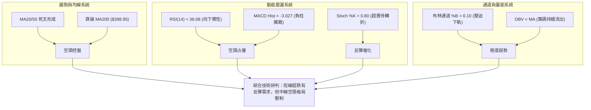

### 📈 移動平均線排列分析

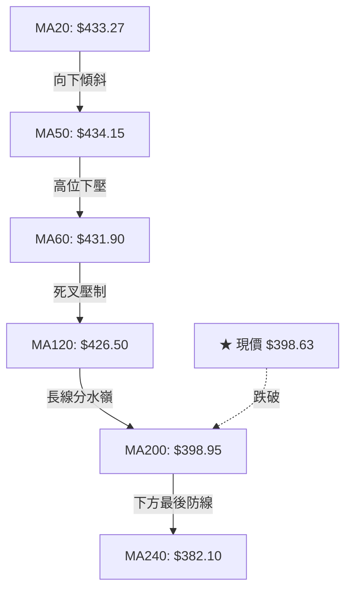

#### 均線階層狀態量化表

| 均線名稱 | 當前價位 | 距現價差距 | 斜率走勢 | 均線位階含義 |
|:---|:---:|:---:|:---:|:---|
| **MA 5** | $422.59 | -5.67% | ▼ 急降 | 短期極度乖離，存在均值回歸拉力 |
| **MA 10** | $422.52 | -5.65% | ▼ 下降 | 超短期反壓重重 |
| **MA 20** | $433.27 | -8.00% | ▼ 下降 | 月線下行，確立中期空頭調整通道 |
| **MA 50** | $434.15 | -8.18% | ▼ 走平轉下 | 季線轉為下彎，形成沉重中期蓋頭壓力 |
| **MA 60** | $431.90 | -7.70% | ▼ 下降 | 與 MA20 形成雙重死叉壓力 |
| **MA 120** | $426.50 | -6.53% | ▼ 轉弱 | 半年線開始下行，中長線籌碼鬆動 |
| **MA 200** | $398.95 | -0.08% | ▼ 走平 | **牛熊分界線：收盤價微幅跌破 0.32 美元，形成關鍵拉鋸** |
| **MA 240** | $382.10 | +4.33% | ▲ 穩健上升 | **真正長期年線上升支撐，與 S1 ($384.06) 形成多方最後鋼鐵防線** |

### 📉 RSI(14) 分析

#### RSI 數值進度條
```
RSI(14) 當前數值: 36.08
0 ─────────── 30 ────── 36.08 ────────────── 70 ─────────── 100
[ 超賣警戒區 ] ▓▓▓▓▓▓▓▓▓▓░░░░░░░░░░░░░░░░░░░░░░░ [ 超買警戒區 ]
現狀：偏弱中性區間 (Weak-Neutral Zone)，距離 30 絕對超賣仍有空間
```

- **數值解讀**：RSI(14) Wilder 計算值為 **36.08**。指數位於 30 至 50 弱勢區間內，反映空方主導跌勢，但尚未出現極端數值（<30），表明下行拋壓尚未耗盡。
- **背離分析判斷**：
  - 比對數據中近 20 根 K 棒走勢（比較近 20 根 K 棒首尾之價格與 RSI 方向）：2026-10-09 週K高點 $487.47（週 RSI 達 71.7 峰值）至當前收盤 $398.63（RSI 降至 36.08），價格創低伴隨 RSI 同步走低。
  - **結論**：依客觀數據判定為 **「無明顯背離」**。當前價格的下跌受實質賣壓驅動，並非動能衰竭的虛跌，暫無背離反轉之訊號支持。

### 📊 MACD(12/26/9) 訊號解讀

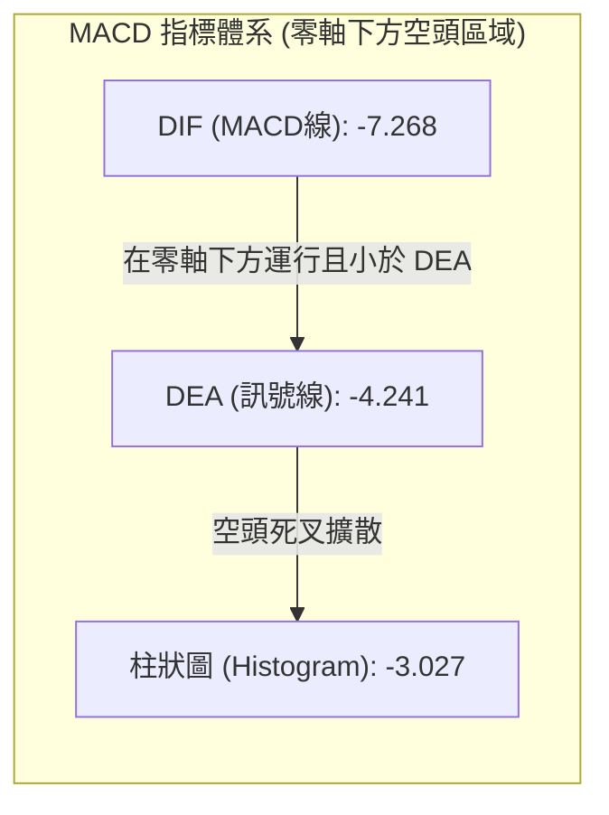

- **MACD 線 (DIF)**：-7.268
- **訊號線 (Signal / DEA)**：-4.241
- **柱狀圖 (Histogram)**：-3.027 🔴
- **深度研判**：MACD 線已深潛至零軸之下，且以 -3.027 的負柱狀持續擴散，顯示空方動能處於加速釋放期。在 Histogram 負柱未出現連續縮腳翻紅之前，任何盤中上衝均視為技術性反抽，嚴禁重倉抄底。

### 📦 布林通道分析

```
TSM 日線布林通道 (20, 2) 結構圖
═════════════════════════════════════════════════════════════════════════
$476.12 ────────────────────────── 布林上軌 (Upper Band)
        │
$450.00 ┤
        │
$433.27 ────────────────────────── 布林中軌 (MA20) — 強動態反壓
        │
$410.00 ┤
$398.63 ─── ◄ 當前收盤價 ($398.63, %B = 0.10)
$390.43 ────────────────────────── 布林下軌 (Lower Band) — 動態支撐帶
═════════════════════════════════════════════════════════════════════════
```

- **通道帶寬與形態**：布林通道帶寬為 $85.69（上軌 $476.12 至下軌 $390.43）。
- **%B 指標位置**：當前 %B 為 **0.10**，意味著現價處於通道下緣 10% 的極端低位，技術上存在嚴重的「貼軌下行」（Walking the lower band）特徵。
- **隨機指標共振**：Stoch %K 驟降至 **0.80**，Stoch %D 為 **22.08**，已進入極度超賣區，下軌 $390.43 附近將引發一定程度的超跌空頭回補，但中軌 $433.27 已轉為實質重壓。

### 💹 成交量分析（量價配合度）

1. **量能指標速覽**：
   - 最新日成交量：**13,149,200 股**
   - 20 日成交均量：**12,095,365 股**（量比：**1.09x**，微幅放量）
   - 50 日成交均量：**10,632,948 股**
2. **量價配合診斷**：
   - **量價結構轉弱**：在 2026-10-30 大跌時，成交量爆出 **21,971,100 股**（量比達 1.81x），而在 10-27 與 10-28 弱反彈時，成交量僅萎縮至 8~9 百萬股左右，呈現典型的「跌時放量、漲時量縮」的空頭量價背離。
   - **OBV (能量潮指標)**：數據明確標示 **OBV < MA**，代表資金流出趨勢確立，量能指標無法確認現價的企穩狀態。

---

## 6. 動能與波動率

### ⚡ 動能評估四象限

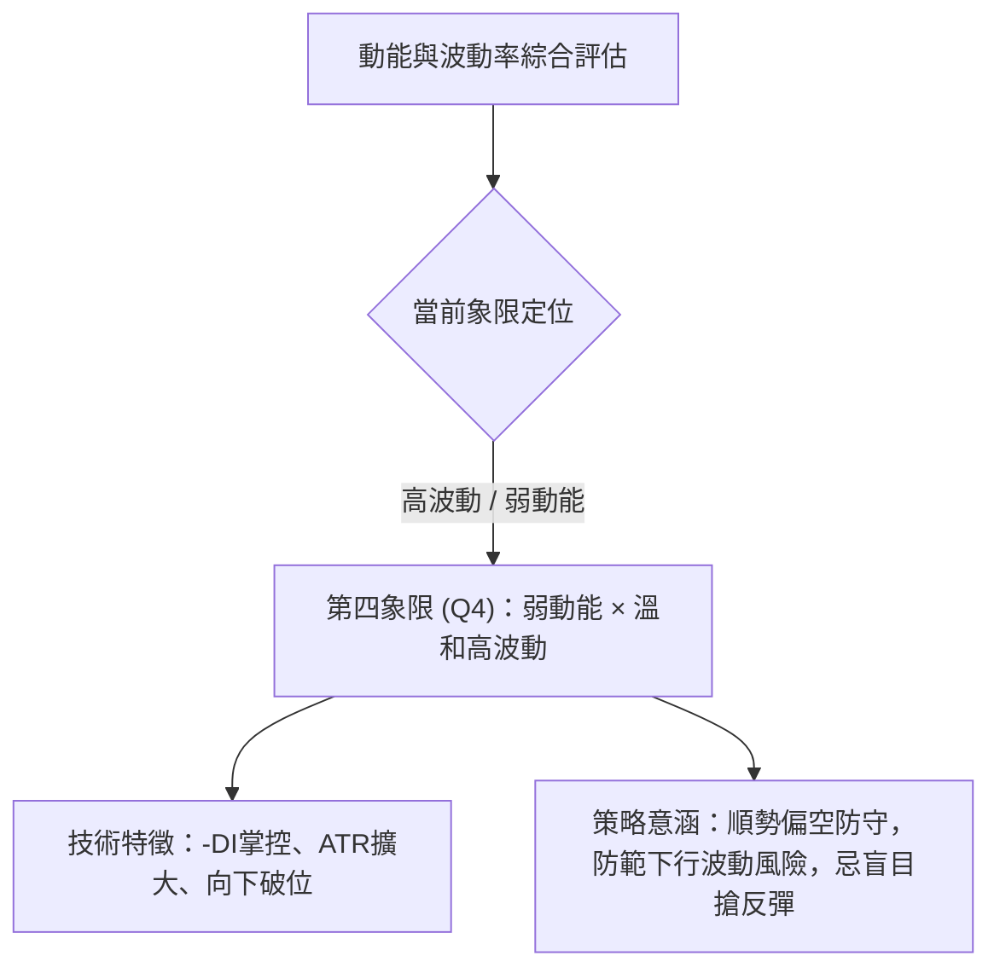

#### 動能評估四象限分析表

| 象限 | 動能維度 | 波動維度 | 當前狀態定位 | 技術評估與操作意涵 |
|:---:|:---:|:---:|:---:|:---|
| **Q1** | 強 (多頭) | 低 (穩定) | — | 最佳波段做多機會（低風險穩健上升） |
| **Q2** | 弱 (空頭) | 低 (低迷) | — | 盤整無波，資金沉澱，觀望為主 |
| **Q3** | 強 (多頭) | 高 (劇烈) | — | 衝頂軋空行情報酬高，但需嚴控回撤風險 |
| **Q4** | **弱 (負向)** | **中高 (擴張)** | **✓ (TSM 當前處於此處)** | **高風險弱勢區：賣壓主導釋放，波動擴張，應以保全資金與偏空對沖為核心** |

### 📊 ATR 波動率分析

- **ATR(14) 數值**：**$13.71**（占當前股價比例為 **3.44%**，依 Wilder 平滑演算法計算）。
- **單日波動範圍預估**：
  $$\text{正常單日震盪區間} = \$398.63 \pm \$13.71 \rightarrow [\$384.92, \$412.34]$$
  *(下緣極度貼近 S1 支撐位 $384.06，上緣極度貼近 R1 阻力位 $412.43)*。
- **止損距離建議**：
  - 日內波段交易止損：建議採 $1.0 \times \text{ATR} = \mathbf{\$13.71}$。
  - 中期波段策略止損：建議採 $1.5 \times \text{ATR} = \mathbf{\$20.57}$。

### 📐 Beta 與市場相關性

- **Beta 係數**：**1.233**（相對於 S&P 500 指數高出 23.3% 的波動敏感度）。
- **市場特徵分析**：TSM 具有高度的高貝他（High-Beta）科技成長股屬性。在美股大盤處於調整或半導體板塊走弱時，TSM 往往承受 1.2 至 1.5 倍的放大下挫風險；反之，若大盤企穩，其超跌反彈爆發力亦相應較強。

---

## 7. 多時框架總結

### 📋 時框架評分表

| 時框架 | 趨勢方向 | 動能狀態 | 均線排列狀況 | 圖表形態識別 | 綜合評分 | 戰術操作建議 |
|:---|:---:|:---:|:---:|:---:|:---:|:---|
| **月線 (長期)** | 偏多整理 🟢 | 長線動能趨緩 🟡 | 守於 MA240 ($382.10) 之上 | 大級別上升軌道中的次級修正 | **65/100** | 長期投資者於年線支撐分批佈局 |
| **週線 (中期)** | 波段回撤 🔴 | 週 MACD 負柱擴散 🔴 | 跌破多條短期週均線 | 雙重頂回撤頸線尋求 50% 斐波 | **38/100** | 中期持倉逢反彈減碼防守 |
| **日線 (短期)** | 下行探底 🔴 | RSI 36 / Stoch 超賣 🔴 | 全面受阻於 MA20/50 死叉 | 下降通道壓迫，失守 MA200 | **30/100** | 短線禁止追多，順勢偏空操作 |

### 🔲 綜合訊號矩陣

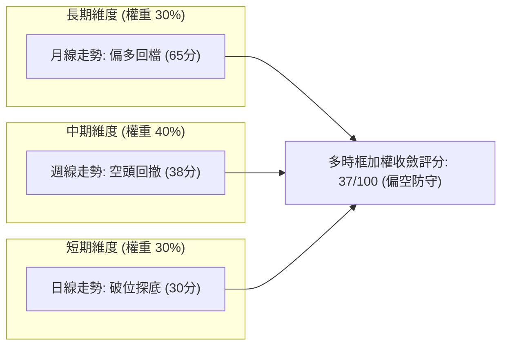

### ⚖️ 多時框收斂結論（依規則 14 嚴格收斂）

1. **行情性質判定**：
   - 當前 **ADX(14) 讀數為 21.46 (< 25)**，嚴格判定為 **「盤整行情 / 弱趨勢架構」**。
   - 根據規則 14 優先級：盤整行情下，**應以日線布林通道上下軌與結構支撐阻力為主要交易區間**。
2. **多時框矛盾化解**：
   - 雖然長期月線 MA240 ($382.10) 仍呈多頭排列，但日線級別跌破 MA200 ($398.95) 且 -DI (38.55) 大幅碾壓 +DI (18.50)，表明短期向下慣性主導盤面。
   - 因此，日線超賣（Stoch %K = 0.80）僅視為區間內的潛在反彈動能，不能推翻中期自歷史高點回撤的空頭現實。
3. **唯一方向性結論**：
   - **偏空防守（評分 37/100）**。
   - 當前策略重心為：**以反彈尋找阻力位做空為主，逢關鍵支撐進行低吸超跌對沖為輔，嚴禁在跌破均線密集區的當下盲目重倉抄底**。

---

## 8. 交易策略建議

### 🗺️ 策略決策流程圖

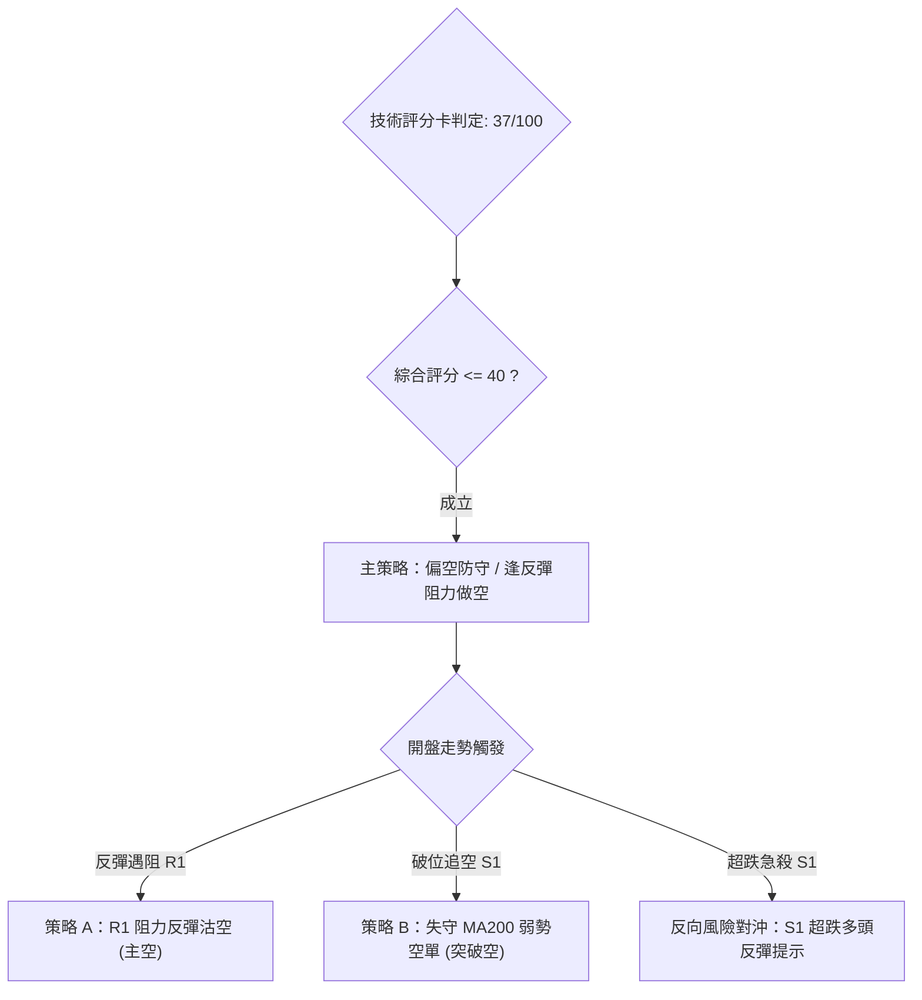

### 🧭 策略路由（依規則 18 與評分卡分流）

> **當前主策略方向 = 主推空頭策略（依技術評分 37/100，綜合評分 ≤ 40）**  
> 依規範，本報告全面主推空頭戰術（策略 A 與策略 B），多頭僅列為關鍵支撐處的極短線反彈與對沖風控提示。

### 🎯 價格情境階梯（Price Scenarios）

價位嚴格引用自第 4 章「關鍵價位」實際聚類計算數值：

| 觸發條件 | 下一目標 | 後續延伸 | 情境技術含義與戰術解讀 |
|:---|:---:|:---:|:---|
| **向上突破 R1 ($412.43)** | **R2 ($419.86)** | **R3 ($431.68)** | 短線超跌強勁修復，測試下彎之 MA20/MA50 沉重反壓帶 |
| **當前現價區間 ($398.63)** | 測試 MA200 ($398.95) | 徘徊於布林下軌 ($390.43) | 弱勢震盪整理，空方試圖消耗年線支撐買盤 |
| **實質跌破 S1 ($384.06)** | **S2 ($371.72)** | **S3 ($358.75)** | 正式宣告跌破 MA240 年線，引發機構去槓桿與多殺多停損潮 |

### 📊 情境機率分佈

| 情境劇本 | 估計機率 | 主要技術指標依據 |
|:---|:---:|:---|
| **震盪尋底 / 弱勢回落** | **55%** | MACD 柱狀圖續呈負擴散 (-3.027)、-DI (38.55) 強勢壓制、OBV 流出、價格失守 MA200 |
| **區間弱勢震盪** | **30%** | ADX = 21.46 (< 25 缺乏單邊趨勢)、Stoch 超賣醞釀反抽，支撐於布林下軌 $390.43 附近 |
| **強勁反彈轉折** | **15%** | 需帶巨量（超過 20M）突破頸線 R1 ($412.43) 方能扭轉，目前缺乏量能配合證據 |

### 🟢 主策略詳情（空頭主導策略）

嚴格依據規則 17 計算風險報酬比：  
$$\text{做空風險報酬比} = \frac{\text{進場價} - \text{目標價 T1}}{\text{止損價} - \text{進場價}}$$

| 策略要素 | 策略 A（反彈阻力做空 — 穩健型） | 策略 B（跌破追空/順勢空 — 積極型） |
|:---|:---:|:---:|
| **進場條件** | 價格反彈至 R1 頸線阻力處滯漲受阻 | 現價跌破 11-02 低點 ($398.29) 確認失守 MA200 |
| **進場價格** | **$412.43** (精確引用 R1) | **$398.29** (引用 11-02 實際最低價) |
| **目標價 T1** | **$384.06** (精確引用 S1) | **$371.72** (精確引用 S2) |
| **目標價 T2** | **$371.72** (精確引用 S2) | **$358.75** (精確引用 S3) |
| **止損價格** | **$419.86** (精確引用 R2) | **$412.43** (精確引用 R1) |
| **風險報酬比 (以 T1 計)**| **1 : 3.82（以 T1 計）**<br/>*(412.43-384.06)/(419.86-412.43) = 28.37/7.43* | **1 : 1.88（以 T1 計）**<br/>*(398.29-371.72)/(412.43-398.29) = 26.57/14.14* |
| **風險報酬比 (以 T2 計)**| 1 : 5.48（以 T2 計）<br/>*(412.43-371.72)/(419.86-412.43) = 40.71/7.43* | 1 : 2.80（以 T2 計）<br/>*(398.29-358.75)/(412.43-398.29) = 39.54/14.14* |
| **成功機率估計** | 65% | 55% |
| **建議配置倉位** | 總資產之 **15%** | 總資產之 **10%** |

### 🔴 反向風險觸發點（對沖提示）

- **多頭反轉觸發位**：若日 K 收盤價以高於 18,000,000 股的大量有效突破 **R1 ($412.43)**，所有空頭頭寸必須無條件平倉了結。
- **超跌博弈買點（極短線對沖）**：若盤中急跌刺穿布林下軌至 **S1 ($384.06) 至 MA240 ($382.10)** 區間，激進型投資者可動用小於 5% 倉位進行左側博弈反彈，止損必須嚴格設於 **$375.75**（斐波 50% 處）。

### ⭐ 整體訊號強度評星

```
╔══════════════════════════════════════════════════════════════════════════╗
║ 做多訊號強度：★★☆☆☆  (2/5星 - 僅存超跌反彈動能，中線均線反壓沉重)      ║
║ 做空訊號強度：★★★★☆  (4/5星 - 均線死叉、MACD擴散、-DI居高不下)        ║
║ 整體可信度：  ★★★★☆  (4/5星 - OHLCV 多時框共振結構具備高確定性)      ║
╚══════════════════════════════════════════════════════════════════════════╝
```

---

## 9. 風險提示與監控

### ✅ 關鍵監控指標 Checklist

```
╔══════════════════════════════════════════════════════════════════════════╗
║                   TSM 盤面關鍵防線監控清單 (Checklist)                  ║
╠══════════════════════════════════════════════════════════════════════════╣
║ [ ] 1. MA200 多空線爭奪：觀察每日收盤是否重新收復 $398.95              ║
║ [ ] 2. 斐波那契關鍵回調：觀察 38.2% ($402.11) 是否轉化為反彈鐵頂        ║
║ [ ] 3. 下降通道動態邊界：監控布林下軌 ($390.43) 是否出現鈍化或開口擴張   ║
║ [ ] 4. 籌碼動能監控：觀察 OBV 是否突破均線，且日成交量是否萎縮至 9M 以下║
║ [ ] 5. 震盪反轉訊號：監控 Stoch %K 是否自 < 1.00 向上金叉 %D (22.08)     ║
║ [ ] 6. 終極波段防守點：S1 ($384.06) 與 MA240 ($382.10) 是否出現長下影線 ║
╚══════════════════════════════════════════════════════════════════════════╝
```

### ⚠️ 風險場景分析

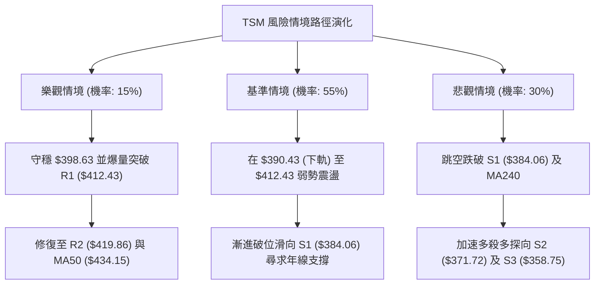

### 🛡️ 風險管理重要提醒

1. **防範流動性與半導體週期回撤**：TSM 目前的 Trailing P/E 為 26.31，Forward P/E 為 17.05，基本面雖展現高達 50.9% 的單季營收年增率，但近期新聞顯示部分避險基金獲利減碼，且有 8 檔 ETF 削減持股，需警惕技術面補跌引發的法人去槓桿踩踏。
2. **嚴格執行倉位控管準則**：
   - 單筆空頭策略的最大風險暴露額度不得超過投資組合總權益的 **1.5%**。
   - 任何情況下嚴禁在下降趨勢中攤平成本（Martingale 加碼法）。
3. **止損紀律執行**：嚴格依據本報告設定之精確點位執行停損，若策略 A 遭遇收盤突破 **$419.86 (R2)**，代表雙頂頸線跌破形態失效，必須果斷止損離場。

---

## 📋 報告總結

```
╔══════════════════════════════════════════════════════════════════════════╗
║                        TSM 技術分析報告總結                              ║
╠══════════════════════════════════════════════════════════════════════════╣
║ 報告日期：2026-11-03                                                     ║
║ 當前價格：$398.63 USD                                                    ║
║ 分析評級：🔴 偏空防守 (技術評分卡綜合得分: 37/100)                      ║
║                                                                          ║
║ 關鍵結論：                                                               ║
║ ├─ 長期趨勢：🟢 守於 MA240 ($382.10) 之上，維持大格局多頭架構            ║
║ ├─ 中期趨勢：🔴 自 52W 高點 $487.47 回撤，失守頸線，展開次級修正        ║
║ ├─ 短期趨勢：🔴 跌破 MA200 ($398.95) 與斐波 38.2%，下行通道壓迫          ║
║ ├─ 關鍵支撐：S1: $384.06 ｜ S2: $371.72 ｜ 斐波 50.0%: $375.75           ║
║ ├─ 關鍵阻力：R1: $412.43 ｜ R2: $419.86 ｜ R3 (MA20/50): $431.68        ║
║ └─ 外資共識：買方目標價均值 $584.39 (短期與技術面嚴重脫鉤，以技術面為準)║
║                                                                          ║
║ 最優策略組合：                                                           ║
║ 1. 🥇 最佳機會：策略 A (反彈至 R1: $412.43 做空，風報比 1 : 3.82)         ║
║ 2. 🥈 次選機會：策略 B (破位 $398.29 順勢空至 S2: $371.72，風報比 1 : 1.88)║
║ 3. 🥉 保守選擇：空倉觀望，耐心等待價格下探 S1 ($384.06) 構築止跌形態    ║
╚══════════════════════════════════════════════════════════════════════════╝
```

---

> ⚠️ **免責聲明**：本報告為依據客觀量化技術指標與歷史 OHLCV 價格數據所編撰之研究報告，所有內容與數值**僅供學術研究與技術分析參考**，**不構成任何形式的投資要約、招攬或具體操作建議**。金融市場波動劇烈，投資人應獨立評估市場風險並自負盈虧。

---

*報告生成時間：2026-11-03 ｜ 數據來源：Yahoo Finance ｜ 分析框架：多時框技術分析模型*