# TSM 技術分析報告

> **報告日期**：2026-11-04 ｜ **語言**：繁體中文 ｜ **數據來源**：Yahoo Finance ｜ **當前價格**：$404.80 USD

---

## 目錄

| 章節 | 內容 |
|------|------|
| [1. 技術面概覽](#1-技術面概覽) | 訊號儀表板、核心指標、評分卡 |
| [2. 趨勢分析](#2-趨勢分析) | 多時框趨勢、長中短期走勢、ADX 解讀 |
| [3. 圖表形態分析](#3-圖表形態分析) | 形態識別、真實K線組合、形態目標價 |
| [4. 支撐與阻力](#4-支撐與阻力) | 關鍵價位結構、斐波那契回調深度解讀 |
| [5. 技術指標深度解讀](#5-技術指標深度解讀) | MA排列、RSI/MACD背離判定、布林通道、量價 |
| [6. 動能與波動率](#6-動能與波動率) | 動能四象限、ATR 風控、Beta 相關性 |
| [7. 多時框架總結](#7-多時框架總結) | 多時框矩陣、優先級收斂原則與方向定調 |
| [8. 交易策略建議](#8-交易策略建議) | 單一主策略路由、價格階梯、嚴格風報比計算 |
| [9. 風險提示與監控](#9-風險提示與監控) | 監控清單、情境推演、資金控管規範 |

---

## 1. 技術面概覽

### 🎯 技術訊號儀表板

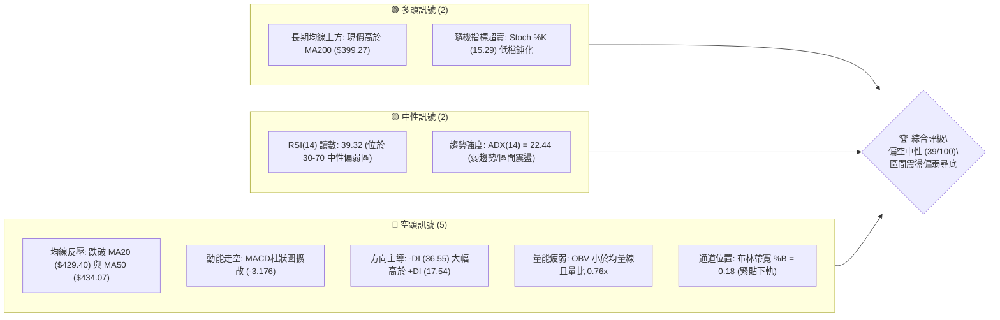

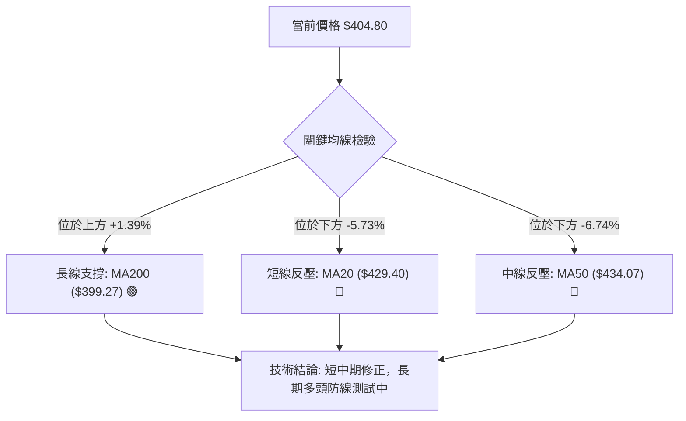

### 📊 核心指標速覽表

| 指標類別 | 指標名稱 | 當前數值 | 訊號 | 解讀 |
|:---|:---|:---|:---:|:---|
| **價格** | 當前收盤價 | $404.80 | 🟡 | 位於52週區間 63.0% 位置，處於歷史高點修正段 |
| **均線** | 短期 MA20 | $429.40 | 🔴 | 現價跌破 MA20 達 -5.73%，短線反彈空間受限於此 |
| **均線** | 中期 MA50 | $434.07 | 🔴 | 現價位於 MA50 下方 -6.74%，且 MA20 向下跌破 MA50 |
| **均線** | 長期 MA200| $399.27 | 🟢 | 現價高於 MA200 達 +1.39%，維繫長期結構牛市分水嶺 |
| **動能** | RSI(14) | 39.32 | 🟡 | 處於 30–70 區間偏弱側，未入極端超賣，無顯著底背離 |
| **動能** | MACD(12,26,9) | -8.211 / -5.035 | 🔴 | DIF 線低於 DEA 線，MACD Hist 為 -3.176，空方動能主導 |
| **動能** | KD(14,3) | %K 15.29 / %D 9.78 | 🟢 | 雙指標落入 20 以下超賣區，具備短線技術性抽腳反彈契機 |
| **趨勢** | ADX / DMI | ADX 22.44 (-DI 36.55) | 🔴 | ADX<25 屬盤整/弱趨勢，但 -DI 壓倒 +DI(17.54) 顯示空方佔優 |
| **通道** | Bollinger Bands | 上 $467.31 / 下 $391.49 | 🟡 | %B 為 0.18，下軌 $391.49 與 MA200 形成重疊支撐緩衝帶 |
| **波動** | ATR(14) | $13.42 (3.32%) | 🟡 | 日間平均波動約 13.42 美元，日內風險度維持中等水準 |
| **量能** | 當日量 / 20日均量 | 9,280,636 / 12,144,172 | 🔴 | 量比僅 0.76x，OBV < MA，反彈缺乏積極買盤動能配合 |

### 🏆 技術評分卡

```
╔════════════════════════════════════════════════════════════════╗
║                   技術評分卡 — TSM (2026-11-04)                ║
╠════════════════════════════════════════════════════════════════╣
║ 趨勢強度 (Trend)     ███████░░░░░░░░░░░░░  35/100  🔴 空頭控盤 ║
║ 動能指標 (Momentum)  ████████░░░░░░░░░░░░  40/100  🔴 動能疲弱 ║
║ 支撐穩定度 (Support) ██████████░░░░░░░░░░  50/100  🟡 考驗MA200║
║ 成交量配合 (Volume)  ███████░░░░░░░░░░░░░  35/100  🔴 量能萎縮 ║
║ 形態完整度 (Pattern) ████████░░░░░░░░░░░░  40/100  🟡 弱勢整理 ║
║ 均線排列 (MA System) ███████░░░░░░░░░░░░░  35/100  🔴 混合偏空 ║
╠════════════════════════════════════════════════════════════════╣
║ 綜合評分 (Overall)   ████████░░░░░░░░░░░░  39/100  🔴 偏空中性 ║
║ 計算依據：(35 + 40 + 50 + 35 + 40 + 35) ÷ 6 = 39.17 → 39/100   ║
╚════════════════════════════════════════════════════════════════╝
```

---

## 2. 趨勢分析

### 🌐 多時框趨勢分析

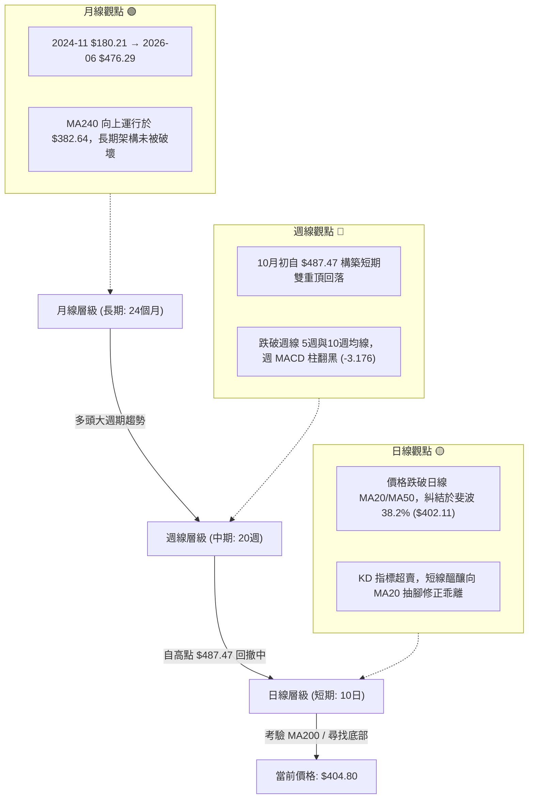

### 📈 長期趨勢 — 12個月走勢圖（Unicode）

```
TSM 月線走勢圖（過去12個月：2025-12 至 2026-11）
價格 ($)
$490 ┤                                              
$480 ┤                                  ●(06月:476.29)
$460 ┤                                        ●(09月:456.19)
$440 ┤                                              
$420 ┤                            ●(05月:416.36)    ●(08月:414.21)
$400 ┤                      ●(04月:394.08)    ●(07月:403.17)    ●(10月:406.13)
$380 ┤                                                          ▲ (現價: 404.80)
$360 ┤                ●(02月:371.66)
$340 ┤          ●(01月:327.98)  ●(03月:336.26)
$320 ┤    ●(12月:301.52)
$300 ┤
     └────┬─────┬─────┬─────┬─────┬─────┬─────┬─────┬─────┬─────┬─────┬─────┬──
        12月   01月  02月  03月  04月  05月  06月  07月  08月  09月  10月  11月(現價)
        2025   2026 ──────────────────────────────────────────────────→ 2026
```

#### 長期走勢特徵分析表（過去12個月）

| 階段區間 | 起訖月份 | 起點收盤價 | 終點收盤價 | 區間漲跌幅 | 結構特徵解讀 |
|:---|:---|:---|:---|:---:|:---|
| **主升攻擊段** | 2025-12 → 2026-02 | $301.52 | $371.66 | +23.26% | 晶圓先進製程產能滿載預期，量價齊揚突破300大關 |
| **技術回後買** | 2026-02 → 2026-03 | $371.66 | $336.26 | -9.52%  | 獲利盤回吐，於前高突破點位獲支撐形成健康洗盤 |
| **擴張加速段** | 2026-03 → 2026-06 | $336.26 | $476.29 | +41.64% | 展開主升第3波，創下歷史月線收盤新高 $476.29 |
| **寬幅箱型段** | 2026-06 → 2026-10 | $476.29 | $406.13 | -14.73% | 進入大區間高檔震盪，雙峰分別在 06月($476.29)與 09月($456.19) |
| **當前定位** | 2026-10 → 2026-11 | $406.13 | $404.80 | -0.33%  | 考驗自 2024年以來的大多頭趨勢防線（MA200: $399.27） |

### 📊 中期趨勢（週線分析）

中期走勢自 2026-10-09 當週刷出 52 週新高 $487.47 後，呈現連續 4 週的下挫結構。週線收盤價依序為：$453.31 → $412.61 → $418.51 → $406.13 → $404.80。

```
週線級別價格壓力與支撐階梯圖：
[$487.47] 52W 歷史極值高點（空方反轉起點）
    │
    ▼ -10.82%
[$434.67 - $434.74] 斐波那契 23.6% 回調位 / 9月中旬震盪平台（中期強阻力）
    │
    ▼ -6.89%
[$412.43 - $418.51] R1 阻力帶 / 近期反彈高點聚類（短期頸線重壓）
    │
    ▼ -1.85%
====================================================== [現價: $404.80]
    │
    ▲ +0.67%
[$402.11] 斐波那契 38.2% 回調位（現階段微幅支撐，正受測試）
    │
    ▲ +1.39%
[$399.27] 日線 MA200 關鍵牛熊分水嶺
    │
    ▲ +5.40%
[$384.06] S1 波段低點聚類（第一道中級結構防線）
```

### ⚡ 趨勢強度評估（ADX 解讀）

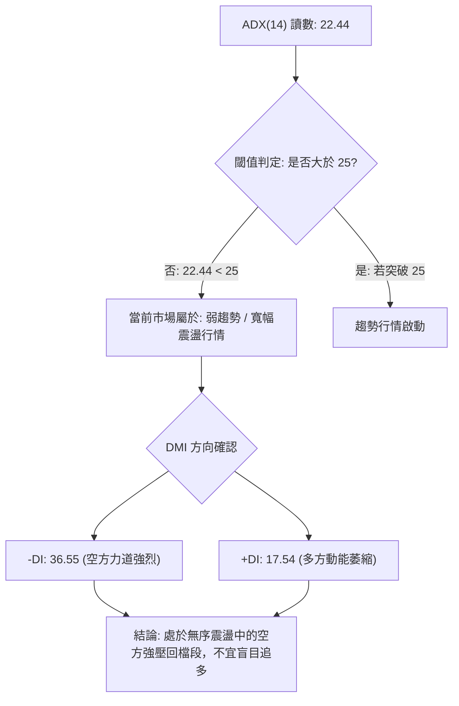

#### ADX 與 DMI 數值矩陣解讀

| 指標名稱 | 當前數值 | 參考臨界線 | 狀態解讀 | 操作指導原則 |
|:---|:---:|:---:|:---|:---|
| **ADX(14)** | **22.44** | 25.00 | **弱趨勢 / 寬幅區間盤整** | 避免趨勢突破追價策略；以區間下軌尋低吸、上軌止盈為主 |
| **+DI** | **17.54** | 20.00 | **多頭推動力匱乏** | 多頭主力未有積極攻擊訊號，不可預設為 V 型反轉 |
| **-DI** | **36.55** | 25.00 | **空頭控盤力道顯著** | 盤中逢反彈容易遭遇解套與停損賣壓阻截 |
| **DI 差值** | **-19.01** | 0.00 | **空方完全壓制** | 技術面尚需經歷打底鈍化，方能收斂 DI 乖離 |

---

## 3. 圖表形態分析

### 🔍 形態識別系統

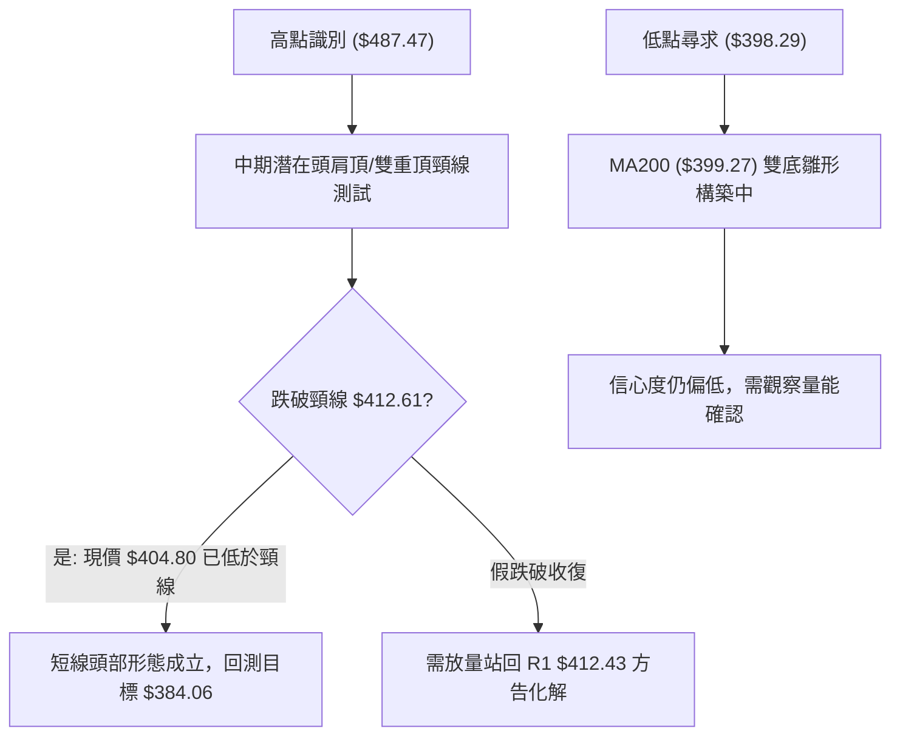

#### 圖表形態信心度評估表（依規則 15）

| 形態名稱 | 信心度 | 判斷依據（嚴格引用數據） | 完成度 | 形態量測目標價（附精確計算式） |
|:---|:---:|:---|:---:|:---|
| **雙重頂形態** (M頭) | **75%** | 兩次波段高點分別為 2026-06 ($476.29) 與 2026-10-09 ($487.47)，跌破 10-16 當週頸線收盤 $412.61 | **85%** | **$337.75**<br>計算式：頸線 $412.61 − (高點 $487.47 − 頸線 $412.61 = $74.86) = $337.75。*(註：途中將在 S1/S2/S3 遭遇強支撐)* |
| **MA200 支撐整理平台** | **55%** | 日K連續於 10-30 ($400.12) 與 11-02 ($398.29) 在 MA200 ($399.27) 止跌抽腳 | **40%** | **$434.07 (反彈目標)**<br>計算式：以測試 MA200 成功為底，反彈測試 MA50 之對等位 = $434.07 |
| **大型頭肩底** | **0%** | **數據不足，無幾何左肩對稱依據** | 0% | 訊號不足，僅做指標型解讀，不強行繪製複雜形態 |

### 🕯️ 重要K線形態分析

根據規則 19，完全依據數據中「近10根日K」與「近8根週K」之精確數值進行解讀：

#### 近10根日K形態精確拆解

| 日期 | 開盤價 | 最高價 | 最低價 | 收盤價 | 成交量 | K線形態名稱 | 解讀與心理層面分析 | 訊號 |
|:---:|:---:|:---:|:---:|:---:|:---:|:---|:---|:---:|
| 2026-10-21 | 433.14 | 435.16 | 423.74 | 431.89 | 10,721,100 | 下影小黑線 | 盤中下探獲買盤收斂，但反彈力道未突破開盤 | 🟡 |
| 2026-10-22 | 419.39 | 421.91 | 410.22 | 412.35 | 16,475,100 | 跳空中黑K | 帶量長黑摜破短均線，空方加速發力 | 🔴 |
| 2026-10-23 | 412.29 | 421.31 | 411.11 | 418.51 | 9,494,400 | 低檔長紅K | 低檔縮量反彈，多頭嘗試構築短線回穩下影線 | 🟢 |
| 2026-10-26 | 418.07 | 428.85 | 417.72 | 424.37 | 9,627,100 | 連續反彈小陽線 | 延續技術性反抽，多頭試圖挑戰上方缺口反壓 | 🟢 |
| 2026-10-27 | 427.16 | 438.58 | 426.00 | 436.87 | 9,022,500 | 實體中長紅K | 多頭攻勢達到波段頂點，但成交量未能放大 | 🟡 |
| 2026-10-28 | 438.24 | 440.88 | 436.84 | 439.51 | 8,037,400 | 高檔十字星/滯漲星 | 縮量見高 $440.88，高檔買盤後繼無力，浮現轉折疑慮 | 🔴 |
| 2026-10-29 | 431.69 | 436.24 | 428.43 | 431.81 | 8,465,900 | 跳空下行陰線 | 吞噬前一日低點，確立反彈波結束，回歸跌勢 | 🔴 |
| 2026-10-30 | 414.08 | 418.09 | 400.12 | 406.13 | 21,971,100 | **放量大陰線** | **爆出近兩週最大量 (21.9M)，恐慌殺盤測試 $400.12** | 🔴 |
| 2026-11-02 | 412.52 | 414.76 | 398.29 | 398.63 | 13,190,900 | 光腳陰線/破位測底 | 盤中跌破 400 整數及 MA200，收在 $398.63，短線極度承壓 | 🔴 |
| 2026-11-03 | 404.99 | 408.37 | 403.03 | 404.80 | 9,280,636 | 低檔紅十字星 (孕線) | 縮量企穩收復 400 關卡與 MA200，賣壓初見竭盡 | 🟢 |

#### 近8根週K形態精確拆解

| 日期 (週末) | 開盤價 | 最高價 | 最低價 | 收盤價 | 成交量 | 週K形態名稱 | 解讀與中線趨勢意義 | 訊號 |
|:---:|:---:|:---:|:---:|:---:|:---:|:---|:---|:---:|
| 2026-09-18 | 414.90 | 434.82 | 411.45 | 434.67 | 59,602,200 | 突破中長陽 | 帶量突破 430 阻力，開啟衝頂行情 | 🟢 |
| 2026-09-25 | 440.80 | 455.03 | 437.06 | 450.61 | 46,852,600 | 實體大陽線 | 強勢多頭排列，推升均線發散 | 🟢 |
| 2026-10-02 | 448.39 | 474.79 | 443.11 | 472.78 | 44,927,100 | 加速趕頂大長陽 | 均線正乖離擴大，多方動能耗盡前兆 | 🟢 |
| 2026-10-09 | 478.77 | 487.47 | 449.75 | 453.31 | 49,231,100 | **長上影流星線 (倒錘)** | **創歷史高 $487.47 後遭逢強烈拋售，週線見頂** | 🔴 |
| 2026-10-16 | 453.55 | 454.40 | 407.13 | 412.61 | 71,736,400 | **天量斷頭巨陰** | **71.7M 巨量摜破 430 支撐，主力資金撤離明確** | 🔴 |
| 2026-10-23 | 421.66 | 435.16 | 410.22 | 418.51 | 61,583,000 | 弱勢抵抗陽十字 | 反抽無力，受壓於 435 之下 | 🟡 |
| 2026-10-30 | 418.07 | 440.88 | 400.12 | 406.13 | 57,124,000 | 上影帶量陰線 | 上衝 $440.88 遇阻大幅回落，再次確立下行波 | 🔴 |
| 2026-11-03 | 412.52 | 414.76 | 398.29 | 404.80 | 22,471,536 | 測底待變小陰星 | 測試 MA200 與 400 關卡，等待方向選擇 | 🟡 |

### 📉 ASCII 走勢形態示意圖

```
TSM 雙重頂與當前頸線測底形態示意圖
 價格
$487.47 ────────────┐ (2026-10-09 第二頂)
                    │
$476.29 ──────┐     │
  (第一頂)    │     │
              │     │                                       
$440.88 ──────┼─────┼──────────┐ (10-28 反彈次高點)
              │     │          │
$429.40 ──────┼─────┼──────────┼───────── (MA20 反壓阻力帶)
              │     │          │
$412.61 ──────┴─────┼──────────┼───────── (關鍵頸線跌破點 / R1: $412.43)
                    │          │
$404.80 ────────────┼──────────┼─────────◄ 【當前價格】
                    │          │
$399.27 ────────────┼──────────┴───────── (MA200 牛熊支撐防線 / 11-02 探底 $398.29)
                    │
$384.06 ────────────┴──────────────────── (S1: 形態量測初步支撐目標)
```

### 🎯 形態目標價計算

1. **頂部結構理論回撤目標**：
   - 第一頂點高位：$476.29，第二頂點極值高位：$487.47。
   - 跌破初級形態頸線位（10-16 週收盤價）：$412.61。
   - 垂直高度 $H = 487.47 - 412.61 = 74.86$ 美元。
   - 理論極限空方目標價 $= 412.61 - 74.86 = \$337.75$。此價位逼近長期回調支撐 S3 ($358.75) 與 61.8% 斐波那契回調位 ($349.38)。

2. **短線反彈測試目標**：
   - 底部探針低點（11-02 日K最低點）：$398.29。
   - 若短線在 MA200 ($399.27) 築底成功，首要反彈目標為回抽短均線壓制區：即阻力位 R1 **$412.43**（滿足幅度 $+1.88\%$）與 R2 **$419.86**（滿足幅度 $+3.72\%$）。

---

## 4. 支撐與阻力

### 🗺️ 關鍵價位分布圖（Unicode）

```
TSM 價位結構分布圖（嚴格依據 OHLCV 計算）
═══════════════════════════════════════════════════════════════════
$487.47 ║████████████████████████████████████████║ 52W 歷史最高價 (0.0% Fib)
$434.74 ║██████████████████████████████          ║ 23.6% Fib / MA50 ($434.07)
$431.68 ║██████████████████████████              ║ 強阻力 R3 (波段高點聚類)
$419.86 ║████████████████████                    ║ 阻力 R2 (反彈高點聚類)
$412.43 ║████████████████                        ║ 關鍵阻力 R1 (頸線壓力區)
$404.80 ╠════════════════════════════════════════╣ ◄ 當前收盤價 ($404.80)
$402.11 ║▓▓▓▓▓▓▓▓▓▓▓▓▓▓▓▓▓▓▓▓▓▓                  ║ 38.2% Fib 回調位 (現價測試中)
$399.27 ║▓▓▓▓▓▓▓▓▓▓▓▓▓▓▓▓▓▓▓▓▓▓▓▓▓▓▓▓            ║ MA200 長期趨勢均線防線
$384.06 ║████████████████████████████████        ║ 關鍵支撐 S1 (波段低點聚類)
$375.75 ║████████████████████████████████████    ║ 50.0% Fib 中軸平衡線
$371.72 ║██████████████████████████████████████  ║ 強支撐 S2 (波段低點聚類)
$358.75 ║████████████████████████████████████████║ 深度支撐 S3 (波段低點聚類)
═══════════════════════════════════════════════════════════════════
```

### 🚧 阻力位分析表

所有價位均直接取自系統計算數值，嚴禁任何外推編造：

| 阻力級別 | 準確價位 | 距現價幅動 | 形成原因與技術背景 | 突破難度評估 | 重要性級別 |
|:---|:---:|:---:|:---|:---:|:---:|
| **R1** | **$412.43** | +1.88% | 近一年波段高點聚類；10-22 與 10-23 跳空起跌平台下緣頸線 | 🟡 中等 (需補量) | ★★★★☆ |
| **R2** | **$419.86** | +3.72% | 近一年波段高點聚類；與 MA10 ($420.49) 形成共振重壓區 | 🔴 偏高 (解套賣壓) | ★★★☆☆ |
| **R3** | **$431.68** | +6.64% | 近一年波段高點聚類；與日線 MA60 ($431.69) 及 MA20 ($429.40) 高度疊合 | 🔴 極高 (強壓密集成交區) | ★★★★★ |

### 🛡️ 支撐位分析表

所有價位均直接取自系統計算數值：

| 支撐級別 | 準確價位 | 距現價幅動 | 形成原因與技術背景 | 守住機率評估 | 重要性級別 |
|:---|:---:|:---:|:---|:---:|:---:|
| **S1** | **$384.06** | -5.12% | 近一年波段低點聚類；緊鄰 MA240 ($382.64) 與布林通道下軌 ($391.49) | 🟢 65% (多頭關鍵陣地) | ★★★★★ |
| **S2** | **$371.72** | -8.17% | 近一年波段低點聚類；2026-02 突破回踩點，接近 50% 斐波那契位 ($375.75) | 🟢 80% (強勁買盤防禦) | ★★★★☆ |
| **S3** | **$358.75** | -11.38%| 近一年波段低點聚類；接近 61.8% 黃金分割強支撐 ($349.38) | 🟢 90% (極限恐慌低點) | ★★★☆☆ |

### 📐 斐波那契回調位分析

依據 52 週極值區間 **$264.03（低點） → $487.47（高點）**，全距 $223.44 美元計算：

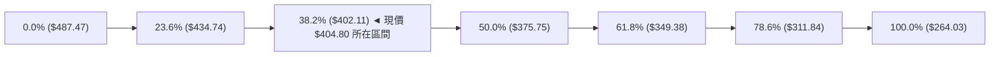

#### 斐波那契位置深度解讀表

| 分割比率 | 準確價位 | 相對現價位置 | 技術意義與多空攻防策略解讀 |
|:---:|:---:|:---:|:---|
| **0.0% (52W High)** | **$487.47** | +20.42% | 歷史週期天花板，中長期多頭獲利了結與反轉原點 |
| **23.6%** | **$434.74** | +7.40% | 與 MA50 ($434.07) 重疊，為強勢修正與弱勢修正的臨界線（現已跌破） |
| **38.2%** | **$402.11** | -0.66% | **【現價防守核心】** 股價正於 $402.11 至 $404.80 間徘徊，此處若失守將滑向 50% 回調 |
| **50.0%** | **$375.75** | -7.18% | 多空平衡中軸，通常為牛市健康回踩的最深容忍界限，接近 S2 ($371.72) |
| **61.8%** | **$349.38** | -13.69% | 黃金分割防線，跌破此位則宣告 52 週多頭格局全數瓦解 |
| **78.6%** | **$311.84** | -22.96% | 深度回撤極端防禦位 |
| **100.0% (52W Low)**| **$264.03** | -34.78% | 2025年起漲基準點 |

---

## 5. 技術指標深度解讀

### 🎛️ 指標訊號總覽

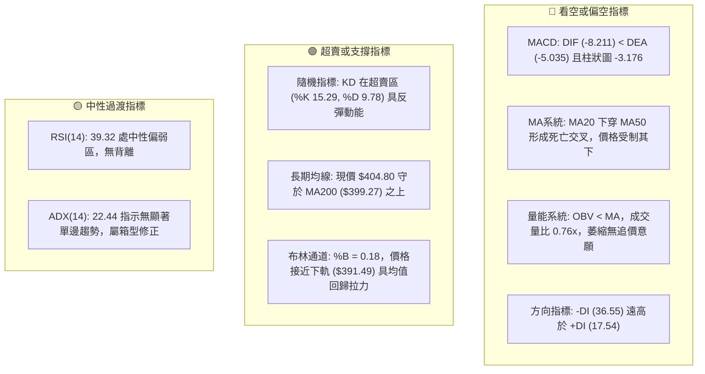

### 📈 移動平均線排列分析

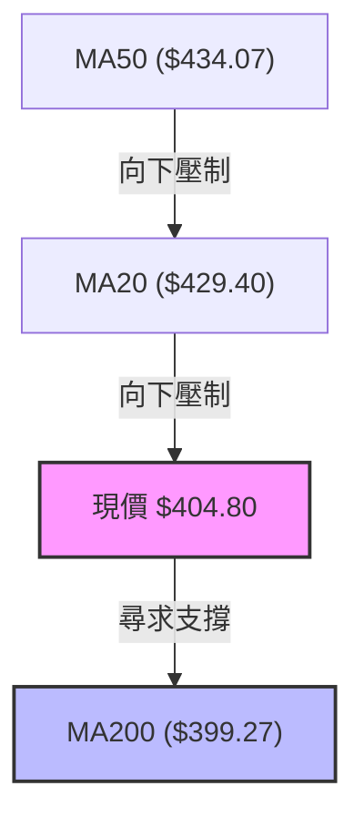

#### 完整均線系統追蹤表

| 均線名稱 | 數值 | 距現價差距 | 當前斜率走勢 | 均線位階與意義解讀 |
|:---|:---:|:---:|:---:|:---|
| **MA 5** | $416.18 | -2.73% | ▼ 向下急速走平 | 超短線第一阻力，近5日均線扣抵高位 |
| **MA 10** | $420.49 | -3.73% | ▼ 陡峭下行 | 兩週平均持倉成本線，與 R2 ($419.86) 重合 |
| **MA 20** | $429.40 | -5.73% | ▼ 穩定向下 | 月線生命線，布林中軌所在，短空主要防禦基地 |
| **MA 50** | $434.07 | -6.74% | ▼ 開始轉折向下 | 季線轉弱，與斐波那契 23.6% ($434.74) 形成死亡共振 |
| **MA 60** | $431.69 | -6.23% | ▼ 走平下彎 | 與 R3 ($431.68) 精確重疊，中期多空分水嶺 |
| **MA 120** | $426.55 | -5.10% | ▼ 走平下彎 | 半年線支撐轉為重壓 |
| **MA 200** | $399.27 | +1.39% | ▲ 穩健向上 | **年線/牛熊線：多頭最後陣地，目前僅領先 $5.53** |
| **MA 240** | $382.64 | +5.79% | ▲ 穩健向上 | 長期基底均線，緊貼支撐 S1 ($384.06) |

*均線排列判定：MA20 < MA50 < MA60，而價格處於 MA200 之上但低於短中期均線，屬典型的**「均線空頭排列下的牛市回撤測試（混合排列）」**。*

### 📉 RSI(14) 分析

```
RSI(14) 當前讀數: 39.32
[0] ────────── [30] ──────●─────── [70] ────────── [100]
    極度超賣       超賣    39.32    超買       極度超買
進度條: ███████████████░░░░░░░░░░░░░░░░░░░░ 39.32%
```

- **超買超賣狀態**：數值 39.32，雖未跌破 30 達到極端超賣，但已跌破 50 多空分界點，處於弱勢空方主導空間。
- **背離判定**：
  - **日線背離檢驗**：近 20 根 K 棒中，價格自 10-09 高點 $487.47 回落至 11-02 低點 $398.29（低點創新低），而 RSI 自 71.7 回落至 34.3 並微升至 39.32。價格與指標方向同步下行，**「明確無底背離，亦無頂背離」**，僅屬正常動能釋放。

### 📊 MACD(12/26/9) 訊號解讀

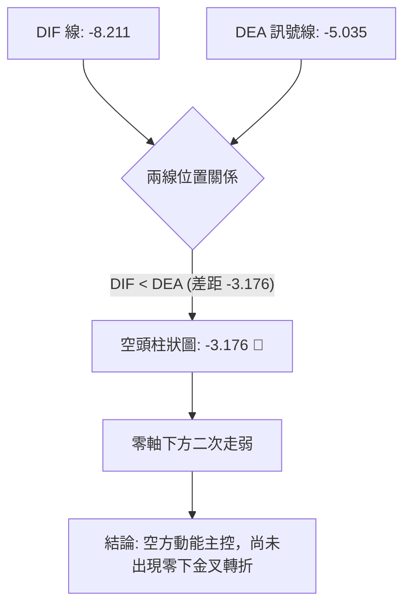

- **數值關係**：DIF ($-8.211$) 遠低於 Signal ($-5.035$)，兩者皆深陷零軸之下，MACD Histogram 為 **$-3.176$**。
- **動能演變**：從週線 MACD 柱觀察，10-02 當週為 $+2.837$，10-09 翻負至 $-0.244$，10-16 擴大至 $-6.872$，雖近期收斂至 $-3.176$，但負值依然偏大，表明短期空頭殺跌力道雖有趨緩，但多頭尚未奪回主導權。

### 📦 布林通道分析

```
TSM 日線布林通道 (20, 2) 結構示意圖
價格
$467.31 ─────────────────────────────── 上軌 (Upper Band)
               │
               │
$429.40 ─────────────────────────────── 中軌 (Middle Band = MA20)
               │
$404.80 ───●───┼─────────────────────── ◄ 【當前價格】(%B = 0.18)
               │
$391.49 ─────────────────────────────── 下軌 (Lower Band)
```

- **通道帶寬與位置**：通道上軌 $467.31，下軌 $391.49，帶寬高達 $75.82 美元。當前價格 $404.80 位於下半區，%B 讀數為 **0.18**（緊貼下軌）。
- **通道行為解讀**：當 %B 接近 0.15–0.20 且伴隨 ADX 低於 25 時，股價極易在觸及下軌區間（$391.49–$400.00）引發均值回歸反彈，回測中軌（$429.40）阻力。

### 💹 成交量分析（量價配合度）


- **量價配合特徵**：
  1. 10-30 殺跌至 $400.12 時爆出 21,971,100 股的天量，顯示低檔有初步承接盤，但亦呈現恐慌拋壓。
  2. 11-03 收紅反彈時，成交量迅速萎縮至 9,280,636 股，量比僅 **0.76x**。
  3. **量價背離診斷**：反彈無量形成「價漲量縮」的量價背離，說明多頭信心薄弱，僅為空方停損單與短線沖銷盤推動，缺乏長線機構主力回補的「連續遞增攻擊量」。
  4. **OBV 趨勢**：明確處於均線下方（`OBV < MA → 量能疲弱`），維持空方量能架構。

---

## 6. 動能與波動率

### ⚡ 動能評估四象限

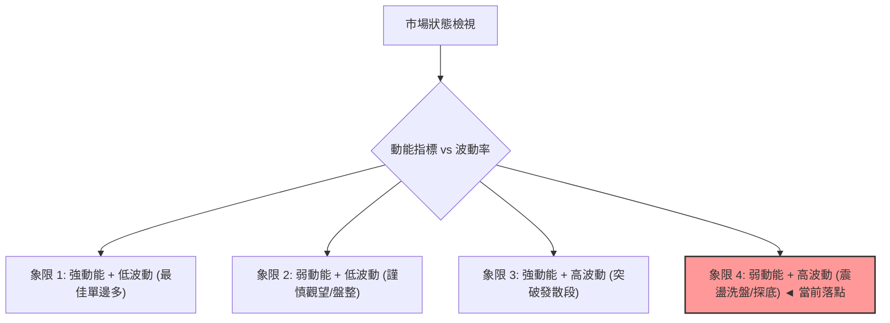

#### 動能與波動率定位解析

| 象限標籤 | 動能屬性 (RSI / MACD) | 波動屬性 (ATR / BBW) | 當前判定 | 市場環境與策略評估 |
|:---:|:---:|:---:|:---:|:---|
| **Q1** | 強 (RSI > 60) | 低 (ATR% < 2%) | ─ | 主升穩健推進，積極持股做多 |
| **Q2** | 弱 (RSI 40-50) | 低 (ATR% < 2%) | ─ | 狹幅無聊整理，觀望等待變盤 |
| **Q3** | 強 (RSI 極端) | 高 (ATR% > 3%) | ─ | 狂熱噴發或連續崩跌，高風險追價 |
| **Q4** | **弱 (RSI: 39.32, MACD<0)** | **高 (ATR%: 3.32%, 日波$13.42)** | **✓ [當前落點]** | **寬幅震盪洗盤尋底，嚴禁滿倉，需拉大止損防洗** |

### 📊 ATR 波動率分析

- **ATR(14) 數值**：**$13.42**（佔當前股價之 **3.32%**，採 Wilder 平滑計算法）。
- **日間波動風險**：這意味著 TSM 在常態單日內具備約 $\pm \$13.42$ 的波動空間，當前價位 $404.80 往下的單日正常波動下限即可觸及 $391.38（恰與布林下軌 $391.49 共振）。
- **止損與部位管理建議**：
  - 超短線交易止損距離建議不得小於 $1.0 \times \text{ATR}$（即 $\$13.42$）。
  - 波段交易止損應設定在 $1.5 \times \text{ATR}$（約 $\$20.13$）至 $2.0 \times \text{ATR}$（約 $\$26.84$），以避免在測試 MA200 過程中被市場雜訊掃出場。

### 📐 Beta 與市場相關性

- **Beta 係數**：**1.233**。
- **大盤敏感度**：TSM 屬於高彈性標的，波動幅度約為美股大盤（S&P 500）的 1.23 倍。在科技股遭遇避險賣壓時，其下行速度將顯著高於大盤；反之，若半導體板塊出現情緒修復，其彈性亦大於平均水準。
- **機構持股與放空比**：機構持股佔比 15.5%，空頭佔流通股比例僅 0.6%（Short Ratio: 2.79），表明當前下跌並非源於大規模做空機構狙擊，而是多頭在前期巨幅獲利後的集體調倉與避險賣壓。

---

## 7. 多時框架總結

### 📋 時框架評分表

| 時框架 | 趨勢方向 | 動能狀態 | 均線排列 | 關鍵支持 / 阻力 | 評分 (1-100) | 核心交易指引 |
|:---|:---:|:---:|:---:|:---:|:---:|:---|
| **長期 (月線)** | 🟢 多頭格局 | 🟡 高檔鈍化 | 🟢 均線多頭排列 (MA240 向上) | 支撐: $382.64 / 阻力: $476.29 | **75/100** | 逢重大拉回至長線支撐均分批承接 |
| **中期 (週線)** | 🔴 回調整理 | 🔴 柱狀擴散 | 🔴 跌破短均線 (MA5/10 轉空) | 支撐: $402.11 / 阻力: $453.31 | **35/100** | 尚未見週線落底翻紅，維持防禦架構 |
| **短期 (日線)** | 🔴 弱勢震盪 | 🟢 KD 超賣 | 🔴 MA20/50 空頭交叉 | 支撐: $399.27 / 阻力: $412.43 | **35/100** | 超賣醞釀反彈，但受制於 R1 頸線重壓 |

### 🔲 綜合訊號矩陣

```
時框訊號一致性陣列：
[長期 月線] ────────────────────────── 🟢 看多 (牛市未死)
               ▲
               │ (衝突)
               ▼
[中期 週線] ────────────────────────── 🔴 看空 (波段回撤進行中)
               ▲
               │ (一致)
               ▼
[短期 日線] ────────────────────────── 🔴 偏空震盪 (短均反壓，指標超賣)
```

### ⚖️ 多時框收斂結論

依據【嚴格要求 14：多時框收斂規則】：
1. **行情屬性判定**：當前 ADX(14) 讀數為 **22.44**，明確處於 **$\text{ADX} < 25$ 的「盤整/弱趨勢行情」**。
2. **主導時框與優先級**：在盤整行情中，市場缺乏單邊趨勢推動力，趨勢追隨型策略失效，交易重點收斂至**「以日線布林通道上下軌 ($391.49 – $467.31) 與關鍵波段聚類為主要震盪交易區間」**。
3. **最終方向性唯一結論**：**【中性偏空，區間尋底】**。
   - 雖長期月線維持牛市（評分 75），但短期與中期受制於日線 MA20 ($429.40) 及週線天量長陰，反彈空間被緊緊壓制在 R1 ($412.43) 與 R2 ($419.86)。
   - 第 1 章綜合評分定調為 **39/100**，因此第 8 章之策略規劃嚴格遵循分流規則：**主推偏空/防禦型之區間反彈逢高做空或破位空頭策略，多頭僅列為反彈風險提示與超跌博弈**。

---

## 8. 交易策略建議

### 🗺️ 策略決策流程圖

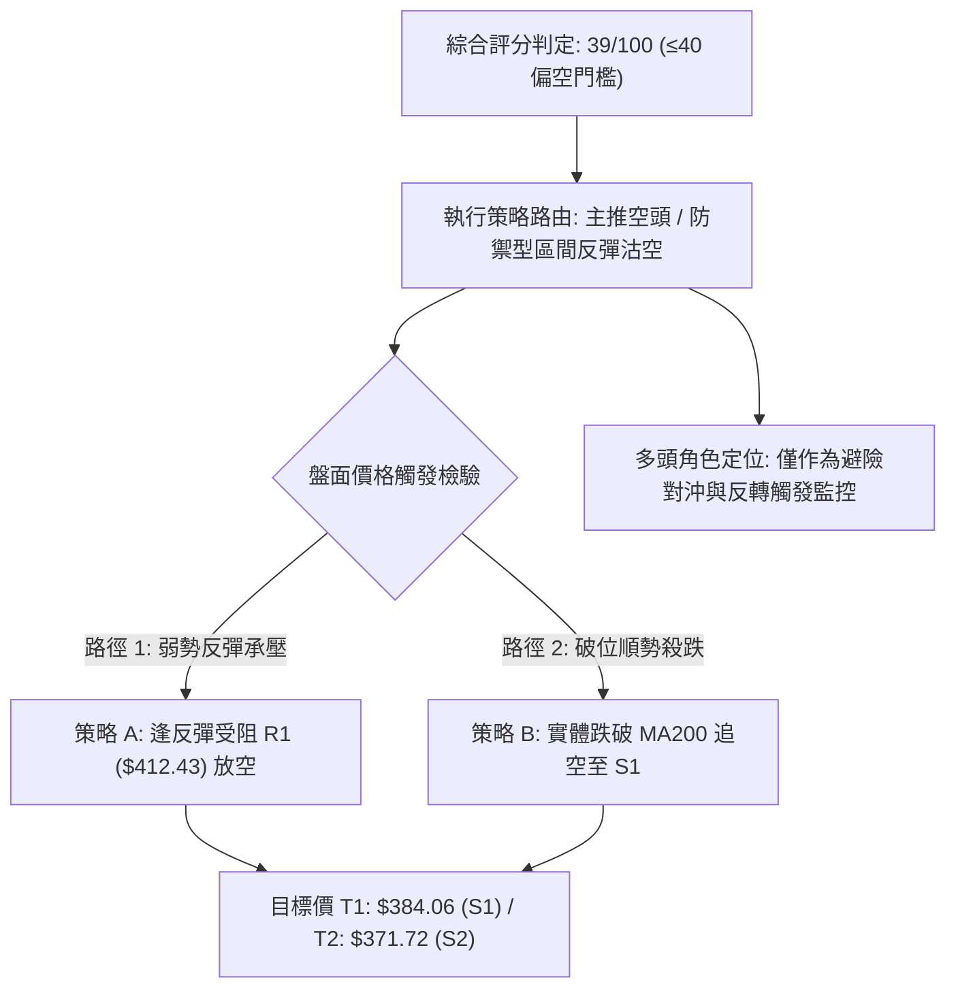

### 🧭 策略路由（依評分卡分流）

> **當前主策略方向 = 主推空頭策略（防禦沽空 / 逢高做空）（依技術評分 39/100）**

根據規則 18，綜合評分 $\le 40$ 觸發「偏空主策略路由」。禁止兩頭模稜兩可推薦。當前價格 $404.80 位於 MA20 之下，反彈缺乏動能配合，任何向阻力位推進之走勢均視為放空窗口。

### 🎯 價格情境階梯（Price Scenarios）

所有價位完全引用第 4 章「關鍵價位」之精確數值：

| 觸發條件 | 下一目標 | 後續延伸 | 情境技術含義 |
|:---|:---:|:---:|:---|
| **強勢向上突破 R1 ($412.43)** | R2 ($419.86) | R3 ($431.68) | 短線超賣反彈擴大，空單需立即嚴格止損 |
| **窄幅震盪受制於現價與 R1 之間** | 斐波 38.2% ($402.11) | MA200 ($399.27) | 弱勢盤整消耗反彈動能，醞釀下一波下探 |
| **有效放量跌破 MA200 ($399.27)** | S1 ($384.06) | S2 ($371.72) | 中期破位確立，正式朝頭部形態量測目標前進 |
| **失守強支撐 S1 ($384.06)** | S2 ($371.72) | S3 ($358.75) | 恐慌盤湧現，測試 50% 斐波那契長期生命線 |

### 📊 情境機率分佈

| 運行情境 | 發生機率 | 主要技術依據 |
|:---|:---:|:---|
| **情境一：回落測試 MA200 並再探低點** | **55%** | MACD 柱狀圖仍為負值 (-3.176)，-DI (36.55) 強勢控盤，OBV 疲軟，現價距離 MA200 僅一步之遙 |
| **情境二：在 $398–$412 區間弱勢震盪** | **30%** | ADX 僅 22.44 指示無單邊趨勢，KD (15.29) 極端超賣帶來底部買盤支撐，限制急跌空間 |
| **情境三：放量向上反轉突破 R2** | **15%** | 反彈成交量嚴重不足 (量比 0.76x)，上方 MA20 與 MA50 形成雙重反壓蓋頂 |

### 🟢 主策略詳情（空頭交易策略）

所有價位均來自系統計算數值；風險報酬比嚴格遵守規則 17 定義：
$$\text{做空風險報酬比} = \frac{\text{進場價} - \text{目標價 T1}}{\text{止損價} - \text{進場價}}$$

| 策略要素 | 策略 A：反彈阻力位沽空（首選） | 策略 B：跌破 MA200 順勢追空（突破） |
|:---|:---|:---|
| **策略類型** | 逢高放空（反彈衰竭進場） | 破位做空（關鍵均線失守確認） |
| **進場條件** | 股價反彈至 R1 附近遇阻，日K出現上影線或黑K收破進場價 | 日K實體跌破 MA200 ($399.27)，且收盤低於 $398.29 前低 |
| **進場價格** | **$412.43** (精確取自 R1) | **$398.29** (取自 11-02 破位點) |
| **目標價 T1** | **$384.06** (精確取自 S1) | **$384.06** (精確取自 S1) |
| **目標價 T2** | **$371.72** (精確取自 S2) | **$371.72** (精確取自 S2) |
| **止損價格** | **$419.86** (精確取自 R2) | **$404.80** (精確取自現價 / MA200 之上) |
| **風險報酬比 (T1)**| **1 : 3.82**（以 T1 計）<br>算式：$(412.43 - 384.06) \div (419.86 - 412.43) = 28.37 \div 7.43 = 3.818$ | **1 : 2.18**（以 T1 計）<br>算式：$(398.29 - 384.06) \div (404.80 - 398.29) = 14.23 \div 6.51 = 2.185$ |
| **風險報酬比 (T2)**| **1 : 5.48**（以 T2 計）<br>算式：$(412.43 - 371.72) \div (419.86 - 412.43) = 40.71 \div 7.43 = 5.479$ | **1 : 4.08**（以 T2 計）<br>算式：$(398.29 - 371.72) \div (404.80 - 398.29) = 26.57 \div 6.51 = 4.081$ |
| **模型成功率** | **65%** | **55%** |
| **建議配置倉位** | **15%** (總資金權重) | **10%** (總資金權重) |

### 🔴 反向風險觸發點（多頭翻轉對沖提示）

若市場出現以下情況，主空頭策略必須**無條件終止並平倉避險**：
1. **反轉關鍵價位**：日線收盤價**強勢站上 R2 ($419.86)**，宣告短線頭肩頂破位形態失效，將回補上方缺口挑戰 MA20 ($429.40)。
2. **量能翻轉訊號**：單日成交量放大至 **20M（突破20日均量線 12.14M 之 1.5 倍以上）** 且收出大實體長紅K棒。
3. **指標共振修復**：日線 MACD 柱狀圖翻紅（值 $> 0$）且 RSI(14) 回升突破 50 中軸。

### ⭐ 整體訊號強度評星

```
做多訊號強度：★★☆☆☆  (2/5星 — 僅超賣反彈機會，大趨勢受壓)
做空訊號強度：★★★★☆  (4/5星 — 符合評分卡39分，空方控盤)
整體可信度：  ★★★★☆  (4/5星 — 數據多維共振，支撐阻力清晰)
```

---

## 9. 風險提示與監控

### ✅ 關鍵監控指標 Checklist

```
╔══════════════════════════════════════════════════════════════════╗
║                   TSM 每日交易前技術監控清單                     ║
╠══════════════════════════════════════════════════════════════════╣
║ [ ] 監控 MA200 ($399.27) 防守：收盤若破位是否引發程式停損潮      ║
║ [ ] 監控阻力位 R1 ($412.43)：盤中反彈是否在此處浮現長上影線      ║
║ [ ] 監控 MACD 柱狀圖：當前 -3.176，關注負值是否持續收斂至 -1 以內 ║
║ [ ] 監控成交流量：是否維持低於 10M（量縮續跌）或爆量 >20M (變盤) ║
║ [ ] 監控 KD 超賣鈍化：Stoch %K 是否向上金叉 %D 形成短線抽腳      ║
║ [ ] 監控布林通道下軌 ($391.49)：價格是否脫離通道外產生極端拉回   ║
╚══════════════════════════════════════════════════════════════════╝
```

### ⚠️ 風險場景分析

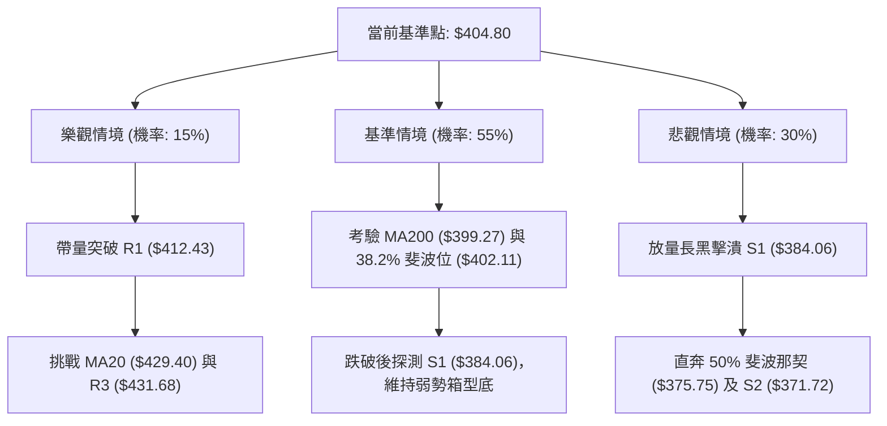

### 🛡️ 風險管理重要提醒

1. **半導體產業系統性波動**：近期新聞顯示「AI 概念股三週內市值縮水 5 兆美元，對沖基金自 2023 年以來首度轉為減持」，板塊情緒退潮將壓制龍頭台積電的估值溢價，切忌單純因本益比便宜而盲目抄底。
2. **波動率自適應部位控管**：
   - 當前 ATR 高達 **$13.42**，單筆交易的最大資金虧損嚴格限制在總資產的 **1.0%–1.5%** 之內。
   - 若採用策略 A（風險距離 $\$7.43$），每 10 萬美元資產之空單建立規模不宜超過 200 股（承擔約 $\$1,486$ 風險，符合 1.5% 風控上限）。
3. **嚴守停損紀律**：目前股價逼近 MA200 牛熊分界，此處法人停損賣壓極易形成連鎖反應。一旦確認跌破重要止損價位，嚴禁攤平加碼。

---

## 📋 報告總結

```
╔══════════════════════════════════════════════════════════════════╗
║                     TSM 技術分析報告總結                         ║
╠══════════════════════════════════════════════════════════════════╣
║ 報告日期：2026-11-04                                             ║
║ 當前價格：$404.80 USD                                            ║
║ 分析評級：🔴 偏空中性 (綜合評分: 39/100，處弱勢區間震盪)         ║
╠══════════════════════════════════════════════════════════════════╣
║ 關鍵結論：                                                       ║
║ ├─ 長期趨勢：🟢 宏觀牛市基底尚存，MA240 向上運行於 $382.64        ║
║ ├─ 中期趨勢：🔴 自歷史天價 $487.47 回跌，週線形成雙頂下殺結構    ║
║ ├─ 短期趨勢：🟡 跌破 MA20/50，正在考驗 MA200 ($399.27) 最後防線  ║
║ ├─ 關鍵支撐：S1: $384.06 │ S2: $371.72 │ 38.2% Fib: $402.11     ║
║ ├─ 關鍵阻力：R1: $412.43 │ R2: $419.86 │ MA20: $429.40          ║
║ └─ 外資共識：目標均價 $584.39 (高 $1000 / 低 $440)，基本面長線仍優 ║
╠══════════════════════════════════════════════════════════════════╣
║ 最優策略組合：                                                   ║
║ 1. 🥇 最佳機會：策略 A (反彈至 R1 $412.43 沽空，風報比 1:3.82)   ║
║ 2. 🥈 次選機會：策略 B (跌破 $398.29 順勢空至 S1，風報比 1:2.18)   ║
║ 3. 🥉 防守觀望：空手者靜待 MA200 是否爆量止跌，不進場盲目摸底   ║
╚══════════════════════════════════════════════════════════════════╝
```

---

> ⚠️ **免責聲明**：本報告為依據客觀技術指標數據生成之專業量化研究報告，所有點位推導均嚴格基於歷史量價與統計模型。本報告**僅供學術研究與投資策略討論參考**，**不構成任何要約、招攬或具體投資建議**。金融市場瞬息萬變，交易決策應獨立審慎評估，投資人須自行承擔全部市場風險。

---

*報告生成時間：2026-11-04 ｜ 數據來源：Yahoo Finance ｜ 分析框架：資深多時框技術分析模型*