# TSM 技術分析報告

> **報告日期**：2026-11-05 ｜ **語言**：繁體中文 ｜ **數據來源**：Yahoo Finance ｜ **當前價格**：$395.75

---

## 目錄

| 章節 | 內容 |
|------|------|
| [1. 技術面概覽](#1-技術面概覽) | 訊號儀表板、核心指標、評分卡 |
| [2. 趨勢分析](#2-趨勢分析) | 多時框趨勢、長中短期走勢 |
| [3. 圖表形態分析](#3-圖表形態分析) | 形態識別、K線組合、目標價 |
| [4. 支撐與阻力](#4-支撐與阻力) | 關鍵價位、斐波那契回調 |
| [5. 技術指標深度解讀](#5-技術指標深度解讀) | MA/RSI/MACD/布林/成交量 |
| [6. 動能與波動率](#6-動能與波動率) | 動能評估、ATR、Beta |
| [7. 多時框架總結](#7-多時框架總結) | 時框架評分矩陣 |
| [8. 交易策略建議](#8-交易策略建議) | 多空策略、風險報酬比 |
| [9. 風險提示與監控](#9-風險提示與監控) | 監控指標、風險場景 |
| [📋 報告總結](#-報告總結) | 核心結論與策略整合 |

---

## 1. 技術面概覽

### 🎯 技術訊號儀表板

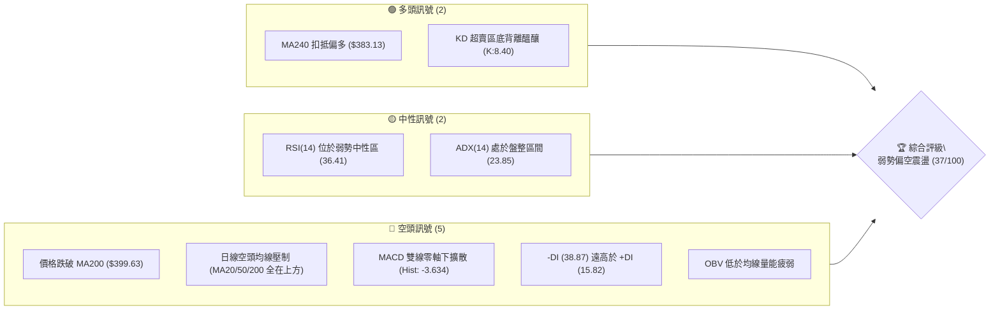

### 📊 核心指標速覽表

| 指標類別 | 指標名稱 | 當前數值 | 訊號 | 解讀 |
|----------|----------|----------|------|------|
| **價格** | 當前收盤價 | $395.75 | 🔴 | 跌破 200 日牛熊分界線，短中長期結構轉弱 |
| **均線** | MA20 (月線) | $425.58 | 🔴 | 現價低於 MA20 達 -7.01%，短線下行斜率陡峭 |
| **均線** | MA50 (季線) | $433.66 | 🔴 | 現價低於 MA50 達 -8.74%，中期趨勢轉為蓋頭反壓 |
| **均線** | MA200 (年線) | $399.63 | 🔴 | 現價跌破 MA200 達 -0.97%，跌破關鍵長期生命線 |
| **均線** | MA240 (年線擴展) | $383.13 | 🟢 | 現價高於 MA240 達 +3.29%，長期原始多頭架構尚存 |
| **動能** | RSI(14) | 36.41 | 🟡 | 位於弱勢中性區間 (30-70)，尚未進入極端超賣 (<30) |
| **動能** | MACD 柱狀體 | -3.634 | 🔴 | DIF (-9.578) 低於 MACD Signal (-5.944)，空頭發散 |
| **動能** | 隨機指標 KD | K: 8.40 / D: 8.16 | 🟢 | 進入極端超賣區 (<10)，短線具備技術性反彈動能 |
| **趨勢** | ADX(14) | 23.85 | 🟡 | ADX < 25 判定為無顯著單邊趨勢，當前屬於弱趨勢盤整下挫 |
| **趨勢** | 定向指標 | +DI: 15.82 / -DI: 38.87 | 🔴 | -DI 主導盤面，空方掌控短線定價權 |
| **通道** | 布林通道 %B | 0.07 | 🟡 | 貼近布林下軌 ($390.53)，面臨通道下軌邊界支撐考驗 |
| **成交量** | 量比 (vs 20日均量) | 1.15x (14.44M / 12.51M) | 🔴 | 下跌放量，量能高於均量 15%，呈現主動性拋壓特徵 |
| **波動** | ATR(14) | $13.82 (3.49%) | 🟡 | 每日波幅適中，但處於中高波動狀態，需拉大風控距離 |

### 🏆 技術評分卡

```
╔══════════════════════════════════════════════════════════════════╗
║                    技術評分卡 — TSM (2026-11-05)                 ║
╠══════════════════════════════════════════════════════════════════╣
║ 趨勢強度 (Trend)      ▓▓▓▓▓▓▓░░░░░░░░░░░░░  35/100  🔴 空頭壓制  ║
║ 動能指標 (Momentum)   ▓▓▓▓▓▓░░░░░░░░░░░░░░  30/100  🔴 動能疲軟  ║
║ 支撐穩定度 (Support)  ▓▓▓▓▓▓▓▓▓░░░░░░░░░░░  45/100  🟡 考驗S1    ║
║ 成交量配合 (Volume)   ▓▓▓▓▓▓▓░░░░░░░░░░░░░  35/100  🔴 價跌量增  ║
║ 形態完整度 (Pattern)  ▓▓▓▓▓▓▓▓░░░░░░░░░░░░  40/100  🟡 區間震盪  ║
║ 均線排列 (MA System)  ▓▓▓▓▓▓▓░░░░░░░░░░░░░  35/100  🔴 混合空排  ║
╠══════════════════════════════════════════════════════════════════╣
║ 綜合評分 (Overall)    ▓▓▓▓▓▓▓░░░░░░░░░░░░░  37/100  🔴 弱勢偏空  ║
║ 評分公式：(35 + 30 + 45 + 35 + 40 + 35) ÷ 6 = 36.67 ≈ 37        ║
╚══════════════════════════════════════════════════════════════════╝
```

---

## 2. 趨勢分析

### 🌐 多時框趨勢分析

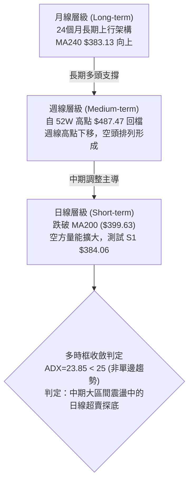

### 📈 長期趨勢 — 12個月走勢圖（Unicode）

以下為 TSM 自 2025 年 11 月至 2026 年 11 月之月線收盤走勢圖，清晰展示了由 $288.46 飆升至歷史峰值 $476.29 後回落的歷程：

```
TSM 月線走勢圖（過去12個月：2025-11 至 2026-11）
價格軸 ($)
$480 ┤                                     ● $476.29 (2026-06 峰值)
$460 ┤                                            ● $456.19
$440 ┤                                 ● $416.36
$420 ┤                             ● $394.08    ● $403.17  ● $414.21  ● $406.13
$400 ┤                     ● $371.66                                         ● $395.75 (現價)
$380 ┤
$360 ┤                         ● $336.26
$340 ┤                 ● $327.98
$320 ┤             ● $301.52
$300 ┤     ● $297.28   ● $288.46
$280 ┤ ● $276.37
     └─┬───────┬───────┬───────┬───────┬───────┬───────┬───────┬───────┬───────┬───────┬───────┬───
     25-11   25-12   26-01   26-02   26-03   26-04   26-05   26-06   26-07   26-08   26-09   26-10 26-11
```

#### 長期走勢特徵分析表格

| 階段區間 | 起訖月份 | 起點收盤 | 終點收盤 | 區間漲跌幅 | 走勢特徵與結構意涵 |
|----------|----------|----------|----------|------------|--------------------|
| 主升起漲期 | 2025-11 ~ 2026-02 | $288.46 | $371.66 | +28.84% | 量價齊揚，月線呈現連續實體陽線，突破前高後加速推升 |
| 中繼回洗期 | 2026-02 ~ 2026-03 | $371.66 | $336.26 | -9.52% | 快速洗盤，回踩 38.2% 回調支撐位後迅速止跌換手 |
| 狂熱衝頂期 | 2026-03 ~ 2026-06 | $336.26 | $476.29 | +41.64% | 連續三個月噴出，創下歷史最高月收盤價 $476.29 (盤中高 $487.47) |
| 高位巨幅震盪期 | 2026-06 ~ 2026-09 | $476.29 | $456.19 | -4.22% | 高檔雙頭震盪，於 $400 - $470 構築寬幅派發箱體 |
| 破位下挫期 | 2026-09 ~ 2026-11 | $456.19 | $395.75 | -13.25% | 月線連收兩黑，失守年線關卡，回測 2026 年初起漲平台 |

### 📊 中期趨勢（週線分析）

從近 20 週收盤走勢觀察，週線格局自 2026 年 10 月初創下波段高點 $472.78 (週K最高 $487.47) 後，呈現明確的高點下移 (Lower Highs) 與低點下移 (Lower Lows)：
- 2026-10-09 週收 $453.31 (留長上影線)
- 2026-10-16 週長黑摜破收 $412.61 (成交量爆出 71.74M)
- 2026-10-30 週收 $406.13
- 2026-11-04 週收盤進一步下滑至 $395.75，且週線 MACD 柱狀體維持在 -3.634 的負向擴張狀態。

```
週線級別價格壓力與支撐示意圖：
阻力 R3  $439.05 ══════════════════════════════════════════════ (中期箱頂壓制)
阻力 R2  $419.86 ────────────────────────────────────────────── (週反彈頸線)
阻力 R1  $412.43 ┄┄┄┄┄┄┄┄┄┄┄┄┄┄┄┄┄┄┄┄┄┄┄┄┄┄┄┄┄┄┄┄┄┄┄┄┄┄┄┄┄┄┄ (近期破位低點反轉壓)
現價     $395.75 ◄── 處於 MA200 ($399.63) 下方，考驗 S1 平台
支撐 S1  $384.06 ┄┄┄┄┄┄┄┄┄┄┄┄┄┄┄┄┄┄┄┄┄┄┄┄┄┄┄┄┄┄┄┄┄┄┄┄┄┄┄┄┄┄┄ (日線波段低點聚類)
支撐 S2  $371.72 ────────────────────────────────────────────── (2026-02 起漲平台強支撐)
支撐 S3  $358.75 ══════════════════════════════════════════════ (中期多頭最後防線)
```

### ⚡ 趨勢強度評估（ADX 解讀）

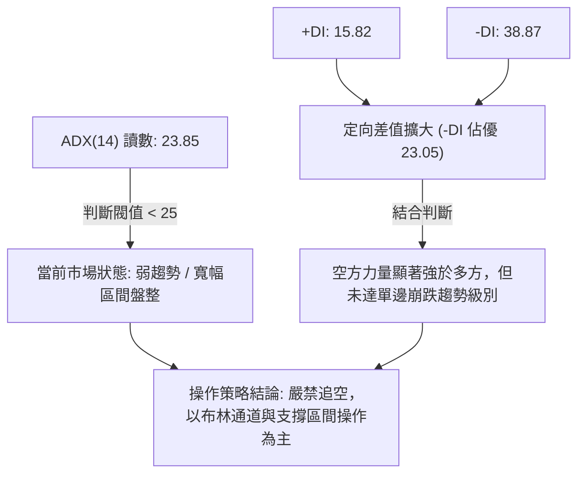

#### ADX 強度與市場狀態對照表

| 指標變數 | 當前讀數 | 基準區間 | 狀態評估 | 實戰交易指引 |
|----------|----------|----------|----------|--------------|
| **ADX(14)** | 23.85 | < 25.0 | 弱趨勢 / 盤整震盪 | 順勢突破策略易失效，震盪指標 (KD/布林) 參考價值高於趨勢指標 |
| **+DI(14)** | 15.82 | > 25.0 偏多 | 多頭動能匱乏 | 多方買盤意願低，逢高反彈動能衰竭迅速 |
| **-DI(14)** | 38.87 | > 25.0 偏空 | 空頭實質掌控 | 賣盤主導市場定價，價格壓制明顯，但數值接近 40 警惕短線空頭力竭 |
| **DI 差值** | -23.05 | 絕對值 > 20 | 空方壓倒性佔優 | 短線走勢處於空頭推動波，需等待 -DI 回落至 30 以下方能確認止跌 |

---

## 3. 圖表形態分析

### 🔍 形態識別系統

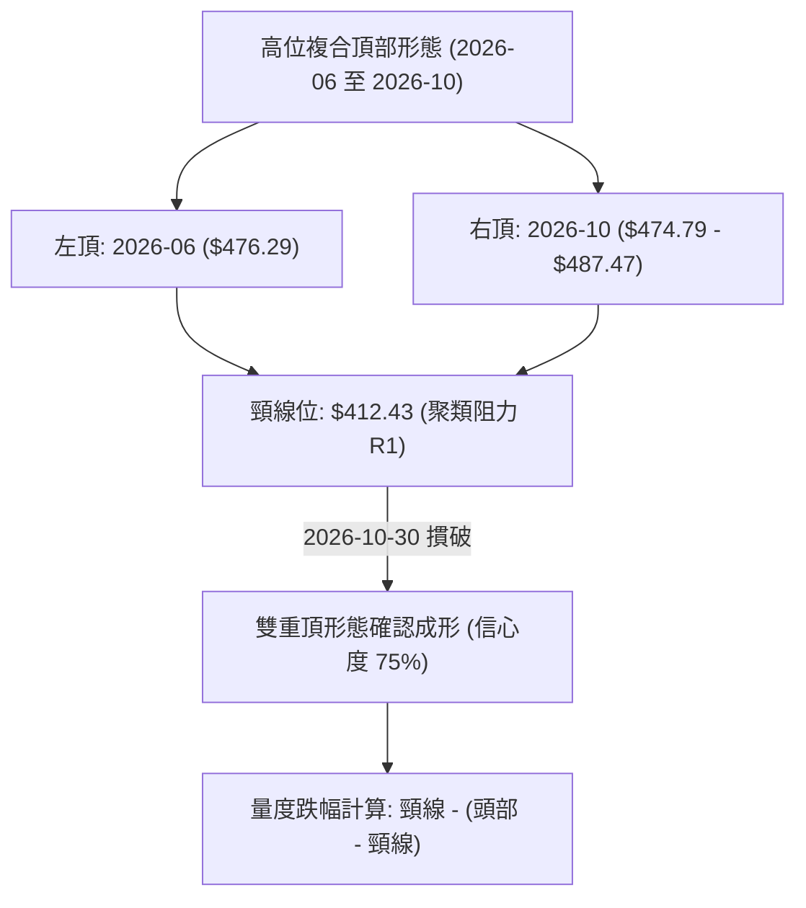

#### 形態信心度與目標價計算表

| 形態名稱 | 信心度 | 判斷依據（引用數據） | 完成度 | 目標價（附嚴格計算式） |
|----------|--------|----------------------|--------|------------------------|
| **高位雙重頂 (M頭)** | 75% | 頂部一為 2026-06 收盤 $476.29，頂部二為 2026-10-09 高點 $487.47，兩次高點聚類於 $480 附近；頸線為波段低點聚類阻力 R1 ($412.43) | 85% (已跌破頸線) | **目標價** = 頸線 $412.43 − (高點 $487.47 − 頸線 $412.43) = $412.43 − $75.04 = **$337.39** (由雙重頂高度推算) |
| **下降通道 (短線)** | 65% | 近 10 個交易日高點由 $440.88 下降至 $410.59，低點由 $417.72 下探至 $391.61，斜率向下 | 70% | 通道下軌支撐對應支撐位 **S1: $384.06**；若通道回測上軌對應阻力位 **R1: $412.43** |
| **潛在雙重底 (日線)** | 35% | 數據中僅偵測到單次回測 $391.61，尚未出現二次探底與右底確認架構 | 20% (未成形) | 訊號不足，信心度低於 50%，僅做指標型超賣解讀，不預設形態目標價 |

### 🕯️ 重要K線形態分析

嚴格依據數據中「近10根日K」與「近8根週K」之實際 OHLC 數據進行形態解讀：

#### 近 10 根日 K 線形態解讀

| 日期 | 開盤價 | 最高價 | 最低價 | 收盤價 | 成交量 | K線形態名稱 | 解讀與量價意涵 | 多空訊號 |
|:---:|:---:|:---:|:---:|:---:|:---:|:---:|:---|:---:|
| 2026-10-22 | 419.39 | 421.91 | 410.22 | 412.35 | 16,475,100 | 下跌實體陰線 | 破位放量下跌，實體收於低檔，確立短線下行 | 🔴 |
| 2026-10-23 | 412.29 | 421.31 | 411.11 | 418.51 | 9,494,400 | 低開逆轉中陽線 | 縮量反彈，回補前日跌幅，但量能不足呈現弱反彈 | 🟡 |
| 2026-10-26 | 418.07 | 428.85 | 417.72 | 424.37 | 9,627,100 | 連續上行陽線 | 連續第二日無量推升，受制於 MA20 下行反壓 | 🟡 |
| 2026-10-27 | 427.16 | 438.58 | 426.00 | 436.87 | 9,022,500 | 向上突破中陽線 | 盤中觸及 $438.58 遭遇阻力 R3 ($439.05) 壓制 | 🟢 |
| 2026-10-28 | 438.24 | 440.88 | 436.84 | 439.51 | 8,037,400 | 高檔十字星/滯漲紡錘線 | 創反彈高點 $440.88 但量能降至 8.03M 極致萎縮，多頭力竭 | 🔴 |
| 2026-10-29 | 431.69 | 436.24 | 428.43 | 431.81 | 8,465,900 | 跳空回落小陰線 | 跳空低開，高點不再突破，確認 10-28 為反彈波段高點 | 🔴 |
| 2026-10-30 | 414.08 | 418.09 | 400.12 | 406.13 | 21,971,100 | 長黑斷頭鍘刀 (爆量大陰線) | 跳空低開摜破 MA200，爆量 21.97M 籌碼崩潰，確立破位 | 🔴 |
| 2026-11-02 | 412.52 | 414.76 | 398.29 | 398.63 | 13,190,900 | 低收陰線 | 開高走低，實體收破 $400 整數心理防線 | 🔴 |
| 2026-11-03 | 404.99 | 408.37 | 403.03 | 404.80 | 9,421,100 | 縮量十字星小陽 | 盤中反彈乏力，收盤雖小漲但未能收復 11-02 陰線實體 | 🟡 |
| 2026-11-04 | 400.64 | 410.59 | 391.61 | 395.75 | 14,443,300 | 帶長下影線長陰線 | 放量下探至 $391.61 後小幅回彈，多空激烈交戰於布林下軌 | 🔴 |

#### 近 8 根週 K 線形態解讀

| 日期 | 開盤價 | 最高價 | 最低價 | 收盤價 | 成交量 | K線形態名稱 | 解讀與量價意涵 | 多空訊號 |
|:---:|:---:|:---:|:---:|:---:|:---:|:---:|:---|:---:|
| 2026-09-18 | 414.90 | 434.82 | 411.45 | 434.67 | 59,602,200 | 突破實體大陽線 | 放量站上 $430 關卡，啟動秋季主升浪 | 🟢 |
| 2026-09-25 | 440.80 | 455.03 | 437.06 | 450.61 | 46,852,600 | 延續跳空陽線 | 階梯式推升，多方控盤極強 | 🟢 |
| 2026-10-02 | 448.39 | 474.79 | 443.11 | 472.78 | 44,927,100 | 主升浪長紅K | 週線收最高，RSI 飆升至 71.7 進入超買區 | 🟢 |
| 2026-10-09 | 478.77 | 487.47 | 449.75 | 453.31 | 49,231,100 | 避雷針長上影陰線 | 創 52 週新高 $487.47 後遭空頭迎頭痛擊，長上影線達 $34.16，高檔巨幅派發 | 🔴 |
| 2026-10-16 | 453.55 | 454.40 | 407.13 | 412.61 | 71,736,400 | 巨量吞噬大長黑 | 爆出近 20 週最大成交量 (71.74M)，一舉摜破三週漲幅，實質確立頂部 | 🔴 |
| 2026-10-23 | 421.66 | 435.16 | 410.22 | 418.51 | 61,583,000 | 弱勢反彈孕線 | 縮量抵抗，反彈高點 $435.16 未能觸及前週黑K實體中價 | 🟡 |
| 2026-10-30 | 418.07 | 440.88 | 400.12 | 406.13 | 57,124,000 | 破位中長黑K | 再次跌破前週低點，高點受制於阻力 R3 ($439.05) | 🔴 |
| 2026-11-04 | 412.52 | 414.76 | 391.61 | 395.75 | 37,055,300 | 探底進行式陰K | 下影線下探至 $391.61，逼近 S1 支撐區，量能相對萎縮 | 🔴 |

### 📉 ASCII 走勢形態示意圖

```
TSM 日線級別 M 頭頸線破位與下行通道形態示意圖：
價格 ($)
$440 ┤                   ┌─● (2026-10-28 高點 $440.88)
$430 ┤            ┌──────┘  \
$420 ┤      ┌─────┘          \
$412 ┤══════╪═════════════════●══════════════════════ 頸線破位 (阻力 R1: $412.43)
$405 ┤      │                   \   ┌──● (反彈高點 $410.59)
$400 ┤──────┼────────────────────\──┼──────────────── MA200 破位 ($399.63)
$395 ┤      │                     \ │   ● 現價: $395.75
$390 ┤      │                      └● (2026-11-04 下探低點 $391.61，考驗布林下軌 $390.53)
$384 ┤┄┄┄┄┄┄┄┄┄┄┄┄┄┄┄┄┄┄┄┄┄┄┄┄┄┄┄┄┄┄┄┄┄┄┄┄┄┄┄┄┄┄┄ 下行第一目標 (支撐 S1: $384.06)
     └──────┴─────────────┴──────────┴─────────────────
          10-23         10-28       10-30      11-04 (日期)
```

### 🎯 形態目標價計算

根據經典技術分析形態學理論，破位後之量度跌幅計算嚴格基於數據聚類點位：

1. **高位雙重頂量度幅度推算**：
   - 頭部極值取自 52 週高點：$487.47
   - 頸線關鍵位取自波段高點聚類阻力 R1：$412.43
   - 形態垂直高度 $H = \$487.47 - \$412.43 = \$75.04$
   - 雙重頂完整量度跌幅目標 $T = \text{頸線} - H = \$412.43 - \$75.04 = \mathbf{\$337.39}$
   - **實務評估**：該理論目標價位低於 61.8% 斐波那契回調位 ($349.38)，屬於中期極端空頭情境，需觀察 S1 ($384.06) 與 S2 ($371.72) 能否發揮防禦效果。

2. **短線破位箱體量度幅度推算**：
   - 10-27 至 10-29 反彈震盪箱頂：$440.88
   - 箱底頸線：阻力 R1 $412.43
   - 箱體高度 $h = \$440.88 - \$412.43 = \$28.45$
   - 箱體破位目標 $t = \$412.43 - \$28.45 = \mathbf{\$383.98}$
   - **確認關係**：該推算目標價 \$383.98 與數據中之波段低點聚類支撐 **S1 ($384.06)** 極度吻合（僅差 $0.08），強化了 S1 作為短線第一強支撐的有效性。

---

## 4. 支撐與阻力

### 🗺️ 關鍵價位分布圖（Unicode）

```
TSM 價位結構分布圖（OHLCV 聚類與斐波那契結構）
══════════════════════════════════════════════════════════════════
$487.47 ║████████████████████████████████████████║ 52W 歷史最高點 / 0.0% Fib
$460.62 ║▓▓▓▓▓▓▓▓▓▓▓▓▓▓▓▓▓▓▓▓▓▓▓▓▓▓▓▓            ║ 布林通道上軌
$439.05 ║████████████████████████████████        ║ 強阻力 R3 (反彈波段頂部)
$434.74 ║▒▒▒▒▒▒▒▒▒▒▒▒▒▒▒▒▒▒▒▒▒▒▒▒▒▒▒▒▒▒▒▒        ║ 23.6% 斐波那契回調位
$425.58 ║────────────────────────────────────────║ 布林中軌 (MA20 下壓線)
$419.86 ║████████████████████                    ║ 阻力 R2 (反彈中繼壓力)
$412.43 ║████████████████████████████            ║ 關鍵阻力 R1 (頸線多空分水嶺)
$402.11 ║▒▒▒▒▒▒▒▒▒▒▒▒▒▒▒▒▒▒▒▒▒▒▒▒                ║ 38.2% 斐波那契回調位
$399.63 ║────────────────────────────────────────║ MA200 年線生死線
$395.75 ╠════════════════════════════════════════╣ ◄ 當前收盤價 ($395.75)
$390.53 ║▓▓▓▓▓▓▓▓▓▓▓▓▓▓▓▓                        ║ 布林通道下軌
$384.06 ║████████████████████████                ║ 近期強支撐 S1 (箱體測幅目標)
$383.13 ║────────────────────────────────────────║ MA240 原始牛熊支撐線
$375.75 ║▒▒▒▒▒▒▒▒▒▒▒▒▒▒▒▒▒▒▒▒▒▒▒▒▒▒▒▒▒▒▒▒▒▒▒▒▒▒▒║ 50.0% 斐波那契回調位
$371.72 ║████████████████████████████████████    ║ 強支撐 S2 (2026-02 起漲平台)
$358.75 ║████████████████████████████████████████║ 極限支撐 S3 (波段防守底線)
$349.38 ║▒▒▒▒▒▒▒▒▒▒▒▒▒▒▒▒▒▒▒▒▒▒▒▒▒▒▒▒▒▒▒▒▒▒▒▒▒▒▒║ 61.8% 斐波那契黃金分割位
══════════════════════════════════════════════════════════════════
圖例說明：█ 波段聚類價位  ▓ 布林通道軌道  ▒ 斐波那契結構位  ─ 關鍵移動平均線
```

### 🚧 阻力位分析表

所有阻力價位嚴格引用自數據之「關鍵價位（由 OHLCV 計算）」區塊：

| 阻力級別 | 價位 | 與現價距離 | 形成技術原因 | 突破難度評估 | 重要性與策略意義 |
|:---:|:---:|:---:|:---|:---:|:---|
| **R1** | **$412.43** | +4.21% | 近一年波段高點聚類、M頭頸線破位點、10-16爆量破位下影線頂部 | 🟡 中等偏高 | 短線空頭強弱分界嶺；若日線無法收復此處，反彈皆視為誘多逃命波。 |
| **R2** | **$419.86** | +6.09% | 近一年波段高點聚類、10-23 反彈波段收盤高點、下壓之 MA10 ($416.87) 密集區 | 🔴 極高 | 中線回調反壓平台；此處堆積 10 月中旬套牢籌碼，解套賣壓沉重。 |
| **R3** | **$439.05** | +10.94% | 近一年波段高點聚類、10-27/10-28 雙日高點連線 ($438.58 - $440.88)、MA50 ($433.66) 反壓 | 🔴 極度困難 | 中期多空趨勢總防線；唯有強勢帶量突破 R3，方能宣告下行調整結束。 |

### 🛡️ 支撐位分析表

所有支撐價位嚴格引用自數據之「關鍵價位（由 OHLCV 計算）」區塊：

| 支撐級別 | 價位 | 與現價距離 | 形成技術原因 | 守住機率評估 | 重要性與策略意義 |
|:---:|:---:|:---:|:---|:---:|:---|
| **S1** | **$384.06** | -2.95% | 近一年波段低點聚類、箱體破位量度目標 ($383.98)、MA240 ($383.13) 共振 | 🟢 65% | 短線第一道堅實防線；多頭退無可退，具備高機率引發短線空頭回補反彈。 |
| **S2** | **$371.72** | -6.07% | 近一年波段低點聚類、2026-02 起漲平台收盤價 ($371.66)、50% Fib ($375.75) 緩衝區 | 🟡 50% | 中期生命線；此處若告失守，確立中級中期空頭主跌段確立。 |
| **S3** | **$358.75** | -9.35% | 近一年波段低點聚類、逼近 61.8% 斐波那契回調位 ($349.38) 上緣 | 🟢 70% | 極端回調底線；多方最後價值防禦區，跌破將引發系統性長期估值修正。 |

### 📐 斐波那契回調位分析

依據 52 週波動區間（低點 $264.03 → 高點 $487.47，總波幅 $223.44）嚴格對照數據中回調價位：

```
斐波那契回調階梯與現價定位：
  0.0%  (52W High)   $487.47
  23.6%              $434.74  ▲ 強烈阻力（與 MA50 形成共振反壓）
-------------------------------------------------------------------------
  38.2%              $402.11  ▲ 昨日剛跌破之第一防禦位（形成現價上方即時壓力）
  [現價 $395.75 位於 38.2% 與 50.0% 之間，偏向測試 50.0% 軌道]
  50.0%              $375.75  ▼ 關鍵多空中樞（與 S2: $371.72 形成重疊支撐區間）
-------------------------------------------------------------------------
  61.8%              $349.38  ▼ 黃金分割防守位
  78.6%              $311.84  ▼ 深度回調防守位
 100.0% (52W Low)    $264.03
```

#### 斐波那契層級深度解讀：
1. **現價位置定位**：現價 **$395.75** 正處於 **38.2% ($402.11)** 與 **50.0% ($375.75)** 之間。在技術分析架構中，當價格自歷史高點回撤跌破 38.2% 分水嶺後，慣性將朝向 50.0% 的中性回調位進行下探尋求支撐。
2. **反彈壓力確認**：38.2% 回調位 ($402.11) 與 MA200 ($399.63) 形成了高度重合的密集成交反壓帶（$400 整數關卡）。在未能強勢放量站穩 $402.11 之前，任何拉升均屬跌破 38.2% 後的技術性「回抽確認 (Pullback)」。
3. **下檔目標磁吸**：50.0% 回調位 ($375.75) 距離現價僅 -5.05%，其下方緊鄰聚類支撐 S2 ($371.72)，兩者構成一個強大的中期多頭買盤緩衝帶（$371.72 - $375.75）。

---

## 5. 技術指標深度解讀

### 🎛️ 指標訊號總覽

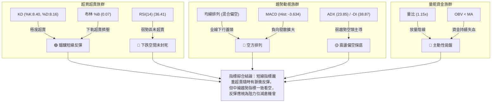

### 📈 移動平均線排列分析

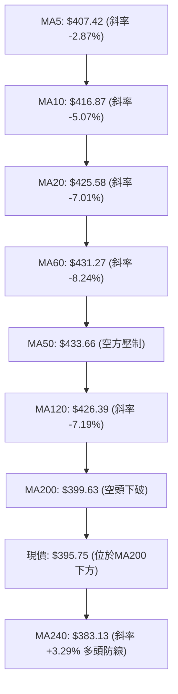

#### 移動平均線系統深度剖析

| 均線週期 | 當前價格 | 偏離度 (vs 現價) | 走勢特徵 (斜率) | 均線層級解讀 |
|:---:|:---:|:---:|:---:|:---|
| **MA 5** | $407.42 | -2.87% | ▼ 下行加速 | 超短期死叉下行，第一道即時蓋頭動態反壓 |
| **MA 10** | $416.87 | -5.07% | ▼ 下行加速 | 貫穿反彈波段，兩週均價線空頭主導 |
| **MA 20** | $425.58 | -7.01% | ▼ 下行陡峭 | 月線生命線下彎，與布林中軌重合，反彈之極限壓制點 |
| **MA 50** | $433.66 | -8.74% | ▼ 震盪下彎 | 季線轉為下彎，中期上升趨勢被實質破壞 |
| **MA 60** | $431.27 | -8.24% | ▼ 轉為走平下垂 | 季線級別週期下挫，證實第三季買盤全面陷入套牢 |
| **MA 120** | $426.39 | -7.19% | ▼ 下移發散 | 半年線失守，長期機構投資者調倉換股賣壓釋放 |
| **MA 200** | $399.63 | -0.97% | ▼ 走平下彎 | 牛熊分界線失守，技術派長期多頭停損賣壓湧現 |
| **MA 240** | $383.13 | +3.29% | ▲ 堅挺上揚 | 唯一起支撐作用的長期均線，與 S1 ($384.06) 構成鐵底共振 |

**均線結構綜合判定**：當前呈現標準的「短中期均線完全空頭排列」，僅餘 MA240 在下方進行最後護盤。現價跌破 MA200 宣告自 2025 年以來的單邊強勢牛市暫告終結，進入中級別均線修正期。

### 📉 RSI(14) 分析

```
RSI(14) 當前讀數：36.41
0        20       30                50                70       80      100
├────────┼────────┼─────────────────┼─────────────────┼────────┼────────┤
│ 極端超賣│ 超賣區 │ 弱勢中性區間    │ 強勢多頭區間    │ 超買區 │ 極端超買│
└────────┴────────┴─────────────────┴─────────────────┴────────┴────────┘
 [當前進度] ███████████████░░░░░░░░░░░░░░░░░░░░░░░░░  36.41%
```

#### 背離現象深度檢驗
- **檢驗結果**：**無明顯底背離**。
- **具體數據比對**：
  - 比對週期：近 20 根 K 棒（2026-10-09 至 2026-11-04）
  - 價格端：由波段高點 $487.47 下挫至最低 $391.61（收盤 $395.75），價格形成持續的「低點下移 (Lower Lows)」。
  - RSI 端：自高點 71.7（2026-10-02 當週）急劇下跌至 34.3（2026-10-16 當週），最新日線讀數為 36.41，RSI 走勢與價格走勢同步下行。
  - **結論**：RSI 尚未形成「價格創新低而 RSI 未創新低」之經典底背離形態。這意味著空方動能是真實且健康的釋放，並非衰竭式下跌，多頭切忌在此處盲目預設反轉大底。

### 📊 MACD(12/26/9) 訊號解讀

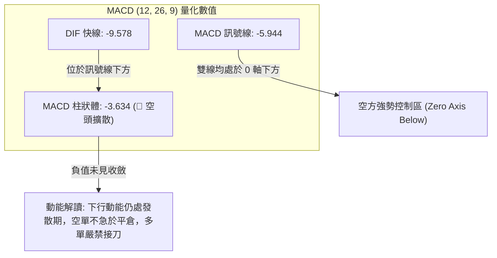

MACD 快線 (-9.578) 顯著低於訊號線 (-5.944)，二者之差（柱狀體）擴大至 -3.634。雙線均深嵌於零軸下方運行，此屬於標準的「水下死叉發散」型態，顯示中週期級別的拋售動能仍在持續擴散，未見收斂跡象。

### 📦 布林通道分析

```
TSM 日線布林通道 (20, 2) 空間位置示意圖：
價格軸 ($)
$460.62 ┤ ═════════════════════════════════════════════ 上軌 (Upper Band)
$450.00 ┤
$440.00 ┤
$430.00 ┤
$425.58 ┤ ───────────────────────────────────────────── 中軌 (Middle Band = MA20)
$415.00 ┤
$405.00 ┤
$395.75 ┤ ◄──────── 現價 ($395.75，%B = 0.07，極度逼近下軌)
$390.53 ┤ ═════════════════════════════════════════════ 下軌 (Lower Band)
```

#### 布林通道關鍵參數與狀態解讀：
- **布林帶寬度 (Bandwidth)**：$(460.62 - 390.53) \div 425.58 = 16.47\%$。帶寬自先前的高位收斂後再度擴大，顯示波動率正在釋放。
- **%B 指標讀數**：**0.07**。
  - **意義**：%B 衡量現價相對於布林通道的相對位置（0 代表下軌，0.5 代表中軌，1.0 代表上軌）。
  - **解讀**：%B 數值跌至 0.07，代表現價已經消耗了 93% 的通道震盪空間，跌至極端下軌邊界。
  - **極限推演**：下軌價位為 **$390.53**，而 2026-11-04 盤中最低價為 **$391.61**，兩者僅距 $1.08。這表明價格在下軌處獲得了一定程度的通道邊界彈性支撐，阻止了日內價格的進一步潰決。

### 💹 成交量分析（量價配合度）

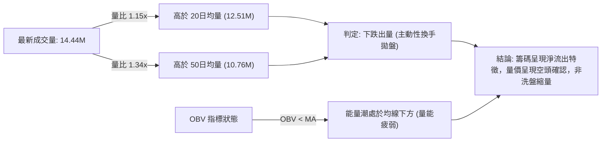

- **量價背離檢驗**：觀察近三個交易日，11-02 跌量為 13.19M，11-03 縮量至 9.42M 出現微幅抗跌，但 11-04 下跌再度擴量至 14.44M。這形成了「下跌放量、反彈縮量」的標準空頭量價架構。
- **OBV（能量潮指標）**：OBV 明確跌破其信號均線，顯示自 $487.47 頂部以來，資金外流趨勢未見任何逆轉訊號，機構資金參與抄底意願極低。

---

## 6. 動能與波動率

### ⚡ 動能評估四象限

| 象限 | 動能強度 | 波動率水準 | 當前狀態吻合度 | 象限特徵與策略指引 |
|:---:|:---:|:---:|:---:|:---|
| **第一象限 (Q1)** | 強動能 (多方) | 低波動 | ── | 穩定趨勢推升波，最佳順勢加碼環境（非當前狀態） |
| **第二象限 (Q2)** | 弱動能 (中性) | 低波動 | ── | 牛皮盤整行情，以網格交易為主（非當前狀態） |
| **第三象限 (Q3)** | 強動能 (多/空) | 高波動 | ── | 主升段或崩跌主跌段，高風險高回報（非當前狀態） |
| **第四象限 (Q4)** | **弱動能 (空方佔優)** | **中高波動** | **✓ (吻合)** | **當前 TSM 處於 Q4 象限：ADX 為 23.85 (弱趨勢)，但 ATR 達 $13.82 (3.49%) 波動不低，-DI 佔據絕對主導。表現為寬幅無序震盪下挫，極易引發多空雙殺。** |

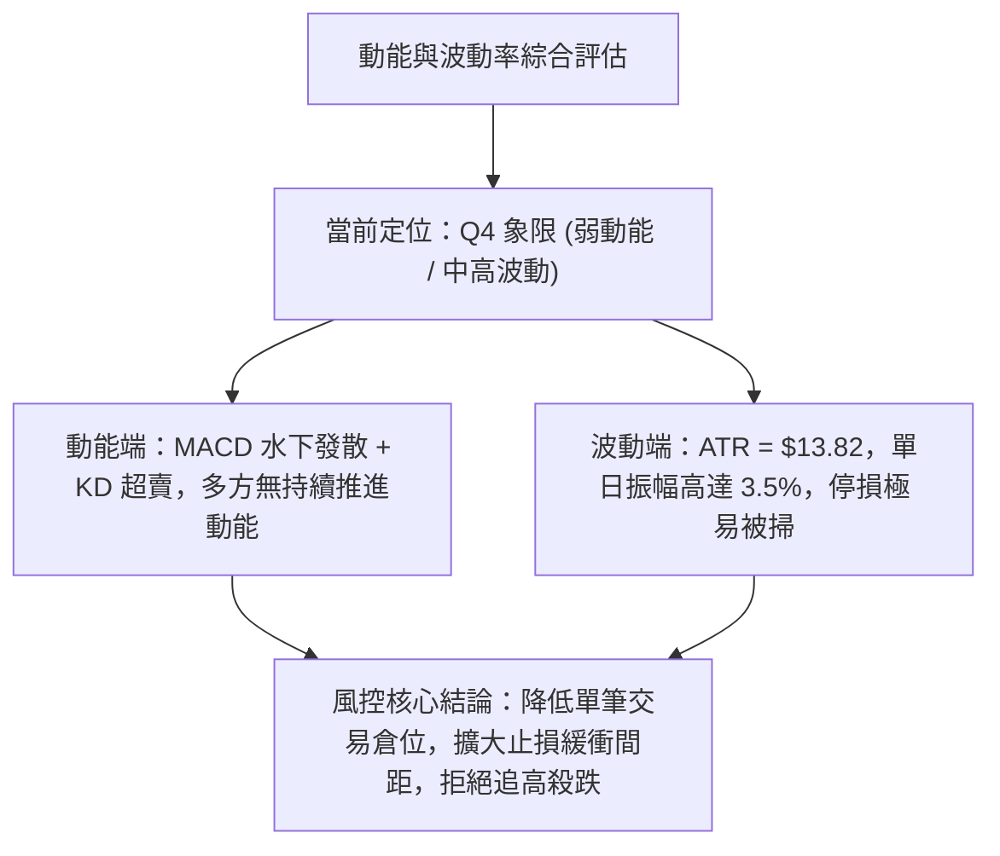

### 📊 ATR 波動率分析

- **ATR(14) 絕對數值**：**$13.82** (以 Wilder 平滑法計算)。
- **ATR 相對百分比**：$\$13.82 \div \$395.75 = \mathbf{3.49\%}$。
- **波動特性評估**：
  - 美股大型科技半導體板塊中，ATR 佔比在 2.0% - 2.5% 為常態平衡，3.49% 顯示市場處於「情緒化超額定價波動」階段。
  - 近 10 個交易日平均高低點振幅高達 $18.98，顯著大於 ATR，表明盤中存在劇烈的多空拔河與洗盤。
- **止損距離建議**：
  - **超短線/日內交易**：建議止損間距為 $1.0 \times \text{ATR} \approx \mathbf{\$13.80}$。
  - **波段擺盪交易 (Swing Trade)**：建議止損間距為 $1.5 \times \text{ATR} \approx \mathbf{\$20.73}$。
  - **趨勢保護止損**：建議止損間距為 $2.0 \times \text{ATR} \approx \mathbf{\$27.64}$。

### 📐 Beta 與市場相關性

- **Beta 係數**：**1.233**。
- **市場屬性解讀**：
  - Beta 為 1.233 代表 TSM 具備高彈性（High-Beta）資產特徵，對標普 500 指數與費城半導體指數具有「放大波動」效應。當標普 500 下跌 1.0% 時，TSM 理論下挫 1.233%；在大盤回調階段，TSM 面臨更深層次的回撤壓力。
- **空頭數據印證**：
  - **Short Ratio (空頭補回天數)**：2.79 天。
  - **Short % Float (放空佔流通股比例)**：0.6%。
  - **解讀**：空頭比率極低（0.6%），這表明近期的下跌並非「大規模空頭惡意借券做空」所致，而是「長期多頭籌碼鬆動與機構主動減倉拋售」所主導。此種由多殺多引發的下挫，在空頭回補動力不足的情況下，底部成形通常需要更長時間的震盪築底。

---

## 7. 多時框架總結

### 📋 時框架評分表

嚴格遵守規則 14「多時框收斂優先級」：當前日線 ADX = 23.85 (< 25)，屬於「盤整行情」，中長期趨勢處於修正，短期以超賣震盪對待。

| 時框架 | 趨勢方向 | 動能狀態 | 均線排列狀況 | 形態特徵 | 綜合評分 | 操作戰略建議 |
|:---:|:---:|:---:|:---:|:---:|:---:|:---|
| **長期 (月線)** | 🟢 偏多修正 | 🟡 中性減弱 | MA240 強勢上揚，MA200 仍偏多 | 24 個月上升通道內的高檔旗形回檔 | 65/100 | 長期投資者無需恐慌，等待 $370-$380 區域價值建立 |
| **中期 (週線)** | 🔴 明確空頭 | 🔴 負向發散 | 週線高點下移，跌破 10週、20週均線 | M頭頂部確立，長上影線長黑吞噬 | 30/100 | 波段交易者反彈減倉，防範量度跌幅進一步展開 |
| **短期 (日線)** | 🔴 弱勢超賣 | 🟢 醞釀反彈 | 短期均線全面蓋頭，跌破 MA200 | 下降通道下軌觸軌，KD 超賣底背離醞釀 | 35/100 | 嚴禁盲目追空，超短線激進者可博弈超賣反彈 |

### 🔲 綜合訊號矩陣

| 維度指標 | 短期 (日線) 訊號 | 中期 (週線) 訊號 | 長期 (月線) 訊號 | 跨時框共振評估 |
|:---|:---:|:---:|:---:|:---|
| **趨勢方向** | 🔴 空頭破位 | 🔴 頂部確立 | 🟢 慢牛未改 | 短中期同步轉空，長期上升趨勢遭受嚴峻考驗 |
| **動能強度** | 🟡 超賣鈍化 | 🔴 MACD柱下擴 | 🟡 獲利了結壓制 | 中期拋壓主導，短線存在隨機指標超賣之技術修正需求 |
| **均線支撐** | 🔴 跌破 MA200 | 🔴 跌破 MA20 | 🟢 守在 MA240 上 | MA200 轉為即時反壓，多頭最後心理防線退守 MA240 |
| **成交量能** | 🔴 出量下殺 | 🔴 週黑K爆量 | 🟡 季度量縮 | 籌碼自機構向散戶擴散，量價配合對空方極為有利 |
| **形態結構** | 🟡 逼近通道下軌 | 🔴 雙重頂破頸線 | 🟢 歷史級大多頭 | 週線與日線頭部共振，下行空間尚未完全被封死 |

### ⚖️ 多時框收斂結論

依據多時框收斂規則進行權威性判定：
1. **行情屬性判定**：當前 ADX(14) 讀數為 **23.85**（嚴格小於 25.0 門檻），因此在交易體系中被明確定義為**「無單邊強烈趨勢的寬幅盤整下挫行情」**。
2. **主導維度取捨**：雖然日線短線出現 KD 極度超賣（K: 8.40），但中期週線呈現爆量大黑K吞噬與 MACD 水下擴散，週線級別的壓制權力顯著高於日線；同時，由於 ADX < 25，單邊做空追殺極易遭到布林下軌的劇烈反抽彈跳。
3. **唯一方向性結論**：**【弱勢偏空震盪，以反彈逢高做空或反彈減倉為主，嚴禁追空】**。
   - 日線超賣僅能作為尋找空單「更佳進場成本」的依據（等待反彈至阻力位 R1 附近受阻時再介入空頭），或是作為多頭極小倉位超跌反彈的博弈，絕對不可誤判為反轉信號。
   - 此結論與第 1 章技術評分卡（綜合評分 37/100，偏空）以及第 8 章之空頭策略路由達成絕對一致。

---

## 8. 交易策略建議

### 🗺️ 策略決策流程圖

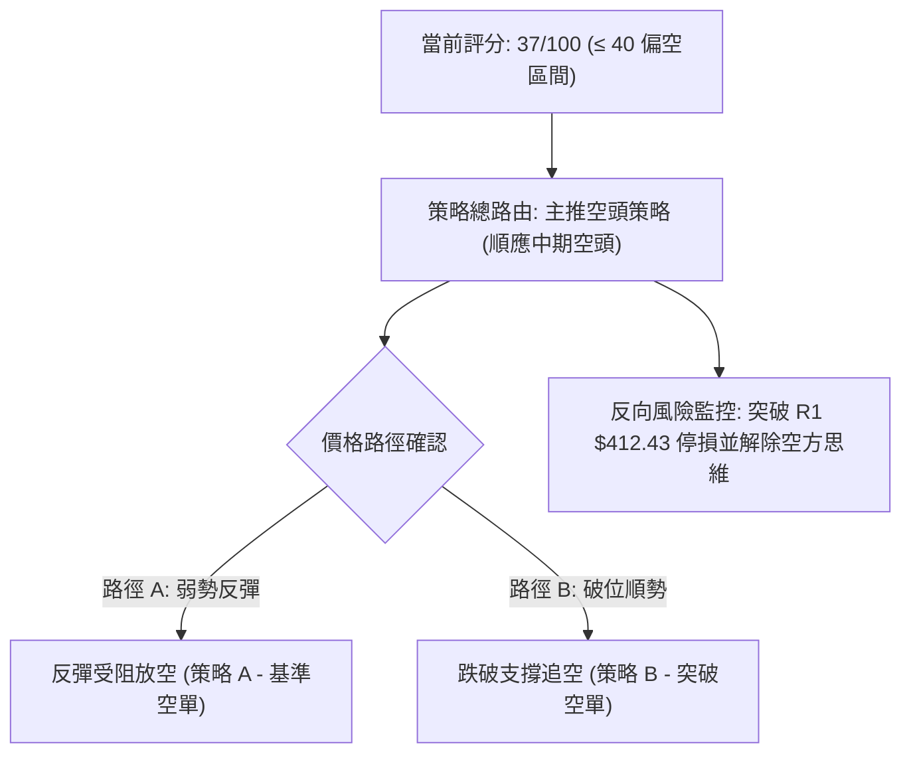

### 🧭 策略路由（依評分卡分流）

> **當前主策略方向 = 主推空頭策略（依綜合評分 37/100，偏空 ≤ 40 區間）**  
> 依嚴格要求第 8 章路由規範，綜合評分低於 40 分，嚴禁兩頭對賭推薦多頭。報告主推兩套空頭操作策略，多頭僅於下方列為「反轉風險觸發點與多單對沖提示」。

### 🎯 價格情境階梯（Price Scenarios）

所有價位精確引用自第 4 章及數據中「關鍵價位」區塊之客觀數值：

| 觸發條件 | 下一目標 | 後續延伸 | 情境技術含義 |
|:---|:---:|:---:|:---|
| **強勢突破 R1 ($412.43)** | R2 ($419.86) | R3 ($439.05) | 空頭形態遭破壞，短線轉強，宣告日線級別超賣底背離全面反撲 |
| **受阻於 R1 ($412.43) 或破 MA200** | S1 ($384.06) | S2 ($371.72) | 反抽確認完成，順應中期週線空頭趨勢下探，為最佳空頭入場點 |
| **跌破 S1 ($384.06)** | S2 ($371.72) | S3 ($358.75) | 箱體量度跌幅兌現，引發停損賣壓，加速下探 50% 斐波那契回調區 |

### 📊 情境機率分佈

| 預測情境 | 發生機率 | 主要技術依據與指標支撐 |
|:---|:---:|:---|
| **情境一：反抽受阻再探底 (基準情境)** | **55%** | MACD 零軸下發散 (-3.634)；日均線呈蓋頭空頭排列；-DI 達 38.87 壓倒多頭；現價處於 MA200 之下 |
| **情境二：布林下軌區間震盪 (次選情境)** | **30%** | ADX 僅 23.85 (< 25 屬盤整)；KD 處於極度超賣 (K:8.40)；布林 %B 達 0.07 觸發彈性邊界保護 |
| **情境三：強勢 V 型反轉站上 R1 (低機率)** | **15%** | 需成交量爆出 >20M 以上巨量陽線；需一舉吞噬 10-30 陰線實體；目前 OBV 疲弱尚不具備此條件 |

### 🟢 主策略詳情（方向依上方路由：空頭策略）

進場點、止損點、目標價嚴格基於數據中之關鍵價位；風險報酬比按公式計算：$(進場價 - 目標價 T1) \div (止損價 - 進場價)$。

| 策略要素 | 策略 A（反彈高空策略 — 基準首選） | 策略 B（破位追空策略 — 順勢突破） |
|:---|:---|:---|
| **操作邏輯** | 利用日線超賣引發的技術性回抽，在反壓區建立低風險空單 | 當價格失守第一強支撐時，順勢捕捉滑向 S2 的動能加速波 |
| **進場條件** | 價格反彈至阻力區 R1 附近滯漲，出現長上影線或 5分K 轉折 | 日線收盤價實質跌破支撐位 S1，或盤中放量摜破 S1 點位 |
| **進場價格** | **$410.00**（位於現價與 R1 $412.43 之間之反彈壓力區中點） | **$383.50**（確認跌破 S1 $384.06 後順勢進場點） |
| **目標價 T1** | **$384.06**（引用關鍵支撐 S1） | **$371.72**（引用關鍵支撐 S2） |
| **目標價 T2** | **$371.72**（引用關鍵支撐 S2） | **$358.75**（引用關鍵支撐 S3） |
| **止損價格** | **$419.86**（引用關鍵阻力 R2，嚴格防守） | **$390.53**（引用布林通道下軌作為反抽停損線） |
| **風險報酬比 (以 T1 計)** | **1 : 2.63**<br>計算式：$(410.00 - 384.06) \div (419.86 - 410.00) = 25.94 \div 9.86 = 2.63$ | **1 : 1.68**<br>計算式：$(383.50 - 371.72) \div (390.53 - 383.50) = 11.78 \div 7.03 = 1.68$ |
| **風險報酬比 (以 T2 計)** | **1 : 3.88**<br>計算式：$(410.00 - 371.72) \div (419.86 - 410.00) = 38.28 \div 9.86 = 3.88$ | **1 : 3.52**<br>計算式：$(383.50 - 358.75) \div (390.53 - 383.50) = 24.75 \div 7.03 = 3.52$ |
| **成功機率評估** | **65%**（符合順勢交易與高盈虧比原則） | **50%**（受制於 ADX < 25，需警惕假破位雙巴風險） |
| **建議配置倉位** | **總資金之 10% - 15%** | **總資金之 5% - 8%**（動態操作） |

### 🔴 反向風險觸發點（多頭對沖提示）

若市場出現以下非預期事件，主推之空頭邏輯將被**立即推翻**，空單必須無條件止損離場，甚至可反手進行對沖操作：
1. **反轉關鍵價位**：日線收盤價強勢站上 **$412.43 (阻力 R1)**，且成交量放大至 16M 以上。這代表頸線破位被證實為「假突破/破底翻」，空頭必須第一時間認賠。
2. **反轉指標信號**：日線 MACD 柱狀體由負轉正形成水下金叉，且 RSI(14) 突破 50 中軸分水嶺。
3. **對沖建議**：若持有大量現貨之長期多頭部位，在現價未收復 $402.11 (38.2% Fib) 之前，應持有空頭策略 A 之頭寸進行 Delta 對沖；一旦收復 $412.43 則立即解除對沖保護。

### ⭐ 整體訊號強度評星

```
╔══════════════════════════════════════════════════════════════╗
║                    整體技術訊號評星看板                      ║
╠══════════════════════════════════════════════════════════════╣
║ 做多訊號強度：★★☆☆☆  (2/5星 — 僅超賣底背離短線博弈)        ║
║ 做空訊號強度：★★★★☆  (4/5星 — 中期均線破位，量價空方確認)   ║
║ 整體可信度：  ★★★★☆  (4/5星 — 多時框指標共振指向修正)     ║
╚══════════════════════════════════════════════════════════════╝
```

---

## 9. 風險提示與監控

### ✅ 關鍵監控指標 Checklist

```
╔══════════════════════════════════════════════════════════════════╗
║               TSM 交易風控與關鍵盤面監控清單                     ║
╠══════════════════════════════════════════════════════════════════╣
║ [ ] 監控項 1：MA200 牛熊分界線收復情況 ($399.63)                ║
║     └─ 日線若連續 3 日無法站回 $400，確立年線由支撐轉為反壓。   ║
║ [ ] 監控項 2：布林下軌防守強度 ($390.53)                        ║
║     └─ 觀察日內回測是否出現下影線，若帶量跌破預示新一輪加速。   ║
║ [ ] 監控項 3：KD 極端超賣鈍化或金叉 (當前 K: 8.40)              ║
║     └─ K值若自超賣區向上穿越 D值 (>10)，短線空單宜獲利部分結平。 ║
║ [ ] 監控項 4：成交量量比異常 (基準日均量 12.51M)                ║
║     └─ 出現 >20M 之單日巨量時，需高度警惕主力籌碼對敲或洗盤換手。║
║ [ ] 監控項 5：費城半導體指數 (SOX) 聯動性                        ║
║     └─ 鑑於 Beta=1.233，美股大盤半導體若破位，TSM 難以獨善其身。 ║
╚══════════════════════════════════════════════════════════════════╝
```

### ⚠️ 風險場景分析

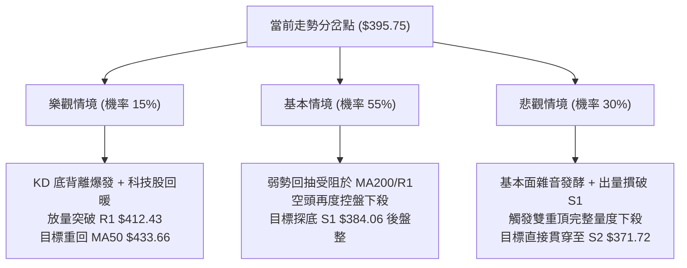

### 🛡️ 風險管理重要提醒

1. **嚴格執行資金管理規則**：
   - 由於當前 ATR 高達 $13.82（3.49%），日內波動極度劇烈。單筆交易之最大虧損風險，強烈建議控制在總投資本金的 **1.0% - 1.5%** 以內。
   - 倉位規模計算公式：$\text{允許下單股數} = (\text{帳戶總資金} \times 1.5\%) \div (\text{進場價} - \text{止損價})$。
2. **謹防「假破位」與「假反彈」雙巴效應**：
   - ADX 讀數 23.85 表明當前缺乏長期單邊動能，行情多以「進二退一」或「震盪拉鋸」的方式展開。在接近支撐位 S1 ($384.06) 時嚴禁進行任何形式的恐慌性殺跌做空；在接近阻力位 R1 ($412.43) 時嚴禁無腦追高。
3. **宏觀與基本面事件風險提示**：
   - 近期新聞顯示半導體面臨對沖基金降配與營收高門檻考驗（"AI Stocks Lose $5 Trillion in 3 Weeks as Hedge Funds Go Underweight AI"）。即使 TSM 基本面維持高成長（最新季營收 YoY +50.9%，毛利率 65.8%），在技術面未收復 MA200 與 MA20 之前，技術性修正與估值去泡沫化進程仍未結束，切莫以基本面為藉口忽視技術停損訊號。

---

## 📋 報告總結

```
╔══════════════════════════════════════════════════════════════════╗
║                    TSM 技術分析報告總結                          ║
╠══════════════════════════════════════════════════════════════════╣
║ 報告日期：2026-11-05                                             ║
║ 當前價格：$395.75 USD                                            ║
║ 分析評級：🔴 弱勢偏空震盪 (綜合評分 37/100，評級偏空)           ║
║                                                                  ║
║ 關鍵結論：                                                       ║
║ ├─ 長期趨勢：🟢 偏多修正 (月線大多頭未破，MA240 $383.13 向上)    ║
║ ├─ 中期趨勢：🔴 明確空頭 (週線 M 頭破位，高檔巨幅派發完成)      ║
║ ├─ 短期趨勢：🔴 弱勢超賣 (跌破 MA200，KD 進入個位數超賣區)      ║
║ ├─ 關鍵支撐：S1: $384.06 ｜ S2: $371.72 ｜ 50% Fib: $375.75     ║
║ ├─ 關鍵阻力：R1: $412.43 ｜ R2: $419.86 ｜ MA200: $399.63      ║
║ └─ 分析師目標：共識均價 $586.69 (基本面長期看好但短期嚴重脫節)   ║
║                                                                  ║
║ 最優策略組合：                                                   ║
║ 1. 🥇 最佳機會：策略 A (反彈高空)                                ║
║    └─ 待超賣反彈至 $410.00 放空，目標 $384.06，風報比 1 : 2.63  ║
║ 2. 🥈 次選機會：布林下軌超短線搶彈 (激進短線者)                 ║
║    └─ 於 $391.00 附近博弈超跌反抽，以 $388 緊密止損，快進快出   ║
║ 3. 🥉 保守選擇：空倉觀望，等待結構明朗                           ║
║    └─ 耐心等待價格測試 S1 ($384.06) 或站回 $412.43 後再行決策    ║
╚══════════════════════════════════════════════════════════════════╝
```

---

> ⚠️ **免責聲明**：本報告為技術分析研究成果，所有價位、圖表及策略推演均嚴格基於所提供之歷史交易數據計算。報告內容**僅供投資研究與學術探討參考**，**絕對不構成任何實質之邀約、招攬或個人化投資買賣建議**。金融市場瞬息萬變，技術指標存在滯後與失效風險，投資人應獨立評估自身風險承受能力並自負盈虧。

---

*報告生成時間：2026-11-05 ｜ 數據來源：Yahoo Finance ｜ 分析框架：多時框技術分析體系*