# TSM 技術分析報告

> **報告日期**：2026-11-06 ｜ **語言**：繁體中文 ｜ **數據來源**：Yahoo Finance ｜ **當前價格**：$353.10 USD

---

## 目錄

| 章節 | 內容 |
|------|------|
| [1. 技術面概覽](#1-技術面概覽) | 訊號儀表板、核心指標、評分卡 |
| [2. 趨勢分析](#2-趨勢分析) | 多時框趨勢、長中短期走勢 |
| [3. 圖表形態分析](#3-圖表形態分析) | 形態識別、K線組合、目標價 |
| [4. 支撐與阻力](#4-支撐與阻力) | 關鍵價位、斐波那契回調 |
| [5. 技術指標深度解讀](#5-技術指標深度解讀) | MA/RSI/MACD/布林/成交量 |
| [6. 動能與波動率](#6-動能與波動率) | 動能評估、ATR、Beta |
| [7. 多時框架總結](#7-多時框架總結) | 時框架評分矩陣 |
| [8. 交易策略建議](#8-交易策略建議) | 多空策略、風險報酬比 |
| [9. 風險提示與監控](#9-風險提示與監控) | 監控指標、風險場景 |
| [📋 報告總結](#-報告總結) | 總體評級、關鍵結論與策略清單 |

---

## 1. 技術面概覽

### 🎯 技術訊號儀表板

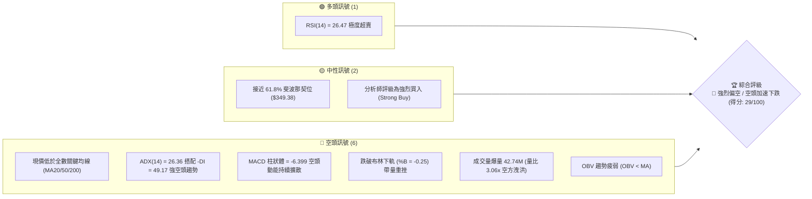

### 📊 核心指標速覽表

| 指標類別 | 指標名稱 | 當前數值 | 訊號 | 解讀 |
|----------|----------|----------|------|------|
| **價格** | 當前收盤價 | $353.10 | 🔴 | 單日重挫放量長陰，位於52週區間 39.9% |
| **均線** | MA20 | $420.33 | 🔴 | 價格低於 MA20 達 -16.00%，短期動能嚴重走疲 |
| **均線** | MA50 | $432.39 | 🔴 | 價格低於中期生命線 MA50 達 -18.34% |
| **均線** | MA200 | $399.78 | 🔴 | 實體大陰線摜破牛熊分界線 MA200，破壞長期多頭結構 |
| **動能** | RSI(14) | 26.47 | 🟢 | 進入極度超賣區（< 30），隨時具備技術性跌深反彈動能 |
| **動能** | MACD (12,26,9) | -13.942 | 🔴 | 快慢線均在零軸下方加速下行，柱狀體 -6.399 顯示空方佔據絕對優勢 |
| **趨勢** | ADX(14) / -DI | 26.36 / 49.17 | 🔴 | ADX > 25 確立趨勢行情，-DI 高達 49.17 證實為主導性強空頭趨勢 |
| **通道** | 布林通道下軌 | $375.64 | 🔴 | 現價大幅跌破下軌，%B 為 -0.25，呈現極端乖離與下軌開口擴張 |
| **量能** | 當日成交量 | 42,742,100 | 🔴 | 量比達 3.06 倍，量增價跌屬機構性恐慌拋售特徵 |
| **波動** | ATR(14) | $16.02 | 🟡 | 每日平均波動幅度高達 4.54%，市場恐慌情緒飆升 |

### 🏆 技術評分卡

```
╔══════════════════════════════════════════════════════════════════════╗
║                    技術評分卡 — TSM (2026-11-06)                     ║
╠══════════════════════════════════════════════════════════════════════╣
║ 評分維度        評分進度條 (0-100)           數值   訊號狀態         ║
╟──────────────────────────────────────────────────────────────────────╢
║ 趨勢強度        █████░░░░░░░░░░░░░░░        25/100   🔴 空方強趨勢主導 ║
║ 動能指標        ██████░░░░░░░░░░░░░░        30/100   🔴 動能疲弱但超賣 ║
║ 支撐穩定度      █████████░░░░░░░░░░░        45/100   🟡 測斐波61.8%防線║
║ 成交量配合      ████░░░░░░░░░░░░░░░░        20/100   🔴 爆量恐慌性殺跌 ║
║ 形態完整度      ███████░░░░░░░░░░░░░        35/100   🔴 頭部下破破位形 ║
║ 均線排列        ████░░░░░░░░░░░░░░░░        19/100   🔴 全週期均線倒掛 ║
╠══════════════════════════════════════════════════════════════════════╣
║ 綜合評分        ██████░░░░░░░░░░░░░░        29/100   🔴 強烈偏空       ║
║                                     (依規則18: 六項算術平均四捨五入)  ║
╚══════════════════════════════════════════════════════════════════════╝
```

---

## 2. 趨勢分析

### 🌐 多時框趨勢分析

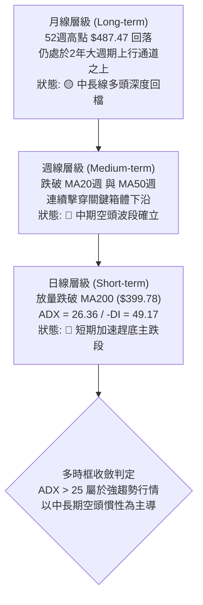

### 📈 長期趨勢 — 12個月走勢圖（Unicode）

以下為 TSM 過去 12 個月（2025-11 至 2026-11）之月線收盤走勢 ASCII 走勢圖，標注歷史波段高低點與當前破位位置：

```
TSM 月線走勢圖（2025-11 至 2026-11，單位：USD）
價格軸 ($)
$480 ┤                                           ● (2026-06: $476.29)
$460 ┤                                                 ● (2026-09: $456.19)
$440 ┤                                       
$420 ┤                                   ● (2026-05: $416.36)
$400 ┤                             ● (2026-04: $394.08)  ● (2026-10: $406.13)
$380 ┤                   ● (2026-02: $371.66)
$360 ┤                                                       ●← 當前 ($353.10)
$340 ┤             ● (2026-01: $327.98)   ● (2026-03: $336.26)
$320 ┤       ● (2025-12: $301.52)
$300 ┤ ● (2025-11: $288.46)
     └─┬─────┬─────┬─────┬─────┬─────┬─────┬─────┬─────┬─────┬─────┬─────┬──
      11    12    01    02    03    04    05    06    07    08    09    10    11 (月份)
      2025                                2026
```

#### 走勢特徵分析表格

| 階段區間 | 時間跨度 | 起訖收盤價 | 漲跌幅 | 主要技術特徵與驅動因素 |
|----------|----------|------------|--------|------------------------|
| **第 1 階段：主升推動** | 2025-11 ~ 2026-02 | $288.46 → $371.66 | +28.84% | 連續4個月階梯式推升，半導體資本支出擴張預期 |
| **第 2 階段：高檔震盪** | 2026-02 ~ 2026-03 | $371.66 → $336.26 | -9.52% | 首次回踩中期波段支撐，完成洗盤換手 |
| **第 3 階段：衝頂噴出** | 2026-03 ~ 2026-06 | $336.26 → $476.29 | +41.64% | 展開主升第 5 浪，並於 2026-06 創下月線收盤極值 $476.29 |
| **第 4 階段：雙頂構築** | 2026-07 ~ 2026-09 | $403.17 → $456.19 | +13.15% | 7月急跌後於9月再次衝高至 $456.19，未破前高構築次高點 |
| **第 5 階段：破位下殺** | 2026-10 ~ 2026-11 | $406.13 → $353.10 | -13.06% | 10月破位收陰，11月初跳空放量崩跌，直接貫穿 MA200 |

### 📊 中期趨勢（週線分析）

週線格局自 2026-10-09 當週觸及 52 週最高價 $487.47 後，呈現高檔「長上影墓碑線」破位反轉。近 5 週內，收盤價由 $453.31 迅速滑落至 $353.10，單月累計跌幅達 -22.11%。

```
週線近期主要壓力與支撐階梯示意圖
========================================================================
$487.47 ─── [52W 歷史極值高點] ── 2026-10-09 見頂回落
   │
$453.31 ─── [波段反彈頸線阻力] ── 10月中旬長黑破位起跌點
   │
$412.43 ─── [關鍵阻力 R3] ─────── 2026-10-16 週收盤價密集區
   │
$387.17 ─── [阻力 R2] ─────────── 密集籌碼成交套牢下緣
   │
$378.64 ─── [關鍵阻力 R1] ─────── 2026-11-05 開盤跳空缺口下緣
   │
$353.10 ◄── 當前收盤價位置 (2026-11-05 週K長陰探底)
   │
$349.38 ─── [斐波那契 61.8% 防線] ─ 強力黃金分割支撐位
   │
$329.33 ─── [波段支撐 S1] ─────── 近一年波段低點聚類核心支撐
========================================================================
```

### ⚡ 趨勢強度評估（ADX 解讀）

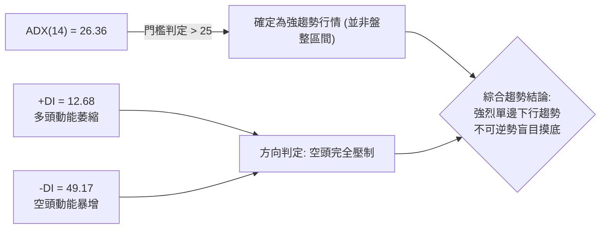

#### ADX 趨勢強度判定對照表

| 指標項目 | 數值區間 | 當前數值 | 狀態評估 | 實戰交易指引 |
|----------|----------|----------|----------|--------------|
| **ADX(14)** | 25 ~ 50 | **26.36** | 🟢 強趨勢確立 | 順應趨勢交易，不可採用網格或區間震盪高拋低吸策略 |
| **+DI** | < 20 | **12.68** | 🔴 多方動能極度匱乏 | 多頭無力組織有效反擊，多頭部位宜離場或緊設保護 |
| **-DI** | > 40 | **49.17** | 🔴 空方力量極端強勢 | 空方享有盤面絕對主導權，任何反彈均視為空頭防守點 |
| **DI 差值值** | \|(+DI) - (-DI)\| | **36.49** | 🔴 趨勢裂口急速拉開 | 單邊下行速率極快，市場正經歷流動性擠壓與多殺多 |

---

## 3. 圖表形態分析

### 🔍 形態識別系統

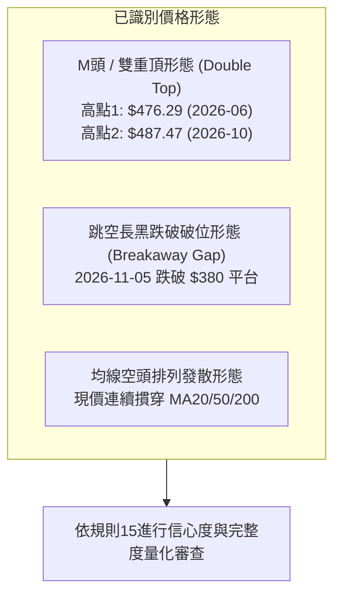

#### 圖表形態信心度與目標價評估表

| 形態名稱 | 信心度 | 判斷依據（嚴格引用數據） | 完成度 | 形態目標價（附計算式） |
|----------|--------|--------------------------|--------|------------------------|
| **雙重頂 (Double Top)** | **85%** | ① 左頂 $476.29 (2026-06收盤)；② 右頂 52W 高點 $487.47 (2026-10-09)；③ 頸線取兩頂間波段低點 $397.30 (2026-07-17週收盤)。本週以大陰線實體收於 $353.10，已決定性跌穿頸線。 | **100%** (已跌破頸線確認) | 依形態量度跌幅計算：<br/>形態高度 = 頂點 $487.47 − 頸線 $397.30 = $90.17<br/>理論目標價 = 頸線 $397.30 − 高度 $90.17 = **$307.13**<br/>*(接近數據提供之支撐位 S3: $314.41 與 78.6% 斐波位 $311.84)* |
| **跳空向下突破 (Breakaway Gap)** | **75%** | 2026-11-04 最低價 $391.61，2026-11-05 最高價僅 $380.78，留下高達 $10.83 之向下未補跳空缺口，且伴隨 42.74M 巨量。 | **90%** (缺口確立，尚待3日確認) | 由缺口起跌點 $391.61 依前一波等長跌幅推算：<br/>前一波跌幅 = $440.88 (10-28高) − $400.12 (10-30低) = $40.76<br/>推算目標價 = $380.78 − $40.76 = **$340.02** |
| **頭肩頂形態** | **25%** | 左肩約在 2026-05 ($416.36)，頭部 $487.47，但右肩結構混亂且反彈週期過短。 | **< 30%** | **訊號不足，僅做指標型解讀**（依規則15不予強行畫出） |

### 🕯️ 重要K線形態分析

嚴格依據數據中「近10根日K」與「近8根週K」的實際 OHLCV 進行解讀：

| 日期（週期） | 開盤價 | 最高價 | 最低價 | 收盤價 | 成交量 | K線形態名稱 | 形態解讀與市場心理 | 訊號 |
|--------------|--------|--------|--------|--------|--------|-------------|--------------------|------|
| **2026-10-09 (週K)** | 478.77 | 487.47 | 449.75 | 453.31 | 49,231,100 | **長上影流星線 (Shooting Star)** | 衝刺 52 週新高 $487.47 後引發龐大解套與獲利盤拋壓，高檔力竭反轉。 | 🔴 |
| **2026-10-16 (週K)** | 453.55 | 454.40 | 407.13 | 412.61 | 71,736,400 | **放量大陰線 (Bearish Marubozu)** | 週量暴增至 71.7M，多頭防線全面潰敗，確立中期頭部反轉成立。 | 🔴 |
| **2026-10-28 (日K)** | 438.24 | 440.88 | 436.84 | 439.51 | 8,037,400 | **高檔紅十字星 (Doji)** | 反彈動能衰竭，量能萎縮至 8.03M，多空雙方於阻力帶前出現嚴重遲疑。 | 🟡 |
| **2026-10-30 (日K)** | 414.08 | 418.09 | 400.12 | 406.13 | 21,971,100 | **長黑摜破長陰線** | 爆量 21.97M 摜破 $410 支撐，吞噬前四日震盪漲幅，確認反彈結束。 | 🔴 |
| **2026-11-03 (日K)** | 404.99 | 408.37 | 403.03 | 404.80 | 9,421,100 | **十字孕線 (Harami Cross)** | 實體極小，高低點收斂，代表市場在等待重大催化劑，屬中繼整理。 | 🟡 |
| **2026-11-04 (日K)** | 400.64 | 410.59 | 391.61 | 395.75 | 14,516,500 | **破位長下影弱勢陰線** | 盤中一度跌破 $392，收盤失守整數大關 $400 與 MA200 ($399.78)。 | 🔴 |
| **2026-11-05 (日K)** | 379.75 | 380.78 | 351.19 | 353.10 | 42,742,100 | **跳空放量崩跌大陰棒** | 跳空低開於 $379.75，量暴增至 42.74M，收在最低點附近，極度恐慌殺盤。 | 🔴 |

### 📉 ASCII 走勢形態示意圖

```
TSM 雙重頂 (M頭) 破位下殺走勢結構
===================================================================================
價格 ($)
$490 ┤                      [右頂: $487.47] (2026-10-09)
$470 ┤      [左頂: $476.29]        \
$450 ┤         /        \           \
$430 ┤        /          \           \
$410 ┤       /            \           \
$397 ┼──────/──────────────●───────────\────── [雙頂頸線: $397.30]
$380 ┤     /          (2026-07-17)      \  ◄── 跳空缺口 ($380.78 - $391.61)
$360 ┤    /                              \
$353 ┤   /                                ● ◄── 現價: $353.10 (實體大陰破頸線)
$340 ┤  /                                  │
$314 ┼─/───────────────────────────────────┼── [形態量度跌幅低點: S3 $314.41]
$307 ┴─────────────────────────────────────▼── [雙頂理論完全跌幅: $307.13]
===================================================================================
```

### 🎯 形態目標價計算

根據雙重頂頸線跌破之經典量度規則：
1. **頸線確認**：選取雙頂結構間之波段收盤低谷，即 2026-07-17 當週收盤價 **$397.30**。
2. **形態高度 (H)**：最高峰值（52W High $487.47）− 頸線（$397.30）= **$90.17**。
3. **第一階段目標價 (T1)**：取高度之 50% 跌幅延伸，即 $397.30 − ($90.17 × 0.5) = **$352.21**。（現價 $353.10 已精準觸達此區域，引發短線超賣鈍化）。
4. **第二階段等幅目標價 (T2)**：完整 1:1 等幅下測，即 $397.30 − $90.17 = **$307.13**。此價位與提供的關鍵支撐位 **S3 ($314.41)** 以及斐波那契 78.6% 回調位 **($311.84)** 形成高度共振區間。

---

## 4. 支撐與阻力

### 🗺️ 關鍵價位分布圖（Unicode）

```
TSM 價位結構分布圖（數據精確對齊）
╔══════════════════════════════════════════════════════════════════════╗
║ 價位 ($)   結構屬性與重要性強度進度條                  級別說明      ║
╠══════════════════════════════════════════════════════════════════════╣
║ $412.43   ║████████████████████████║ (+16.80%)        強阻力 R3     ║
║ $387.17   ║████████████████████    ║ ( +9.65%)        阻力 R2       ║
║ $378.64   ║████████████████████████║ ( +7.23%)        關鍵阻力 R1   ║
║ $375.75   ║████████████████        ║ ( +6.41%)        斐波 50.0%    ║
╠═══════════╬════════════════════════╬═════════════════════════════════╣
║ $353.10   ╠════════════════════════╣ ◄── 當前收盤價                  ║
╠═══════════╬════════════════════════╬═════════════════════════════════╣
║ $349.38   ║▓▓▓▓▓▓▓▓▓▓▓▓▓▓▓▓▓▓▓▓▓▓▓▓║ ( -1.05%)        斐波 61.8%防線║
║ $329.33   ║▓▓▓▓▓▓▓▓▓▓▓▓▓▓▓▓        ║ ( -6.73%)        近期支撐 S1   ║
║ $323.56   ║▓▓▓▓▓▓▓▓▓▓▓▓▓▓▓▓▓▓      ║ ( -8.37%)        波段支撐 S2   ║
║ $314.41   ║████████████████████████║ (-10.96%)        極限支撐 S3   ║
║ $311.84   ║████████████████████    ║ (-11.69%)        斐波 78.6%位  ║
╚══════════════════════════════════════════════════════════════════════╝
```

### 🚧 阻力位分析表

以下阻力價位嚴格引用系統計算之波段高點聚類數值：

| 阻力級別 | 價位 ($) | 距現價幅幅 | 形成原因與籌碼結構 | 突破難度 | 重要性 |
|----------|----------|------------|--------------------|----------|--------|
| **R1** | **$378.64** | +7.23% | 2026-11-05 跳空下行缺口下緣，布林通道下軌 ($375.64) 反壓重疊處 | 🔴 極高 | 關鍵短線反彈生死線 |
| **R2** | **$387.17** | +9.65% | 11月初崩跌前的籌碼盤整平台下沿，240日均線 ($383.46) 密集套牢區 | 🔴 極高 | 波段結構防守點 |
| **R3** | **$412.43** | +16.80% | 10月中旬長黑破位起跌密集區、10根日K最高點聚類區，MA10 ($410.95) 壓制 | 🔴 堅不可摧 | 中期牛熊反轉分水嶺 |

### 🛡️ 支撐位分析表

以下支撐價位嚴格引用系統計算之波段低點聚類數值：

| 支撐級別 | 價位 ($) | 距現價幅幅 | 形成原因與籌碼結構 | 守住機率 | 重要性 |
|----------|----------|------------|--------------------|----------|--------|
| **S1** | **$329.33** | -6.73% | 近一年波段低點聚類核心，歷史月線 2026-01 收盤價 ($327.98) 密集支撐帶 | 🟡 60% | 第一道防線 / 反彈契機 |
| **S2** | **$323.56** | -8.37% | 次級波段低點聚類點，2026年首季起漲點之第二換手密集帶 | 🟡 55% | 中期關鍵防護墊 |
| **S3** | **$314.41** | -10.96% | 近一年最低波段低點聚類，與斐波那契 78.6% ($311.84) 構成多頭最後防線 | 🟢 75% | 多頭長期生命線 |

### 📐 斐波那契回調位分析

依據 52 週完整波動區間（高點 **$487.47** → 低點 **$264.03**，總垂直落差 $223.44）之精確回調位進行解讀：

```
斐波那契黃金分割回調結構（52W 區間：$264.03 → $487.47）
========================================================================
 0.0%  (52W High)  $487.47  ──────────────────────────────────────────
23.6%              $434.74  [已失守] 2026-10 下旬反彈受阻於此
38.2%              $402.11  [已失守] 與 MA200 ($399.78) 共振，破位引發踩踏
50.0%              $375.75  [已失守] 多空分水嶺，跳空摜破加速下墜
------------------------------------------------------------------------
現價位置 ◄───────  $353.10  (位於 50.0% 與 61.8% 之間，逼近黃金回調位)
------------------------------------------------------------------------
61.8%              $349.38  [關鍵測試] 多頭生死攸關之黃金回調線，相距僅 -1.05%
78.6%              $311.84  [深次回調] 若失守 61.8%，下行空間將直探此位
100.0% (52W Low)   $264.03  ──────────────────────────────────────────
========================================================================
```

*   **現價位置意義**：現價 $353.10 正運行於 50.0% 回調位 ($375.75) 與 61.8% 回調位 ($349.38) 之間，目前距離黃金回調線 $349.38 僅有 **$3.72（-1.05%）** 的空間。
*   **技術戰略解讀**：61.8% 是大週期波段推升的最後一道黃金防禦屏障。歷史規律顯示，強勢多頭市場的大級別深度洗盤往往止步於 61.8% 附近；一旦實體週K線跌破 $349.38，宣告 52 週漲幅全數遭到空方瓦解，價格將無可避免地下滑尋求 78.6% 回調位（$311.84）及 S3（$314.41）之支撐。

---

## 5. 技術指標深度解讀

### 🎛️ 指標訊號總覽

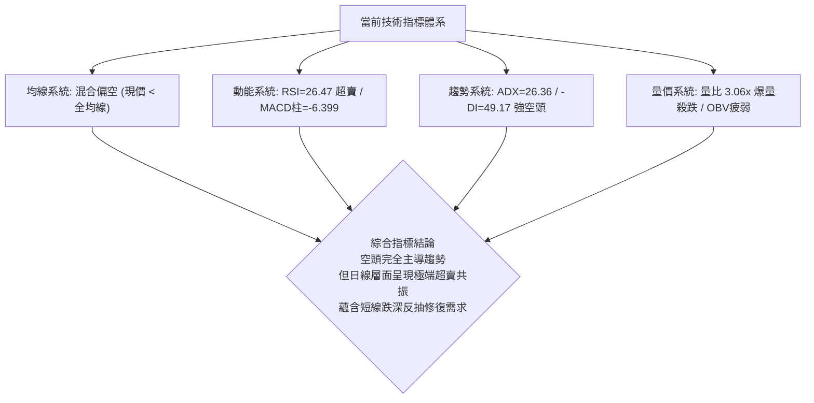

### 📈 移動平均線排列分析

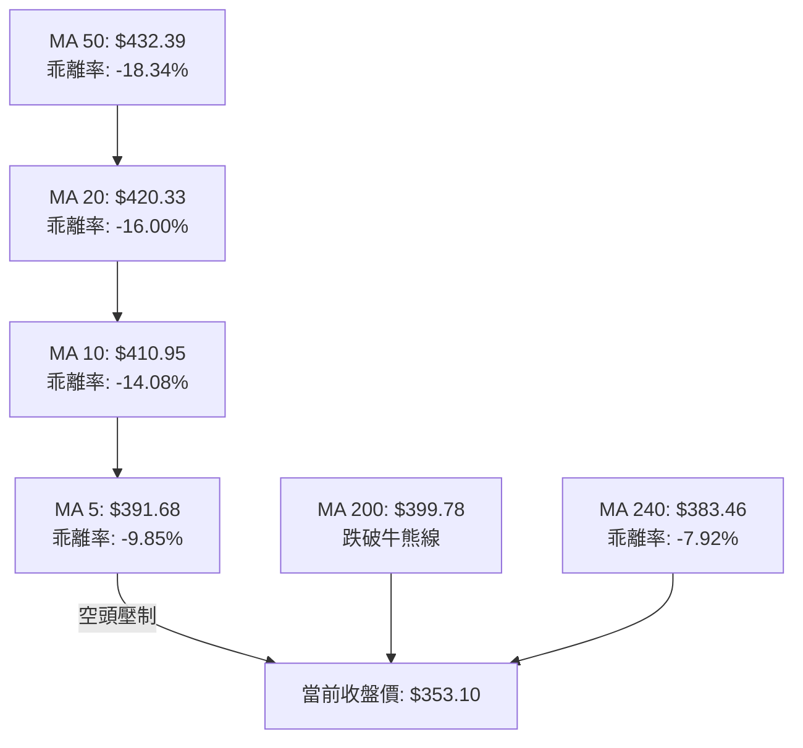

#### 各週期均線狀態詳細解析表

| 均線名稱 | 數值 ($) | 與現價乖離率 | 排列狀態 | 走勢特徵與技術涵義 |
|----------|----------|--------------|----------|--------------------|
| **MA 5** | $391.68 | -9.85% | 空頭陡峭向下 | 短期下行斜率極大，對價格構成直接且沈重的壓制 |
| **MA 10** | $410.95 | -14.08% | 空頭向下 | 下穿 MA20 與 MA50，形成短期死叉擴散 |
| **MA 20** | $420.33 | -16.00% | 轉折向下 | 布林中軌所在，中期反彈不可逾越的強阻力 |
| **MA 50** | $432.39 | -18.34% | 由平轉下 | 中期生命線徹底失守，確立中級調整行情的展開 |
| **MA 60** | $430.03 | -17.89% | 高檔走平下彎 | 季線下行，中長線籌碼全面轉入套牢狀態 |
| **MA 120** | $425.98 | -17.11% | 走平 | 半年線失守，長期多頭趨勢遭到嚴重破壞 |
| **MA 200** | $399.78 | -11.68% | 向上放緩 | 牛熊分界線被實體大陰棒直接摜破，多方長期信心遭受重創 |
| **MA 240** | $383.46 | -7.92% | 微幅向上 | 年線支撐未發揮抵抗效果，已演變為上方回抽反壓 |

### 📉 RSI(14) 分析

*   **RSI(14) 數值展示**：`26.47`（Wilder 計算）
    `█████░░░░░░░░░░░░░░░` 26.47% (🟢 極度超賣區間 < 30)
*   **區間特徵解讀**：RSI 跌至 26.47，已進入自 2026-06 以來的最低水位。通常 RSI < 30 代表市場處於非理性的恐慌性拋售階段，拋壓出現情緒性透支。
*   **背離分析判斷**：
    *   **日線週期**：檢驗近 20 根 K 棒首尾，價格自 2026-10-23 之 $418.51 跌至 $353.10，RSI 由 41.5 降至 26.47，價格與指標同步破底，**無明顯底背離**現象。
    *   **結論**：此處為單邊趨勢性超賣，而非動能衰竭型背離。超賣狀態可能在極端空頭行情中出現「鈍化」（即 RSI 貼近低檔震盪而價格持續破底）。

### 📊 MACD(12/26/9) 訊號解讀

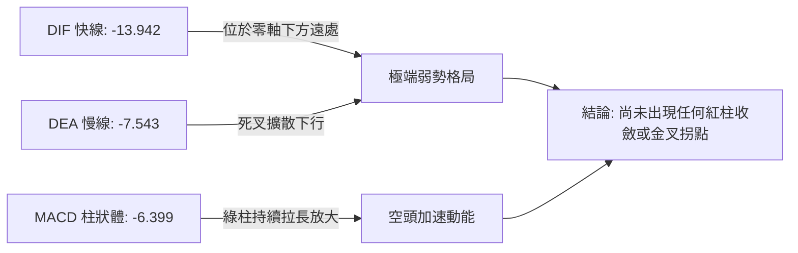

*   **數值結構**：MACD 線（-13.942）遠低於訊號線（-7.543），兩者均在零軸下方深處呈現發散擴張態勢。
*   **柱狀圖 (Histogram)**：現值為 **-6.399**，較前一交易日持續拉長，表明做空動能尚未見頂，空方控盤力道仍在增強，尚未出現「綠柱縮短」的第一道止跌訊號。

### 📦 布林通道分析

```
TSM 日線布林通道 (20, 2) 結構圖
===================================================================================
價格 ($)
$465.02 ┬────────────────────────────────────────── 布林上軌 (帶寬收縮後開口向下)
        │
$420.33 ┼────────────────────────────────────────── 布林中軌 (MA20 下彎壓制)
        │
$375.64 ┴────────────────────────────────────────── 布林下軌 (下軌被貫穿破位)
        │
$353.10 ◄── 當前收盤價位置 (極端跌破下軌，%B = -0.25)
===================================================================================
```

*   **通道狀態解讀**：布林帶寬目前為 $465.02 − $375.64 = $89.38。
*   **%B 指標深度剖析**：%B 數值為 **-0.25**（0 代表下軌，0.5 代表中軌，1 代表上軌）。%B 為負值代表現價已跌穿布林下軌達通道寬度的 25%，屬於統計學上的「3 個標準差外極端異常值」。這表明短線價格嚴重偏離均值，存在強烈向布林下軌（$375.64）回歸的均值回歸（Mean Reversion）修復引力。

### 💹 成交量分析（量價配合度）

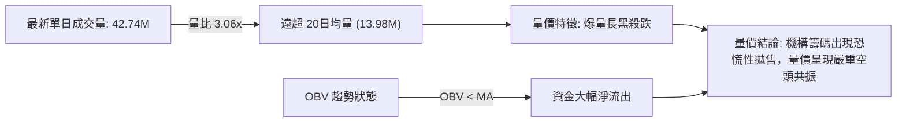

*   **量能異動特徵**：2026-11-05 伴隨股價大跌 -10.78%，成交量激增至 **42,742,100 股**，為 20 日均量（13,977,800 股）的 **3.06 倍**，亦為 50 日均量（11,464,482 股）的 **3.73 倍**。
*   **能量潮 (OBV) 解讀**：OBV 跌破其均線並持續向下發散（OBV < MA），確認過去一個月反彈過程中主力資金並未進場吸籌，反而在高檔獲利了結；今日的巨量殺跌代表多頭停損賣壓與融資斷頭盤傾巢而出，量能確認了價格的破位下跌真實有效。

---

## 6. 動能與波動率

### ⚡ 動能評估四象限

| 象限標籤 | 動能維度 (Directional Momentum) | 波動率維度 (Volatility) | 當前判定 | 技術狀態評估與操盤環境特徵 |
|:--------:|:--------------------------------:|:------------------------:|:--------:|:--------------------------|
| **Q1** | 強多頭動能 | 低波動率 | — | 主升浪平穩推進期，最佳持倉階段 |
| **Q2** | 弱多頭動能 | 低波動率 | — | 底部盤整吸籌或高檔橫盤蓄勢期 |
| **Q3** | 強多頭動能 | 高波動率 | — | 衝頂噴出期，高風險高收益，拉回震盪劇烈 |
| **Q4** | **強空頭動能** | **高波動率** | **✓ (當前所處象限)** | **市場處於「恐慌性殺跌 / 主跌段」：空方佔據絕對壓倒性優勢，伴隨 ATR 與成交量急劇放大。此階段進場摸底極易遭遇二次下殺，應嚴控多頭風險。** |

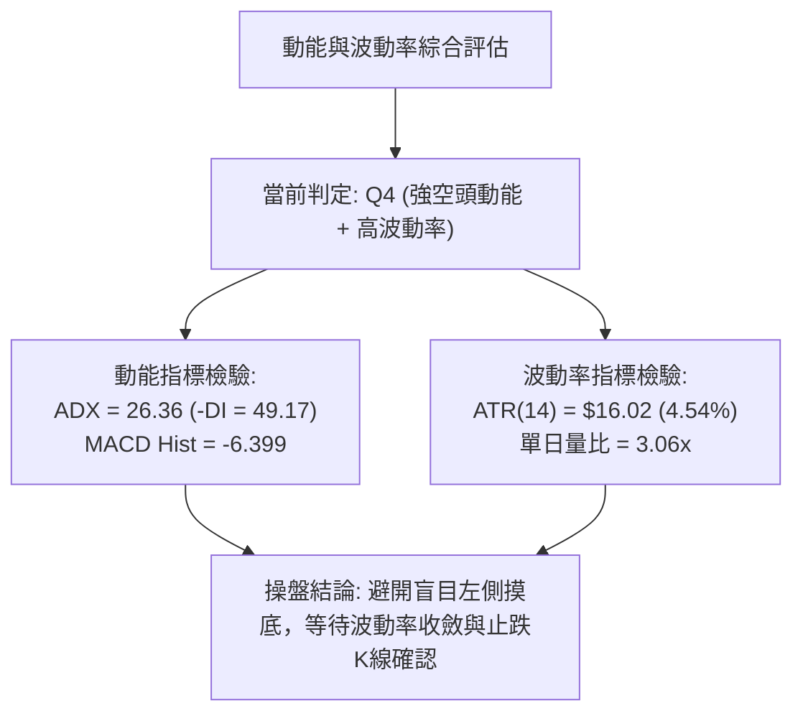

### 📊 ATR 波動率分析

*   **ATR(14) 數值**：**$16.02**（以收盤價計佔比 **4.54%**，採用 Wilder 平滑算法）。
*   **波動特性評估**：每日 16 美元的真實波幅代表 TSM 當前處於極高波動狀態。對於短線與波段操作而言，價格噪音範圍極寬，任何過於緊密的止損均極易被日內隨機波動觸發。
*   **風控與止損建議數值**：
    *   **短線反彈交易止損距離**：取 $1.0 \times \text{ATR} = \mathbf{\$16.02}$。
    *   **波段空頭交易止損距離**：取 $1.5 \times \text{ATR} = \mathbf{\$24.03}$。
    *   **關鍵壓力防守緩衝距離**：在重要阻力位（如 R1: $378.64）上方加計 $0.5 \times \text{ATR} = \mathbf{\$8.01}$ 進行防守過濾。

### 📐 Beta 與市場相關性

*   **Beta 係數**：**1.233**
*   **市場相關性分析**：
    *   TSM 對半導體板塊（SOX）與大盤（S&P 500 / 納斯達克）具備高敏銳度（放大 1.233 倍系統性風險）。
    *   新聞事件顯示「Nvidia 自 10 月高點以來市值蒸發近 1.4 兆美元」以及「民主黨期中選舉後晶片股暴跌」，驗證了近期半導體產業鏈正承受系統性板塊去估值壓力。在產業系統性風險集中釋放期，個股的基本面優勢短期內會被 Beta 引發的流動性收縮所掩蓋。

---

## 7. 多時框架總結

### 📋 時框架評分表

| 時框架 | 趨勢方向 | 動能狀態 | 均線排列狀況 | 形態特徵 | 綜合評分 | 戰術指引 |
|--------|----------|----------|--------------|----------|:--------:|----------|
| **月線 (長期)** | 🟡 深度回檔 | 減弱中，自超買區回落 | 仍高於長週期 MA240 ($383 附近受考驗) | 2年長期大牛市健康回吐 | **50/100** | 考驗 61.8% 斐波那契長期支撐 ($349.38) |
| **週線 (中期)** | 🔴 明確走熊 | MACD 綠柱拉長 (-6.399) | 跌破 MA20週與 MA50週支撐 | 雙頂（M頭）跌破頸線完成 | **25/100** | 中期調整確立，反彈逢高減磅 |
| **日線 (短期)** | 🔴 加速下挫 | RSI=26.47 極度超賣 | 全數均線呈空頭發散壓制 | 帶量跳空破位大陰線 | **20/100** | 短線禁止追空，提防報復性跌深反抽 |

### 🔲 綜合訊號矩陣

```
╔══════════════════════════════════════════════════════════════════════╗
║                    多時框架綜合訊號矩陣驗證                          ║
╠══════════════════════════════════════════════════════════════════════╣
║ 分析維度        日線 (短期)       週線 (中期)       月線 (長期)      ║
╟──────────────────────────────────────────────────────────────────────╢
║ 趨勢方向        🔴 強烈看跌       🔴 看跌           🟡 中立偏多      ║
║ 動能指標        🟢 超賣反彈預期   🔴 空頭動能充沛   🔴 動能衰退      ║
║ 支撐/阻力       🔴 跌破密集均線   🔴 跌破雙頂頸線   🟡 逼近61.8%黃金位║
║ 成交量配合      🔴 恐慌拋售放量   🔴 連續破位放量   🟡 正常籌碼換手  ║
║ 波動率狀態      🔴 ATR擴大至4.54% 🔴 破位大陰線     🟡 歷史高檔震盪  ║
╠══════════════════════════════════════════════════════════════════════╣
║ 時框優先級判定: ADX = 26.36 > 25 (趨勢行情) ── 週線/日線空頭趨勢共振 ║
╚══════════════════════════════════════════════════════════════════════╝
```

### ⚖️ 多時框收斂結論

依據多時框收斂規則（規則 14）：
1. **行情性質判定**：當前日線 ADX 為 **26.36 > 25**，且 -DI 高達 **49.17**，技術面明確處於**「單邊強趨勢行情」**，絕非盤整震盪格局。
2. **時框收斂優先級**：在強趨勢行情中，中長期（週線破位、均線全面空頭倒掛）方向具備最高定性權力，日線層級的 RSI 超賣（26.47）僅能定義為「短線跌深可能引發技術性反抽」，絕對不可作為反轉做多的依據。日線只用來尋找順勢逢高進場放空的時機。
3. **唯一方向性結論**：**🔴 強烈偏空（主跌段運行中）**。該結論與第 1 章技術評分卡（綜合評分 **29/100**）嚴格一致。

---

## 8. 交易策略建議

### 🗺️ 策略決策流程圖

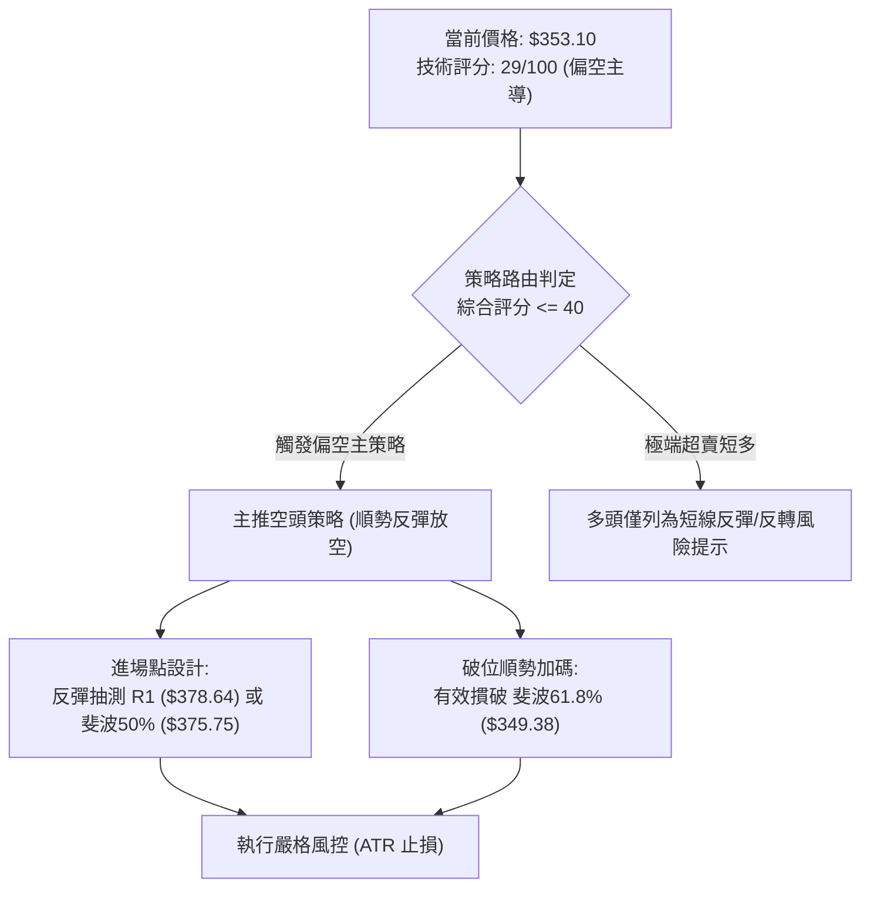

### 🧭 策略路由

> **當前主策略方向 = 🔴 偏空操作（逢反彈建立空頭部位），依據第 1 章技術評分卡綜合評分 29/100（≤ 40 區間）。**
> 任何多頭操作均被嚴格定義為「超賣跌深博弈微小反抽」之逆勢高風險行為，不可重倉參與。

### 🎯 價格情境階梯（Price Scenarios）

價位嚴格引用第 4 章波段計算之核心價位：

| 觸發條件 | 下一目標價 | 後續延伸目標 | 情境技術含義與市場狀態 |
|----------|------------|--------------|------------------------|
| **反彈受阻於 R1 ($378.64)** | 斐波 61.8% ($349.38) | S1 ($329.33) | 跳空缺口防守有效，空頭順勢展開第二波主跌 |
| **向上突破 R1 ($378.64)** | R2 ($387.17) | R3 ($412.43) | 短線超賣引發較大幅度技術性修復，封閉跳空缺口 |
| **直接摜破 61.8% ($349.38)** | S1 ($329.33) | S2 ($323.56) / S3 ($314.41) | 多頭最後防線崩潰，引發新一輪多殺多清算 |

### 📊 情境機率分佈

| 情境劇本 | 機率 | 主要依據與技術指標支撐 |
|----------|:----:|------------------------|
| **情境 A：弱勢反抽後破底續跌** | **60%** | ADX=26.36 (-DI=49.17) 強趨勢確立；均線呈現全面倒掛壓制；OBV 顯示資金持續外逃；MACD 柱狀體加速下行。 |
| **情境 B：直接破位加速下殺** | **25%** | 恐慌情緒持續蔓延，42.74M 巨量摜破引發連鎖停損，直接擊穿 $349.38 防線。 |
| **情境 C：強勢 V 型反轉修復** | **15%** | 僅憑藉日線 RSI(14)=26.47 極度超賣引發軋空，但上方缺口重重，缺乏量能支持難以持續。 |

### 🔴 主策略詳情（空頭主導策略）

依據規則 17，風險報酬比一律依 $(進場價 - T1) / (止損價 - 進場價)$ 精確計算：

| 策略要素 | 策略 A（反彈高空 — 逢阻力放空） | 策略 B（順勢破位空 — 破線加碼放空） |
|----------|---------------------------------|-------------------------------------|
| **策略類型** | 順大勢逆小勢（回抽反壓放空） | 順勢破位追空（突破關鍵支撐） |
| **進場條件** | 股價回抽測試跳空缺口下緣與 R1 遇阻出現日K上影線 | 實體日K跌破斐波那契 61.8% 關鍵防線 |
| **進場價格** | **$378.64** (精確錨定 R1 阻力位) | **$349.38** (精確錨定 61.8% 斐波那契位) |
| **目標價 T1** | **$349.38** (斐波 61.8% 黃金分割位) | **$329.33** (關鍵支撐位 S1) |
| **目標價 T2** | **$329.33** (關鍵支撐位 S1) | **$314.41** (關鍵極限支撐位 S3) |
| **止損價格** | **$387.17** (精確錨定 R2 阻力位) | **$357.10** (進場價上浮約 0.5×ATR 防守) |
| **風險報酬比** | **1 : 3.43**（以 T1 計）<br/>*計算式: (378.64 − 349.38) ÷ (387.17 − 378.64) = 29.26 ÷ 8.53*<br/>*(以 T2 計為 1 : 5.78)* | **1 : 2.60**（以 T1 計）<br/>*計算式: (349.38 − 329.33) ÷ (357.10 − 349.38) = 20.05 ÷ 7.72*<br/>*(以 T2 計為 1 : 4.53)* |
| **成功機率** | **65%** | **60%** |
| **建議倉位** | **15%** (總資金佔比) | **10%** (破位確認後介入) |

### 🟢 反向風險觸發點（對沖提示）

若出現以下訊號，代表偏空主策略被推翻，空頭必須無條件平倉離場並考慮對沖：
1. **價格強勢站穩 R1 ($378.64)**：並於 3 個交易日內完全封閉 2026-11-05 跳空缺口，收盤價突破 **R2 ($387.17)**。
2. **日線 RSI(14) 迅速回升至 45 以上**，且 MACD 柱狀體由負轉正出現第一根紅柱。
3. **成交量在 $349.38 附近出現單日「爆量長下影線（成交量 > 5,000 萬股）」**，確立為機構強行接盤洗盤形態。

### ⭐ 整體訊號強度評星

```
做多訊號強度：★☆☆☆☆  (1/5星 — 僅存在超賣技術修復預期)
做空訊號強度：★★★★☆  (4/5星 — 趨勢、均線、量價全面共振看空)
整體可信度：  ★★★★☆  (4/5星 — 多時框指標高度收斂收斂)
```

---

## 9. 風險提示與監控

### ✅ 關鍵監控指標 Checklist

```
╔══════════════════════════════════════════════════════════════════════╗
║                    每日盤面核心監控 Checklist                        ║
╠══════════════════════════════════════════════════════════════════════╣
║ [ ] 監控斐波那契 61.8% 防線 ($349.38) 的日內得失情況 (跌破則引發加速)║
║ [ ] 監控 2026-11-05 跳空缺口 ($378.64 - $380.78) 之回補力度          ║
║ [ ] 監控 MACD 柱狀體數值 (當前 -6.399，觀察何時出現數值收斂)         ║
║ [ ] 監控日線 RSI(14) (當前 26.47，密切追蹤是否於 30 下方鈍化)        ║
║ [ ] 監控單日成交量變化 (若回抽量能 < 1,397 萬股均量，確立為弱勢反抽) ║
║ [ ] 監控半導體板塊指數與輝達 (NVDA) 盤面情緒之聯動傳導               ║
╚══════════════════════════════════════════════════════════════════════╝
```

### ⚠️ 風險場景分析

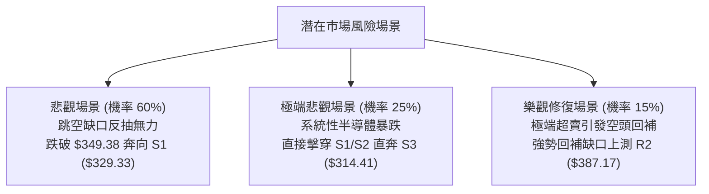

### 🛡️ 風險管理重要提醒

1. **嚴禁在主跌段中盲目摸底**：ADX(14) 高達 26.36 搭配 -DI 為 49.17，代表市場處於由機構與演算法主導的單邊趨勢市。在單邊市中，「超賣可以更超賣」，過早進場搶反彈如同「徒手接落下的飛刀」。
2. **波動率放大的倉位管理**：當前 ATR 高達 $16.02（4.54%），任何操作必須將單筆交易名義虧損嚴格限制在總資產的 **1.0% ~ 1.5%** 範圍內。倉位上限不宜超過 25%，預留足夠的流動性以防跳空低開風險。
3. **跳空缺口之風控意涵**：2026-11-05 的向下跳空缺口下緣 **$378.64** 是多頭短期的心理天花板，在未能帶量吞噬該缺口前，盤面任何反彈均應視為空頭防守反擊與多方減倉的機會。

---

## 📋 報告總結

```
TSM 技術分析報告總結
════════════════════════════════════════════════════════
報告日期：2026-11-06
當前價格：$353.10 USD
分析評級：🔴 強烈偏空 / 空頭加速主跌段 (綜合評分: 29/100)

關鍵結論：
├─ 長期趨勢：🟡 52週歷史高點回吐逾 27%，考驗 61.8% 斐波那契防線
├─ 中期趨勢：🔴 雙頂 (M頭) 帶量跌破頸線 $397.30，中期頭部成立
├─ 短期趨勢：🔴 跳空放量摜破 MA200 牛熊分水嶺，ADX 確立強空頭趨勢
├─ 關鍵支撐：S1: $329.33 ｜ S2: $323.56 ｜ S3: $314.41
├─ 關鍵阻力：R1: $378.64 ｜ R2: $387.17 ｜ R3: $412.43
└─ 分析師目標：均價 $586.69 (基本面強烈買入，但與短期技術面嚴重脫節)

最優策略組合：
1. 🥇 最佳機會：策略 A (反彈至 R1 $378.64 放空，止損 $387.17，目標 T1 $349.38，風報比 1:3.43)
2. 🥈 次選機會：策略 B (跌破斐波 61.8% $349.38 順勢追空，目標 T1 $329.33，風報比 1:2.60)
3. 🥉 保守選擇：空倉觀望，靜待日線 RSI 出現底背離且價格站上布林下軌再行評估
════════════════════════════════════════════════════════
```

---

> ⚠️ **免責聲明**：本報告為技術分析專業模型生成，所有分析、點位推算及策略配置均嚴格基於所提供的歷史 OHLCV 價格與量化技術指標數據。本報告**僅供學術研究與交易架構參考**，**不構成任何要約、招攬或具體投資建議**。市場具有高度不確定性，半導體類股波動劇烈，投資人應依個人財務狀況與風險承受度審慎獨立決策，自行承擔一切市場風險。

---

*報告生成時間：2026-11-06 ｜ 數據來源：Yahoo Finance ｜ 分析框架：多時框量化技術分析*