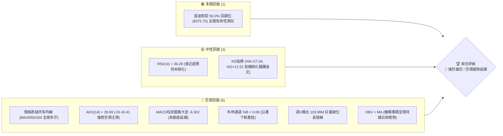
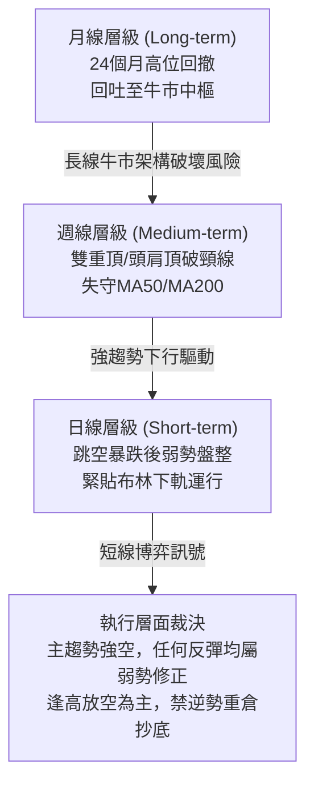
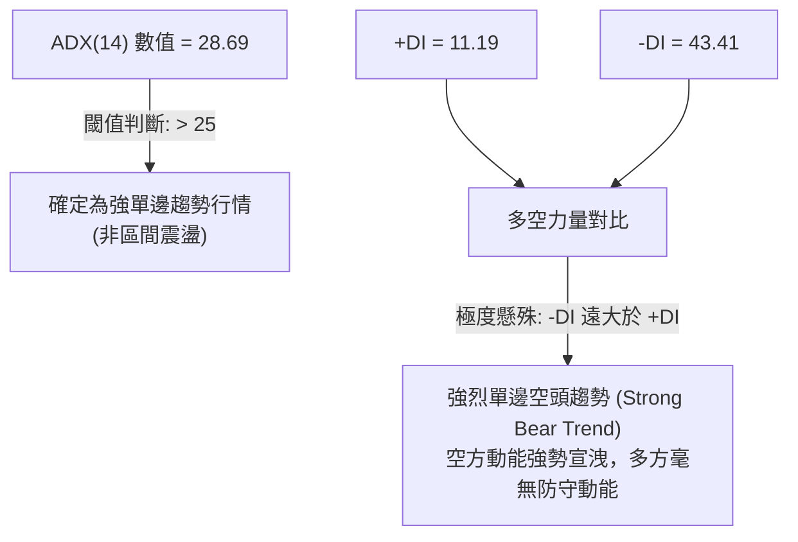
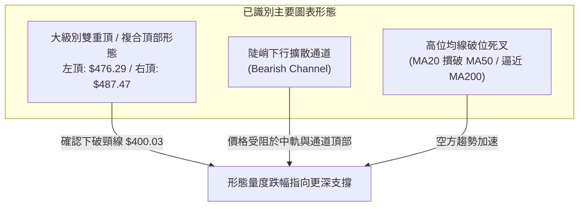
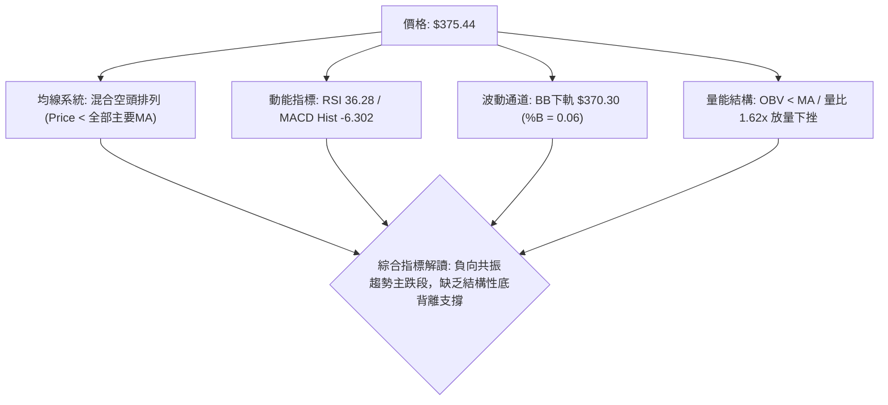
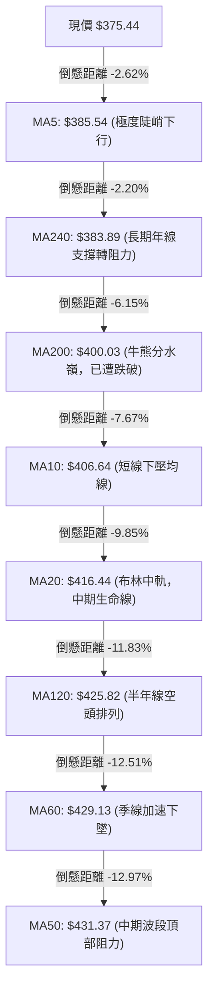
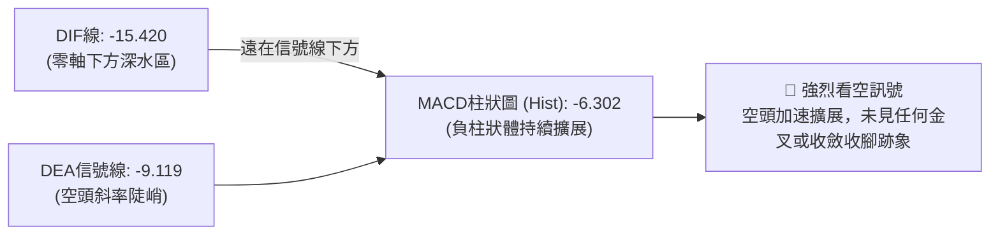
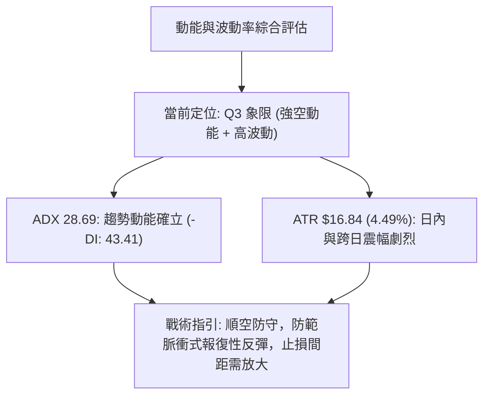
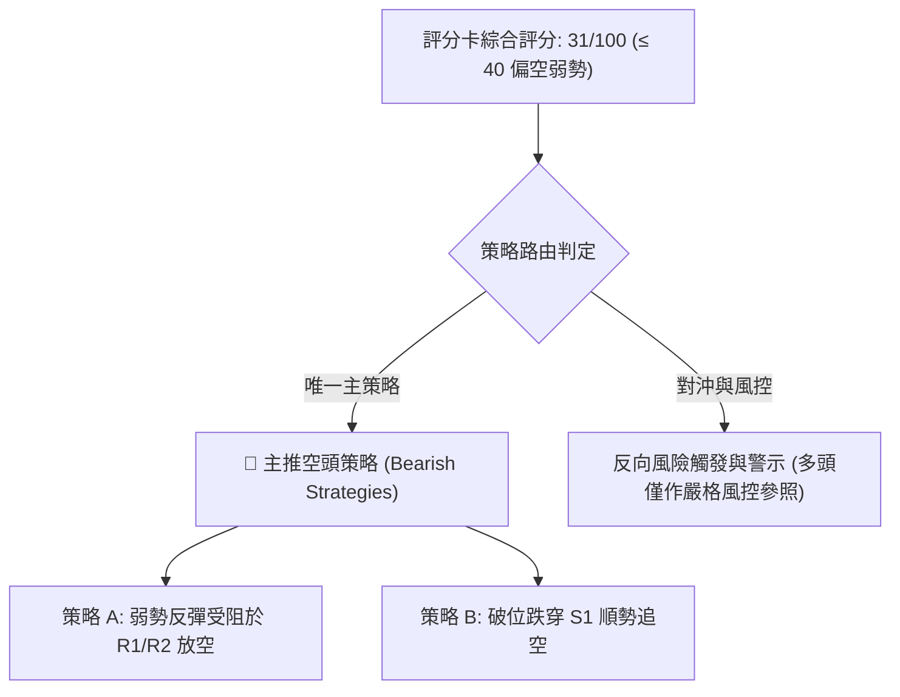
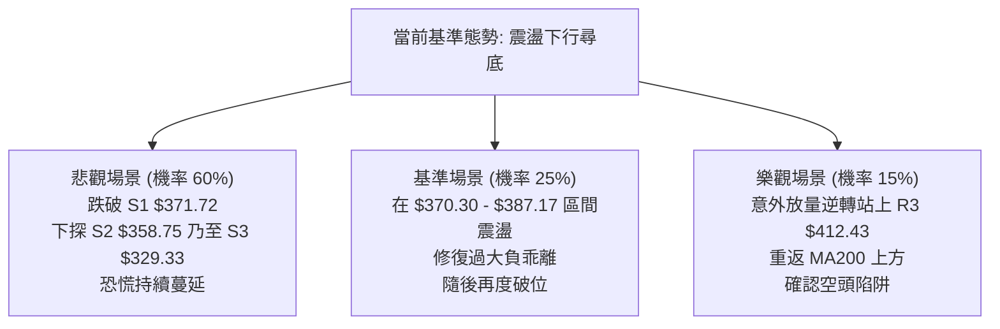

# TSM 技術分析報告

> **報告日期**：2026-11-07 ｜ **語言**：繁體中文 ｜ **數據來源**：Yahoo Finance ｜ **當前價格**：$375.44 USD

---

## 目錄

| 章節 | 內容 |
|------|------|
| [1. 技術面概覽](#1-技術面概覽) | 訊號儀表板、核心指標、評分卡 |
| [2. 趨勢分析](#2-趨勢分析) | 多時框趨勢、長中短期走勢、12個月走勢圖 |
| [3. 圖表形態分析](#3-圖表形態分析) | 形態識別、K線組合、目標價推算 |
| [4. 支撐與阻力](#4-支撐與阻力) | 關鍵價位分布圖、斐波那契回調 |
| [5. 技術指標深度解讀](#5-技術指標深度解讀) | 均線系統、RSI、MACD、布林通道、成交量 |
| [6. 動能與波動率](#6-動能與波動率) | 動能四象限、ATR 波動率、Beta 與大盤關聯 |
| [7. 多時框架總結](#7-多時框架總結) | 時框架評分矩陣、收斂裁決結論 |
| [8. 交易策略建議](#8-交易策略建議) | 策略路由、主策略執行細節、風險報酬比 |
| [9. 風險提示與監控](#9-風險提示與監控) | 關鍵監控清單、情境模擬、風控指南 |

---

## 1. 技術面概覽

### 🎯 技術訊號儀表板



### 📊 核心指標速覽表

| 指標類別 | 指標名稱 | 當前數值 | 訊號 | 解讀 |
|----------|----------|----------|------|------|
| **價格** | 當前收盤價 | $375.44 | 🔴 | 位於52週高點($487.47)與低點($264.03)的中點(49.9%) |
| **均線** | MA20 | $416.44 | 🔴 | 價格低於MA20達 -9.85%，短期下行斜率陡峭 |
| **均線** | MA50 | $431.37 | 🔴 | 中期生命線失守，形成上方沉重套牢賣壓帶 |
| **均線** | MA200 | $400.03 | 🔴 | 長期牛熊分界線被跳空長陰實體跌破，中長線架構轉弱 |
| **動能** | RSI(14) | 36.28 | 🟡 | 進入弱勢偏空區間，尚未觸及30以下極端超賣區 |
| **動能** | MACD (12,26,9) | -15.420 / -9.119 | 🔴 | DIF雙線處於零軸下方深度死叉，柱狀圖 -6.302 持續擴大 |
| **趨勢** | ADX(14) / ±DI | 28.69 / -DI: 43.41 | 🔴 | ADX>25表明強趨勢確立，-DI(43.41)完全碾壓+DI(11.19) |
| **通道** | Bollinger Bands | 下軌 $370.30 / %B: 0.06 | 🔴 | 帶狀向下開口張開，價格緊貼下軌運行，尚未出現收斂 |
| **成交量**| 最新量 / 20日均量 | 23.80M / 14.72M | 🔴 | 量比達 1.62x，下跌帶量；週成交量突破1.03億股巨量殺跌 |
| **波動** | ATR(14) | $16.84 (4.49%) | 🔴 | 波動率極高，每日正常波幅逾16美元，操作風險敞口偏高 |

### 🏆 技術評分卡

```
╔══════════════════════════════════════════════════════════════════╗
║                    技術評分卡 — TSM (2026-11-07)                 ║
╠══════════════════════════════════════════════════════════════════╣
║ 趨勢強度 (Trend)      █████░░░░░░░░░░░░░░░  25/100  🔴 強烈空頭  ║
║ 動能指標 (Momentum)   ██████░░░░░░░░░░░░░░  30/100  🔴 負動能強  ║
║ 支撐穩定度 (Support)  █████████░░░░░░░░░░░  45/100  🟡 考驗S1/S2 ║
║ 成交量配合 (Volume)   ███████░░░░░░░░░░░░░  35/100  🔴 放量破位  ║
║ 形態完整度 (Pattern)  ██████░░░░░░░░░░░░░░  30/100  🔴 頭肩頂破  ║
║ 均線排列 (Moving Avg) ████░░░░░░░░░░░░░░░░  21/100  🔴 空頭排列  ║
╠══════════════════════════════════════════════════════════════════╣
║ 綜合評分              ██████░░░░░░░░░░░░░░  31/100  🔴 偏空弱勢  ║
║ 評分定義說明：依規則18，綜合評分 = 六項子評分之算術平均值         ║
║ (25 + 30 + 45 + 35 + 30 + 21) ÷ 6 = 186 ÷ 6 = 31.0               ║
╚══════════════════════════════════════════════════════════════════╝
```

---

## 2. 趨勢分析

### 🌐 多時框趨勢分析



### 📈 長期趨勢 — 12個月走勢圖（Unicode）

以下為根據 TSM 過去 12 個月收盤數據（2025-12 至 2026-11）所繪製的 ASCII 月線趨勢圖：

```
TSM 月線走勢圖（過去12個月：2025-12 至 2026-11）
價格 ($)
$480 ┤                               ● $476.29 (2026-06歷史次高)
$450 ┤                                      ● $456.19
$420 ┤                         ● $416.36       ● $414.21
$390 ┤                   ● $394.08                ● $403.17  ● $406.13
$360 ┤             ● $371.66                                    ● $375.44 (當前收盤)
$330 ┤       ● $327.98   ● $336.26
$300 ┤ ● $301.52
     └─┬─────┬─────┬─────┬─────┬─────┬─────┬─────┬─────┬─────┬─────┬─────┬──
      12月  01月  02月  03月  04月  05月  06月  07月  08月  09月  10月  11月
     (2025) (----------------------- 2026 -----------------------------)
```

**歷史走勢特徵分析表**：

| 時間區段 | 起訖價格 ($) | 漲跌幅 | 走勢結構與特徵解讀 |
|----------|-------------|--------|-------------------|
| **2025-12 ~ 2026-02** | $301.52 → $371.66 | +23.26% | 主升浪第一階段，AI晶片需求激增推動單邊估值修復 |
| **2026-02 ~ 2026-03** | $371.66 → $336.26 | -9.52%  | 獲利盤回吐洗盤，於 $330 區間獲得紮實買盤支撐 |
| **2026-03 ~ 2026-06** | $336.26 → $476.29 | +41.64% | 瘋狂加速衝頂浪，於2026-06創下月線收盤頂點 $476.29 |
| **2026-06 ~ 2026-07** | $476.29 → $403.17 | -15.35% | 高位巨震，初次出現主力機構獲利出逃跡象 |
| **2026-07 ~ 2026-09** | $403.17 → $456.19 | +13.15% | 次高點反彈（構築日線級別52週極值 $487.47）之右肩假突破 |
| **2026-09 ~ 2026-11** | $456.19 → $375.44 | -17.70% | 頂部複合形態確立跌破，連續跌穿MA20/50/200，進入崩跌段 |

### 📊 中期趨勢（週線分析）

中期技術面正在經歷今年以來最嚴峻的下行考驗。自 2026-10-09 當週創下 52 週高點 $487.47 後，週線連續出現高位陰線吞噬，並在 2026-11-06 當週錄得高達 103,960,500 股的爆量長黑K棒，最低下探至 $351.19，一舉摜破 60 週均線與 MA200（$400.03）。週線 MACD 柱狀圖由 2026-10-02 的 +2.837 急劇翻負至 -6.302，週 RSI(14) 亦自超買區的 71.7 崩落至 36.3。目前價格雖暫時脫離最低點並收於 $375.44，但週線下影線未能收復關鍵頸線 $400.03，中期空頭掌控絕對主導權。

### ⚡ 趨勢強度評估（ADX 解讀）



**ADX 趨勢強度對照解讀**：
- **ADX(14) = 28.69**：處於 25–50 的典型「明確趨勢區間」，排除盤整市態。
- **方向性指標（DMI）**：`-DI` 高達 43.41，`+DI` 僅為 11.19。差值（Directional Movement Index）擴大至 32.22，顯示市場處於極度不對稱的空頭拋售潮中。任何未伴隨 -DI 顯著收斂與 ADX 拐頭的微幅反彈，均屬於空頭回補而非趨勢反轉。

---

## 3. 圖表形態分析

### 🔍 形態識別系統



**形態信心度與目標價評估表**（依規則 15）：

| 形態名稱 | 信心度 | 判斷依據（引用數據） | 完成度 | 目標價（附嚴格計算式） |
|----------|--------|----------------------|--------|------------------------|
| **複合雙重頂 (Double Top)** | 85% | 頂1(2026-06收盤$476.29)與頂2(2026-10-09高點$487.47)構成雙頂；頸線為2026-07低點聚類與MA200共振位 $400.03。2026-11-06已收於 $375.44，實體長陰破位頸線。 | 90% | 頸線 $400.03 − 形態高度($487.47 − $400.03 = $87.44) = **$312.59**（接近斐波那契78.6%之 $311.84，下看數據支撐 S3 $329.33） |
| **短期陡峭下降旗形/通道** | 70% | 自 2026-10-28 高點 $440.88 下跌至 2026-11-05 低點 $351.19，隨後兩日內弱勢反彈，受阻於日線 MA5 ($385.54) 與 R1 ($378.64)。 | 65% | 由通道旗面下破點推算：若無法站上 R1 $378.64，將朝波段低點聚類支撐 S2 **$358.75** 延伸測試 |

### 🕯️ 重要 K 線形態分析

依規則 19，嚴格採用數據提供之「近10根日K」與「近8根週K」實體數據進行專業分析：

**日K線形態分析（近10個交易日）：**

| 日期 | 開盤價 | 最高價 | 最低價 | 收盤價 | 成交量 | K線形態 | 解讀與多空訊號 |
|------|--------|--------|--------|--------|--------|---------|----------------|
| **2026-10-26** | 418.07 | 428.85 | 417.72 | 424.37 | 9,627,100 | 中陽線 | 🟡 短線在MA20下方弱勢抽頭，量能低迷 |
| **2026-10-27** | 427.16 | 438.58 | 426.00 | 436.87 | 9,022,500 | 光腳中陽線 | 🟡 測試MA50（$431.37）反壓，買盤縮量誘多 |
| **2026-10-28** | 438.24 | 440.88 | 436.84 | 439.51 | 8,037,400 | 高位小陽星 | 🔴 在波段頂點 $440.88 出現滯漲，成交量萎縮 |
| **2026-10-29** | 431.69 | 436.24 | 428.43 | 431.81 | 8,465,900 | 低開小陰線 | 🔴 跌破前日低點，反彈宣告終結 |
| **2026-10-30** | 414.08 | 418.09 | 400.12 | 406.13 | 21,971,100 | 放量長陰線 | 🔴 實體大陰破位，成交量激增2.5倍，殺破MA20 |
| **2026-11-02** | 412.52 | 414.76 | 398.29 | 398.63 | 13,190,900 | 光頭陰線 | 🔴 收盤摜破牛熊線 MA200 ($400.03)，空頭確立 |
| **2026-11-03** | 404.99 | 408.37 | 403.03 | 404.80 | 9,421,100 | 窄幅十字陰星 | 🟡 弱勢反抽確認MA200破位有效，多頭無力回天 |
| **2026-11-04** | 400.64 | 410.59 | 391.61 | 395.75 | 14,516,500 | 衝高回落紡錘陰 | 🔴 盤中反抽MA200未果，引發新一輪止損拋盤 |
| **2026-11-05** | 379.75 | 380.78 | 351.19 | 353.10 | 43,030,700 | 恐慌崩跌巨量大陰 | 🔴 跳空低開暴跌，爆出4303萬股巨量，下探$351.19 |
| **2026-11-06** | 380.56 | 380.72 | 367.95 | 375.44 | 23,801,300 | 下影小陽線（孕線） | 🟡 低檔震盪收斂，下影線長7.49美元，短線有微幅喘息 |

**週K線形態分析（近8週）：**

| 日期（週末） | 開盤價 | 最高價 | 最低價 | 收盤價 | 週成交量 | K線形態 | 解讀與多空訊號 |
|--------------|--------|--------|--------|--------|----------|---------|----------------|
| **2026-09-18** | 414.90 | 434.82 | 411.45 | 434.67 | 59,602,200 | 中陽線 | 🟢 沿5週均線上行，動能平穩 |
| **2026-09-25** | 440.80 | 455.03 | 437.06 | 450.61 | 46,852,600 | 跳空高開陽線 | 🟢 向上突破450關卡，量價背離隱現 |
| **2026-10-02** | 448.39 | 474.79 | 443.11 | 472.78 | 44,927,100 | 光頭大陽線 | 🟢 逼近歷史天價，週RSI衝上71.7超買區 |
| **2026-10-09** | 478.77 | 487.47 | 449.75 | 453.31 | 49,231,100 | 流星線 (Shooting Star)| 🔴 創52週高點$487.47後崩退34美元，見頂訊號 |
| **2026-10-16** | 453.55 | 454.40 | 407.13 | 412.61 | 71,736,400 | 放量斷頭長陰 | 🔴 吞噬前三週漲幅，主力機構集中減倉出逃 |
| **2026-10-23** | 421.66 | 435.16 | 410.22 | 418.51 | 61,583,000 | 弱勢陽十字星 | 🟡 下跌中繼，多頭反攻無量 |
| **2026-10-30** | 418.07 | 440.88 | 400.12 | 406.13 | 57,124,000 | 衝高破位長上影陰| 🔴 反彈至440.88受阻於MA50，收跌破410 |
| **2026-11-06** | 412.52 | 414.76 | 351.19 | 375.44 | 103,960,500| 破位放量大陰錘頭| 🔴 單週成交逾1.03億股，雖有下影但重挫破MA200 |

### 📉 ASCII 走勢形態示意圖

```
TSM 近期頭肩頂 / 雙重頂破位結構示意圖
價格 ($)
$487.47 ┤                        ▲ 頭部/右頂 ($487.47, 2026-10-09)
        │                       / \
$476.29 ┤        ▲ 左頂        /   \
        │       / \           /     \
$440.88 ┤      /   \         /       ▲ 右肩反彈高點 ($440.88, 2026-10-28)
        │     /     \       /         \
$416.44 ┤────/───────\─────/───────────\────── (MA20阻力帶 $416.44)
$400.03 ┼───/─────────\───/─────────────\───── 頸線/牛熊分界 (MA200: $400.03) 跌破！
        │  /           ▼ 頸線波谷        \
$378.64 ┤ /                               \  ▲ 短線反彈阻力 R1: $378.64
$375.44 ┤/─────────────────────────────────● 現價 $375.44 (50.0% Fib: $375.75)
        │                                   \
$351.19 ┤                                    ▼ 恐慌針尖低點 ($351.19, 2026-11-05)
```

---

## 4. 支撐與阻力

### 🗺️ 關鍵價位分布圖（Unicode）

```
TSM 價位結構分布圖（嚴格依據 OHLCV 歷史聚集點與斐波那契）
══════════════════════════════════════════════════════════════════
$412.43 ║████████████████████████████████║ 強阻力 R3 (波段高點聚類 / 逼近MA20)
$400.03 ║████████████████████████████░░░░║ 心理大關 / MA200 牛熊頸線位
$387.17 ║████████████████████░░░░░░░░░░░░║ 阻力 R2 (反彈次級阻力位 / 近MA240)
$378.64 ║████████████████████████░░░░░░░░║ 關鍵阻力 R1 (前日反彈高點共振)
$375.75 ╟────────────────────────────────╢ 斐波那契 50.0% 基準線
$375.44 ╠════════════════════════════════╣ ◄ 現價收盤 (2026-11-06)
$371.72 ║▓▓▓▓▓▓▓▓▓▓▓▓▓▓▓▓▓▓▓▓░░░░░░░░░░░░║ 近期支撐 S1 (波段低點聚類，第一防線)
$358.75 ║████████████████████████░░░░░░░░║ 強支撐 S2 (波段低點聚類，前低緩衝區)
$349.38 ╟────────────────────────────────╢ 斐波那契 61.8% 黃金分割強支撐
$329.33 ║████████████████████████████████║ 極限強支撐 S3 (波段低點聚類，深幅底)
══════════════════════════════════════════════════════════════════
```

### 🚧 阻力位分析表

阻力位完全引用數據「關鍵價位」區塊之 OHLCV 波段高點聚類：

| 阻力級別 | 精確價位 | 形成技術依據與指標共振 | 突破難度 | 重要性權重 |
|----------|----------|------------------------|----------|------------|
| **R1** | **$378.64** | 近一年波段高點聚類、2026-11-05反彈高點($380.78)下沿、距現價 +0.85% | 🟡 中等 | 短線多空第一道分水嶺，站不穩則反彈夭折 |
| **R2** | **$387.17** | 波段高點聚類、鄰近日線 MA5 ($385.54) 與 MA240 ($383.89)、距現價 +3.12% | 🔴 偏高 | 均線密集成交區，空方回踩狙擊點位 |
| **R3** | **$412.43** | 波段高點聚類、11-04高點($410.59)與日線布林中軌 MA20 ($416.44)共振帶、+9.85% | 🔴 極高 | 中期強弱轉換臨界點，需巨量配合方可挑戰 |

### 🛡️ 支撐位分析表

支撐位完全引用數據「關鍵價位」區塊之 OHLCV 波段低點聚類：

| 支撐級別 | 精確價位 | 形成技術依據與指標共振 | 守住機率 | 重要性權重 |
|----------|----------|------------------------|----------|------------|
| **S1** | **$371.72** | 近一年波段低點聚類、2026-11-06當日低點($367.95)上方支撐、距現價 -0.99% | 40% | 短線第一道防線，一旦跌破將向下軌破位 |
| **S2** | **$358.75** | 波段低點聚類、11-05極端恐慌下影線中繼支撐、距現價 -4.45% | 55% | 多方短線最後防守平臺，失守將測試黃金分割 |
| **S3** | **$329.33** | 波段低點聚類、2026年3月震盪底($336.26)下方強支撐、距現價 -12.28% | 75% | 長期多頭防線，雙頂形態之極限理論下探區間 |

### 📐 斐波那契回調位分析

依據 52 週極值區間（低點 $264.03 → 高點 $487.47，波幅 $223.44）計算之標準斐波那契水平位：

| 斐波那契回調比例 | 對應精確價位 | 與現價 ($375.44) 之位置關係與技術意義解讀 |
|------------------|--------------|--------------------------------------------|
| **0.0% (52W High)** | **$487.47** | 2026-10-09 形成之歷史極值高點，本輪牛市頂點阻力 |
| **23.6%** | **$434.74** | 頂部回撤第一道防線，目前已轉為中期極強結構阻力 |
| **38.2%** | **$402.11** | 極重要黃金分割位，與 MA200 ($400.03) 高度重疊，失守後已轉為沉重反壓 |
| **50.0%** | **$375.75** | **當前價格正處於此位置（現價 $375.44 距此僅差 $0.31），多空在此展開拉鋸** |
| **61.8%** | **$349.38** | 關鍵黃金分割支撐，與 2026-11-05 低點 $351.19 形成完美空間共振 |
| **78.6%** | **$311.84** | 深度回撤防線，雙頂形態理論量度目標區間 |
| **100.0% (52W Low)**| **$264.03** | 52 週起漲點，終極結構支撐位 |

> **位置判定**：現價 $375.44 緊扣 **50.0% 回調位 ($375.75)**。此處為典型的多空平衡爭奪位；若收盤無法企穩於 $375.75 之上，下行空間將迅速朝 **61.8% ($349.38)** 敞開。

---

## 5. 技術指標深度解讀

### 🎛️ 指標訊號總覽



### 📈 移動平均線排列分析



**均線狀態解讀**：
當前均線系統呈現極為弱勢的**空頭糾纏與發散態勢**。價格在短時間內連續貫穿 MA5、MA10、MA20、MA50、MA200 與 MA240。所有中短期移動平均線均呈現負斜率下行，價格目前距離 20 日均線（$416.44）負乖離率達 -9.85%，距離 50 日均線（$431.37）達 -12.97%。雖然存在短線技術性負乖離修復需求，但在 MA5（$385.54）與 MA200（$400.03）向下壓制的環境下，均線反壓沉重。

### 📉 RSI(14) 分析

- **RSI 數值進度條**：
  ```
  RSI(14) = 36.28  [███████░░░░░░░░░░░░░]  36.28% (弱勢空頭區間)
  超賣臨界: 30.00  [██████░░░░░░░░░░░░░░]
  中軸分界: 50.00  [██████████░░░░░░░░░░]
  ```
- **超買超賣狀態**：RSI(14) 當前讀數為 36.28（Wilder平滑法）。雖然價格已大幅回調，但 RSI 仍位於 30 之上，**尚未進入傳統極端超賣區（<30）**。這意味著空方動能尚未充分衰竭，市場尚未出現典型恐慌盤洗盡後的「超賣鈍化」或強烈V型反轉特徵。
- **背離判斷**：
  - 根據日線近 20 根 K 棒數據，價格自 2026-10-28 高點 $440.88 單邊下跌至 $351.19，RSI 亦同步由 50 以上跌破至 36.28。
  - **背離結論：目前「無底背離」現象**。價格與 RSI 方向一致向下，動能並未在低檔出現指標走平、價格破低的底背離抗跌特徵，確立此波下跌為純粹的趨勢性殺跌。

### 📊 MACD (12, 26, 9) 訊號解讀



- **MACD 線與信號線**：DIF 數值為 -15.420，DEA 數值為 -9.119，兩者均在零軸之下大幅發散。DIF 負向加速，差值擴大。
- **柱狀圖（Histogram）**：當前柱體為 **-6.302**，較前一交易日與前一週持續拉長，未出現任何縮短跡象（尚未見到收腳）。這反映空頭動能仍處於加速釋放階段，在柱狀圖出現明確縮短前，嚴禁盲目進場博弈反轉。

### 📦 布林通道分析

```
TSM 布林通道 (20, 2) 結構示意圖
價格 ($)
$462.58 ┤═══════════════════════════════════ 上軌 ($462.58)
        │
$416.44 ┤─────────────────────────────────── 中軌 / MA20 ($416.44)
        │
$375.44 ┤  ● 現價 ($375.44)  [ %B = 0.06 ]
$370.30 ┤═══════════════════════════════════ 下軌 ($370.30)
```

- **通道帶寬與形態**：中軌（MA20）為 $416.44，上軌為 $462.58，下軌為 $370.30。通道整體呈現急劇張口狀態（Bandwidth 擴大），標準差劇烈放大。
- **%B 位置分析**：當前 %B 僅為 **0.06**，極度逼近下軌（0 代表下軌，0.5 為中軌）。價格在 2026-11-05 甚至一度跌穿下軌至 $351.19。當前價格雖回抽至下軌上方（$375.44 > $370.30），但這僅屬於觸軌後的技術性反抽，並非通道向上收口的走強訊號。

### 💹 成交量分析（量價配合度）

- **量比與均量對比**：
  - 最新單日成交量為 **23,801,300 股**，相對於 20 日均量（14,720,195 股）高達 **1.62 倍**。
  - 50 日均量為 11,691,284 股，近兩日均量顯著高於中長期水位。
  - 2026-11-05 暴跌時放量至 43,030,700 股，顯示盤中引發了停損賣壓與融資斷頭潮。
- **週量能警訊**：近一週總成交量高達 **103,960,500 股**，創下近數月最大單週拋售量，量價呈現典型的「放量破位下行」格局。
- **能量潮（OBV）**：當前指標顯示「OBV < MA」，OBV 曲線持續下行於其移動平均線下方，證實主力機構資金以派發與淨流出為主，量能未確認任何止跌信號。

---

## 6. 動能與波動率

### ⚡ 動能評估四象限

| 象限 | 動能維度 | 波動維度 | 當前狀態標註 | 戰術解讀與應對策略 |
|------|----------|----------|--------------|--------------------|
| **Q1 (高動能·低波動)** | 多頭強動能 | 低波動壓縮 | — | 穩定單邊推升波段，最優順勢做多環境 |
| **Q2 (低動能·低波動)** | 中性弱動能 | 低波動盤整 | — | 垃圾時間震盪，適合布林帶區間網格操作 |
| **Q3 (強動能·高波動)** | **強烈空頭動能** | **極高波動擴張** | **✓ (當前處於此象限)** | **強空主導且波動劇烈（ATR=4.49%），單邊下行風險極大，操作需嚴格限制部位並順勢逢高作空** |
| **Q4 (低動能·高波動)** | 衰竭無序動能 | 高波動洗盤 | — | 刀口舔血，容易出現多空雙殺假突破 |



### 📊 ATR 波動率分析

- **當前 ATR(14)**：**$16.84**（Wilder 平滑法），佔當前股價比例高達 **4.49%**。
- **日內波動特徵**：近 5 個交易日內，TSM 每日高低價差平均逾 20 美元（例如 11-05 單日震幅達 $29.59，11-06 達 $12.77）。
- **止損距離動態設定建議**：
  - 由於 ATR 高達 $16.84，若採取傳統緊密止損（如 1–2% 或 $5–$7），極易被噪聲與開盤跳空掃出場。
  - **常規止損乘數**：建議設定為 **1.0 × ATR 至 1.5 × ATR**（即 $16.80 至 $25.20 緩衝空間），以確保交易策略具備統計顯著性。

### 📐 Beta 與市場相關性

- **當前 Beta 係數**：**1.233**。
- **大盤敏感度分析**：TSM 具有高於標普 500 指數與費城半導體指數（SOX）23.3% 的系統性波動風險。在科技股整體面臨去槓桿或獲利回吐週期時，TSM 的下跌彈性顯著被放大。Beta > 1.2 意味著大盤若修正 2%，TSM 理論下行期望值約為 2.47%。當前拋壓由宏觀科技族群回調與半導體供應鏈雜音共同驅動，放大整體脆弱度。

---

## 7. 多時框架總結

### 📋 時框架評分表

| 時框架 | 趨勢方向 | 動能狀態 | 均線排列狀況 | 形態特徵 | 綜合評分 | 操作定位建議 |
|--------|----------|----------|--------------|----------|----------|--------------|
| **月線 (長期)** | 🟡 中性轉弱 | RSI自高位急墜，長期MACD柱縮短 | 跌破5月均線，暫處於10月均線之上 | 長期雙頂結構威脅 | 50/100 | 長線資金暫停定期定額，等待底部形態成型 |
| **週線 (中期)** | 🔴 明確空頭 | MACD柱擴大翻負(-6.302)，週RSI=36.3 | 跌破MA50與MA200，週均線死叉 | 頭肩頂破頸線放量長陰 | 25/100 | 中線多頭嚴禁持倉，反彈均為減倉避險點 |
| **日線 (短期)** | 🔴 極度偏空 | ADX=28.69 (-DI=43.41)，DIF深水區 | 全面空頭排列，價格受制於MA5 | 下降旗形/低檔弱勢抗跌孕線 | 20/100 | 短線尋找受阻於阻力位時之順勢放空時機 |

### 🔲 綜合訊號矩陣

```
時框共振訊號矩陣：
╔═════════════╦══════════════╦══════════════╦══════════════╦══════════════╗
║ 維度 / 時框 ║  日線 (短期) ║  週線 (中期) ║  月線 (長期) ║ 綜合共振結論 ║
╠═════════════╬══════════════╬══════════════╬══════════════╬══════════════╣
║ 趨勢方向    ║ 🔴 順勢主跌  ║ 🔴 破位下行  ║ 🟡 牛市回撤  ║ 🔴 空方主導  ║
║ 均線系統    ║ 🔴 空頭排列  ║ 🔴 死叉發散  ║ 🟡 測試均線  ║ 🔴 沉重反壓  ║
║ 動能指標    ║ 🔴 空頭擴展  ║ 🔴 負向加速  ║ 🟡 動能衰減  ║ 🔴 動能疲軟  ║
║ 成交量能    ║ 🔴 放量殺跌  ║ 🔴 週量破億  ║ 🟡 高位派發  ║ 🔴 籌碼鬆動  ║
║ 形態結構    ║ 🟡 孕線弱反  ║ 🔴 雙頂頸線破║ 🟡 高位震盪  ║ 🔴 空方勝出  ║
╚═════════════╩══════════════╩══════════════╩══════════════╩══════════════╝
```

### ⚖️ 多時框收斂結論

依據多時框收斂優先級規則（規則 14）：
1. **趨勢市態判定**：當前 ADX(14) 讀數為 **28.69（> 25）**，市場處於標準的「趨勢行情」，徹底排除盤整市態。
2. **時框優先主導權**：在趨勢行情下，**以中長期時框（週線 / MA50 / MA200）方向為絕對主導**。週線失守牛熊分界線 MA200（$400.03），且 -DI 高達 43.41，確認中線下行趨勢成型。
3. **日線定位**：日線僅用於尋找次級折返走勢的**進場放空時機**，絕不可因日線出現單一根下影線（如 11-06 小陽線）而誤判趨勢反轉。
4. **唯一方向性結論**：**🔴 強烈偏空（主趨勢看空）**。後續所有交易策略必須順應週線與日線的空頭共振展開。

---

## 8. 交易策略建議

### 🗺️ 策略決策流程圖



### 🧭 策略路由（依評分卡分流）

> **當前主策略方向 = 🔴 空頭主導（反彈放空 / 破位追空），綜合評分為 31/100。**
> 
> *依據嚴格規則 18 與評分路由規範，綜合評分 ≤ 40 必須主推空頭策略，多頭部位僅列為極端反轉之風險對沖與空單停損參考，嚴禁雙向同等下注。*

### 🎯 價格情境階梯（Price Scenarios）

價位完全採用數據提供之波段高低點聚類與斐波那契基準位：

| 觸發條件 | 下一目標 | 後續延伸 | 情境技術含義 |
|----------|----------|----------|--------------|
| **反彈受阻於 R1 $378.64** | S1 $371.72 | S2 $358.75 | 弱勢反彈宣告終結，空頭重啟主跌段 |
| **向上反彈至 R2 $387.17 承壓** | R1 $378.64 | S1 $371.72 | 回抽均線密集區完成技術確認，構築右肩賣點 |
| **強勢突破 R3 $412.43** | MA20 $416.44 | 52W High $487.47 | 中期走勢假突破修復，空頭策略全面失效需停損 |
| **直接摜破 S1 $371.72** | S2 $358.75 | 61.8% Fib $349.38 | 空方動能擴散，展開破位加速尋底 |
| **失守 S2 $358.75 支撐** | S3 $329.33 | 78.6% Fib $311.84 | 進入雙頂量度跌幅盲區，下探年內大底 |

### 📊 情境機率分佈

| 情境劃分 | 機率預估 | 主要技術指標支撐依據 |
|----------|----------|----------------------|
| **情境一：震盪走低 / 再探前低 (主基調)** | **60%** | ADX 28.69 強空趨勢、-DI 43.41 壓制、均線全破、週量逾億股出貨 |
| **情境二：超賣引發弱勢反彈 (中繼修復)** | **25%** | 價格暫守 50.0% Fib ($375.75)、日線 RSI=36.28 具備短線負乖離抽頭可能 |
| **情境三：V型強勢反轉站回牛熊線 (小概率)**| **15%** | 需連續數日爆量大陽線收復 MA200 ($400.03) 且 MACD 金叉，目前無跡象 |

### 🔴 主策略詳情（空頭交易策略）

所有價位均嚴格取自數據提供的波段高低點聚類（R1, R2, R3, S1, S2, S3）：

| 策略要素 | 策略 A：反彈受阻高空策略（次級折返放空） | 策略 B：跌破支撐追空策略（破位順勢跟進） |
|----------|-----------------------------------------|-----------------------------------------|
| **策略類型** | 順勢逢高做空 (Sell on Bounce) | 支撐破位做空 (Breakdown Short) |
| **進場條件** | 股價弱勢反彈至 R1 遇阻回落，或觸及 R1 確認不破 | 盤中實體跌破支撐 S1，日K收盤確認破位 |
| **進場價格** | **$378.64** (精確取自 R1) | **$371.72** (精確取自 S1) |
| **目標價 T1** | **$358.75** (精確取自 S2) | **$358.75** (精確取自 S2) |
| **目標價 T2** | **$329.33** (精確取自 S3) | **$329.33** (精確取自 S3) |
| **止損價格** | **$387.17** (精確取自 R2) | **$378.64** (精確取自 R1) |
| **風險報酬比** | **1 : 2.33（以 T1 計）**<br/>*(378.64 - 358.75) ÷ (387.17 - 378.64) = 19.89 ÷ 8.53 = 2.33*<br/>*(以 T2 計則為 1 : 5.78)* | **1 : 1.87（以 T1 計）**<br/>*(371.72 - 358.75) ÷ (378.64 - 371.72) = 12.97 ÷ 6.92 = 1.87*<br/>*(以 T2 計則為 1 : 6.13)* |
| **成功機率** | **65%** | **60%** |
| **建議倉位** | **總資金之 15%** | **總資金之 10%** |

### 🟢 反向風險觸發點（對沖與風控提示）

若出現以下訊號，空頭主策略必須全面暫停並執行嚴格風控：
1. **關鍵價位逆轉**：若日線收盤價強勢突破 **R2 ($387.17)**，所有空單必須減倉 50%；若收盤站上 **R3 ($412.43)**，空頭邏輯徹底被證偽，必須無條件止損離場。
2. **指標轉折警訊**：日線 MACD 柱狀圖（當前 -6.302）出現連續 2 日大幅縮短且 DIF 拐頭；或日線 RSI(14) 突破 50 中軸，視為反轉風險觸發。
3. **量能異動確認**：若後續出現單日大陽線向上收復 MA200（$400.03），且單日成交量突破 30,000,000 股，則可能構成高位雙底洗盤陷阱，空頭應全面轉向防守。

### ⭐ 整體訊號強度評星

```
做多訊號強度：★☆☆☆☆  (1/5 星 — 僅具備超跌反抽預期，勝率偏低)
做空訊號強度：★★★★☆  (4/5 星 — 均線空頭排列，趨勢向下確立)
整體可信度：  ★★★★☆  (4/5 星 — 數據完備，多時框與動能高度共振)
```

---

## 9. 風險提示與監控

### ✅ 關鍵監控指標 Checklist

```
╔══════════════════════════════════════════════════════════════════╗
║                    每日盤面關鍵技術指標監控清單                  ║
╠══════════════════════════════════════════════════════════════════╣
║ [ ] 價位確認：現價 $375.44 是否收破斐波那契 50.0% 基準線 $375.75 ║
║ [ ] 支撐防守：S1 $371.72 與 S2 $358.75 是否出現破位放量長陰      ║
║ [ ] 均線動態：價格向上反抽是否受制於日線 MA5 ($385.54) 阻力      ║
║ [ ] 動能收斂：MACD 負柱狀體 (-6.302) 是否出現連續縮短收腳跡象    ║
║ [ ] 超賣信號：RSI(14) 是否正式跌破 30.00 進入極端恐慌超賣區      ║
║ [ ] 趨勢強度：ADX(14) 是否持續維持在 25 以上且 -DI 維持高位     ║
║ [ ] 量能異動：單日成交量是否異常超越 3,000 萬股出現換手止跌長陽  ║
╚══════════════════════════════════════════════════════════════════╝
```

### ⚠️ 風險場景分析



### 🛡️ 風險管理重要提醒

1. **嚴禁主觀逆勢摸底**：當前週線出現逾 1 億股的破位賣壓，且 ADX(14) 高達 28.69，顯示空頭拋壓極具動量。左側盲目抄底如同「空中接飛刀」，必須等待右側築底形態（如雙底、頭肩底或日線底背離）明確完成。
2. **波動率保護與部位控管**：TSM 的 ATR 高達 $16.84（佔比 4.49%），單日波動極其劇烈。建議單筆交易虧損上限嚴格控制在總投資組合淨值的 **1.0% 以內**。若以策略 A 為例，止損幅度為 $8.53，則建議持倉股數不應超過總資本承受限額。
3. **關注牛熊分界線壓制**：MA200（$400.03）失守後，已由原本的強烈支撐轉化為極強的中期骨牌反壓線。在價格有效站穩 $400.03 之前，所有反彈均應依「空頭市場技術性反彈」對待。

---

## 📋 報告總結

```
╔══════════════════════════════════════════════════════════════════╗
║                     TSM 技術分析報告總結                         ║
╠══════════════════════════════════════════════════════════════════╣
║ 報告日期：2026-11-07                                             ║
║ 當前價格：$375.44 USD                                            ║
║ 分析評級：🔴 強烈偏空 / 空頭趨勢主導 (綜合評分 31/100)           ║
╠══════════════════════════════════════════════════════════════════╣
║ 關鍵結論：                                                       ║
║ ├─ 長期趨勢：🟡 月線高位巨震，長線面臨雙頂構建威脅              ║
║ ├─ 中期趨勢：🔴 週線跌破牛熊線 MA200 ($400.03)，爆出億股長黑     ║
║ ├─ 短期趨勢：🔴 日線全面均線空頭排列，緊貼布林下軌運行          ║
║ ├─ 關鍵支撐：S1 $371.72 ｜ S2 $358.75 ｜ S3 $329.33            ║
║ ├─ 關鍵阻力：R1 $378.64 ｜ R2 $387.17 ｜ R3 $412.43            ║
║ └─ 斐波那契：現價正扣於 50.0% 回調位 ($375.75) 脆弱防守區間      ║
╠══════════════════════════════════════════════════════════════════╣
║ 最優策略組合（依評分卡 ≤ 40 規範主推空頭）：                     ║
║ 1. 🥇 最佳機會（策略 A）：反彈受阻於 R1 $378.64 放空，            ║
║    目標 S2 $358.75 / S3 $329.33，止損 R2 $387.17 (風報比 1:2.33)  ║
║ 2. 🥈 次選機會（策略 B）：跌破 S1 $371.72 追空，                 ║
║    目標 S2 $358.75，止損 R1 $378.64 (風報比 1:1.87)             ║
║ 3. 🥉 保守選擇：多頭完全空倉觀望，耐心等待價格下探 61.8%         ║
║    ($349.38) 或 S3 ($329.33) 企穩出現右側信號再行定奪           ║
╚══════════════════════════════════════════════════════════════════╝
```

---

> ⚠️ **免責聲明**：本報告為依據客觀市場數據進行之專業量化與技術圖表分析，所有價位、阻力支撐與比例均由提供的 OHLCV 歷史數據計算推導。本報告**僅供研究與學術參考**，**不構成任何形式的要約、招攬或投資建議**。市場具有高度不確定性與下行風險，投資人應獨立評估財務狀況並自負投資盈虧。

---

*報告生成時間：2026-11-07 ｜ 數據來源：Yahoo Finance ｜ 分析框架：多時框技術分析體系*