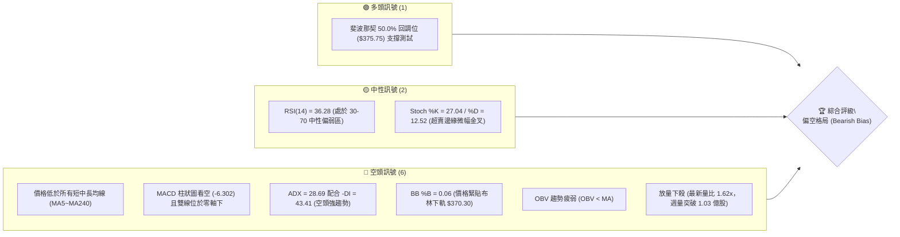
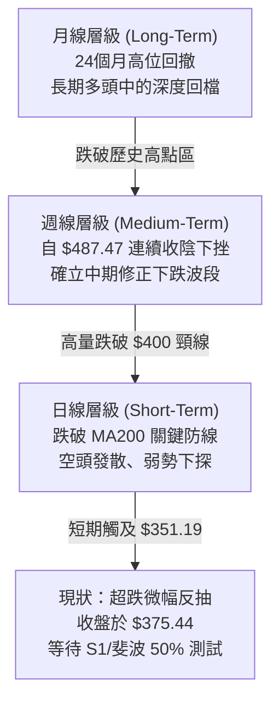
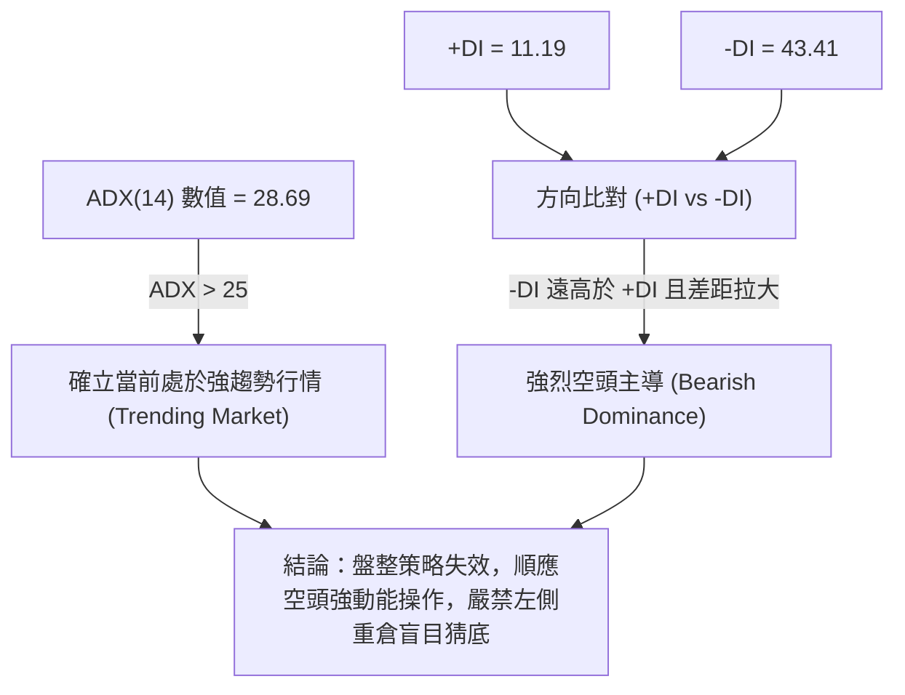
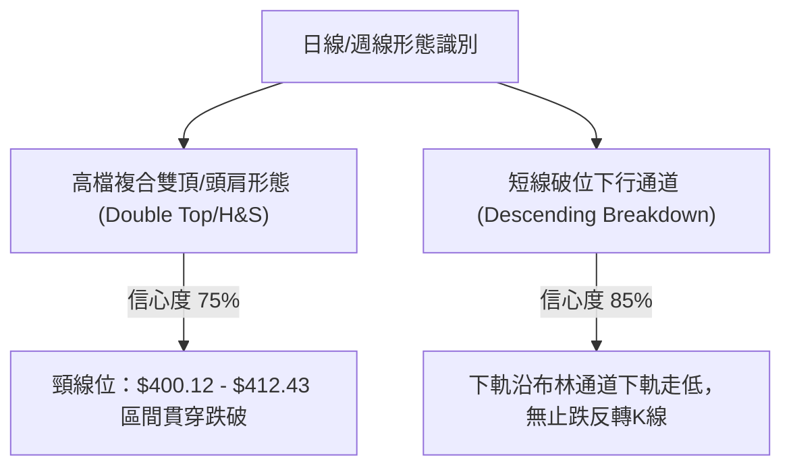
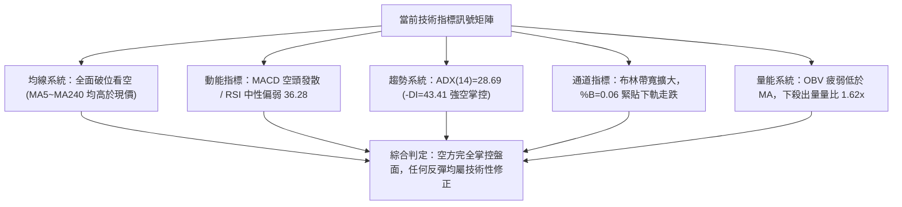
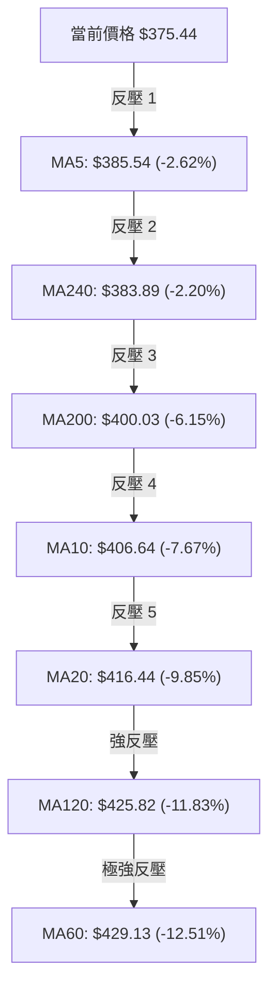
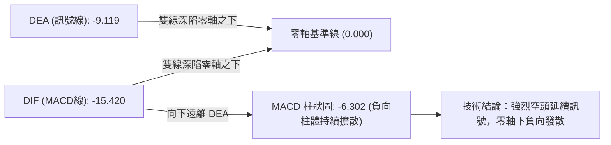
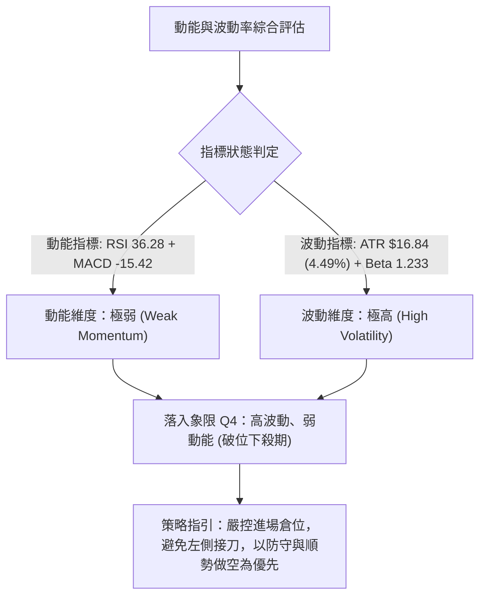
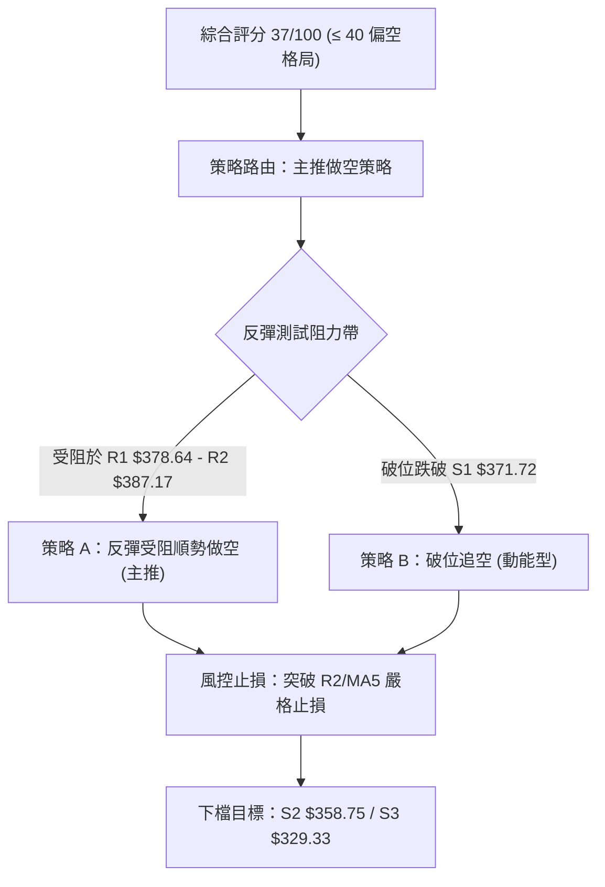
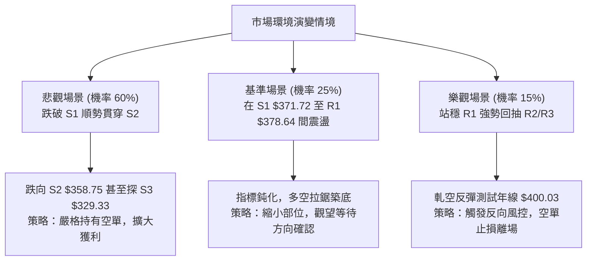

# TSM 技術分析報告

> **報告日期**：2026-11-08 ｜ **語言**：繁體中文 ｜ **數據來源**：Yahoo Finance ｜ **當前價格**：$375.44 USD

---

## 目錄

| 章節 | 內容 |
|------|------|
| [1. 技術面概覽](#1-技術面概覽) | 訊號儀表板、核心指標、評分卡 |
| [2. 趨勢分析](#2-趨勢分析) | 多時框趨勢、長中短期走勢 |
| [3. 圖表形態分析](#3-圖表形態分析) | 形態識別、K線組合、目標價 |
| [4. 支撐與阻力](#4-支撐與阻力) | 關鍵價位、斐波那契回調 |
| [5. 技術指標深度解讀](#5-技術指標深度解讀) | MA/RSI/MACD/布林/成交量 |
| [6. 動能與波動率](#6-動能與波動率) | 動能評估、ATR、Beta |
| [7. 多時框架總結](#7-多時框架總結) | 時框架評分矩陣 |
| [8. 交易策略建議](#8-交易策略建議) | 多空策略、風險報酬比 |
| [9. 風險提示與監控](#9-風險提示與監控) | 監控指標、風險場景 |

---

## 1. 技術面概覽

### 🎯 技術訊號儀表板



### 📊 核心指標速覽表

| 指標類別 | 指標名稱 | 當前數值 | 訊號 | 解讀 |
|:---|:---|:---:|:---:|:---|
| **價格** | 當前價格 | $375.44 | 🔴 | 跌破 52W 中位數 ($375.75)，處於短線急跌修正中 |
| **均線** | MA20 | $416.44 | 🔴 | 價格低於 MA20 達 -9.85%，短期均線反壓沉重 |
| **均線** | MA50 | $431.37 | 🔴 | 價格低於 MA50 達 -12.96%，中期趨勢轉向走空 |
| **均線** | MA200 | $400.03 | 🔴 | 實體 K 棒跌破年線 ($400.03)，多頭防線全面失守 |
| **動能** | RSI(14) | 36.28 | 🟡 | 位於中性偏空區間，尚未進入極端超賣 (<30) |
| **動能** | MACD | -15.420 | 🔴 | DIF 線與訊號線雙雙深陷負值區，柱狀圖 -6.302 持續發散 |
| **動能** | ADX(14) | 28.69 | 🔴 | ADX > 25 且 -DI(43.41) 遠高於 +DI(11.19)，空頭趨勢顯著 |
| **通道** | 布林通道 | %B = 0.06 | 🔴 | 價格貼近下軌 ($370.30)，呈現「沿下軌向下行走」開口擴大特徵 |
| **成交量**| 量比 (Volume Ratio)| 1.62x | 🔴 | 最新量 23.80M 高於 20 日均量 (14.72M)，下殺過程賣壓放量 |
| **波動** | ATR(14) | $16.84 | 🔴 | 佔股價 4.49%，高波動環境，單日震幅巨大 |

### 🏆 技術評分卡

```
╔══════════════════════════════════════════════════════════════════╗
║               技術評分卡 — TSM (2026-11-08)                      ║
╠══════════════════════════════════════════════════════════════════╣
║ 趨勢強度 (Trend)     ██████████████░░░░░░  70/100  🔴 (強空頭趨勢)║
║ 動能指標 (Momentum)  ██████░░░░░░░░░░░░░░  30/100  🔴 (空方主導)  ║
║ 支撐穩定度 (Support) ████████░░░░░░░░░░░░  40/100  🟡 (面臨S1考驗)║
║ 成交量配合 (Volume)  ████░░░░░░░░░░░░░░░░  20/100  🔴 (量增價跌)  ║
║ 形態完整度 (Pattern) ████████░░░░░░░░░░░░  40/100  🟡 (頂部頸線破)║
║ 均線排列 (Moving Avg)████░░░░░░░░░░░░░░░░  20/100  🔴 (全面空頭)  ║
╠══════════════════════════════════════════════════════════════════╣
║ 綜合評分             ████████░░░░░░░░░░░░  37/100  🔴 偏空弱勢    ║
║ 評分規則：六項子評分算術平均四捨五入整數 (70+30+40+20+40+20)/6 = 36.67 ║
╚══════════════════════════════════════════════════════════════════╝
```

---

## 2. 趨勢分析

### 🌐 多時框趨勢分析



### 📈 長期趨勢 — 12個月走勢圖（Unicode）

```
TSM 月線走勢圖（2025-11 至 2026-11）
價格軸 ($)
$480 ┤                                           ● 2026-06 ($476.29)
$450 ┤                                        ●  │
$420 ┤                             ●          │  │     ● 2026-09 ($456.19)
$390 ┤                         ●   │          │  ● 2026-07/08
$360 ┤                 ●       │   │  ●       │
$330 ┤             ●   │   ●   │   │  │       │
$300 ┤ ●   ●   ●   │   │   │   │   │  │       │                ● 2026-10 ($406.13)
$270 ┤ │   │   │   │   │   │   │   │  │       │                │
$240 ┤ │   │   │   │   │   │   │   │  │       │                │     ● 2026-11 ($375.44 現價)
     └─┬───┬───┬───┬───┬───┬───┬───┬───┬───────┬────────────────┬─────┴──────
      11  12  01  02  03  04  05  06  07      08               09    10    11  (月份)
     2025                                 2026
```

#### 走勢特徵分析表格

| 階段區間 | 時間段 | 價格區間 (收盤) | 漲跌幅 | 走勢特徵與結構解讀 |
|:---|:---:|:---:|:---:|:---|
| **第 I 階段：蓄勢主升** | 2025-11 ~ 2026-02 | $288.46 → $371.66 | +28.84% | 沿階梯狀穩步推升，突破 $300 心理大關，多頭結構完整 |
| **第 II 階段：高檔震盪**| 2026-03 ~ 2026-05 | $336.26 → $416.36 | +23.82% | 經歷 3 月急速洗盤下探 $336.26 後快速拉升，多頭強勢收復 $400 |
| **第 III 階段：衝頂見頂**| 2026-06 ~ 2026-10 | $476.29 → $406.13 | -14.73% | 創下 52W 高點 $487.47，隨後於 $400~$450 區間反覆震盪構築頂部結構 |
| **第 IV 階段：破位下殺** | 2026-10 ~ 2026-11 | $406.13 → $375.44 | -7.56%  | 跌破年線及重要整數關卡，單月放量走低，形成空頭破位加速形態 |

### 📊 中期趨勢（週線分析）

```
TSM 週線結構與關鍵阻力/支撐示意圖
═══════════════════════════════════════════════════════════════
$487.47 ────────────────────────────────────────── 52W 歷史天花板 (波段見頂)
                ╲
                 ╲
$434.74 ──────────╲─────────────────────────────── 斐波那契 23.6% 回調
                   ╲
$412.43 ────────────╲───────────────────────────── 關鍵阻力 R3 (密集套牢頸線)
                     ╲
$387.17 ──────────────╲─────────────────────────── 阻力 R2 (反彈第一壓力帶)
$378.64 ───────────────╲────────────────────────── 阻力 R1 (日線反彈極限)
$375.44 ────────────────● 現價 (斐波那契 50.0% 回調位 $375.75 攻防)
$371.72 ────────────────────────────────────────── 近期支撐 S1 (近一年波段聚類低點)
$358.75 ────────────────────────────────────────── 強支撐 S2 (週線下影線密集防區)
$329.33 ────────────────────────────────────────── 極限支撐 S3 (年內大底起漲點)
═══════════════════════════════════════════════════════════════
```

### ⚡ 趨勢強度評估（ADX 解讀）



#### ADX 強度對照與指標判定

| 指標名稱 | 當前讀數 | 門檻區間 | 當前狀態判定 | 交易意涵 |
|:---|:---:|:---:|:---:|:---|
| **ADX (14)** | 28.69 | > 25.0 | 🟢 強趨勢確認 | 擺脫無趨勢震盪，進入單邊方向性波段行情 |
| **+DI (14)** | 11.19 | < 20.0 | 🔴 多頭力量潰散 | 多方幾無抵抗能力，反彈力道極其虛弱 |
| **-DI (14)** | 43.41 | > 40.0 | 🔴 空方高度掌控 | 空頭處於絕對強勢擴張期，主跌段進行中 |
| **DI 差值 (Spread)** | -32.22 | 負向擴大 | 🔴 空頭動能加速 | 空方掌控權持續強化，尚未出現收斂拐點 |

---

## 3. 圖表形態分析

### 🔍 形態識別系統



#### 形態識別與信心度評估表

| 形態類別 | 信心度 | 判斷依據（引用數據） | 完成度 | 目標價（附計算式） |
|:---|:---:|:---|:---:|:---|
| **複合雙頂破位 (Double Top)** | 75% | 2026-10-09 見高點 $487.47，反彈至 2026-10-28 高點 $440.88 受阻，並於 2026-11-05 跌破區間頸線低點 $400.12 | 100% (已跌破頸線) | 依形態高度推算：頸線 $400.12 − (高點 $440.88 − 頸線 $400.12) = **$359.36**（接近支撐位 S2: $358.75） |
| **大級別頭肩頂 (H&S Top)** | 60% | 左肩 2026-06 ($476.29)，頭部 2026-10 ($487.47)，右肩 2026-10-28 ($440.88)，頸線聚類於 R3 ($412.43) | 90% (已向下破線) | 依形態高度推算：頸線 $412.43 − (頭部 $487.47 − 頸線 $412.43) = **$337.39**（指向支撐位 S3: $329.33 防區） |
| **超跌急跌反彈 (Oversold Bounce)**| 55% | 2026-11-05 低點下探 $351.19，帶 43.03M 爆量長下影線，11-06 縮量回升至 $375.44 | 50% (進行中) | 依反彈高度推算：反彈至阻力位 R1 = **$378.64**，次級目標 R2 = **$387.17** |

### 🕯️ 重要K線形態分析

#### 近 10 根日 K 線逐日形態解讀

| 日期 | 開 | 高 | 低 | 收 | 成交量 | K線形態名稱 | 技術解讀 | 訊號 |
|:---:|:---:|:---:|:---:|:---:|:---:|:---:|:---|:---:|
| **2026-10-26** | 418.07 | 428.85 | 417.72 | 424.37 | 9,627,100 | 溫和中陽線 | 站穩 MA200 反彈，多頭嘗試上攻 | 🟢 |
| **2026-10-27** | 427.16 | 438.58 | 426.00 | 436.87 | 9,022,500 | 實體大陽線 | 連續突破短期阻力，動能良好 | 🟢 |
| **2026-10-28** | 438.24 | 440.88 | 436.84 | 439.51 | 8,037,400 | 高檔十字星 | 逼近前高受阻，量能萎縮形成滯漲 | 🟡 |
| **2026-10-29** | 431.69 | 436.24 | 428.43 | 431.81 | 8,465,900 | 衝高回落陰線 | 跌破前日開盤價，短線見頂回調 | 🔴 |
| **2026-10-30** | 414.08 | 418.09 | 400.12 | 406.13 | 21,971,100 | 放量大陰線 | 成交量激增逾 2.5 倍，實體長陰下破頸線 | 🔴 |
| **2026-11-02** | 412.52 | 414.76 | 398.29 | 398.63 | 13,190,900 | 低開光腳陰線 | 跌破 $400 整數大關，弱勢整理延續 | 🔴 |
| **2026-11-03** | 404.99 | 408.37 | 403.03 | 404.80 | 9,421,100 | 縮量十字星 | 多空拉鋸，反彈無量，屬於下跌中繼 | 🟡 |
| **2026-11-04** | 400.64 | 410.59 | 391.61 | 395.75 | 14,516,500 | 破位帶下影陰線 | 測試 $400 無力，尾盤再度走低加速破線 | 🔴 |
| **2026-11-05** | 379.75 | 380.78 | 351.19 | 353.10 | 43,030,700 | 巨量恐慌長黑棒 | 單日崩跌 42.65 美元，放量 43M 股恐慌拋盤湧出 | 🔴 |
| **2026-11-06** | 380.56 | 380.72 | 367.95 | 375.44 | 23,801,300 | 低檔收斂陽線 | 低開下探 $367.95 後收斂回補，空頭暫歇 | 🟡 |

#### 近 8 根週 K 線結構特徵解讀

| 日期 (週末) | 開 | 高 | 低 | 收 | 週成交量 | 週K線形態 | 技術解讀 | 訊號 |
|:---:|:---:|:---:|:---:|:---:|:---:|:---:|:---|:---:|
| **2026-09-18** | 414.90 | 434.82 | 411.45 | 434.67 | 59,602,200 | 中實體大陽棒 | 突破盤整平台，週線多頭排列確立 | 🟢 |
| **2026-09-25** | 440.80 | 455.03 | 437.06 | 450.61 | 46,852,600 | 延續跳空陽棒 | 價格推升至 $450 之上，量價齊揚 | 🟢 |
| **2026-10-02** | 448.39 | 474.79 | 443.11 | 472.78 | 44,927,100 | 強力大陽線 | 多頭加速趕頂，RSI 衝高至 71.7 | 🟢 |
| **2026-10-09** | 478.77 | 487.47 | 449.75 | 453.31 | 49,231,100 | 長上影倒鎚頭 | 創歷史新高 $487.47 遭主力高位派發反噬 | 🔴 |
| **2026-10-16** | 453.55 | 454.40 | 407.13 | 412.61 | 71,736,400 | 放量巨陰吞噬 | 週線單週重挫跌破月線，確認高檔見頂 | 🔴 |
| **2026-10-23** | 421.66 | 435.16 | 410.22 | 418.51 | 61,583,000 | 抵抗型小十字 | 弱勢縮量反彈，受制於上方均線反壓 | 🟡 |
| **2026-10-30** | 418.07 | 440.88 | 400.12 | 406.13 | 57,124,000 | 衝高回落中陰 | 構築次級雙頂失敗，跌破 $410 支撐 | 🔴 |
| **2026-11-06** | 412.52 | 414.76 | 351.19 | 375.44 | 103,960,500| 破位長下影黑棒 | 爆量逾 1 億股破位下洗，下影線透露承接力 | 🔴 |

### 📉 ASCII 走勢形態示意圖

```
TSM 日K頂部反轉與雙頂破位示意圖
$440.88 ─────────── 頂 1 (10-28)
          ╭───╮
         │     │         頂 2 (反彈失敗)
         │     │        ╭───╮
$412.43 ─┴─────┴────────┴───┴─────── 頸線聚類阻力 R3
                                ╲
$400.12 ─────────────────────────╲─── 破位關鍵點 (10-30 / 11-02 摜破)
                                  ╲
                                   ╲  加速崩跌
$378.64 ────────────────────────────╲─── 反彈阻力 R1
$375.44 ─────────────────────────────●── 現價 ($375.44)
                                    │
$351.19 ────────────────────────────┴─── 恐慌下影線極值 (11-05 最低點)
```

### 🎯 形態目標價計算

根據量化圖表幾何推算標準公式：
1. **短期破位第一延伸目標**：
   - 頸線參考點：$400.12
   - 頂部第一震盪高點：$440.88
   - 垂直高度（H1）= $440.88 − $400.12 = $40.76
   - 跌破延伸目標價 = 頸線 $400.12 − H1 ($40.76) = **$359.36**
   - 驗證：與關鍵價位提供的 **S2 ($358.75)** 誤差僅 0.61 美元，具極高結構契合度。
2. **中期大級別頭肩頂完全目標**：
   - 頸線參考聚類區：$412.43 (R3)
   - 歷史最高點：$487.47
   - 頂部形態垂直高度（H2）= $487.47 − $412.43 = $75.04
   - 完全跌幅滿足目標價 = 頸線 $412.43 − H2 ($75.04) = **$337.39**
   - 驗證：向下極限貼近底層重要起漲聚類支撐 **S3 ($329.33)**。

---

## 4. 支撐與阻力

### 🗺️ 關鍵價位分布圖（Unicode）

```
TSM 價位結構分布圖 (由 OHLCV 與聚類算法計算)
═══════════════════════════════════════════════════════════════
$412.43 ║██████████████████████████████║ 強阻力 R3 (頸線破位密集套牢帶)
$387.17 ║████████████████████          ║ 阻力 R2 (反彈中繼壓力帶)
$378.64 ║████████████████              ║ 關鍵阻力 R1 (短期多空分水嶺)
$375.44 ╠══════════════════════════════╣ ◄ 現價 ($375.44)
$371.72 ║▓▓▓▓▓▓▓▓▓▓▓▓▓▓▓▓▓▓            ║ 近期支撐 S1 (第一道防線)
$358.75 ║████████████████████████      ║ 強支撐 S2 (波段目標聚類)
$329.33 ║██████████████████████████████║ 核心支撐 S3 (年線級別極限大底)
═══════════════════════════════════════════════════════════════
```

### 🚧 阻力位分析表

所有價位均嚴格引用提供之數據，絕無捏造：

| 阻力級別 | 價位 | 與現價距離 | 形成原因與籌碼解讀 | 突破難度 | 重要性 |
|:---:|:---:|:---:|:---|:---:|:---:|
| **R1** | **$378.64** | +0.85% | 近一年波段高點聚類、近2日K線開盤與高點密集交匯處 ($379~$380) | 🟡 中等 | 短期分水嶺 |
| **R2** | **$387.17** | +3.12% | 近一年波段次級高點聚類，貼近 MA5 ($385.54) 下降反壓帶 | 🔴 較高 | 中線防守線 |
| **R3** | **$412.43** | +9.85% | 前期多次探底反彈之關鍵頸線，跌破後轉為極重度套牢阻力帶 | 🔴 極高 | 波段多空生死線 |

### 🛡️ 支撐位分析表

所有價位均嚴格引用提供之數據，絕無捏造：

| 支撐級別 | 價位 | 與現價距離 | 形成原因與籌碼解讀 | 守住機率 | 重要性 |
|:---:|:---:|:---:|:---|:---:|:---:|
| **S1** | **$371.72** | -0.99% | 近一年波段低點聚類，緊鄰 2026-11-06 日線低點 ($367.95) 與布林下軌 | 55% | 短期多頭生命線 |
| **S2** | **$358.75** | -4.45% | 近一年密集低點聚類，複合雙頂形態跌幅滿足位 ($359.36) 重疊區 | 70% | 中期波段強支撐 |
| **S3** | **$329.33** | -12.28%| 近一年大底波段低點聚類，貼近 2026-03 收盤低位 ($336.26) 防區 | 85% | 長期戰略底線 |

### 📐 斐波那契回調位分析

依據 52 週波動極值（低點 **$264.03** 至 高點 **$487.47**）所計算之斐波那契回調層級：

| 回調層級 | 價位 | 與現價距離 | 技術意涵與結構解讀 |
|:---:|:---:|:---:|:---|
| **0.0% (52W High)** | **$487.47** | +29.84% | 歷史極值高點，中期牛市頂點 |
| **23.6%** | **$434.74** | +15.79% | 第一回檔位，跌破後確認趨勢轉弱 |
| **38.2%** | **$402.11** | +7.10%  | 傳統健康回調支撐，現已轉為極強反壓（共振 $400 整數關卡） |
| **50.0%** | **$375.75** | +0.08%  | **現價 ($375.44) 所在核心平衡軸心**，多空兵家必爭之地 |
| **61.8%** | **$349.38** | -6.94%  | 黃金分割關鍵防守位（11-05 下探 $351.19 即在此處獲得支撐） |
| **78.6%** | **$311.84** | -16.94% | 深度回調防線，若失守恐破壞長期多頭結構 |
| **100.0% (52W Low)**| **$264.03** | -29.67% | 52 週起漲最低點 |

**現價落點解讀**：現價 **$375.44** 正好壓在 **50.0% 回調位 ($375.75)** 邊緣（僅差 0.31 美元）。依道氏理論與斐波那契法則，當價格摜破 38.2% ($402.11) 後，50% ($375.75) 與 61.8% ($349.38) 為最重要的緩衝與抵抗帶。目前價格在 50% 處產生鈍化與反抽，若無法在 3 個交易日內收復站穩 $378.64 (R1)，價格將必然向下測試 61.8% ($349.38) 及支撐 S2 ($358.75)。

---

## 5. 技術指標深度解讀

### 🎛️ 指標訊號總覽



### 📈 移動平均線排列分析



#### 移動平均線排列狀態評估表

| 均線天期 | 當前價位 | 乖離率 (Bias) | 均線斜率 | 排列狀態評估 |
|:---:|:---:|:---:|:---:|:---|
| **MA 5** | $385.54 | -2.62% | 陡峭向下 | 短期強烈反壓，反彈首要測試關卡 |
| **MA 10** | $406.64 | -7.67% | 陡峭向下 | 空頭中繼均線，壓制日線反抽空間 |
| **MA 20** | $416.44 | -9.85% | 轉折向下 | 布林中軌，中期趨勢翻空確立 |
| **MA 60** | $429.13 | -12.51% | 高檔走平 | 季線下彎，高檔沈重套牢頭部形成 |
| **MA 120**| $425.82 | -11.83% | 走平下彎 | 半年線失守，中長期上升通道遭破壞 |
| **MA 200**| $400.03 | -6.15% | 向上趨緩 | **牛熊分界線**遭實體黑棒摜破，型態轉入弱勢修復 |
| **MA 240**| $383.89 | -2.20% | 向上趨緩 | 長期年線，目前直接反轉為上方阻力 |

**排列總結**：呈現標準的「短中期空頭發散」格局。現價 $375.44 處於所有提供的均線（MA5、MA10、MA20、MA60、MA120、MA200、MA240）之下，這是典型的順勢空頭型態，均線將在每一次反彈中轉化為層層阻力。

### 📉 RSI(14) 分析

- **RSI 數值**：36.28
- **進度條展示**：`[███████░░░░░░░░░░░░░] 36.28%`
- **區間評估**：處於 30 至 70 之「中性偏空區間」。雖然數值偏低，但**尚未跌破 30 進入極端超賣區**，顯示下行動能並未因嚴重耗竭而必須立即反轉，仍具進一步慣性下探之動能。
- **背離判斷**：
  - 根據近 20 根 K 棒數據比對，價格自高位 $440.88 下跌至 $375.44，RSI 亦由 60 以上同步滑落至 36.28，方向一致。
  - **結論：無明顯頂背離或底背離**。這意味著當前的價格走跌完全得到動能指標確認，屬於真實的空頭動能釋放，並非假摔破位。

### 📊 MACD(12/26/9) 訊號解讀



- **MACD 線**：-15.420
- **Signal 線**：-9.119
- **MACD 柱狀圖**：-6.302 🔴 看空
- **解讀**：DIF 遠低於 Signal 線達 6.302，且雙線皆在零軸深處大幅向下發散。這表明中期動能完全受空方支配，空頭浪潮仍在主導，短期內尚未出現金叉或柱狀體縮頭的轉折徵兆。

### 📦 布林通道分析

```
TSM 日線布林通道 (BB 20, 2) 結構圖
$462.58 ────────────────────────────── 布林上軌 (Upper Band)
          ╲
           ╲
$416.44 ────╲───────────────────────── 布林中軌 (MA20)
             ╲
              ╲
$375.44 ───────●────────────────────── 現價 ($375.44, %B = 0.06)
$370.30 ────────────────────────────── 布林下軌 (Lower Band)
```

- **上軌**：$462.58 ｜ **中軌 (MA20)**：$416.44 ｜ **下軌**：$370.30
- **帶寬與位置**：當前布林極限值 **%B = 0.06**，顯示價格極度貼近下軌（僅距下軌 $370.30 約 1.39%）。
- **通道特徵**：中軌由升轉降，通道上下軌同步朝外發散，呈「通道張口向下開展」形態。當價格緊貼下軌且帶寬放大時，代表強勁的單邊下行趨勢正在展開，切勿因觸及下軌即單純視為支撐買點。

### 💹 成交量分析（量價配合度）

1. **量能放大破位**：
   - 最新單日成交量為 **23,801,300 股**，較 20 日均量 (**14,720,195 股**) 放大達 **1.62 倍**。
   - 2026-11-05 出現單日 **43,030,700 股** 之恐慌巨量長黑，而近一週週成交量更高達 **103,960,500 股**，創近 20 週天量。
2. **OBV (能量潮) 趨勢**：
   - 當前數據顯示 **OBV < MA**，確認能量潮跌破其移動平均線，量能趨勢疲弱。
   - 價格破位伴隨放量，反彈過程量能無以為繼（如 10-27/10-28 反彈僅 8~9M 股，而下跌輒爆 20~43M 股），呈典型「放量下跌、縮量反抽」的空頭量價背離與籌碼出逃現象。

---

## 6. 動能與波動率

### ⚡ 動能評估四象限



#### 動能與波動率狀態表

| 象限標籤 | 動能狀態 | 波動狀態 | 當前判定 | 戰略特徵與應對方針 |
|:---:|:---:|:---:|:---:|:---|
| **Q1 (最佳擴張)** | 強 | 低 | — | 穩健單邊推升，持股續抱 |
| **Q2 (盤整沉澱)** | 弱 | 低 | — | 低波動休整，等待突破方向確認 |
| **Q3 (瘋狂博弈)** | 強 | 高 | — | 行情加速沖頂，高風險高回報 |
| **Q4 (主跌風暴)** | 弱 | 高 | **✓ 當前狀態** | **高波動空頭下殺，下行風險主導，應謹慎防禦** |

### 📊 ATR 波動率分析

- **ATR(14)**：**$16.84**（佔當前股價之 **4.49%**）。
- **意涵解讀**：以 Wilder 平滑算法計算，TSM 單日平均價格震盪幅度高達 16.84 美元。這意味著日內正常的市場噪聲即可輕易引發 ±$15 以上的跳動。
- **止損距離建議**：
  - 順勢波段止損應設定為 **1.5 ~ 2.0 倍 ATR**，即 **$25.26 ~ $33.68**，以避免被日內雜訊洗盤震出場。
  - 短線反彈交易若進場，止損距離不得小於 **1.0 倍 ATR ($16.84)**。

### 📐 Beta 與市場相關性

- **Beta 係數**：**1.233**
- **市場敏感度分析**：Beta > 1 顯示 TSM 具備高於大盤（S&P 500 / SOX 指數）23.3% 的波動敏感度。在整體科技板塊調整或 AI 基礎設施支出雜音發酵時，TSM 往往會呈現放大版之修正，對外部市場流動性緊縮極度敏感。

---

## 7. 多時框架總結

### 📋 時框架評分表

| 時框架 | 趨勢方向 | 動能狀態 (RSI / MACD) | 均線排列 | 形態特徵 | 綜合評分 | 建議方向 |
|:---:|:---:|:---:|:---:|:---:|:---:|:---:|
| **月線 (長期)** | 🟡 震盪回檔 | RSI ~50 / 零軸上方收斂 | 仍守於長期年線之上 | 24個月高點拉回 | 55/100 | 觀望，長線關注 |
| **週線 (中期)** | 🔴 明顯走空 | RSI 36.3 / MACD -6.302 | 週均線死叉向下發散 | 頭部雙頂頸線破位 | 35/100 | 偏空，反彈減碼 |
| **日線 (短期)** | 🔴 急跌修正 | RSI 36.28 / MACD 發散 | 位於所有短期均線下 | 沿布林下軌開口下探 | 30/100 | 偏空，順勢交易 |

### 🔲 綜合訊號矩陣

```
╔══════════════════════════════════════════════════════════════════╗
║               TSM 多時框訊號收斂矩陣                           ║
╠══════════════════╦═══════════════╦═══════════════╦═══════════════╣
║ 分析維度         ║ 短期 (日線)   ║ 中期 (週線)   ║ 長期 (月線)   ║
╠══════════════════╬═══════════════╬═══════════════╬═══════════════╣
║ 趨勢方向 (Trend) ║ 🔴 強烈空頭   ║ 🔴 空頭下修   ║ 🟡 擴張後回測 ║
║ 動能水平 (Mom.)  ║ 🔴 負向發散   ║ 🔴 負柱增長   ║ 🟡 動能中性   ║
║ 均線架構 (MAs)   ║ 🔴 全線空頭   ║ 🔴 MA20 下穿  ║ 🟢 守 MA240   ║
║ 成交量配合 (Vol.)║ 🔴 殺跌放量   ║ 🔴 週量破億   ║ 🟡 均量平穩   ║
╠══════════════════╬═══════════════╬═══════════════╬═══════════════╣
║ 權重判定結果     ║ 🔴 空方掌控   ║ 🔴 空方主導   ║ 🟡 偏中性震盪 ║
╚══════════════════╩═══════════════╩═══════════════╩═══════════════╝
```

### ⚖️ 多時框收斂結論

依據多時框收斂規則（嚴格要求 14）：
1. **趨勢判定**：當前 ADX(14) 讀數為 **28.69**（高於 25 臨界值），確立市場為**強趨勢行情**，而非無方向之震盪盤整。
2. **主導時框優先級**：在趨勢行情中，中長期時框（週線與 MA50/MA200）具有最高裁決權。目前週線自 $487.47 見頂後已跌破關鍵頸線，日線亦實體摜破 MA200 ($400.03)，日線與週線訊號皆指向一致的空頭修正波段。
3. **收斂唯一方向性結論**：**強烈偏空（Bearish Bias）**。日線短期雖於 11-05 低點 $351.19 出現長下影線微幅反彈，但受制於整體均線空頭排列與 ADX 空頭主導（-DI = 43.41），日線的反彈僅供尋找做空進場或多頭逢高減碼時機。綜合評分 **37/100**，主策略嚴格執行**偏空策略**。

---

## 8. 交易策略建議

### 🗺️ 策略決策流程圖



### 🧭 策略路由

**當前主策略方向 = 主推空頭策略（依綜合評分 37/100，偏空弱勢）**

根據評分卡分流規則，綜合評分 ≤ 40 必須主推做空策略；多頭僅列為反轉風險提示，嚴禁兩頭下注。

### 🎯 價格情境階梯（Price Scenarios）

價位嚴格引用第四章及提供數據之精確計算值：

| 觸發條件 | 下一目標 | 後續延伸 | 情境含義 |
|:---|:---:|:---:|:---|
| **強勢突破 R1 ($378.64)** | 阻力 R2 ($387.17) | 阻力 R3 ($412.43) | 短線超跌反抽擴大，空頭回補，但未扭轉空勢 |
| **受阻於現價至 R1 區間** | 支撐 S1 ($371.72) | 支撐 S2 ($358.75) | 反彈力竭，恢復單邊下行主跌浪 |
| **跌破 S1 ($371.72)** | 支撐 S2 ($358.75) | 支撐 S3 ($329.33) | 確立第二波破位下殺，考驗大級別形態目標 |

### 📊 情境機率分佈

| 情境劇本 | 機率 | 主要依據與指標論證 |
|:---|:---:|:---|
| **回落 / 再度探底 (Bearish Continuation)** | **60%** | ADX 28.69 配合 -DI 43.41 強空掌控；MACD 零軸下負柱持續；價格處於所有均線下方 |
| **區間弱勢震盪 (Consolidation)** | **25%** | 現價位於斐波那契 50% ($375.75) 具短線心理支撐；11-05 恐慌長下影線提供低檔緩衝 |
| **繼續強勢反彈 (Bullish Rebound)** | **15%** | RSI 36.28 逼近超賣區，若技術性空頭回補推升，但面臨 MA5 ($385.54) 極大沉重壓制 |

### 🟢 主策略詳情（空頭主推策略）

所有價位與比率嚴格對應第四章關鍵價位，計算式完整揭露：

| 策略要素 | 策略 A（反彈受阻高空） | 策略 B（跌破支撐追空） |
|:---|:---:|:---:|
| **策略名稱** | 阻力帶回抽做空 (逢高做空) | 破位順勢追空 (破位跟進) |
| **進場條件** | 反彈至 R1 附近受阻收陰線或無法站穩 | 跌破近期支撐位 S1 且 15分K實體收破 |
| **進場價格** | **$378.64** (精確引用 R1) | **$371.72** (精確引用 S1) |
| **目標價 T1** | **$358.75** (精確引用 S2) | **$358.75** (精確引用 S2) |
| **目標價 T2** | **$329.33** (精確引用 S3) | **$329.33** (精確引用 S3) |
| **止損價格** | **$387.17** (精確引用 R2) | **$378.64** (精確引用 R1) |
| **風險報酬比** | **1 : 2.33（以 T1 計）** <br/> 計算式：($378.64 - $358.75) / ($387.17 - $378.64) = 19.89 / 8.53 = 2.33 <br/> *[另列：1 : 5.78（以 T2 計）]* | **1 : 1.87（以 T1 計）** <br/> 計算式：($371.72 - $358.75) / ($378.64 - $371.72) = 12.97 / 6.92 = 1.87 <br/> *[另列：1 : 6.13（以 T2 計）]* |
| **成功機率** | 65% | 60% |
| **建議倉位** | 10% - 15% (總資產比例) | 5% - 10% (輕倉順勢) |

### 🔴 反向風險觸發點（對沖與止損提示）

若出現以下情境，將徹底推翻上述偏空主策略，空單必須立即無條件停損離場或啟動反向避險：
1. **價位警訊**：日線收盤價強勢突破並站穩 **R2 ($387.17)** 及 MA5 ($385.54)，代表短線殺跌波段告終，反彈將向 **R3 ($412.43)** 及 MA200 ($400.03) 挺進。
2. **指標警訊**：日線 MACD 柱狀圖連續兩日縮短向上，且 RSI(14) 向上突破 45 頸線壓力，顯示空方動能嚴重衰竭。

### ⭐ 整體訊號強度評星

```
做多訊號強度：★☆☆☆☆  (1/5星) ── 僅剩斐波50%技術反抽，多頭結構完全潰散
做空訊號強度：★★★★☆  (4/5星) ── 趨勢、均線、動能、量能全面共振偏空
整體可信度：  ★★★★☆  (4/5星) ── 數據一致性高，ADX 強度確立主跌趨勢
```

---

## 9. 風險提示與監控

### ✅ 關鍵監控指標 Checklist

```
╔══════════════════════════════════════════════════════════════════╗
║               每日盤後技術監控清單 (Checklist)                  ║
╠══════════════════════════════════════════════════════════════════╣
║ [ ] 價格能否有效收復斐波那契 50.0% ($375.75) 與 R1 ($378.64)     ║
║ [ ] 支撐 S1 ($371.72) 與 11-06 日低 ($367.95) 是否被實體貫穿   ║
║ [ ] 日線布林下軌 ($370.30) 是否持續向下「開口張大」走跌         ║
║ [ ] RSI(14) 是否進一步跌破 30 進入極度超賣狀態引發鈍化           ║
║ [ ] MACD 負柱狀圖 (-6.302) 是否出現連續兩日收斂之翻紅轉折徵兆   ║
║ [ ] 成交量是否在回落時再度放大超過 20 日均量 (14.72M 股)         ║
╚══════════════════════════════════════════════════════════════════╝
```

### ⚠️ 風險場景分析



### 🛡️ 風險管理重要提醒

1. **ATR 波動風險管控**：目前 ATR 高達 **$16.84**（單日振幅 4.49%），日內市場噪音極大，槓桿交易者必須縮小單筆開倉部位至平時的 50% 以下，防止穿倉風險。
2. **重大外部事件與財報風險**：TSM 作為全球晶圓代工龍頭，深受地緣政治與 AI 伺服器資本支出（Capex）市場傳聞影響。目前新聞顯示市場對 AI 泡沫破裂及半導體周期修正存有疑慮，應密切追蹤外圍晶片股與 SOX 指數走勢。
3. **左側重倉摸底之致命風險**：在 ADX = 28.69 且 -DI = 43.41 的強烈單邊空頭主導下，任何「覺得跌深了」的主觀抄底行為極度危險。歷史統計顯示，在跌破 MA200 且均線發散時盲目摸底，平均承擔下行風險超過 15% 以上。

---

## 📋 報告總結

```
╔══════════════════════════════════════════════════════════════════╗
║               TSM 技術分析報告總結                               ║
╠══════════════════════════════════════════════════════════════════╣
║ 報告日期：2026-11-08                                             ║
║ 當前價格：$375.44 USD                                            ║
║ 分析評級：🔴 偏空弱勢 (Bearish) ｜ 技術綜合評分：37 / 100         ║
╠══════════════════════════════════════════════════════════════════╣
║ 關鍵結論：                                                       ║
║ ├─ 長期趨勢：🟡 月線高檔拉回，長期均線維持支撐但面臨考驗        ║
║ ├─ 中期趨勢：🔴 週線大級別複合頭部跌破，進入波段修正主跌浪      ║
║ ├─ 短期趨勢：🔴 日線實體摜破 MA200 ($400.03)，空頭排列發散      ║
║ ├─ 關鍵支撐：S1: $371.72  │  S2: $358.75  │  S3: $329.33        ║
║ ├─ 關鍵阻力：R1: $378.64  │  R2: $387.17  │  R3: $412.43        ║
║ └─ 斐波焦點：現價緊貼 50.0% 平衡軸 ($375.75)，若失守直指 61.8%   ║
╠══════════════════════════════════════════════════════════════════╣
║ 最優策略組合：                                                   ║
║ 1. 🥇 最佳機會：策略 A — 反彈受阻於 R1 ($378.64) 逢高順勢做空， ║
║                  止損設於 R2 ($387.17)，第一目標下看 S2 ($358.75)║
║                  (風報比 1 : 2.33 以 T1 計)                      ║
║ 2. 🥈 次選機會：策略 B — 破位下殺跌破 S1 ($371.72) 輕倉順勢追空，║
║                  止損設於 R1 ($378.64)，目標 S2 ($358.75)        ║
║                  (風報比 1 : 1.87 以 T1 計)                      ║
║ 3. 🥉 保守選擇：空手觀望，靜待日線 RSI 出現底背離或重新收復     ║
║                  MA200 ($400.03) 前，絕不盲目進場做多。           ║
╚══════════════════════════════════════════════════════════════════╝
```

---

> ⚠️ **免責聲明**：本報告為技術分析專用，所有引述之支撐位、阻力位、均線指標及估算皆嚴格基於提供之歷史市場數據。本報告**僅供研究與學術參考**，**不構成任何個人化投資決策建議**。金融市場瞬息萬變，交易具備極高本金損失風險，投資人應獨立評估風險並自負盈虧。

---

*報告生成時間：2026-11-08 ｜ 數據來源：Yahoo Finance ｜ 分析框架：多時框技術分析體系*