# TSM 技術分析報告

> **報告日期**：2026-11-09 ｜ **語言**：繁體中文 ｜ **數據來源**：Yahoo Finance ｜ **當前價格**：$375.44 USD

---

## 目錄

| 章節 | 內容 |
|------|------|
| [1. 技術面概覽](#1-技術面概覽) | 訊號儀表板、核心指標、評分卡 |
| [2. 趨勢分析](#2-趨勢分析) | 多時框趨勢、長中短期走勢、ADX解讀 |
| [3. 圖表形態分析](#3-圖表形態分析) | 形態識別、K線組合、目標價推算 |
| [4. 支撐與阻力](#4-支撐與阻力) | 關鍵價位、斐波那契回調結構 |
| [5. 技術指標深度解讀](#5-技術指標深度解讀) | MA/RSI/MACD/布林/成交量分析 |
| [6. 動能與波動率](#6-動能與波動率) | 動能四象限、ATR、Beta與波動分析 |
| [7. 多時框架總結](#7-多時框架總結) | 時框架評分矩陣、多時框收斂結論 |
| [8. 交易策略建議](#8-交易策略建議) | 主策略路由、情境階梯、風險報酬比 |
| [9. 風險提示與監控](#9-風險提示與監控) | 關鍵監控清單、情境分析、風控提醒 |

---

## 1. 技術面概覽

### 🎯 技術訊號儀表板

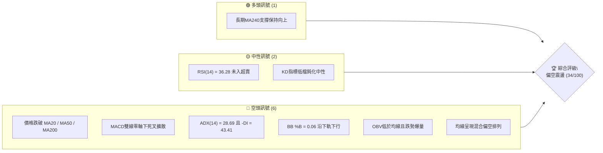

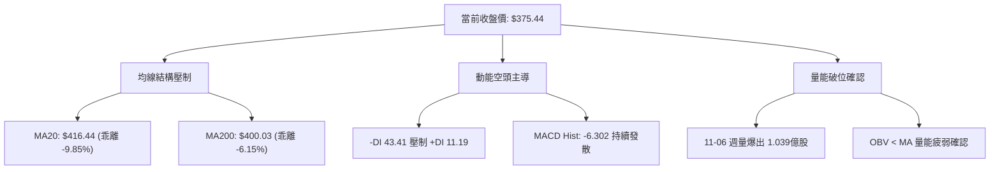

### 📊 核心指標速覽表

| 指標類別 | 指標名稱 | 當前數值 | 訊號 | 解讀 |
|----------|----------|----------|------|------|
| **價格** | 當前收盤價 | $375.44 | 🔴 | 位於52週區間49.9%，短線連續破位下行 |
| **均線** | MA20 (月線) | $416.44 | 🔴 | 股價位於MA20下方 -9.85%，短期均線快速下彎 |
| **均線** | MA50 (季線) | $431.37 | 🔴 | 股價位於MA50下方 -12.97%，中期趨勢轉弱 |
| **均線** | MA200 (年線) | $400.03 | 🔴 | 跌破牛熊分水嶺MA200（-6.15%），長期防線失守 |
| **動能** | RSI(14) | 36.28 | 🟡 | 處於30–70中性偏弱區，尚未進入極端超賣區 |
| **動能** | MACD (12,26,9) | -15.420 / -9.119 | 🔴 | MACD線位於訊號線下方，柱狀圖 -6.302 持續發散 |
| **趨勢** | ADX(14) / ±DI | 28.69 (-DI 43.41) | 🔴 | ADX>25確認強趨勢，-DI大幅主導，為明確空頭趨勢 |
| **通道** | 布林帶 (%B) | %B: 0.06 (下軌 $370.30) | 🔴 | 股價緊貼布林通道下軌運行，通道呈現張口下跌 |
| **成交量** | 量比 (vs 20MA) | 1.62x (2,380萬股) | 🔴 | 突破與下跌時均放量，OBV跌破均線，空方籌碼拋售 |
| **波動** | ATR(14) | $16.84 (4.49%) | 🔴 | 波動顯著擴大，日振幅達高波動水準 |

### 🏆 技術評分卡

```
╔══════════════════════════════════════════════════════════════════╗
║                   技術評分卡 — TSM (2026-11-09)                 ║
╠══════════════════════════════════════════════════════════════════╣
║ 趨勢強度 (ADX=28.69, -DI極強)   ███████░░░░░░░░░░░░░  35/100 🔴 ║
║ 動能指標 (MACD發散, RSI=36.28)  ██████░░░░░░░░░░░░░░  30/100 🔴 ║
║ 支撐穩定度 (考驗S1 $371.72)     ████████░░░░░░░░░░░░  40/100 🟡 ║
║ 成交量配合 (OBV疲弱, 破位放量)  ██████░░░░░░░░░░░░░░  30/100 🔴 ║
║ 形態完整度 (雙重頂破頸線)       ████████░░░░░░░░░░░░  40/100 🟡 ║
║ 均線排列 (全線跌破, 混亂偏空)   ██████░░░░░░░░░░░░░░  30/100 🔴 ║
╠══════════════════════════════════════════════════════════════════╣
║ 綜合評分 (六項算術平均四捨五入) ███████░░░░░░░░░░░░░  34/100 🔴 ║
║ 綜合評級：偏空強空頭趨勢 (Strong Bearish Bias)                  ║
╚══════════════════════════════════════════════════════════════════╝
```
*註：綜合評分 = (35 + 30 + 40 + 30 + 40 + 30) ÷ 6 = 34.17，四捨五入取整為 34。*

---

## 2. 趨勢分析

### 🌐 多時框趨勢分析

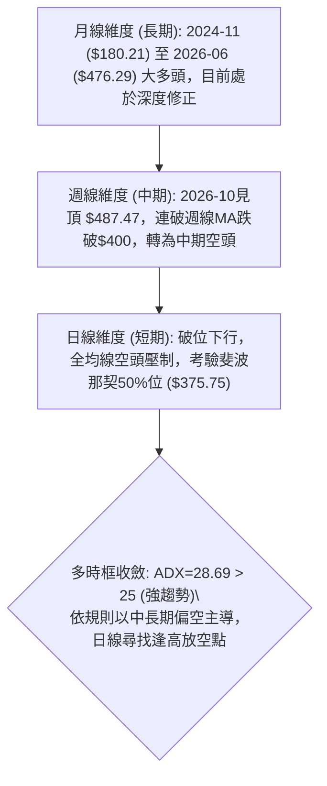

### 📈 長期趨勢 — 12個月走勢圖（Unicode）

```
TSM 月線走勢圖（過去12個月：2025-11 至 2026-11）
價格軸 ($)
$480 ┤                                           ●(2026-06 高點 $476.29)
$450 ┤                                        ●     ●(2026-09 $456.19)
$420 ┤                                  ●  ●     ●
$390 ┤                            ●  ●              ●(2026-10 $406.13)
$360 ┤                      ●                          ●←現價 $375.44 (2026-11)
$330 ┤                ●        ●
$300 ┤          ●  ●
$280 ┤    ●(2025-11 $288.46)
     └────┬─────┬─────┬─────┬─────┬─────┬─────┬─────┬─────┬─────┬─────┬─────┬────
        25-11 25-12 26-01 26-02 26-03 26-04 26-05 26-06 26-07 26-08 26-09 26-10 26-11
```

#### 走勢特徵分析表格

| 週期階段 | 起訖時間 | 起始價 → 終止價 | 區間漲跌幅 | 主要走勢特徵與量價結構 |
|----------|----------|-----------------|------------|------------------------|
| **啟動主升段** | 2025-11 → 2026-02 | $288.46 → $371.66 | +28.84% | 單邊階梯式放量上漲，突破多個整數關卡 |
| **強勢高檔震盪** | 2026-02 → 2026-03 | $371.66 → $336.26 | -9.52% | 獲利了結賣壓浮現，回踩確認中期支撐 |
| **狂熱延伸段** | 2026-03 → 2026-06 | $336.26 → $476.29 | +41.64% | 創歷史新高 $476.29，多頭趨勢達到頂峰 |
| **高位雙頂構築** | 2026-07 → 2026-10 | $403.17 → $406.13 | +0.73% | 兩度上攻 $456.19 與 $487.47，量能萎縮形成頂部背離 |
| **破位下行段** | 2026-10 → 2026-11 | $406.13 → $375.44 | -7.56% | 摜破 MA200，週成交量暴增至 1.039 億股，恐慌拋盤湧現 |

### 📊 中期趨勢（週線分析）

```
TSM 近8週價格走勢與關鍵壓力支撐示意圖
價格 ($)
$490 ┤       ● (2026-10-09 高點 $487.47 — 52週高點 / 頂部1)
$470 ┤    ●     
$450 ┤ ●           ● (2026-10-09 週收 $453.31)
$430 ┤                ━━━━━━━━━━━━━━━━━━━━━━━━━━━━━ 阻力 R3: $412.43
$410 ┤                   ●     ●     ● (2026-10-30 週收 $406.13)
$390 ┤                      ●           ━━━━━━━━━━━━ 阻力 R2: $387.17 / R1: $378.64
$370 ┤                                     ●← 現價 $375.44 (考驗 S1 $371.72)
$350 ┤                                  ● (2026-11-05 最低 $351.19 / S2 $358.75)
     └──────┬──────┬──────┬──────┬──────┬──────┬──────┬──────
          09-18  09-25  10-02  10-09  10-16  10-23  10-30  11-06
```

週線層面顯示，TSM 自 10 月初創下 52 週高點 $487.47 後，呈現連續陰線下挫走勢。11 月首週單週振幅由 $414.76 急殺至 $351.19，單週暴跌超過 60 美元，隨後週五微幅回抽至 $375.44 收盤。雖然在 S1 ($371.72) 之上暫獲支撐，但週線已完全跌破 20 週均線系統，週 MACD 柱狀圖滑落至 -6.302，中期技術結構已徹底破壞。

### ⚡ 趨勢強度評估（ADX 解讀）

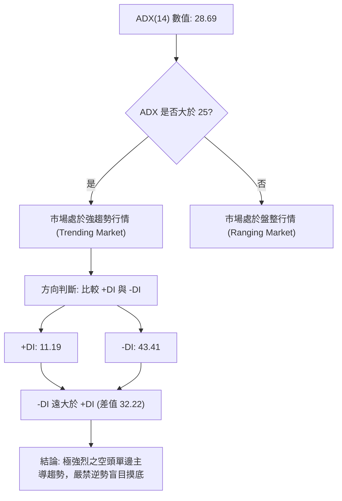

#### ADX 趨勢強度對照表

| 指標變數 | 當前數值 | 狀態門檻 | 趨勢屬性解讀 | 操作指導原則 |
|----------|----------|----------|--------------|--------------|
| **ADX(14)** | 28.69 | > 25.0 | 明確強趨勢形成 | 順勢交易為主，振盪指標可能鈍化 |
| **+DI (多頭動能)** | 11.19 | < 20.0 | 多方動能極度匱乏 | 多頭買盤無力，反彈高度受限 |
| **-DI (空頭動能)** | 43.41 | > 40.0 | 空方全面控制盤面 | 拋壓沉重，空頭趨勢具高度延續性 |
| **動能差 (+DI − -DI)** | -32.22 | 極端負值 | 單邊空方主導架構 | 不得以超賣為由進場摸底，以反彈做空為先 |

---

## 3. 圖表形態分析

### 🔍 形態識別系統

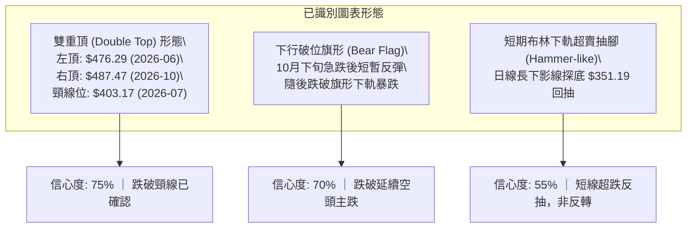

#### 圖表形態信心度分析表（依規則 15）

| 形態名稱 | 信心度 | 判斷依據（引用數據） | 完成度 | 目標價（附計算式） |
|----------|--------|----------------------|--------|--------------------|
| **大型雙重頂 (M頂)** | 75% | 2026-06 月收盤 $476.29 與 2026-10 高點 $487.47 構築雙頂；2026-07 低點 $403.17 為頸線。現價 $375.44 已實體跌破頸線。 | 90% | 由形態高度推算：頸線 $403.17 − (高點 $487.47 − 頸線 $403.17) = $318.87（接近支撐 S3 $329.33） |
| **破位空頭旗形** | 70% | 10-16 週低 $407.13 至 10-23 週反彈至 $418.51 形成旗形整理，隨後 11-06 週放量大陰線跌破旗形底線。 | 85% | 旗桿跌幅 ($487.47 − $407.13 = $80.34)；由突破口 $418.51 − $80.34 = $338.17 |
| **指標型超賣修正** | 55% | 布林通道 %B 跌至 0.06，日K於 11-05 探底 $351.19 後拉回 $375.44。訊號不足以構成反轉底部形態。 | 40% | 依布林中軌回抽推算：目標為 BB中軌 $416.44 或阻力 R1 $378.64 |

### 🕯️ 重要K線形態分析（依規則 19，近10根日K與近8根週K）

#### 近10根日K形態精解

| 日期 | 開盤價 | 最高價 | 最低價 | 收盤價 | 成交量 | K線形態 | 解讀與訊號 |
|------|--------|--------|--------|--------|--------|---------|------------|
| 2026-10-26 | 418.07 | 428.85 | 417.72 | 424.37 | 9,627,100 | 中陽線 | 反彈上衝，受阻於阻力位 🟢 |
| 2026-10-27 | 427.16 | 438.58 | 426.00 | 436.87 | 9,022,500 | 光腳中陽線 | 向上試探 MA50 阻力，量能未放大 🟢 |
| 2026-10-28 | 438.24 | 440.88 | 436.84 | 439.51 | 8,037,400 | 高位小陽星 | 縮量滯漲，多頭動能耗盡 🟡 |
| 2026-10-29 | 431.69 | 436.24 | 428.43 | 431.81 | 8,465,900 | 小陰線 | 跳空低開，短期反彈結束轉折 🔴 |
| 2026-10-30 | 414.08 | 418.09 | 400.12 | 406.13 | 21,971,100 | 放量長陰線 | 破位長黑，單日放量逾2倍，摜破 $410 🔴 |
| 2026-11-02 | 412.52 | 414.76 | 398.29 | 398.63 | 13,190,900 | 跳空下行中陰 | 跌破 $400 整數關卡，MA200 失守 🔴 |
| 2026-11-03 | 404.99 | 408.37 | 403.03 | 404.80 | 9,421,100 | 低位小字星 | 抵抗型橫盤，下行中繼 🟡 |
| 2026-11-04 | 400.64 | 410.59 | 391.61 | 395.75 | 14,516,500 | 帶上影流星陰線 | 多頭反撲失敗，$410 壓力沉重 🔴 |
| 2026-11-05 | 379.75 | 380.78 | 351.19 | 353.10 | 43,030,700 | 恐慌崩跌大陰線 | 暴跌 -10.78%，放量 4,303 萬股，破位暴跌 🔴 |
| 2026-11-06 | 380.56 | 380.72 | 367.95 | 375.44 | 23,801,300 | 下影小陽十字星 | 探底回升，空頭回補，短線企穩於 S1 上方 🟡 |

#### 近8根週K形態精解

| 週結束日 | 開盤價 | 最高價 | 最低價 | 收盤價 | 週成交量 | 週K線形態 | 解讀與訊號 |
|----------|--------|--------|--------|--------|----------|-----------|------------|
| 2026-09-18 | 414.90 | 434.82 | 411.45 | 434.67 | 59,602,200 | 中陽線 | 突破向上，多頭攻擊 🟢 |
| 2026-09-25 | 440.80 | 455.03 | 437.06 | 450.61 | 46,852,600 | 突破陽線 | 站上 $450，量能平穩 🟢 |
| 2026-10-02 | 448.39 | 474.79 | 443.11 | 472.78 | 44,927,100 | 光頭大陽線 | 逼近歷史高點，多頭亢奮 🟢 |
| 2026-10-09 | 478.77 | 487.47 | 449.75 | 453.31 | 49,231,100 | 長上影倒鎚陰線 | 創新高 $487.47 遭重壓壓回，頂部確立 🔴 |
| 2026-10-16 | 453.55 | 454.40 | 407.13 | 412.61 | 71,736,400 | 放量大陰吞噬 | 一陰吞三陽，成交量爆增，頂部反轉確認 🔴 |
| 2026-10-23 | 421.66 | 435.16 | 410.22 | 418.51 | 61,583,000 | 弱勢小陽修復 | 縮量弱勢反彈，受壓於 5 週均線 🟡 |
| 2026-10-30 | 418.07 | 440.88 | 400.12 | 406.13 | 57,124,000 | 長上影倒鎚陰線 | 二次衝高回落，確認反彈失敗 🔴 |
| 2026-11-06 | 412.52 | 414.76 | 351.19 | 375.44 | 103,960,500 | 巨量長下影陰線 | 單週爆出1.039億股天量，空方宣洩，收於$375.44 🔴 |

### 📉 ASCII 走勢形態示意圖

```
TSM 雙重頂 (Double Top) 破位幾何結構示意圖
價格
$490 ┤                 頂部 2: $487.47 (2026-10-09)
     │                 ╭──╮
$470 ┤ 頂部 1: $476.29 │  │
     │   ╭──╮          │  │
$450 ┤  │  │          │  │
     │  │  │          │  │
$430 ┤  │  │  反彈    │  │
     │  │  ╰─────╮    │  ╰─────╮
$410 ┤──┼────────┼────┼────────┼─── 頸線突破位: $403.17 (2026-07)
     │  │        ╰────╯        ╰──╮
$390 ┤  │                          ╰─── 破位下跌
$375 ┤──┼───────────────────────────────● 現價: $375.44
$350 ┤  │                               ╰──● 探底低點 $351.19
$330 ┤  │                                   ┆
$318 ┤  ┴───────────────────────────────────┴── 形態量度目標: $318.87
```

### 🎯 形態目標價計算

1. **雙重頂量度目標計算**：
   - 頂部最高峰值：$487.47
   - 形態頸線基準點：$403.17
   - 垂直形態高度 $H = \$487.47 - \$403.17 = \$84.30$
   - 理論量度跌幅目標 $Target = 頸線 \$403.17 - H \$84.30 = \$318.87$
   - 該目標價位於長期波段支撐 S3 ($329.33) 與 斐波那契 78.6% 回調位 ($311.84) 之緩衝區間內。

2. **下行破位旗形目標計算**：
   - 旗桿起點：$487.47；旗桿底端：$407.13；旗桿高度 = $80.34
   - 旗形反彈高點（突破點）：$418.51
   - 旗形量度跌幅目標 = $\$418.51 - \$80.34 = \$338.17$
   - 該目標價位緊鄰支撐 S3 ($329.33) 上沿。

---

## 4. 支撐與阻力

### 🗺️ 關鍵價位分布圖（Unicode）

```
TSM 價位結構分布圖（OHLCV 精確計算）
══════════════════════════════════════════════════════════════════
$412.43 ║████████████████████████████████████████║ 強阻力 R3 (+9.85%)
$402.11 ║████████████████████████████████        ║ 斐波那契 38.2% 回調位
$387.17 ║████████████████████                    ║ 波段阻力 R2 (+3.12%)
$378.64 ║████████████████████████                ║ 近期關鍵阻力 R1 (+0.85%)
$375.75 ║▒▒▒▒▒▒▒▒▒▒▒▒▒▒▒▒▒▒▒▒▒▒▒▒▒▒▒▒▒▒▒▒▒▒▒▒▒▒▒▒║ 斐波那契 50.0% 回調位
$375.44 ╠════════════════════════════════════════╣ ◄ 當前收盤價 ($375.44)
$371.72 ║▓▓▓▓▓▓▓▓▓▓▓▓▓▓▓▓▓▓▓▓▓▓▓▓                ║ 近期關鍵支撐 S1 (-0.99%)
$358.75 ║████████████████████████                ║ 波段強支撐 S2 (-4.45%)
$349.38 ║████████████████                        ║ 斐波那契 61.8% 黃金分割位
$329.33 ║████████████████████████████████████████║ 核心防守強支撐 S3 (-12.28%)
══════════════════════════════════════════════════════════════════
```

### 🚧 阻力位分析表（波段高點聚類）

| 阻力級別 | 精確價位 | 距現價幅離 | 形成原因與籌碼結構 | 突破難度 | 重要性 |
|----------|----------|------------|--------------------|----------|--------|
| **R1** | $378.64 | +0.85% | 11-05 與 11-06 日K開盤開盤聚類區，短線多空爭奪樞軸 | 🟡 中等 | 短線轉強第一道門檻 |
| **R2** | $387.17 | +3.12% | 短期下跌缺口下沿與 MA5 ($385.54) 壓制帶 | 🔴 較高 | 日線級別反彈分水嶺 |
| **R3** | $412.43 | +9.85% | 密集套牢成交量密集區、MA20 ($416.44) 與頸線交會區 | 🔴 極高 | 中期趨勢多空分水嶺 |

### 🛡️ 支撐位分析表（波段低點聚類）

| 支撐級別 | 精確價位 | 距現價幅離 | 形成原因與籌碼結構 | 守住機率 | 重要性 |
|----------|----------|------------|--------------------|----------|--------|
| **S1** | $371.72 | -0.99% | 近一年波段低點聚類、斐波那契50%位 ($375.75) 緩衝區 | 🟡 45% | 當前多頭最後短線防線 |
| **S2** | $358.75 | -4.45% | 11-05 長下影線籌碼沉澱區、前波起漲突破點 | 🟡 50% | 恐慌盤宣洩後的二次探底支撐 |
| **S3** | $329.33 | -12.28% | 2026-03 波段底部收盤價 $336.26 之聚類支撐核心 | 🟢 80% | 中長期強烈價值防守帶 |

### 📐 斐波那契回調位分析

依據 52 週完整波動區間（低點 $264.03 → 高點 $487.47，波幅 $223.44）：

```
斐波那契回調結構階梯
0.0%  ── $487.47 (52W High)
23.6% ── $434.74
38.2% ── $402.11 ── 失守轉為中期強壓力 (與MA200 $400.03共振)
50.0% ── $375.75 ◄── 現價 $375.44 正在此位爭奪！
61.8% ── $349.38 ── 黃金分割關鍵支撐位 (與11-05低點$351.19共振)
78.6% ── $311.84 ── 極限深度回調位
100.0%── $264.03 (52W Low)
```

#### 解讀與意義：
當前收盤價 **$375.44** 正好壓在 **斐波那契 50.0% 回調位 ($375.75)** 下方 0.31 美元處。
- 技術意義上，50% 回調位是多空心理均衡的樞軸點。一旦跌破並連續三天無法收復，價格回撤目標將直奔 **61.8% 黃金分割位 ($349.38)**。
- 值得注意的是，11 月 5 日盤中最低下探至 **$351.19**，已非常精確地回踩了 61.8% 回調位 ($349.38) 後出現長下影線拉回。目前多方正試圖守護 50% 關卡，但上方 38.2% ($402.11) 與 MA200 ($400.03) 已經形成極難跨越的共振套牢天花板。

---

## 5. 技術指標深度解讀

### 🎛️ 指標訊號總覽

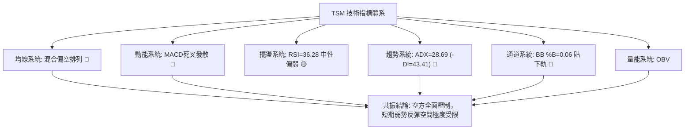

### 📈 移動平均線排列分析

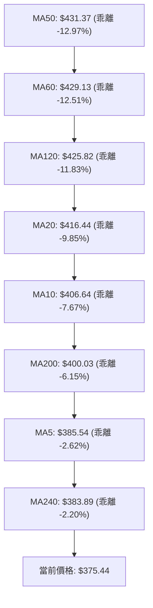

#### 均線數據分析矩陣

| 均線名稱 | 數值 | 價格相對於均線 | 均線走勢斜率 | 技術意涵 |
|----------|------|----------------|--------------|----------|
| **MA5** | $385.54 | 下方 -2.62% | ▼ 急跌趨緩 | 超短期壓制，第一道動態阻力 |
| **MA10** | $406.64 | 下方 -7.67% | ▼ 快速下墜 | 短期趨勢阻力，反彈強阻力 |
| **MA20** | $416.44 | 下方 -9.85% | ▼ 加速下行 | 月線生命線下行，確認短期空頭市場 |
| **MA50** | $431.37 | 下方 -12.97% | ▼ 見頂下彎 | 季線轉跌，中期趨勢正式走壞 |
| **MA200** | $400.03 | 下方 -6.15% | ◄ 走平轉下 | 牛熊分界線失守，長期多頭基石動搖 |
| **MA240** | $383.89 | 下方 -2.20% | ▲ 緩慢上升 | 兩年長期均線，現價跌破後試圖反抽 |

當前均線系統呈現「混合排列偏空」。短中期均線（MA5、MA10、MA20、MA50）由上至下依序排列為壓制狀態，且斜率均為陡峭下行。最嚴峻的技術訊號是股價摜破年線 **MA200 ($400.03)**，這在過去兩年的多頭牛市中極為罕見，表明中期多頭趨勢已經終結，進入深度的籌碼重組期。

### 📉 RSI(14) 分析

```
RSI(14) 數值展示: 36.28
0 ═══════════ 30 ════════════════════ 70 ═══════════ 100
[███████████░░░░░░░░░░░░░░░░░░░░░░] 36.28%
       超賣區 ◄     當前中性偏弱     ► 超買區
```

- **超買超賣判斷**：RSI(14) 當前數值為 **36.28**。雖然逼近 30 超賣門檻，但技術上仍處於 **30–70 中性偏弱區間**。這意味著空方動能尚未完全衰竭，並沒有出現常見於強勁 V 型反轉的極端超賣（RSI < 20）訊號。
- **背離分析判斷**：
  - 檢視近 20 根 K 棒走勢：股價從 10 月中旬 $453.31 暴跌至 11 月 06 日收盤 $375.44（盤中最低 $351.19），創出波段新低；同期間 RSI(14) 自 52.6 順勢下滑至 36.3。
  - **明確結論**：**RSI 無底背離，亦無頂背離**。RSI 下行趨勢與價格下行完全同步，空頭走勢由真實的殺跌動能推動，並非指標背離引發的假跌破。

### 📊 MACD(12,26,9) 訊號解讀

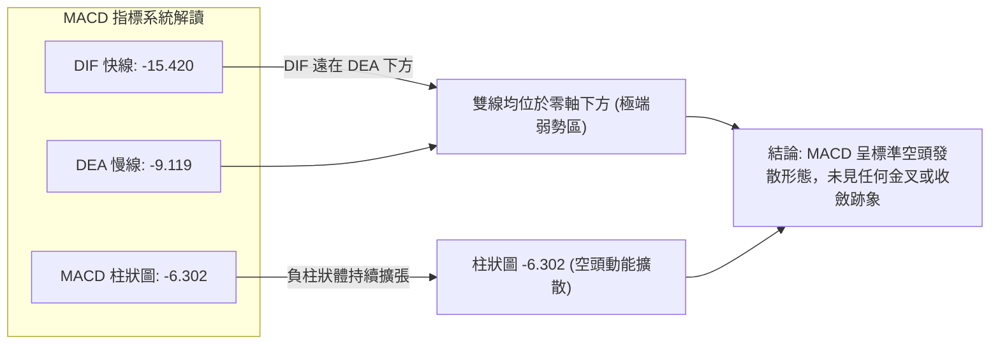

- **MACD 數值解讀**：快線 DIF (-15.420) 遠低於慢線 DEA (-9.119)，兩者均在零軸深處下行。柱狀體 (Histogram) 數值為 **-6.302**，呈現顯著的空頭發散狀態。
- **背離判定**：週線級別 MACD 柱狀圖自 10-09 當週的 -0.244 連續下墜至 10-16 的 -6.872、11-06 的 -6.302；價格與柱狀體同步向下尋底，**MACD 指標不存在底背離**。此架構顯示空頭賣壓仍處於宣洩主升段，趨勢慣性依然向下。

### 📦 布林通道分析

```
TSM 日線布林通道 (20, 2) 結構示意圖
價格 ($)
$462.58 ┤ ══════════════════════════════════════════ 上軌 (BB Upper)
        │
$416.44 ┤ ────────────────────────────────────────── 中軌 (MA20)
        │
$375.44 ┤ ◄────────── 現價 $375.44 (%B = 0.06)
$370.30 ┤ ══════════════════════════════════════════ 下軌 (BB Lower)
        └───────────────────────────────────────────
```

- **通道參數解讀**：
  - **布林上軌**：$462.58
  - **布林中軌 (MA20)**：$416.44
  - **布林下軌**：$370.30
  - **帶寬與位置 (%B)**：**0.06**
- **形態與動態特徵**：
  - %B 數值為 0.06，代表當前收盤價極度逼近下軌（0 代表下軌，$370.30），距離下軌僅 5.14 美元。
  - 當前布林通道呈現典型的「張口下行」形態，中軌快速向下扣抵，價格「沿著下軌走單邊」（Walking the Lower Band）。在強趨勢（ADX=28.69）背景下，%B 處於低位並不代表能立即反彈，反而反映了空頭壓迫通道邊界的極端弱勢特徵。

### 💹 成交量分析（量價配合度）

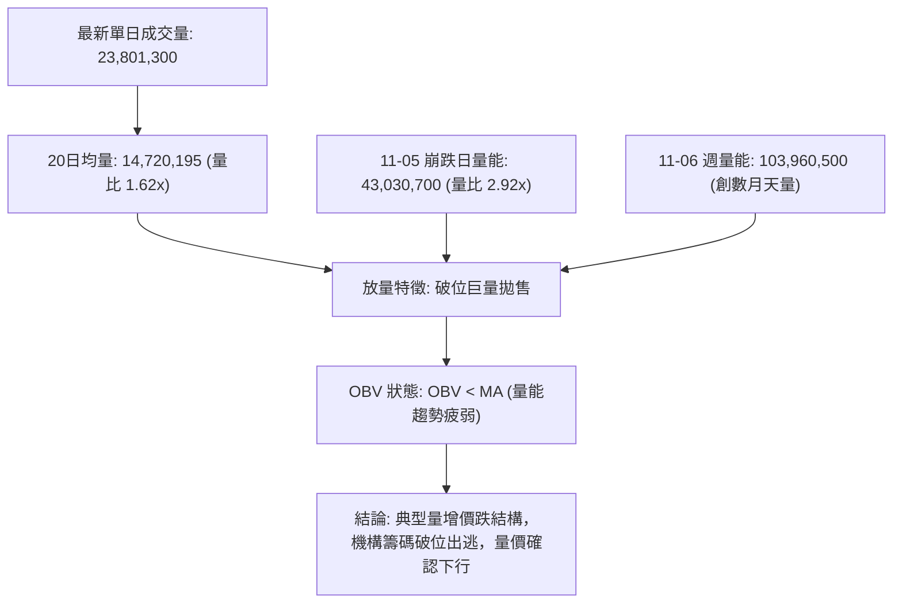

- **量價配合診斷**：
  1. **破位巨量釋放**：11 月 5 日下跌至最低 $351.19 當日，單日湧出 43,030,700 股巨量；11 月 06 日收盤時單週成交量達到 **103,960,500 股**，較前數週均量（約 5,000 萬至 6,000 萬股）激增近一倍。這種「跌破關鍵均線時成交量急劇放大」是典型的恐慌盤湧出與機構減倉訊號。
  2. **OBV 能量潮解讀**：數據明確顯示「OBV < MA → 量能疲弱」。在過去一個月的下行過程中，每次短暫陽線均縮量（如 10-27 陽線量僅 902 萬股），而陰線全線放量（10-30 放量 2,197 萬股、11-05 放量 4,303 萬股）。資金持續呈現淨流出狀態，量能結構完全確認價格的跌破有效性。

---

## 6. 動能與波動率

### ⚡ 動能評估四象限

| 象限 | 動能維度 | 波動維度 | 代表特徵 | 當前狀態評估 |
|------|----------|----------|----------|--------------|
| **Q1 (高動能·低波動)** | 強多頭/強空頭 | 波動收斂 | 穩定單邊趨勢延伸 | — |
| **Q2 (弱動能·低波動)** | 方向不明 | 波動低迷 | 盤整蓄勢、觀望期 | — |
| **Q3 (強動能·高波動)** | **強空頭主導** | **波動劇烈擴大** | **恐慌殺跌、情緒宣洩、主跌浪** | **✓ 當前所處象限 (TSM)** |
| **Q4 (弱動能·高波動)** | 動能衰竭 | 寬幅震盪 | 頂底拉鋸、多空洗盤 | — |

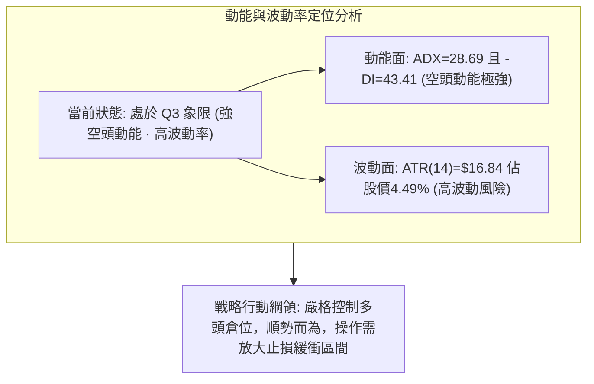

### 📊 ATR 波動率分析

- **ATR(14) 數值**：**$16.84 USD**（Wilder 計算，佔當前股價之 **4.49%**）。
- **市場波動環境解讀**：
  - 歷史上 TSM 作為萬億市值巨頭，ATR 佔比通常在 2.0%–3.0% 之間。目前 ATR 攀升至 4.49%，意味著每日平均正常波動範圍高達近 17 美元。
  - 11 月 5 日單日高低差達到 $29.59（$380.78 − $351.19），已達 1.75 倍 ATR，市場處於極端情緒釋放期。
- **止損距離建議**：
  - 順勢空單保護性止損建議設置：**1.5 × ATR = 1.5 × \$16.84 = \$25.26**。
  - 逆勢短線多單止損建議設置：**0.75 × ATR = 0.75 × \$16.84 = \$12.63**。
  - 嚴格避免過於狹窄的止損（如 < $10），以防被高 ATR 波動下的隨機噪音震盪洗盤出場。

### 📐 Beta 與市場相關性

- **Beta 係數**：**1.233**。
- **市場敏感度分析**：
  - Beta 為 1.233，表明 TSM 具備較大盤（標普500指數）更高的波動槓桿屬性。當半導體產業或整體美股市場出現 1% 的系統性修正時，TSM 理論上將放大波動至 1.233%。
  - 結合近期新聞動態「AI 晶片股在全球性潰敗後反彈，但泡沫擔憂隱現」，TSM 作為 AI 晶片代工核心節點，在資金抽離科技股轉向防禦型資產的宏觀逆風中，承受了顯著高於大盤的高 Beta 殺估值賣壓。

---

## 7. 多時框架總結

### 📋 時框架評分表

| 時框架 | 趨勢方向 | 動能狀態 | 均線排列 | 核心形態識別 | 綜合評分 | 操作建議方向 |
|--------|----------|----------|----------|--------------|----------|--------------|
| **長期 (月線)** | 🟢 多頭修正 | 中性回落 (RSI約50) | MA240向上支撐 | 大週期自 $180 起漲後的高位回檔 | 55/100 | 長期投資者等待低接價值區 |
| **中期 (週線)** | 🔴 明確走熊 | MACD柱死叉發散 | 跌破20週均線 | 雙重頂 ($487.47) 破頸線 ($403.17) | 30/100 | 中線反彈逢高減磅、建立空單 |
| **短期 (日線)** | 🔴 弱勢反彈 | RSI=36.28 超賣回抽 | 全線空頭壓制 | 暴跌至 $351.19 後的超跌抽腳星線 | 32/100 | 短線嚴禁追高，尋找回抽做空點 |

### 🔲 綜合訊號矩陣

```
時框架訊號交叉驗證矩陣
╔═════════════╦══════════════╦══════════════╦══════════════╗
║ 指標維度    ║ 短期 (日線)  ║ 中期 (週線)  ║ 長期 (月線)  ║
╠═════════════╬══════════════╬══════════════╬══════════════╣
║ 趨勢方向    ║ 🔴 破位下行  ║ 🔴 雙頂成型  ║ 🟡 深度回調  ║
║ 均線系統    ║ 🔴 混亂壓制  ║ 🔴 跌破多均  ║ 🟢 守於MA240 ║
║ 動能指標    ║ 🔴 MACD擴散  ║ 🔴 MACD走空  ║ 🟡 動能衰退  ║
║ 量價結構    ║ 🔴 破位爆量  ║ 🔴 週陰吞陽  ║ 🟢 總量仍充沛║
║ ADX趨勢強度 ║ 🔴 強空頭    ║ 🔴 空方主導  ║ 🟡 趨勢放緩  ║
╚═════════════╩══════════════╩══════════════╩══════════════╝
```

### ⚖️ 多時框收斂結論（依嚴格要求 14）

1. **行情屬性判定**：當前 ADX(14) 數值為 **28.69**（明確大於 25.0 門檻），且 -DI 高達 **43.41**，確立當前市場為**強趨勢單邊行情（Trending Market）**，而非區間盤整行情。
2. **多時框優先級收斂**：
   - 依據規則 14：「趨勢行情（ADX>25）以中長期（週線/MA50、MA200）方向為主，日線只用來尋找進場時機」。
   - 目前週線級別雙重頂確立破位，日線跌破 MA50 ($431.37) 與 MA200 ($400.03)，因此中期趨勢完全由空頭力量主導。日線層面 11-06 出現的探底小陽線與 RSI=36.28，僅視為空頭主趨勢下的**次級超跌反抽**，不可誤判為反轉。
3. **唯一方向性結論**：**強烈偏空（Bearish Bias）**。
   - 所有交易邏輯必須嚴格服從中期空頭趨勢。戰術主軸為**「順應中短期空頭趨勢，逢回抽阻力位佈局空單」**，嚴格禁止大倉位逆勢猜底。

---

## 8. 交易策略建議

### 🗺️ 策略決策流程圖

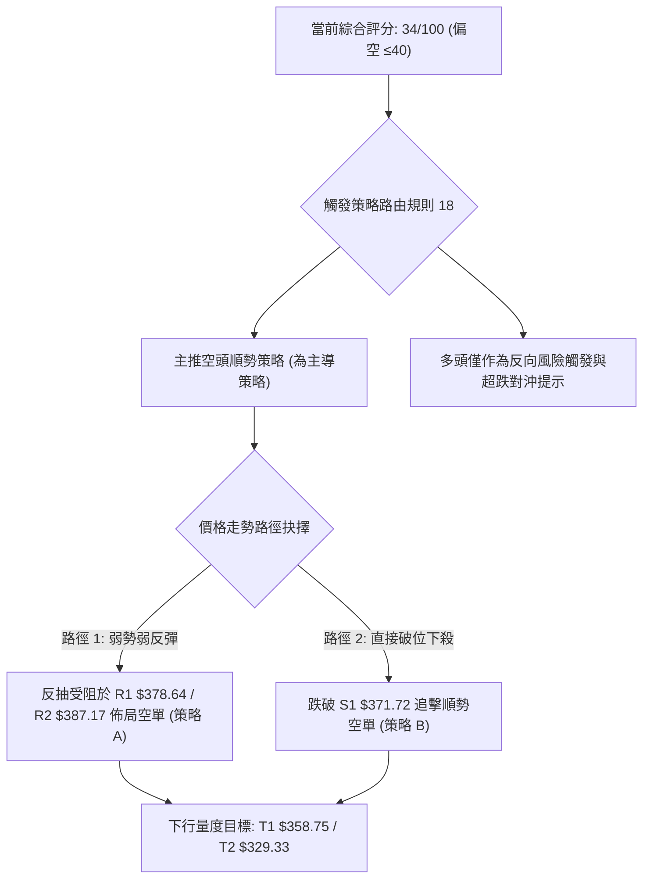

### 🧭 策略路由（依評分卡分流）

> **當前主策略方向 = 主推空頭策略（依技術評分 34/100，≤40 進入空頭路由）**

由於第 1 章技術評分卡綜合評分為 **34/100**，技術面處於明確空頭主導結構，依據交易紀律，本報告**主推空頭順勢策略**。多頭操作僅列為風控反轉觸發點，不作為主力推薦。

### 🎯 價格情境階梯（Price Scenarios）

價位嚴格引用下方數據「關鍵價位」區塊之精確數值：

| 觸發條件 | 下一目標 | 後續延伸 | 情境技術含義與籌碼心理 |
|----------|----------|----------|------------------------|
| **向上突破 R1 $378.64** | R2 $387.17 | R3 $412.43 | 短線超跌反抽擴大，回測 MA5 與缺口壓制，空頭回補 |
| **受阻於 R1–R2 區間** | S1 $371.72 | S2 $358.75 | 反彈遇均線反壓動能衰竭，空方主力二次進場壓制 |
| **向下實體跌破 S1 $371.72** | S2 $358.75 | S3 $329.33 | 斐波那契50%防線徹底失守，空頭展開第二波主跌浪 |
| **向下摜破 S2 $358.75** | S3 $329.33 | 斐波78.6% $311.84 | 探底 11-05 低點失敗，籌碼發生全面踩踏恐慌 |

### 📊 情境機率分佈

| 情境劃分 | 預估機率 | 主要技術指標依據 |
|----------|----------|------------------|
| **空頭下行 / 再探低點 (主流)** | **60%** | ADX=28.69 (-DI=43.41)，MACD 負柱狀體 -6.302 持續發散，OBV 跌破均線爆量壓制。 |
| **區間震盪 / 弱勢橫盤** | **25%** | 現價收於斐波那契 50% ($375.75) 附近，S1 ($371.72) 暫具支撐，布林下軌超賣帶來技術性拉扯。 |
| **向上反彈 / 收復均線** | **15%** | RSI(14)=36.28 自低檔微幅回升，但受阻於 MA20 ($416.44) 與 MA200 重重均線反壓，反轉機率極低。 |

### 🟢 主策略詳情（空頭主推策略）

*註：風險報酬比嚴格按規則 17 計算：做空風險報酬比 = (進場價 − 目標價 T1) ÷ (止損價 − 進場價)。*

| 策略要素 | 策略 A（反彈高空 — 逢阻力放空） | 策略 B（破位追空 — 順勢跌破放空） |
|----------|----------------------------------|------------------------------------|
| **戰略定位** | 逢反抽短期阻力位佈局高品質空單 | 跌破關鍵低點時順勢追擊空頭主跌 |
| **進場條件** | 股價反彈至 R1 遇阻回落，或觸及 R2 假突破 | 股價實體跌破支撐位 S1 並伴隨成交量放大 |
| **精確進場價格** | **$382.91** (取 R1 $378.64 至 R2 $387.17 區間中點) | **$371.72** (S1 支撐位破位進場點) |
| **目標價 T1** | **$358.75** (波段強支撐 S2) | **$358.75** (波段強支撐 S2) |
| **目標價 T2** | **$329.33** (核心防守強支撐 S3) | **$329.33** (核心防守強支撐 S3) |
| **精確止損價格** | **$394.99** (設於 R2 上方約 2% / 0.75 ATR) | **$378.64** (設於阻力位 R1 處) |
| **風險報酬比** | **1 : 2.00（以 T1 計）**<br>*(382.91 − 358.75) ÷ (394.99 − 382.91) = 24.16 ÷ 12.08 = 2.00*<br>*(以 T2 計為 1 : 4.44)* | **1 : 1.87（以 T1 計）**<br>*(371.72 − 358.75) ÷ (378.64 − 371.72) = 12.97 ÷ 6.92 = 1.87*<br>*(以 T2 計為 1 : 6.13)* |
| **模型預估成功率** | **65%** | **58%** |
| **建議配置倉位** | **15% - 20%** 總部位 | **10% - 15%** 總部位 |

### 🔴 反向風險觸發點（多頭對沖提示）

若出現以下技術事件，本報告之空頭主策略將被推翻或需強制停損對沖：
1. **收盤價強勢突破阻力 R2 ($387.17)**：表明超跌反彈演變為日線級別中級回升，空單必須立即無條件止損出局。
2. **日線收盤重新站穩 MA200 ($400.03) 與 R3 ($412.43)**：若多頭強勢收復牛熊線，代表 11 月初的急跌為空頭陷阱（Bear Trap），市場將重新回歸牛市軌道。
3. **MACD 日線出現低檔黃金交叉且 RSI 突破 50 中軸**：動能轉強訊號確立，此時禁止任何做空嘗試。

### ⭐ 整體訊號強度評星

```
╔══════════════════════════════════════════════════════════════════╗
║ 做多訊號強度：★☆☆☆☆  (1/5星 — 僅存超跌技術性抽腳，嚴禁逆勢摸底)║
║ 做空訊號強度：★★★★☆  (4/5星 — 均線/趨勢/動能/形態高度共振走空)  ║
║ 整體可信度：  ★★★★☆  (4/5星 — 破位巨量確認，ADX趨勢明確)       ║
╚══════════════════════════════════════════════════════════════════╝
```

---

## 9. 風險提示與監控

### ✅ 關鍵監控指標 Checklist

```
╔══════════════════════════════════════════════════════════════════╗
║               TSM 交易風控與關鍵指標監控清單                     ║
╠══════════════════════════════════════════════════════════════════╣
║ [ ] 監控支撐位 S1 ($371.72)：收盤若失守，立即啟動破位追空策略   ║
║ [ ] 監控阻力位 R1 ($378.64)：反彈測試時觀察小時線是否出現長上影  ║
║ [ ] 監控阻力位 R2 ($387.17)：空單絕對保護性止損觸發線           ║
║ [ ] 監控 ADX(14) 數值變化：若 ADX 跌破 25，需警惕單邊趨勢轉震盪 ║
║ [ ] 監控 -DI 與 +DI 開口：若 -DI 自 43.41 收斂至 30 以下代表拋壓減緩║
║ [ ] 監控 MACD 負柱狀體：觀察是否開始收斂（數值由 -6.302 縮小）  ║
║ [ ] 監控單日成交量：若反彈量 > 2,000萬股，警惕主力主力護盤大逆轉 ║
║ [ ] 監控 11-05 極端低點 ($351.19)：若再破該點，開啟無支撐崩跌模式║
╚══════════════════════════════════════════════════════════════════╝
```

### ⚠️ 風險場景分析

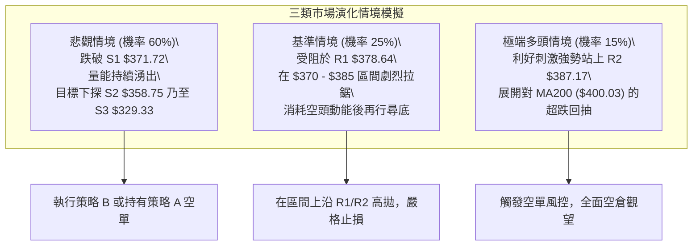

### 🛡️ 風險管理重要提醒

1. **嚴防流動性與跳空風險**：近期 TSM 單日波幅已逾 4.49% (ATR=$16.84)。特別注意跨日開盤跳空風險，倉位規模務必嚴格限制在總資產的 15%–20% 之內，切忌滿倉操作。
2. **避免情緒化逆勢猜底**：半導體類股 Beta 值高達 1.233，在 AI 晶片估值重估的背景下，超賣指標可能長期鈍化。不可僅憑「股價已自高點下跌逾 $100」或「PE 僅 24 倍」作為技術面買入依據。在技術面未形成明確的多頭雙底或放量收復 MA20 之前，逆勢做多等同於「徒手接落下的飛刀」。
3. **嚴格執行風險報酬比紀律**：所有進場單必須在進場前設定好精確的止損與停利條件。若以策略 A 進場，止損點 $394.99 絕不可因心理僥倖而隨意向上移動。

---

## 📋 報告總結

```
TSM 技術分析報告總結
════════════════════════════════════════════════════════
報告日期：2026-11-09
當前價格：$375.44 USD
分析評級：🔴 偏空強趨勢（綜合評分：34 / 100）

關鍵結論：
├─ 長期趨勢：🟡 多頭高位深度修正，考驗 MA240 ($383.89) 防守
├─ 中期趨勢：🔴 雙重頂形態成型破頸線，失守 MA200 牛熊分界線
├─ 短期趨勢：🔴 破位單邊暴跌，ADX=28.69 (-DI=43.41) 空頭絕對主導
├─ 關鍵支撐：S1: $371.72 ｜ S2: $358.75 ｜ S3: $329.33
├─ 關鍵阻力：R1: $378.64 ｜ R2: $387.17 ｜ R3: $412.43
└─ 斐波樞軸：50.0% 回調位 $375.75（現價 $375.44 正在臨界點爭奪）

最優策略組合：
1. 🥇 最佳機會（策略 A）：反彈至 R1–R2 中間點 ($382.91) 放空，
   止損 $394.99，目標 T1: $358.75 / T2: $329.33（風報比 1 : 2.00 以 T1 計）
2. 🥈 次選機會（策略 B）：實體跌破支撐 S1 ($371.72) 順勢追空，
   止損 $378.64，目標 T1: $358.75 / T2: $329.33（風報比 1 : 1.87 以 T1 計）
3. 🥉 保守選擇：維持 100% 現金空倉觀望，耐心等待價格下探 S3 ($329.33)
   或右側築底結構完成再行介入。
════════════════════════════════════════════════════════
```

---

> ⚠️ **免責聲明**：本報告為 AI 自動生成之技術分析研究，所有數據指標及價位均嚴格基於所提供之歷史 OHLCV 市場行情進行量化推算。本報告**僅供研究與學術參考**，**不構成任何要約、招攬或投資買賣建議**。金融市場瞬息萬變，高槓桿與單邊行情具備高度本金虧損風險，投資人應獨立評估財務狀況並自負盈虧。

---

*報告生成時間：2026-11-09 ｜ 數據來源：Yahoo Finance ｜ 分析框架：多時框技術分析體系*