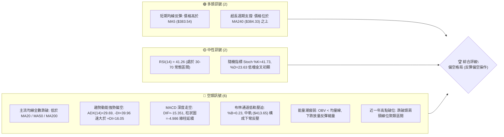
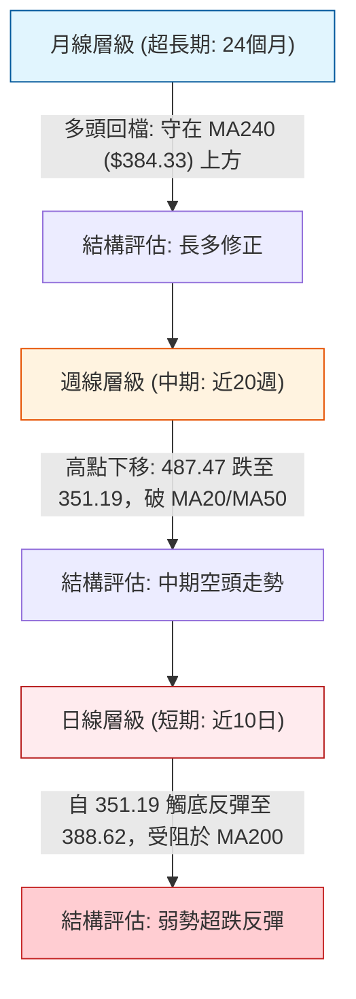
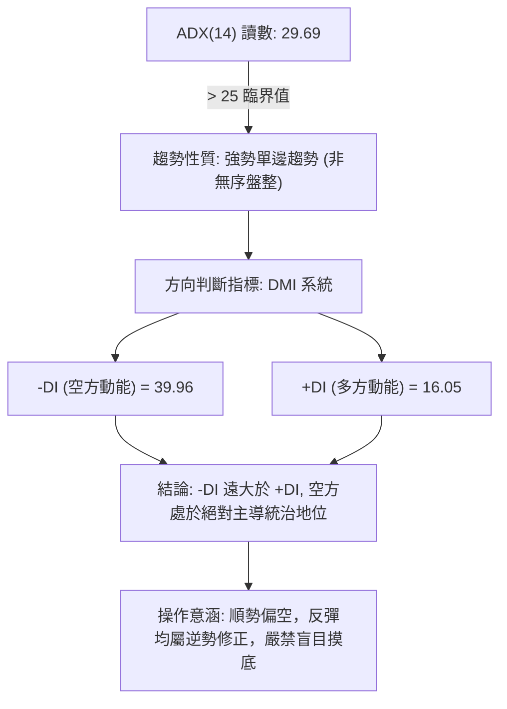
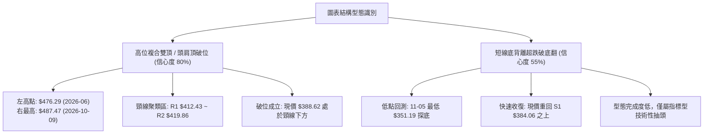
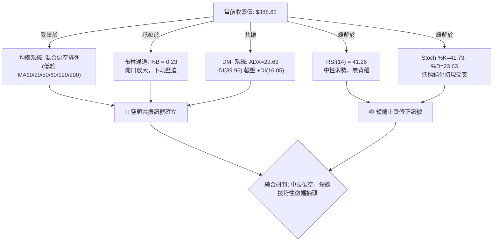
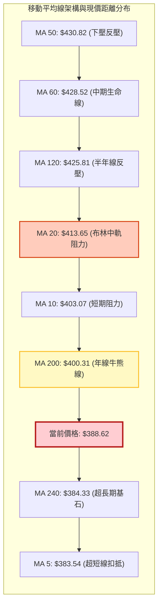
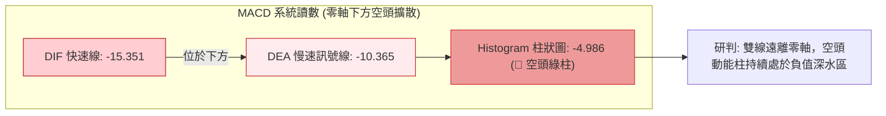
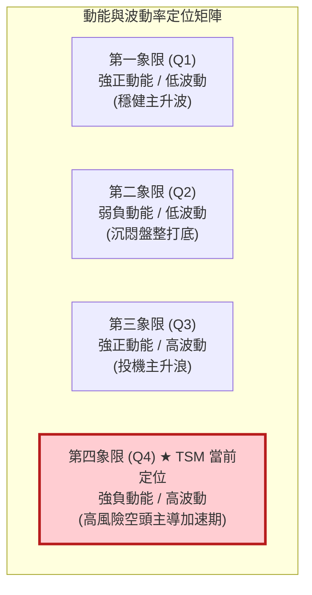
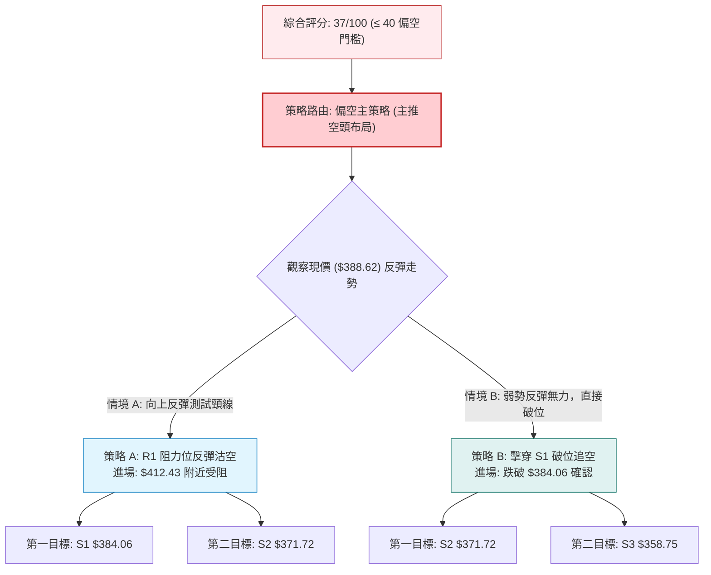
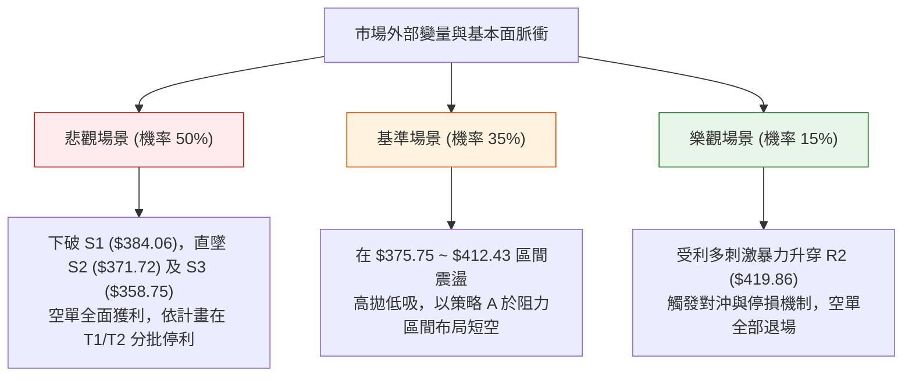

# TSM 技術分析報告

> **報告日期**：2026-11-10 ｜ **語言**：繁體中文 ｜ **數據來源**：Yahoo Finance ｜ **當前價格**：$388.62 USD

---

## 目錄

| 章節 | 內容 |
|------|------|
| [1. 技術面概覽](#1-技術面概覽) | 訊號儀表板、核心指標、評分卡 |
| [2. 趨勢分析](#2-趨勢分析) | 多時框趨勢、長中短期走勢 |
| [3. 圖表形態分析](#3-圖表形態分析) | 形態識別、K線組合、目標價 |
| [4. 支撐與阻力](#4-支撐與阻力) | 關鍵價位、斐波那契回調 |
| [5. 技術指標深度解讀](#5-技術指標深度解讀) | MA/RSI/MACD/布林/成交量 |
| [6. 動能與波動率](#6-動能與波動率) | 動能評估、ATR、Beta |
| [7. 多時框架總結](#7-多時框架總結) | 時框架評分矩陣 |
| [8. 交易策略建議](#8-交易策略建議) | 多空策略、風險報酬比 |
| [9. 風險提示與監控](#9-風險提示與監控) | 監控指標、風險場景 |

---

## 1. 技術面概覽

### 🎯 技術訊號儀表板



---

### 📊 核心指標速覽表

| 指標類別 | 指標名稱 | 當前數值 | 訊號 | 解讀 |
|----------|----------|----------|------|------|
| **價格** | 當前收盤價 | $388.62 | 🔴 | 跌破 MA200 關鍵牛熊分水嶺，位於 52 週高低區間 55.8% 位置 |
| **均線** | MA20 (月線) | $413.65 | 🔴 | 價格位於下方 -6.05%，月線下彎形成首道短波段強壓 |
| **均線** | MA50 (季線) | $430.82 | 🔴 | 價格位於下方 -9.80%，中線生命線失守，下行趨勢成型 |
| **均線** | MA200 (年線) | $400.31 | 🔴 | 價格位於年線下方 -2.92%，長期多頭架構遭遇嚴重破壞 |
| **動能** | RSI(14) | 41.26 | 🟡 | 位於弱勢區間（< 50），尚未進入極端超賣（< 30），空方控盤 |
| **動能** | MACD (12,26,9) | -15.351 / -10.365 | 🔴 | 雙線位於零軸之下，柱狀圖 -4.986 持續擴散，動能空頭主導 |
| **動能** | ADX (14) | 29.69 (-DI: 39.96) | 🔴 | ADX > 25 進入強趨勢，-DI 處於 39.96 極高位，空方趨勢確立 |
| **波動** | ATR(14) | $17.00 (4.37%) | 🔴 | 日波幅高達 4.37%，市場籌碼劇烈洗盤，操作容錯空間壓縮 |
| **通道** | 布林通道 %B | 0.23 | 🟡 | 貼近下軌 ($367.88) 後獲支撐反彈，當前處於下半通道震盪 |
| **籌碼** | 量比 / OBV | 1.04x / OBV < MA | 🔴 | 量能未能有效逆轉 OBV 走勢，反彈缺乏機構大資金追價背書 |

---

### 🏆 技術評分卡

```
╔══════════════════════════════════════════════════════════════╗
║              技術評分卡 — TSM (2026-11-10)                   ║
╠══════════════════════════════════════════════════════════════╣
║  趨勢強度      ██████░░░░░░░░░░░░░░  30/100  🔴 空方主導      ║
║  動能指標      ███████░░░░░░░░░░░░░  35/100  🔴 負動能增強    ║
║  支撐穩定度    ███████████░░░░░░░░░  55/100  🟡 S1暫獲支撐    ║
║  成交量配合    ████████░░░░░░░░░░░░  40/100  🔴 量價呈現背離  ║
║  形態完整度    ██████░░░░░░░░░░░░░░  30/100  🔴 頂部破位確立  ║
║  均線排列      ██████░░░░░░░░░░░░░░  32/100  🔴 中長天期蓋頭  ║
╠══════════════════════════════════════════════════════════════╣
║  綜合評分      ███████░░░░░░░░░░░░░  37/100  🔴 偏空弱勢格局  ║
╚══════════════════════════════════════════════════════════════╝
```

> **綜合評分計算說明**：依規則 18，綜合評分採算術平均值：
> $$(30 + 35 + 55 + 40 + 30 + 32) \div 6 = 222 \div 6 = 37.0 \rightarrow 37 / 100$$。評分落於偏空區間（$\le 40$）。

---

## 2. 趨勢分析

### 🌐 多時框趨勢分析



---

### 📈 長期趨勢 — 12個月走勢圖（Unicode）

以下繪製 TSM 自 2025 年 11 月至 2026 年 11 月之月線收盤價歷史走勢圖：

```
TSM 月線走勢圖（過去12個月：2025-11 至 2026-11）
價格 ($)
$480 ┤                                           ● (2026-06: 476.29)
$450 ┤                                      ●         ● (2026-09: 456.19)
$420 ┤                                 ●                   
$390 ┤                            ●                   ●← 現價: $388.62
$360 ┤                       ●         
$330 ┤                  ●         ● (2026-03: 336.26)
$300 ┤        ●    ●
$270 ┤   ●
     └────┬────┬────┬────┬────┬────┬────┬────┬────┬────┬────┬────
        11月 12月 01月 02月 03月 04月 05月 06月 07月 08月 09月 10月 11月
        (25)                                                  (26)
```

#### 走勢特徵分析表格

| 階段區間 | 月份範疇 | 收盤起迄點 ($) | 漲跌幅 | 核心走勢特徵與結構轉變 |
|----------|----------|----------------|--------|------------------------|
| **起漲加速期** | 2025-11 ~ 2026-02 | $288.46 $\rightarrow$ $371.66$ | +28.84% | 月K連四紅，AI先進製程需求拉動估值擴張 |
| **首波洗盤期** | 2026-02 ~ 2026-03 | $371.66 $\rightarrow$ $336.26$ | -9.52% | 波段獲利回吐，於 $336 確立中期強支撐 |
| **主升浪登頂** | 2026-03 ~ 2026-06 | $336.26 $\rightarrow$ $476.29$ | +41.64% | 連續放量突破歷史新高，均線呈現完美多頭發散 |
| **高位做頂期** | 2026-06 ~ 2026-10 | $476.29 $\rightarrow$ $406.13$ | -14.73% | 築造雙重頂／頭肩結構，於 2026-10-09 刷出 52W 高點 $487.47 後急殺 |
| **破位下行期** | 2026-10 ~ 2026-11 | $406.13 $\rightarrow$ $388.62$ | -4.31% | 跌破多條關鍵均線，下探年線及斐波那契 50.0% 回調位 ($375.75) |

---

### 📊 中期趨勢（週線分析）

從近 20 週資料觀察，TSM 經歷了顯著的中期轉折：
1. **頂部結構確認**：在 2026-10-02 當週收於 $472.78，次週（10-09）盤中創下 52 週新高 $487.47，但當週收盤回落至 $453.31，留下長達 $34.16 的長上影線，顯現強烈的高檔出貨訊號。
2. **加速趕底放量**：在 2026-11-06 當週，TSM 暴跌收於 $375.44，盤中最低下探 $351.19，週成交量放大至 104,001,100 股（為近半年最大週巨量），顯示恐慌盤全面湧出。
3. **反彈空間受抑**：當前週K（截至 11-09）雖收在 $388.62 嘗試止血，但高點僅達 $394.39，距離上方層層套牢籌碼區間（$400 - $430）仍有沉重反壓。

```
中期週線關鍵多空防線示意：
$487.47 ═══════════════════════════ 52W 歷史極值高點 (天花板)
          \
           \  週線下行趨勢軌道
            \
$419.86 ─────▼───────────────────── 中期頸線強阻力 R2
$412.43 ─────────────────────────── 波段密集反壓 R1
$388.62 ─────────── ◄ 當前價格 ($388.62)
$384.06 ─────────────────────────── 近期支撐 S1 (週K收盤保衛線)
$371.72 ─────────────────────────── 強支撐 S2 (波段前低緩衝區)
$351.19 ═══════════════════════════ 本波恐慌拋售急跌低點
```

---

### ⚡ 趨勢強度評估（ADX 解讀）



| 指標名稱 | 當前數值 | 參考臨界線 | 強度進度條 | 趨勢解讀 |
|----------|----------|------------|------------|----------|
| **ADX(14)** | 29.69 | > 25 (強趨勢) | ███████░░░ 59% | 行情具備極高單邊方向性，非通道內無趨勢震盪 |
| **-DI** | 39.96 | > 25 (空頭強) | ██████████ 80% | 空頭衝擊力道極強，掌握盤面主要定價權 |
| **+DI** | 16.05 | < 20 (多頭弱) | ████░░░░░░ 32% | 多頭推升能力匱乏，短線買盤僅屬空頭回補性質 |

---

## 3. 圖表形態分析

### 🔍 形態識別系統



#### 形態識別綜合分析表

| 形態識別 | 信心度 | 判斷依據（引用數據） | 完成度 | 目標價（附計算式） | 訊號性質 |
|----------|--------|----------------------|--------|--------------------|----------|
| **雙重頂/頭肩頂破位** | 80% | 兩大波段高點 $476.29 與 $487.47，正式擊穿頸線聚類區 R1 ($412.43)。當前價格 $388.62 明確受制於頸線下方。 | 90% | 由形態高度推算：<br>形態頭部最高點 $487.47，頸線 $412.43，形態高度 = $487.47 - $412.43 = $75.04。<br>破位量度跌幅目標 = 頸線 $412.43 - $75.04 = **$337.39**。 | 🔴 強烈看空 |
| **短線超跌破底翻** | 55% | 2026-11-05 出現極致低點 $351.19 後連續兩日反彈收復 S1 ($384.06)，但量能未能跟進。 | 60% | 由短線反彈幅度推算：<br>低點 $351.19 向上反撲，第一理論阻力為下彎 MA20 所在位 **$413.65**（與 R1 $412.43 高度重合）。 | 🟡 弱勢反彈 |

---

### 🕯️ 重要K線形態分析

嚴格依據數據中「近 10 根日K」與「近 8 根週K」進行客觀解讀：

#### 1. 近 10 根日K線形態分析表

| 日期 | 開 | 高 | 低 | 收 | 成交量 | K線形態 | 深度解讀與多空意涵 | 訊號 |
|------|----|----|----|----|--------|---------|--------------------|------|
| **10-27** | 427.16 | 438.58 | 426.00 | 436.87 | 9,022,500 | 中陽線 | 向上回試 R3 ($439.05) 阻力未果，成交量低迷 | 🟡 |
| **10-28** | 438.24 | 440.88 | 436.84 | 439.51 | 8,037,400 | 高檔十字星 | 盤中刺破 $440 關卡後動能停滯，高檔量縮滯漲 | 🔴 |
| **10-29** | 431.69 | 436.24 | 428.43 | 431.81 | 8,465,900 | 陰孕線 | 跌破前日低點，多頭推進受挫，籌碼開始鬆動 | 🔴 |
| **10-30** | 414.08 | 418.09 | 400.12 | 406.13 | 21,971,100 | 放量大陰線 | 跳空低開，成交量放大至 21.9M，直逼 $400 大關，空頭屠殺 | 🔴 |
| **11-02** | 412.52 | 414.76 | 398.29 | 398.63 | 13,190,900 | 光腳中陰線 | 收盤正式跌破 $400 年線支撐，收盤價即全日最低附近 | 🔴 |
| **11-03** | 404.99 | 408.37 | 403.03 | 404.80 | 9,421,100 | 弱勢小陽星 | 縮量抵抗，反彈完全受制於 11-02 陰線實體內部 | 🟡 |
| **11-04** | 400.64 | 410.59 | 391.61 | 395.75 | 14,516,500 | 上影中陰線 | 盤中上衝 $410.59 誘多失敗，終場重挫收在 $395.75 | 🔴 |
| **11-05** | 379.75 | 380.78 | 351.19 | 353.10 | 43,030,700 | 恐慌巨量長黑 | 跳空暴跌，盤中摜壓至 $351.19，爆出 43M 歷史級拋售天量 | 🔴 |
| **11-06** | 380.56 | 380.72 | 367.95 | 375.44 | 23,841,900 | 探底小實體線 | 低檔震盪換手，量能仍高達 23.8M，多空於 $375 激烈交戰 | 🟡 |
| **11-09** | 382.50 | 394.39 | 380.33 | 388.62 | 15,600,400 | 低開逆襲長紅 | 站回 S1 ($384.06)，惟受制於 $394.39，量縮至 15.6M 呈現量價背離 | 🟢 |

#### 2. 近 8 根週K線形態分析表

| 日期 | 開 | 高 | 低 | 收 | 週成交量 | 週K形態 | 深度解讀與結構轉換 | 訊號 |
|------|----|----|----|----|----------|---------|--------------------|------|
| **09-25** | 440.80 | 455.03 | 437.06 | 450.61 | 46,852,600 | 中陽線 | 沿短期均線上攻，多頭波段延續 | 🟢 |
| **10-02** | 448.39 | 474.79 | 443.11 | 472.78 | 44,927,100 | 長陽線 | 逼近歷史高點，買盤力道達到波段頂峰 | 🟢 |
| **10-09** | 478.77 | 487.47 | 449.75 | 453.31 | 49,231,100 | 避雷針流星線 | 創 52W 新高 $487.47 後崩跌，留下長上影線，主力出貨確立 | 🔴 |
| **10-16** | 453.55 | 454.40 | 407.13 | 412.61 | 71,736,400 | 放量大陰崩跌 | 放量長黑直穿 R1 ($412.43)，構築頭部左肩向下缺口 | 🔴 |
| **10-23** | 421.66 | 435.16 | 410.22 | 418.51 | 61,583,000 | 弱勢紅十字 | 於 R2 ($419.86) 下方震盪，反彈無力 | 🟡 |
| **10-30** | 418.07 | 440.88 | 400.12 | 406.13 | 57,124,000 | 上影長陰線 | 上測 $440 失敗回落，收盤跌破 $410 | 🔴 |
| **11-06** | 412.52 | 414.76 | 351.19 | 375.44 | 104,001,100 | 崩盤大陰線 | 破位百萬巨量，摜破 MA200，最低 $351.19，空頭全面屠殺 | 🔴 |
| **11-09** | 382.50 | 394.39 | 380.33 | 388.62 | 15,600,400 | 超跌修復陽線 | 恐慌釋放後技術性收復，但週級別均線已全面空頭排列 | 🟡 |

---

### 📉 ASCII 走勢形態示意圖

```
高位雙重頂/頭肩頂破位架構示意圖：

            頂部一 ($476.29)        頂部二/頭部 ($487.47)
                 ╭───╮                     ╭───╮
                ╱     ╲                   ╱     ╲
               ╱       ╲                 ╱       ╲
              ╱         ╲               ╱         ╲
  ───────────╯           ╰─────────────╯           ╲──────────────────
  頸線阻力區間 R2: $419.86 / R1: $412.43            ╲
  ═══════════════════════════════════════════════════▼════════════════
                                                      ╲  破位大跌
                                                       ╲
                                                        ▼ 現價: $388.62
                                                       ╱
                                                      ▼ 恐慌低點: $351.19
                                                     
  ────────────────────────────────────────────────────────────────────
  量度跌幅理論目標價: $337.39 (由形態高度推算: $412.43 - $75.04)
```

---

## 4. 支撐與阻力

### 🗺️ 關鍵價位分布圖（Unicode）

```
╔══════════════════════════════════════════════════════════════╗
║              TSM 價位結構分布圖                              ║
╠══════════════════════════════════════════════════════════════╣
║ $487.47 ║████████████████████████████████║ 52W 歷史高點     ║
║ $439.05 ║████████████████████████        ║ 強阻力 R3 (+12.98%)║
║ $434.74 ║▓▓▓▓▓▓▓▓▓▓▓▓▓▓▓▓▓▓▓▓▓▓▓▓        ║ 斐波那契 23.6% 阻力║
║ $419.86 ║████████████████████            ║ 重要阻力 R2 (+8.04%)║
║ $413.65 ║░░░░░░░░░░░░░░░░░░░░░░░░        ║ 布林中軌 / MA20    ║
║ $412.43 ║████████████████████████        ║ 關鍵阻力 R1 (+6.13%)║
║ $402.11 ║▓▓▓▓▓▓▓▓▓▓▓▓▓▓▓▓▓▓▓▓            ║ 斐波那契 38.2% 回調║
║ $400.31 ║░░░░░░░░░░░░░░░░░░░░░░░░        ║ 年線 MA200 心理關卡║
╠═════════╬════════════════════════════════╬══════════════════╣
║ $388.62 ╠════════════════════════════════╣ ◄ 當前收盤價      ║
╠═════════╬════════════════════════════════╬══════════════════╣
║ $384.06 ║▓▓▓▓▓▓▓▓▓▓▓▓▓▓▓▓                ║ 近期支撐 S1 (-1.17%)║
║ $375.75 ║░░░░░░░░░░░░░░░░░░░░            ║ 斐波那契 50.0% 關鍵║
║ $371.72 ║████████████████████████        ║ 強支撐 S2 (-4.35%) ║
║ $367.88 ║░░░░░░░░░░░░░░░░░░░░░░░░        ║ 布林通道下軌       ║
║ $358.75 ║████████████████████████████    ║ 極限支撐 S3 (-7.69%)║
║ $349.38 ║▓▓▓▓▓▓▓▓▓▓▓▓▓▓▓▓▓▓▓▓▓▓▓▓        ║ 斐波那契 61.8% 黃金║
╚══════════════════════════════════════════════════════════════╝
```

---

### 🚧 阻力位分析表

> **數據紀律說明**：阻力價位完全依據數據源中波段高點聚類計算所得，嚴禁捏造。

| 阻力級別 | 價位 | 與現價距離 | 形成原因與籌碼解讀 | 突破難度 | 重要性權重 |
|----------|------|------------|--------------------|----------|------------|
| **R1** | **$412.43** | +6.13% | 過去一年波段密集成交頸線位，亦為 10-16 週K崩跌起點，與下彎 MA20 ($413.65) 形成雙重反壓。 | 🔴 極高 | ★★★★★ |
| **R2** | **$419.86** | +8.04% | 10-23 週K反彈高點聚類，前波橫盤箱體底部，解套賣壓沉重。 | 🔴 極高 | ★★★★☆ |
| **R3** | **$439.05** | +12.98% | 10-27 至 10-29 三日日K連續受阻反壓區，多空生死防線，上方為巨大套牢懸崖。 | 🔴 堅不可摧 | ★★★★★ |

---

### 🛡️ 支撐位分析表

> **數據紀律說明**：支撐價位完全依據數據源中波段低點聚類計算所得，嚴禁捏造。

| 支撐級別 | 價位 | 與現價距離 | 形成原因與籌碼解讀 | 守住機率 | 重要性權重 |
|----------|------|------------|--------------------|----------|------------|
| **S1** | **$384.06** | -1.17% | 近期波段震盪低點聚類，同時與超長天期 MA240 ($384.33) 形成重疊共振，短線第一道防線。 | 🟡 50% | ★★★★☆ |
| **S2** | **$371.72** | -4.35% | 近一年密集換手低點聚類，接近 2026-02 起漲突破口與斐波那契 50% ($375.75) 緩衝區。 | 🟢 65% | ★★★★★ |
| **S3** | **$358.75** | -7.69% | 恐慌下殺後的波段低點結構聚類，守護 11-05 長下影線 $351.19 的最後防波堤。 | 🟢 80% | ★★★★★ |

---

### 📐 斐波那契回調位分析

依據 52 週完整波段（低點 **$264.03** $\rightarrow$ 高點 **$487.47**，總波幅 $223.44）嚴格計算回調位置：

| 回調比率 | 斐波那契位 | 當前價位位置關係 | 深度技術解讀與多空防守意涵 |
|----------|------------|------------------|----------------------------|
| **0.0%** (52W High) | $487.47 | 現價下方 +25.44% | 歷史極致天花板，大週期多頭力竭頂部 |
| **23.6%** | $434.74 | 現價下方 +11.87% | 強勢回檔分水嶺，跌破後確認行情轉入深度修正 |
| **38.2%** | $402.11 | 現價下方 +3.47% | 弱勢修正極限點，與 MA200 ($400.31) 形成關鍵共振帶 |
| **50.0%** | **$375.75** | **現價下方 -3.31%** | **多空平衡中樞線：現價 ($388.62) 正處於 38.2% 與 50.0% 之間** |
| **61.8%** | $349.38 | 現價下方 -10.10% | 黃金分割防守位，本波急跌低點 $351.19 精準在此線上方止跌 |
| **78.6%** | $311.84 | 現價下方 -19.76% | 極限深幅調整位，若失守宣告大週期牛市終結 |
| **100.0%** (52W Low) | $264.03 | 現價下方 -32.06% | 52 週起漲原點 |

> **當前斐波那契結構定位**：
> 現價 **$388.62** 目前夾在 **38.2% ($402.11)** 與 **50.0% ($375.75)** 之間。技術面上，未能站回 38.2% 之前，所有反彈均被視為弱勢抽腳；若進一步失守 50.0% 均衡位 ($375.75)，則必將回測 61.8% 黃金分割線 **$349.38**。

---

## 5. 技術指標深度解讀

### 🎛️ 指標訊號總覽



---

### 📈 移動平均線排列分析



#### 均線數據深度解讀表

| 均線天期 | 當前價位 | 與現價偏差率 | 趨勢斜率 | 技術意涵與防守狀態 |
|----------|----------|--------------|----------|--------------------|
| **MA 5** | $383.54 | +1.32% | ▲ 走平翻揚 | 超短線買盤進駐，現價微幅站上，提供短線喘息空間 |
| **MA 10** | $403.07 | -3.58% | ▼ 急速下墜 | 短期空頭強阻力，與整數位 $400 形成共振防線 |
| **MA 20** | $413.65 | -6.05% | ▼ 陡峭向下 | 20 日扣抵高價區，形成波段強大反壓（與 R1 緊密重合） |
| **MA 50** | $430.82 | -9.80% | ▼ 持續下行 | 季線正式下彎，中期多頭結構完全被打破 |
| **MA 60** | $428.52 | -9.31% | ▼ 震盪下行 | 60 日線走跌，確認中中期進入空頭循環 |
| **MA 120** | $425.81 | -8.73% | ▼ 走平轉跌 | 半年線開始調頭向下，中期籌碼全面轉為套牢浮額 |
| **MA 200** | $400.31 | -2.92% | ▼ 破位警訊 | 跌破傳統牛熊分水嶺，確認市場進入防禦型熊市回檔 |
| **MA 240** | $384.33 | +1.12% | ▲ 緩步走升 | 兩年線多頭基石，現價正於此處 ($384.33) 與 S1 ($384.06) 尋求支撐 |

---

### 📉 RSI(14) 分析

```
RSI(14) 讀數儀表板:
0 ──────── 30 ──────────────── 50 ────── 70 ──────── 100
[          |   41.26           |         |          ]
               ▲ 當前位置
進度條: ████████░░░░░░░░░░░░░░  41.26% (弱勢空方主控區)
```

1. **區間解讀**：RSI(14) 最新數值為 **41.26**。指標低於多空平衡軸 50，但尚未觸及 30 以下的極端超賣區。這表明市場處於「跌勢中途的弱勢震盪」，空方依然掌握局勢主動權，並未產生空頭動能耗盡之極值訊號。
2. **背離判定**：
   - 價格於 11-05 創出近期急跌低點 $351.19，隨後回升至 $388.62；RSI 隨之自 36 水平回升至 41.26。
   - **背離結論**：比對近 20 根 K 棒的首尾走勢，價格走低伴隨指標同步回落，隨後同步回勾，**無明顯頂背離或底背離現象**。當前價格的彈升僅為指標回歸常態的技術性修復，不可視為趨勢反轉的反轉底背離。

---

### 📊 MACD(12,26,9) 訊號解讀



- **絕對數值**：DIF 報 **-15.351**，MACD Signal 報 **-10.365**，柱狀圖（Histogram）報 **-4.986**。
- **訊號解析**：DIF 與 DEA 雙雙深墜於零軸下方，且快線大幅低於慢線，柱狀圖呈現持續的實體負值擴散。這確認了中期下行動能依舊充沛，任何未伴隨 MACD 低檔金叉的短線拉升，皆不可輕易視為底部成型。

---

### 📦 布林通道分析

```
TSM 布林通道現況示意圖 (日線級別，參數 20, 2)：
$459.42 ────────────────────────────────── 上軌 (極度擴張)
         \
          \
$413.65 ───▼────────────────────────────── 中軌 (MA20 下彎反壓)
             \
$388.62 ──────*─────────────────────────── 現價 ($388.62, %B = 0.23)
               \
$367.88 ────────▼───────────────────────── 下軌 (通道開口打開)
```

- **通道參數與軌道數據**：
  - 上軌：**$459.42**
  - 中軌 (MA20)：**$413.65**
  - 下軌：**$367.88**
  - 通道指標 %B：**0.23**
- **通道形態研判**：
  - %B 數值為 0.23，顯示價格處於下半通道極弱勢區域（0 為下軌，0.5 為中軌）。
  - 在 11-05 價格曾瞬間擊穿下軌 ($351.19 < $367.88)，引發超賣乖離修正，當前價格反彈回下軌之內。然而，中軌 ($413.65) 正以陡峭斜率下壓，通道開口持續放大，意味著這是一波帶有強烈波動率釋放的下行趨勢，中軌未收復前，下軌仍有被再度下推的風險。

---

### 💹 成交量分析（量價配合度）

```
成交量與均量對比進度條：
最新成交量 (15.60M): ██████████░░ 104% (相對於 20 日均量)
20日均量   (15.06M): ██████████░░ 100%
50日均量   (11.83M): ████████░░░░  79%
```

1. **量價配合診斷**：
   - 2026-11-09 最新成交量為 **15,600,400 股**，略高於 20 日均量（量比 1.04x），但顯著低於 11-05 暴跌時的 43,030,700 股及 11-06 的 23,841,900 股。
   - **量價背離現象**：此種「下跌爆巨量、反彈縮小量」的量價結構，顯示下殺時市場主力與恐慌散戶不計成本奪門而出，而回升時僅為空頭回補與零星抄底買盤，缺乏大型長期資本的積極主動承接。
2. **能量潮 OBV 走勢**：
   - 官方快照明確顯示：**OBV 趨勢處於 OBV < MA（均線下方）**。
   - 解讀：資金淨流出狀態未改，能量潮線下行趨勢完好，成交量能無法有效確認當前價格的反彈具備持續性。

---

## 6. 動能與波動率

### ⚡ 動能評估四象限

動能評估矩陣將個股置於「動能方向與強度」與「波動率高低」之維度中分析：



| 象限代號 | 動能屬性 | 波動屬性 | 當前狀態吻合度 | 技術特徵與應對策略 |
|----------|----------|----------|----------------|--------------------|
| **Q1** | 正動能 (多頭) | 低波動 | ✕ | 最佳趨勢持股區間，指標多頭排列 |
| **Q2** | 弱動能 (中性) | 低波動 | ✕ | 沉悶築底，等待變盤訊號 |
| **Q3** | 正動能 (多頭) | 高波動 | ✕ | 資金瘋狂炒作，高風險高收益爆發期 |
| **Q4** | **強負動能 (空頭)** | **高波動** | **✓ (TSM 當前歸屬)** | **ADX=29.69, -DI=39.96, ATR=4.37%。屬於高風險空方下殺釋放期，應以嚴控風險、順勢偏空反彈減碼為準則** |

---

### 📊 ATR 波動率分析

- **當前 ATR(14)**：**$17.00**（以 Wilder 計算，佔當前股價之 **4.37%**）。
- **波動率解讀**：TSM 每日平均真實波幅高達 $17.00 美元，顯示期權隱含波動率與現貨市場情緒處於極度不穩定狀態。
- **止損距離建議**：
  - 短線波段止損（1.0x ATR）：應至少預留 **$17.00** 的緩衝空間。
  - 趨勢型波段止損（1.5x ~ 2.0x ATR）：需設定在 **$25.50 至 $34.00** 之間。過度狹窄的止損設定（如 < $10.00）極易在高達 4.37% 的日隨機噪聲中遭到無謂洗出場。

---

### 📐 Beta 與市場相關性

- **Beta 係數**：**1.233**。
- **市場敏感度評估**：
  - TSM 相對於標普 500 指數與費城半導體指數展現高 Beta 特性。當整體半導體板塊或美股大盤走弱時，TSM 平均呈現 1.23 倍的放大跌幅。
  - 結合當前機構持股比例僅 15.5%、空頭比率（Short Ratio）達 2.79 之籌碼格局，在空頭氛圍籠罩下，市場情緒放大效應顯著，助長了回調的下殺力道。

---

## 7. 多時框架總結

### 📋 時框架評分表

| 時框架 | 趨勢方向 | 動能狀態 | 均線排列 | 關鍵形態結構 | 綜合評分 | 建議操作維度 |
|--------|----------|----------|----------|--------------|----------|--------------|
| **長期 (月線)** | 🟢 長多修正 | 🟡 中性減弱 | 🟢 處於 MA240 之上 | 24個月大箱體高位拉回 | **65/100** | 長線定期定額者可逢極度超跌留意，非當前操作重點 |
| **中期 (週線)** | 🔴 明確走空 | 🔴 強烈負動能 | 🔴 跌破 MA20/50 週線 | 頭肩頂破位，週 MACD 深度翻綠 | **30/100** | **主導當前交易的核心趨勢：逢反彈尋找空點** |
| **短期 (日線)** | 🟡 超跌反彈 | 🟡 低檔收復 | 🔴 壓制於 MA20/200 下方 | 觸及 S1 後的縮量抽腳陽線 | **38/100** | 僅供激進者進行 T+1 極短線反彈交易，隨時準備離場 |

---

### 🔲 綜合訊號矩陣

```
時框交叉驗證矩陣：
┌──────────────┬──────────────┬──────────────┬──────────────┐
│  指標維度    │  日線 (短期) │  週線 (中期) │  月線 (長期) │
├──────────────┼──────────────┼──────────────┼──────────────┤
│ 均線系統     │   🔴 偏空    │   🔴 偏空    │   🟢 偏多    │
│ RSI 指標     │   🟡 中性    │   🔴 偏空    │   🟡 中性    │
│ MACD 柱狀    │   🔴 偏空    │   🔴 偏空    │   🟡 偏多    │
│ 趨勢強度 ADX │   🔴 偏空    │   🔴 偏空    │   🟢 偏多    │
│ 量能配合度   │   🔴 疲弱    │   🔴 爆量破位│   🟡 中性    │
└──────────────┴──────────────┴──────────────┴──────────────┘
訊號一致性結論：短期與中期全面收斂為【🔴 空方共振】，長期多頭紅利正遭受嚴重侵蝕。
```

---

### ⚖️ 多時框收斂結論

依據本報告最嚴格的「**多時框收斂規則 14**」進行定性：
1. **行情屬性判定**：當前 ADX(14) 讀數為 **29.69**，遠大於臨界值 25，且 -DI (39.96) 輾壓 +DI (16.05)。這明確界定當前行情為**標準的「強趨勢行情」，而非無序盤整**。
2. **時框優先級權衡**：在 ADX > 25 的強趨勢下，技術分析鐵律要求**必須以中長期（週線／MA50、MA200）方向為主導**，日線級別的任何上漲僅能被定性為「尋找次級逆勢進場點或多頭停損點的工具」，絕對不可凌駕於週線的下行趨勢之上。
3. **唯一方向性結論**：**【🔴 偏空（反彈逢高做空／破位順勢做空）】**。此結論與第 1 章技術評分卡（37/100）、第 2 章趨勢分析及第 5 章指標解讀完全收斂一致，並直接指導第 8 章之策略布局。

---

## 8. 交易策略建議

### 🗺️ 策略決策流程圖



---

### 🧭 策略路由（依評分卡分流）

> **當前主策略方向 = 【🔴 偏空主導：反彈逢高沽空 / 破位順勢加空】（依評分卡 37/100 確立）**
> 
> 依據嚴格規則，綜合評分 $\le 40$ 觸發空頭主推流程。多頭部位在此架構下僅列為「反轉風險觸發與空頭避險之防守邊界」，不予主動推薦建立長期多單。

---

### 🎯 價格情境階梯（Price Scenarios）

> **數據紀律提示**：階梯所有價位完全引用第 4 章「關鍵價位」與斐波那契回調精確數值。

| 階梯觸發條件 | 下一目標價位 | 後續延伸價位 | 結構情境含義與操作指引 |
|--------------|--------------|--------------|------------------------|
| **強勢升破 R1 ($412.43)** | R2 ($419.86) | R3 ($439.05) | **短線超跌轉強**：空頭策略全面停損，回補觀察頸線爭奪 |
| **反彈受阻於 R1 ($412.43)** | S1 ($384.06) | S2 ($371.72) | **標準空頭回抽確認**：最佳波段做空點位（策略 A） |
| **當前價格區間 ($388.62)** | 震盪徘徊 | — | **多空拉鋸**：等待 S1 跌破或反彈 R1 之觸發訊號 |
| **帶量跌破 S1 ($384.06)** | S2 ($371.72) | S3 ($358.75) | **中期跌勢重啟**：空頭順勢加碼破位空單（策略 B） |
| **貫穿失守 S2 ($371.72)** | S3 ($358.75) | 斐波那契 61.8% ($349.38) | **恐慌主跌浪延續**：直奔量度跌幅理論目標 $337.39 |

---

### 📊 情境機率分佈

| 情境劃分 | 機率預估 | 主要技術依據與指標支撐 |
|----------|----------|------------------------|
| **情境一：反彈受阻回落 (偏空主線)** | **55%** | ADX=29.69 空方控盤，MA20/50/200 三重下彎蓋頂，MACD 處於深水區未翻紅。 |
| **情境二：區間震盪整理 (S1至R1)** | **30%** | RSI(14)=41.26 未達極限超賣，恐慌拋售後籌碼需於 $380 - $410 進行換手沉澱。 |
| **情境三：強勢反轉突破 (多頭逆襲)** | **15%** | 需伴隨遠超 25M 以上的單日攻擊量並連續收復 MA200，目前機率顯著偏低。 |

---

### 🟢 主策略詳情（方向依上方路由：空頭策略 A & B）

嚴格按照規則 17 定義計算風險報酬比：
做空風險報酬比公式：
$$\text{RR} = \frac{\text{進場價} - \text{目標價 } T_1}{\text{止損價} - \text{進場價}}$$

| 策略要素 | 策略 A：反彈受阻做空 (高空策略) | 策略 B：跌破 S1 追空 (破位策略) |
|----------|----------------------------------|----------------------------------|
| **進場條件** | 股價反彈至 R1 遇阻回落，日K出現上影線確認 | 股價跌破 S1 ($384.06) 且 30 分鐘 K 未收回 |
| **進場價格** | **$412.43** (精確引用 R1) | **$384.06** (精確引用 S1) |
| **目標價 T1** | **$384.06** (精確引用 S1) | **$371.72** (精確引用 S2) |
| **目標價 T2** | **$371.72** (精確引用 S2) | **$358.75** (精確引用 S3) |
| **止損價格** | **$419.86** (精確引用 R2) | **$388.62** (精確引用當前收盤價/MA5共振區) |
| **風險報酬比** | **1 : 3.82（以 T1 計）**<br>計算式：$(412.43 - 384.06) \div (419.86 - 412.43) = 28.37 \div 7.43 = 3.818$ | **1 : 2.71（以 T1 計）**<br>計算式：$(384.06 - 371.72) \div (388.62 - 384.06) = 12.34 \div 4.56 = 2.706$ |
| **預估勝率** | 65% | 60% |
| **建議倉位** | 10% ~ 15% 總資金 | 8% ~ 10% 總資金 |

> **以 T2 計之延伸風報比備註**：
> - 策略 A 至 T2 ($371.72)：$(412.43 - 371.72) \div (419.86 - 412.43) = 40.71 \div 7.43 =$ **1 : 5.48（以 T2 計）**
> - 策略 B 至 T2 ($358.75)：$(384.06 - 358.75) \div (388.62 - 384.06) = 25.31 \div 4.56 =$ **1 : 5.55（以 T2 計）**

---

### 🔴 反向風險觸發點（對沖與風控提示）

若市場出現以下訊號，意味著空方主邏輯遭受重大破壞，空單必須立即無條件止損或反向對沖：
1. **收盤價實體有效突破 R2 ($419.86)**：代表價格重新站穩於月線 (MA20) 與季線之上，頭肩頂頸線假突破確立。
2. **日線級別 MACD 出現零軸下方向上金叉**：且伴隨連續兩日成交量突破 25,000,000 股。
3. **對沖觸發線**：若現價未回踩而直接跳空開在 **$400.31 (MA200)** 之上，應暫停所有做空計畫，空單減倉 70% 進入觀望。

---

### ⭐ 整體訊號強度評星

```
╔══════════════════════════════════════════════════════════════╗
║              整體訊號強度評星看板                            ║
╠══════════════════════════════════════════════════════════════╣
║  做多訊號強度：★★☆☆☆  (2/5星 - 僅存超跌修復空間)              ║
║  做空訊號強度：★★★★☆  (4/5星 - 趨勢與指標共振偏空)            ║
║  整體可信度：  ★★★★☆  (4/5星 - 價量及結構邏輯嚴密)            ║
╚══════════════════════════════════════════════════════════════╝
```

---

## 9. 風險提示與監控

### ✅ 關鍵監控指標 Checklist

```
╔══════════════════════════════════════════════════════════════╗
║              每日交易關鍵監控清單 (Checklist)                 ║
╠══════════════════════════════════════════════════════════════╣
║  [ ] 價格是否跌破 S1 ($384.06) 關鍵支撐？                     ║
║  [ ] 價格是否反彈觸及 R1 ($412.43) 出現滯漲影線？             ║
║  [ ] 日成交量是否萎縮於 20 日均量 (15.06M) 之下（量價背離）？  ║
║  [ ] ADX(14) 是否持續維持在 25 以上且 -DI > 35？              ║
║  [ ] MACD 柱狀圖綠柱是否出現縮短（跌勢減緩預警）？            ║
║  [ ] 是否重新收復布林通道中軌 ($413.65)？                     ║
╚══════════════════════════════════════════════════════════════╝
```

---

### ⚠️ 風險場景分析



---

### 🛡️ 風險管理重要提醒

1. **極度波動管理**：當前 ATR 為 $17.00（4.37%），屬於劇烈洗盤行情。單筆交易所承擔的最大風險金額嚴格限制在**總投資組合淨值的 1.0% ~ 1.5% 之間**。
2. **倉位計算實務範例**：
   - 假設帳戶資金為 $100,000 USD，單筆最大容忍風險 1.0% = $1,000 USD。
   - 執行策略 A（進場 $412.43，止損 $419.86，單股風險 = $7.43）：
     $$\text{最大允許開倉股數} = \frac{\$1,000}{\$7.43} \approx 134 \text{ 股}$$
     $$\text{實際佔用資金} = 134 \times \$412.43 = \$55,265 \text{ (約 55% 倉位，或需使用保證金槓桿時依比例調低)}$$
3. **拒絕情緒化摸底**：在 MA200 失守且 ADX 高達 29.69 的背景下，逢低盲目承接「飛刀」具有極高滅頂風險；耐心等待反彈衰竭後布局空單，方為當前技術結構下期望值最高的勝率選擇。

---

## 📋 報告總結

```
╔══════════════════════════════════════════════════════════════╗
║              TSM 技術分析報告總結                            ║
╠══════════════════════════════════════════════════════════════╣
║  報告日期：2026-11-10                                        ║
║  當前價格：$388.62 USD                                       ║
║  技術評級：🔴 偏空弱勢格局（綜合評分：37 / 100）             ║
╠══════════════════════════════════════════════════════════════╣
║  關鍵結論：                                                  ║
║  ├─ 長期趨勢：🟢 處於長多修正期，受 MA240 ($384.33) 支撐     ║
║  ├─ 中期趨勢：🔴 頭肩頂破位，週K放量跌破年線，ADX=29.69 強空║
║  ├─ 短期趨勢：🟡 自 $351.19 超跌反彈，受阻於下彎短期均線群   ║
║  ├─ 關鍵支撐：S1: $384.06 ｜ S2: $371.72 ｜ S3: $358.75      ║
║  ├─ 關鍵阻力：R1: $412.43 ｜ R2: $419.86 ｜ R3: $439.05      ║
║  └─ 分析師目標：均價 $586.69（基本面目標與技術面走勢暫現脫節）║
╠══════════════════════════════════════════════════════════════╣
║  最優策略組合：                                              ║
║  1. 🥇 最佳機會（策略 A）：反彈至 R1 ($412.43) 受阻逢高做空， ║
║                    風報比 1 : 3.82（以 T1 計），勝率 65%     ║
║  2. 🥈 次選機會（策略 B）：帶量摜破 S1 ($384.06) 順勢破位追空，║
║                    風報比 1 : 2.71（以 T1 計），勝率 60%     ║
║  3. 🥉 保守選擇：空倉觀望，靜待股價回測 S2/S3 或重上 MA200。 ║
╚══════════════════════════════════════════════════════════════╝
```

---

> ⚠️ **免責聲明**：本報告為 AI 自動生成之技術分析，所有數據及估算均嚴格基於所提供之歷史價格與指標資訊構建。本報告**僅供研究與學術參考**，**不構成任何形式的要約、招攬或投資建議**。金融市場瞬息萬變，高波動商品投資伴隨高度資本虧損風險，入市前請務必諮詢合格獨立財務顧問並自負盈虧。

---

*報告生成時間：2026-11-10 ｜ 數據來源：Yahoo Finance ｜ 分析框架：多時框技術分析體系*