# TSM 技術分析報告

> **報告日期**：2026-11-11 ｜ **語言**：繁體中文 ｜ **數據來源**：Yahoo Finance ｜ **當前價格**：$396.48 USD

---

## 目錄

| 章節 | 內容 |
|------|------|
| [1. 技術面概覽](#1-技術面概覽) | 訊號儀表板、核心指標、評分卡 |
| [2. 趨勢分析](#2-趨勢分析) | 多時框趨勢、長中短期走勢 |
| [3. 圖表形態分析](#3-圖表形態分析) | 形態識別、K線組合、目標價 |
| [4. 支撐與阻力](#4-支撐與阻力) | 關鍵價位、斐波那契回調 |
| [5. 技術指標深度解讀](#5-技術指標深度解讀) | MA/RSI/MACD/布林/成交量 |
| [6. 動能與波動率](#6-動能與波動率) | 動能評估、ATR、Beta |
| [7. 多時框架總結](#7-多時框架總結) | 時框架評分矩陣 |
| [8. 交易策略建議](#8-交易策略建議) | 多空策略、風險報酬比 |
| [9. 風險提示與監控](#9-風險提示與監控) | 監控指標、風險場景 |

---

## 1. 技術面概覽

### 🎯 技術訊號儀表板

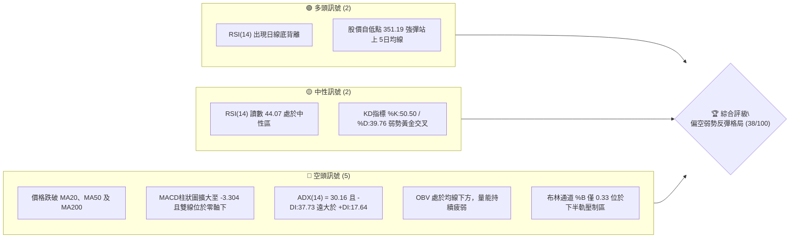

### 📊 核心指標速覽表

| 指標類別 | 指標名稱 | 當前數值 | 訊號 | 解讀 |
|----------|----------|----------|------|------|
| **價格** | 當前收盤價 | $396.48 | 🔴 | 跌破 200 日牛熊分界線，短線處於下行修正波 |
| **均線** | MA20 (月線) | $411.22 | 🔴 | 價格在均線下方 -3.58%，中短期下行壓力沉重 |
| **均線** | MA50 (季線) | $430.46 | 🔴 | 價格在均線下方 -7.89%，中期趨勢已轉空 |
| **均線** | MA200 (年線) | $400.64 | 🔴 | 價格微幅失守年線關卡，長線多頭架構遭遇實質考驗 |
| **動能** | RSI(14) | 44.07 | 🟡 | 位於 30–70 中性區間，呈現超跌後之技術性修復 |
| **動能** | MACD (12,26,9) | -14.496 / -11.191 | 🔴 | 柱狀圖 -3.304，雙線處於零軸下方發散，空方控盤 |
| **趨勢** | ADX(14) / ±DI | 30.16 / -DI:37.73 | 🔴 | ADX > 25 確立強趨勢，-DI 主導表明為明確空頭趨勢 |
| **通道** | 布林通道帶寬 | 上$455.08 / 下$367.36 | 🔴 | %B 為 0.33，價格受制於中軌 $411.22 之下壓 |
| **成交量** | 20日量比 / OBV | 0.94x / OBV < MA | 🔴 | 缺乏主力買盤承接，量能萎縮確認反彈力道偏弱 |
| **波動** | ATR(14) | $16.71 (4.21%) | 🟡 | 日間波動幅度偏大，需設定相對寬幅之風控距離 |

### 🏆 技術評分卡

```
技術評分卡 — TSM (2026-11-11)
════════════════════════════════════════════════════
趨勢強度      ███████░░░░░░░░░░░░░  35/100  🔴 空頭強趨勢壓制
動能指標      ████████░░░░░░░░░░░░  40/100  🔴 MACD負值但RSI背離
支撐穩定度    █████████░░░░░░░░░░░  45/100  🟡 S1與Fib 50%形成初階支撐
成交量配合    ███████░░░░░░░░░░░░░  35/100  🔴 量能萎縮且OBV弱勢
形態完整度    ████████░░░░░░░░░░░░  40/100  🟡 空頭旗形/弱勢下行通道
均線排列      ██████░░░░░░░░░░░░░░  30/100  🔴 均線呈現死亡交叉發散
════════════════════════════════════════════════════
綜合評分      ████████░░░░░░░░░░░░  38/100  🔴 評級：偏空 (規則18算術平均)
════════════════════════════════════════════════════
評分計算式：(35 + 40 + 45 + 35 + 40 + 30) ÷ 6 = 225 ÷ 6 = 37.5 → 四捨五入為 38/100
```

---

## 2. 趨勢分析

### 🌐 多時框趨勢分析

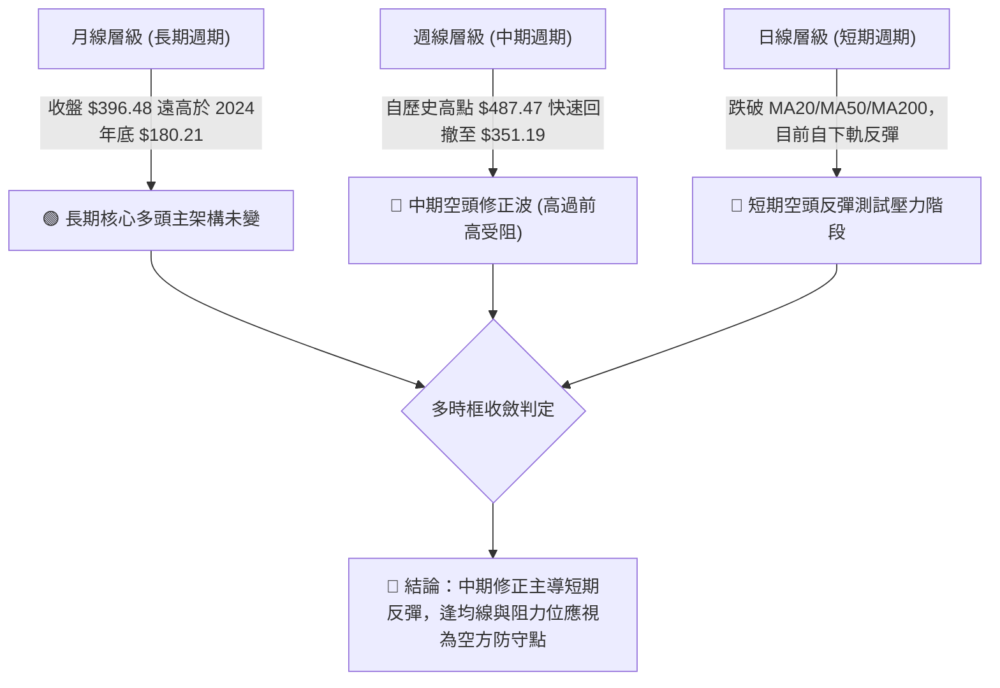

### 📈 長期趨勢 — 12個月走勢圖（Unicode）

```
TSM 月線走勢圖（過去12個月：2025-12 至 2026-11）
價格軸 ($)
$480 ┤                                      ● 2026-06 ($476.29)
$440 ┤                                            ● 2026-09 ($456.19)
$400 ┤                                  ● 05($416)    ● 08($414)
$360 ┤                      ● 2026-02 ($371.66)   ● 07($403)  ● 10($406)
$320 ┤          ● 2026-01 ($327.98)   ● 03($336)                  ● 11($396.48)←現價
$280 ┤● 2025-12 ($301.52)
     └─────────────────────────────────────────────────────────────
       12   01   02   03   04   05   06   07   08   09   10   11 (月份)
```

#### 走勢特徵分析表格

| 階段區間 | 起止價格 | 漲跌幅 | 趨勢特徵描述 |
|----------|----------|--------|--------------|
| **2025-12 ~ 2026-02** | $301.52 → $371.66 | +23.26% | 突破加速期，AI需求帶動半導體晶圓代工估值重估 |
| **2026-02 ~ 2026-06** | $371.66 → $476.29 | +28.15% | 狂熱主升段，創出多頭波段高位，成交量顯著推升 |
| **2026-06 ~ 2026-09** | $476.29 → $456.19 | -4.22% | 高檔橫盤滯漲期，多次衝擊 $480 未果形成寬幅震盪 |
| **2026-09 ~ 2026-11** | $456.19 → $396.48 | -13.09% | 頂部破位下殺期，快速回吐漲幅並失守多條重要支撐均線 |

### 📊 中期趨勢（週線分析）

```
TSM 週線結構壓力與支撐示意圖
$487.47 ────────────────────────────── 52W 歷史最高點 (2026-10-09) [強阻力]
        │
        ▼ 5週急速回撤 -27.96%
$430.46 ────────────────────────────── MA50 季線關鍵分水嶺 [反彈第一強壓]
$412.43 ────────────────────────────── 密集籌碼壓力區 R1 (近一年波段高點聚類)
$400.64 ────────────────────────────── MA200 年線生死線 (多空爭奪中)
$396.48 ◄═════════════════════════════ 【當前收盤價】
$384.06 ────────────────────────────── 近期波段支撐聚類 S1
$375.75 ────────────────────────────── 52週斐波那契 50.0% 回調位
$351.19 ────────────────────────────── 2026-11-05 波段下影線極值低點 (強支撐防線)
```

週線指標顯示，在 2026-10-09 當週觸及 52 週新高 $487.47 後，連續出現大陰線回落。2026-11-06 當週週成交量爆發至 104,001,100 股，收盤 $375.44，留下最低 $351.19 的長下影線。雖然短線有抄底資金介入，但整體週線動能 MACD 柱狀圖仍為 -3.304，顯示中期修正格局尚未結束。

### ⚡ 趨勢強度評估（ADX 解讀）

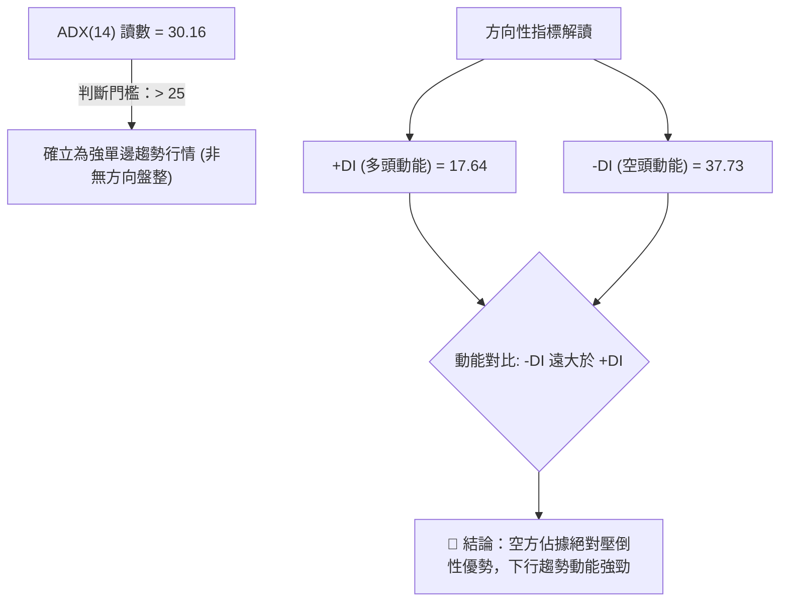

#### ADX 趨勢強度對照表

| 指標變數 | 當前讀數 | 標準門檻 | 狀態解讀 |
|----------|----------|----------|----------|
| **ADX(14)** | 30.16 | > 25 (強趨勢) | 市場處於明確的趨勢行情中，禁止採用逆勢盲目摸底策略 |
| **+DI** | 17.64 | 參考基準 | 多頭推升力量極端渙散，買盤僅具防守性 |
| **-DI** | 37.73 | > 30 (空方強烈主導) | 賣盤主導市場定價權，下行慣性依然存在 |
| **趨勢架構** | 空頭趨勢 | -DI > +DI 且 ADX 處於上升段 | 依據規則 14，ADX > 25 鎖定以中長期均線下壓為主要交易依據 |

---

## 3. 圖表形態分析

### 🔍 形態識別系統

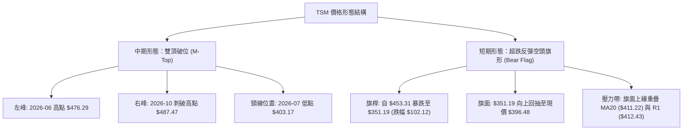

#### 形態信心度與目標價計算表

| 形態名稱 | 信心度 | 判斷依據（引用數據） | 完成度 | 目標價（附嚴格計算式） |
|----------|--------|----------------------|--------|------------------------|
| **雙頂形態 (M-Top)** | 80% | 2026-06 收盤 $476.29 與 2026-10 高點 $487.47 構成雙峰，跌破 2026-07 低點 $403.17 頸線 | 85% | 頸線 $403.17 − (形態高點 $487.47 − 頸線 $403.17) = $403.17 − $84.30 = **$318.87** (接近 Fib 78.6% $311.84) |
| **空頭旗形 (Bear Flag)** | 70% | 旗桿自 $453.31 跌至 $351.19，隨後以弱勢低量自 $351.19 爬升至 $396.48，處於反彈通道內 | 60% | 若跌破旗面下軌，目標 = 反彈高點 (暫以現價 $396.48 估算) − 旗桿高度 ($453.31 − $351.19 = $102.12) = **$294.36** |
| **頭肩底形態** | 0% | 數據中未偵測到底部反轉特徵 | 0% | 訊號不足，僅做指標型解讀，不預設多頭幾何目標 |

### 🕯️ 重要K線形態分析

#### 近 10 根日 K 棒逐日解析

| 日期 (日K) | 開盤價 | 最高價 | 最低價 | 收盤價 | K線形態 | 深度解讀 | 訊號 |
|------------|--------|--------|--------|--------|---------|----------|------|
| **2026-10-28** | 438.24 | 440.88 | 436.84 | 439.51 | 小陽星十字 | 於 MA50 下方縮量橫盤，多空方向未明 | 🟡 |
| **2026-10-29** | 431.69 | 436.24 | 428.43 | 431.81 | 跳空小陰線 | 開盤向下跳空，跌破 435 籌碼支撐，弱勢顯現 | 🔴 |
| **2026-10-30** | 414.08 | 418.09 | 400.12 | 406.13 | 帶量長黑破位線 | 成交量驟增至 21.97M，失守 410 重要整數關卡 | 🔴 |
| **2026-11-02** | 412.52 | 414.76 | 398.29 | 398.63 | 光腳中黑線 | 跌破 400 元年線，盤中多頭反抗力道極弱 | 🔴 |
| **2026-11-03** | 404.99 | 408.37 | 403.03 | 404.80 | 窄幅整理小陰星 | 縮量至 9.42M，於破位後短暫喘息，屬於下跌中繼 | 🟡 |
| **2026-11-04** | 400.64 | 410.59 | 391.61 | 395.75 | 衝高回落倒錘頭 | 盤中上測年線 $400.64 未果，長上影線顯現沉重套牢賣壓 | 🔴 |
| **2026-11-05** | 379.75 | 380.78 | 351.19 | 353.10 | 恐慌長黑破位線 | 43.03M 巨量摜壓，盤中創下 $351.19 波段低點，引發恐慌性停損 | 🔴 |
| **2026-11-06** | 380.56 | 380.72 | 367.95 | 375.44 | 破底回升小陽線 | 23.84M 換手量，未再創 $351.19 新低，出現初步承接買盤 | 🟢 |
| **2026-11-09** | 382.50 | 394.39 | 380.33 | 388.62 | 光頭中陽線 | 吞噬前一日實體，自低位展開超跌技術性修復反彈 | 🟢 |
| **2026-11-10** | 388.42 | 400.21 | 387.20 | 396.48 | 帶長上影陽線 | 盤中刺破 400 大關至 400.21，但遭 MA200 壓制回落至 396.48 | 🟡 |

#### 近 8 根週 K 棒週期解析

| 日期 (週K最後交易日) | 開盤價 | 最高價 | 最低價 | 收盤價 | 週K形態 | 趨勢解讀 | 訊號 |
|----------------------|--------|--------|--------|--------|---------|----------|------|
| **2026-09-25** | 440.80 | 455.03 | 437.06 | 450.61 | 突破大陽線 | 多頭放量推升，重新站回 450 之上 | 🟢 |
| **2026-10-02** | 448.39 | 474.79 | 443.11 | 472.78 | 長陽實體衝刺 | 逼近歷史天花板，週 RSI 進入 71.7 超買區 | 🟢 |
| **2026-10-09** | 478.77 | 487.47 | 449.75 | 453.31 | 52週高點長上影陰線 | 創 52W 新高 $487.47 後遭主力巨幅出貨，形成烏雲蓋頂 | 🔴 |
| **2026-10-16** | 453.55 | 454.40 | 407.13 | 412.61 | 週線大長黑摜壓 | 爆出 71.73M 大量，直接擊潰 MA20 週線支撐 | 🔴 |
| **2026-10-23** | 421.66 | 435.16 | 410.22 | 418.51 | 週線弱勢反彈星 | 縮量至 61.58M，多方無力收復 430 阻力失土 | 🟡 |
| **2026-10-30** | 418.07 | 440.88 | 400.12 | 406.13 | 衝高破位黑三兵 | 測試 440 壓力後再度破底，確立雙頂頸線失守 | 🔴 |
| **2026-11-06** | 412.52 | 414.76 | 351.19 | 375.44 | 恐慌長下影流星錘 | 104.00M 歷史天量換手，下影線長達 $24.25，測試極限支撐 | 🟡 |
| **2026-11-10** (本週) | 382.50 | 400.21 | 380.33 | 396.48 | 縮量反彈小陽線 | 截至今收盤 30.00M 成交量，暫時受制於年線之下 | 🟡 |

### 📉 ASCII 走勢形態示意圖

```
TSM 日線空頭旗形走勢結構圖
價格 ($)
$453.31 ┐
        │＼ (旗桿下殺段: -22.5%)
        │  ＼
$406.13 ┤    ＼       ┌─── 阻力上軌 (MA20: $411.22 / R1: $412.43)
        │      ＼     ╱  ▲
$396.48 ┤        ＼ ╱  ● 現價 $396.48 (旗面反彈中)
        │          ╱  ╱
$375.44 ┤         ╱  ╱  (旗面整理通道)
        │        ╱  ▼
$351.19 ┴───────┴────── 支撐下軌 (2026-11-05 低點)
```

---

## 4. 支撐與阻力

### 🗺️ 關鍵價位分布圖（Unicode）

```
TSM 價位結構分布圖
═══════════════════════════════════════════════════
$439.05 ║████████████████████████║ 強阻力 R3 (波段籌碼重災區)
$419.86 ║████████████████████    ║ 阻力 R2 (反彈高點聚類)
$412.43 ║████████████████████████║ 關鍵阻力 R1 (MA20與波段高點共振)
$402.11 ╟────────────────────────╢ Fib 38.2% 回調位 / 年線 $400.64 密集區
$396.48 ╠════════════════════════╣ ◄ 現價 (2026-11-10 收盤)
$384.06 ║▓▓▓▓▓▓▓▓▓▓▓▓▓▓▓▓        ║ 近期支撐 S1 (MA240與波段低點聚類)
$375.75 ╟────────────────────────╢ Fib 50.0% 關鍵平衡位
$371.72 ║████████████████████    ║ 強支撐 S2 (近一年波段密集低點)
$358.75 ║████████████████████████║ 極限防守支撐 S3 (波段底限聚類)
═══════════════════════════════════════════════════
```

### 🚧 阻力位分析表

依據數據「關鍵價位（由 OHLCV 計算）」區塊嚴格引用，不得任意捏造：

| 阻力級別 | 精確價位 | 距現價幅動 | 形成原因與技術共振 | 突破難度 | 重要性 |
|----------|----------|------------|--------------------|----------|--------|
| **R1** | **$412.43** | +4.02% | 近一年波段高點聚類；與日線 MA20 ($411.22) 高度重疊，形成密集蓋頂均線阻力 | 🔴 極高 | ★★★★★ |
| **R2** | **$419.86** | +5.90% | 近一年波段次高密集區；與 2026-10-23 週反彈高點 $435.16 前之折返頸線呼應 | 🟡 高 | ★★★★☆ |
| **R3** | **$439.05** | +10.74% | 波段高點聚類；上方緊鄰日線 MA50 ($430.46) 與 Fib 23.6% ($434.74)，為中期多空天塹 | 🔴 極難 | ★★★★★ |

### 🛡️ 支撐位分析表

依據數據「關鍵價位（由 OHLCV 計算）」區塊嚴格引用，不得任意捏造：

| 支撐級別 | 精確價位 | 距現價幅動 | 形成原因與技術共振 | 守住機率 | 重要性 |
|----------|----------|------------|--------------------|----------|--------|
| **S1** | **$384.06** | -3.13% | 近一年波段低點聚類；與長線 MA240 ($384.81) 共振，短線回踩第一防線 | 🟡 50% | ★★★★☆ |
| **S2** | **$371.72** | -6.24% | 近一年強波段低點聚類；緊鄰 52 週 Fib 50.0% 回調位 ($375.75)，為中線多頭防線 | 🟢 65% | ★★★★★ |
| **S3** | **$358.75** | -9.52% | 近一年極限波段低點聚類；下方 $351.19 為 2026-11-05 恐慌低點，失守將直探 Fib 61.8% | 🟢 75% | ★★★★☆ |

### 📐 斐波那契回調位分析

依據 52 週極值區間（低點 $264.03 → 高點 $487.47，垂直振幅 $223.44）黃金分割計算：

| 斐波那契回調位 | 精確價位 | 距現價差距 | 技術面結構解讀 |
|----------------|----------|------------|----------------|
| **0.0% (52W High)** | $487.47 | +22.95% | 2026-10-09 形成之歷史最高紀錄，長期天花板 |
| **23.6%** | $434.74 | +9.65% | 初級回調阻力位，緊鄰 MA50 ($430.46) |
| **38.2%** | $402.11 | +1.42% | 強弱分水嶺；緊鄰年線 MA200 ($400.64)，現價正受阻於此位下方 |
| **50.0%** | $375.75 | -5.23% | 多空力量對稱平衡位；2026-11-06 週線收盤 $375.44 精準測試守住 |
| **61.8%** | $349.38 | -11.88% | 黃金分割強防守位；若 S3 ($358.75) 失守之終極回撤目標 |
| **78.6%** | $311.84 | -21.35% | 深度結構修正位，對應 2026 年初起漲平台 |
| **100.0% (52W Low)**| $264.03 | -33.41% | 52 週最低點，牛市原始基座 |

> **當前價位定位評註**：現價 $396.48 恰好夾在 **Fib 38.2% ($402.11)** 與 **Fib 50.0% ($375.75)** 之間。在技術面被視為典型「弱勢區間整理」。若無法實質站穩 $402.11 之上，市場將隨時面臨二次探底考驗 $375.75 的風險。

---

## 5. 技術指標深度解讀

### 🎛️ 指標訊號總覽

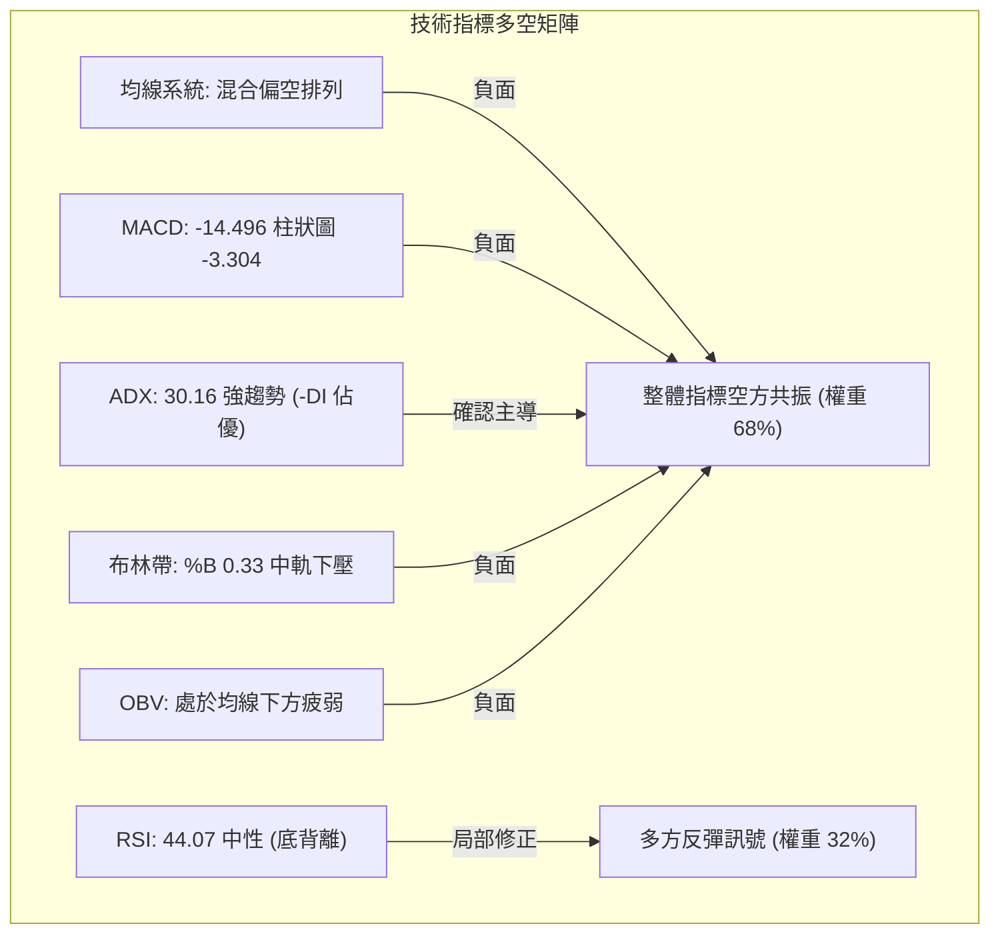

### 📈 移動平均線排列分析

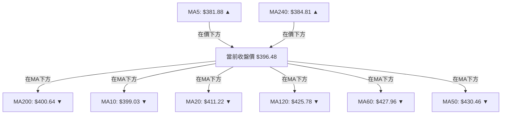

#### 移動平均線數據對照表

| 週期 | 數值 | 距現價差額 | 走勢方向 | 排列狀態與涵義 |
|------|------|------------|----------|----------------|
| **MA5** | $381.88 | +$14.60 (+3.82%) | ▲ 向上拐頭 | 短線超跌強彈，股價暫時站上短期 5 日均線 |
| **MA10** | $399.03 | -$2.55 (-0.64%) | ▼ 下行發散 | 股價盤中衝高回落，未有效克服 10 日線壓制 |
| **MA20** | $411.22 | -$14.74 (-3.58%) | ▼ 陡峭下行 | 月線反壓沉重，過去 20 日籌碼全數處於浮虧狀態 |
| **MA50** | $430.46 | -$31.48 (-7.36%) | ▼ 下行走平 | 季線下彎，中期頭部形成確立 |
| **MA60** | $427.96 | -$31.48 (-7.36%) | ▼ 下行走勢 | 中期生命線失守，形成結構性阻力 |
| **MA120** | $425.78 | -$29.30 (-6.88%) | ▼ 走平下彎 | 半年線失守，中長期均線發散轉差 |
| **MA200** | $400.64 | -$4.16 (-1.04%) | ▼ 走平下穿 | 年線牛熊分水嶺被跌破，當前處於反抽測試階段 |
| **MA240** | $384.81 | +$11.67 (+3.03%) | ▲ 緩步上行 | 長期牛市底線，與 S1 ($384.06) 形成強烈共振重疊 |

> **均線系統總評**：呈現經典的「混合偏空排列」。MA10、MA20、MA50、MA60 均呈現由上而下的空頭壓制態勢，現價 $396.48 夾在下方的長期防線 MA240 ($384.81) 與上方的牛熊年線 MA200 ($400.64) 之間，多空短兵相接。

### 📉 RSI(14) 分析

- **當前數值**：44.07 (Wilder 平滑計算)
- **區間定位**：處於 30–70 中性震盪區間
- **強度進度條**：
  ```
  RSI(14) 強度：[████████░░░░░░░░░░] 44.07% (中性偏弱)
  ```
- **背離形態判斷**：⚠️ **確認日線底背離 (Bullish Divergence)**
  - *背離論證*：在近 20 根 K 棒的首尾對比中，價格由 2026-10-30 的收盤價 $406.13 一路下殺至 2026-11-05 的 $353.10（盤中 $351.19，創波段新低），但 RSI(14) 在 2026-10-16 跌至 34.3 的極值後，在 2026-11-06 回測低點時 RSI 守在 36.3，隨後迅速拉升至 44.07，形成「價格創新低、指標未創新低」的典型底背離架構。
  - *效力評估*：該背離促成了現階段由 $351.19 往 $396.48 的技術性反彈，但由於缺乏成交量跟進，背離帶來的推升動能正逼近衰竭臨界點。

### 📊 MACD(12,26,9) 訊號解讀

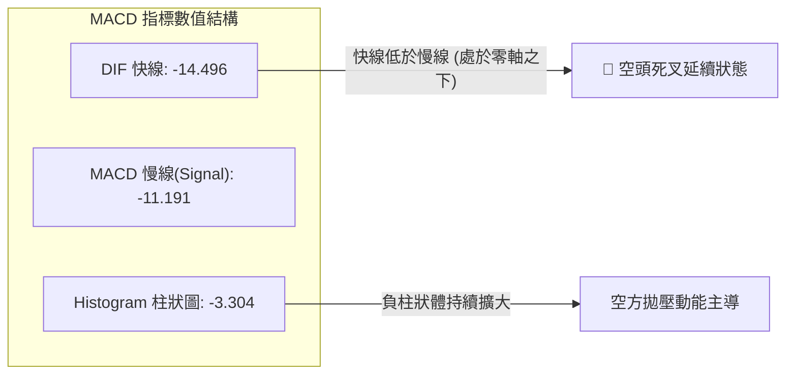

MACD 快線 (-14.496) 與訊號線 (-11.191) 深度沉於零軸之下，反映中期空頭力量十分充沛。負柱狀圖達 -3.304，雖較 10 月中旬極值 (-6.872) 有所收斂，但近一週並未見到金叉轉折跡象，顯示下行慣性依然壓制盤面。

### 📦 布林通道分析

```
TSM 日線布林通道示意圖
價格軸 ($)
$455.08 ┬──────────────────────────────────────── 上軌 (帶寬上緣)
        │
$411.22 ┼──────────────────────────────────────── 中軌 (MA20 下壓阻力)
        │
$396.48 ┤                    ● 現價 (位處中軌與下軌間，%B = 0.33)
        │
$367.36 ┴──────────────────────────────────────── 下軌 (帶寬下緣動態支撐)
```

- **軌道狀態**：中軌（MA20）落在 $411.22，下軌落在 $367.36，上軌落在 $455.08。
- **%B 指標**：0.33。數值小於 0.50，顯示價格運行於布林中軌下方的空頭弱勢區。
- **帶寬走勢**：當前布林帶處於擴張後的中期整理階段，中軌 $411.22 與阻力 R1 ($412.43) 構成多頭難以逾越的第一道鐵壁。

### 💹 成交量分析（量價配合度）

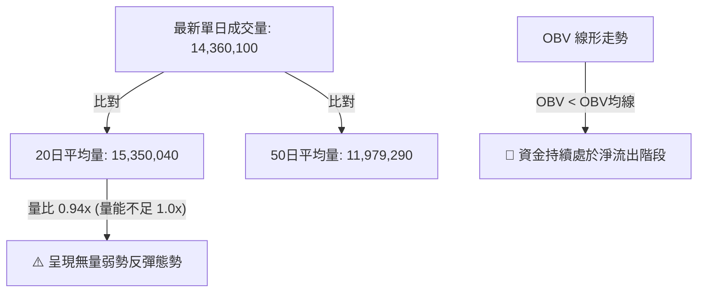

- **量能評估**：2026-11-10 最新成交量為 14.36M，量比僅 0.94x，低於 20 日均量。反觀 2026-11-05 大跌時爆出 43.03M 巨量，顯示「下殺有量、反彈無量」的典型空頭籌碼結構。
- **OBV 指標特徵**：OBV 處於均線下方，反映自 2026-10-09 見頂以來的機構籌碼派發趨勢仍在進行，量能無法對目前的上漲給予正向確認（量價背離）。

---

## 6. 動能與波動率

### ⚡ 動能評估四象限

| 象限代號 | 動能強度 (Momentum) | 波動率水平 (Volatility) | 當前判定 | 特徵解讀與操作應對策略 |
|----------|---------------------|-------------------------|----------|------------------------|
| **Q1** | 強多頭動能 | 低波動率 | — | 最佳波段順勢推升階段 |
| **Q2** | 弱/空頭動能 | 低波動率 | — | 狹幅無方向盤整，謹慎觀望 |
| **Q3** | 強多頭動能 | 高波動率 | — | 主升衝刺噴出，高風險高收益 |
| **Q4** | **弱/空頭主導 (ADX 30.16)** | **高波動 (ATR 4.21%)** | **✓ (當前狀態)** | **高風險殺跌修正期，逢反彈做空或防守** |

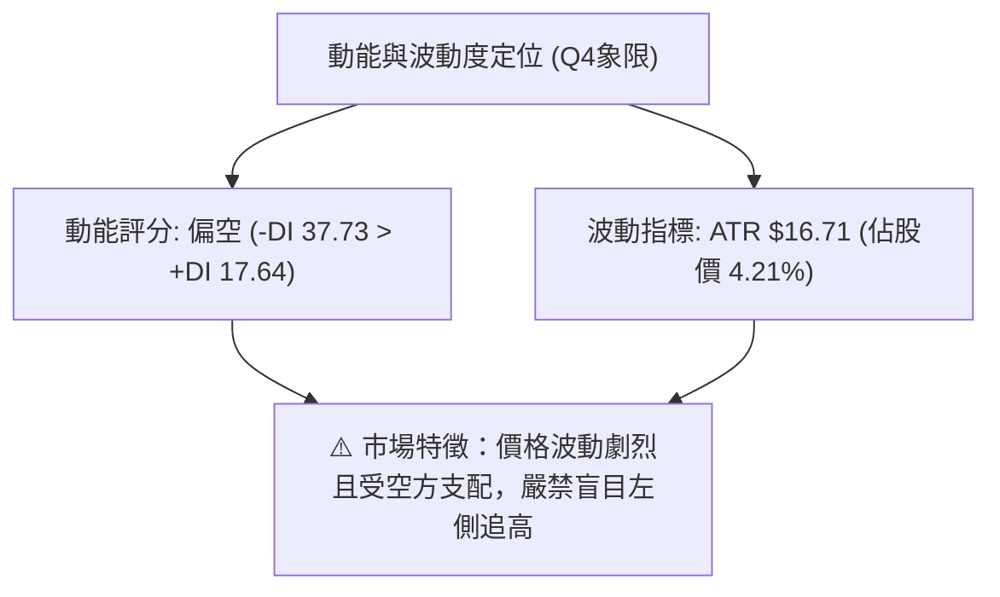

### 📊 ATR 波動率分析

- **ATR(14) 讀數**：$16.71（採 Wilder 平滑演算法）。
- **相對波動率**：佔現價 $396.48 之 **4.21%**，顯示 TSM 目前處於高日度波動狀態。
- **風控距離建議**：
  - *短期日內止損安全邊界 (1.0 × ATR)*：約 **$16.71**
  - *波段交易止損安全邊界 (1.5 × ATR)*：約 **$25.07**
  - *操作涵義*：在規劃任何交易時，停損幅度若小於 $16.71，極易被正常的日間隨機噪聲掃出場。

### 📐 Beta 與市場相關性

- **Beta 係數**：**1.233**
- **市場特徵解析**：TSM 具有顯著高於標普 500 指數（Beta = 1.0）的高彈性特質。
- **大盤共振性**：在大盤回檔階段，TSM 的回撤幅度平均為科技板塊指數的 1.23 倍；在高 Beta 環境下，當前空頭趨勢具有放大下行風險的傾向。

---

## 7. 多時框架總結

### 📋 時框架評分表

| 時框架 | 趨勢方向 | 動能狀態 | 均線排列狀況 | 形態特徵 | 綜合評分 | 建議操作維度 |
|--------|----------|----------|--------------|----------|----------|--------------|
| **月線 (長期)** | 🟢 多頭拉回 | 🟡 漲勢趨緩 | 位於長期 MA240 之上 | 長多大格局中的局部大幅拉回 | **65/100** | 長線定期定額逢低分批 |
| **週線 (中期)** | 🔴 明確空頭 | 🔴 MACD負值放大 | 失守週 MA20，下測 MA50 | 雙頂確立，處於回調波段中 | **35/100** | 中期波段禁止盲目作多 |
| **日線 (短期)** | 🔴 空頭反彈 | 🟡 RSI底背離反彈 | 混合偏空，價格受制於年線 | 空頭旗形反彈逼近上軌壓力 | **38/100** | 短線尋找阻力位逢高沽空 |

### 🔲 綜合訊號矩陣

```
TSM 多時框訊號一致性評估矩陣
────────────────────────────────────────────────────────────────
維度項目        短期 (日線)          中期 (週線)          長期 (月線)
────────────────────────────────────────────────────────────────
主導方向        🔴 空頭反彈          🔴 破位下殺          🟢 多頭回撤
均線排列        🔴 偏空死叉          🔴 跌破週MA20        🟢 完整多頭多頭
動能強弱        🟡 RSI底背離(轉弱)   🔴 MACD擴大翻黑      🟡 高檔超買鈍化緩解
量能結構        🔴 無量弱勢反彈      🔴 週線破位爆量      🟢 長期資金沉澱
關鍵位置        🔴 壓制在年線下方    🔴 雙頂頸線下壓      🟢 Fib 50% 防守中
────────────────────────────────────────────────────────────────
一致性結論：中短期高度共振偏空 (權重佔優)，長期多頭支撐尚存但面臨嚴峻檢驗。
```

### ⚖️ 多時框收斂結論

> **依據規則 14 嚴格收斂判定**：
> 1. **趨勢/盤整識別**：當前 ADX(14) 讀數為 **30.16 (> 25)**，且 -DI (37.73) 遠高於 +DI (17.64)，市場確立為**極強的單邊空頭趨勢行情**，而非無方向的盤整震盪。
> 2. **主導權優先級**：依規則，當 ADX > 25 時，**以中長期週線與 MA50、MA200 方向為主導**。目前週線雙頂破位且日線實質跌破 MA200 ($400.64)，中期下行壓力佔據絕對統治地位；日線的短期反彈（由 RSI 底背離推動）僅能作為尋找理想空單進場點之輔助。
> 3. **唯一方向性結論**：**【偏空主導】**。嚴禁將日線連續數日的縮量紅 K 解讀為反轉信號，第 8 章之核心策略將嚴格依據評分卡 38/100 偏空格局，鎖定「反彈阻力位沽空」為唯一主策略。

---

## 8. 交易策略建議

### 🗺️ 策略決策流程圖

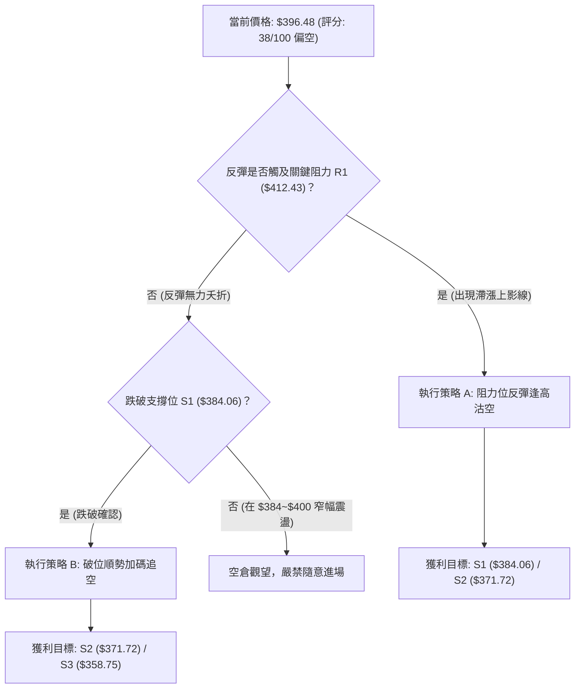

### 🧭 策略路由（依評分卡分流）

**當前主策略方向 = 【主推空頭策略】（依據綜合評分 38/100 偏空判定，規則 18）**

因技術評分低於 40 分，空方佔據絕對趨勢優勢，報告主推兩套放空佈局架構；多頭操作僅被視為逆勢對沖或左側激進博弈，不作為主策略推薦。

### 🎯 價格情境階梯（Price Scenarios）

價位嚴格引用下方數據「關鍵價位」區塊之精確值：

| 觸發條件 | 下一目標 | 後續延伸 | 情境含義與技術解讀 |
|----------|----------|----------|--------------------|
| **突破 R1 $412.43** | R2 $419.86 | R3 $439.05 | 短線假破底翻，超跌反彈演化為寬幅震盪，空頭主動停損出局 |
| **受阻於現價至 R1 區間** | S1 $384.06 | S2 $371.72 | 典型弱勢空頭旗形反抽完畢，重啟主跌段，回探波段低位 |
| **有效跌破 S1 $384.06** | S2 $371.72 | S3 $358.75 | 跌破 MA240 長期支撐，中期停損賣盤湧現，確認探底格局 |

### 📊 情境機率分佈

| 預期情境 | 發生機率 | 主要技術依據 |
|----------|----------|--------------|
| **回落 / 再度探底 (Bear Continuation)** | **55%** | ADX = 30.16 (-DI 主導)、價格失守年線、MACD 負向雙線發散、反彈量能不足 |
| **區間震盪整理 (Consolidation)** | **30%** | RSI(14) 呈現日線底背離修復、Fib 50% ($375.75) 與 S1 ($384.06) 具初步防守買盤 |
| **強勢突破上行 (Bullish Reversal)** | **15%** | 機構回補推升、站回年線與 MA20 之上（需爆發出 >25M 之攻擊量確認） |

### 🟢 主策略詳情（空頭主推架構）

所有數據嚴格基於「關鍵價位」精確運算，風險報酬比符合規則 17：

| 策略要素 | 策略 A（反彈阻力位逢高沽空） | 策略 B（跌破關鍵支撐順勢追空） |
|----------|------------------------------|--------------------------------|
| **進場條件** | 價格反抽至 R1 與 MA20 密集區出現滯漲上影線 | 日線實體帶量收盤跌破 S1 支撐位 |
| **進場價格** | **$412.43** (精確引用 R1) | **$384.06** (精確引用 S1) |
| **止損價格** | **$419.86** (精確引用 R2) | **$396.48** (精確引用當前收盤價/年線防線) |
| **目標價 T1** | **$384.06** (精確引用 S1) | **$371.72** (精確引用 S2) |
| **目標價 T2** | **$371.72** (精確引用 S2) | **$358.75** (精確引用 S3) |
| **風險報酬比** | **1 : 3.82（以 T1 計）** <br> **1 : 5.48（以 T2 計）** | **1 : 0.99（以 T1 計）** <br> **1 : 2.04（以 T2 計）** |
| **成功機率** | **60%** | **55%** |
| **建議倉位** | **15% - 20%** (中等倉位) | **10% - 15%** (輕倉順勢) |

#### 策略 A 風險報酬比計算驗證（依規則 17）：
- **進場價** = $412.43
- **止損價** = $419.86；止損風險 = $419.86 − $412.43 = **$7.43**
- **目標價 T1** = $384.06；獲利空間 T1 = $412.43 − $384.06 = **$28.37**
- **RR(T1)** = $28.37 ÷ $7.43 = **3.818... → 1 : 3.82（以 T1 計）**
- **目標價 T2** = $371.72；獲利空間 T2 = $412.43 − $371.72 = **$40.71**
- **RR(T2)** = $40.71 ÷ $7.43 = **5.479... → 1 : 5.48（以 T2 計）**

#### 策略 B 風險報酬比計算驗證（依規則 17）：
- **進場價** = $384.06
- **止損價** = $396.48；止損風險 = $396.48 − $384.06 = **$12.42**
- **目標價 T1** = $371.72；獲利空間 T1 = $384.06 − $371.72 = **$12.34**
- **RR(T1)** = $12.34 ÷ $12.42 = **0.993... → 1 : 0.99（以 T1 計）**
- **目標價 T2** = $358.75；獲利空間 T2 = $384.06 − $358.75 = **$25.31**
- **RR(T2)** = $25.31 ÷ $12.42 = **2.037... → 1 : 2.04（以 T2 計）**

### 🔴 反向風險觸發點（對沖提示）

- **關鍵轉折價位**：**$412.43 (R1)** 與 **$430.46 (MA50)**。
- **對沖觸發機制**：若日 K 線帶有超過 25M 之顯著攻擊量，強行收復並收盤站穩在 $412.43 之上，則空頭旗形被向上破壞，空單必須全數停損平倉。
- **激進型多頭試單**：僅在股價帶量突破 $412.43 後，方可極小倉位（< 5%）順勢短多，上看 R2 ($419.86) 及 Fib 23.6% ($434.74)，但必須將停損設於 $400.64 (MA200)。

### ⭐ 整體訊號強度評星

```
做多訊號強度：★★☆☆☆  (2/5星 - 僅存超跌背離反彈，勝率偏低)
做空訊號強度：★★★★☆  (4/5星 - 順應 ADX 強趨勢與均線破位，勝率高)
整體可信度：  ★★★★☆  (4/5星 - 量價指標高度共振，架構清晰)
```

---

## 9. 風險提示與監控

### ✅ 關鍵監控指標 Checklist

```
╔══════════════════════════════════════════════════════════════╗
║               TSM 關鍵技術指標風控監控清單                     ║
╠══════════════════════════════════════════════════════════════╣
║ [ ] 價格是否成功重返年線 MA200 ($400.64) 之上？               ║
║ [ ] 價格衝擊 R1 ($412.43) 與 MA20 ($411.22) 是否出現阻力背離？ ║
║ [ ] 成交量是否連續兩日突破 20 日均量 (15.35M)？              ║
║ [ ] RSI(14) 讀數是否突破 50 中軸確立多空分水嶺逆轉？          ║
║ [ ] ADX(14) 是否持續高於 25 且 -DI 是否仍大於 +DI？          ║
║ [ ] 下方支撐 S1 ($384.06) 與 S2 ($371.72) 是否遭受實質跌破？  ║
╚══════════════════════════════════════════════════════════════╝
```

### ⚠️ 風險場景分析

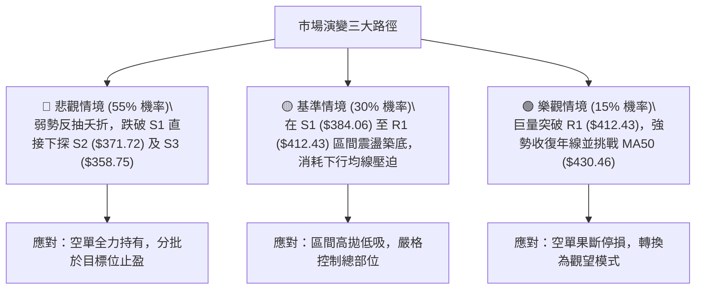

### 🛡️ 風險管理重要提醒

1. **嚴禁主觀摸底**：ADX 達 30.16 且 -DI = 37.73，此為典型空方強趨勢。在技術指標未給出明確的右側多頭結構之前，切忌在下行途中憑感覺抄底。
2. **波動率放大應對**：ATR 目前高達 $16.71（4.21%），日間振幅動輒超過 15 美元，槓桿合約或期權投資者應主動縮減頭寸規模，避免遭到日間劇烈洗盤震盪出場。
3. **宏觀與板塊聯動**：TSM 作為全球半導體龍頭，當前估值與技術面深度受到科技股巨頭資本支出預期影響，需高度留意相關 AI 供應鏈動態對價格結構的突發衝擊。

---

## 📋 報告總結

```
TSM 技術分析報告總結
════════════════════════════════════════════════════════
報告日期：2026-11-11
當前價格：$396.48 USD
分析評級：🔴 偏空弱勢反彈（技術評分：38 / 100）

關鍵結論：
├─ 長期趨勢：🟢 多頭大架構回撤（高檔震盪拉回整理）
├─ 中期趨勢：🔴 空頭修正破位（雙頂頸線跌破，均線下彎）
├─ 短期趨勢：🔴 弱勢空頭旗形反彈（年線下方承壓）
├─ 關鍵支撐：S1 $384.06 ｜ S2 $371.72 ｜ S3 $358.75
├─ 關鍵阻力：R1 $412.43 ｜ R2 $419.86 ｜ R3 $439.05
└─ 分析師目標：均價 $586.69（基本面預期與技術走勢暫時脫節）

最優策略組合：
1. 🥇 最佳機會：策略 A — 反抽測試 R1 ($412.43) 阻力位受阻時逢高沽空 (RR 1:3.82)
2. 🥈 次選機會：策略 B — 帶量實體跌破 S1 ($384.06) 順勢跟進追空 (RR 1:2.04 以 T2 計)
3. 🥉 保守選擇：空倉耐心觀望，等待股價在 S2 ($371.72) 與 Fib 50% 處構築明確底部型態
════════════════════════════════════════════════════════
```

---

> ⚠️ **免責聲明**：本報告為 AI 自動生成之技術分析，所有數據及估算均基於提供的歷史價格資訊。本報告**僅供研究與學術參考**，**不構成任何投資建議**。投資有風險，入市需謹慎。

---

*報告生成時間：2026-11-11 ｜ 數據來源：Yahoo Finance ｜ 分析框架：多時框技術分析*