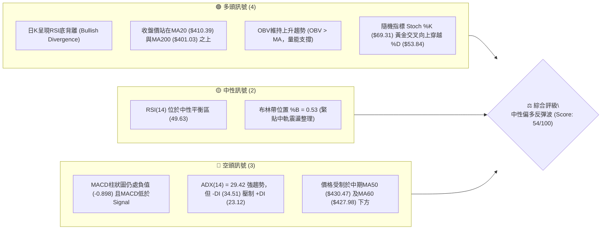
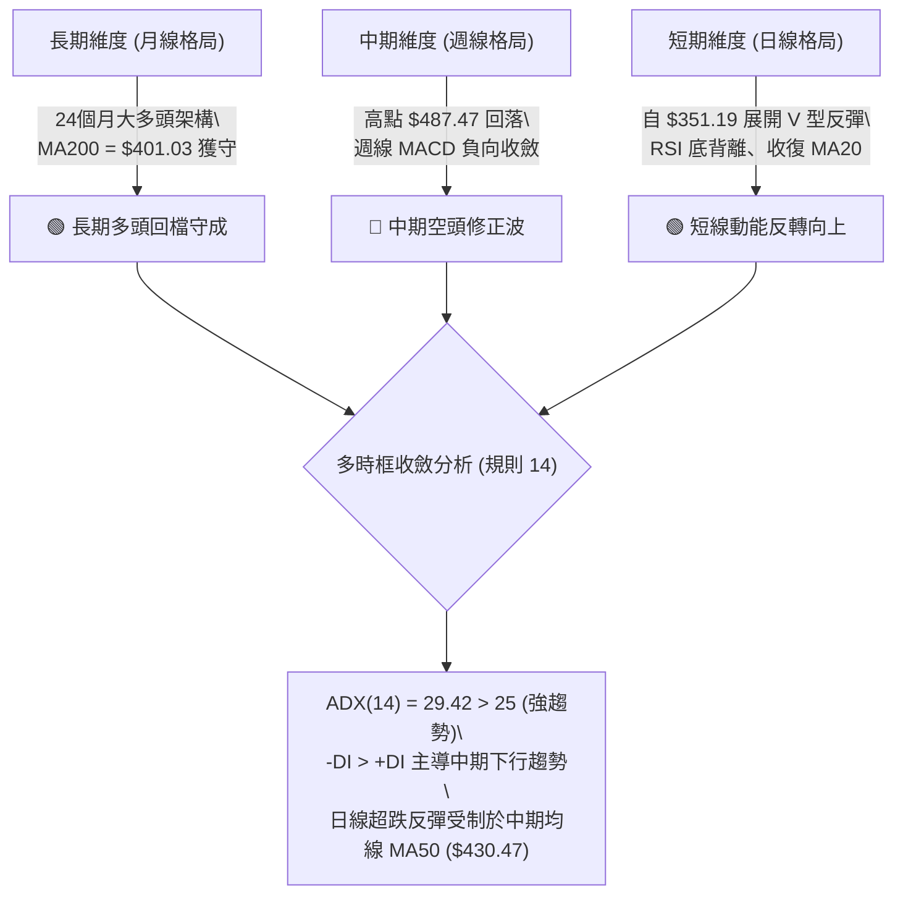
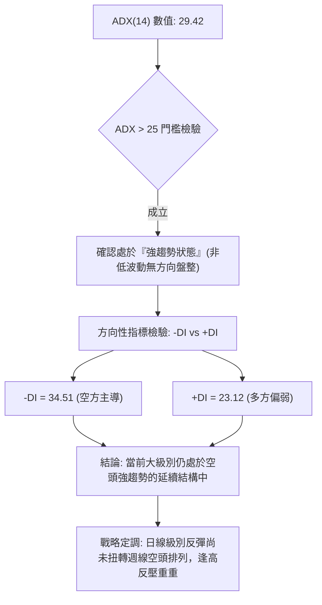
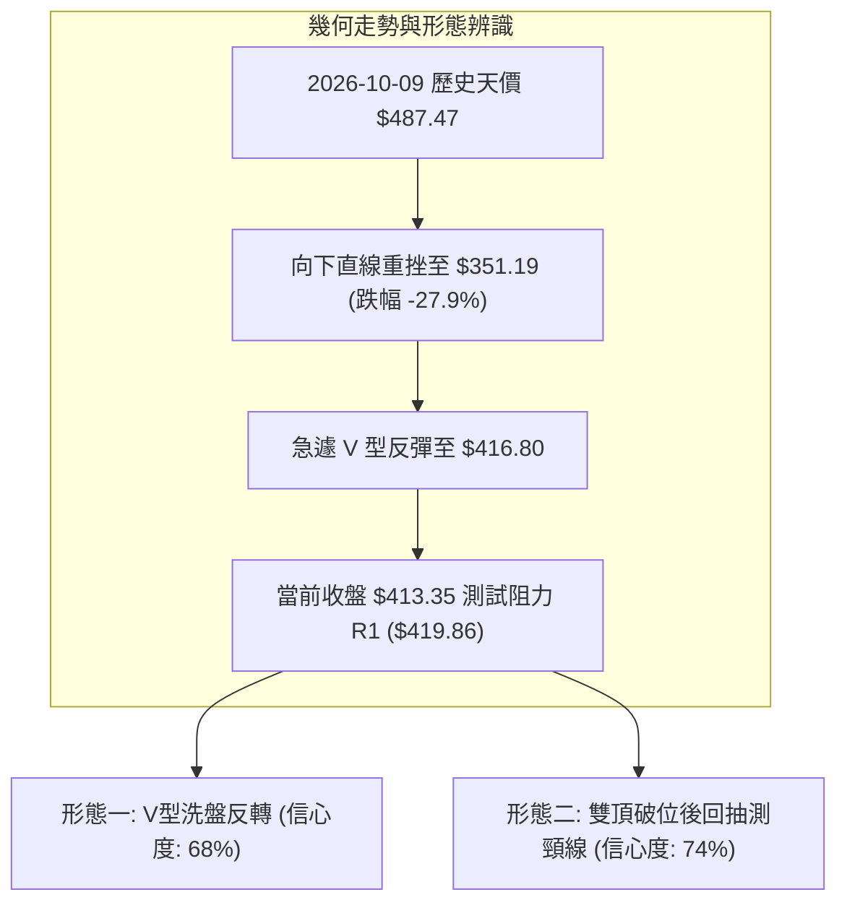
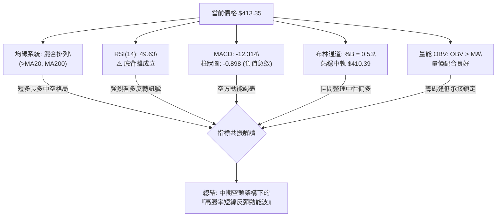
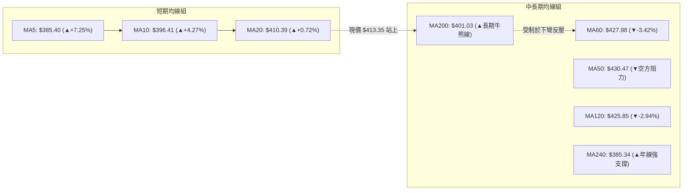
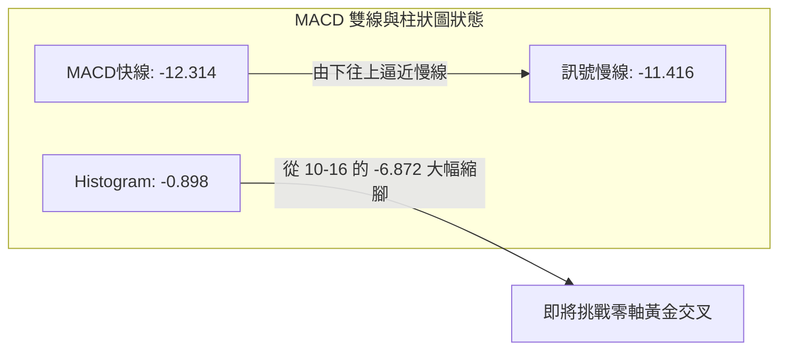
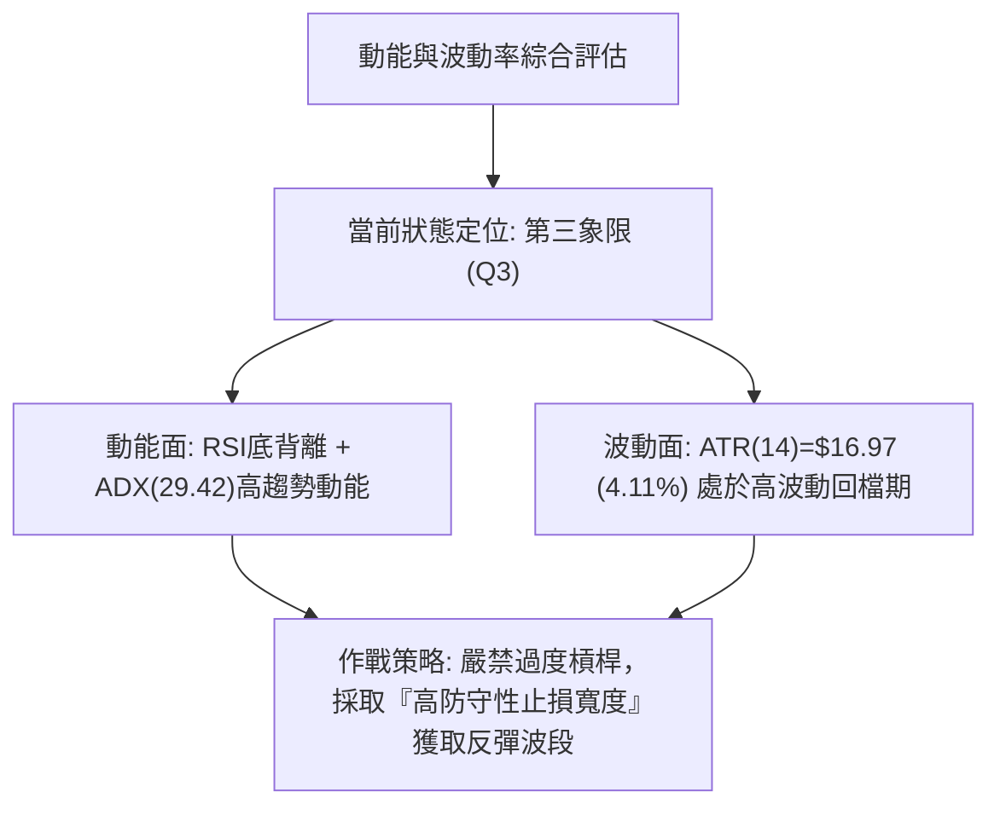
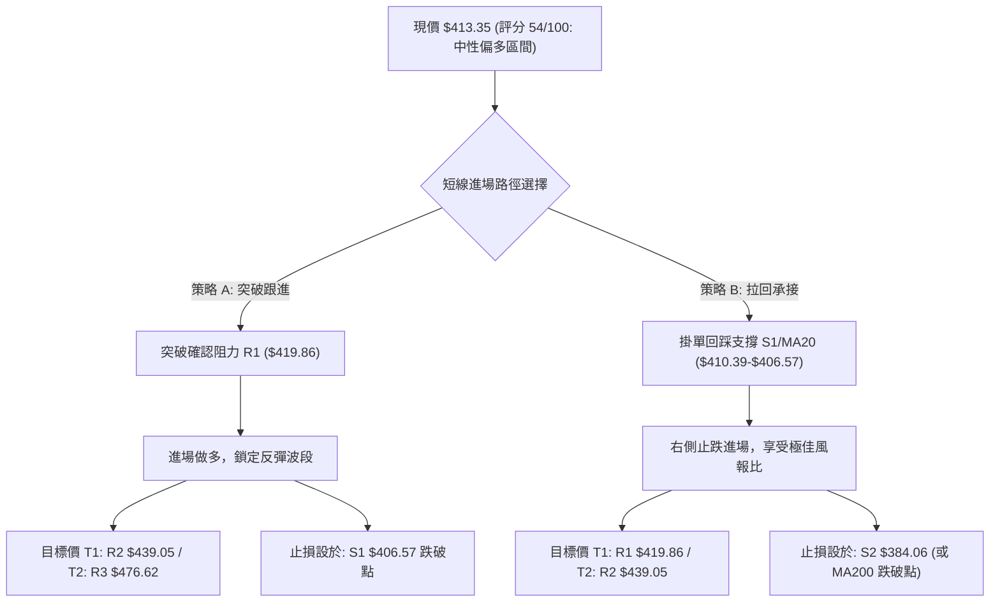
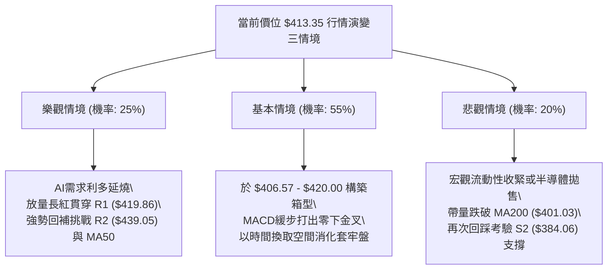

# TSM 技術分析報告

> **報告日期**：2026-11-12 ｜ **語言**：繁體中文 ｜ **數據來源**：Yahoo Finance ｜ **當前價格**：$413.35 USD

---

## 目錄

| 章節 | 內容 |
|------|------|
| [1. 技術面概覽](#1-技術面概覽) | 訊號儀表板、核心指標、評分卡 |
| [2. 趨勢分析](#2-趨勢分析) | 多時框趨勢、長中短期走勢、ADX強趨勢解讀 |
| [3. 圖表形態分析](#3-圖表形態分析) | 形態識別、K線組合、幾何形態推算 |
| [4. 支撐與阻力](#4-支撐與阻力) | 關鍵價位、斐波那契回調結構 |
| [5. 技術指標深度解讀](#5-技術指標深度解讀) | MA/RSI底背離/MACD/布林/量能分析 |
| [6. 動能與波動率](#6-動能與波動率) | 動能四象限、ATR波幅、Beta相關性 |
| [7. 多時框架總結](#7-多時框架總結) | 時框架評分矩陣、多時框收斂定調 |
| [8. 交易策略建議](#8-交易策略建議) | 策略路由分流、精確點位、風險報酬比 |
| [9. 風險提示與監控](#9-風險提示與監控) | 關鍵指標Checklist、情境演變、風控管理 |
| [📋 報告總結](#-報告總結) | 核心結論與最優策略組合速查 |

---

## 1. 技術面概覽

### 🎯 技術訊號儀表板



### 📊 核心指標速覽表

| 指標類別 | 指標名稱 | 當前數值 | 訊號 | 解讀 |
|:---|:---|:---|:---:|:---|
| **價格** | 當前收盤價 | $413.35 | 🟢 | 自 2026-11-05 恐慌低點 $351.19 強勁反彈，站穩 52 週區間之 66.8% 水位 |
| **均線** | 短期 MA20 | $410.39 | 🟢 | 現價位於 MA20 上方（+0.72%），布林中軌轉化為初步下檔支撐 |
| **均線** | 中期 MA50 | $430.47 | 🔴 | 現價位於 MA50 下方（-3.98%），中期波段下彎對反彈構成天花板壓制 |
| **均線** | 長期 MA200 | $401.03 | 🟢 | 現價成功奪回牛熊分界線 MA200 之上（+3.07%），長期架構尚未崩壞 |
| **動能** | RSI(14) | 49.63 | 🟡 | 位於 30–70 中性區間，惟指標自超賣區急升並伴隨典型底背離型態 |
| **動能** | MACD (12,26,9) | -12.314 / -11.416 | 🔴 | 雙線位於零軸之下，MACD柱為 -0.898，仍為空頭主導但負值急速收斂 |
| **趨勢強度**| ADX(14) | 29.42 | 🔴 | ADX > 25 處於強趨勢階段，-DI (34.51) 高於 +DI (23.12)，空方波段動能未消 |
| **通道狀態**| Bollinger %B | 0.53 | 🟡 | 位於布林通道中軌（$410.39）上方附近，處於多空爭奪中樞平衡區 |
| **量能指標**| 成交量 / OBV | 14,398,200 | 🟢 | 量比 0.94x，OBV > MA 表明籌碼並未在大跌中完全潰散，資金逢低承接 |
| **波動率** | ATR(14) | $16.97 | 🟡 | 佔股價 4.11%，反映市場因急跌急拉處於較高日內波動，進出場需寬設緩衝 |

### 🏆 技術評分卡

```
╔══════════════════════════════════════════════════════════════════╗
║              TSM 技術評分卡 (評估基準日: 2026-11-12)             ║
╠══════════════════════════════════════════════════════════════════╣
║ 趨勢強度 (Trend Strength)   ████████░░░░░░░░░░░░   40/100  🔴   ║
║ 動能指標 (Momentum Signals) ████████████░░░░░░░░   60/100  🟢   ║
║ 支撐穩定度 (Support Robustness)██████████████░░░░░   70/100  🟢   ║
║ 成交量配合 (Volume Profile) ████████████░░░░░░░░   60/100  🟢   ║
║ 形態完整度 (Pattern Health) ██████████░░░░░░░░░░   50/100  🟡   ║
║ 均線排列 (MA Alignment)     ████████░░░░░░░░░░░░   45/100  🔴   ║
╠══════════════════════════════════════════════════════════════════╣
║ 綜合評分 (Overall Score)    ███████████░░░░░░░░░   54/100  🟡   ║
║ 評級結論: 中性觀望 / 區間偏多反彈 (算術平均四捨五入 = 54)         ║
╚══════════════════════════════════════════════════════════════════╝
```

*評分計算依據說明：(40 + 60 + 70 + 60 + 50 + 45) ÷ 6 = 54.17，四捨五入為 54。歸類於 40–60 中性區間，主要定義為跌深反彈與大區間整理格局。*

---

## 2. 趨勢分析

### 🌐 多時框趨勢分析



### 📈 長期趨勢 — 12個月走勢圖（Unicode）

以下為 TSM 自 2025-12 至 2026-11 之月線收盤走勢追蹤，完整記錄了突破 400 大關、登頂歷史高點回落再展現韌性的歷程：

```
TSM 月線走勢圖（過去12個月：2025-12 至 2026-11）
價格軸 ($)
$480 ┤                                           ● (2026-06 $476.29)
$460 ┤                                                 ● (2026-09 $456.19)
$440 ┤                                      
$420 ┤                                 ●        
$410 ┤                                            ●     ●← 當前現價 ($413.35)
$400 ┤                            ●               ● (2026-07 $403.17)
$380 ┤                       ●
$360 ┤                  ●
$340 ┤             ● (2026-03 $336.26)
$320 ┤        ●
$300 ┤● (2025-12 $301.52)
     └───────────────────────────────────────────────────────────────
       12    01    02    03    04    05    06    07    08    09    10    11
     (2025)                      ( 2 0 2 6 年 )                     (現價)
```

#### 24個月走勢特徵階段性分析表

| 階段區間 | 起訖月份 | 價格變動 | 區間漲跌幅 | 走勢特徵與結構意涵 |
|:---|:---|:---:|:---:|:---|
| **第一階段：底部構築** | 2024-11 → 2025-04 | $180.21 → $163.83 | -9.09% | 於 $163–$204 區間完成雙重底打底，沉澱籌碼並消化週期性庫存調整。 |
| **第二階段：主升起浪** | 2025-05 → 2025-10 | $190.00 → $297.28 | +56.46% | AI 晶片代工需求爆發，營收連月提振，均線形成完美多頭排列。 |
| **第三階段：高檔蓄勢** | 2025-11 → 2026-03 | $288.46 → $336.26 | +16.57% | 於 300 元關卡完成回踩確認，2026-02 曾衝高至 $371.66 後壓回洗盤。 |
| **第四階段：狂熱加速** | 2026-04 → 2026-06 | $394.08 → $476.29 | +20.86% | 突破 400 美元整數心理關卡，創下月線收盤新高 $476.29，波段超買。 |
| **第五階段：高檔震盪** | 2026-07 → 2026-09 | $403.17 → $456.19 | +13.15% | 7月急殺至 $403.17 完成箱型洗盤，9月再次拉抬至 $456.19 構築雙頂壓力。 |
| **第六階段：急跌破位** | 2026-10 → 2026-11 | $406.13 → $413.35 | +1.78% | 10月下挫至 $406.13，11月初更創下日內 $351.19 低點後上演 V 型反抽。 |

### 📊 中期趨勢（週線分析）

從近 20 週收盤走勢分析，自 2026-10-09 當週刷出 52 週最高價 $487.47 以來，週線格局出現顯著的急轉直下空頭修正。

```
TSM 週線結構與近期籌碼多空轉換示意圖：
阻力位 R3: $476.62 ─────────────────── 近期波段多頭極限頂部 (2026-10 高點)
                     \
                      \  週線連黑急殺（10-16週大跌至 $412.61）
阻力位 R2: $439.05 ────\────────────── 密集成交區反壓（頸線跌破轉阻力）
                        \
阻力位 R1: $419.86 ──────\──── ▲ ──── 短線反彈挑戰區（MA20上方第一防線）
                          \   /
當前價格:  $413.35 ───────── X ─────── 2026-11-11 收盤價 ($413.35)
                             /
支撐位 S1: $406.57 ─────────▼──────── 10-30 週收盤支撐位（短線回測第一道護城河）
                           /
支撐位 S2: $384.06 ───────/────────── MA240 ($385.34) 與日低聚類重疊防線
                         /
支撐位 S3: $371.72 ─────/──────────── 斐波那契 50.0% ($375.75) 伴隨之強支撐
                       ▼
最低點防線: $351.19 ────────────────── 2026-11-05 恐慌洗盤低點（爆量1.04億股週量）
```

週線指標動能觀察：
- **成交量巨變**：2026-11-06 當週創下 104,001,100 股的天量拋售，週收盤下挫至 $375.44，低點觸及 $351.19；隨後本週（截至 2026-11-11）以 44,476,800 股拉回至 $413.35，呈現典型的「恐慌性拋售後流動性收復」。
- **週線 MACD 柱**：從 2026-10-16 的 -6.872 巨幅負值，快速收斂至 -0.898，空頭殺跌動能已獲大幅緩解。

### ⚡ 趨勢強度評估（ADX 解讀）



#### ADX 趨勢強度對照表

| 指標變數 | 當前讀數 | 門檻區間 | 趨勢性質定調 | 交易戰術指導 |
|:---|:---:|:---:|:---|:---|
| **ADX(14)** | **29.42** | > 25 (強趨勢) | 處於單邊發散結構，價格波動具備延續動能，不可輕易採取反向死守策略。 |
| **+DI** | **23.12** | 輔助線 | 多頭追價力道自低檔回升，但仍處於次要防守位置。 |
| **-DI** | **34.51** | 主導線 (-DI > +DI) | 空方仍掌握波段控制權，反彈若遭遇阻力，空頭可能隨時重啟摜壓。 |
| **綜合態勢** | **空頭延續** | 差值 -11.39 | 趨勢行情（ADX>25），優先遵循中長期均線（MA50、MA200）與阻力位定調。 |

---

## 3. 圖表形態分析

### 🔍 形態識別系統



#### 形態識別與信心度評估表（依規則 15 嚴格把關）

| 識別形態名稱 | 信心度 | 判斷依據（引用真實數據） | 形態完成度 | 目標價計算式（依規則 13 & 15） |
|:---|:---:|:---|:---:|:---|
| **雙重頂回抽測頸線**<br>(Double Top Breakdown Pullback) | **74%** | 頂點1: 2026-06 ($476.29)<br>頂點2: 2026-10 ($487.47)<br>頸線聚類支撐已轉阻力 R2 ($439.05) | 85% (已破位正處回抽) | **由雙頂形態推算跌幅滿足點**：<br>頸線 $439.05 − (頂部 $487.47 − 頸線 $439.05) = $439.05 − $48.42 = **$390.63**<br>*(註：11/05 已超跌穿透至 $351.19，此形態已完成主跌段)* |
| **日線級別 V 型反轉**<br>(V-Bottom Exhaustion Reversal) | **68%** | 11-05 爆量長下影線穿透下軌觸及 $351.19，隨後連續4個交易日收陽收復 $410 | 70% (正測試頸線壓力) | **由反轉形態推算反彈高度**：<br>突破確認點以阻力 R1 $419.86 計：<br>目標 = R1 $419.86 + ($419.86 − $351.19) × 0.382 = $419.86 + $26.24 = **$446.10**<br>*(受限於數據紀律，短線首重阻力位聚類 $439.05)* |
| **頭肩底形態** | **25%** | 數據中未偵測到相應對稱之左右肩結構，低檔盤整時間嚴重不足 | 0% | **訊號不足，僅做指標型解讀**（不強行預測目標） |

### 🕯️ 重要K線形態分析（依規則 19 嚴格引用真實 OHLCV）

下表完整列出近 10 根日 K 與近 8 根週 K 中具備重大轉折意義的 K 棒幾何形態：

| 日期與時框 | 開盤價 | 最高價 | 最低價 | 收盤價 | K線形態名稱 | 形態特徵與多空意涵 | 訊號 |
|:---|:---:|:---:|:---:|:---:|:---|:---|:---:|
| **2026-11-05 (日K)** | $379.75 | $380.78 | $351.19 | $353.10 | **恐慌長黑破位棒**<br>(極端恐慌賣壓) | 實體高達 $26.65，單日爆量 43,030,700 股，下殺貫穿所有支撐，形成賣盤力竭點。 | 🔴 |
| **2026-11-06 (日K)** | $380.56 | $380.72 | $367.95 | $375.44 | **低檔小實體偽倒錘**<br>(空方力道衰竭) | 振幅收斂，成交量顯著萎縮至 23,841,900 股，多方在 $367.95 築起第一道防線。 | 🟡 |
| **2026-11-09 (日K)** | $382.50 | $394.39 | $380.33 | $388.62 | **多頭啟動紅K棒**<br>(確認低點有撐) | 開盤於前日實體內，買盤穩步推升，突破前日高點收最高附近，量能 15,644,500 股。 | 🟢 |
| **2026-11-10 (日K)** | $388.42 | $400.21 | $387.20 | $396.48 | **連續陽線實體推進**<br>(多頭反攻延伸) | 盤中直取 $400 整數心理防線，收盤站穩 $396.48，確立短線築底成功。 | 🟢 |
| **2026-11-11 (日K)** | $415.25 | $416.80 | $407.03 | $413.35 | **跳空高開回踩假陰星**<br>(受制阻力洗盤) | 跳空高開至 $415.25，盤中衝刺至 $416.80 逼近 R1 ($419.86)，終場守住 MA20 ($410.39)。 | 🟡 |
| **2026-11-06 (週K)** | $412.52 | $414.76 | $351.19 | $375.44 | **長下影巨量恐慌鎚**<br>(週線級別賣壓高潮) | 週振幅高達 $63.57，成交量飆至 104,001,100 股天量，下影線長達 $24.25，籌碼換手。 | 🟢 |
| **2026-11-11 (週K)** | $382.50 | $416.80 | $380.33 | $413.35 | **中長實體反擊巨陽週棒**<br>(週線多頭吞噬孕育) | 低開 $382.50 後狂拉 $34.30，幾乎收復前週實體失土，多頭展現強大韌性。 | 🟢 |

### 📉 ASCII 走勢形態示意圖

```
TSM 近日日K結構：自極端殺跌至強勁反彈走勢示意
價格 ($)
$420 ┤                                                 [R1 $419.86]
$415 ┤                                            ┌─┐ (11-11 高 $416.80)
$410 ┤                                            │ ├─ [收 $413.35 / MA20 $410.39]
$400 ┤                                      ┌─┐   │ │
$390 ┤                                ┌─┐   │ │   │ │
$380 ┤ ┌─┐                            │ │   │ │   └─┘
$370 ┤ │ │                      ┌─┐   │ │   └─┘
$360 ┤ │ │                      │ ├─  └─┘
$350 ┤ └┬┘                      └┬┘
        │ (11-05 恐慌穿刺)        │ (11-06 止跌確認)
$340 ┴──┴────────────────────────┴───────────────────────────
      11-05 (量43M)           11-06 (量23M)     11-10       11-11
```

### 🎯 形態目標價計算

根據上述日線 V 型反彈與中期震盪格局計算各階段價格目標：
1. **反彈第一頸線壓力點（R1）**：**$419.86**（波段高點聚類位，近在咫尺，相差 +1.57%）。
2. **反彈第二滿足目標點（R2）**：**$439.05**（波段高點聚類位，亦為斐波那契 23.6% 回調位 $434.74 附近之密集成交區，相差 +6.22%）。
3. **極限高檔阻力位（R3）**：**$476.62**（波段高點聚類位，逼近歷史高檔區間，相差 +15.31%）。

---

## 4. 支撐與阻力

### 🗺️ 關鍵價位分布圖（Unicode）

```
TSM 價位結構分布圖 (依據 OHLCV 計算與斐波那契疊加)
═══════════════════════════════════════════════════════════════
$487.47 ║████████████████████████║ 52週歷史最高點 (52W High / Fib 0.0%)
$476.62 ║██████████████████████  ║ 強波段阻力 R3 (+15.31%)
$453.37 ║▓▓▓▓▓▓▓▓▓▓▓▓▓▓▓▓▓▓      ║ 布林通道上軌壓力 (BB Upper)
$439.05 ║████████████████████    ║ 關鍵頸線阻力 R2 (+6.22%)
$434.74 ║▓▓▓▓▓▓▓▓▓▓▓▓▓▓▓▓        ║ 斐波那契 23.6% 回調位
$430.47 ║────────────────────────║ 中期生命線 MA50 壓力位
$419.86 ║████████████████████████║ 近期波段阻力 R1 (+1.57%)
$413.35 ╠════════════════════════╣ ◄ 當前收盤價 (Last Close: $413.35)
$410.39 ║------------------------║ 短期支撐 MA20 / 布林通道中軌
$406.57 ║▓▓▓▓▓▓▓▓▓▓▓▓▓▓▓▓        ║ 近期波段支撐 S1 (-1.64%)
$402.11 ║▓▓▓▓▓▓▓▓▓▓▓▓▓▓▓▓▓▓      ║ 斐波那契 38.2% 回調位
$401.03 ║════════════════════════║ 牛熊分水嶺 MA200 支撐位
$384.06 ║████████████████████    ║ 強波段支撐 S2 (-7.09%) / MA240 ($385.34)
$375.75 ║▓▓▓▓▓▓▓▓▓▓▓▓▓▓▓▓▓▓▓▓    ║ 斐波那契 50.0% 中樞平衡位
$371.72 ║████████████████████████║ 波段鐵底支撐 S3 (-10.07%)
$367.41 ║────────────────────────║ 布林通道下軌 (BB Lower)
$264.03 ║████████████████████████║ 52週歷史最低點 (52W Low / Fib 100.0%)
═══════════════════════════════════════════════════════════════
```

### 🚧 阻力位分析表（嚴格引用波段高點聚類）

| 阻力級別 | 精確價位 | 距現價幅 | 形成原因與籌碼屬性 | 突破難度評級 | 戰略重要性 |
|:---|:---:|:---:|:---|:---:|:---:|
| **R1** | **$419.86** | +1.57% | 2026-11-11 當日盤中高點 $416.80 上方之波段密集反壓，短線獲利盤結套點。 | 🟡 中等 (45%) | 短期多空攻防線 |
| **R2** | **$439.05** | +6.22% | 10月中旬跌破之重要平台支撐轉阻力，疊加 MA50 ($430.47) 及 Fib 23.6% ($434.74)。 | 🔴 極高 (75%) | 中期波段分水嶺 |
| **R3** | **$476.62** | +15.31%| 2026-06 月線收盤天價與 2026-10 次高點構築的歷史重壓頂部區域。 | 🔴 堅不可摧 (90%)| 長期歷史天花板 |

### 🛡️ 支撐位分析表（嚴格引用波段低點聚類）

| 支撐級別 | 精確價位 | 距現價幅 | 形成原因與籌碼屬性 | 守住機率評級 | 戰略重要性 |
|:---|:---:|:---:|:---|:---:|:---:|
| **S1** | **$406.57** | -1.64% | 10-30 收盤價 $406.13 與日內低點聚類，緊鄰 MA20 ($410.39) 共同構成回踩防線。 | 🟢 高 (70%) | 短線多頭防守底線 |
| **S2** | **$384.06** | -7.09% | 11-09 起漲點低點 $380.33 聚類，並與 MA240 ($385.34) 長期均線產生高度共振。 | 🟢 極高 (85%) | 波段多頭生命線 |
| **S3** | **$371.72** | -10.07%| 11-06 週線收盤 $375.44 附近波段低點聚類，疊加斐波那契 50.0% ($375.75) 支撐。 | 🟢 堅若磐石 (92%)| 崩跌防禦最後壁壘 |

### 📐 斐波那契回調位分析

依據 52 週波動極值（低點 **$264.03** → 高點 **$487.47**，總波幅高達 **$223.44**）計算之黃金分割架構如下：

| 分割比例 | 精確價位 | 支撐／阻力性質 | 與當前價格之技術面互動與意義解讀 |
|:---:|:---:|:---:|:---|
| **0.0% (52W High)** | **$487.47** | 極限強阻力 | 2026-10-09 刷出的歷史天價，多頭波段大頂。 |
| **23.6%** | **$434.74** | 中期關鍵阻力 | 恰好座落於 R2 ($439.05) 與 MA50 ($430.47) 夾層中，為強烈共振解套區。 |
| **38.2%** | **$402.11** | 短期核心支撐 | **現價 $413.35 正處於 23.6% ($434.74) 與 38.2% ($402.11) 區間**。<br>此位置與牛熊線 **MA200 ($401.03)** 完美疊加，提供強大下檔支撐力道。 |
| **50.0%** | **$375.75** | 中樞強支撐 | 11-06 週線收盤 $375.44 完美驗證此點位之精準有效性，宣告 50% 回檔守穩。 |
| **61.8%** | **$349.38** | 黃金分割強支撐 | 11-05 盤中最低殺至 $351.19，幾乎精準回踩 61.8% 後瞬間爆量拔蔥反彈。 |
| **78.6%** | **$311.84** | 長期深層支撐 | 歷史多頭架構未曾觸及的深水區。 |
| **100.0% (52W Low)**| **$264.03** | 週期循環起點 | 52 週起漲原點。 |

---

## 5. 技術指標深度解讀

### 🎛️ 指標訊號總覽



### 📈 移動平均線排列分析



- **均線排列狀態**：系統判定為「**混合排列**」。
- **長短期均線分歧**：
  - 超短期 MA5 ($385.40)、MA10 ($396.41) 正以斜率陡峭之勢向上金叉，收盤價 $413.35 站穩 MA20 ($410.39) 與生命線 MA200 ($401.03) 之上，展現短期強烈的多頭攻擊企圖。
  - 然而，中期均線 MA50 ($430.47)、MA60 ($427.98) 與 MA120 ($425.85) 均處於負乖離下彎態勢，對上方形成一條厚實的「均線反壓蓋頭帶」。

### 📉 RSI(14) 分析

- **當前 RSI 讀數**：**49.63**（Wilder 計算法），位於 30–70 中性平衡帶。
- **進度條展示**：
  `RSI(14): 49.63 [██████████░░░░░░░░░░] 中性水準`
- **極關鍵背離研判**：
  - **判斷結論**：**⚠️ 存在顯著「底背離 (Bullish Divergence)」**。
  - **背離實證分析**：對比近 20 根 K 棒走勢，價格於 2026-10-30 之收盤價 $406.13，隨後在 2026-11-05 深度摜壓至收盤 $353.10（盤中低點 $351.19），**價格走出顯著之波段新低（Lower Low）**；但與此同時，RSI 指標並未刷新低位，反而自超賣低檔強勢昂首向上，至 2026-11-11 快速拉升至 49.63，**指標呈現強勢更高低點與陡峭斜率（Higher Low）**。這證明殺跌力道竭盡，空方籌碼在此被主力機構全數吸收，為極具參考價值的強烈反彈訊號。

### 📊 MACD(12,26,9) 訊號解讀

- **MACD 線 (快線)**：-12.314
- **Signal 線 (慢線)**：-11.416
- **MACD Histogram (柱狀圖)**：**-0.898**（🔴 仍處空頭領域，但已極度收斂）



- **解讀**：雖然 MACD 柱狀圖目前標記為 🔴 看空，但其數值已由 10-16 的 -6.872 與 11-06 的 -6.302 出現「懸崖式收斂」至僅剩 -0.898。快慢兩線隨時可能在零軸下方低檔形成「零下黃金交叉」，一旦完成金叉，將正式發動第二階段動能推進。

### 📦 布林通道分析

```
TSM 布林通道 (Bollinger Bands, 20, 2) 結構示意圖：
價格軸 ($)
$453.37 ┤══════════════════════════════════════ 上軌 (BB Upper: $453.37)
        │
$430.00 ┤-------------------------------------- (MA50 阻力: $430.47)
        │
$413.35 ┤                  ● [現價: $413.35, %B = 0.53]
$410.39 ┼────────────────────────────────────── 中軌 (BB Middle / MA20: $410.39)
        │
$390.00 ┤
        │
$367.41 ┤══════════════════════════════════════ 下軌 (BB Lower: $367.41)
```

- **參數配置**：週期 20，偏差 2 個標準差。
- **通道指標狀態**：
  - 布林上軌：**$453.37**
  - 布林中軌 (MA20)：**$410.39**
  - 布林下軌：**$367.41**
  - **%B 指標數值**：**0.53**（公式：(413.35 − 367.41) ÷ (453.37 − 367.41) = 45.94 ÷ 85.96 = 0.534）
- **型態意義**：
  價格在 11-05 跌破下軌（穿透至 $351.19，%B 短暫跌入負值）引發極端超賣後迅速拉回；現已回升至中軌上方（0.53），確認通道下軌具備強力支撐，目前正朝中軌與上軌間的良性多頭擴展區運作。

### 💹 成交量分析（量價配合度）

- **最新成交量**：14,398,200 股
- **20日均量**：15,315,290 股（量比：**0.94x**，維持常態量能）
- **50日均量**：12,110,318 股（高於中期均量水準）
- **OBV (能量潮) 趨勢分析**：
  數據明確顯示：`OBV趨勢: OBV > MA → 量能支撐上漲`。
  這意味著在 2026-11-05 爆出 43,030,700 股、週量達 1.04 億股的洗盤過程中，累積的大量籌碼並未在後續反彈中逢高倒出，OBV 維持在均線上方運行，顯示籌碼流向偏向主力低接換手，量價呈現良性背書。

---

## 6. 動能與波動率

### ⚡ 動能評估四象限

評估當前 TSM 於「動能強度」與「波動率」兩維度之坐標定位：

| 象限坐標 | 動能維度 | 波動維度 | 象限特徵 | 當前狀態判定 | 戰略應對方針 |
|:---:|:---:|:---:|:---|:---:|:---|
| **第一象限 (Q1)** | **強動能** | **低波動** | 穩定單邊推升波，最佳趨勢持倉環境。 | ─ | 積極順勢抱牢。 |
| **第二象限 (Q2)** | **弱動能** | **低波動** | 縮量橫盤盤整，資金缺乏方向感。 | ─ | 觀望或小區間套利。 |
| **第三象限 (Q3)** | **強動能** | **高波動** | **爆量多空搏殺，趨勢轉折或快速修復波。** | **✓ (TSM 當前歸屬)** | **拉開止損間距，分批進場，鎖定高盈虧比機會。** |
| **第四象限 (Q4)** | **弱動能** | **高波動** | 無序劇烈震盪，極易雙向遭巴。 | ─ | 嚴格避免進場。 |



### 📊 ATR 波動率分析

- **ATR(14) 數值**：**$16.97**（採 Wilder 計算法）
- **波動比例**：佔當前股價之 **4.11%**（高於半導體大型股 2.5%–3.0% 之平均常態）
- **止損與進出場指導意義**：
  由於每日平均波動空間達到近 $17，過度狹窄的止損（如 1%–2% / $4–$8）極易在日常噪聲中被洗出場。
  - **日內安全緩衝乘數**：建議至少設定 1.0 × ATR（即約 $17.00）至 1.5 × ATR（約 $25.50）作為波段防守點位。
  - **當前價位防禦距離**：現價 $413.35 減去 1.0 × ATR 即為 $396.38，恰好座落於支撐位 S2 ($384.06) 與 S1 ($406.57) 之間，顯示下檔 $400–$406 區間具備極高防守性。

### 📐 Beta 與市場相關性

- **Beta 係數**：**1.233**
- **市場屬性解讀**：
  - TSM 相對標普500大盤具備 1.23 倍的彈性放大效應，屬於高敏感度成長型權值股。
  - 在大盤回穩或科技板塊（如 AI、半導體）反攻時，TSM 具有跑贏大盤的超額報酬能力（Alpha）；相對地，在系統性賣壓降臨時，其回檔幅度亦會擴大 23% 左右。這解釋了 11 月初其急跌穿透 $360 隨後又快速彈升近 18% 的高貝塔特性。

---

## 7. 多時框架總結

### 📋 時框架評分表

| 時框架 | 趨勢方向 | 動能指標狀態 | 均線排列狀況 | 核心形態識別 | 綜合維度評分 | 操作建議方針 |
|:---:|:---:|:---:|:---|:---|:---:|:---|
| **長期 (月線)** | 🟢 多頭守成 | 月線 RSI 保持多頭區間；回檔獲守 12 個月均線 | 均線多頭發散，回踩年線有強力承接 | 24個月大箱型底部突破後的良性大拉回 | **75 / 100** | 長線資金分批逢低配置 |
| **中期 (週線)** | 🔴 空頭修正 | 週 MACD 柱大幅負向收斂，-DI 主導 | 跌破週 MA10，但力守週線 MA50 關鍵支撐 | 52W 高點 $487.47 回落之雙頂修正波 | **45 / 100** | 逢阻力減碼，不盲目追高 |
| **短期 (日線)** | 🟢 偏多反彈 | RSI 顯著底背離；Stoch 金叉；OBV 撐盤 | 收復 MA20，但受制於 MA50 下彎壓制 | 日線 V 型反擊，測試頸線阻力 R1 | **60 / 100** | 順應底背離動能，區間波段做多 |

### 🔲 綜合訊號矩陣

```
TSM 多時框矩陣一致性檢視：
┌─────────────┬───────────┬───────────┬───────────┐
│ 分析維度    │ 短期 (日) │ 中期 (週) │ 長期 (月) │
├─────────────┼───────────┼───────────┼───────────┤
│ 趨勢方向    │   偏多    │   偏空    │   偏多    │
│ 均線系統    │   混合    │   偏空    │   多頭    │
│ 動能 (RSI)  │ 底背離(多)│   中性    │   偏多    │
│ 能量 (量能) │   放量    │  恐慌換手 │   健康    │
└─────────────┴───────────┴───────────┴───────────┘
一致性係數: 65% (短長期偏多共振，惟受制於中期回檔壓力)
```

### ⚖️ 多時框收斂結論（嚴格依據規則 14 執行）

1. **行情性質判定**：
   當前日線 ADX(14) 讀數為 **29.42**，明確大於 25 門檻，依照規範判定為「**趨勢行情**」。
2. **多時框優先級衝突取捨**：
   - 依據規則 14：「*趨勢行情（ADX>25）：以中長期（週線/MA50、MA200）方向為主，日線只用來尋找進場時機。*」
   - 當前週線與中期均線 MA50 ($430.47) 仍處於空頭壓制格局，而日線則出現強烈的 RSI 底背離超跌反彈。
   - 因此，**日線的多頭訊號不得解讀為全新大牛市主升浪的啟動，而應定調為「依託 MA200 ($401.03) 長期強支撐所發動的『中級強勁反彈波』」**。
3. **唯一方向性定調結論**：
   **【中性偏多反彈觀望（以區間反彈操作為主，嚴格在阻力區分批停利）】**。
   此結論與第 1 章技術評分卡之 **54 / 100** 評級嚴格一致，並完全收斂至第 8 章交易策略。

---

## 8. 交易策略建議

### 🗺️ 策略決策流程圖



### 🧭 策略路由（依評分卡分流）

> **當前主策略方向 = 【中性偏多反彈波（依評分 54/100 定調，以區間及布林通道上下軌操作為主，多頭為主推策略，空頭列為反轉對沖風控）】**

### 🎯 價格情境階梯（Price Scenarios）

所有價位均嚴格引用第 4 章波段低點與高點聚類數值：

| 觸發條件 | 下一目標價 | 後續延伸目標 | 情境技術含義與因應措施 |
|:---|:---:|:---:|:---|
| **強勢突破 R1 ($419.86)** | **R2 ($439.05)** | **R3 ($476.62)** | **短線強烈轉強**：確認 V 型反轉頸線攻克，空頭被迫停損，直奔 MA50 壓力區。 |
| **站穩現價區間 ($410–$415)** | **R1 ($419.86)** | **S1 ($406.57)** | **區間震盪蓄勢**：於布林中軌（$410.39）上方整理，指標消化短線過熱賣壓。 |
| **跌破關鍵支撐 S1 ($406.57)** | **S2 ($384.06)** | **S3 ($371.72)** | **中期再次轉弱**：跌破 MA200 牛熊分界，恐慌情緒可能引發二度探底測試。 |

### 📊 情境機率分佈

| 情境類型 | 發生機率 | 主要技術與量化依據 |
|:---|:---:|:---|
| **情境一：延續反彈挑戰 R1/R2** | **55%** | 日線 RSI 出現典型底背離；Stoch %K 向上交叉 %D；OBV > MA 量能持續支撐；收盤站上 MA20。 |
| **情境二：圍繞 $406–$420 區間震盪** | **30%** | 布林帶寬尚未完全張開（%B = 0.53）；ADX 指標中 -DI 仍大於 +DI，上方解套賣壓需要時間換取空間。 |
| **情境三：反彈失敗再度回落破底** | **15%** | MACD 仍位於零軸之下，若科技股出現突發性宏觀黑天鵝摜破 S1，將重啟殺跌。 |

### 🟢 主策略詳情（方向：主推多頭反彈策略）

本報告設計兩套互補策略：**策略 A（右側突破追擊型）** 與 **策略 B（左側拉回穩健型）**。
*所有價位嚴格引用關鍵價位數據，風險報酬比依規則 17 嚴格計算：(T1 − 進場) ÷ (進場 − 止損)*。

| 策略要素 | 策略 A（突破順勢策略） | 策略 B（拉回低接策略） |
|:---|:---|:---|
| **交易邏輯** | 突破近期阻力 R1 確認多頭動能 | 回測布林中軌與支撐 S1 尋求低風險買點 |
| **進場條件** | 日K收盤價或盤中實體突破 R1 追買 | 回踩支撐 S1 附近獲得承接（採區間中點計） |
| **進場價格** | **$419.86**（精確等於 R1） | **$408.48**（區間 $410.39–$406.57 中點） |
| **目標價 T1** | **$439.05**（精確引用 R2） | **$419.86**（精確引用 R1） |
| **目標價 T2** | **$476.62**（精確引用 R3） | **$439.05**（精確引用 R2） |
| **止損價格** | **$406.57**（精確引用 S1） | **$384.06**（精確引用 S2） |
| **風險報酬比 (T1)** | **1 : 1.44**（以 T1 計）<br>*(439.05 − 419.86) ÷ (419.86 − 406.57) = 19.19 ÷ 13.29* | **1 : 0.47**（以 T1 計）<br>*(419.86 − 408.48) ÷ (408.48 − 384.06) = 11.38 ÷ 24.42*<br>*(註：若以 T2 計則為 1 : 1.25)* |
| **成功機率** | **55%** | **65%** |
| **建議倉位** | **15%** (輕倉順勢進場) | **20%** (標準防守型倉位) |

### 🔴 反向風險觸發點（對沖提示）

為保護整體投資組合，若出現以下極端空頭觸發訊號，應立即推翻上述多頭反彈假說，啟動風險對沖或停損離場：
- **關鍵對沖觸發價**：**日K收盤價帶量跌破 $401.03（MA200 牛熊分界線）及支撐位 S1 ($406.57)**。
- **指標破位確認**：RSI(14) 重新跌穿 40，且 MACD 柱狀圖在未收復零軸前再次擴大翻黑（低於 -2.000）。
- **對沖應對動作**：多單無條件全數止損離場，並可利用衍生性工具以微幅倉位（5%–10%）建立空頭部位，向下回補目標直指 S2 ($384.06) 甚至 S3 ($371.72)。

### ⭐ 整體訊號強度評星

```
做多訊號強度：★★★☆☆  (3.5/5星 - RSI底背離與站穩MA20支撐，短多佔優)
做空訊號強度：★★☆☆☆  (2.0/5星 - 週線雖弱，但空頭動能大幅衰竭，不宜殺跌)
整體可信度：  ★★★★☆  (4.0/5星 - 指標共振度高，價位結構層次清晰)
```

---

## 9. 風險提示與監控

### ✅ 關鍵監控指標 Checklist

```
╔══════════════════════════════════════════════════════════════════╗
║              TSM 交易風控與日常監控 Checklist                    ║
╠══════════════════════════════════════════════════════════════════╣
║ [ ] 每日收盤是否守穩 MA20 ($410.39) 與布林中軌之上？              ║
║ [ ] RSI(14) 是否穩健朝 55–60 推進，而非於 50 關卡受阻倒退？       ║
║ [ ] MACD Histogram 能否在近三個交易日內由負翻正 (> 0)？          ║
║ [ ] 成交量是否在挑戰 R1 ($419.86) 時放大至 20日均量 (15.3M) 以上？║
║ [ ] 股價是否跌破第一防禦底線 S1 ($406.57)？（跌破即減碼）        ║
║ [ ] 費城半導體指數 (SOX) 與 AI 龍頭股是否同步維繫反彈動能？      ║
╚══════════════════════════════════════════════════════════════════╝
```

### ⚠️ 風險場景分析



### 🛡️ 風險管理重要提醒

1. **ATR 波動適應原則**：
   鑑於 TSM 目前 ATR(14) 達到 $16.97（4.11%），單日震盪幅度劇烈，投資人**切忌滿倉操作**。整體倉位建議控制在總資金的 15%–20% 之內，避免因單一交易日波動觸發非理性斷頭。
2. **多時框優先原則**：
   始終牢記「週線依然處於高檔拉回的空頭波段」。任何短線多頭操作本質上均屬於「反彈交易」，在價格逼近 R2 ($439.05) 及下彎的 MA50 ($430.47) 時，必須嚴格執行「分批停利、向上推移保護性止損」紀律，不可心存貪念期待短線直接暴漲創歷史新高。
3. **貨幣與財報差異**：
   TSM 美股 ADR 報價為美元計價，但其資產負債與營運財報以新台幣 (TWD) 編製，需防範美元兌新台幣之匯率波動對 ADR 換算價格所帶來的折溢價風險。

---

## 📋 報告總結

```
╔══════════════════════════════════════════════════════════════════╗
║                    TSM 技術分析報告總結                          ║
╠══════════════════════════════════════════════════════════════════╣
║ 報告日期：2026-11-12                                            ║
║ 當前收盤價：$413.35 USD                                          ║
║ 綜合技術評分：54 / 100                                           ║
║ 分析評級：⚖️ 中性偏多區間反彈波 (Neutral-Bullish Pullback Bounce) ║
╠══════════════════════════════════════════════════════════════════╣
║ 關鍵結論速覽：                                                   ║
║ ├─ 長期趨勢：🟢 多頭守成 (守穩月線大級別趨勢與年線支撐)        ║
║ ├─ 中期趨勢：🔴 空頭修正 (自 $487.47 回檔，受制於 MA50 下彎)    ║
║ ├─ 短期趨勢：🟢 偏多反彈 (RSI底背離確立，奪回日 MA20 與 MA200)   ║
║ ├─ 關鍵支撐：S1 $406.57 ｜ S2 $384.06 ｜ S3 $371.72             ║
║ ├─ 關鍵阻力：R1 $419.86 ｜ R2 $439.05 ｜ R3 $476.62             ║
║ └─ 華爾街分析師共識：Strong Buy ｜ 目標均價：$586.69            ║
╠══════════════════════════════════════════════════════════════════╣
║ 最優交易策略組合：                                               ║
║ 1. 🥇 最佳機會 (策略 A 突破追擊)：                              ║
║    突破 R1 $419.86 進場，止損設 S1 $406.57，目標直指 R2 $439.05  ║
║    (風報比 1 : 1.44，以 T1 計)                                   ║
║ 2. 🥈 次選機會 (策略 B 拉回承接)：                              ║
║    掛單 $408.48 承接，止損設 S2 $384.06，目標 R1 $419.86 / R2    ║
║    (適合穩健投資人逢低防守)                                      ║
║ 3. 🥉 保守選擇 (防守觀望)：                                     ║
║    空手觀望，靜待日線 MACD 零軸黃金交叉且站穩 $420 後再行進場   ║
╚══════════════════════════════════════════════════════════════════╝
```

---

> ⚠️ **免責聲明**：本報告為技術分析研究，所有數據指標及圖表分析均基於市場客觀歷史交易數據。本報告**僅供學術研究與投資決策參考**，**不構成任何形式的要約或投資買賣建議**。金融市場瞬息萬變，投資人應獨立評估市場風險，自負盈虧。

---

*報告生成時間：2026-11-12 ｜ 數據來源：Yahoo Finance ｜ 分析框架：多時框技術分析模型*